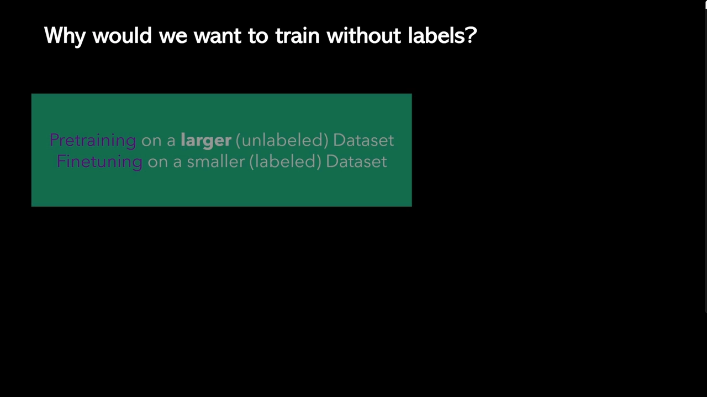
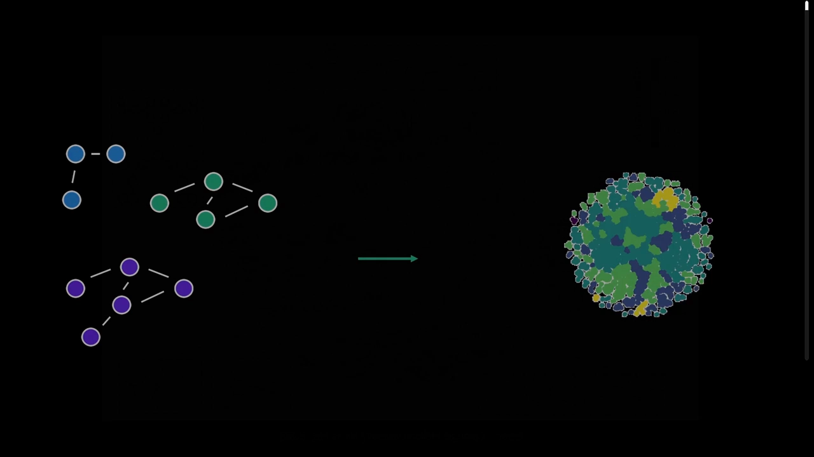
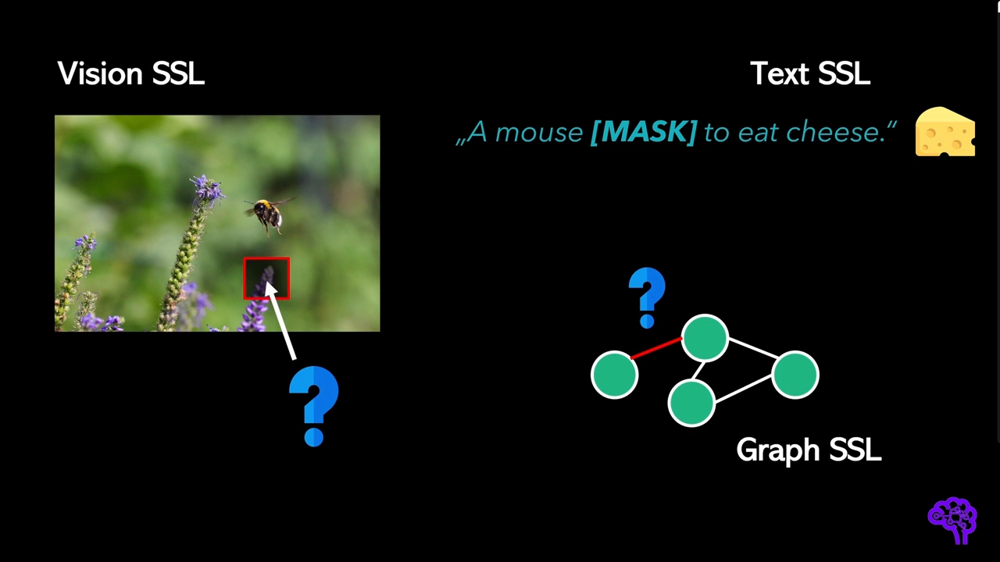
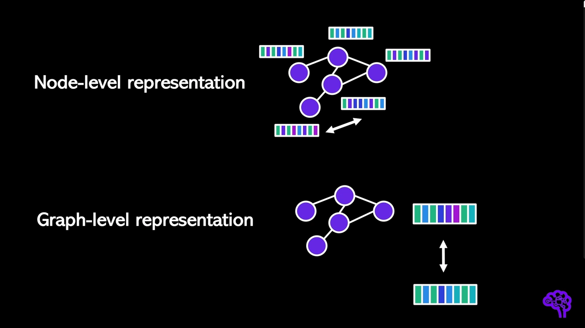
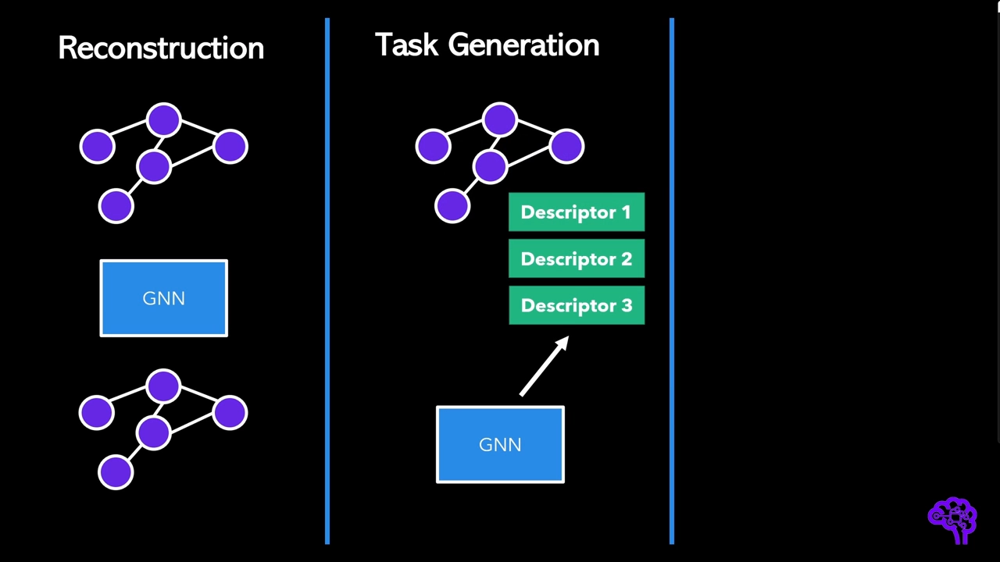
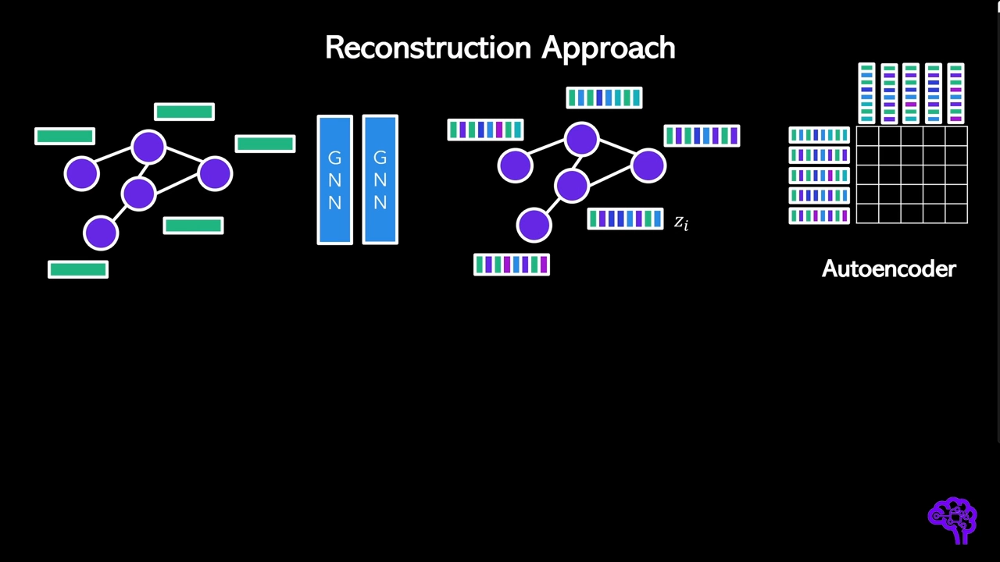
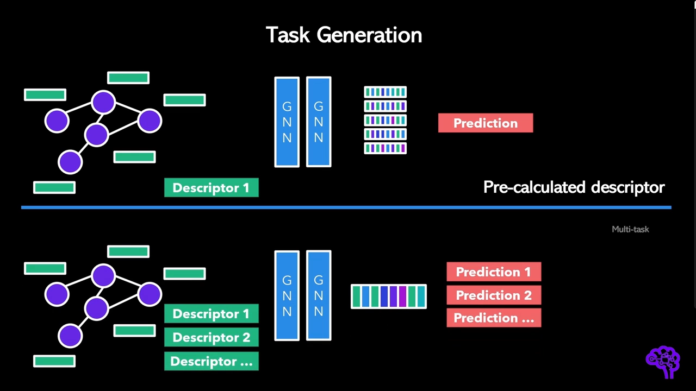
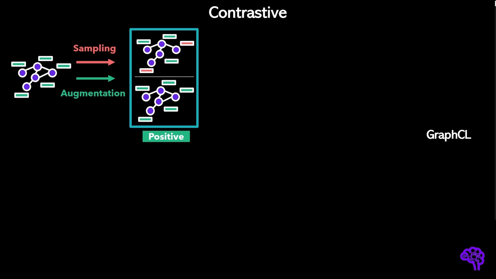
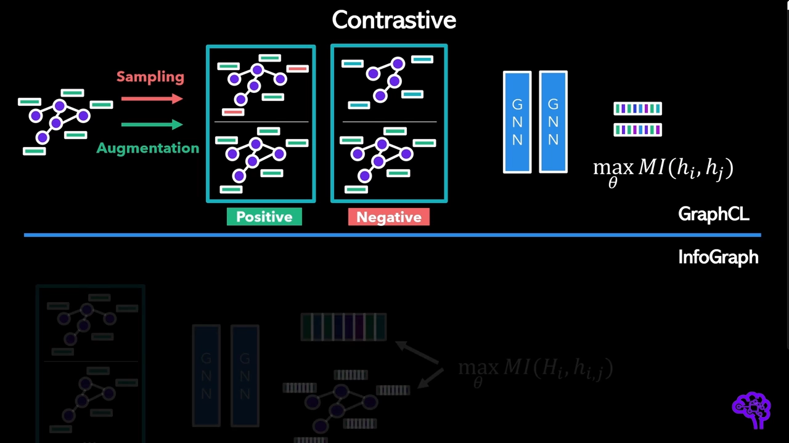

# 从掩码到对比：没有标签时，图模型如何从数据本身取监督信号

> 视频来源：[Self-/Unsupervised GNN Training](https://www.youtube.com/watch?v=3XTuhchTWd8)（YouTube · DeepFindr）｜时长约 12 分钟
> 简要导读：这支视频把图上的无监督训练整理成三类做法——重建、任务生成、对比，并反复追问一个更基础的问题：监督信号落在节点上还是整张图上。本文按这个粒度线索重排它的内容；能量、力与应力这类坐标级监督见同节[《能量是图级标签，力是它的坐标导数：监督粒度决定分子图模型能学到什么》](能量是图级标签力是它的坐标导数：监督粒度决定分子图模型能学到什么.md)。

## 本讲要解决的核心问题（SCQA）

**背景**：图神经网络通常靠标签训练——节点属于哪一类、整张图有什么性质。化学和生物数据集里，标签往往难拿或者很贵。

**冲突**：没有标签，梯度从哪里来？更麻烦的是，即使凑出了监督信号，“节点级”和“图级”这两种粒度要求的表示根本不是一回事：图级表示要和别的图区分开，节点级表示要在同一张图内部区分开。

**疑问**：无标签时，监督信号可以放在哪一层？不同粒度各自能学到什么、又各自引入什么先验？

**回答（中心思想）**：无标签训练的监督信号来自数据自身被遮住或被打乱的部分。三类做法——重建输入、预测预计算描述符、对比正负样本——分别把信号放在邻接矩阵、节点特征、整图描述符或图级嵌入上；**粒度决定了模型被逼着记住什么，也决定了它引入哪种“相似”的假设**。

## 一、没有标签时，监督信号只能从数据本身来

### 1.1 为什么要在没有标签的情况下训练

最典型的动机是迁移学习：在一个更大的无标签数据集上预训练，再在一个更小的有标签数据集上微调。讲者指出这在化学和生物数据里很常见——标签难拿或很贵，于是希望给模型看更多数据来提升下游任务的表现（[跳转到 00:28](https://www.youtube.com/watch?v=3XTuhchTWd8&t=28)）。

第二种动机是干脆不做下游任务：只是把图转换成嵌入，用来做聚类、异常检测等。这时重要的是**相似的图应该有相似的嵌入**，从而得到一个有秩序的隐空间（[跳转到 01:22](https://www.youtube.com/watch?v=3XTuhchTWd8&t=82)）。

### 1.2 一个反例：预训练不一定有用

讲者特意插了一条负面证据：有工作系统分析了分子图上的多种 GNN 预训练方法，结论是在下游任务上没有找到显著提升（[跳转到 01:01](https://www.youtube.com/watch?v=3XTuhchTWd8&t=61)）。这条提醒很重要——**无监督训练不是免费的午餐**，它引入的假设可能和下游任务需要的东西不一致。

### 1.3 自监督：把输入的一部分藏起来

主流做法是自监督学习：监督信号从数据本身获得，具体方式是预测输入中被藏起来的部分（[跳转到 02:33](https://www.youtube.com/watch?v=3XTuhchTWd8&t=153)）。图像里挖掉随机小块让模型补，文本里遮住某些词让模型填。

图上同理：去掉一些边或节点，让模型预测缺失的部分（[跳转到 02:46](https://www.youtube.com/watch?v=3XTuhchTWd8&t=166)）。注意这里已经出现了粒度的雏形——被遮住的是**边**还是**节点特征**，监督就落在不同的对象上。

## 二、节点级与图级：粒度不同，要学的东西也不同

讲者在进入具体方法前专门区分了两件事（[跳转到 04:38](https://www.youtube.com/watch?v=3XTuhchTWd8&t=278)）：

- **图级嵌入**：更重要的是把这张图和别的图区分开，所以关心的是**图间（inter-graph）**表示；
- **节点级嵌入**（包含节点与边信息）：关心的是同一张图内部的表示，即**图内（intra-graph）**表示。

这张图值得盯着看一会儿：上半部分是同一张图里多个节点各自带向量，箭头表示它们之间要互相区分；下半部分是整张图压缩成一个向量，箭头表示它要和另一张图的向量区分。**同一个编码器，被不同粒度的损失推着走，学到的表示会完全不同**。

讲者也说明，后面的方法并不严格区分这两种视角，但有些方法只适用于其中一种（[跳转到 05:08](https://www.youtube.com/watch?v=3XTuhchTWd8&t=308)）。

## 三、重建：让表示能还原输入的一部分

讲者把无标签方法归成三类：重建、任务生成、对比（[跳转到 03:24](https://www.youtube.com/watch?v=3XTuhchTWd8&t=204)）。

### 3.1 重建邻接矩阵：节点级监督

图自编码器（Kipf，2016）用两层 GNN 把图编码成每个节点的隐向量 $z_i$，解码器只是隐向量的内积，用来预测输入的邻接矩阵（[跳转到 05:29](https://www.youtube.com/watch?v=3XTuhchTWd8&t=329)）。

这是**节点级**的无监督学习：节点嵌入被优化成“能重建节点之间的连接关系”。背后的假设是，好的节点表示应该保留图结构（[跳转到 05:44](https://www.youtube.com/watch?v=3XTuhchTWd8&t=344)）。注意这里的监督对象是邻接矩阵的每个元素——也就是每一对节点。

### 3.2 属性掩码：把节点特征遮住再预测

2019 年的《Strategies for Pre-training GNNs》提出另一种重建：不重建邻接矩阵，而是恢复节点特征矩阵中被遮住的部分（[跳转到 06:10](https://www.youtube.com/watch?v=3XTuhchTWd8&t=370)）。做法很直接：把一小部分节点嵌入替换成零向量，然后在损失函数里比较预测向量和真实向量（[跳转到 06:15](https://www.youtube.com/watch?v=3XTuhchTWd8&t=375)）。

这就是标题里的“节点掩码”。它的监督粒度仍然是节点级，但监督内容从“谁和谁相连”换成了“这个节点长什么样”。模型为了填出被遮住的节点特征，必须学会利用周围节点提供的上下文信息（[跳转到 06:40](https://www.youtube.com/watch?v=3XTuhchTWd8&t=400)）。

讲者也提醒：当然可以尝试重建整张图——所有节点和所有边——但那是一个相当困难的任务，他自己在项目里也体会过（[跳转到 06:40](https://www.youtube.com/watch?v=3XTuhchTWd8&t=400)）。**监督粒度越细、覆盖越全，任务就越难**，这是重建类方法的一个内在张力。

## 四、任务生成：把预计算描述符当标签

第二类做法不重建输入，而是先算出一些图的描述量，再让模型去预测这些数（[跳转到 07:05](https://www.youtube.com/watch?v=3XTuhchTWd8&t=425)）。描述量可以在节点级，也可以在整图级：节点度、聚类系数、子结构、节点间路径长度等。损失用均方误差。

这里的粒度切换很自然：**预测节点度是节点级监督，预测整图描述符是图级监督**，同一个编码器配不同的任务头就能切换。

讲者指出一个关键弱点：描述符的选择会显著影响学到的嵌入质量（[跳转到 07:35](https://www.youtube.com/watch?v=3XTuhchTWd8&t=455)）。于是有了改进版——预测大量且多样的预计算标签，即经典的多任务预训练。

多任务让嵌入更通用。对分子来说，这些预计算标签可以包括实验室里做过的各种测量，也可以包括分子指纹（[跳转到 07:43](https://www.youtube.com/watch?v=3XTuhchTWd8&t=463)）。

讲者在这里给了一句很尖锐的评论：如果最终目的是给下游任务预训练，那这些描述符其实可以直接当特征用，所以这类方法在他看来有点冗余（[跳转到 04:16](https://www.youtube.com/watch?v=3XTuhchTWd8&t=256)）。这句话点出了“任务生成”类方法的本质——**它把人工设计的特征包装成了监督信号**，学到的东西不会超过这些特征所包含的信息。

## 五、对比：正负样本对与“相似”的先验

### 5.1 正样本来自增广，负样本来自批内采样

对比学习的想法是：把联合采样的两个视图和独立采样的视图区分开（[跳转到 08:08](https://www.youtube.com/watch?v=3XTuhchTWd8&t=488)）。GraphCL（2020）是其中一个流行框架。

正样本对由同一实例做两次增广得到。增广方式包括：把节点特征矩阵的一部分置零（属性掩码）、随机打乱属性（Deep Graph Infomax 用的做法）、删边或加边（[跳转到 08:51](https://www.youtube.com/watch?v=3XTuhchTWd8&t=531)）。

负样本对则在批内做负采样，就是数据集里两张不同的图。模型的任务是最大化相似视图之间的一致性；用数学语言说，是最大化两个嵌入之间的互信息（[跳转到 09:27](https://www.youtube.com/watch?v=3XTuhchTWd8&t=567)）。GraphCL 在损失里用余弦相似度，并说明这最大化了互信息的下界。

### 5.2 对比发生在哪一层

GraphCL 对比的是**图级**嵌入。但也可以对比**节点级**，或者两者都做——InfoGraph（2020，受 Deep InfoMax 启发）就是把整图表示和子结构表示做对比：在一个批内枚举所有节点与图的组合，让模型判断某个节点嵌入和某个图嵌入是否来自同一张图（[跳转到 10:22](https://www.youtube.com/watch?v=3XTuhchTWd8&t=622)）。

这张图把“粒度”画得很清楚：上面一行，两个视图各自汇聚成一个向量，比较的是两个向量；下面一行，一个图级向量和多个节点向量两两配对，比较的是跨层级的组合。**对比的粒度决定了模型必须让哪两个东西靠近**。

### 5.3 对比学习偷偷引入了一个先验

讲者最后强调的一点，是本节最值得记住的警告：对比学习在图上有一种隐含先验——**结构略有不同的图仍然应该得到相似的表示**（[跳转到 10:52](https://www.youtube.com/watch?v=3XTuhchTWd8&t=652)）。

直觉上这很合理，但在某些场景下是次优的。比如分子图，稍微改变结构——比如加一个原子——可能带来完全不同的行为（[跳转到 11:17](https://www.youtube.com/watch?v=3XTuhchTWd8&t=677)）。所以他认为，非常重要的是想清楚图表示应该在嵌入空间里如何对齐。

这句话可以翻译成粒度语言：对比学习用“增广后仍相似”定义了正样本，等于**用数据增广的方式规定了什么算同一个东西**。增广越强，这个先验越强；对分子这类“差一个原子就是另一个分子”的对象，这个先验可能直接是错的。

## 六、这一路方法的现状

讲者的总结很克制：图上的自监督学习仍在等待自己的突破，还没有取得 NLP 或视觉那样的成功（[跳转到 11:30](https://www.youtube.com/watch?v=3XTuhchTWd8&t=690)）。但另一方面，无监督的图训练在很多场景下是必需的，他相信未来会有更多改进。

把全篇按粒度重排一次，可以得到一张对照表：

- **重建邻接矩阵**：监督落在每对节点上，逼模型记住连接结构；
- **属性掩码**：监督落在每个节点的特征上，逼模型利用邻居上下文；
- **描述符预测**：监督落在预计算量上，粒度可节点可整图，上限由描述符决定；
- **对比**：监督落在嵌入之间的距离上，粒度可图级可节点级，先验由增广方式决定。

四种做法的共同点是：**没有真实标签，就用“数据被破坏后再恢复”或“数据之间应该相似”来造标签**。造出来的标签粒度越细，模型被约束得越具体，同时也越容易把造标签时的假设一起学进去。

## 小结

- 无标签训练的监督信号来自数据自身：遮住一部分让它补，或者规定谁和谁应该相似。
- 节点级与图级的差别是结构性的：图级表示要和别的图区分（图间），节点级表示要在图内区分（图内）。
- 重建类方法把监督放在输入的具体元素上：邻接矩阵（每对节点）或节点特征（每个节点）。
- 任务生成类方法把人工描述符当标签，多任务能提升通用性，但上限受描述符限制，甚至可以直接拿描述符当特征。
- 对比类方法把监督放在嵌入距离上，正样本由增广定义，负样本由批内采样定义；对比可以在图级、节点级或跨层级进行。
- 对比学习隐含“结构略变仍相似”的先验，对分子这类结构敏感的对象可能不成立。
- 预训练不保证提升下游性能，已有工作报告过没有显著改进的负面结果。

## 关键术语速查

| 术语 | 一句话解释 |
| --- | --- |
| 自监督学习（self-supervised） | 从数据本身造监督信号，典型做法是遮住输入的一部分再让模型预测 |
| 属性掩码（attribute masking） | 把部分节点特征置零，让模型根据邻居上下文恢复它们 |
| 图自编码器（graph autoencoder） | 编码器把节点压成隐向量，解码器用内积重建邻接矩阵 |
| 图级／节点级嵌入 | 整张图一个向量／每个节点一个向量；前者要区分图与图，后者要区分图内节点 |
| 图间／图内表示 | inter-graph 指不同图之间的差异，intra-graph 指同一张图内部的结构差异 |
| 预计算描述符 | 训练前算好的图统计量，如节点度、聚类系数、路径长度、分子指纹 |
| 多任务预训练 | 同时预测大量不同的预计算标签，让表示更通用 |
| 对比学习（contrastive） | 拉近相似样本的表示、推远不同样本的表示 |
| 正样本／负样本对 | 同一实例的两个增广视图／批内随机取的两张不同图 |
| 互信息（mutual information） | 两个表示之间共享信息的量；对比学习常被解释为最大化它的下界 |
| 数据增广（augmentation） | 对输入做保语义的变换（掩码、打乱、删边加边），用来构造正样本 |
| 隐空间对齐 | 决定哪些图在嵌入空间里应该靠近，是预训练最关键的隐含假设 |