# 能量是图级标签，力是它的坐标导数：监督粒度决定分子图模型能学到什么

> 视频来源：[ML Meets Molecular Dynamics: A Crash Course in ML Interatomic Potentials](https://www.youtube.com/watch?v=tWeBrPTrSDE)（YouTube · Atoms to Materials）｜时长约 56 分钟
> 简要导读：这支视频用“一百年势函数演化史”讲同一件事——每个模型靠什么信号被训练出来。本文按监督粒度这条主线重排全片：能量、每原子能量、力、应力四种标签各自的形状，以及它们如何反过来决定模型结构、读出方式和数据需求。节点掩码、对比学习等无标签监督见同节[《从掩码到对比：没有标签时图模型如何从数据本身取监督信号》](从掩码到对比：没有标签时图模型如何从数据本身取监督信号.md)。

## 本讲要解决的核心问题（SCQA）

**背景**：分子动力学要模拟原子逐个运动。驱动它的是一个“原子间势”：给定任意一个原子构型（每个原子的元素与三维坐标），它告诉你这个构型的能量；能量高的构型不稳定，会自发往低处走（[跳转到 02:59](https://www.youtube.com/watch?v=tWeBrPTrSDE&t=179)）。

**冲突**：同一个构型，第一性原理计算（DFT）给出的不是一个数，而是一整套数：一个总能量、每个原子三个方向的力分量、晶胞的应力张量。这些标签的“粒度”完全不同——一个是整张图一个标量，一个是每个节点一个三维向量。训练时到底把哪一个放进损失函数，直接决定模型能学到什么、必须长成什么样。

**疑问**：监督信号放在哪一层，模型就学到哪一层的信息吗？粒度更细的标签是不是一定更好？

**回答（中心思想）**：能量是图级标量，力是能量对坐标的导数，每原子能量是把图级标签拆成节点级的一种结构假设。监督粒度越细，标签数量越多、约束越强，但也越依赖“能量可加”“力来自同一个势”这类结构前提；粒度越粗，标签越省，但模型只能被约束到“整体对”，学不到局部细节。

## 一、监督信号决定模型学到什么：从“专家写公式”到“数据给答案”

### 1.1 势函数是整条链的入口

分子动力学模拟的核心不是积分器，而是原子间势。它回答的问题是：给定一个原子构型——比如一根完整的金纳米线和一根中间被拉出细桥的金纳米线——这个构型的能量是多少（[跳转到 03:04](https://www.youtube.com/watch?v=tWeBrPTrSDE&t=184)）。能量决定了原子往哪里走，所以“能量准不准”就是整条模拟链准不准。

视频开头用几段模拟说明这条链能做什么（[跳转到 00:58](https://www.youtube.com/watch?v=tWeBrPTrSDE&t=58)）：金纳米线被拉伸、拉出细桥再断裂；铜镍钎焊时铜原子在不同温度下向镍的缝隙扩散、界面互相扩散；微陨石撞击矿物造成大量断键与脱羟基；多肽与有机分子的杂化材料随温度改变构型并自组装；铁表面催化裂解氮气，电荷转移可以从铁原子的颜色看出来。这些场景全部依赖同一个量——构型能量。

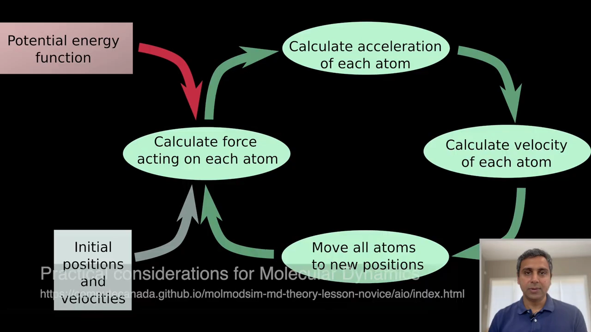

这张循环图说明了“能量”这个标签为什么处在中心位置：它每一轮都要被求导一次，才能推动原子移动。

模拟技术按精度和代价排成一条阶梯：DFT 求解电子与原子行为的方程，最准但只能算很少的原子；分子动力学能到微米尺度但精度不如 DFT；相场、有限元能算宏观物体但已经不看单个原子了（[跳转到 04:14](https://www.youtube.com/watch?v=tWeBrPTrSDE&t=254)）。机器学习势的目标就一句话：**和 DFT 一样准，和经典分子动力学一样便宜**（[跳转到 05:32](https://www.youtube.com/watch?v=tWeBrPTrSDE&t=332)）。

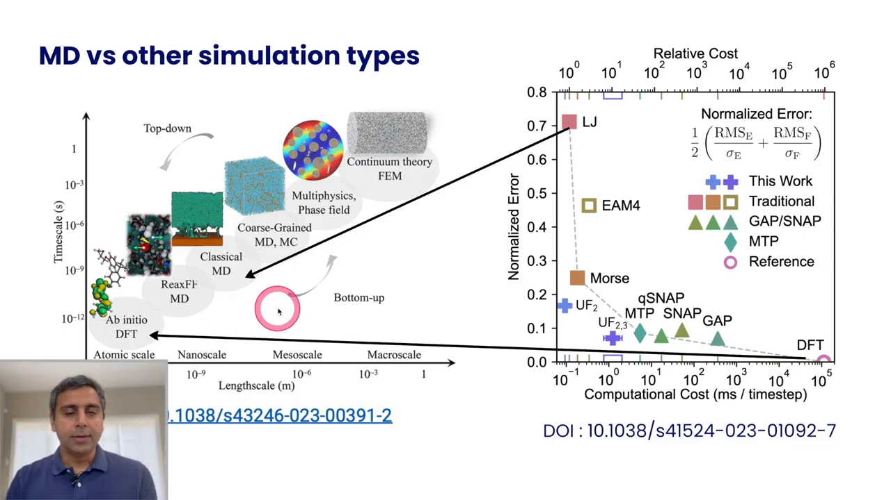

右图是本节反复要用的坐标轴：横轴是计算代价，纵轴是归一化误差，误差的定义就是能量误差与力误差的加权——$\frac{1}{2}\left(\mathrm{RMSE}_E/\sigma_E + \mathrm{RMSE}_F/\sigma_F\right)$。这张图已经预告了本节的主题：**评价一个势，从来不是只看能量**。

### 1.2 经典势：参数靠专家，不靠数据

最早的一批势函数里没有学习。Lennard-Jones 势（1924）把能量写成两个原子距离的函数：

$$
v(r) = 4\varepsilon\left[\left(\frac{\sigma}{r}\right)^{12} - \left(\frac{\sigma}{r}\right)^{6}\right]
$$

可调的只有两个参数：$\varepsilon$ 控制吸引的深度，$\sigma$ 控制能量为零的距离（[跳转到 07:18](https://www.youtube.com/watch?v=tWeBrPTrSDE&t=438)）。总能量是所有相互作用原子对的能量求和，力则是对这个函数取负导数（[跳转到 07:23](https://www.youtube.com/watch?v=tWeBrPTrSDE&t=443)）。

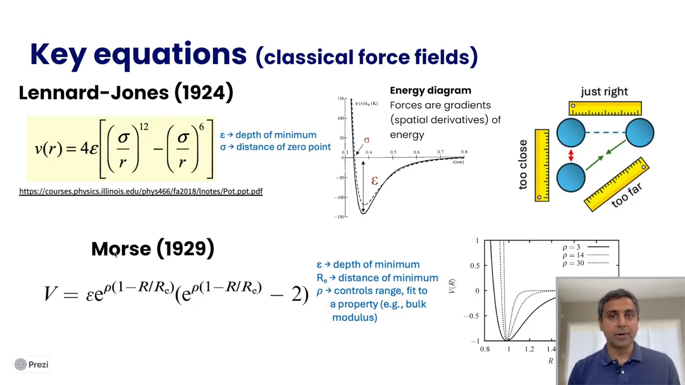

这张图把本节最关键的一条关系写在标题里：**力是能量的空间导数**。距离正好时曲线在最低点，导数为零，原子不受力；太近时导数很陡，把原子推开；太远时导数反向，把原子拉近。

Morse 势（1929）多了一个 $\rho$ 参数控制势阱的陡峭程度，于是能拟合体模量这类性质（[跳转到 09:03](https://www.youtube.com/watch?v=tWeBrPTrSDE&t=543)）。但参数再多也没用：没有多体效应——两个原子之间的势被第三个原子改变——就永远到不了真实精度（[跳转到 10:24](https://www.youtube.com/watch?v=tWeBrPTrSDE&t=624)）。Stillinger-Weber 势加了三体项，用键角 $\theta_{jk}$ 让硅自发形成 109.5° 的四面体结构（[跳转到 11:51](https://www.youtube.com/watch?v=tWeBrPTrSDE&t=711)）；嵌入原子方法（EAM）则把邻居的“电子密度”求和后非线性地修正原子能量（[跳转到 13:11](https://www.youtube.com/watch?v=tWeBrPTrSDE&t=791)）。

这些模型的共同点是：**监督信号为零**。函数形式、参数、物理直觉全部由人提供，数据不参与。它们能很便宜，但每一个新体系都要重新调参。

## 二、能量是整图的标量：一个构型一个标签

### 2.1 早期神经网络换掉的是“函数形式”，不是标签

第一次真正的转变发生在早期神经网络：把 Lennard-Jones、Stillinger-Weber 那样写死的解析式，换成一个从数据里学出来的模型（[跳转到 16:34](https://www.youtube.com/watch?v=tWeBrPTrSDE&t=994)）。讲者把代价说得很直白：你不再需要对参数和函数形式有那么多专家直觉，**但你需要一个非常好的训练数据集**——通常来自 DFT，包含大量构型以及它们的能量（[跳转到 16:39](https://www.youtube.com/watch?v=tWeBrPTrSDE&t=999)）。

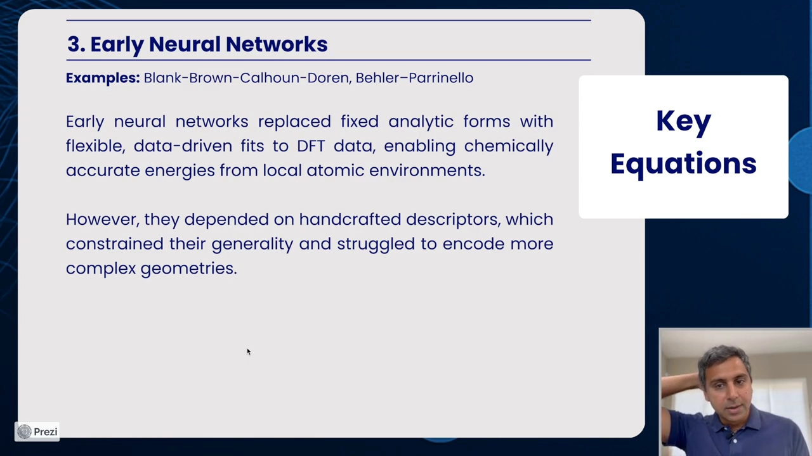

换句话说，监督信号从“人的先验”换成了“DFT 的数值”。标签的形状没变：仍然是一个构型一个总能量。

### 2.2 Behler-Parrinello：一个构型一个 $E$，但内部先拆成每原子能量

2007 年的 Behler-Parrinello 网络是这条线的样板。输入是每个原子的坐标 $R$，第一步把它们换成描述符 $G$——描述局域环境的量，比如有几个邻居、邻居在什么角度上（[跳转到 17:59](https://www.youtube.com/watch?v=tWeBrPTrSDE&t=1079)）。讲者解释了为什么必须换：原子的绝对 XYZ 坐标对能量几乎没有意义，真正决定能量的是它周围的邻居排布（[跳转到 18:24](https://www.youtube.com/watch?v=tWeBrPTrSDE&t=1104)）。

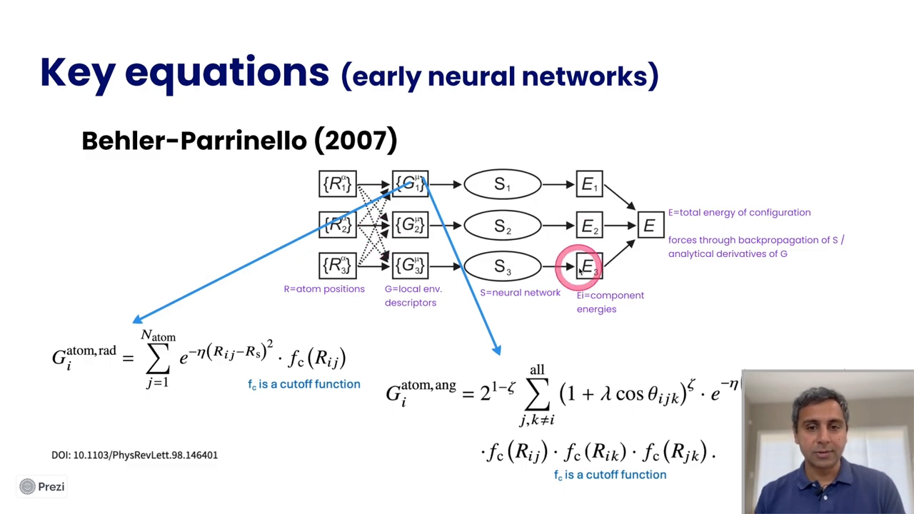

注意图右侧那行小字：$E$ 是构型总能量，$E_i$ 是“分量能量”，而力是通过对 $S$ 反向传播、或对 $G$ 解析求导得到的。这张图里同时出现了三种粒度：

- **每原子能量 $E_i$**：节点级标签，但 DFT 并不直接给这个数；
- **总能量 $E = \sum_i E_i$**：图级标签，DFT 直接给；
- **力**：对坐标的导数，每个原子三个分量。

流程是：对每个原子描述局域环境，让网络预测它的分量能量，再把所有原子的能量加起来得到构型总能量（[跳转到 19:14](https://www.youtube.com/watch?v=tWeBrPTrSDE&t=1154)）。这就是本节要强调的第一个结构性选择：**图级标签被“求和读出”拆成了节点级监督**。求和这个操作不是装饰，它保证了“把一个原子挪到远处不改变另一个原子的能量”这种可加性，也让模型天然对原子数外推。

代价是：$E_i$ 本身没有标签。网络只能通过总和 $E$ 被间接约束，同一个总能量可以由无穷多种 $E_i$ 分配方式凑出来。这是“用粗标签监督细表示”的典型代价。

## 三、力：一个构型 3N 个标签，比能量细得多

### 3.1 为什么不能只要能量

讲者在这里给了一句关键提醒：**你不只想要能量，你还想要力**（[跳转到 19:39](https://www.youtube.com/watch?v=tWeBrPTrSDE&t=1179)）。在经典势里，力是对解析式求导得到的；在神经网络里没有解析式可导，于是改用反向传播与自动微分：把“坐标变化如何改变能量”算出来，取导数就得到力（[跳转到 20:04](https://www.youtube.com/watch?v=tWeBrPTrSDE&t=1204)）。

$$
\mathbf{F}_i = -\frac{\partial E}{\partial \mathbf{r}_i}
$$

这里有一个容易被忽略的推论：**力标签不是独立的标签**。只要模型以“先算标量能量、再求导得力”的方式构造，力和能量就共享同一组参数，物理上自动一致。反过来，如果直接回归力向量，就失去了这层约束。

### 3.2 标签数量的量级差

一个含 $N$ 个原子的构型，能量标签是 1 个标量，力标签是 $3N$ 个分量。这个差距在实际数据集里非常直观：M3GNet 的训练集包含超过 6 万个化合物、超过 18.7 万个能量与应力张量、超过 1600 万个力（[跳转到 47:43](https://www.youtube.com/watch?v=tWeBrPTrSDE&t=2863)）。

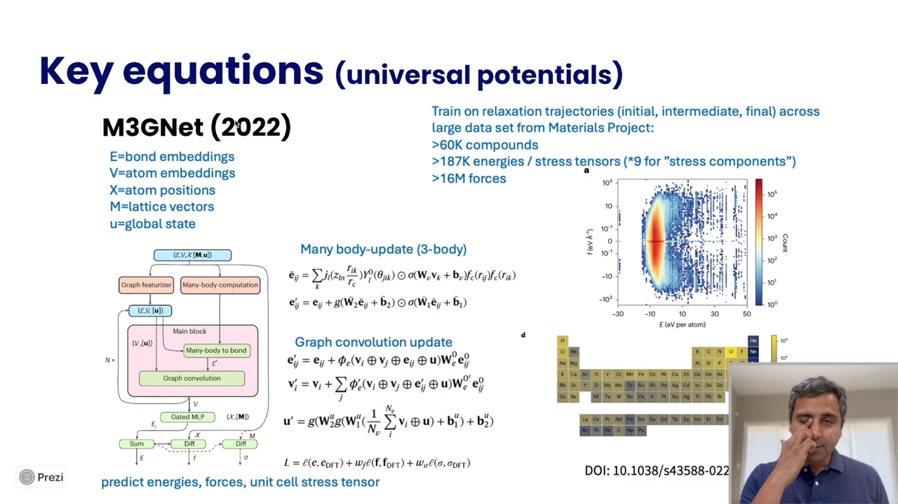

同一张幻灯片右下角写着损失函数：

$$
L = \ell(E, E_{\text{DFT}}) + w_f\,\ell(F, F_{\text{DFT}}) + w_\sigma\,\ell(\sigma, \sigma_{\text{DFT}})
$$

三项分别对应三种粒度：图级标量、每原子向量、图级张量。$w_f$、$w_\sigma$ 是两个权重，说明**不同粒度的标签在损失里是要配比的**——它们量纲不同、数量差几个数量级，不能简单相加。

## 四、每原子能量：把图级标签拆成节点级

### 4.1 可加性是一个假设，不是事实

前面说 $E = \sum_i E_i$，这句话在数学上永远成立（你总可以随便分配），但在物理上是一个**建模假设**：能量可以分解成局域贡献之和。它成立时好处极大——模型可以对任意原子数外推，训练时每个原子都能得到梯度信号；它不成立时（长程静电、集体电子效应），误差就被硬塞进局域项里。

讲者对这一点有明确批评：所有这些“只看局域环境”的方法有一个共同缺点，每个原子的能量只由它的近邻决定，长程效应被塞进局域相互作用里（[跳转到 30:24](https://www.youtube.com/watch?v=tWeBrPTrSDE&t=1824)）。这正是后来引入图神经网络与消息传递的动机。

### 4.2 从手工描述符到消息传递

GAP（2010）把局域环境写成一个三维“邻居密度”热图，再投影到超球谐函数、组合成双谱系数，得到旋转不变的描述；最后用高斯过程回归从双谱系数预测能量（[跳转到 24:32](https://www.youtube.com/watch?v=tWeBrPTrSDE&t=1472)）。

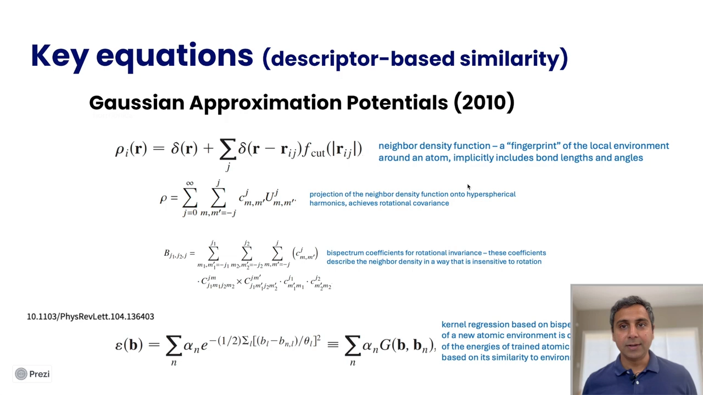

注意这张图里没有任何“力”的项：GAP 的监督仍然是能量，力同样是从能量导出的。而高斯过程还有一个副产品——只要看新构型的双谱系数离训练集有多远，就能估计预测的不确定度（[跳转到 29:39](https://www.youtube.com/watch?v=tWeBrPTrSDE&t=1779)）。这是“标签缺失处如何知道自己不知道”的一种回答。

CGCNN（2018）把晶体建成图：原子是节点，键是边，节点的初始特征是元素属性（族号、周期号、电负性等），边的特征是键长相对若干设定点的位置（[跳转到 32:02](https://www.youtube.com/watch?v=tWeBrPTrSDE&t=1922)）。然后做多轮消息传递更新节点表示，最后用一个网络从更新后的表示预测总能量（[跳转到 34:32](https://www.youtube.com/watch?v=tWeBrPTrSDE&t=2072)）。

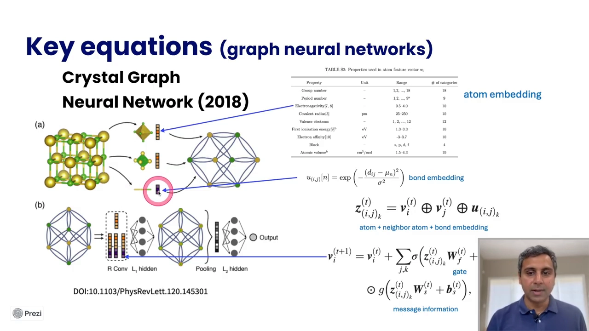

这里监督粒度与读出的配合非常清楚：**标签是图级的，所以读出必须是“把所有节点表示汇聚成一个图表示再回归”**；节点表示本身没有标签，它只是被图级损失间接塑造。多轮消息传递扩大感受野（[跳转到 36:57](https://www.youtube.com/watch?v=tWeBrPTrSDE&t=2217)），本质上是让这个图级标量能依赖更大的子图。

## 五、粒度更细的表示，需要更细的标签来支撑

### 5.1 等变特征与力的方向性

不变图网络的特征全是标量，旋转系统时嵌入不变。研究者认为这限制了表达力：如果允许向量、张量特征参与消息传递，就能表达方向信息（[跳转到 38:37](https://www.youtube.com/watch?v=tWeBrPTrSDE&t=2317)）。讲者给的理由直接和标签挂钩：**力是有方向的量**，所以等变模型有时能得到更好的力（[跳转到 39:54](https://www.youtube.com/watch?v=tWeBrPTrSDE&t=2394)）。

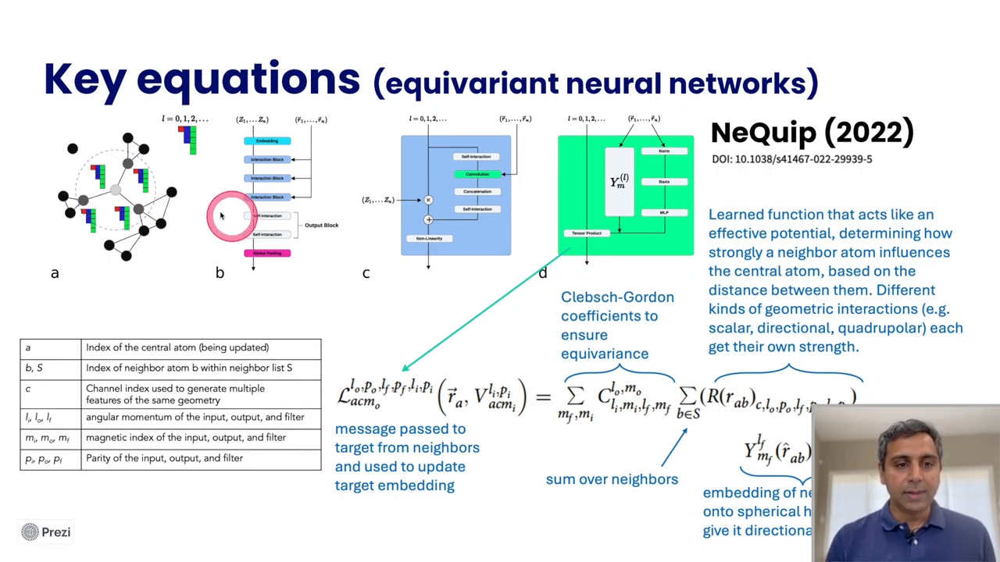

这张图的技术细节属于等变网络那一节，此处只需记住结论：等变模型更**数据高效**——用更少的训练点就能学到相互作用，同样数据量下精度更高；代价是张量积计算量大（[跳转到 44:56](https://www.youtube.com/watch?v=tWeBrPTrSDE&t=2696)）。讲者也留了一个开放问题：等变网络到底值不值，还是普通不变网络够用就好（[跳转到 45:26](https://www.youtube.com/watch?v=tWeBrPTrSDE&t=2726)）。

### 5.2 应力的加入：对晶胞向量求导

M3GNet（2022）在能量和力之外再加一种标签：晶胞应力。做法是把能量不只对原子坐标求导（得到力），还对晶胞的晶格向量求导（[跳转到 49:23](https://www.youtube.com/watch?v=tWeBrPTrSDE&t=2963)）。于是晶胞本身也能在模拟中演化。

这是“监督粒度”讨论的一个漂亮收尾：**同一个标量能量，对不同自变量求导，就得到不同粒度的标签**。对坐标求导是每原子三维向量，对晶胞向量求导是图级张量。标签的形状不是数据自带的，而是由“你对什么求导”定义的。

## 六、标签的代价：数据效率、误差度量与外推

### 6.1 每个体系训一个 vs 训一次用所有

在 M3GNet 之前，所有方法的共同哲学是：先针对你关心的体系生成一个大的 DFT 数据集，训练，再跑模拟（[跳转到 46:05](https://www.youtube.com/watch?v=tWeBrPTrSDE&t=2765)）。通用势想改掉这件事：在非常广的化学与结构多样性上训练一次，之后开箱即用，不必重训，也不必自己跑 DFT（[跳转到 47:00](https://www.youtube.com/watch?v=tWeBrPTrSDE&t=2820)）。

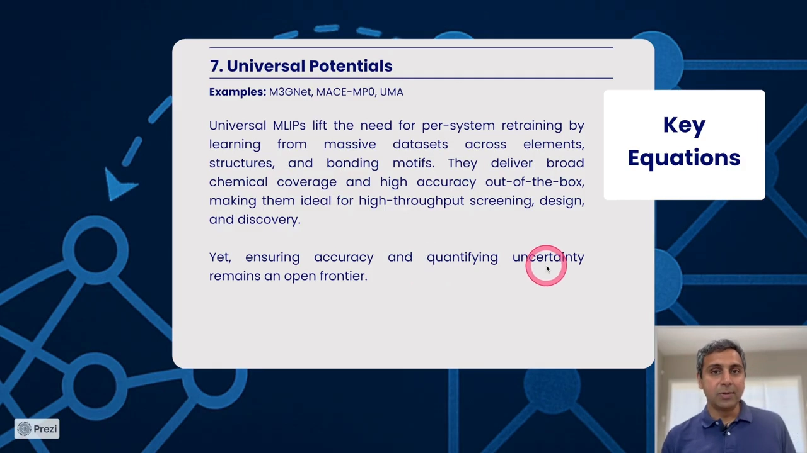

### 6.2 标签缺失与标签不可信

讲者对通用势的警告值得单独记下：如果你的新化合物和训练集里的任何东西都不像，就应该警惕（[跳转到 48:08](https://www.youtube.com/watch?v=tWeBrPTrSDE&t=2888)）。更根本的问题是**你不知道自己什么时候不准**——很难判断什么时候可以直接用通用模型，什么时候必须补算数据（[跳转到 51:28](https://www.youtube.com/watch?v=tWeBrPTrSDE&t=3088)）。

于是出现了两条路线（[跳转到 54:00](https://www.youtube.com/watch?v=tWeBrPTrSDE&t=3240)）：

1. **把一切塞进一个模型**：给足够多不同材料类别的例子，让权重里包含足够信息；Meta 的通用原子模型还用混合专家按体系动态组合。
2. **让模型知道自己不知道**：用不确定性量化判断当前构型是否可信，不可信就触发 DFT 计算、生成新训练数据，再继续算。

两条路线对应两种对“标签缺失”的处理：前者用覆盖度硬扛，后者用不确定性主动补标签。

### 6.3 误差要分粒度报告

回到那张误差—代价图：归一化误差把能量项和力项各除以自己的标准差再平均。这提醒我们，**能量误差和力误差不是同一个量**，不能只报总能量误差就说力场好用。力的误差按分量算，能量的误差按构型算，两者的分母、量级、对下游模拟的影响都不同。

## 七、标签的边界：还能监督什么

讲者最后给出两个方向（[跳转到 52:12](https://www.youtube.com/watch?v=tWeBrPTrSDE&t=3132)）。

第一个是通用模型继续扩张：不只晶体和固体，还要覆盖分子、材料与分子的界面、有机与无机的界面，全部高速高精度地建模。

第二个是**电子结构感知的模型**。目前的势只给能量和力，但很多材料性质取决于电子在做什么：催化里有没有电荷转移、态密度有没有变化、能带结构有没有移动从而改变导电性（[跳转到 54:47](https://www.youtube.com/watch?v=tWeBrPTrSDE&t=3287)）。于是有人开始不只训练能量和力，还训练态密度这类电子结构量（[跳转到 55:18](https://www.youtube.com/watch?v=tWeBrPTrSDE&t=3318)）。

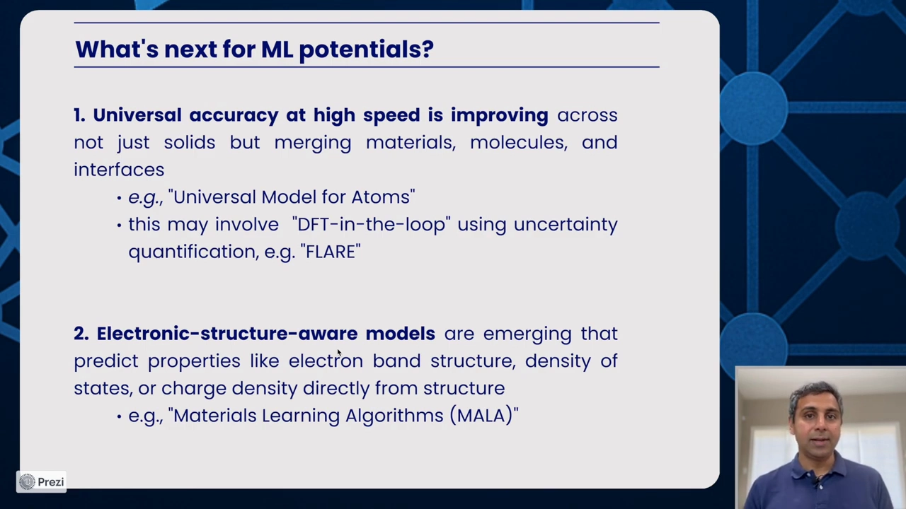

这条线索把监督粒度的讨论推到极限：如果标签从“一个构型一个能量”变成“一个构型一条态密度曲线”，模型能学到的信息就不再是几何的，而是电子的。

## 小结

- **标签形状由“对什么求导”定义**：能量是图级标量；力是能量对每个原子坐标的导数，一个构型 $3N$ 个分量；应力是能量对晶胞向量的导数，图级张量。
- **每原子能量是节点级监督，但它是构造出来的**：$E=\sum_i E_i$ 让图级标签能训练节点表示，代价是 $E_i$ 本身无标签、可加性只是假设。
- **粒度决定读出**：图级标签要求把所有节点汇聚成一个图表示再回归；节点级标签才能直接约束节点表示。
- **粒度决定标签数量与配比**：能量与力在损失里必须加权，因为量级与数量差几个数量级；M3GNet 的 18.7 万能量对应 1600 万力。
- **粒度越细，结构约束越强**：由能量导出的力与能量天然一致；直接回归力就放弃了这个约束。
- **标签缺失要用覆盖度或不确定性来兜**：GAP 用与训练集的距离估计不确定度，通用势用数据广度换开箱精度，两条路线都承认“不知道自己不知道”是主要风险。
- **评价要分粒度**：能量误差与力误差是两种误差，不能互相替代。

## 关键术语速查

| 术语 | 一句话解释 |
| --- | --- |
| 原子间势（interatomic potential） | 输入一个原子构型，输出该构型能量的函数；分子动力学靠它对坐标求导得到力 |
| DFT（密度泛函理论） | 求解电子与原子行为的第一性原理方法，精度高、代价大，是机器学习势的标签来源 |
| 图级标签 | 整张图一个数，例如一个构型的总能量、一个分子的性质 |
| 节点级标签 | 每个节点一个数或向量，例如每原子能量、每个原子的力 |
| 分量能量 $E_i$ | 模型内部给每个原子算的能量，求和后等于构型总能量；DFT 不直接提供它 |
| 自动微分（autodiff） | 由程序自动算出“输出对输入”的导数；这里用来从能量得到力 |
| 描述符（descriptor） | 把原子坐标换成对能量更有意义的局域环境量，如邻居距离分布、键角分布 |
| 双谱系数（bispectrum） | GAP 用来描述局域环境的旋转不变特征 |
| 消息传递（message passing） | 节点反复从邻居收集信息更新自身表示，层数决定感受野大小 |
| 等变（equivariant） | 输入旋转时，向量、张量特征按规则一起旋转，而不是保持不变 |
| 应力张量 | 能量对晶胞形变的导数，描述晶胞受力状态 |
| 不确定性量化 | 让模型给出“这个预测可信吗”的估计，用于决定是否补算 DFT |