# 链接预测的分数来自节点对：读出、负采样与切分共同决定边级评价

> 视频来源：[GNN-16.异构图上的连接预测](https://www.bilibili.com/video/BV17x4y1Q7Jx/)（B 站 · 下山-1227）｜时长约 39 分钟
> 本文接着[《第01讲：课程简介》](第01讲_课程简介.md)的任务定义往下走：那一篇讲“节点级、边级、图级任务各自是什么”，这一篇只讲边级任务的读出与评价——一条边怎样从两个节点向量算出一个分数，负采样怎样把候选集放大，按边切分怎样避免泄漏，以及标签粒度怎样改变评价的分母。

## 本讲要解决的核心问题（SCQA）

**背景**：图神经网络最后输出的是每个节点的向量。做节点分类时，拿一个节点的向量接一个分类器就能得到类别；这件事很直观。

**冲突**：链接预测问的却是“某条边是否存在”，模型并没有现成的“边向量”。更麻烦的是，一张图里真正存在的边只有十万条量级，而可能的节点对远多于此；如果只拿正样本算分，模型只要一律输出“有边”就能得高分。读出方式、负样本和切分方式任何一处变了，同一个模型的分数都会变。

**疑问**：一条边到底怎样从两个节点向量读出来？边级标签怎样计分、分母是什么？为什么换一种标签粒度，评价指标和切分单位就不能照搬？

**回答（中心思想）**：边预测是在节点对上做二分类。读出层把一对节点表示变成一个分数（这支视频用点积）；负采样造出负类，把评价的样本单位从“边”变成“节点对”；按边切分并把消息传递边与监督边分开，决定模型能不能提前看到答案；而标签粒度决定一个样本是什么、分母是什么、切分按什么单位做。三者一起，才决定一个边级分数到底意味着什么。

---

## 一、链接预测不是给边分类，而是给节点对打分

**结论：边本身没有独立特征，边级任务的实例是一对节点；标签只有“有边/无边”两种。**

这支视频用的是一个 user—movie 异构图：左边节点类型是 user，右边节点类型是 movie，边表示某个用户看过某部电影。任务不是预测评分，而是预测两个节点之间是否存在边。标签只有 1 和 0：1 表示有边，0 表示没有边。[【跳转到 00:50】](https://www.bilibili.com/video/BV17x4y1Q7Jx/?t=50)

这一点和上一讲的数据集形成对照。上一讲给的是电影评分，那是一个链接回归问题，要预测标签的具体数值；这一讲不做回归，只测“有没有边”，所以是链接预测，也就是边级二分类。[【跳转到 01:15】](https://www.bilibili.com/video/BV17x4y1Q7Jx/?t=75)

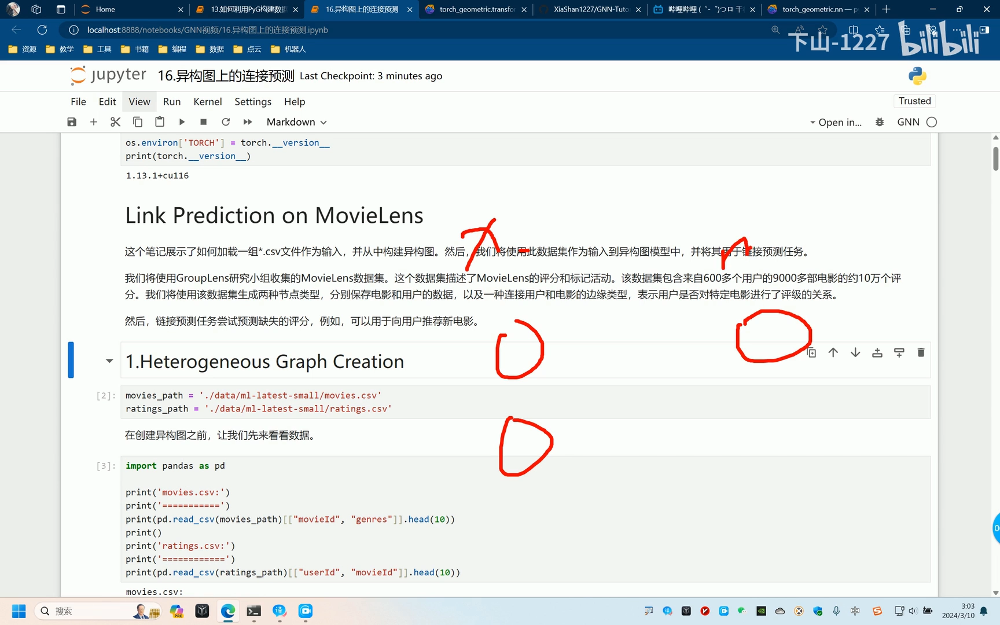

这里先把三个词说清楚：

- **异构图（heterogeneous graph）**：节点或边不止一种类型。这里 user 和 movie 是两种节点，user→movie 是一种边。
- **链接预测（link prediction）**：给定当前图，判断两个节点之间是否应当存在边；推荐系统里就是判断“这个用户会不会看这部电影”。
- **二分类（binary classification）**：输出只有两类，有边记 1、无边记 0。它和节点分类的区别不在损失函数，而在“一个样本是什么”。

数据以 HeteroData 的形式存储：user 有节点索引，movie 有 node_id 和 20 维特征；整张图共有 100836 条评分边，来自 610 个用户和 9742 部电影。[【跳转到 02:30】](https://www.bilibili.com/video/BV17x4y1Q7Jx/?t=150)

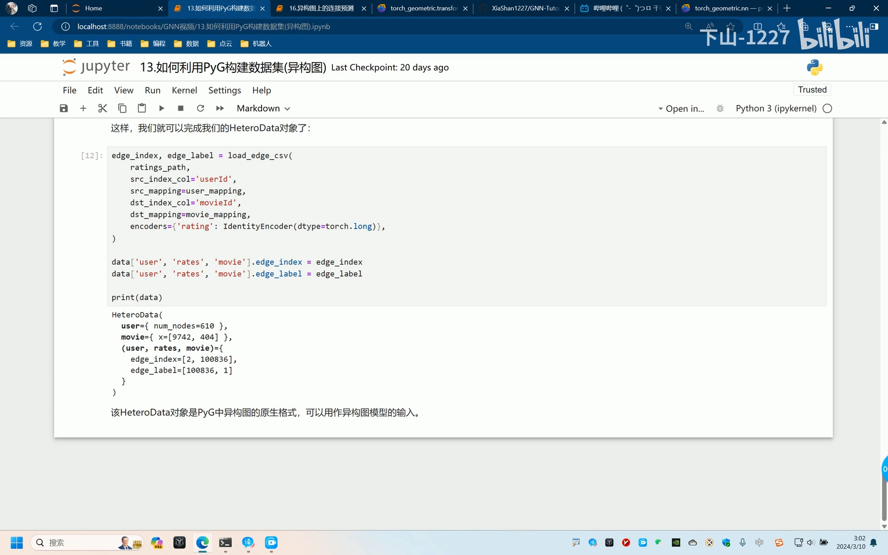

这张图里最值得注意的是 `edge_label` 的形状：它和 `edge_index` 一样按“边”计数。也就是说，边级任务的标签天然落在节点对上，而不是落在单个节点上。后面所有关于分母、负采样和切分的讨论，都是从这一点长出来的。

---

## 二、先有节点嵌入，再有边表示：读出层决定节点对怎么打分

**结论：边预测的读出分两步——图网络先算出节点嵌入，再用一个解码器把一对节点嵌入变成一个分数。**

模型的 forward 流程可以拆成三段：

1. 对 user 和 movie 分别做 embedding，把不同来源的特征映射到同一通道数；
2. 用一个同构的 SAGE 模型做消息传递，再通过 `to_hetero` 把它转换成异构图模型；
3. 取出每条待预测边的源节点和目标节点嵌入，交给分类器读出分数。

视频里反复强调顺序：**先做节点嵌入，做完节点嵌入之后才做边嵌入**。[【跳转到 30:41】](https://www.bilibili.com/video/BV17x4y1Q7Jx/?t=1841)

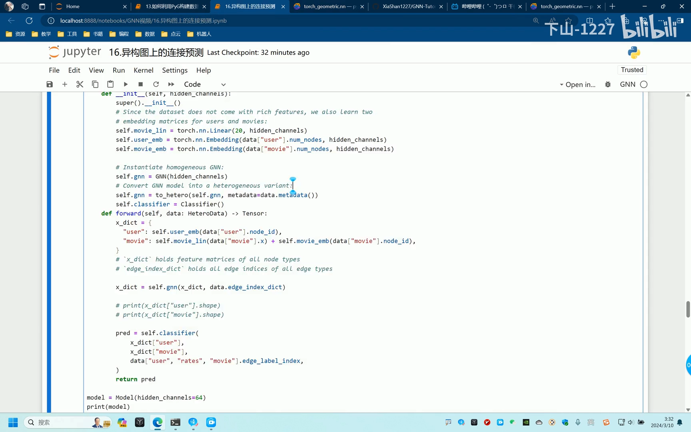

`to_hetero` 的作用是把一个同构图模型复制成按关系分别传递的异构图模型。它接收原模型和 `metadata`，对每一种边类型复制一份消息传递实例；每一层的消息传递写成按关系聚合的形式：

$$
h_v^{(\ell)} = \bigoplus_{r \in \mathcal{R}} f_\theta^{(\ell,r)} \left( h_v^{(\ell-1)}, \{ h_w^{(\ell-1)} : w \in \mathcal{N}^{(r)}(v) \} \right)
$$

其中 $\mathcal{R}$ 是关系（边类型）集合，$\mathcal{N}^{(r)}(v)$ 是节点 $v$ 在第 $r$ 种关系下的邻居，$\bigoplus$ 表示把不同关系的结果聚合起来。[【跳转到 27:16】](https://www.bilibili.com/video/BV17x4y1Q7Jx/?t=1636)

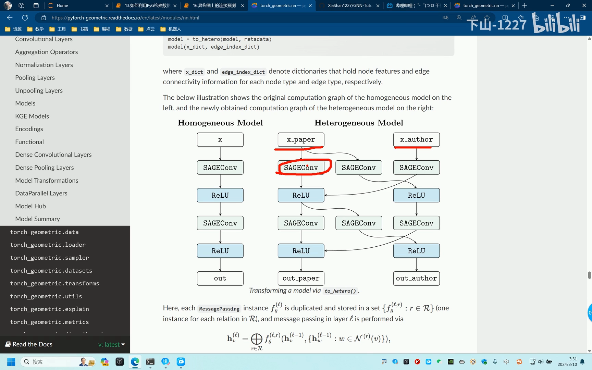

真正做读出的是最后这个 `Classifier`。它接收 user 侧的全部节点嵌入、movie 侧的全部节点嵌入，以及待预测边的 `edge_label_index`；`edge_label_index` 的第 0 行是源节点下标，第 1 行是目标节点下标。取出对应的两个向量后，逐维相乘再求和：

$$
s(u,v) = \sum_{d=1}^{D} h_u[d] \, h_v[d]
$$

这个 $s(u,v)$ 就是这条边的原始分数（logit）。分数越高，模型越认为这两个节点之间应当有边。[【跳转到 32:31】](https://www.bilibili.com/video/BV17x4y1Q7Jx/?t=1951)

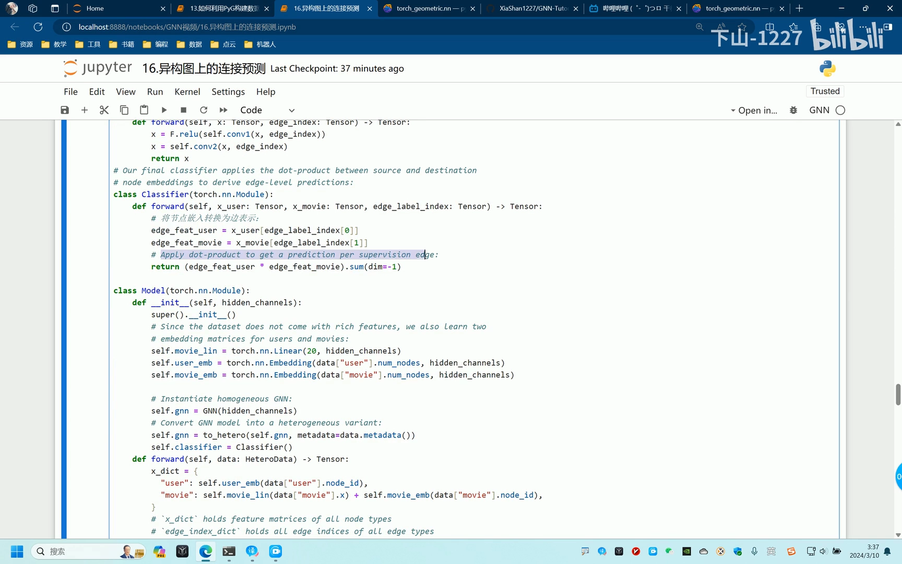

把这一步抽象出来，就是边级任务的**解码器（decoder）**：它把一对节点表示映射成一个标量分数。点积是最简单的一种，它要求两个向量在同一维度上对齐，分数高表示两个方向一致。视频选的是点积，所以读出层没有额外参数；如果任务需要更复杂的交互，也可以把两个节点表示拼接后送入一个可学习的小网络（如 MLP），但那已经超出这支视频的实现范围。无论用哪种解码器，位置是一样的：**节点嵌入负责“每个节点是什么”，解码器负责“这一对节点合起来像不像一条边”**。

---

## 三、边级标签的样本单位是节点对

**结论：节点级任务一个节点一个标签，图级任务一张图一个标签，边级任务一个节点对一个标签；样本单位变了，评价的分母就变了。**

在训练集里，`edge_label` 存的是每条监督边的标签，一共 24201 个；`edge_label_index` 则存这些边对应的源、目标节点下标。[【跳转到 10:21】](https://www.bilibili.com/video/BV17x4y1Q7Jx/?t=621)

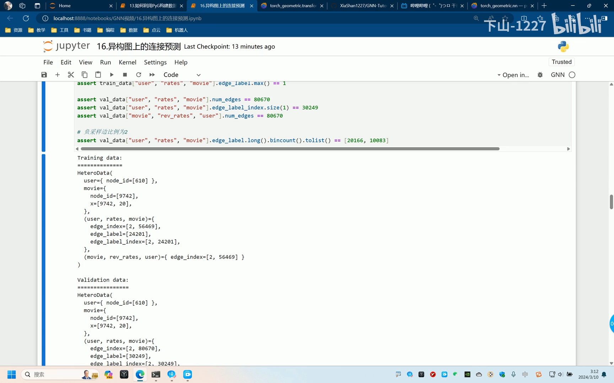

这里已经出现了两套“边”：

- **消息传递边**：参与图卷积，决定节点嵌入长什么样；
- **监督边**：只提供标签，决定模型被往哪个方向推。

同一个节点对，在消息传递里出现一次，在监督里又出现一次，就会造成后面要讲的泄漏。先把这一点记住：边级任务的“样本”不是图里天然存在的边，而是**被选为监督对象的节点对**。

把三种粒度并排放，差别就很清楚：

| 标签粒度 | 一个样本是什么 | 标签落在哪里 | 评价的分母 |
| :--- | :--- | :--- | :--- |
| 节点级 | 一个节点 | 每个节点一个类别或数值 | 被评价的节点数 |
| 边级 | 一对节点 | 每个节点对一个 0/1 标签 | 被评价的节点对数（含负采样） |
| 图级 | 一整张图 | 每张图一个类别或数值 | 被评价的图数 |

这张表不是视频里直接给出的，而是把视频的边级做法放回三种粒度中对照。视频在结尾也明确说：节点层面、边层面、图层面的预测“很多东西都是相通的”，节点嵌入、边嵌入、图表示之间都存在特征转换，不是割裂的。[【跳转到 37:54】](https://www.bilibili.com/video/BV17x4y1Q7Jx/?t=2274) 相通的是表示，不同的是样本单位和分母；把这两件事混在一起，就会拿节点级的直觉去读边级的分数。

---

## 四、负采样把候选集从 10083 条正边扩成 30249 个节点对

**结论：边级评价的分母不是原图的边数，而是“正样本 + 负样本”的候选节点对数；负采样比例直接改变这个分母。**

链接预测天然缺少负样本：图里存下来的边都是正样本，没有“这条边不存在”的记录。视频的做法是随机挑一些本来没有连接的节点对，把它们连起来，标签记为 0，作为负样本。[【跳转到 06:30】](https://www.bilibili.com/video/BV17x4y1Q7Jx/?t=390)

负采样率设为 2，意思是负样本边与正样本边的比例是 2 比 1。[【跳转到 05:15】](https://www.bilibili.com/video/BV17x4y1Q7Jx/?t=315) 到了验证集，这个比例会直接体现在数字上：

- 验证集正样本：$100836 \times 0.1 \approx 10083$ 条边；
- 负采样率 2：负样本约 $10083 \times 2 = 20166$ 条；
- 候选节点对总数：$10083 \times 3 = 30249$ 个。

所以验证集的 `edge_label` 长度是 30249，`edge_label_index` 是 $2 \times 30249$。[【跳转到 12:51】](https://www.bilibili.com/video/BV17x4y1Q7Jx/?t=771)

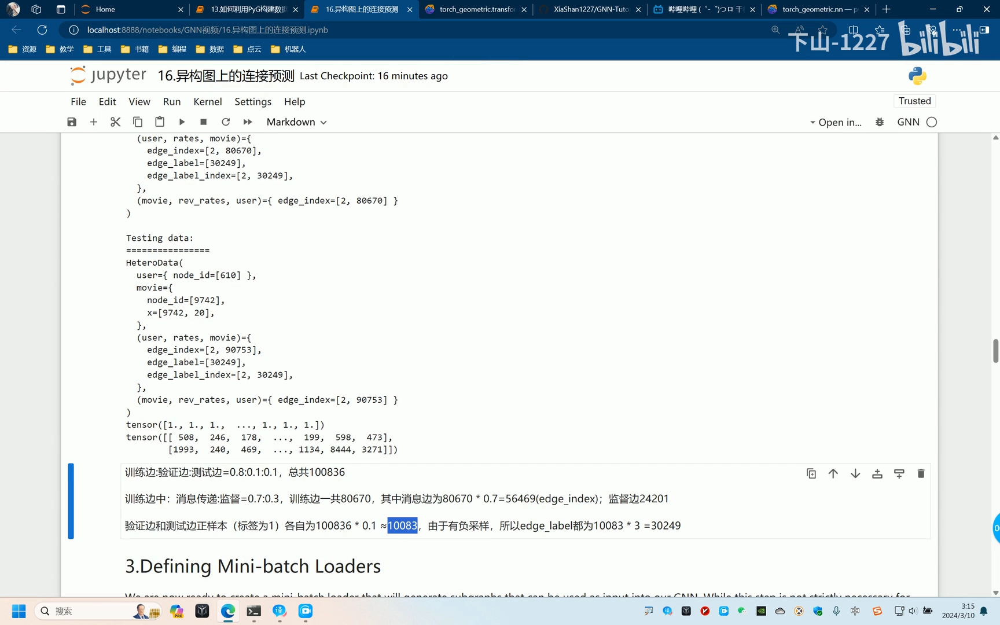

这个 30249 就是边级评价的实际分母。它和原图的 100836 条边不是一回事，和“所有可能的 user—movie 节点对”更不是一回事。后面算出来的 AUC，是在这 30249 个候选对上算的，不是在整张图上算的。

小批量里也能看到同一件事。`LinkNeighborLoader` 以监督边为种子边，一阶采 20 个邻居、二阶采 10 个邻居，负采样率 2.0，batch_size 128；因为每个正样本配两个负样本，一个 batch 的候选对数是 $3 \times 128 = 384$。[【跳转到 15:46】](https://www.bilibili.com/video/BV17x4y1Q7Jx/?t=946)

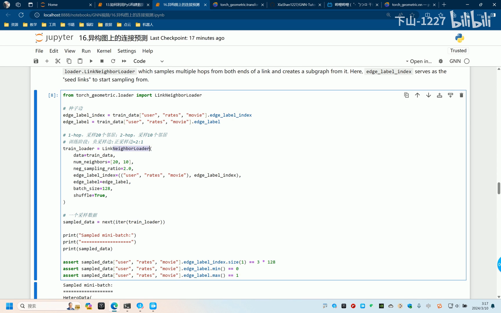

这里有一个容易被忽略的后果：**负采样比例是评价条件的一部分，不是数据的固有属性。** 比例从 2 改成 1 或 10，候选集的难度、正负分布和最终分数都会变。视频里 0.93 的 AUC，是在“每个正样本配两个随机负样本”的条件下得到的；把它当成“模型在真实推荐场景里有多准”，就跨过了这个条件。

---

## 五、切分的是边，不是节点：80/10/10 与按边隔离

**结论：边级任务的切分单位是边；训练、验证、测试三份边互不重叠，才能保证验证分数不是背答案背出来的。**

视频用 PyG 的 `RandomLinkSplit` 划分边：训练 80%、验证 10%、测试 10%。[【跳转到 02:55】](https://www.bilibili.com/video/BV17x4y1Q7Jx/?t=175)

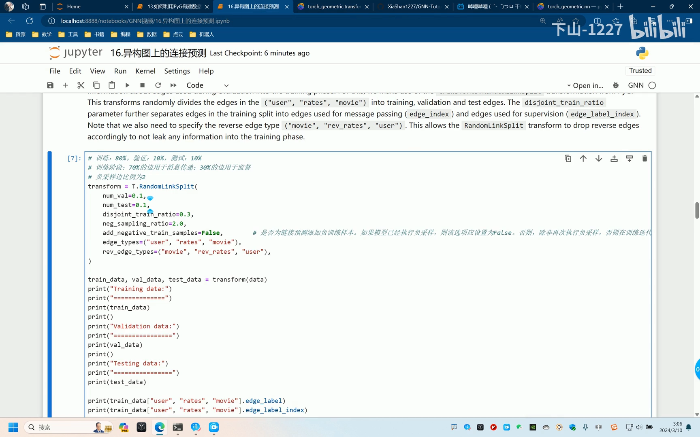

注意这里的 80/10/10 切的是**边**，不是节点。节点分类里常见的是按节点划分训练/验证/测试掩码；图分类里是按图划分。切分单位跟着标签粒度走：标签落在边上，就必须保证验证边没有在训练时以别的身份出现过。

`RandomLinkSplit` 还有两个和泄漏直接相关的参数：

- `disjoint_train_ratio` 设为 0.3：把训练边再分成两部分，70% 用于消息传递，30% 只用于监督；
- `rev_edge_types`：指定反向边类型，保证正向边被划到某一侧时，反向边也跟着走，不会一边在训练集、一边在验证集。

视频对 0.3 的解释很直白：如果全部边都用来做消息传递，预测时可能会有消息泄漏；把一部分边只留作监督，可以缓解这个问题。作者也补了一句，这不是特别严谨的硬规定，如果你有实际证据说明不用更好，也可以不用。[【跳转到 04:25】](https://www.bilibili.com/video/BV17x4y1Q7Jx/?t=265)

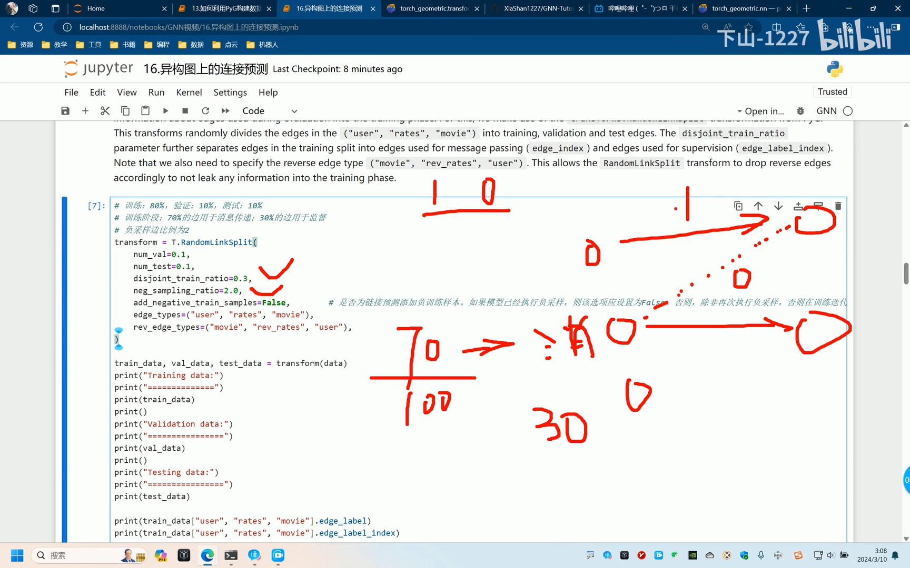

为什么这件事在边级任务里格外重要？因为边既是特征通道，又是预测目标。一条边如果既参与了消息传递，又被当作监督标签，模型在算节点嵌入时就已经把答案“看”进去了；这时验证分数高，不代表它能预测没见过的边。节点级任务里也有类似的掩码问题，但边级任务更隐蔽：同一条边可以同时以“邻接关系”和“标签”两种身份出现。

---

## 六、消息传递边与监督边分开：56469 与 24201

**结论：按边切分不是一句口号，它要落到具体的边数上；训练边 80670 条，按 70/30 分成 56469 条消息边和 24201 条监督边。**

视频把整套算术完整地走了一遍：

- 总边数 100836；
- 训练边占 80%：$100836 \times 0.8 = 80670$；
- 训练边内部再按 70/30 分：消息边 $80670 \times 0.7 = 56469$，监督边 $80670 \times 0.3 = 24201$。

于是训练数据里 `edge_index` 是 56469 条边，`edge_label` 是 24201 个标签，`edge_label_index` 是 $2 \times 24201$。[【跳转到 11:36】](https://www.bilibili.com/video/BV17x4y1Q7Jx/?t=696)

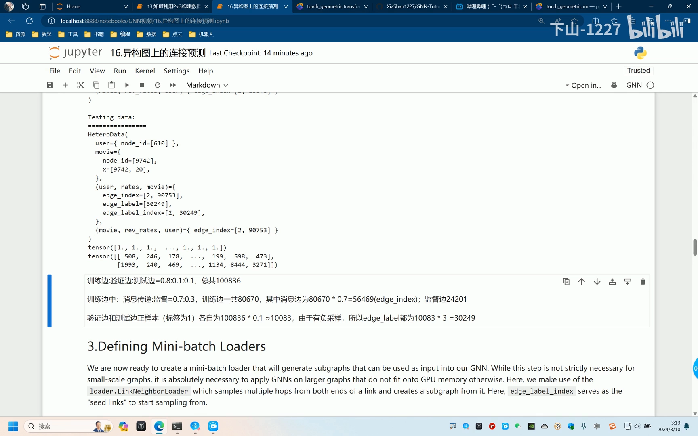

这组数字把“按边切分”从抽象原则变成了可检查的对象。读一个链接预测实验时，至少要看四件事：

1. 训练/验证/测试各占多少条边；
2. 训练边里有多少条真正参与消息传递，多少条只做监督；
3. 验证和测试的正样本是否也经过负采样，比例是多少；
4. 反向边有没有跟着正向边一起划走。

少看其中任何一条，分数都可能被高估。视频里 0.93 的 AUC 之所以能作为一个有效结果，前提就是这四件事都被显式设定过。

---

## 七、边级评价用 AUC：看正样本分数是否排在负样本之前

**结论：AUC 衡量的是排序能力——随机取一个正样本和一个负样本，正样本分数更高的概率；它不依赖阈值，也不等于准确率。**

训练用二元交叉熵（BCE）：模型输出一个 logit，标签是 0 或 1，损失把两者拉到一起。[【跳转到 35:08】](https://www.bilibili.com/video/BV17x4y1Q7Jx/?t=2108)

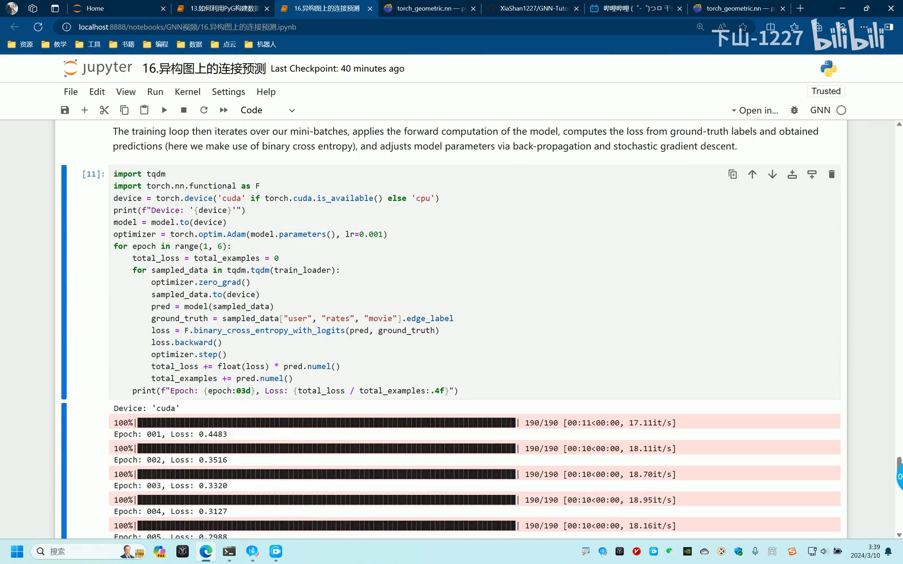

验证时用 `sklearn.metrics.roc_auc_score`，把验证集所有 batch 的预测分数拼起来，和真实标签一起算 AUC。[【跳转到 36:39】](https://www.bilibili.com/video/BV17x4y1Q7Jx/?t=2199) 最终得到 **0.9307**。[【跳转到 37:29】](https://www.bilibili.com/video/BV17x4y1Q7Jx/?t=2249)

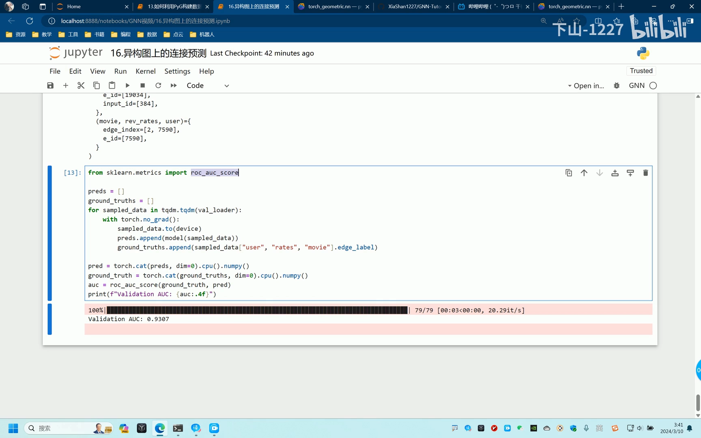

AUC 的定义可以写成：随机抽一个正样本和一个负样本，正样本的分数高于负样本的概率。它只关心正负样本的相对顺序，所以不需要先选一个阈值把分数切成 0/1。视频里也提到，除了 ROC/AUC，还可以用 F1 score；原作者这里用的是 AUC。[【跳转到 37:04】](https://www.bilibili.com/video/BV17x4y1Q7Jx/?t=2224)

读这个 0.9307 时，有三个边界要一起说：

- **它是排序指标，不是概率。** 0.9307 不表示“这条边有 93% 的概率存在”，只表示正样本排在负样本前面的可能性较高。
- **它依赖候选集。** 负样本是随机采样的，比例是 2；如果换成更难的历史负样本或按节点归纳的负样本，同一个模型会得到不同的 AUC。
- **它依赖切分。** 验证边没有参与消息传递，反向边也跟着划走；如果切分泄漏，AUC 会被抬高。

视频没有使用 AP（average precision，平均精度）。AP 也是排序指标，但它逐位置累计精确率，更关注排在最前面的正样本；当候选集里负样本远多于正样本时，AUC 容易被大量容易区分的负样本抬高，AP 对“前几名里有多少真正例”更敏感。这支视频的任务里负正比固定为 2，作者选了 AUC，所以本文只把 AP 作为读表时的对照，不把它当成视频的结论。

---

## 八、标签粒度决定样本单位、分母与切分单位

**结论：同一套节点嵌入可以服务三种任务，但换一种标签粒度，评价的样本单位、分母和切分单位都要跟着换；不能拿节点级的指标直觉去读边级分数。**

把视频里的边级做法放回三种粒度中对照：

| 任务层级 | 读出取什么 | 标签粒度 | 切分单位 | 评价在什么集合上算 |
| :--- | :--- | :--- | :--- | :--- |
| 节点分类 | 单个节点表示 | 每个节点一个类别 | 节点（训练/验证/测试掩码） | 被评价的节点 |
| 链接预测 | 一对节点表示，经解码器打分 | 每个节点对一个 0/1 | 边（正边、负边、反向边一起划） | 候选节点对（正样本 + 负样本） |
| 图分类 | 整图表示（节点表示经池化） | 每张图一个类别 | 图 | 被评价的图 |

这张表的关键不在“三种任务”这个分类，而在最后一列：**分母是什么，取决于标签落在哪个粒度上。** 节点级的分母是节点数，边级的分母是候选节点对数，图级的分母是图数。视频里 30249 这个数字之所以重要，就是因为它就是边级的实际分母；它既不是 100836，也不是 610×9742。

视频在结尾把三者的关系说得很清楚：链接预测和节点预测、图预测“都有相通的东西”，节点嵌入、边嵌入、图表示之间都是特征转换，不是割裂的。[【跳转到 38:05】](https://www.bilibili.com/video/BV17x4y1Q7Jx/?t=2285) 相通的是表示和消息传递；不相通的是评价。把边级的 0.93 直接搬到节点级或图级，或者反过来，都是把分母换了却假装指标没变。

---

## 九、把 0.93 读成一句话

**结论：0.9307 是“在 80/10/10 按边切分、训练边内部 70/30 隔离、验证集按 2 比 1 负采样”的条件下，模型对 30249 个候选节点对的排序能力；它不是部署准确率，也不是边存在的概率。**

这句话里每一个限定条件都对应一个会改变分数的旋钮：

- 负采样率从 2 改成别的值，候选集难度变了；
- `disjoint_train_ratio` 从 0.3 改成 0，消息传递边和监督边重叠，分数可能被泄漏抬高；
- 切分从按边改成按时间或按节点，训练/验证的分布变了；
- 解码器从点积换成带参数的 MLP，读出能力变了，但过拟合风险也变了。

所以，读一个链接预测结果时，先问“分母是什么、候选集怎么来的、切分单位是什么”，再问“AUC 多少”。这三个问题的答案，比分数本身更能说明模型学到了什么。

---

## 小结

- 边级任务的实例是一对节点，标签是 0/1；边本身没有独立特征，边表示由节点表示读出。
- 读出分两步：图网络算节点嵌入，解码器把一对节点嵌入变成分数；视频用点积，逐维相乘再求和。
- 负采样把评价单位从“边”变成“节点对”：验证集 10083 条正边，按 2 比 1 采样后变成 30249 个候选对。
- 切分单位是边：训练 80%、验证 10%、测试 10%；训练边内部再按 70/30 分成 56469 条消息边和 24201 条监督边，避免同一条边既传递消息又充当答案。
- 边级评价用 AUC，衡量正样本分数排在负样本之前的概率；0.9307 依赖候选集与切分，不是概率，也不是部署准确率。
- 标签粒度决定分母：节点级按节点计分，边级按节点对计分，图级按图计分；切分单位也随之改变。

## 关键术语速查

| 术语 | 一句话解释 |
| :--- | :--- |
| 异构图 | 节点或边不止一种类型的图，例如 user—movie 两种节点、评分一种边。 |
| 链接预测 | 判断两个节点之间是否应当存在边，输出通常是有边/无边的二分类。 |
| 边级任务 | 一个样本是一对节点，标签落在节点对上，而不是单个节点或整张图上。 |
| 节点嵌入 | 图网络为每个节点算出的向量，汇总了节点自身特征与邻居信息。 |
| 解码器 | 把一对节点表示映射成一个分数的函数；点积是最简单的一种。 |
| 负采样 | 随机挑选本来没有边的节点对，标为 0，用来给链接预测提供负类。 |
| 负采样率 | 负样本数与正样本数的比例；视频设为 2，即每个正样本配两个负样本。 |
| 候选节点对 | 评价时实际参与打分的节点对集合，等于正样本加负样本，是边级指标的分母。 |
| 按边切分 | 训练/验证/测试按边划分，而不是按节点或按图划分。 |
| 消息传递边 | 参与图卷积、影响节点嵌入的边。 |
| 监督边 | 只提供标签、不参与消息传递的边；与消息传递边分开可减少泄漏。 |
| 数据泄漏 | 预测时使用了本不该获得的信息，例如待预测的边已经参与了消息传递。 |
| ROC-AUC | 随机取一个正样本和一个负样本，正样本分数更高的概率；只反映排序能力。 |
| AP | 平均精度，逐位置累计精确率的排序指标；更关注排在前面的正样本。 |
| 二元交叉熵 | 二分类常用的损失函数，把模型输出的 logit 与 0/1 标签拉近。 |