# 力必须是能量对坐标的负梯度：同一个标量势同时拟合能量、力与应力

> 视频来源：[Basics of machine learning force fields](https://www.youtube.com/watch?v=f1VXKVlVhg4)（YouTube · VASP Lecture · Georg Kresse）｜时长约 89 分钟
> 简要导读：机器学习力场要同时给出能量、力和应力。这三者的形状完全不同：一个是标量、一个是 $3N$ 个分量、一个是六个张量分量，但它们必须来自同一个标量势。本文按这条线索走：三类输出各自是什么形状、方程数量差多少、为什么力是能量的导数、直接回归力会丢掉什么，以及这层一致性换来了哪些能算、哪些不能算。坐标生成那一支由同节[《坐标生成输出的是一个构象集合，不是一张正确结构》](坐标生成输出的是一个构象集合，不是一张正确结构.md)负责。

## 本讲要解决的核心问题（SCQA）

**背景**：密度泛函理论把多体问题降成单粒子问题，计算量随体系大小立方增长，几分钟就能算两千个电子的单个结构。它还有一个不太常被强调的好处：一阶导数用 Hellmann-Feynman 定理算起来极快，所以能算力、算应力、做分子动力学（[【跳转到 04:24】](https://www.youtube.com/watch?v=f1VXKVlVhg4&t=264)）。但它在有限温度下仍然慢：跑十万个时间步，即便是小体系也要算几个月甚至一年（[【跳转到 05:14】](https://www.youtube.com/watch?v=f1VXKVlVhg4&t=314)）。

**冲突**：机器学习力场要把这一步再加速一千到一万倍（[【跳转到 05:39】](https://www.youtube.com/watch?v=f1VXKVlVhg4&t=339)）。可是要拟合的不是一个量，而是三个：能量、力、应力。它们的形状、数量与量纲都不同——500 个结构给 500 个能量方程，却给 15 万个力方程和 3000 个应力方程。如果把它们当成三个独立任务分别回归，模型可以拟合得很准，但三者之间那层物理关系就没了。

**疑问**：这三类输出到底怎么组织在一个模型里？为什么力必须是能量的导数，而不是一个独立的回归目标？这层约束换来了什么，又放弃了什么？

**回答（中心思想）**：能量、力与应力由同一个局域能量泛函同时拟合，力是这个泛函对坐标的导数，应力是它对晶胞形变的导数。模型学的是一个标量势，另外两个输出由它派生，因此三者自动自洽。直接回归力会失去这层保证，跨相时尤其致命。这层一致性让热导率、自由能与相变温度这类量变得可算，但它只保证自洽、不保证正确：走出训练覆盖范围，自洽的模型照样给出完全错误的结果。

## 一、三类输出先分清：一个标量、一组向量、一个张量

先把输出对象摆在一起。这张表是后面所有讨论的骨架。

| 输出对象 | 形状 | 一个 100 原子构型给多少方程 | 量纲 |
| --- | --- | --- | --- |
| 能量 | 一个标量（可拆成每原子一项） | 1 | eV 或 eV/atom |
| 力 | $N$ 个三维向量，共 $3N$ 个分量 | 300 | eV/Å |
| 应力 | 六个独立张量分量 | 6 | kbar |

训练流程的第一步就把三类输出一起收进数据库：做第一性原理计算，通常算一千个左右的结构，对每个结构算出能量、力和应力张量，就像在 VASP 里通常做的那样（[【跳转到 06:04】](https://www.youtube.com/watch?v=f1VXKVlVhg4&t=364)）。所以它们不是三个数据集，而是同一批计算给出的三种标签。

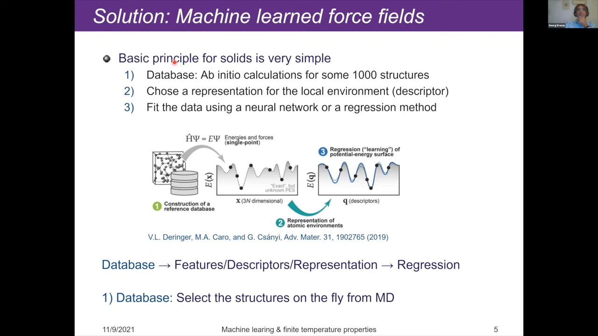

这张图把三类输出的来源画在一起：左侧数据库里存的是能量与力，中间把坐标换成描述符，右侧回归出势能面。注意箭头方向：坐标先变成描述符，能量与力都从描述符回归出来，而不是各自独立地从坐标回归。

## 二、能量是标量：一个构型一个数，而且必须不变

### 2.1 总能量被写成局域能量之和

模型的核心假设只有一句：总能量是局域能量之和，而每个原子的局域能量只是它周围局域环境的函数（[【跳转到 16:29】](https://www.youtube.com/watch?v=f1VXKVlVhg4&t=989)）。

$$
E = \sum_i U_i, \qquad U_i = U(\{c^i_n, p^i_{nvl}\})
$$

讲者把“只依赖局域环境”称为机器学习里最关键的假设之一，它不可能精确成立，因为局域环境被截断了，只看中心原子周围一定距离内其他原子在做什么（[【跳转到 17:19】](https://www.youtube.com/watch?v=f1VXKVlVhg4&t=1039)）。

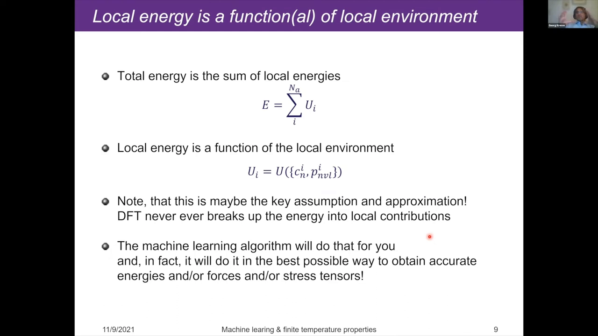

这张幻灯片上有一句关键提醒：DFT 从不把能量拆成局域贡献，这个拆分是机器学习算法替你做的（[【跳转到 17:44】](https://www.youtube.com/watch?v=f1VXKVlVhg4&t=1064)）。也就是说，“每原子能量”不是数据里带的标签，而是模型为了同时拟合能量、力与应力而引入的结构假设。讲者还强调，算法会以“最好的方式”做这个拆分，以便同时得到准确的能量和力与应力。

### 2.2 标量输出天然满足不变性

描述符的选择不是随意的。局域环境最终归结为两个量：对关联函数与角度关联函数。对关联函数衡量在离中心原子距离 $R$ 处找到另一个原子的可能性，角度关联函数衡量在距离 $R$ 处找到一个原子、在距离 $K$ 处找到另一个原子、且两者夹角为 $\theta$ 的可能性（[【跳转到 11:29】](https://www.youtube.com/watch?v=f1VXKVlVhg4&t=689)）。

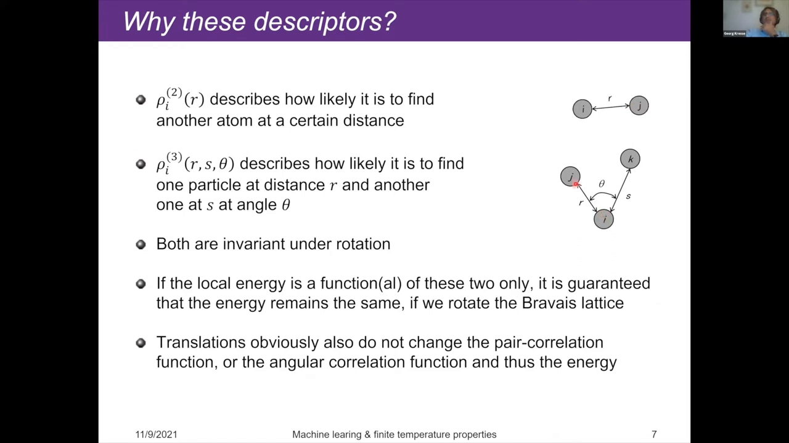

这张图给出一个直接推论：如果局域能量只是这两个描述符的函数，那么在 VASP 里旋转布拉维格子、改变晶格矢量、旋转整个体系，能量和力都保证完全不变（[【跳转到 12:19】](https://www.youtube.com/watch?v=f1VXKVlVhg4&t=739)）。平移也不影响，因为只涉及两原子之间的距离或夹角。标量输出正是承载这种不变性的合适形状。

## 三、力是向量：$3N$ 个分量，占绝大部分信息

### 3.1 力是泛函的导数

第二支视频的核心一句话写在幻灯片标题上：力是这个泛函的导数（[【跳转到 18:09】](https://www.youtube.com/watch?v=f1VXKVlVhg4&t=1089)）。

$$
\frac{dE}{d\mathbf{R}_j} = \sum_i \frac{dU_i}{d\mathbf{R}_j}
$$

由于局域能量是局域环境的函数，求导要用链式法则：先对描述符系数求导，再对系数关于原子位置求导（[【跳转到 18:59】](https://www.youtube.com/watch?v=f1VXKVlVhg4&t=1139)）。

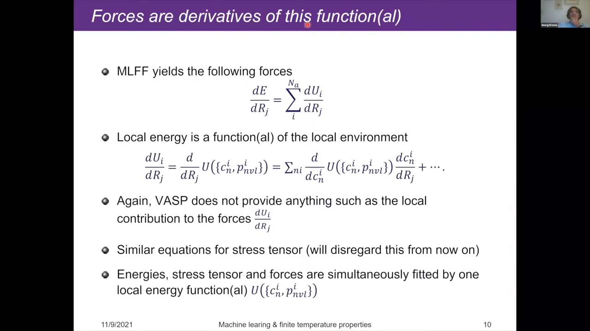

这张幻灯片的关键在最后一行：能量、应力张量和力是由同一个、唯一的局域能量泛函 $U$ 同时拟合的（[【跳转到 19:49】](https://www.youtube.com/watch?v=f1VXKVlVhg4&t=1189)）。另外注意中间那行提醒：VASP 不会提供任何“局域力贡献”这样的量，这个拆分必须由拟合来处理（[【跳转到 19:24】](https://www.youtube.com/watch?v=f1VXKVlVhg4&t=1164)）。

### 3.2 方程数量：能量 500，力 15 万

讲者做了一次信封背面的估算：500 个电子结构计算、每个 100 个原子，能量方程只有 500 个；力是 $500 \times 100 \times 3$，约 15 万个方程；应力六个分量对 500 个结构，又是 3000 个方程（[【跳转到 20:14】](https://www.youtube.com/watch?v=f1VXKVlVhg4&t=1214)）。

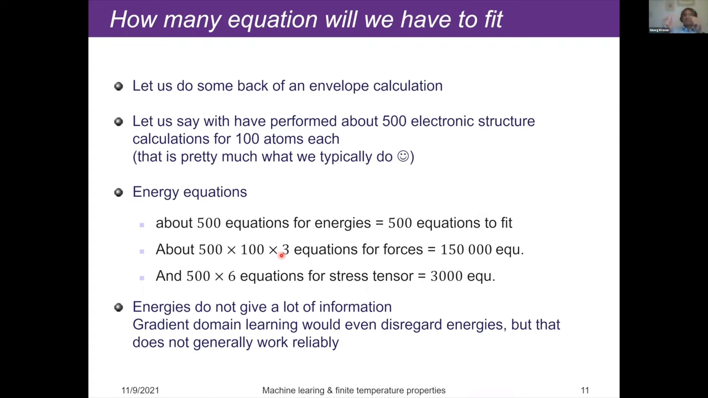

这张图的结论很直接：能量的信息其实很少，绝大部分信息在力里（[【跳转到 21:29】](https://www.youtube.com/watch?v=f1VXKVlVhg4&t=1289)）。这张幻灯片底部还写了由此引出的一个做法：gradient domain learning 甚至会完全丢掉能量，但那样一般不可靠——原因在下一章。

### 3.3 一个超定系统：500 个未知数对 15 万个方程

拟合最终归结为一个最小二乘问题。设计矩阵 $\Phi$ 的行对应能量行与力行，列对应选出的参考原子；向量 $y$ 收集所有训练结构的力与能量（[【跳转到 41:54】](https://www.youtube.com/watch?v=f1VXKVlVhg4&t=2514)）。

$$
\Phi \mathbf{w} = \mathbf{y} \quad \longleftrightarrow \quad |\Phi \mathbf{w} - \mathbf{y}| \to \min
$$

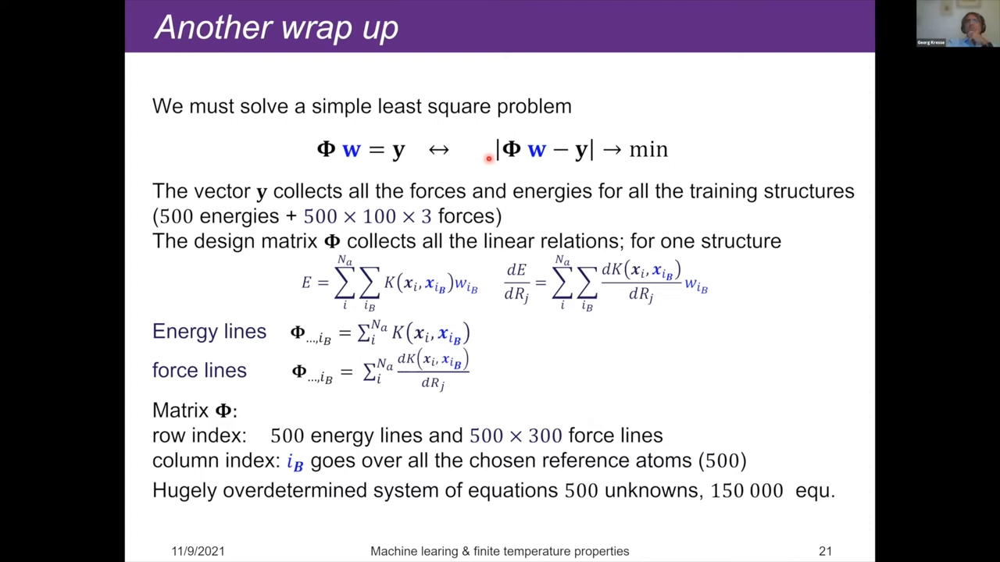

这张图把三类输出的数量关系落到了矩阵形状上：约 15 万个方程、只有 500 个未知数，所以永远无法精确求解，只能最小化残差（[【跳转到 42:19】](https://www.youtube.com/watch?v=f1VXKVlVhg4&t=2539)）。讲者强调这不是什么魔法，本质上就是教科书里标准的最小二乘解（[【跳转到 44:24】](https://www.youtube.com/watch?v=f1VXKVlVhg4&t=2664)）。

## 四、直接回归力的后果：跨相时没有共同的能量零点

如果只拟合力、不要能量，会发生什么？讲者给了一个具体判断：gradient domain learning 在单一相里效果相当不错，但当要跨越完全不同的相时就不行了，比如液态硅和立方金刚石硅之间没有直接联系，你无法在两个相之间构造一条通路，这时就必须同时拟合能量（[【跳转到 21:54】](https://www.youtube.com/watch?v=f1VXKVlVhg4&t=1314)）。

这里的逻辑值得展开：力是逐原子的局部量，它告诉你每一步往哪走，但不告诉你两个相谁的能量更低。丢掉能量标签，就丢掉了跨相比较所需的共同零点。所以“直接回归力”的问题不在于精度，而在于它放弃了一个全局约束。

## 五、一致性要求：一个标量势，三种输出派生

把前面几章合起来，一致性要求的表述只有一句：力是能量对坐标的负梯度，能量、力与应力由同一个标量势派生。

$$
\mathbf{F}_j = -\frac{\partial E}{\partial \mathbf{R}_j}
$$

这个要求有三层后果，正好对应三类输出：

1. **能量必须是可微的标量函数**。模型不能只输出一个数，它输出的必须是一个能对坐标求导的泛函。
2. **力不能独立回归**。它由能量求导得到，因此与能量共享同一组参数，物理上自动一致。
3. **应力同理**。它是能量对晶胞形变的导数，与力、能量由同一个局域能量泛函拟合（[【跳转到 19:49】](https://www.youtube.com/watch?v=f1VXKVlVhg4&t=1189)）。

代价也要说清楚：求导带来额外计算，而且拟合时要在“能量准”和“力准”之间做权衡——因为两者共用一组参数，而方程数量差了三个数量级。讲者提到他们用贝叶斯线性回归解正则化正规方程，后来又改用奇异值分解算伪逆，让力场稍微更准一些（[【跳转到 46:04】](https://www.youtube.com/watch?v=f1VXKVlVhg4&t=2764)）。

这里只到“一致性要求”为止：为什么这条要求等价于保守力场、以及等变性与守恒性的形式化区别，留到 5.1.8。

## 六、一致性换来什么：局域能量让热导率可算

一致性不只是形式上的优雅，它直接决定哪些量算得出来。最清楚的例子是晶格热导率。Green-Kubo 公式里的热流需要一个局域能量模型，热流表达式里出现局域能量对离子位置的导数（[【跳转到 70:48】](https://www.youtube.com/watch?v=f1VXKVlVhg4&t=4248)）。

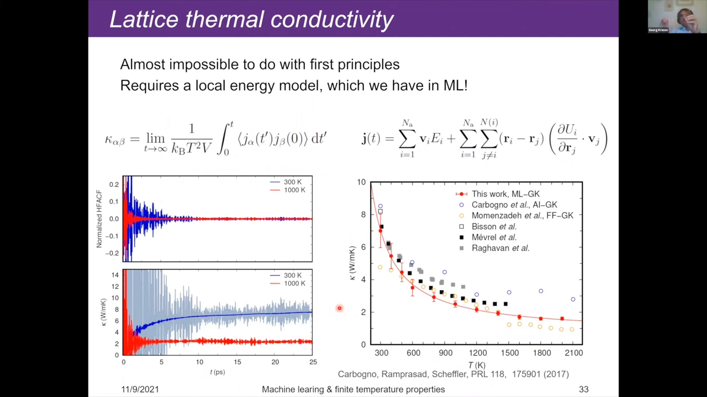

这张图的标题就是结论：这件事几乎不可能只靠第一性原理做到，因为它需要一个局域能量模型，而这个模型机器学习恰好有。VASP 里没有局域能量这种东西，所以这个量在纯第一性原理里永远算不出来；一旦有了每个原子局域能量的近似，就可以代入标准方程用封闭公式算出热导率（[【跳转到 71:13】](https://www.youtube.com/watch?v=f1VXKVlVhg4&t=4273)）。讲者进一步说，机器学习在这里做的不只是插值，它真的把传入的总能量拆成了局域贡献，这不是任何从头算程序会做的事（[【跳转到 72:53】](https://www.youtube.com/watch?v=f1VXKVlVhg4&t=4373)）。

相变温度是另一个只有一致性才能支撑的量。氧化锆从单斜到四方、再到立方的相变，靠的是力场跑足够慢的加热与降温：800 K 左右体积突然变化，伴随向四方相的转变（[【跳转到 64:33】](https://www.youtube.com/watch?v=f1VXKVlVhg4&t=3873)）。但准确确定相变温度还要用热力学积分算自由能，而自由能不是可观测量，不能当系综平均直接算（[【跳转到 67:03】](https://www.youtube.com/watch?v=f1VXKVlVhg4&t=4023)）。跨相比较必须有共同的能量零点，只拟合力、丢掉能量，恰恰丢掉了这个零点。

## 七、一致性不等于精度：三种输出要分别报告误差

共享一个标量势保证三者自洽，但不保证它们一样准。氧化锆的训练与测试误差是分三列报告的：能量用 meV/atom，力用 eV/Å，应力用 kbar（[【跳转到 62:28】](https://www.youtube.com/watch?v=f1VXKVlVhg4&t=3748)）。

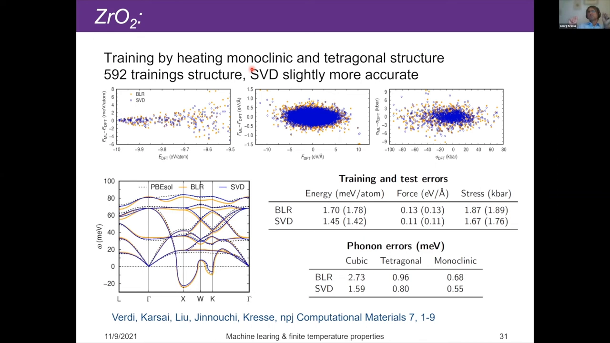

这张表说明：三类输出不能用同一个误差指标概括。能量误差按原子归一，力误差按分量算，应力是张量分量；它们的量级和物理含义都不同。表中还显示 SVD 伪逆把三类误差都降低了大约 20%（[【跳转到 63:18】](https://www.youtube.com/watch?v=f1VXKVlVhg4&t=3798)）。

## 八、标签怎么花：力是逐原子的，所以补算可以落到原子上

输出对象还决定了“标签怎么花”。on-the-fly 训练的思路是：先读入已有的力场，预测势能与不确定度，只有当不确定度超过阈值时才做一次第一性原理计算，然后重新训练（[【跳转到 33:59】](https://www.youtube.com/watch?v=f1VXKVlVhg4&t=2039)）。

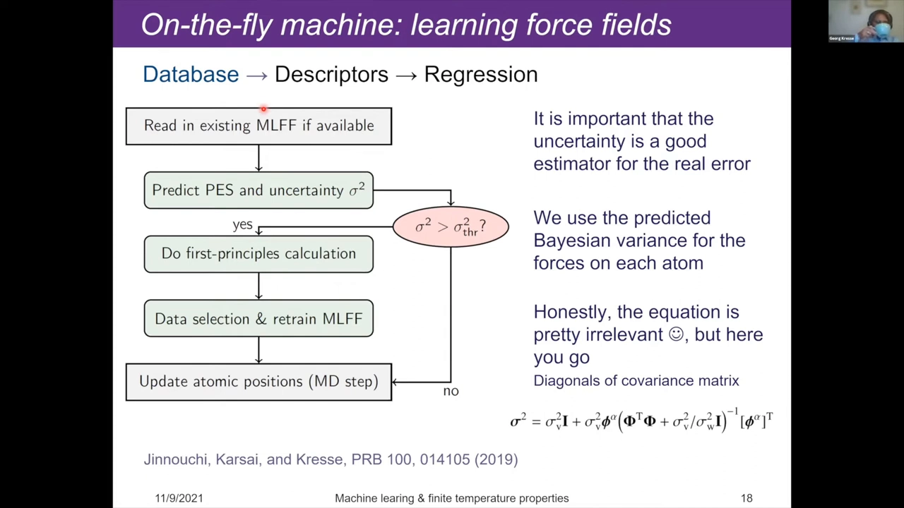

这张图的关键是那个阈值判据。不确定度来自贝叶斯回归：它不只给出总能量和力，还能给出这个预测有多准，也就是贝叶斯方差，本质上是协方差矩阵的对角元（[【跳转到 34:49】](https://www.youtube.com/watch?v=f1VXKVlVhg4&t=2089)）。

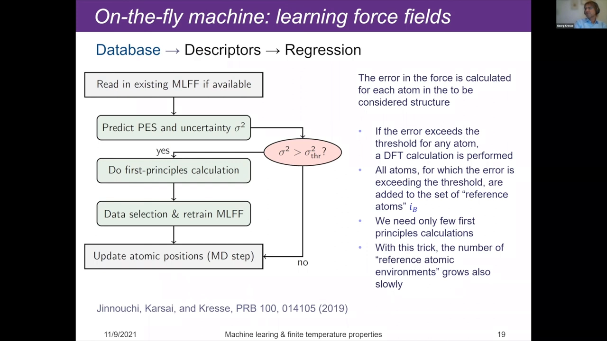

这张图说明了为什么粒度能落到原子上：只要任何一个原子的力误差超过阈值，就做一次第一性原理计算，而且这个原子本身会成为参考原子被加入集合（[【跳转到 36:29】](https://www.youtube.com/watch?v=f1VXKVlVhg4&t=2189)）。能量是图级的，做不到这种粒度。用这个策略，通常 1000 次左右的第一性原理计算就能训练出很高效的力场。

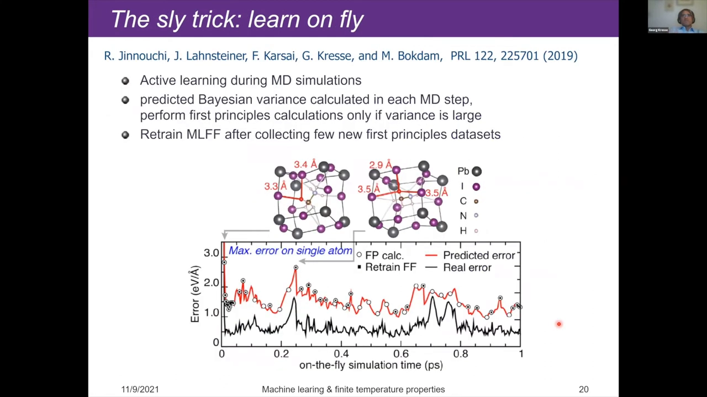

这张图是这套判据的可靠性证据：红线是贝叶斯回归给出的估计误差，黑线是用当前力场预测再与真实第一性原理计算比较得到的真实误差，两者吻合得非常好（[【跳转到 38:09】](https://www.youtube.com/watch?v=f1VXKVlVhg4&t=2289)）。这一步完全不涉及第一性原理计算，所以可以边跑边看。

## 九、一致性的边界：自洽不等于正确

讲者最后给了一个警告：机器学习力场完全不可知，也许只有一点点物理，只做数据告诉它的事（[【跳转到 81:39】](https://www.youtube.com/watch?v=f1VXKVlVhg4&t=4899)）。他们在硅的多个相上训练，包括立方金刚石、六方金刚石、BC8、简单六方等等，唯独没放 ST12，结果 ST12 的能量预测错得离谱（[【跳转到 82:54】](https://www.youtube.com/watch?v=f1VXKVlVhg4&t=4974)）。

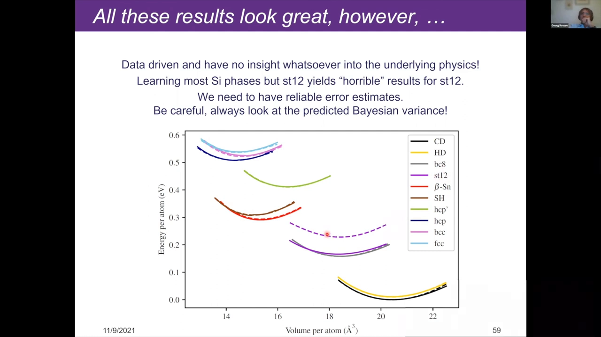

这张图把“一致性”与“正确性”分开了：共享一个标量势能保证力与能量自洽，但势本身对不对，取决于训练数据覆盖到哪里。走出验证范围，自洽的模型照样给出完全错误的结果。讲者的建议是永远看预测的贝叶斯方差，一旦发现误差变大就增加数据（[【跳转到 83:34】](https://www.youtube.com/watch?v=f1VXKVlVhg4&t=5014)）。

顺带把标签的来源也说清楚：这些力场大多数时候被当作密度泛函理论的代理模型，从 DFT 传给机器学习力场的信息是能量、力和应力张量，所以 ground truth 就是 DFT（[【跳转到 85:14】](https://www.youtube.com/watch?v=f1VXKVlVhg4&t=5114)）。

## 十、与另一支视频的分工

本文的输出对象是能量、力与应力三种，它们的共同点是都由同一个标量势派生。另一支视频处理的是坐标生成：输出是一组构象，标签是整个构象，评价是集合之间的距离，而能量始终在模型之外，只作为打分工具或训练目标出现。

两支视频在“能量”这个词上擦肩而过：这里能量是模型内部的核心，力由它求导得到；那里能量是外部的评价标尺，扩散模型本身不含能量。两边唯一的接口是“用能量给生成的坐标打分”，而玻尔兹曼生成器是这个接口的正式版本。

## 小结

- **三类输出形状不同**：能量是一个标量，力是 $3N$ 个分量，应力是六个张量分量；量纲、数量与评价对象都不同。
- **同一个标量势**：能量、力与应力由同一个局域能量泛函同时拟合，力是它对坐标的导数，应力是它对晶胞形变的导数。
- **局域能量是模型引入的假设**：DFT 从不把能量拆成局域贡献，这个拆分是回归层为了同时拟合三类输出而做的。
- **方程数量极不对称**：500 个结构给 500 个能量方程、15 万个力方程、3000 个应力方程，绝大部分信息在力里。
- **直接回归力的代价**：力可以拟合得很准，但不再保证存在一个标量势使其为梯度，跨相时缺少共同能量零点。
- **一致性换来能力**：局域能量模型让热导率、自由能与相变温度这类量可算；这些量在纯第一性原理里几乎做不了。
- **一致性不保证正确**：共享标量势只保证自洽，势本身对不对取决于训练数据覆盖；ST12 就是走出覆盖范围的反例。
- **误差要分对象报告**：能量按原子归一，力按分量，应力按张量分量，三者的量纲与评价对象都不同。

## 关键术语速查

| 术语 | 一句话解释 |
| --- | --- |
| 机器学习力场 | 用回归模型替代第一性原理计算，给出能量、力与应力的代理模型 |
| 局域能量 $U_i$ | 模型分配给单个原子的能量，求和等于总能量；DFT 不直接提供这个量 |
| 描述符 | 把原子周围环境换成对关联、角度关联等量，使能量对旋转平移不变 |
| 对关联函数 | 在离中心原子某距离处找到另一个原子的可能性 |
| 角度关联函数 | 在某距离找到两个原子且夹角为 $\theta$ 的可能性，即三体关联 |
| 标量势 | 一个把构型映射为能量的标量函数，力由它对坐标求导得到 |
| 应力张量 | 能量对晶胞形变的导数，六个独立分量，与力和能量由同一个势拟合 |
| gradient domain learning | 只拟合力、不使用能量标签的训练方式，跨相时缺少共同能量零点 |
| 超定系统 | 方程数远多于未知数的最小二乘问题，只能最小化残差 |
| 贝叶斯方差 | 回归给出的预测不确定度，本质是协方差矩阵的对角元，用来触发补算 |
| on-the-fly 训练 | 边跑分子动力学边补算：误差超阈值才做第一性原理计算并重新训练 |
| Green-Kubo 公式 | 用热流自相关函数算热导率的公式，需要局域能量模型 |
| 热力学积分 | 由内能对温度的积分求自由能的方法，用于确定相变温度 |