# 坐标生成输出的是一个构象集合，不是一张正确结构

> 视频来源：[Torsional Diffusion for Molecular Conformer Generation](https://www.youtube.com/watch?v=29veWh5Ls5s)（YouTube · Valence Labs 读书会 · Gabriele Corso、Bowen Jing）｜时长约 97 分钟
> 简要导读：构象生成的输出不是“这个分子长什么样”的唯一答案，而是一组样本。本文按这条线索走完扭转角扩散：输出对象怎么从三维坐标换成扭转角、分数模型的输入输出各是什么形状、评价为什么落在集合上、以及能量在整条流程里到底出现在哪一步。力与能量那一支由同节[《力必须是能量对坐标的负梯度：同一个标量势同时拟合能量、力与应力》](力必须是能量对坐标的负梯度：同一个标量势同时拟合能量、力与应力.md)负责。

## 本讲要解决的核心问题（SCQA）

**背景**：给定一张分子图，构象生成要找出这个分子在三维空间中能采取的一组构型。传统做法是 DFT 加元动力学：先理解能量景观，再最小化能量找构象，很准但很慢；化学信息学方法快得多，精度却不够；已有的机器学习方法大致停在化学信息学的最先进水平。

**冲突**：直接照搬图像扩散，就是给每个原子的三维坐标加高斯噪声，也就是在 $3N$ 维欧几里得空间里做扩散。这条路能走通，但一个平均 44 个原子的类药分子要在 132 维里采样，GeoDiff 生成一个构象需要 5000 步推理，比对手慢好几个数量级。问题出在“输出什么”上：把整个坐标点云都当成要生成的对象，等于把大量本来很好预测的自由度也交给了模型。

**疑问**：如果换一个输出对象，只生成真正难定的那部分自由度，会发生什么？输出形状一变，训练信号、评价指标和对能量的依赖会不会跟着变？

**回答（中心思想）**：坐标生成输出的是一个构象集合中的样本，不是单个正确答案。把输出从 $3N$ 维坐标换成可旋转键上的扭转角，维度降到个位数，采样步数从 5000 降到 20，代价是模型只能修正扭转角、必须接受化学信息学给出的局部结构。而无论输出写成坐标还是扭转角，扩散模型本身都不含能量：能量只在两个地方出现——外部拿来给生成的构象排序，或者作为训练目标把生成模型改造成玻尔兹曼生成器。

## 一、三类输出先分清：本文只负责坐标这一行

同一个分子构型可以被要求输出三种完全不同的东西。先把这张表立起来，后面每一章都对应其中一行或两行。

| 输出对象 | 形状 | 标签从哪来 | 评价对象 |
| --- | --- | --- | --- |
| 坐标生成 | 一组 $N\times 3$ 位置，或等价的扭转角集合 | 真实构象集合（高精度构象搜索给出的系综） | 生成集合与真实集合之间的距离、覆盖与能量排序 |
| 能量预测 | 一个标量 | 第一性原理或实验能量 | 能量误差（每构型或每原子） |
| 力回归 | $N$ 个三维向量，共 $3N$ 个分量 | 第一性原理力 | 力分量误差 |

本文只处理第一行。需要提前记住两点区别：坐标生成没有逐原子标签，它的监督信号是整个构象；坐标生成也不输出能量和力，能量在这条流程里始终是外部的评价工具，而不是模型的一部分。第二、三行由同节另一篇博客负责。

## 二、输出是集合里的样本，不是唯一解

任务定义本身就把“集合”写进了输出。给定分子图 $G=(V,E)$，要找的是这个分子在三维空间中能采取的一组构型，这些构型叫构象（conformer）（[【跳转到 01:37】](https://www.youtube.com/watch?v=29veWh5Ls5s&t=97)）。它对药物与催化剂发现很关键，因为分子的许多性质、以及它与其他分子和蛋白质相互作用的方式，都取决于三维结构（[【跳转到 02:02】](https://www.youtube.com/watch?v=29veWh5Ls5s&t=122)）。

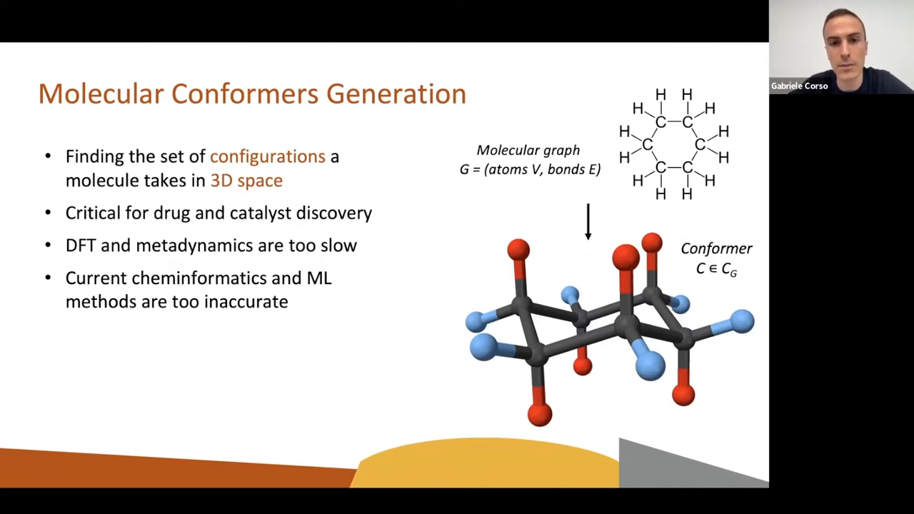

这张图里输出的写法值得盯住：构象 $C$ 属于某个构象集合 $C_G$。也就是说，模型要产出的不是一个“正确答案”，而是一个集合中的样本。这一个符号决定了后面所有事情：标签是集合、评价是集合之间的距离、采样成本算进评价。

传统方法走的是另一条路：DFT 和元动力学先理解分子的能量景观，再最小化、找出使能量最小的构象；它们非常准，但太慢，一个普通类药分子在 CPU 上跑 DFT 要几天（[【跳转到 02:27】](https://www.youtube.com/watch?v=29veWh5Ls5s&t=147)）。注意这里已经出现了能量，但它是被用来“找构象”的工具，不是被预测的输出。

## 三、换一个输出空间：从 132 维坐标到 8 维扭转角

### 3.1 外在坐标与内在坐标

欧几里得扩散把构象看作外在坐标（extrinsic coordinates）：构象是三维空间中的一个点云，只对全局旋转和平移做等价处理（[【跳转到 15:44】](https://www.youtube.com/watch?v=29veWh5Ls5s&t=944)）。这样写很难把难确定的自由度与容易确定的自由度分开。

扭转角扩散换一种视角，用内在坐标（intrinsic coordinates）：构象写成局部结构 $L$ 与扭转角 $\tau$ 的元组，其中 $L$ 包含键长、键角与环的构象，$\tau$ 是可旋转键周围的扭转角（[【跳转到 16:09】](https://www.youtube.com/watch?v=29veWh5Ls5s&t=969)）。于是概率可以拆开：

$$
p_G(C) = p_G(L,\tau) = p_G(\tau \mid L)\, p_G(L)
$$

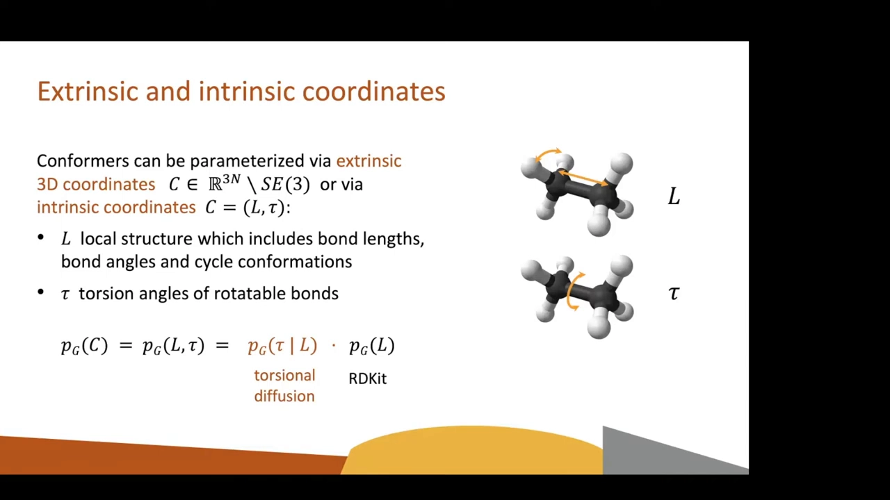

这张图说明了输出对象是可以选的：坐标是最终产物，但模型不必直接生成坐标。他们的选择是让化学信息学方法负责 $p_G(L)$（用 RDKit 的 ETKDG 例程预测局部结构），让神经网络只负责 $p_G(\tau \mid L)$（[【跳转到 18:14】](https://www.youtube.com/watch?v=29veWh5Ls5s&t=1094)）。

### 3.2 维度从 132 降到 7.9

收益很直接。分子的柔性其实存在于扭转角空间里，而键长、键角这些局部结构可以被化学信息学方法非常准确地预测（[【跳转到 06:54】](https://www.youtube.com/watch?v=29veWh5Ls5s&t=414)）。于是把扩散限制在可旋转键的扭转角上，一个平均 44 个原子的类药分子，欧几里得扩散的自由度是 132 维，这里降到不到 8 维，也就是可旋转键的数目（[【跳转到 07:19】](https://www.youtube.com/watch?v=29veWh5Ls5s&t=439)）。

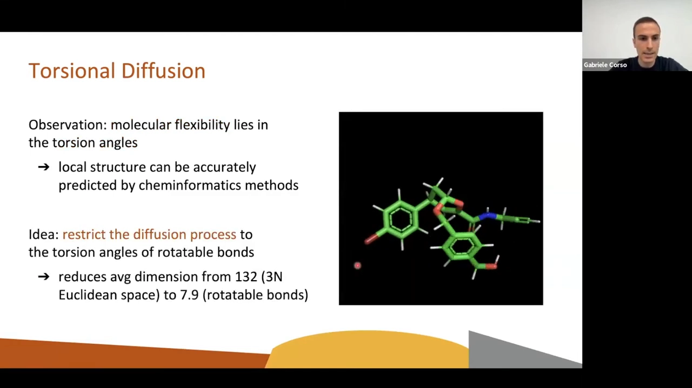

这张图是本节关于输出对象的第一个具体结论：输出什么，决定了问题有多难。同一批分子，输出三维坐标是 132 维问题，输出扭转角是 8 维问题。代价写在图的下半句里：模型不再改变 44 个原子的位置，只改变 8 个可旋转键，键长与键角完全交给外部方法。

讲者还给了一个量化直觉：从 RDKit 构象出发只旋转扭转角，能到离真实构象 0.25 到 0.3 埃的 RMSD，而现有方法大约 0.9 埃（[【跳转到 10:39】](https://www.youtube.com/watch?v=29veWh5Ls5s&t=639)）；随机配对的 RDKit 构象与真实构象相差 1.5 埃，修正扭转角后降到 0.3 埃左右（[【跳转到 12:19】](https://www.youtube.com/watch?v=29veWh5Ls5s&t=739)）。氢原子直径约 0.5 埃，所以 0.2 到 0.3 埃的误差比最小的原子还小。

### 3.3 输出空间是环面，先验不是高斯

扭转角从 $0$ 到 $2\pi$，而 $2\pi$ 与 $0$ 是同一个角，所以 $m$ 个扭转角构成的空间是一个混合环面 $\mathbb{T}^m$，不是欧几里得空间（[【跳转到 18:39】](https://www.youtube.com/watch?v=29veWh5Ls5s&t=1119)）。在这个空间上做扩散，扰动核是把欧几里得高斯核卷绕起来的卷绕正态分布，核的分数可以预先算好存到磁盘上（[【跳转到 19:29】](https://www.youtube.com/watch?v=29veWh5Ls5s&t=1169)）。

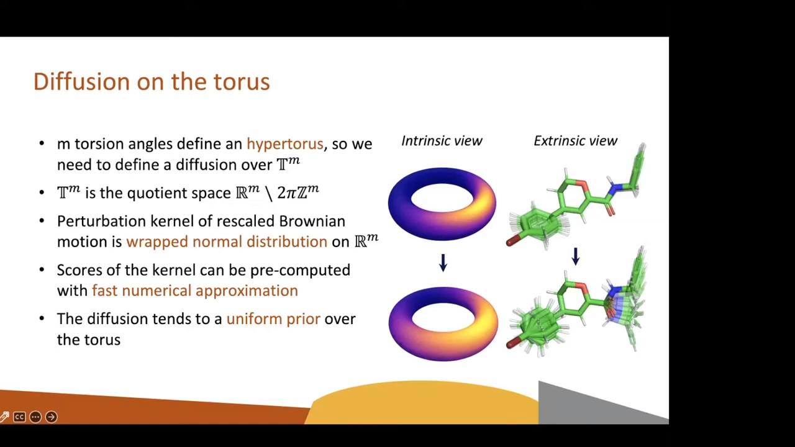

这张图给出一个容易忽略的推论：因为流形是紧的，扩散收敛到的先验不再是高斯分布，而是环面上的均匀分布，从先验采样就是随机取一个扭转角作用到构象上（[【跳转到 20:44】](https://www.youtube.com/watch?v=29veWh5Ls5s&t=1244)）。输出空间的几何形状直接改写了扩散的边界条件。

## 四、分数模型的输入输出：输入点云，输出每个键一个标量

### 4.1 为什么不直接喂内在坐标

既然用内在坐标，最自然的想法是把构象的内在坐标参数化后喂给模型。讲者列了三个问题：环面空间的维度取决于可旋转键的数目；即便数目相同，不同分子、甚至同一分子的不同构象，环面上同一点的含义也不同；局部结构 $L$ 的自由度带约束，很难给出非任意的流形参数化（[【跳转到 22:49】](https://www.youtube.com/watch?v=29veWh5Ls5s&t=1369)）。

$\tau$ 本身也有麻烦：严格说“某个键的扭转角”是一个二面角，需要为键两端的每个原子各选一个邻居来定义（[【跳转到 24:04】](https://www.youtube.com/watch?v=29veWh5Ls5s&t=1444)）。有绕开的办法，比如 Octavian 的论文与 GeoMol 发展出的参数化，但那需要额外训练一个网络为不同邻居算权重（[【跳转到 26:09】](https://www.youtube.com/watch?v=29veWh5Ls5s&t=1569)）。

### 4.2 外在到内在：只学变化量 $\Delta\tau$

他们的做法是：分数模型不一定非要吃内在坐标，只需要一个在目标空间上输出分数的模型（[【跳转到 26:59】](https://www.youtube.com/watch?v=29veWh5Ls5s&t=1619)）。于是输入是构象的外在表示，也就是每个原子在三维空间中的位置；输出是每个可旋转键上的 SE(3) 不变分数，做法是在三维点云上为每个键给出一个标量预测。这 $m$ 个标量正好当作环面切空间 $\mathbb{R}^m$ 上的分量。

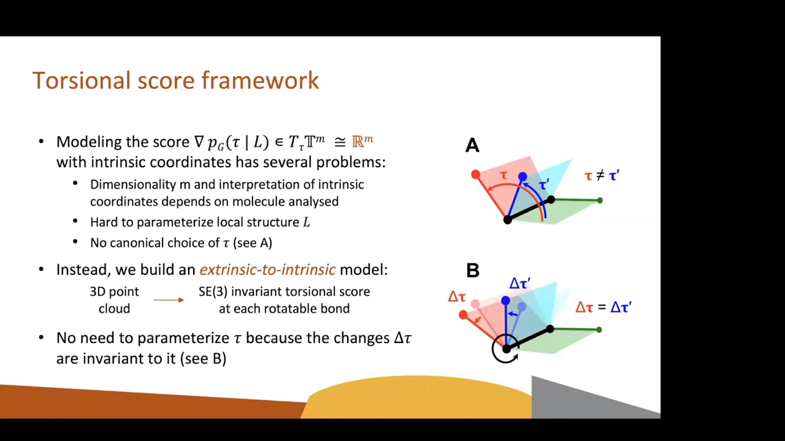

这张图的关键在右下角那组对照：在内在坐标里，同一条键可以选不同的四个点定义二面角，$\tau \neq \tau'$；但一旦固定局部结构，变化量总是相同的，$\Delta\tau = \Delta\tau'$。所以模型从不输出扭转角的具体数值，只输出它的变化量（[【跳转到 29:04】](https://www.youtube.com/watch?v=29veWh5Ls5s&t=1744)）。讲者说得更彻底：你甚至不需要定义任何一个扭转角，可以直接在三维空间里绕那根键旋转分子的一半（[【跳转到 30:19】](https://www.youtube.com/watch?v=29veWh5Ls5s&t=1819)）。

### 4.3 输出必须是赝标量

还有一个对称性要处理：底层能量是宇称不变的，同一分子图、同一局部结构的两个镜像能量几乎完全相同（[【跳转到 34:28】](https://www.youtube.com/watch?v=29veWh5Ls5s&t=2068)）。既然分布宇称不变，分数就必须宇称等变：只给每个键预测一个普通标量不够，必须预测 SE(3) 不变且宇称等变的量，物理文献里叫赝标量（pseudoscalar）（[【跳转到 35:18】](https://www.youtube.com/watch?v=29veWh5Ls5s&t=2118)）。

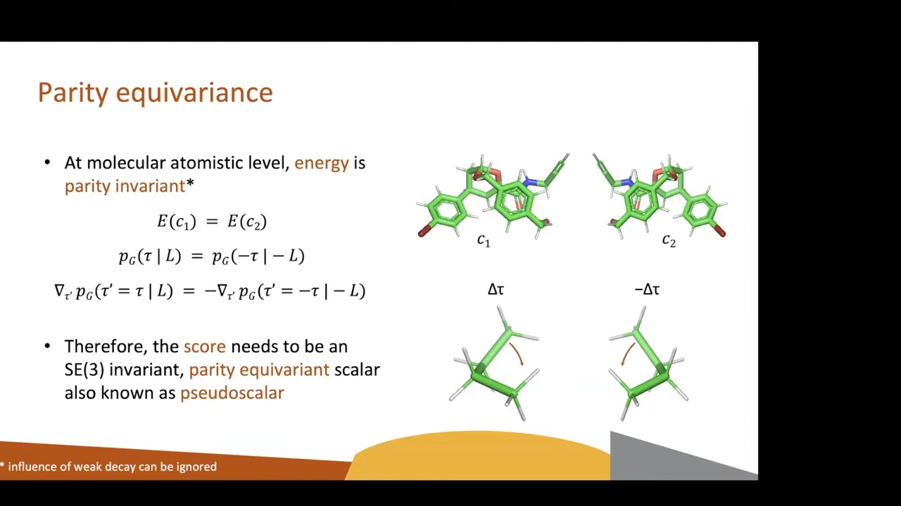

这张图把原因画得很直白：能量对两个镜像相同，那么若左边分子要顺时针旋转，右边分子就必须逆时针旋转。因为扭转角用叉积定义，镜像会让扭转角的正弦变号，也让要预测的修正量变号。

### 4.4 赝扭矩层

网络本身建立在 SE(3) 等变卷积网络上：四层消息传递为每个原子产生学到的特征嵌入，阶数最高到二阶，最后一层叫赝扭矩层（pseudotorque layer）（[【跳转到 37:48】](https://www.youtube.com/watch?v=29veWh5Ls5s&t=2268)）。它从可旋转键两端邻居的原子嵌入出发，为该键预测一个赝标量值，做法是一个三路张量积，滤波器是球谐函数与键轴自身表示的乘积。

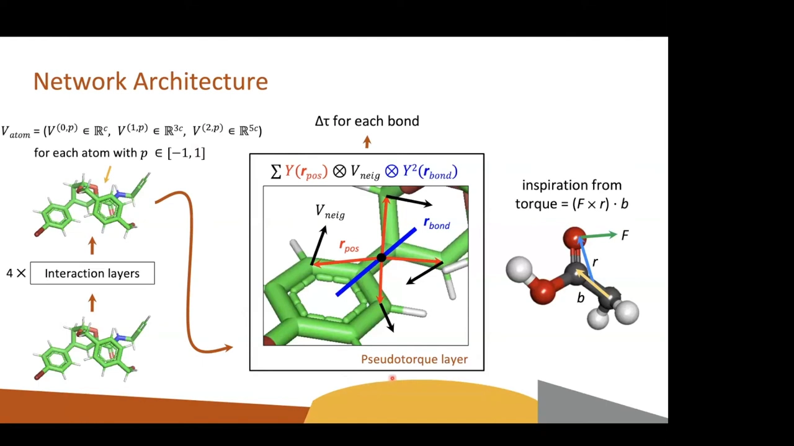

这张图右侧那个类比解释了名字的来历：如果你在相邻原子上有作用力，你会怎样计算扭矩，那就是一个三路乘积。之所以要把键轴放进滤波器，是因为否则滤波器对键的朝向一无所知，而预测绕键的扭转分数恰恰需要这个信息（[【跳转到 38:38】](https://www.youtube.com/watch?v=29veWh5Ls5s&t=2318)）。

## 五、训练与推理：输出是一串小修正量

训练时，遍历训练集的分子，随机选一个构象，在每个扭转角上按合适的噪声尺度采一个卷绕正态分布的扰动，用三维旋转把它作用到构象上，得到被扰动的构象喂给分数模型（[【跳转到 44:19】](https://www.youtube.com/watch?v=29veWh5Ls5s&t=2659)）。推理时从 RDKit 的构象出发拿到局部结构，为每个扭转角采一个均匀扰动，得到一个局部结构与 RDKit 完全相同、但扭转角随机的构象，然后反复应用逆扩散：算分数、按幅度缩放、每步加一点噪声，重复 20 次（[【跳转到 45:59】](https://www.youtube.com/watch?v=29veWh5Ls5s&t=2759)）。

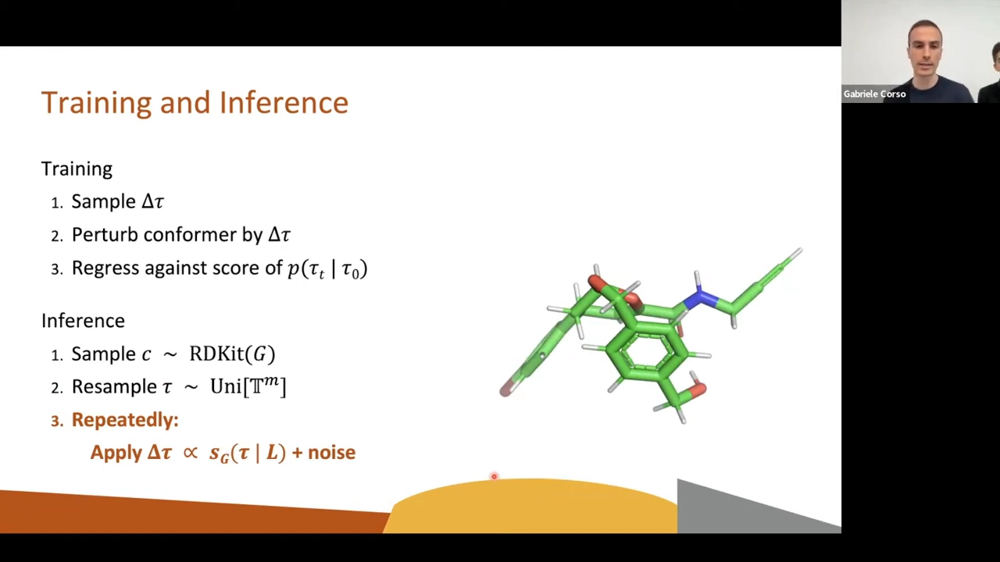

这张图说明输出对象还决定了推理的形态：模型输出的不是一次性给出的坐标，而是一串小步的 $\Delta\tau$。讲者用行星预测作类比：与其直接预测地球两年后的位置，不如每天看它的运动、累积到两年后（[【跳转到 74:17】](https://www.youtube.com/watch?v=29veWh5Ls5s&t=4457)）。论文里把步数一直减到接近直接预测，10 到 20 步是甜点（[【跳转到 70:07】](https://www.youtube.com/watch?v=29veWh5Ls5s&t=4207)）。

### 5.1 训练分布与推理分布必须对齐

这里有一个只属于坐标生成的坑。训练时用真实的局部结构，推理时用 RDKit 的局部结构，两者很像但有细微差别，这个分布偏移会让只在真实局部结构上训练的模型表现很差（[【跳转到 47:58】](https://www.youtube.com/watch?v=29veWh5Ls5s&t=2878)）。他们的补救办法是构象匹配：用 RDKit 得到局部结构，再用差分进化调整扭转角，让它在三维空间里尽量接近真实构象，把这个“适配过的构象”当作训练目标（[【跳转到 48:28】](https://www.youtube.com/watch?v=29veWh5Ls5s&t=2908)）。

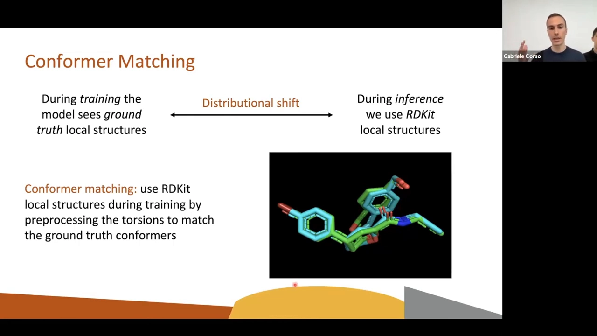

这张图背后有一个值得记住的观察：如果不做构象匹配，给定真实局部结构，模型能把整个真实构象恢复到 RMSD 小于 0.2 埃；而把同一个模型用到 RDKit 局部结构上，它几乎什么都预测不出来（[【跳转到 53:06】](https://www.youtube.com/watch?v=29veWh5Ls5s&t=3186)）。说明局部结构里那些极小的差异，包含了足以重建整个构象的信息——坐标生成模型对“输入的那一半”极其敏感。

## 六、评价对象是集合，不是单个构象

因为输出是集合，评价指标也必须是集合之间的距离。他们用的是系综 RMSD（ensemble RMSD）的两个方向：precision 是“我生成的一个构象，离真实集合里最近的构象有多远”，recall 是“我的集合覆盖了真实集合的多少个模态”（[【跳转到 58:44】](https://www.youtube.com/watch?v=29veWh5Ls5s&t=3524)）。基准是 GEOM-Drugs，约 30 万个类药分子，每个分子平均约 100 个构象（[【跳转到 57:29】](https://www.youtube.com/watch?v=29veWh5Ls5s&t=3449)）。

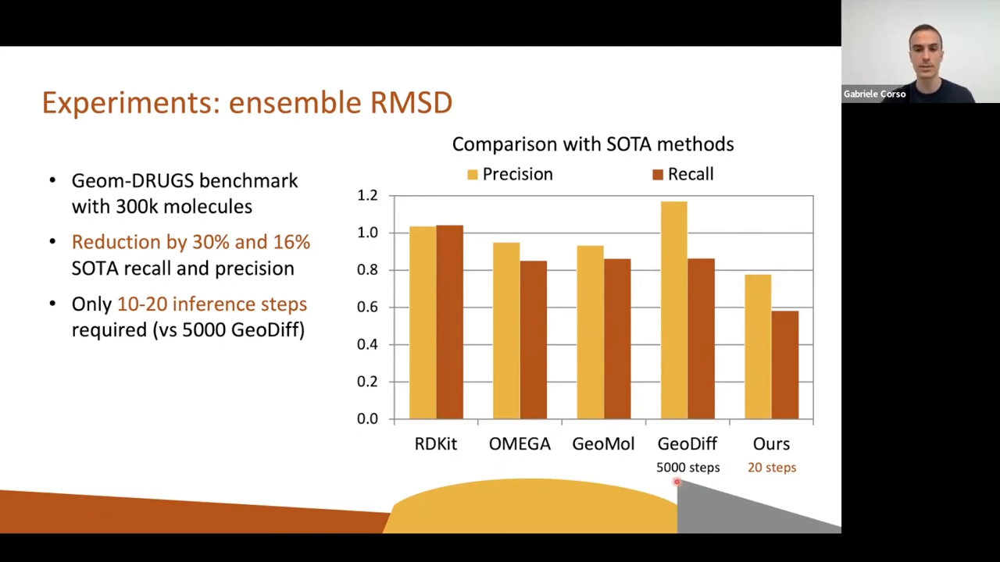

这张图给出两个和输出对象有关的结论。第一，评价的是集合之间的距离，不是单个样本的误差。第二，采样成本属于评价的一部分：他们的方法把最先进方法的误差降低了约 30%（recall）和 16%（precision），是第一个超过 Omega 这类化学信息学方法的机器学习方法（[【跳转到 59:34】](https://www.youtube.com/watch?v=29veWh5Ls5s&t=3574)），而 GeoDiff 要 5000 步才能得到有竞争力的结果，他们只要 20 步（[【跳转到 59:59】](https://www.youtube.com/watch?v=29veWh5Ls5s&t=3599)）。

## 七、坐标本身不含能量：能量只用来给生成的坐标排序

到这里，坐标生成这条流程里还没有出现过能量。它出现在评价环节：用这些方法生成一组构象，先用 xTB 对每个方法生成的构象做弛豫，再计算能量 $E$、偶极矩 $\mu$、HOMO-LUMO 能隙 $\Delta\epsilon$ 和最低能量 $E_{\min}$，看它们与真实 CREST 系综算出的性质有多接近（[【跳转到 61:14】](https://www.youtube.com/watch?v=29veWh5Ls5s&t=3674)）。

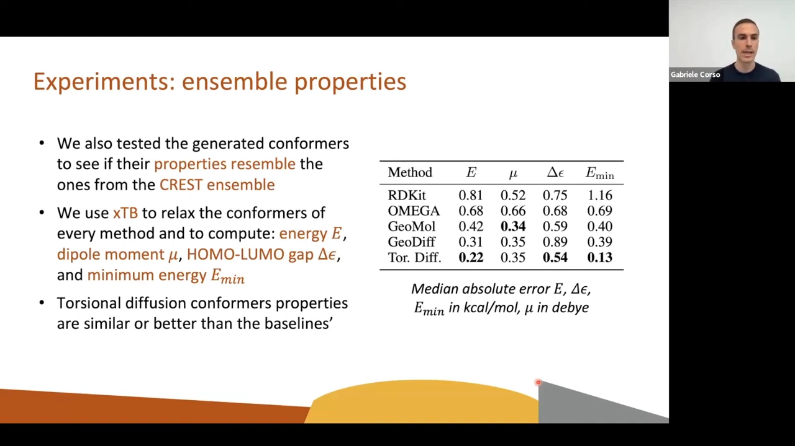

这张表是“坐标生成 + 外部能量打分”的样板：坐标生成负责给出结构，能量模型负责给这些结构打分，评价则落在能量与性质上。扭转角扩散在 $E$、$\Delta\epsilon$、$E_{\min}$ 三列上都是最好的，$E_{\min}$ 的误差是 0.13 kcal/mol（[【跳转到 64:09】](https://www.youtube.com/watch?v=29veWh5Ls5s&t=3849)）。

为什么 $E_{\min}$ 这一列特别重要？讲者把理由讲得很彻底：一个构象在室温水溶液里出现的概率正比于能量的负指数，也就是玻尔兹曼分布，对机器学习研究者来说相当于对构象做 softmax（[【跳转到 63:44】](https://www.youtube.com/watch?v=29veWh5Ls5s&t=3824)）。所以你可以生成 CREST 给出的 90% 的构象，但如果没生成低能量的那个，那基本没意义（[【跳转到 64:34】](https://www.youtube.com/watch?v=29veWh5Ls5s&t=3874)）。

这里要把关系说准：概率由能量定义，不由坐标定义。坐标生成模型输出的是结构，能量是外部给这些结构排序的标尺。讲者也承认现行评价有局限：系综 RMSD 并不是按能量加权的，某些设定下加权可能更合理，但他们沿用了文献现行的评价（[【跳转到 68:19】](https://www.youtube.com/watch?v=29veWh5Ls5s&t=4099)）。

## 八、把能量接进生成模型：从似然到玻尔兹曼生成器

坐标生成与能量真正接上的地方，是最后那部分实验。因为模型用基于分数的框架表述，可以通过概率流 ODE 得到精确的似然，把它看作一个从先验映射到数据分布的连续归一化流（[【跳转到 75:07】](https://www.youtube.com/watch?v=29veWh5Ls5s&t=4507)）。但玻尔兹曼分布是定义在欧几里得空间上的密度，而模型在环面上工作，所以要推导一个换算因子，把环面密度换算成欧几里得空间里的条件分布（[【跳转到 76:22】](https://www.youtube.com/watch?v=29veWh5Ls5s&t=4582)）。

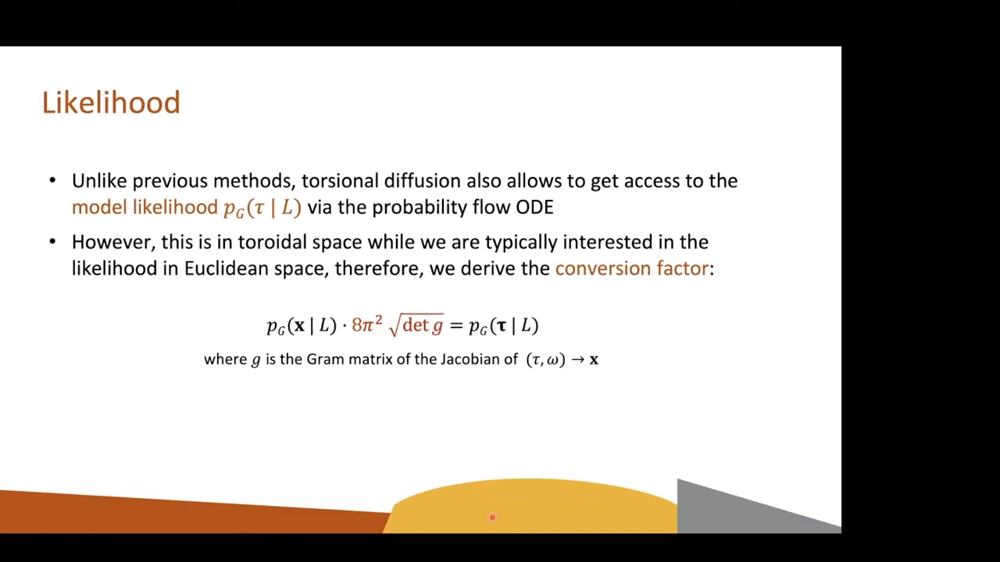

有了似然，才能谈玻尔兹曼生成器：它是一种生成模型，不匹配数据样本，而是匹配一个能量函数或对数密度；换句话说，玻尔兹曼生成器就是用能量函数而不是用数据来训练（[【跳转到 78:52】](https://www.youtube.com/watch?v=29veWh5Ls5s&t=4732)）。这在物理科学里非常重要，因为分子系统构象系综的分布本身就是由能量定义的，能量相当于负对数似然（[【跳转到 78:27】](https://www.youtube.com/watch?v=29veWh5Ls5s&t=4707)）。

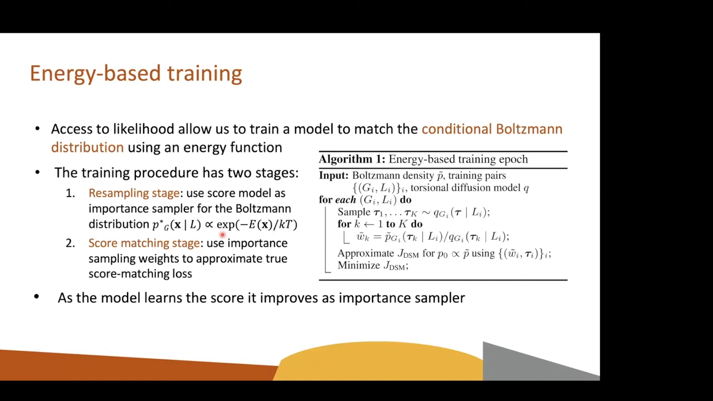

这张图是两阶段训练的算法框图：第一阶段把模型当作玻尔兹曼分布的重要性采样器，用模型密度加上真实能量函数对样本重新加权；第二阶段用这些样本按通常的分数匹配损失训练。与现有基于能量的训练方法的关键区别是：模型密度不用来更新权重，只在重采样阶段给抽到的样本重新加权（[【跳转到 81:22】](https://www.youtube.com/watch?v=29veWh5Ls5s&t=4882)）。实验里用的能量是 MMFF 经典力场（[【跳转到 83:27】](https://www.youtube.com/watch?v=29veWh5Ls5s&t=5007)）。

效果用有效样本量衡量：生成 32 个样本，若模型完美匹配玻尔兹曼密度，有效样本量就是 32；他们的模型 20 步时到 6，而调过参的退火重要性采样即便用 100 步也达不到这个水平（[【跳转到 91:11】](https://www.youtube.com/watch?v=29veWh5Ls5s&t=5471)）。

## 九、与另一支视频的分工

把这条线索收束一下：本文的输出对象只有一种——坐标（或它的扭转角表示），形状是一组 $N\times 3$ 位置或 $m$ 个扭转角；标签是整个构象；评价是集合之间的距离；能量始终在模型之外，只作为打分与训练目标出现。

另一支视频处理的是完全不同的两行：能量是一个构型一个标量，力是一个构型 $3N$ 个分量，而且这两者共享同一个标量势，力必须是能量对坐标的负梯度。那层一致性要求在这里没有对应物——扩散模型的公式里没有能量，它生成的坐标不天然对应任何势，也不保证力是某个势的梯度。要判断这些坐标好不好，必须再引入一个外部的能量或力模型去算，这正是玻尔兹曼生成器这条线的意义。力与能量一致性的完整推导留给 5.1.8。

## 小结

- **输出是集合里的样本**：构象生成要产出 $C \in C_G$，不是唯一正确答案；标签是整个构象，评价是集合之间的距离。
- **换输出空间就是换难度**：同一批分子，输出 $3N$ 维坐标是 132 维问题，输出可旋转键的扭转角是 8 维问题；代价是键长、键角完全交给化学信息学方法。
- **输出空间的几何决定扩散的边界条件**：扭转角构成环面，扰动核是卷绕正态分布，先验是均匀分布而不是高斯。
- **输入输出可以不对称**：模型输入三维点云，输出每个可旋转键一个标量；因为只学变化量 $\Delta\tau$，不需要为扭转角选一个规范定义。
- **输出类型决定对称性要求**：能量宇称不变，所以分数必须是宇称等变的赝标量，网络最后一层因此是赝扭矩层。
- **训练分布必须对齐推理分布**：真实局部结构与 RDKit 局部结构的细微差别会让模型失效，构象匹配就是为消除这个偏移而加的预处理。
- **坐标不含能量**：能量只作为外部打分（$E$、$E_{\min}$、玻尔兹曼排序）或作为玻尔兹曼生成器的训练目标出现；坐标生成本身不保证任何能量一致性。

## 关键术语速查

| 术语 | 一句话解释 |
| --- | --- |
| 构象（conformer） | 同一分子图在三维空间中的一种具体排布，由键长、键角与扭转角共同决定 |
| 外在坐标 | 用每个原子的三维位置描述构象，即 $3N$ 维点云，需对全局旋转平移做等价处理 |
| 内在坐标 | 用局部结构 $L$ 与扭转角 $\tau$ 描述构象，维度更低但与分子绑定 |
| 局部结构 $L$ | 键长、键角与环的构象，被视为容易预测、交给 RDKit 的自由度 |
| 扭转角（torsion angle） | 绕一根键旋转的角度，严格说是需要四个点定义的二面角 |
| 环面（torus） | 多个 $0$ 到 $2\pi$ 周期变量构成的空间，$2\pi$ 与 $0$ 是同一点，因此不是欧几里得空间 |
| 卷绕正态分布 | 把欧几里得高斯核按周期卷绕到环面上得到的扰动核 |
| 赝标量（pseudoscalar） | SE(3) 不变但在镜像下变号的量，宇称不变的能量所要求的分数类型 |
| 赝扭矩层 | 用三路张量积从键两端原子嵌入算出每个键扭转分数的输出层 |
| 构象匹配（conformer matching） | 用差分进化调整 RDKit 构象的扭转角，使其在三维空间接近真实构象的预处理 |
| 系综 RMSD | 生成构象集合与真实构象集合之间的距离，分 precision 与 recall 两个方向 |
| 玻尔兹曼分布 | 构象出现概率正比于能量负指数的分布，是构象系综的物理定义 |
| 玻尔兹曼生成器 | 用能量函数而非数据样本来训练的生成模型，目标是直接采样玻尔兹曼分布 |
| 有效样本量 | 重要性采样下样本的实际统计权重，用来衡量生成模型离目标分布有多远 |