# 力是能量的梯度，但等变不等于守恒：机器学习力场里两条必须分开的要求

> 视频来源：[第六课：机器学习分子力场与人工智能增强的分子模拟](https://www.bilibili.com/video/BV18sY4zoEEw/)（B 站 · MindSpore SPONGE 第五季暑期学校 · 范成，北京大学）｜时长约 53 分钟
> 简要导读：这支课把机器学习力场的设计约束拆成三条：能量守恒、旋转平移不变、相同原子不可区分。本文沿着这三条约束走，重点回答两个常被混在一起的问题：力为什么是能量对坐标的负梯度，以及“等变”与“守恒”为什么是两条独立的要求。三类输出对象（能量、力、应力）的形状与清单见 [5.1.7](../5.1.7_坐标生成、力预测与能量建模/力必须是能量对坐标的负梯度：同一个标量势同时拟合能量、力与应力.md)，本文不重复。

## 本讲要解决的核心问题（SCQA）

**背景**：机器学习力场要替代第一性原理计算，给出任意原子构型 $R$ 的能量与力。最常见的做法是先让网络输出一个标量能量，再对坐标求导得到力；训练数据则来自量子化学计算给出的能量、力，或两者的组合（[【跳转到 04:40】](https://www.bilibili.com/video/BV18sY4zoEEw/?t=280)）。

**冲突**：既然力可以直接作为标签回归，为什么还要绕一圈、先学能量再求导？反过来，一个模型只要把能量做成旋转不变的，它的力就一定“物理正确”吗？在实际模型里，“旋转后能量不变”“力是某个能量的梯度”“力场等变”经常被当成同一件事来说，但它们约束的其实是不同的东西。

**疑问**：从标量能量到 $3N$ 个力分量，求导到底怎么走？直接回归力和由势能导出力，在一致性、数据效率、误差传播上差在哪里？几何对称与能量守恒，各自管什么、不管什么？

**回答（中心思想）**：力是能量对坐标的负梯度，这是链式法则的结果；由能量求导把“能量与力一致”变成模型结构自带的保证，代价是两者的误差被绑在同一个势能面上。几何对称管的是“坐标变换后输出怎么变”，能量守恒管的是“是否存在一个标量势使力是它的梯度”，两者互不蕴含：一个等变的力场可以不是保守场，一个保守的力场也可以不满足某种对称性。设计模型时必须把这两条分开检查。

## 一、先把两条要求分开：一条管变换，一条管积分

讲者在进入具体模型之前，先列出机器学习力场应该满足的三条物理约束：能量守恒、旋转平移不变、相同原子不可区分（[【跳转到 07:18】](https://www.bilibili.com/video/BV18sY4zoEEw/?t=438)）。

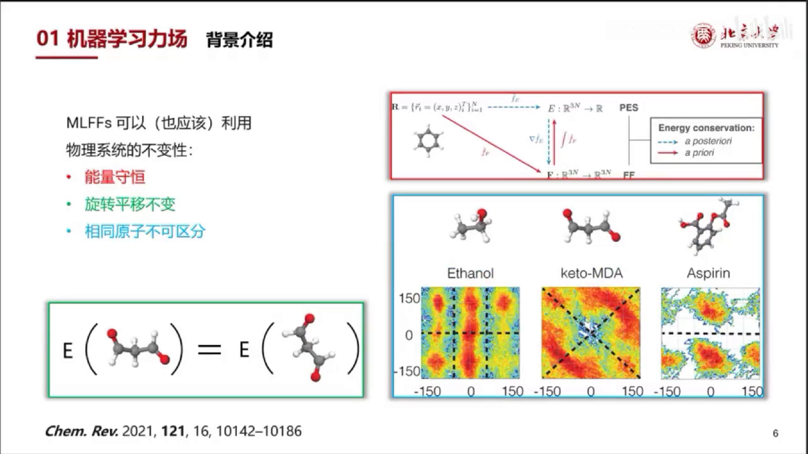

这张幻灯片把本文的主线画了出来。右上角的红色框里，$R$ 是 $3N$ 维坐标，$E$ 是势能面（PES），$F$ 是力场（FF）；从 $E$ 指向 $F$ 的实线箭头标着 $\nabla f_E$，旁边写着 “Energy conservation: a priori / a posteriori”。也就是说，守恒可以来自模型结构（先验），也可以在训练后回头检查（后验）。

三条约束里，第一条和第二条经常被混为一谈，先把它们各自的含义摆清楚。

| 要求 | 约束的是什么 | 典型检验 | 违反后的表现 |
| --- | --- | --- | --- |
| 几何对称（旋转、平移） | 坐标变换后能量与力如何变换 | 把构型整体旋转，看 $E$ 是否不变、$F$ 是否跟着转 | 模型学到“朝哪个方向”的伪特征，换个朝向预测就变 |
| 置换对称（相同原子不可区分） | 输入原子顺序改变后输出是否改变 | 打乱同种原子的编号，看 $E$ 是否不变 | 同一构型因输入顺序不同给出不同能量 |
| 能量守恒（保守力场） | 是否存在一个标量势 $E$，使 $F=-\nabla E$ | 沿闭合路径积分 $\oint F\cdot dR$ 是否为零 | 分子动力学里总能量漂移，没有可用的势能面 |

前两条是**对称性**：它们说的是“对输入做某个变换，输出应该怎么变”。第三条是**可积性**：它说的是“这 $3N$ 个力分量能不能由同一个标量函数求导得到”。一个力场可以满足前两条而不满足第三条，也可以满足第三条而不满足前两条。这个判断是后面所有比较的支点。

## 二、推导：$3N$ 个力分量从同一个标量势来

### 2.1 模型先写成一个标量函数

机器学习力场的常见结构是：总能量等于每个原子局域能量之和，每个原子的局域能量只取决于它周围的局域环境（[【跳转到 12:36】](https://www.bilibili.com/video/BV18sY4zoEEw/?t=756)）。

$$
E(R) = \sum_{i=1}^{N} E_i, \qquad E_i = f_\theta\big(\{D_{i,a}(R)\}_{a}\big)
$$

其中 $R=(\mathbf{r}_1,\dots,\mathbf{r}_N)\in\mathbb{R}^{3N}$ 是所有原子坐标，$D_{i,a}$ 是以原子 $i$ 为中心的第 $a$ 个描述符。描述符是坐标的函数：可以是两原子距离 $r_{ij}$、距离的倒数 $1/r_{ij}$，也可以是距离倒数乘上某个分量（[【跳转到 15:26】](https://www.bilibili.com/video/BV18sY4zoEEw/?t=926)）。

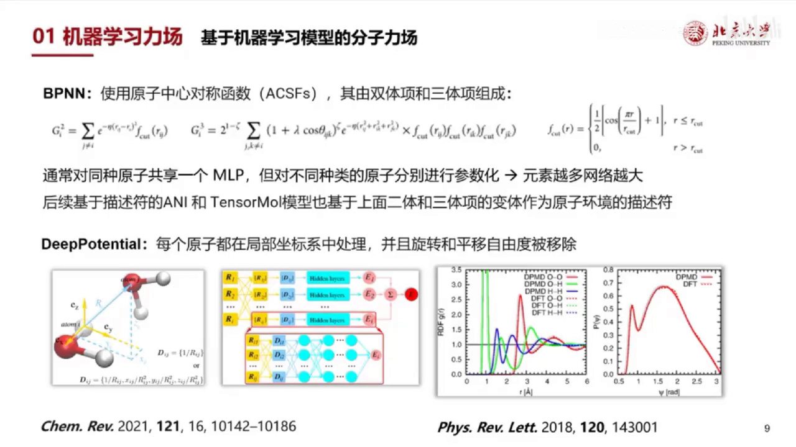

这张图给出推导所需的两个事实：描述符是坐标的显式函数；总能量是这些局域能量之和。只要这两点成立，力就没有独立的自由度。

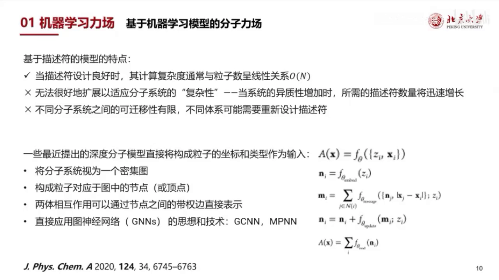

这张幻灯片把“求和”写成了最后一行 $A(x)=\sum_i f_{\text{read}}(\mathbf{n}_i)$。不管中间的消息传递多复杂，输出总是一个标量；这个标量对坐标的导数就是力。

### 2.2 对坐标求导：链式法则走两遍

力定义为能量对坐标的负梯度：

$$
\mathbf{F}_j = -\frac{\partial E}{\partial \mathbf{r}_j}
$$

把 $E=\sum_i E_i$ 代进去，求和与求导交换：

$$
\mathbf{F}_j = -\sum_{i=1}^{N}\frac{\partial E_i}{\partial \mathbf{r}_j}
$$

每个 $E_i$ 不是直接吃坐标，而是吃描述符，所以还要再走一层链式法则：

$$
\frac{\partial E_i}{\partial \mathbf{r}_j}
= \sum_{a}\frac{\partial E_i}{\partial D_{i,a}}\,\frac{\partial D_{i,a}}{\partial \mathbf{r}_j}
$$

合起来就是完整的表达式：

$$
\mathbf{F}_j = -\sum_{i=1}^{N}\sum_{a}\frac{\partial E_i}{\partial D_{i,a}}\,\frac{\partial D_{i,a}}{\partial \mathbf{r}_j}
$$

这个式子里有三个角色。$\partial E_i/\partial D_{i,a}$ 是网络自己学到的“局域能量对描述符有多敏感”；$\partial D_{i,a}/\partial \mathbf{r}_j$ 是描述符的解析导数，只由几何定义决定；最外层的负号来自力的定义。网络只负责第一项，后两项是固定的数学结构。

### 2.3 一个具体例子：两体距离

取最简单的描述符 $D=r_{ij}=\lVert \mathbf{r}_i-\mathbf{r}_j\rVert$。对 $\mathbf{r}_j$ 求导：

$$
\frac{\partial r_{ij}}{\partial \mathbf{r}_j}
= \frac{\mathbf{r}_j-\mathbf{r}_i}{r_{ij}}
= \hat{\mathbf{r}}_{ij}
$$

其中 $\hat{\mathbf{r}}_{ij}$ 是从 $i$ 指向 $j$ 的单位向量。如果描述符用距离的倒数 $D=1/r_{ij}$，则

$$
\frac{\partial (1/r_{ij})}{\partial \mathbf{r}_j}
= -\frac{\hat{\mathbf{r}}_{ij}}{r_{ij}^2}
$$

两项只差一个标量因子，方向都沿着两原子连线。这就是为什么由能量求导得到的力天然沿着键的方向：**方向信息来自描述符对坐标的导数，大小信息来自网络对描述符的导数**。三体项、二面角项、局部坐标框架的分量，只是把 $\partial D/\partial \mathbf{r}_j$ 换成了更复杂的几何导数，链式法则的结构不变。

### 2.4 两个直接推论

第一，如果 $E$ 只依赖相对坐标（距离、夹角、局部框架内的分量），它自动满足平移不变。对整体平移 $\mathbf{r}_j\to\mathbf{r}_j+\mathbf{a}$ 求导，得到所有力之和为零：

$$
\sum_{j=1}^{N}\mathbf{F}_j = -\frac{\partial E}{\partial \mathbf{a}} = 0
$$

第二，如果 $E$ 在旋转下不变，那么 $F=-\nabla E$ 会自动等变。设 $Q$ 是旋转矩阵，$E(QR)=E(R)$，对两边关于 $R$ 求导，用链式法则得到

$$
\nabla E(QR) = Q\,\nabla E(R)
\quad\Longrightarrow\quad
F(QR) = Q\,F(R)
$$

这条式子值得停一下：**能量的不变性，已经把力的等变性“送”出来了**。模型不需要额外设计一个等变的向量输出头，只要能量是旋转不变的标量，再对它求导，力就会跟着坐标一起转。这也是“先学能量、再求导”在对称性上的额外好处。

## 三、直接回归力：可以很准，但不保证是某个能量的梯度

### 3.1 两条路线，差别在“先验”还是“后验”

讲者把两条路线说得很直接：如果模型从预测能量出发，力是能量对坐标的梯度，那它肯定满足能量守恒；如果模型预测的是受力，再从力回到能量，就可能不满足能量守恒，需要做额外设计（[【跳转到 07:43】](https://www.bilibili.com/video/BV18sY4zoEEw/?t=463)）。

这两句话对应两种不同的保证方式：

- **先验守恒**：模型结构里只有一个标量势，力是它的导数。只要前向计算没错，守恒自动成立，不需要训练后再验证。
- **后验守恒**：模型直接输出力，训练完再检查这组力能不能积分出一个能量。检查可能通过，也可能不通过；不通过时，模型仍然可以拟合得很好。

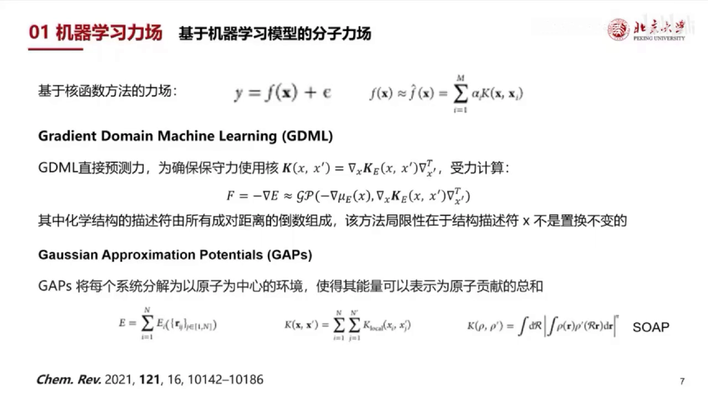

这张幻灯片是一个关键的反例，说明“直接回归力”并不必然等于“不守恒”。GDML 直接预测力，但它的核函数不是普通核，而是

$$
K(x,x') = \nabla_x K_E(x,x')\,\nabla_{x'}^{T}
$$

受力写成

$$
F = -\nabla E \approx \mathcal{GP}\big(-\nabla\mu_E(x),\ \nabla_x K_E(x,x')\,\nabla_{x'}^{T}\big)
$$

也就是说，它在力的空间里做回归，却把核函数构造成“某个能量核的二阶导数”。这样得到的力场仍然是一个标量势的梯度，守恒是先验保证的。代价是核函数被限制在这个形式里，不能随便换。

### 3.2 一般情形：向量场不一定是梯度场

如果没有 GDML 这样的特殊设计，直接回归力得到的是一个普通的向量场 $F_\theta(R)$。对任意向量场，沿闭合路径的积分不一定为零：

$$
\oint F_\theta(R)\cdot dR \neq 0
$$

这时就不存在一个单值的标量函数 $E$ 使 $F_\theta=-\nabla E$。从数学上说，这是“向量场是否可积”的问题；从物理上说，这意味着模型给出的力没有共同的能量零点，无法定义势能面。

一个具体的后果是跨相比较。力是逐原子的局部量，它告诉你每一步往哪走，但不告诉你两个相谁的能量更低。只拟合力、丢掉能量，就丢掉了跨相所需的共同零点。这一点在 [5.1.7](../5.1.7_坐标生成、力预测与能量建模/力必须是能量对坐标的负梯度：同一个标量势同时拟合能量、力与应力.md) 里已经从相变和自由能的角度展开过，这里只保留它与“可积性”的关系：**没有标量势，就没有全局的能量高低**。

### 3.3 一个模型可以“守恒但不对称”

GDML 的例子还能说明另一件事。它的描述符由所有成对距离的倒数组成，讲者明确指出这个描述符对结构 $x$ 不是置换不变的：调整原子顺序，预测就不一样（[【跳转到 11:22】](https://www.bilibili.com/video/BV18sY4zoEEw/?t=682)）。他们后来才用对称化的方法补上这一点。

于是我们得到一个很干净的组合：GDML 的力场是保守的（核函数保证），但它的输入表示不满足置换对称。**守恒成立，对称不成立**。这就直接证明了第三条要求不能从前两条推出来，反过来也一样。

## 四、由能量求导：一致性是结构保证，误差也被绑在一起

### 4.1 一致性从哪里来

由能量求导的模型只有一个标量函数。能量和力共享同一组参数、同一个前向计算图，力只是这个图对输入坐标的反向传播。因此“能量与力一致”不是训练出来的性质，而是计算图的结构性质：只要能量算对了，力就是它的斜率；只要力算错了，错也错在同一个势能面上。

这和“分别训练一个能量头和一个力头”有本质区别。后者即使两个头都很准，也不能保证力头输出的向量场能积分回能量头输出的标量场。两个头各自拟合自己的标签，误差互不相关，一致性只能事后检查。

### 4.2 数据效率：一个构型只有一个能量，却有 $3N$ 个力标签

讲者用 SchNet 在 MD17 上的结果说明了力标签的价值：如果模型仅在能量上训练，训练数据点比较少时表现比较差；加入力的信息之后，效果显著改善（[【跳转到 20:21】](https://www.bilibili.com/video/BV18sY4zoEEw/?t=1221)）。

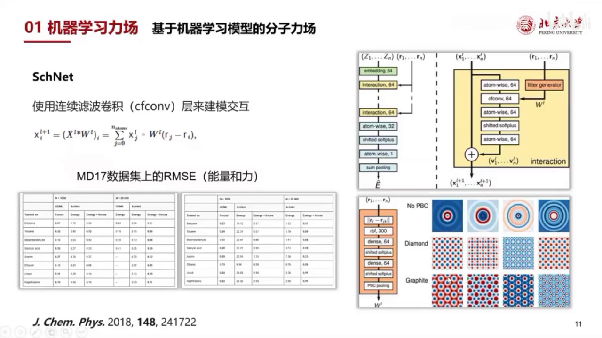

这张表把“监督粒度”落到了数字上。左边是能量误差，右边是力误差；每一列又分成 Energy 和 Energy + Force 两种训练设置。可以看到，加力之后两类误差都下降，数据点少时差距更明显。

原因不复杂：对一个构型来说，你可能只有一个能量标签，但这个构型的力有 $3N$ 个标签（[【跳转到 21:11】](https://www.bilibili.com/video/BV18sY4zoEEw/?t=1271)）。能量给出的是势能面的“高度”，力给出的是势能面在每个原子位置上的“斜率”。斜率标签更多、更局部，对形状的约束更强。

但数据效率的账不能只算标签数量。由能量求导时，$3N$ 个力分量不是 $3N$ 个独立监督信号，它们全部来自同一个标量函数。模型不能靠“每个分量各自拟合”来降低训练误差，必须找到一个能同时解释所有分量的势能面。这既是约束，也是正则化：它排除了那些“每个力都差不多对、但彼此不兼容”的解。

### 4.3 误差传播：能量误差和力误差不是同一件事

由能量求导的模型，力误差是能量误差的导数。这句话有两个方向。

第一，能量的小误差可能对应力的较大误差。如果能量误差是一个缓慢变化的偏移，它的导数很小，力看起来很好；如果能量误差是高频抖动，即使幅值不大，导数也会被放大。反过来，能量误差很大但几乎是个常数偏移时，力可以完全正确，因为求导把常数消掉了。

第二，力的误差不能直接积分成能量误差。直接回归力的模型，每个分量独立拟合，力误差可以很小，但这些力不一定能积分出一个单值能量；即使能积分，积分常数也没有确定。所以“力 RMSE 很低”并不等于“势能面很准”，反之亦然。

这就是为什么由能量求导的模型在报告误差时要分开报告：能量按构型算，力按分量算，两者的量纲、数量级和评价对象都不同。共享一个标量势保证的是自洽，不是两类误差一样大。

### 4.4 训练时的取舍

共享参数也带来一个实际取舍：能量和力的损失要加权。力有 $3N$ 个分量，能量只有一个标量，如果直接相加，力项会主导梯度。讲者没有展开具体的加权方案，但从“能量和力由同一个势拟合”这个前提可以推出：加权不是在两个独立任务之间分配注意力，而是在同一个势能面的“高度误差”和“斜率误差”之间做权衡。

## 五、几何对称：不变的能量，等变的力

### 5.1 不变与等变的定义

讲者给出了两个定义（[【跳转到 24:31】](https://www.bilibili.com/video/BV18sY4zoEEw/?t=1471)）。设 $G$ 是对称群，$g\in G$ 是一个群操作，$D(g)$ 是作用在坐标上的变换，$S(g)$ 是作用在输出空间上的变换。函数 $f$ 关于 $G$ 等变，如果

$$
S(g)\,f(x) = f\big(D(g)x\big)
$$

函数 $f$ 关于 $G$ 不变，如果

$$
f(x) = f\big(D(g)x\big)
$$

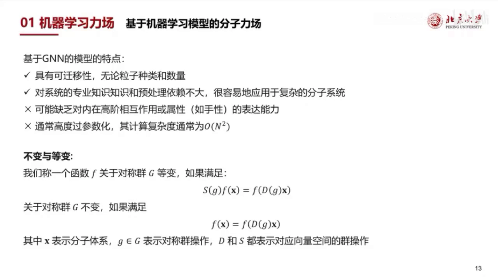

这张幻灯片把两个定义并排放在一起，差别只在等号左边有没有 $S(g)$。对分子体系，$x$ 是原子坐标，$g$ 是旋转、平移或置换。能量是标量，输出空间没有方向，所以 $S(g)$ 是恒等映射，不变和等变在能量上重合；力是向量，$S(g)$ 就是旋转矩阵，两者才分开。

### 5.2 为什么“能量不变”会自动给出“力等变”

上一章已经推过一遍：$E(QR)=E(R)$ 对 $R$ 求导，得到 $F(QR)=QF(R)$。这里补上直观解释。能量是标量，旋转整个分子不改变它的数值；力是能量下降最快的方向，整个分子旋转后，下降最快的方向也跟着旋转同一个角度。所以只要能量对朝向不敏感，力就必然跟着朝向走。

这条推论有一个很实用的后果：**做等变力场，不一定要做等变的向量输出**。把能量做成不变的标量，再对它求导，力自动等变。很多模型只在能量这一层处理对称性，力层不再单独设计，原因就在这里。

### 5.3 三条实现路线

讲者把等变模型的发展概括为从 E(3) 到 O(3) 再到 SO(3) 的过程（[【跳转到 36:56】](https://www.bilibili.com/video/BV18sY4zoEEw/?t=2216)）。对分子力场，平移和反射没有那么重要，所以现在更多关注 SO(3) 等变。

第一条路线是**不变的描述符**。DeePMD 把每个原子放在局部坐标系里处理，旋转和平移的自由度被移除，网络看到的只是局部环境的内禀几何量（[【跳转到 15:26】](https://www.bilibili.com/video/BV18sY4zoEEw/?t=926)）。这类模型输出不变的能量，力由求导得到，因此力是等变的。

第二条路线是**等变的中间表示**。Allegro 把特征分成标量更新 $x$ 和张量更新 $V$，嵌入用贝塞尔径向基函数乘球谐函数，更新时聚合邻居表示、做张量外积，最后得到标量去预测能量（[【跳转到 25:26】](https://www.bilibili.com/video/BV18sY4zoEEw/?t=1526)）。

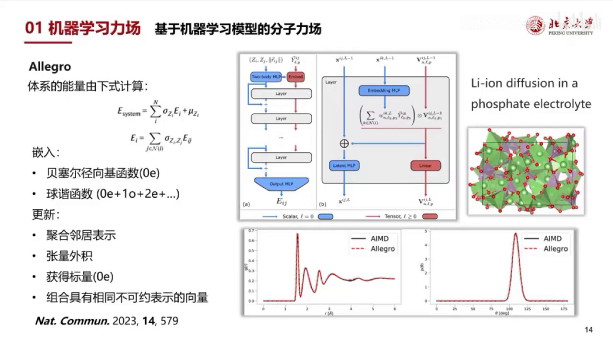

这张图的关键是右侧的蓝色和红色箭头：标量特征（$\ell=0$）和张量特征（$\ell\ge 0$）走不同的通道，最后汇合到标量能量。等变性不是靠数据增广学出来的，而是靠特征按表示组织、运算只允许特定组合来保证的。

第三条路线是**点积标量化**。讲者引用了一个定理：如果 $f$ 是 O(n) 不变标量函数，输入是向量 $v_1,\dots,v_n$，那么 $f$ 可以表示成只依赖这些向量两两点积的函数（[【跳转到 37:51】](https://www.bilibili.com/video/BV18sY4zoEEw/?t=2271)）。

$$
f(v_1,\dots,v_n) = g\Big(\big(v_i^{T}v_j\big)_{i,j=1}^{n}\Big)
$$

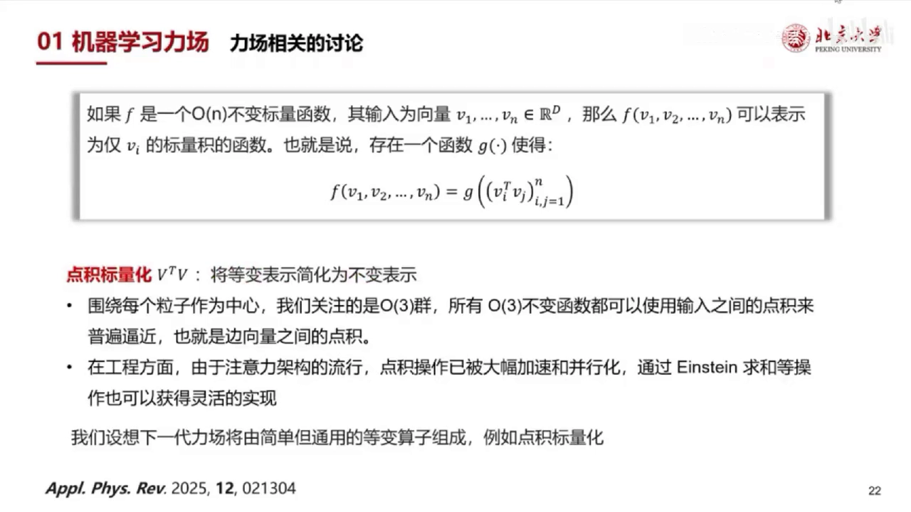

这张图说明了一条构造不变量的通用办法：等变向量之间的点积是旋转不变的标量。工程上，注意力架构让点积运算被大幅加速和并行化，所以这条路线在实现上很有吸引力。

### 5.4 置换对称是另一条轴

除了旋转和平移，还有“相同原子不可区分”。讲者用 123 和 132 的例子说明：同样的原子，输入顺序不同，能量不应该不同（[【跳转到 08:33】](https://www.bilibili.com/video/BV18sY4zoEEw/?t=513)）。这条要求约束的是输入的顺序，不是坐标的朝向。它和旋转不变性经常一起出现，但来源不同：旋转不变来自空间的各向同性，置换不变来自同种粒子的不可区分性。

## 六、把两条要求放进同一个模型：$U=g_I(g_E(x))$

### 6.1 组合式

讲者在讨论力场设计时给了一个很清楚的组合式（[【跳转到 36:31】](https://www.bilibili.com/video/BV18sY4zoEEw/?t=2191)）：理想的力场 $U(x)$ 应该关于 $x$ 是 E(3) 不变的，实际构建时可以用一个不变函数 $g_I$ 和一个等变函数 $g_E$ 组合：

$$
U(x) = g_I\big(g_E(x)\big)
$$

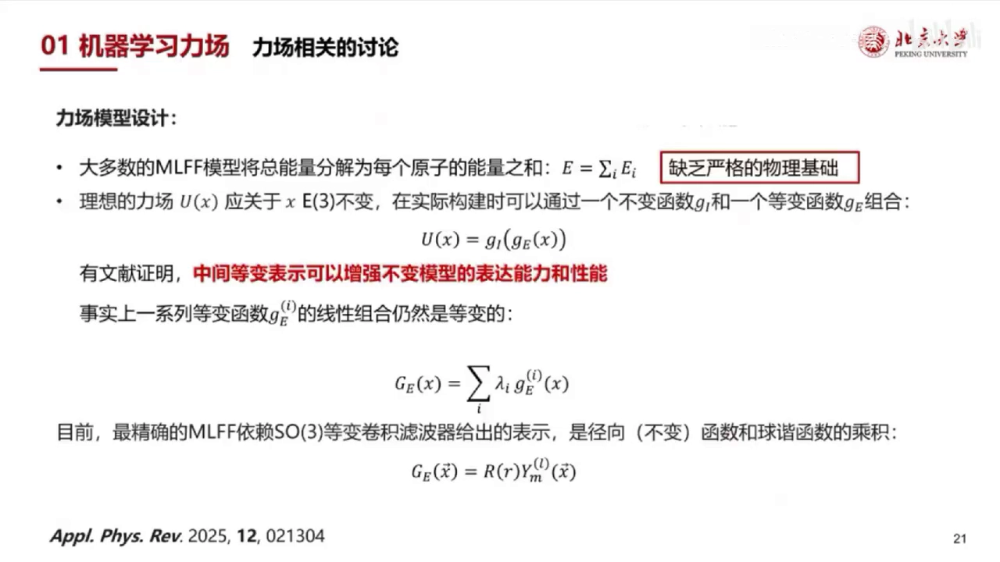

这张幻灯片同时给了两个重要提醒。第一，大多数机器学习力场把总能量分解成每个原子的能量之和 $E=\sum_i E_i$，讲者明确标注这“缺乏严格的物理基础”：物理上没有“每一个原子的能量”这样的说法，这是模型为了同时拟合能量和力而引入的结构假设。第二，中间引入等变表示可以增强不变模型的表达能力和性能；目前最精确的机器学习力场依赖 SO(3) 等变卷积滤波器，形式是径向不变函数乘球谐函数 $G_E(\vec{x})=R(r)Y_m^{(l)}(\vec{x})$。

### 6.2 两条要求各自落在哪一层

把前面的推导和这一章的组合式放在一起，可以得到一张分工表。

| 要求 | 落在模型的哪一层 | 怎么保证 | 不保证什么 |
| --- | --- | --- | --- |
| 几何对称 | 输入表示与中间特征（$g_E$） | 用不变量、等变特征、球谐与点积构造 | 不保证力是某个能量的梯度 |
| 能量守恒 | 输出层与求导关系（$U\to F=-\nabla U$） | 只输出一个标量势，力由求导得到 | 不保证势能面准确，也不保证对称 |
| 置换对称 | 聚合与读出 | 用求和、均值等置换不变的聚合 | 不保证旋转不变或守恒 |

这张表是本文的核心结论。三条要求分别落在不同的层，用不同的机制保证，不能互相替代。

### 6.3 四种组合，帮助记住“互不蕴含”

把“是否对称”和“是否守恒”两两组合，可以列出四种情形。每一种在真实模型里都能找到对应。

| 情形 | 是否守恒 | 是否满足对称要求（旋转/置换） | 例子 |
| --- | --- | --- | --- |
| 先学能量再求导，能量用不变描述符 | 是 | 是 | DeePMD、SchNet 这类模型 |
| 直接回归力，但核函数设计成能量核的导数 | 是 | 否（原始 GDML 描述符不置换不变） | GDML |
| 直接回归力，用普通等变网络输出向量 | 否 | 是 | 只做力回归的等变力场 |
| 直接回归力，普通网络 | 否 | 否 | 最朴素的力回归基线 |

第三行是最容易被忽略的情形：一个模型可以完全等变，力随坐标旋转而旋转，但它给出的向量场仍然不是任何标量势的梯度。等变性只约束“怎么转”，不约束“能不能积分”。

## 七、工程实现：可微势能加自动微分

### 7.1 AI 训练与 MD 模拟是同一张图

讲者把人工智能训练和分子动力学模拟放在一起对照（[【跳转到 41:13】](https://www.bilibili.com/video/BV18sY4zoEEw/?t=2473)）：数据集对应轨迹，网络结构对应模拟体系，网络参数对应体系坐标，损失函数对应势能函数，优化器对应积分器。

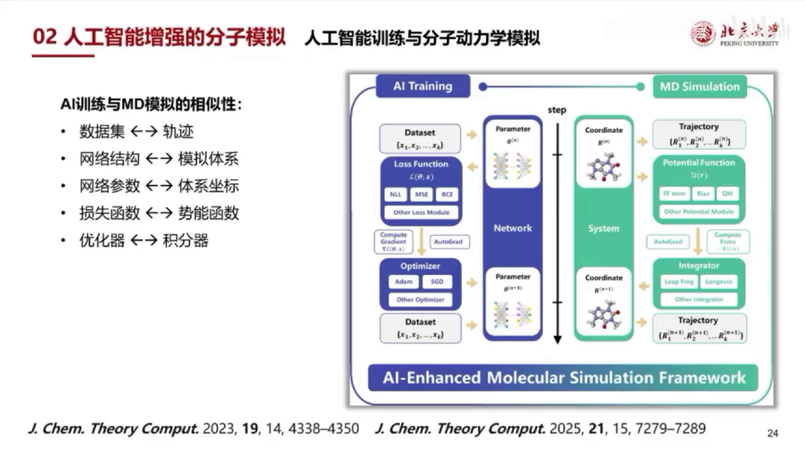

这张图右侧的 MD 流程里有一个箭头写着 “Compute Force $-\nabla U(r)$”，它和左侧的 “Compute Gradient $\nabla\mathcal{L}(\theta,x)$” 是同一个操作。训练时对参数求导，模拟时对坐标求导；求导对象不同，自动微分的机制相同。

### 7.2 只需要可微的势能函数

在 AI 框架里重新实现 MD，最大的好处是自动微分：只需要给出可微分的势能函数，不需要解析地求解它的梯度（[【跳转到 42:03】](https://www.bilibili.com/video/BV18sY4zoEEw/?t=2523)）。

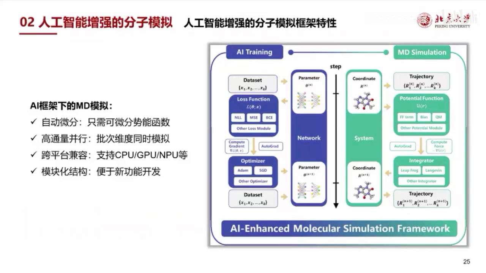

这张幻灯片把“自动微分”列为第一条特性，并写明“只需可微分势能函数”。这条特性直接支撑了本文的主题：只要模型前向给出一个标量，反向传播就给出力，一致性由计算图保证，不需要为力单独写一套解析公式。

讲者还提到一个更复杂的用法：集合变量（CV）的导数。有些 CV 形式上很复杂，手写导数很麻烦；可以把 CV 以能量的形式给出，让自动微分去求导（[【跳转到 43:34】](https://www.bilibili.com/video/BV18sY4zoEEw/?t=2614)）。这和力是同一个模式：**把“求导”这件事交给框架，人只负责写标量函数**。

### 7.3 代价与边界

自动微分不是免费的。反向传播要保存前向计算的中间量，内存随图的大小增长；对 $3N$ 个坐标求一次梯度，计算量大约是一次前向的常数倍。对 MD 来说，每一步都要算力，这笔开销直接进入模拟速度。讲者给出的速度表显示，机器学习力场相对第一性原理可以加速几十倍，但加上 32 个路径积分珠子后，整体加速仍然在千倍量级（[【跳转到 51:00】](https://www.bilibili.com/video/BV18sY4zoEEw/?t=3060)）。

另一条边界是：自动微分保证的是“力等于你所写标量的梯度”，不保证“你所写的标量是对的”。如果势能函数本身错了，求导只会把错误一致地传播到力上。这就是下一章要说的“一致不等于正确”。

## 八、一致性在模拟里兑现什么

### 8.1 势能面：从反应路径到能垒

有了可微的势能函数，就可以用机器学习力场配合增强采样去探索反应势能面。讲者举了 Claisen 重排的例子：半经验 DFT 虽然快，但它给出的势能面描述是定性错误的；要描述得比较准确，就得使用精度更高的力场（[【跳转到 46:52】](https://www.bilibili.com/video/BV18sY4zoEEw/?t=2812)）。

这里的关系值得说清楚：势能面是能量，反应路径上的力是能量的梯度。只有两者来自同一个标量势，沿路径积分得到的能垒才和力一致。如果力和能量是两个独立的头，路径上的力可能指向一个方向，而能量面在另一个方向有极小值，增强采样就会被误导。

### 8.2 核量子效应：同一个势能面，换一种采样

讲者用路径积分分子动力学（PIMD）处理核量子效应：把一个原子换成一系列副本，相邻副本之间用谐振子势连接（[【跳转到 49:26】](https://www.bilibili.com/video/BV18sY4zoEEw/?t=2966)）。甲酸二聚体双质子转移的例子中，考虑核量子效应后，能垒从 4.4 kcal/mol 降到一点几 kcal/mol（[【跳转到 50:35】](https://www.bilibili.com/video/BV18sY4zoEEw/?t=3035)）。

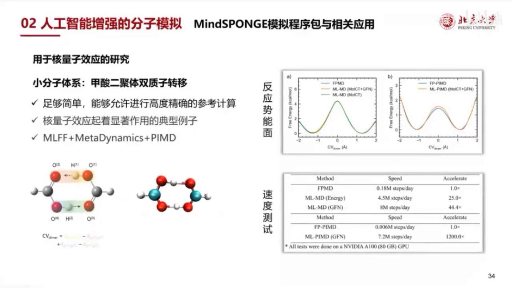

这张图把两件事放在一起：左上和右上是自由能曲线，下面是速度表。它说明一致性带来的不只是“力算得快”，而是同一个势能面可以被不同的采样方法反复使用：经典 MD、PIMD、增强采样，用的都是同一个 $U$ 和它的梯度。

### 8.3 能量守恒在 MD 里的实际含义

分子动力学每一步用积分器更新坐标和速度。如果力不是某个势能的梯度，就不存在一个在积分过程中守恒的总能量；时间步长缩小只能减小积分误差，不能恢复一个不存在的守恒量。讲者把“能量守恒”列为力场的第一条物理约束，原因就在这里：它决定了模拟能不能用能量守恒作为正确性的自检，也决定了系综和热力学量有没有可靠的基础。

但要注意，能量守恒是模型性质与积分性质共同的结果。一个保守力场配上一个粗糙的积分器，总能量仍然会漂移；一个非保守力场配上很小的步长，漂移可能暂时看不出来。所以“跑出来能量守恒”不能反推“力场一定保守”，还需要检查力场本身是不是某个标量的梯度。

## 九、边界：一致、对称，都不等于正确

### 9.1 局域能量分解是假设，不是事实

大多数机器学习力场把总能量写成每个原子能量之和。讲者明确说这缺乏严格的物理基础（[【跳转到 35:41】](https://www.bilibili.com/video/BV18sY4zoEEw/?t=2141)）。这个分解是为了同时拟合能量和力而引入的结构假设：它让力可以落到每个原子上，让局域环境的概念成立，但它不是量子化学直接给出的量。

这个假设的代价是：局域能量分解得对不对，无法单独验证。你能验证的是总能量和力，而这两者只约束它们的和与导数。不同的分解方式可能给出相同的总能量和力，却对应不同的“每原子能量”。所以“每原子能量”只能当作模型内部的中间量，不能当作可观测量。

### 9.2 势能面本身可能错

讲者反复强调精度问题：半经验方法给出的势能面可能是定性错误的（[【跳转到 46:52】](https://www.bilibili.com/video/BV18sY4zoEEw/?t=2812)）；机器学习力场虽然能达到从头算精度，但它的精度来自训练数据，数据覆盖不到的地方仍然可能错。

这一点和一致性是正交的。一个模型可以完全自洽、完全等变，但在训练数据之外给出完全错误的势能面。反过来，一个不太准的模型也可以在它见过的区域内保持能量与力一致。**一致性是内部自洽，正确性是外部对照**，两者要分别验证。

### 9.3 三条独立的检查线

把全文收拢，评估一个机器学习力场至少要分开做三件事：

1. **一致性检查**：力是不是能量的梯度？可以沿闭合路径积分，或者检查模型结构是否只有一个标量势。
2. **对称性检查**：旋转、平移、置换之后，能量和力是否按预期变换？可以构造变换后的构型做对照。
3. **正确性检查**：在训练覆盖范围内，能量和力与参考计算的误差是多少？分层报告，不能只用一个总误差概括。

这三条检查对应三种不同的失败模式：非保守力场会让 MD 的能量漂移；不对称的模型会把朝向或输入顺序当成特征；不准确的势能面会在外推时给出错误的结构和能垒。任何一条通过，都不能替代另外两条。

## 小结

- **力是标量能量的负梯度**：$\mathbf{F}_j=-\partial E/\partial\mathbf{r}_j$，通过描述符走两遍链式法则，方向来自描述符的几何导数，大小来自网络对描述符的导数。
- **能量不变会自动给出力等变**：$E(QR)=E(R)$ 求导得 $F(QR)=QF(R)$，所以等变力场不一定需要等变的向量输出头。
- **守恒是另一条要求**：它问的是“是否存在一个标量势使力是它的梯度”，等价于闭合路径积分为零；等变只约束“怎么转”，不约束“能不能积分”。
- **直接回归力可以很准，但不保证守恒**：普通向量场不一定可积；GDML 通过把核函数构造成能量核的导数，才把守恒变成先验保证。
- **由能量求导把一致性变成结构保证**：能量和力共享参数与计算图，代价是两者的误差被绑在同一个势能面上，必须分开报告。
- **力标签更密，但不是独立监督**：一个构型只有一个能量、却有 $3N$ 个力标签；加力能显著改善小数据下的表现，但这些分量共同约束同一个标量函数。
- **对称与守恒互不蕴含**：原始 GDML 守恒但不置换不变；普通等变力回归等变但不守恒。设计时要分别检查。
- **一致不等于正确**：局域能量分解是模型假设，势能面的正确性取决于训练数据覆盖；一致性、对称性、正确性要三条线分别验证。

## 关键术语速查

| 术语 | 一句话解释 |
| --- | --- |
| 势能面（PES） | 把每个原子构型映射为一个能量的标量函数，力是它的负梯度 |
| 力场（FF） | 给定构型给出力的规则；保守力场是某个势能面的梯度 |
| 负梯度 | $-\nabla E$，能量下降最快的方向，物理上就是力 |
| 链式法则 | 复合函数求导时逐层相乘的规则；这里从坐标到描述符再到能量走了两层 |
| 描述符 | 把原子周围环境换成距离、夹角等几何量的函数，是坐标的显式函数 |
| 局域能量 $E_i$ | 模型分配给单个原子的能量，求和等于总能量；不是量子化学直接给出的量 |
| 不变 | 对输入做变换后输出完全不变，例如旋转分子后总能量不变 |
| 等变 | 对输入做变换后输出按同样方式变换，例如旋转分子后力向量跟着旋转 |
| 保守力场 | 存在标量势 $E$ 使 $F=-\nabla E$ 的力场；等价于闭合路径积分为零 |
| 先验守恒 | 模型结构保证守恒，例如只输出一个标量势再求导 |
| 后验守恒 | 模型直接输出力，训练后再检查能否积分出能量 |
| GDML | 直接预测力的核方法，通过把核函数构造成能量核的导数来保证保守性 |
| 自动微分 | 由计算图自动计算导数的机制；给出可微的标量势就能得到力 |
| 等变卷积滤波器 | 由径向不变函数乘球谐函数构成的滤波器，输出按 SO(3) 表示变换的特征 |
| 点积标量化 | 用向量之间的点积把等变表示收缩成不变标量的操作 |
| 路径积分分子动力学 | 用一组副本加谐振子连接来近似核量子效应的模拟方法 |
| 置换不变 | 打乱同种原子的输入顺序，输出不变 |