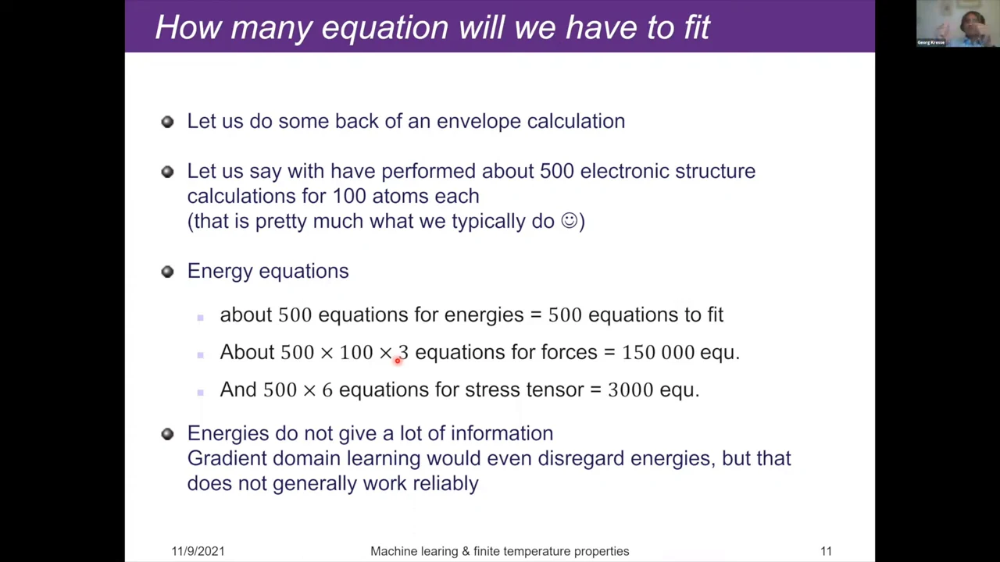
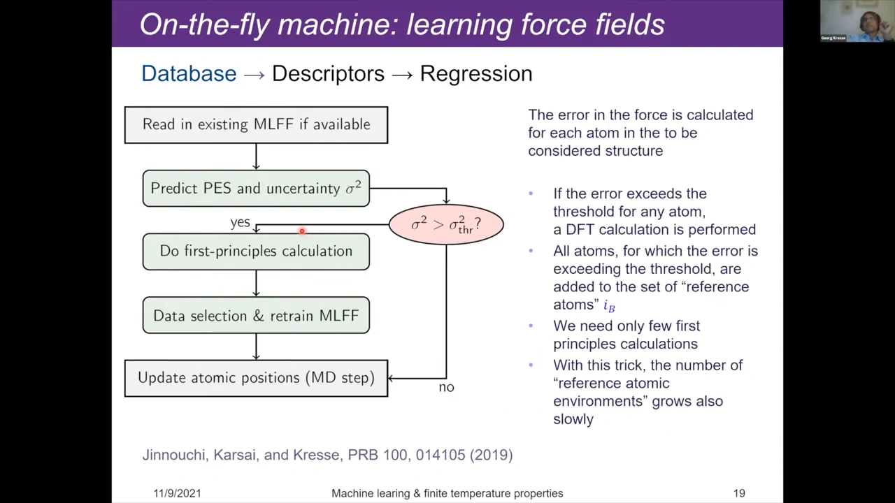
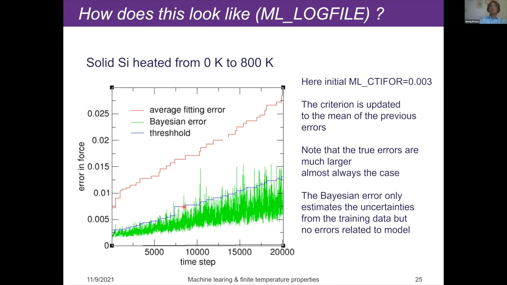
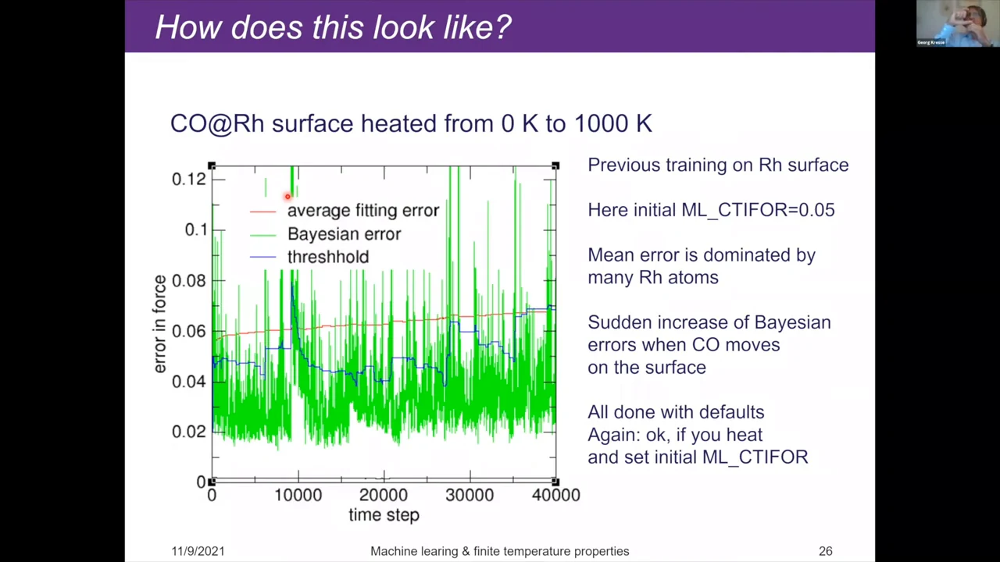
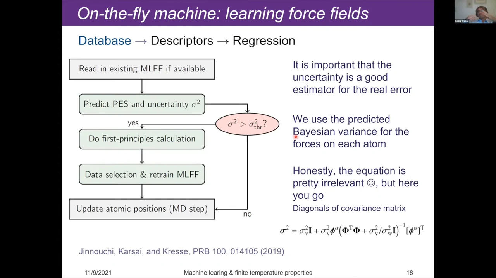
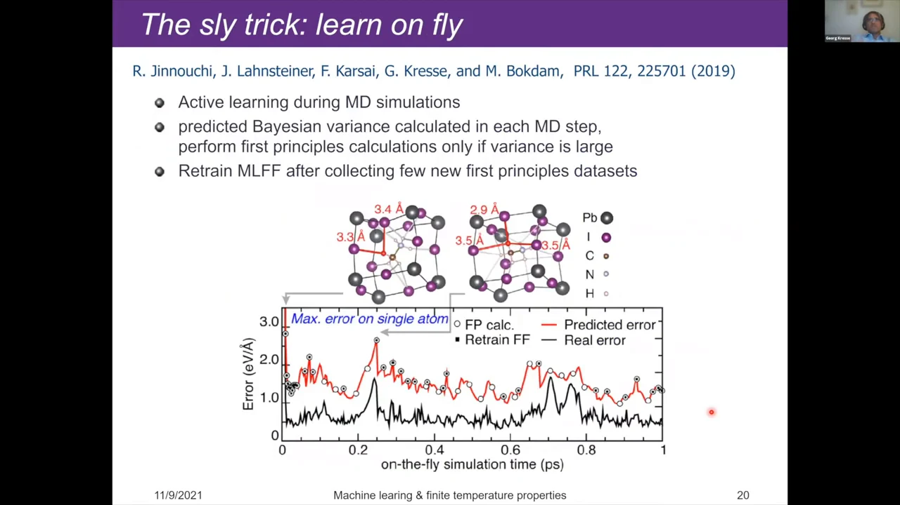
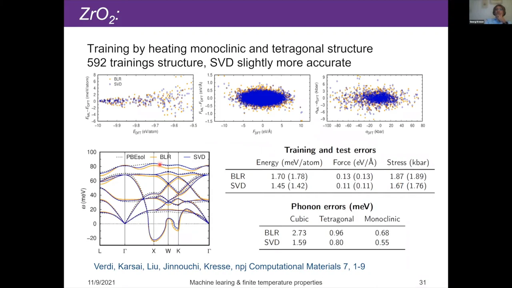
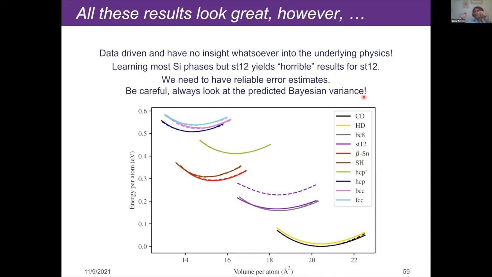
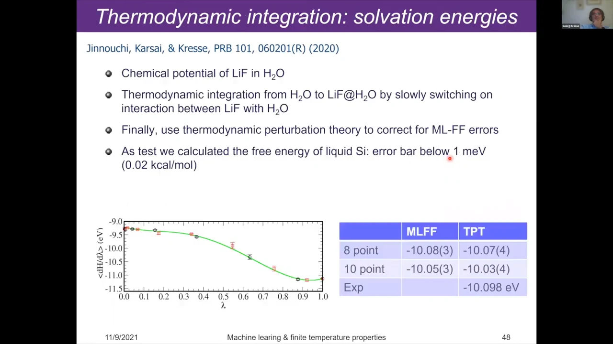
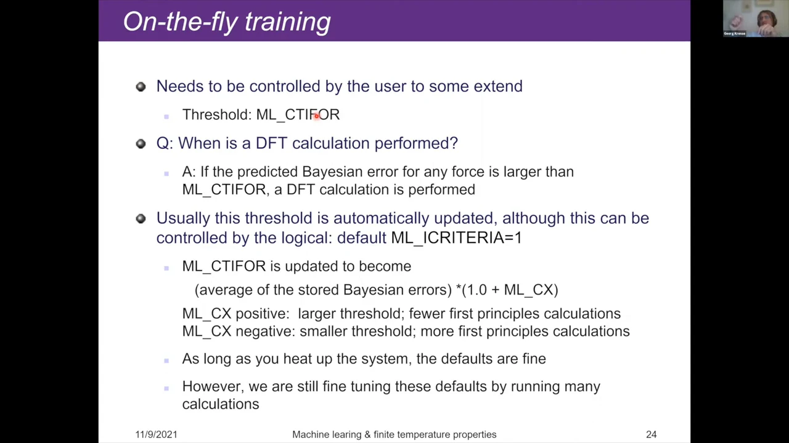

# 平均误差不是判决：力与能量预测要按原子、环境与相分别报告

> 视频来源：[Basics of machine learning force fields](https://www.bilibili.com/video/BV1VA4m157GF/?p=1)（B站搬运 · VASP Lecture · Georg Kresse）｜时长约 89 分钟
> 简要导读：本讲后半段反复追问：能量、力、应力都拟合得不错，为什么一到具体性质就不对？本文只取评价层：三种误差对象、平均误差为何掩盖局部错误、为何要分层报告，以及力与能量误差如何传播。输出与一致性推导见 5.1.7。

## 本讲要解决的核心问题（SCQA）

**背景**：机器学习力场用第一性原理（从量子力学出发直接计算，不依赖经验参数）算出的能量、力和应力训练，目标是替代密度泛函理论（DFT）做分子动力学（按力逐步推进原子轨迹）和结构预测。所谓机器学习力场，就是用回归模型拟合 DFT 给出的能量、力和应力，再以远低于 DFT 的成本做预测。最常见的验收方式是看两个数：能量误差多少毫电子伏特每原子（meV/atom），力误差多少电子伏特每埃（eV/Å）（[【跳转到 63:18】](https://www.bilibili.com/video/BV1VA4m157GF/?p=1&t=3798)）。

**冲突**：这两个数经常看起来很好，但一用到具体性质上就出问题。讲者给出的最刺眼例子是硅的 ST12 相：训练集里故意没有它，模型给出的能量曲线与正确结果差得很远（[【跳转到 82:54】](https://www.bilibili.com/video/BV1VA4m157GF/?p=1&t=4974)）。问题不在于“平均误差算错了”，而在于平均误差回答不了“哪个原子、哪种环境、哪个相会坏”。

**疑问**：力分量误差、能量误差和相对误差各自在评价什么？为什么必须分层报告？力与能量的误差又如何相互传播，最后变成结构、扩散或相变温度的偏差？

**回答（中心思想）**：能量、力和应力的误差是三种不同对象，不能用一个总能量误差代替。平均误差只是汇总，必须同时报告每原子/每分量的力误差、每构型/每原子的能量误差、相对误差，并按原子、元素、局部环境、构象与相分层。力误差会通过每一步分子动力学积分累积，能量误差会通过梯度变成力误差、通过热力学积分进入自由能；因此“平均能量误差低”既不能保证力场可靠，也不能保证性质正确。

## 一、平均误差只能回答“总体像不像”，不能回答“哪里会坏”

先把讲者的数量级摆出来。500 个第一性原理结构、每个 100 个原子，能量只给 500 个方程；力是 $500 \times 100 \times 3$，约 15 万个方程；应力六个分量，又是 3000 个方程（[【跳转到 20:39】](https://www.bilibili.com/video/BV1VA4m157GF/?p=1&t=1239)）。

这张幻灯片是后面所有讨论的骨架：能量和力的方程数差约 300 倍。讲者的原话是“能量的信息其实很少，绝大部分信息在力里”（[【跳转到 21:29】](https://www.bilibili.com/video/BV1VA4m157GF/?p=1&t=1289)）。所以，只用总能量误差评价力场，等于丢掉了绝大部分监督信号，也丢掉了定位局部错误的能力。

由此可以先给出三个判断：

1. **平均误差是汇总，不是判决。** 它告诉你整体偏差有多大，不告诉你最坏的原子或最坏的环境有多坏。
2. **能量误差和力误差不是同一个对象。** 一个是每构型一个标量，一个是每原子三个分量；它们的量纲、数量和传播方式都不同。
3. **分层报告不是可选项。** 只要数据分布不均匀，平均值就会被大量容易样本稀释，稀有但关键的局部环境会被藏起来。

## 二、三种误差对象：力分量、能量、相对误差

### 2.1 能量误差：一个构型一个数，按原子归一

对第 $s$ 个构型，能量误差是

$$
\Delta E_s = E_s^{\text{ML}} - E_s^{\text{DFT}}
$$

它是一个标量。报告时通常再除以原子数 $N_s$，得到每原子能量误差 $\Delta E_s / N_s$，单位是毫电子伏特每原子（meV/atom）或电子伏特每原子（eV/atom）。讲者的 ZrO$_2$ 表格就是这种写法：能量一列的单位是 meV/atom（[【跳转到 63:18】](https://www.bilibili.com/video/BV1VA4m157GF/?p=1&t=3798)）。

“每构型”和“每原子”必须说清楚。同一个总能量误差，除以 100 个原子和除以 10 个原子，数值差十倍；不同体系之间比较时，不归一就没有可比性。反过来，归一之后也会掩盖“某个原子附近错得很厉害”这件事，因为分母是全体原子。

### 2.2 力误差：每个原子三个分量，先看分量再看合成

力是 $3N$ 个分量。对原子 $i$ 的方向 $\alpha \in \{x,y,z\}$，分量误差是

$$
\Delta F_{i\alpha} = F_{i\alpha}^{\text{ML}} - F_{i\alpha}^{\text{DFT}}
$$

把三个分量合成一个每原子标量，常用向量范数

$$
\lVert \Delta \mathbf{F}_i \rVert = \sqrt{\sum_{\alpha} (\Delta F_{i\alpha})^2}
$$

也可以取三个分量里最大的那个。讲者的幻灯片把“每个原子的力误差”作为一个标量来比较，并特别标出“单个原子上的最大误差”（[【跳转到 37:44】](https://www.bilibili.com/video/BV1VA4m157GF/?p=1&t=2264)）。报告时必须写明：你报的是分量误差、向量范数，还是最大分量。三者不能混着平均。力的单位是电子伏特每埃（eV/Å）。

这张图把“每原子”落到了操作上：误差不是先对全体原子平均，而是逐原子算；任何一个原子超过阈值，就做一次 DFT，而且这个原子会被加入参考原子集合（[【跳转到 36:29】](https://www.bilibili.com/video/BV1VA4m157GF/?p=1&t=2189)）。这说明力的评价粒度天然可以细到原子，而能量的评价粒度天然是构型。

### 2.3 相对误差：分母决定含义

相对误差是绝对误差除以一个参考量：

$$
\varepsilon_{\text{rel}} = \frac{\lvert \Delta X \rvert}{\lvert X_{\text{ref}} \rvert}
$$

分母可以是总能量、每原子能量、力的平均大小（模长），或某个性质的参考值。分母不同，数值不可比。讲者给了几个相对误差的例子：不同机器学习力场之间的结果差别只有 5% 到 10%；弹性常数最大的偏差在 $C_{33}$，大约 5% 到 7%；DFT 泛函对熔点的误差仍可能到 10%，甚至 20%（[【跳转到 73:28】](https://www.bilibili.com/video/BV1VA4m157GF/?p=1&t=4408)、[【跳转到 74:34】](https://www.bilibili.com/video/BV1VA4m157GF/?p=1&t=4474)、[【跳转到 77:07】](https://www.bilibili.com/video/BV1VA4m157GF/?p=1&t=4627)）。

这些例子说明两件事。第一，相对误差让不同量纲的性质可以放在同一张表里比较。第二，相对误差不能替代绝对误差：当参考值很小时，一个很小的绝对误差也会被放大成很大的百分比；当参考值很大时，一个不小的绝对误差又会被压得很小。所以报告相对误差时，必须同时给出分母是什么、绝对误差是多少。

| 误差对象 | 形状 | 一个 100 原子构型给多少个数 | 常用单位 | 最小评价粒度 |
| --- | --- | --- | --- | --- |
| 能量 | 一个标量 | 1 | eV、eV/atom、meV/atom | 构型 |
| 力 | $3N$ 个分量 | 300 | eV/Å | 原子、分量 |
| 应力 | 六个独立分量 | 6 | kbar | 张量分量 |
| 相对误差 | 由前三种派生 | 取决于分母 | 百分比 | 取决于分母 |

## 三、总能量误差掩盖局部错误的三个原因

总能量被写成局域能量之和：

$$
E = \sum_i U_i
$$

这是讲者反复强调的核心假设：每个原子的局域能量只依赖它周围的局域环境（[【跳转到 16:29】](https://www.bilibili.com/video/BV1VA4m157GF/?p=1&t=989)）。这个假设带来一个直接后果：局域误差可以正负抵消。某个原子附近的能量算高了，另一个原子附近算低了，总和可能仍然很接近。总能量误差小，不代表每个局域能量都对。

力误差不容易被同样的全局求和掩盖。力是局域能量对坐标的导数，每个原子的力误差直接暴露它周围环境的错误。讲者用 500 个能量方程对 15 万个力方程来说明这一点：能量只给一个构型一个数，力给每个原子三个方向（[【跳转到 20:39】](https://www.bilibili.com/video/BV1VA4m157GF/?p=1&t=1239)）。所以“总能量误差低”最多说明全局积分量对，不能说明局部力对。

更隐蔽的是平均。平均拟合误差会把大量容易原子的小误差和少数难原子的大误差混在一起。讲者在硅的升温学习曲线旁边写了一句很关键的话：**真实误差几乎总是比估计误差大得多**（[【跳转到 53:09】](https://www.bilibili.com/video/BV1VA4m157GF/?p=1&t=3189)）。

这张图里，红线是平均拟合误差，绿线是贝叶斯误差，蓝线是阈值。讲者特别提醒：贝叶斯误差只估计训练数据内的不确定性，不包含模型本身的误差；真实误差几乎总是更大（[【跳转到 53:09】](https://www.bilibili.com/video/BV1VA4m157GF/?p=1&t=3189)）。所以“平均拟合误差小”连“平均真实误差小”都不一定成立，更不用说“局部力误差小”。

CO 在 Rh 表面的例子把“平均被稀释”演得更清楚。讲者先在清洁 Rh 表面训练过，所以 Rh 原子的误差很小；加入 CO 之后，平均误差仍然主要由大量 Rh 原子主导，看起来不大，但贝叶斯误差（取所有原子中的最大值）由还没训练过的 CO 主导，会突然跳高（[【跳转到 54:49】](https://www.bilibili.com/video/BV1VA4m157GF/?p=1&t=3289)）。

这张图的结论是：平均误差和最大误差回答的是两个不同问题。平均误差问“大多数原子怎么样”，最大误差问“最坏的那个原子怎么样”。评价力场时，后者往往更接近你真正关心的失效风险。

## 四、分层报告：按原子、元素与局部环境

分层报告的第一层是原子和元素。同一张图里，Rh 和 CO 的误差量级不同，来源也不同：Rh 是训练过的，CO 是没训练过的。把它们混在一个平均值里，等于让数量多的元素淹没数量少的元素。讲者的做法是逐原子算力误差，再取所有原子中的最大值作为触发判据（[【跳转到 36:29】](https://www.bilibili.com/video/BV1VA4m157GF/?p=1&t=2189)）。

这张图给出了误差估计的粒度：贝叶斯方差是为每个原子上的力预测的，本质上是协方差矩阵的对角元（[【跳转到 34:24】](https://www.bilibili.com/video/BV1VA4m157GF/?p=1&t=2064)）。它不是在构型层面给一个数，而是在原子层面给一个数。这为“按元素、按原子报告”提供了可操作的基础。

第二层是局部环境。讲者用甲基铵分子在铅碘笼子里转动来说明：分子一转，就开始与周围的铅原子形成新键，原来的力场变得不可靠，贝叶斯误差上升，真实误差也上升（[【跳转到 38:34】](https://www.bilibili.com/video/BV1VA4m157GF/?p=1&t=2314)）。这里的“环境”不是元素种类，而是同一个元素在不同配位、不同距离、不同朝向下形成的局部几何。

这张图把“环境”与“误差”直接连起来：红线是预测误差，黑线是事后评估的真实误差，两者在分子转动、成键变化时一起上升（[【跳转到 37:44】](https://www.bilibili.com/video/BV1VA4m157GF/?p=1&t=2264)）。所以只按元素分层还不够，还要按局部环境分层；同一个元素在训练覆盖的环境里可能很准，在没覆盖的环境里可能完全错。

第三层是原子数少的物种。CO 的例子已经说明：数量少的物种在平均值里没有话语权，但它往往是化学反应、吸附、催化的关键。报告时至少要把“按元素/物种的平均”和“按元素/物种的最大”分开列，不能只给一个全局平均。

## 五、分层报告：按构象、相与温度

构象和相的分层，讲者给了三个例子。

第一个是硅的升温过程。学习曲线从 0 K 到 800 K，横轴是时间步，纵轴是力误差；平均拟合误差随温度升高而上升，阈值也跟着历史误差漂移（[【跳转到 52:44】](https://www.bilibili.com/video/BV1VA4m157GF/?p=1&t=3164)）。如果只报告一个室温附近的误差，高温段的误差就被藏掉了。

第二个是 ZrO$_2$ 的三个相。训练集把单斜相和四方相从低温加热到高温，共 592 个结构；报告的是能量、力、应力的训练误差与测试误差（[【跳转到 63:18】](https://www.bilibili.com/video/BV1VA4m157GF/?p=1&t=3798)）。讲者说用奇异值分解（SVD）伪逆重新参数化后误差大约降低 20%；表中能量从 1.70 降到 1.45 meV/atom，力从 0.13 降到 0.11 eV/Å，应力从 1.87 降到 1.67 kbar（千巴），测试误差在括号里，数值接近训练误差。

这张表有三个值得注意的地方。第一，三类输出的量纲和数量级不同，必须分列。第二，训练误差和测试误差要同时给，测试误差才是对外部数据的估计。第三，测试误差接近训练误差，说明这批测试结构与训练分布接近，不能据此推断到没见过的相。

第三个是 ST12。训练集覆盖了立方金刚石、六方金刚石、BC8、简单六方等硅相，唯独没有 ST12。模型对 ST12 的能量曲线错得很远（[【跳转到 82:54】](https://www.bilibili.com/video/BV1VA4m157GF/?p=1&t=4974)）。

这张图的纵轴是每原子能量，横轴是每原子体积；ST12 的虚线曲线与其它相不在一个位置上。讲者的结论很直接：机器学习力场是数据驱动的，几乎没有内置物理；一旦走出验证过的范围，就会得到完全错误的结果（[【跳转到 83:19】](https://www.bilibili.com/video/BV1VA4m157GF/?p=1&t=4999)）。所以报告必须按相、按温度、按体积范围分层，并明确标出哪些区域没有验证。

## 六、力与能量误差的相互传播

### 6.1 能量误差的梯度就是力误差

力是能量对坐标的负梯度：

$$
\mathbf{F}_i = -\frac{\partial E}{\partial \mathbf{R}_i}
$$

这条关系在 5.1.7 已经推导过，这里只引用结论。把能量换成“能量误差”，两边求导就得到

$$
\Delta \mathbf{F}_i = -\frac{\partial \Delta E}{\partial \mathbf{R}_i}
$$

也就是说，**能量误差中随坐标变化的那一部分，就是力误差的来源**。如果能量误差只是一个与构型无关的常数平移，它对坐标的导数为零，不影响力；如果能量误差在某个局部环境里随坐标剧烈变化，它就会变成很大的局部力误差。这解释了为什么“总能量误差不大”和“局部力误差很大”可以同时成立：总能量只记录积分后的标量，力记录的是局部的导数。

### 6.2 力误差进入每一步积分

分子动力学每一步都用当前力更新原子位置。力误差不是一次性扣分，而是每一步都进入积分：

$$
\mathbf{R}_i(t+\Delta t) = \mathbf{R}_i(t) + \mathbf{v}_i(t)\Delta t + \frac{\mathbf{F}_i(t)}{2m_i}\Delta t^2 + \cdots
$$

讲者提到要跑十万个时间步（[【跳转到 05:14】](https://www.bilibili.com/video/BV1VA4m157GF/?p=1&t=314)），并在学习曲线里展示误差随环境变化而上升（[【跳转到 53:09】](https://www.bilibili.com/video/BV1VA4m157GF/?p=1&t=3189)）。把这两件事放在一起，就是力误差的传播链：局部力误差改变每一步的加速度，轨迹逐渐偏离，进而改变结构、扩散系数、径向分布函数（RDF），最后改变相变温度或自由能。CO 在表面移动时误差突然跳高，就是这条链的微观版本（[【跳转到 55:39】](https://www.bilibili.com/video/BV1VA4m157GF/?p=1&t=3339)）。

这里要区分两种“漂移”。一种是数值积分本身的误差，步长足够小、积分器足够好时可以控制；另一种是力场误差造成的积分漂移，它不会因为步长变小而消失，反而会在长轨迹上持续累积。讲者没有给出漂移的定量公式，但他反复强调“测试、测试、再测试”，并说走出验证范围就会得到完全错误的结果（[【跳转到 81:39】](https://www.bilibili.com/video/BV1VA4m157GF/?p=1&t=4899)）。

### 6.3 能量误差进入自由能

能量误差不只通过力进入动力学，也通过热力学积分进入自由能（在给定温度下判断相稳定性的热力学量）。讲者用 LiF 在水中的溶剂化能举例：从纯水到 LiF@H$_2$O，缓慢打开相互作用做热力学积分，最后用热力学微扰理论修正机器学习力场的误差；测试中液体硅的自由能误差棒低于 1 meV（[【跳转到 77:32】](https://www.bilibili.com/video/BV1VA4m157GF/?p=1&t=4652)）。

这张图说明：能量误差的传播不一定是“错到底”，也可以用额外的修正步骤把它压小。但前提是你知道误差在哪里、有多大；如果只有一个总能量平均值，就不知道该修正哪一段积分路径。

## 七、贝叶斯误差估计：能跟踪真实误差，但不包含模型误差

讲者的 on-the-fly（边跑分子动力学边学习）方案用贝叶斯回归（用概率分布表示参数不确定度的回归方法）同时预测力和不确定度。不确定度是协方差矩阵的对角元，为每个原子的力给出一个误差估计（[【跳转到 34:24】](https://www.bilibili.com/video/BV1VA4m157GF/?p=1&t=2064)）。协方差矩阵描述各参数的不确定度及其相关性，对角线上的元素就是单个分量的方差。如果任何一个原子的误差超过阈值，就做一次 DFT，把这个原子加入参考原子集合（[【跳转到 36:29】](https://www.bilibili.com/video/BV1VA4m157GF/?p=1&t=2189)）。

这张图给出阈值的工作方式：阈值通常按历史贝叶斯误差的平均值自动更新，`ML_CX` 控制它偏大还是偏小；偏大就少做 DFT，偏小就多做 DFT（[【跳转到 50:14】](https://www.bilibili.com/video/BV1VA4m157GF/?p=1&t=3014)）。这是一个可操作的“按误差报告决定下一步算哪里”的闭环。

但贝叶斯误差不是万能的。讲者在硅的学习曲线旁边明确写了：贝叶斯误差只估计训练数据内的不确定性，不包含模型本身的误差；真实误差几乎总是更大（[【跳转到 53:09】](https://www.bilibili.com/video/BV1VA4m157GF/?p=1&t=3189)）。所以它适合做筛选信号：告诉你“这里可能不可靠，值得算一次 DFT”；它不适合做最终验收：不能因为贝叶斯方差小，就认定力场正确。

这也是分层报告的一部分：报告贝叶斯误差时，要同时报告它和真实误差的校准关系。讲者用红线和黑线做过一次对照：红线是预测误差，黑线是真实误差，两者在例子中吻合得很好（[【跳转到 37:44】](https://www.bilibili.com/video/BV1VA4m157GF/?p=1&t=2264)）。但这是一次案例，不是普遍保证；换一个体系、换一个相，校准关系要重新检查。

## 八、一张可操作的分层报告清单

把前面的内容压缩成一张表。报告力场误差时，至少覆盖这些行：

| 报告项 | 粒度 | 至少给哪些数 | 分层维度 | 备注 |
| --- | --- | --- | --- | --- |
| 能量 | 每构型、每原子 | 平均绝对误差（MAE）、均方根误差（RMSE）、最大绝对误差 | 相、温度、体积、组分 | 同时给 eV/atom 与 meV/atom，注明是否归一 |
| 力 | 每分量、每原子范数 | 平均、最大、95% 分位数、分布 | 元素、局部环境、原子配位 | 注明是分量、范数还是最大分量 |
| 应力 | 六个分量 | 平均、最大 | 应变状态、相 | 与能量、力分列，不混算 |
| 相对误差 | 由上述派生 | 百分比 | 分母相同的组内比较 | 必须写清分母 |
| 训练/测试 | 两个数据集 | 两套数 | 分布内、分布外 | 测试集要覆盖目标相与温度 |
| 误差估计器 | 每原子 | 校准曲线、真实误差对照 | 元素、环境 | 贝叶斯方差只含数据不确定性 |
| 覆盖范围 | 参考原子、构型 | 覆盖/未覆盖区域 | 相、温度、体积 | 明确标出外推区 |

这张表的核心不是“项目越多越好”，而是三件事：**平均之外要给最大，整体之外要给分层，绝对之外要给相对。** 只要这三件事做到，平均误差就不再是唯一的判决。

## 九、与 5.1.7、5.1.8 的分工

5.1.7 讲的是输出对象与一致性：能量、力、应力分别是什么形状，为什么必须由同一个标量势派生，直接回归力会丢掉什么。本文讲的是评价指标与报告方式：三类误差怎么定义、怎么聚合、怎么分层、怎么传播。两节共用同一个长视频，但取的是不同的层：前者取“输出与一致性”，后者取“评价与报告”。

5.1.8 讲的是势能梯度、等变力与守恒约束的区别。本文不重复推导这些关系，只把 $\mathbf{F} = -\partial E / \partial \mathbf{R}$ 当作评价的前提，讨论它的误差版本 $\Delta \mathbf{F} = -\partial \Delta E / \partial \mathbf{R}$ 如何传播。

如果读者还没有读过 5.1.7，建议先看[《力必须是能量对坐标的负梯度》](../../5.1_不同任务层级/5.1.7_坐标生成、力预测与能量建模/力必须是能量对坐标的负梯度：同一个标量势同时拟合能量、力与应力.md)，再回到本文看评价层。

## 小结

- **平均误差是汇总，不是判决。** 它回答“总体像不像”，不回答“哪个原子、哪种环境、哪个相会坏”。
- **三种误差对象不同。** 能量是每构型一个标量，力是每原子三个分量，应力是六个张量分量；量纲、数量和评价粒度都不同。
- **总能量误差会掩盖局部错误。** 总能量是局域能量之和，局域误差可以正负抵消；平均又会被大量容易原子稀释。
- **平均之外必须给最大。** 硅的学习曲线和 CO@Rh 的例子都说明：平均误差小，最大误差可能很大。
- **分层报告是必要的。** 至少按原子/元素、局部环境、构象、相与温度分层；ST12 说明未覆盖的相可以完全错。
- **力误差通过积分累积。** 每一步 MD 都用当前力，局部力误差会改变轨迹、结构、扩散与相变温度。
- **能量误差通过梯度变成力误差，也通过热力学积分进入自由能。** 常数平移不影响力，随坐标变化的局部误差才会。
- **贝叶斯误差是筛选信号，不是验收保证。** 它只估计训练数据内的不确定性，不包含模型误差；真实误差通常更大。

## 关键术语速查

| 术语 | 一句话解释 |
| --- | --- |
| 能量误差 | 模型预测能量与参考能量之差，通常按构型或每原子报告 |
| 力分量误差 | 单个原子在单个方向上的力误差，单位 eV/Å |
| 力向量范数 | 把一个原子三个方向的力误差合成一个标量，常用平方和开根号 |
| 相对误差 | 绝对误差除以参考量，分母必须写清楚 |
| 平均拟合误差 | 训练/拟合过程中对全体样本的平均误差，不等于真实误差 |
| 最大误差 | 所有原子或所有构型中最坏的那个误差，反映失效风险 |
| 分层报告 | 按原子、元素、局部环境、构象、相或温度分别报告误差 |
| 局部环境 | 中心原子周围的配位、距离、角度与成键情况 |
| 外推 | 模型在训练分布之外做预测；ST12 是讲者的反例 |
| 贝叶斯方差 | 回归给出的预测不确定度，本质是协方差矩阵的对角元 |
| 热力学积分 | 沿一条路径积分能量或焓，用来算自由能；力场误差可用微扰理论修正 |
| on-the-fly 学习 | 边跑分子动力学边预测误差，超过阈值才做第一性原理计算并重新训练 |