# 分子生成模型的评估要拆成三项检查：结构合法性、训练集泄漏与化学空间覆盖

> 视频来源：[面向药学生的人工智能指北-10-快速上手分子生成](https://www.bilibili.com/video/BV1mELozhEeZ/)（B 站 · 小闪电_）｜时长约 118 分钟
> 这是一场面向药学生的直播课：前半段讲分子生成与虚拟筛选的区别、生成模型怎么评价，后半段用一份 VAE 代码在 ZINC 分子库上跑通“训练—采样—看图”。本文不按代码顺序复述，而是把讲者反复回到的那个问题——“你用什么来评估”——拆成结构合法性、训练集泄漏、化学空间覆盖三项检查，并用这场直播里真实出现的失败画面作为每项检查的失败信号。字幕由平台自动生成，术语按上下文订正（如 VAE、ZINC、decode、MLP）。

## 本讲要解决的核心问题（SCQA）

**背景**：分子生成模型的目标，是从训练过的分子库里学到一个分布，再从这个分布里采样出新的分子。它和虚拟筛选的区别很清楚：虚拟筛选是在一个固定库里检索，分子生成是在近乎无限的化学空间里“生产”。

**冲突**：生产出来的东西不一定能用。讲者给出的四把尺子是类药性（QED）、可合成性（SAS）、新颖性（NOV）和合理性（VAL），但这场直播的模型跑完之后，生成的分子“非常差，都是一样的”，很多是光秃秃的直链；讲者还提醒，论文里那些漂亮分子往往是反复采样挑出来的。也就是说，一个生成模型可以同时做到“能解码出分子”和“没有任何实用价值”。

**疑问**：面对一个分子生成模型，究竟要查哪几件事，才能判断它的高分或漂亮样例是不是真的？每一项具体怎么查，失败时屏幕上会看到什么？

**回答（中心思想）**：把评估拆成三项互相独立的检查——结构合法性、训练集泄漏、化学空间覆盖。合法性查“解码出来的还是不是一张合法的分子图”，泄漏查“生成物是不是在复读训练库”，覆盖查“生成分布有没有走出训练集、有没有随条件移动”。三项都过，漂亮样例才算证据；任何一项失守，论文里的漂亮分子都只是采样运气。

---

## 一、生成任务把评估对象从“一个分子”换成了“一个分布”

**结论：虚拟筛选评估的是一张排序表，分子生成评估的是一个分布；评价单位变了，检查项也必须跟着变。**

讲者开场先把两种任务摆在一起（[【跳转到 00:00】](https://www.bilibili.com/video/BV1mELozhEeZ/?t=0)）。虚拟筛选是检索：手里有一个分子库，比如 ZINC，把库里的分子逐个和靶点对接或打分，最后留下十个、九个候选。分子生成是生产：学习大量类药分子的结构，学会“类药分子应该长什么样”，然后直接生成新的分子。

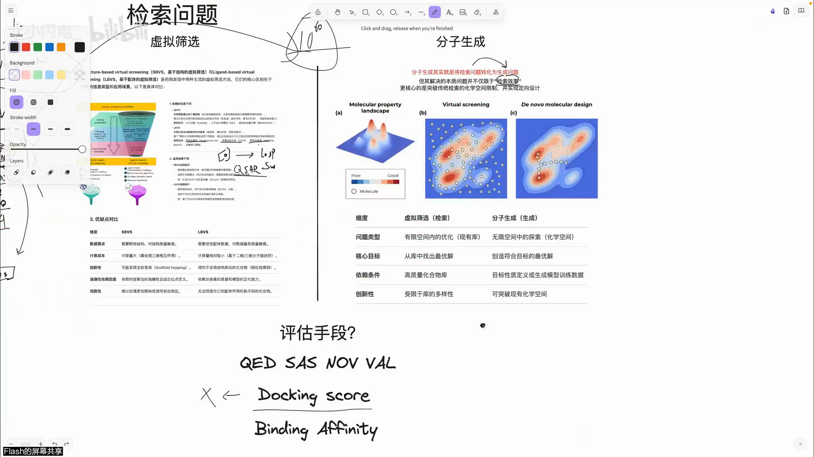

这张对照表把差别落在“问题类型”上：虚拟筛选是“有限空间内的优化（现有库）”，分子生成是“无限空间中的探索（化学空间）”。讲者给的数量级是：一个商业分子库大约 100 万个分子，而可能的类药分子有 $10^{60}$ 量级（口播里也出现过 $10^{64}$ 的说法）。库再大，也只是这个空间里的一小撮。

这带来两个直接后果。第一，检索效率不再是主要矛盾：挨个对接 100 万个分子太慢。第二，更核心的是**化学空间限制**——库里没有的分子，检索永远找不到，只能靠生成（[【跳转到 00:06:30】](https://www.bilibili.com/video/BV1mELozhEeZ/?t=390)）。

讲者还顺手拆掉了虚拟筛选的一个常见指标：对接打分和生物活性没有明显相关性，有时甚至负相关（[【跳转到 00:04:57】](https://www.bilibili.com/video/BV1mELozhEeZ/?t=297)）。这句话对后文很重要：**一个分数看起来在排序，不等于它在测量你想要的东西**。分子生成面对的也是同一类问题，只不过对象从“排序”变成了“分布”。

## 二、视频给出的四把尺子：QED、SAS、NOV、VAL

**结论：讲者把生成分子的评价压成四个缩写——像药、能合成、够新、结构合理；四者缺一，生成就没有意义。**

讲者在进入代码之前，先列了常用的评价指标（[【跳转到 00:08:31】](https://www.bilibili.com/video/BV1mELozhEeZ/?t=511)）：

- **QED（类药性分数）**：生成的分子首先要“长得像药”。它是一个把多个理化性质合成为 0 到 1 的经验分数。
- **SAS（合成可及性分数）**：生成出来还要能合成，否则后续实验无从谈起。它估计的是“这个结构做出来有多难”。
- **NOV（新颖性）**：生成物不能和训练库里的分子重合或几乎重合。讲者举的例子很具体：拿 100 万个 ZINC 分子训练，生成 1000 个，如果其中很多和训练库里的分子只差一个羟基、多一个氟或氯，新颖性就非常差（[【跳转到 00:08:57】](https://www.bilibili.com/video/BV1mELozhEeZ/?t=537)）。
- **VAL（合理性／有效性）**：这个分子的结构是不是合理的、能不能用（[【跳转到 00:09:42】](https://www.bilibili.com/video/BV1mELozhEeZ/?t=582)）。

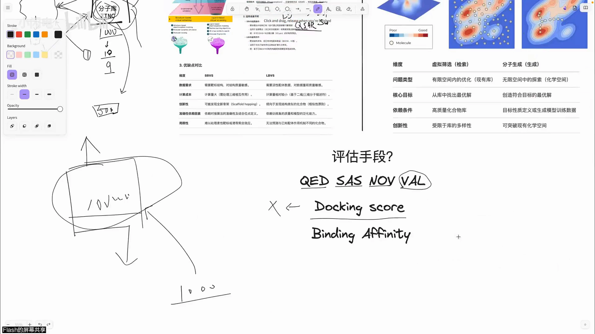

这张板书是全场的方法论中心。讲者把“对接打分”划掉，换成“结合亲和力”，意思是：生成之后当然可以再拿对接或亲和力预测做二次验证（[【跳转到 00:10:05】](https://www.bilibili.com/video/BV1mELozhEeZ/?t=605)），但那属于下游筛选，不是生成模型本身的评价。

更重要的是，讲者紧接着把评估拆成三层（[【跳转到 00:10:16】](https://www.bilibili.com/video/BV1mELozhEeZ/?t=616)）：

1. **数据来源**：你用什么数据训练的。用一堆类药性很差的数据训练，生成出来的分子大概率也差（[【跳转到 00:10:41】](https://www.bilibili.com/video/BV1mELozhEeZ/?t=641)）。
2. **模型算法**：VAE、diffusion、flow、自回归还是 GAN。
3. **评价指标**：你用什么指标来判断生成的好坏。

这三层对应本文的三项检查：数据来源对应“先验覆盖”，模型算法与解码过程对应“结构合法性”，评价指标里的 NOV 对应“训练集泄漏”。讲者自己也没有把三者合成一个总分，而是并列摆出——这本身就是评估结构的一部分。

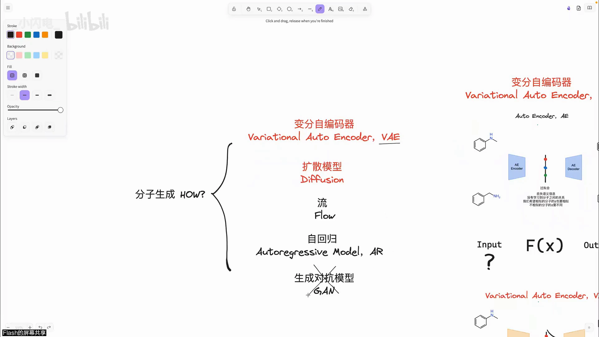

这张板书说明了“模型算法”这一层的范围：同样是生成分子，VAE 从隐空间采样、扩散模型从噪声逐步去噪、自回归逐字生成、流模型学可逆变换。模型不同，合法性失守的方式也不同——自回归错一个字符整句就废，原子级扩散容易生成不合理的键长键角。所以三项检查要按模型类型调整，不能照搬。

## 三、VAE 的机制决定了三处可能失守

**结论：这支视频的模型把分子图压成 550 维向量，再压成高斯分布；合法性、泄漏、覆盖的隐患分别藏在“解码”“训练分布”“采样范围”三个位置。**

要理解三项检查为什么必要，得先看这条流水线怎么走。讲者的实现非常“暴力”（他的原话）：一个分子先由 SMILES（用一串字符线性表示分子结构的记法）经 RDKit（常用的化学信息学工具库）变成图，节点特征矩阵、邻接矩阵、边特征分别展平后拼成一个 550 维向量；这个向量送进编码器（一个 MLP），输出均值 $\mu$ 和方差 $\sigma^2$；从对应的正态分布里采样得到隐向量 $z$（隐空间里的一个点）；解码器再把 $z$ 还原成 550 维，按事先约定好的位置切回节点特征、邻接矩阵和边特征，最后重建分子（[【跳转到 01:34:00】](https://www.bilibili.com/video/BV1mELozhEeZ/?t=5640)）。

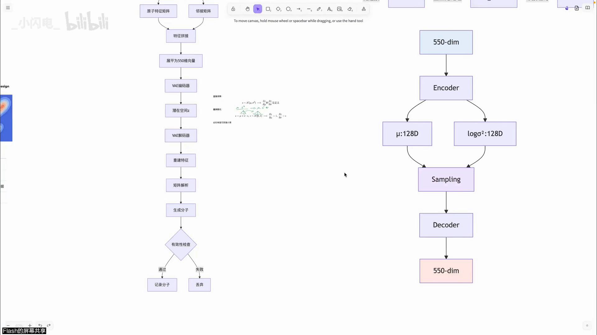

这张流程图底部有一个菱形框，写着“有效性检查”，分出“通过／失败”两条路。它说明合法性不是事后才想起的附加项，而是流水线的一站：解码出来的 550 维必须先被解析成一张图，才谈得上是不是分子。

训练目标有两项：重建损失让解码出来的图尽量接近输入图，KL 散度让编码器输出的分布尽量贴近标准正态分布（[【跳转到 00:43:02】](https://www.bilibili.com/video/BV1mELozhEeZ/?t=2582)）。两项一起训练，是因为生成时编码器要被丢掉：只保留解码器，直接从标准正态分布采样一个 $z$，再解码成分子（[【跳转到 00:45:49】](https://www.bilibili.com/video/BV1mELozhEeZ/?t=2749)）。

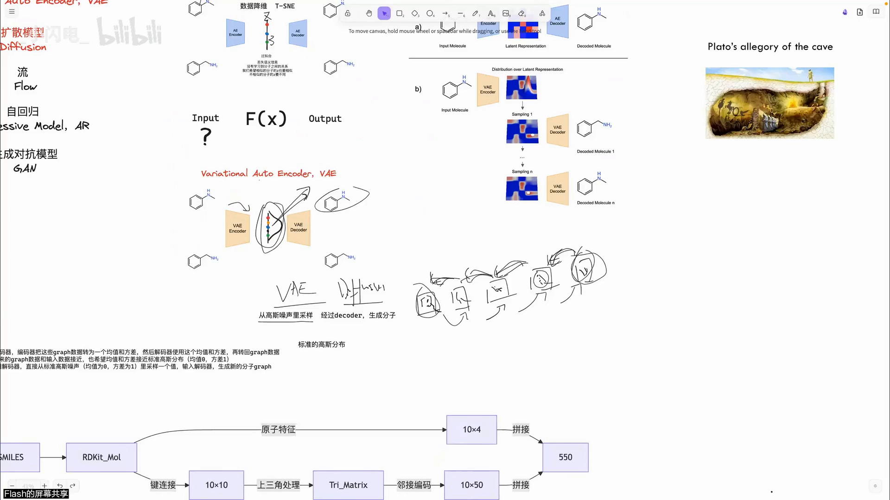

讲者用一张图解释为什么需要 VAE 而不是普通自编码器：AE 把每个分子压成一个固定向量，两个分子之间插值得到的点，解码出来会“非常怪”；VAE 把分子压成一个分布，在分布里采样，才能得到既像药、又和训练分子不同的新分子（[【跳转到 00:34:00】](https://www.bilibili.com/video/BV1mELozhEeZ/?t=2040)）。

这张图同时埋下了三项检查的种子：采样点落在分布边缘会解码出什么（合法性）、采样点是否只覆盖训练分布（覆盖）、解码结果是否只是训练分子的近邻（泄漏）。

## 四、检查项一：结构合法性——解码器能不能把向量还原成一张合法的图

**结论：合法性检查的对象不是“像不像分子”，而是“解码出的离散图是否满足化学语法”；这场直播的模型在这一点上没有任何硬约束。**

讲者在讲 VAE 原理时，有同学问了一个关键问题：“从连续空间取得的分子都是合理的吗？”讲者回答：**不一定**，取决于网络复杂度、参数量和训练数据（[【跳转到 00:32:26】](https://www.bilibili.com/video/BV1mELozhEeZ/?t=1946)）。

为什么不一定？因为解码器输出的是 550 个连续实数，而分子图要求每个原子的类型是一个 one-hot 向量（比如碳是 100、氮是 010、氧是 001），每个键的类型也是离散的。讲者在代码讨论中被同学追问：二元交叉熵损失并不能保证“一个原子标签向量里只有一个 1”，他承认“这相当于一种语法的合法性”，而这个模型“没有细究”，用的是“挺粗暴”的计算（[【跳转到 01:09:03】](https://www.bilibili.com/video/BV1mELozhEeZ/?t=4143)）。

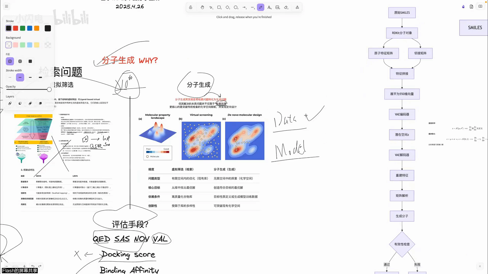

这张流程图把“解码”拆成几步：解码器输出 550 维，先按约定切回节点特征矩阵、邻接矩阵和边特征，再做矩阵解析，最后才生成分子。任何一步出错，后面都无从谈起；而“有效性检查”被放在生成分子之后，说明它检查的是最终结构，不是中间向量。

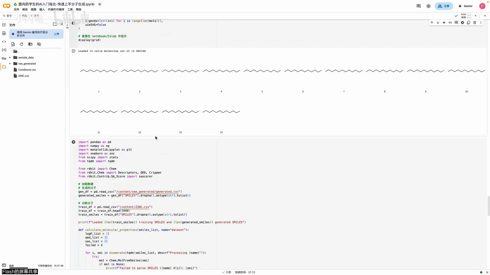

这张截图把“怎么查”写得很直白：对每个生成的 SMILES 调用 `Chem.MolFromSmiles`，返回空就记一次失败；同时算 QED、SAS、logP。屏幕上显示 “Loaded 14 valid molecules out of 14 SMILES”，但下面的 14 个分子几乎都是光秃秃的锯齿状直链——**能解析不等于合理**。合法性检查至少要分两层：

1. **语法层**：SMILES 能否被 RDKit 解析、原子价态是否合法、芳香性是否自洽。失败信号是解析返回空、价键数超标、环闭合错误。
2. **几何／能量层**：键长、键角、二面角是否落在合理范围，有没有生成高张力的三元环、连续三连环。讲者在问答里明确说，基于原子的扩散模型“很容易不合理”，会生成键长键角不对的结构，也会生成“三连环接三连环”这种能量非常高、非常不稳定的东西（[【跳转到 01:41:55】](https://www.bilibili.com/video/BV1mELozhEeZ/?t=6115)）。

失败信号在直播里出现了两次。一次是模型训练不足时，生成的分子“非常差，都是一样的”（[【跳转到 01:12:01】](https://www.bilibili.com/video/BV1mELozhEeZ/?t=4321)）；另一次是最后生成条件分子时，出来的还是“直线型的链状的”（[【跳转到 01:57:05】](https://www.bilibili.com/video/BV1mELozhEeZ/?t=7025)）。这两句话合起来说明：**合法性检查不能只看“有没有解析失败”，还要看“解析成功的分子是不是退化成同一类东西”**。全部解析成功、但全是直链，同样是失败。

## 五、检查项二：训练集泄漏——生成物是不是在复读 ZINC

**结论：生成模型的泄漏不表现为测试集分数虚高，而表现为生成物与训练库重合；检查方法是把生成集和训练集放进同一个指纹空间比距离。**

讲者在列 NOV 指标时，已经把检查方法说清楚了：拿 100 万个 ZINC 分子训练，生成 1000 个，如果这 1000 个和训练库里的分子大量重合，“只是缺了个羟基、多了个氟、多了个氯”，新颖性就非常差，分子生成也就失去了意义（[【跳转到 00:08:57】](https://www.bilibili.com/video/BV1mELozhEeZ/?t=537)）。

这段话值得停一下。它说的不是“生成物和训练物有点像”，而是**生成物落在训练集的近邻里，模型没有生产新信息**。在监督学习里，这类似“模型把训练集背下来了”；在生成模型里，它的可观测形式就是新颖性很差。检查要分三档：

- **完全相同**：生成的 SMILES 规范化后与训练集某条完全相同。
- **近似重合**：分子指纹（如 Morgan 指纹）相似度极高，或只差一个末端基团。
- **骨架重合**：换了一两个取代基，但骨架仍是训练集里常见的骨架。

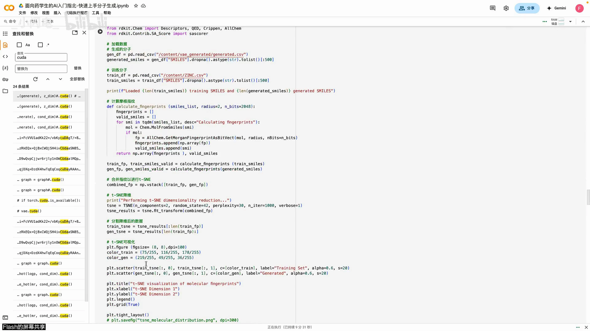

这张代码截图是“怎么查”的现成做法：对训练 SMILES 和生成 SMILES 分别算 Morgan 指纹，拼在一起做 t-SNE，再用两种颜色画出来。如果生成点密密麻麻落在训练点内部，说明模型主要在复读；如果生成点整体贴着训练点外侧，才谈得上扩展。讲者在这段之前也说过，生成的目标是“和原来这些分子都不太像”，那才是好的（[【跳转到 00:29:23】](https://www.bilibili.com/video/BV1mELozhEeZ/?t=1763)）。

这里要划清与另一节的边界：本节说的泄漏是**先验泄漏**——训练分布被生成器复读；至于训练集／测试集怎么切、切完怎么计分，属于边级评价与切分策略的问题，见 5.1.6 与 5.2.1，本节不重复。这场直播的案例本身没有留出集，它把“生成物与训练库的重合度”当作唯一可查的泄漏信号，这既是它的局限，也正好说明：**没有留出集时，至少还能查新颖性；连新颖性都不查，就什么都不知道**。换到有留出集的场景，“有没有留出集、留出集与训练集是否共享骨架”本身也要作为一项检查写进报告，否则新颖性分数无法解释。

## 六、检查项三：化学空间覆盖——生成分布有没有走出训练集

**结论：覆盖检查比较的不是单个分子，而是两个分布：生成分布与训练分布的形状、宽度和位置；失败信号是分布塌缩、变窄或完全被训练分布包住。**

讲者在讲数据来源时给了一句判断：“你如果用的是一堆类药性非常差的数据去训练的话，你生成出来的分子大概率也是类药性很差的。”（[【跳转到 00:10:41】](https://www.bilibili.com/video/BV1mELozhEeZ/?t=641)）这句话反过来就是覆盖检查的定义：**训练集覆盖到哪里，生成器最多只能到哪里；要判断它有没有走出去，必须把两个分布画在一起。** 先验图从哪里来、偏在哪里，是 1.2.2 的问题；本节只把训练分布当作待检查的输入，不再重复偏差的定义。

直播里用的是两个性质：logP 和摩尔折射率（MR）。讲者把 ZINC 训练集的 logP／MR 分布，和条件 VAE 生成的分子分布画在同一张图上（[【跳转到 01:21:13】](https://www.bilibili.com/video/BV1mELozhEeZ/?t=4873)）。

覆盖检查的标准读法是这样的：横轴是性质值，纵轴是密度；先看生成分布相对训练分布的位置：是整体左移、右移，还是被夹在中间；再看宽度：生成分布比训练分布更窄，说明多样性不足；最后看形状：如果生成分布缩成一个尖峰，说明模型塌缩到少数几种分子。

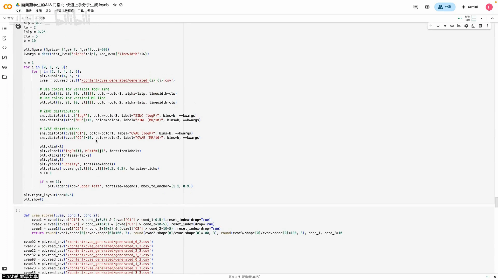

代码层面，覆盖检查就是“读两组 CSV、画两组密度、把条件值画成竖线”。它不需要复杂指标，但需要**两组数据都保留**：只报告生成分子的性质均值，无法判断分布是宽是窄、有没有被训练分布包住。

失败信号有三种，直播里都出现了：

1. **分布塌缩**：生成的分子“都是一样的”，性质分布缩成一根尖峰（[【跳转到 01:12:01】](https://www.bilibili.com/video/BV1mELozhEeZ/?t=4321)）。
2. **分布变窄**：生成分布比训练分布窄，说明模型只敢在训练集中心附近采样，没有真正探索化学空间。
3. **生成数量随条件剧烈波动**：同一个模型，有的条件生成上千个分子，有的条件只生成 4 个、5 个、7 个（[【跳转到 01:22:00】](https://www.bilibili.com/video/BV1mELozhEeZ/?t=4920)）。这不是“某些条件更难”，而是覆盖不均：模型对训练数据里稀少的区域几乎没有生成能力。

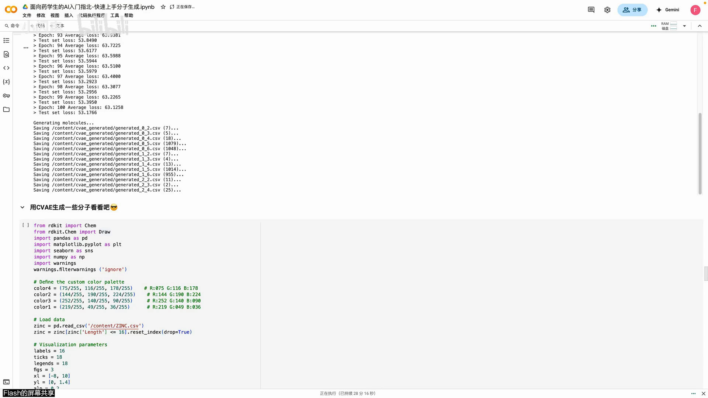

这张日志截图是覆盖检查最容易被忽略的一栏：**分母**。如果只报告“生成了 1000 个分子”，却不报告每个条件各生成多少、失败多少，覆盖不均就被平均数掩盖了。

还要说明一点：这场直播没有留出集，所以覆盖对比只在训练分布内部做。它回答的是“生成器有没有离开训练分布”，回答不了“换一批没见过的分子还灵不灵”。后者需要外部验证，属于 5.2.2 的基线对照与外部验证范围；本节只把“训练／测试分别覆盖到什么化学空间”作为报告时必须交代的一项。

## 七、条件生成把“覆盖”变成可测的响应

**结论：条件生成的价值不只是“按需生成”，它还给了一个可测的实验：改变条件，看生成分布是否跟着移动；不移动就是条件没起作用。**

讲者用条件 VAE 演示了这件事。条件有两个：logP 和 MR。训练时，把分子图数据和这两个条件拼在一起送进编码器和解码器；生成时，从标准正态分布采样一个 $z$，再和指定的条件一起送进解码器（[【跳转到 01:13:00】](https://www.bilibili.com/video/BV1mELozhEeZ/?t=4380)）。

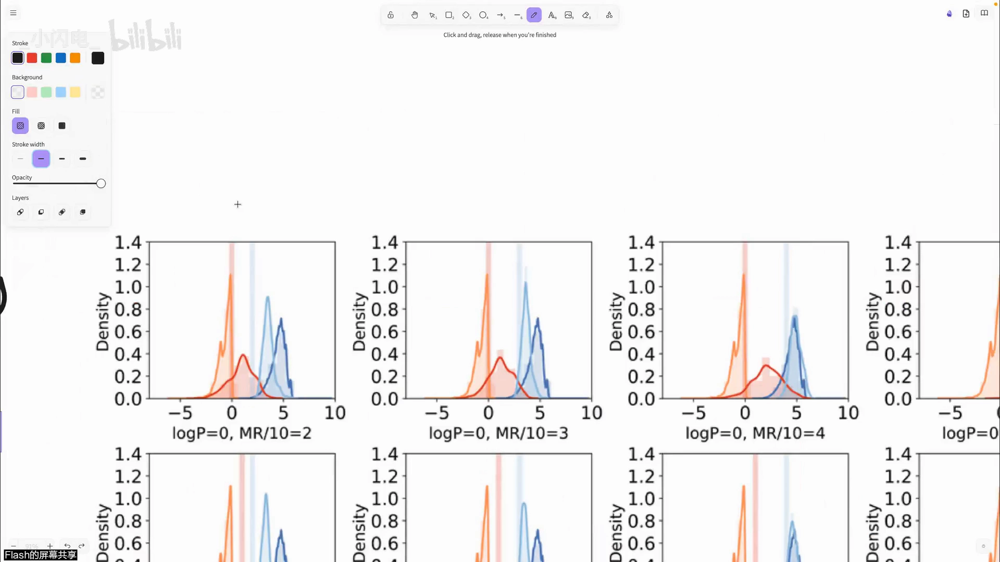

这张图是条件响应检查的读法：每个子图对应一组条件（logP = 0，MR/10 从 2 到 6），竖线标出条件指定的值；如果生成分布（红、浅蓝）随着竖线整体移动，说明条件被模型读懂了。它同时也能看出覆盖：生成分布是否和训练分布（橙、深蓝）一样宽，还是缩成窄峰。

操纵条件之后，检查方法很直接：固定 logP = 0，把 MR 从 2 改到 6，看生成分子的 MR 分布是否整体右移。讲者展示的结果是：浅蓝色的生成分布随着 MR 条件变化“真的在往右移”，红色的 logP 分布也跟着条件变化（[【跳转到 01:56:22】](https://www.bilibili.com/video/BV1mELozhEeZ/?t=6982)）。他据此判断这次训练“条件真的是有指导作用的”。

这里有一个容易混淆的点：条件响应好，不等于覆盖好。条件分布移动只能证明**模型读懂了条件**，不能证明**模型覆盖了条件附近的化学空间**。如果每个条件下只生成四五个分子，分布移动得再准，也只是几个点的移动。所以第七节的检查要和第六节的数量、宽度一起看。

## 八、同一案例的三项检查表：漂亮分子为什么不算证据

**结论：把三项检查并排放在同一个案例上，才能解释“论文里的分子都很好看，实际生成却很差”这个现象；三项检查的共同作用是拆掉采样运气。**

讲者在问答里给了一段非常锋利的评论。他说自己测试过 TargetDiff 等基于口袋的生成模型，“生成的效果都非常非常差”，但“论文里面放的那个生成的分子都很好看”（[【跳转到 01:42:56】](https://www.bilibili.com/video/BV1mELozhEeZ/?t=6176)）。原因他也讲了：生成模型的采样方式不同，输出就不同；你可以不停采样，采到一个特别好看的放进论文，再采一个特别好看的凑成一张图；“所有分子生成的论文，放的那个分子结构都非常好看，都感觉是下一代神药，但其实那都是凑出来的”（[【跳转到 01:43:27】](https://www.bilibili.com/video/BV1mELozhEeZ/?t=6207)）。

这段话正好把三项检查串成一个案例。把这场直播的 VAE 当成被评估对象，检查表可以写成：

| 检查项 | 查什么 | 怎么查 | 这场直播里的失败信号 |
| --- | --- | --- | --- |
| 结构合法性 | 解码出的图是不是合法分子；合法分子是否退化成同一类 | RDKit 解析、价态与芳香性检查；键长键角与环张力检查；统计合法分子的多样性 | 解码器用 BCE 损失，无法保证 one-hot 原子标签；生成物“非常差，都是一样的”；原子级生成出现三元环、键长键角不合理 |
| 训练集泄漏 | 生成物是否复读训练库；条件是否只是复读了训练分布 | 规范化 SMILES 精确匹配；Morgan 指纹近邻；t-SNE 看生成点是否落在训练点内部 | 讲者用“缺羟基、多氟、多氯”描述新颖性差；案例没有留出集，只能查新颖性 |
| 先验覆盖 | 生成分布相对训练分布的位置、宽度、形状；每个条件的生成数量 | 把生成与训练的 logP／MR 分布画在一起；统计每个条件的生成数与失败数 | 分布塌缩成尖峰；生成分子多为直链；不同条件生成数量从 4 到 1070 不等 |

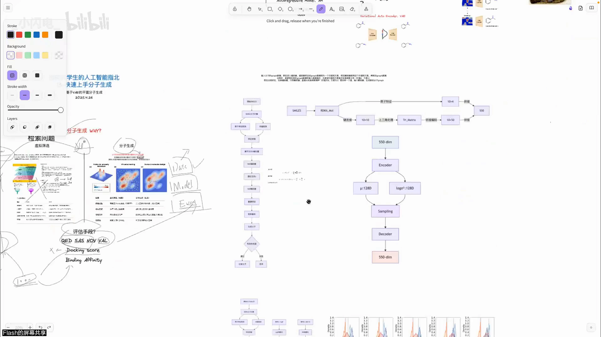

这张图把 Data、Model、Eval 三层并排画在一起，右侧是生成流水线与有效性检查：Data 层对应覆盖，Model 层对应合法性，Eval 层对应泄漏与覆盖的度量。三项检查不是三篇论文的三件事，而是同一个模型的三次追问。

三项检查的次序也有讲究。先查合法性：如果解码出来的根本不是合法分子，后面的新颖性和覆盖都无从谈起。再查泄漏：如果生成物就是训练集的近邻，覆盖再宽也只是训练集的复制。最后查覆盖：前两项都过了，才轮到“它有没有走出训练集、走得够不够远”。

## 小结

- 分子生成评估的对象是一个分布，不是一张排序表；讲者把评价压成 QED、SAS、NOV、VAL 四把尺子，并把评估拆成数据、模型、指标三层。
- 结构合法性要分语法层和几何／能量层：RDKit 能解析只是第一关，合法分子退化成直链、三元环同样是失败。
- 训练集泄漏在生成模型里的可观测形式是新颖性为负：生成物与训练库完全相同、近似重合或骨架重合；用规范化 SMILES、Morgan 指纹和 t-SNE 可以查。
- 先验覆盖要比较生成分布与训练分布的位置、宽度和形状，并报告每个条件的生成数量；分布塌缩、变窄、条件间数量剧烈波动都是失败信号。
- 条件响应（改变条件、分布跟着移动）只能证明模型读懂了条件，不能证明它覆盖了条件附近的化学空间，必须和覆盖检查一起看。
- 论文里的漂亮分子可能是反复采样挑出来的；三项检查的共同作用，是把“采样运气”从证据里剔除。

## 关键术语速查

| 术语 | 一句话解释 |
| --- | --- |
| 分子生成（de novo molecular design） | 从学到的分子分布中采样新分子，而不是从固定库里检索；目标是突破现有库的化学空间限制。 |
| 虚拟筛选 | 在一个固定化合物库里按对接分数或相似性排序，挑出候选分子；本质是检索。 |
| QED | 类药性分数，把多个理化性质合成 0 到 1 的经验指标，越高越像药。 |
| SAS | 合成可及性分数，估计一个结构合成起来的难度，越低越容易合成。 |
| 新颖性（NOV） | 生成分子与训练库不重合的程度；重合或近似重合说明模型在复读训练集。 |
| 合理性／有效性（VAL） | 生成的分子结构是否合法、可用；包括 SMILES 可解析、价态合法、键长键角合理等。 |
| VAE（变分自编码器） | 把分子编码成均值与方差、再从正态分布采样解码的生成模型；KL 散度让隐空间贴近标准正态分布。 |
| 隐空间（latent space） | 编码器输出的低维表示空间；VAE 的隐空间是一个分布，采样点不同，解码出的分子不同。 |
| 重建损失 | 让解码出的图尽量接近输入图的损失；这场直播里按节点特征、邻接矩阵、边特征分段计算。 |
| KL 散度 | 衡量两个分布差异的量；这里用来把编码器输出的分布拉向标准正态分布，便于从噪声采样。 |
| Morgan 指纹 | 以每个原子为中心、按半径向外扩展得到的子结构计数向量，常用来比较分子相似性。 |
| t-SNE | 把高维指纹降到二维做可视化的方法；这里用来观察生成点是否落在训练点内部。 |
| 分布塌缩 | 生成分布缩成少数几个尖峰，生成物高度重复，多样性丧失。 |
| 条件生成 | 在生成时额外输入一个目标性质（如 logP、MR），让生成分布向该条件移动。 |