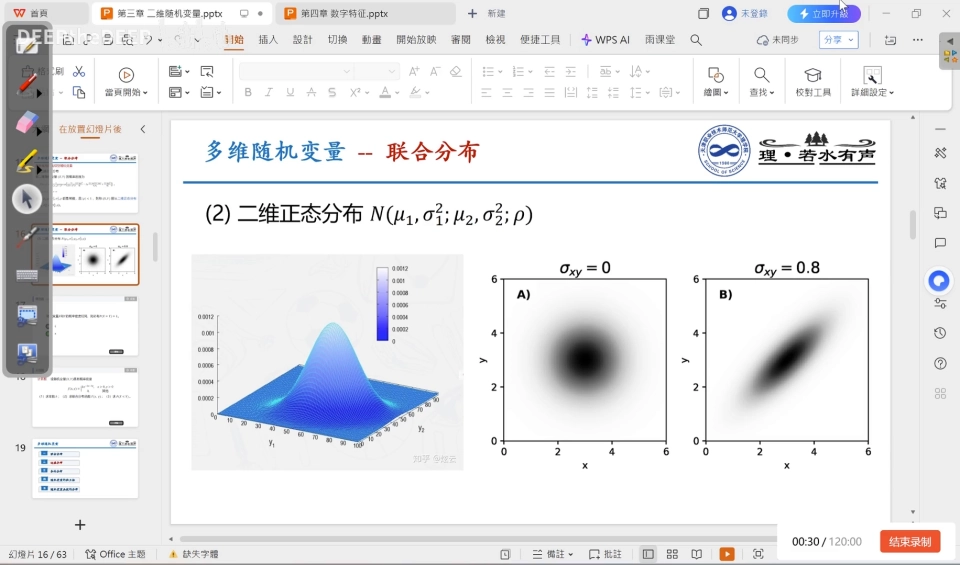
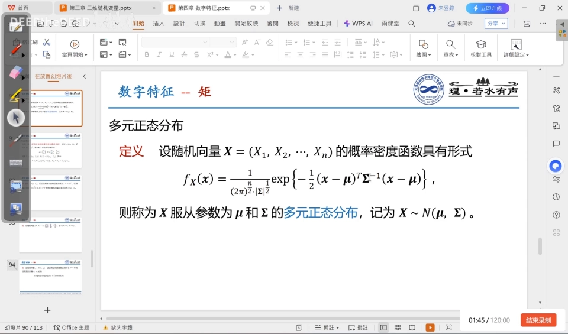
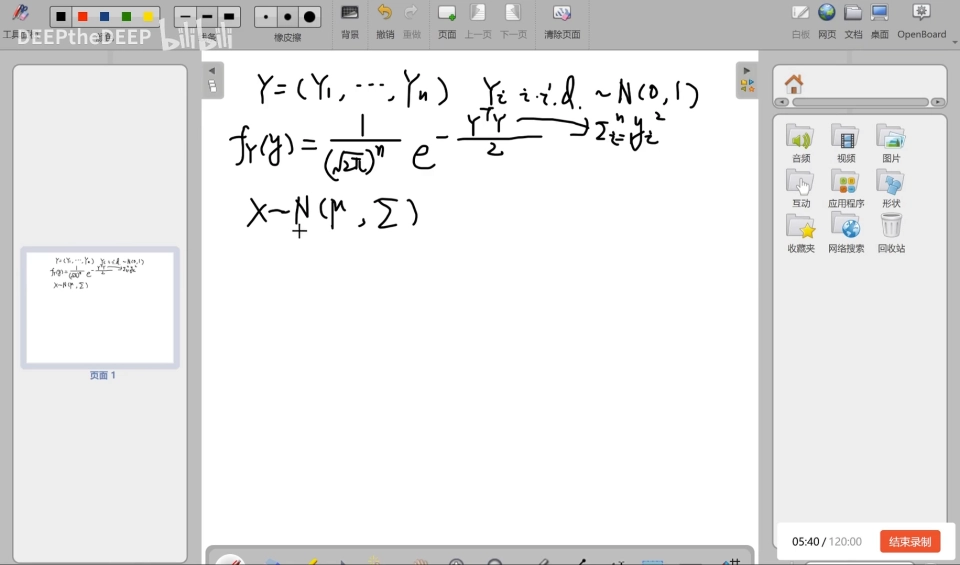
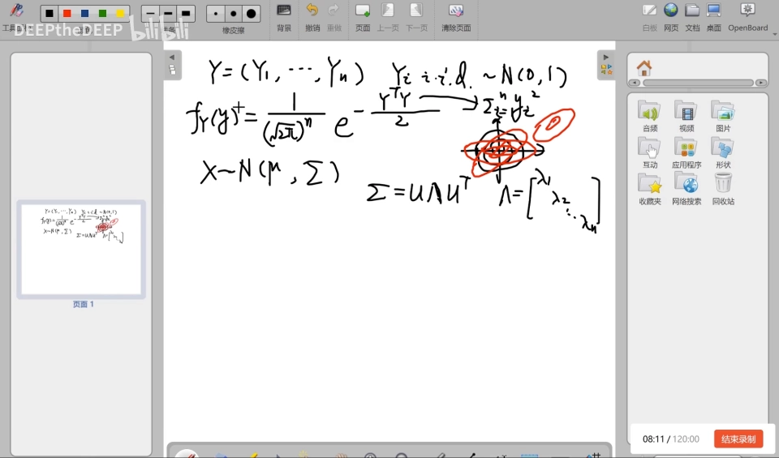
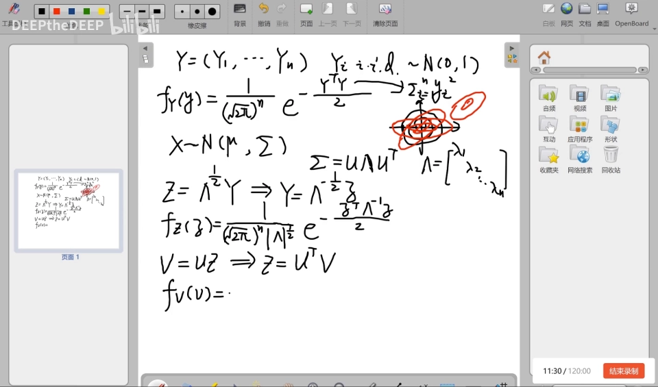
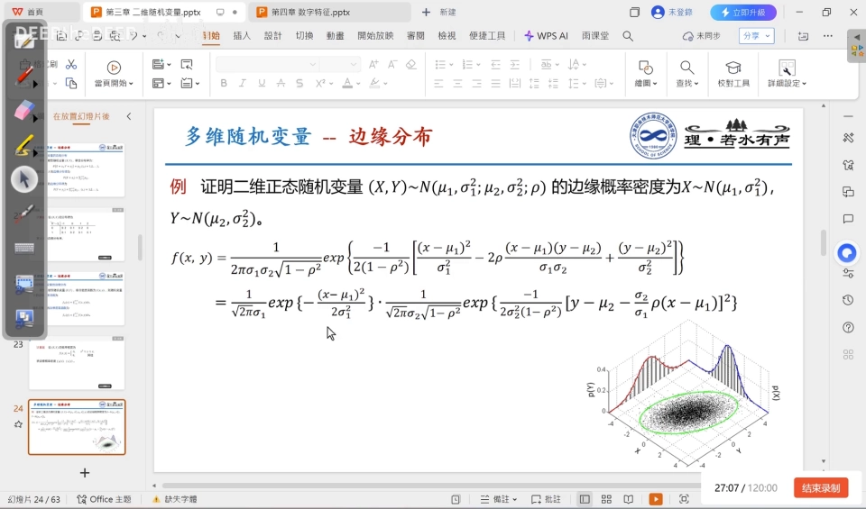
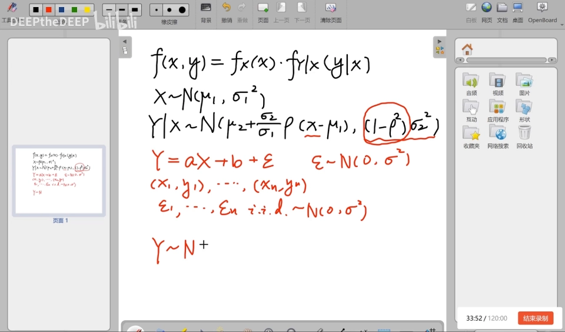
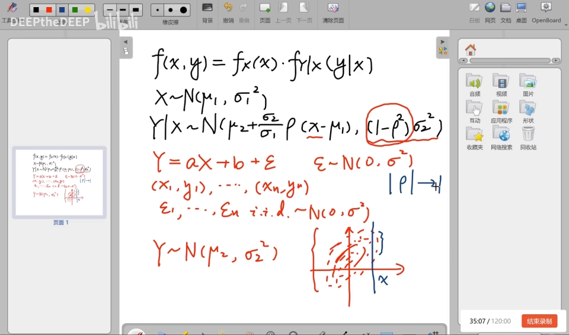
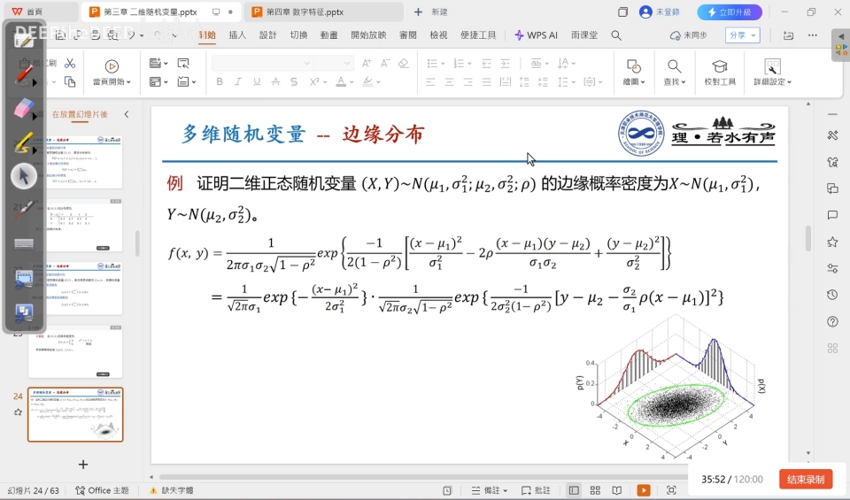

# 多元正态的边缘与条件：固定一部分变量后，剩下的分布是什么

> 视频来源：[多元正态分布的联合分布、边缘分布和条件分布——数学推导](https://www.bilibili.com/video/BV1WZ6EBZEQ6/)（Bilibili · DEEPtheDEEP）｜时长约 37 分钟
> 导读：这支视频把多元正态分布从「标准正态 + 拉伸 + 旋转 + 平移」一步步推出来，再用一次配方把二元密度拆成「边缘 × 条件」两项。看懂这次拆分，就同时拿到了边缘分布、条件分布，以及「固定一个变量后方差为什么会变小」这三件事。

## 本讲要解决的核心问题（SCQA）

**背景**：多元正态分布由均值向量 $\mu$ 和协方差矩阵 $\Sigma$ 描述，密度函数写成

$$
f_X(x) = \frac{1}{(2\pi)^{n/2}\,\lvert \Sigma \rvert^{1/2}}
\exp\left\{-\frac{1}{2}(x-\mu)^{\mathsf T}\Sigma^{-1}(x-\mu)\right\}
$$

**冲突**：这个式子能背下来，但看不出内部结构——为什么需要 $\Sigma^{-1}$ 和 $\lvert \Sigma \rvert$？各分量之间的相关性是从哪一步冒出来的？更重要的是：**边缘分布和条件分布该怎么算？** 为什么正态分布「切一刀」之后还是正态，而且条件分布的方差竟然和给定的那个值无关？[【跳转到 01:20】](https://www.bilibili.com/video/BV1WZ6EBZEQ6/?t=80)

**疑问**：从联合密度出发，怎样一步步得到边缘密度 $f_X(x)$ 和条件密度 $f_{Y\mid X}(y\mid x)$？

**回答（中心思想）**：多元正态分布本质上是 **$N$ 个相互独立的标准正态误差，经过「拉伸 → 旋转 → 平移」三步变换**得到的。抓住这条生成链，就能理解三件事：旋转制造了分量之间的相关性；边缘分布就是把不关心的分量「丢掉」；条件分布就是把一部分分量**固定住**，剩下的分量仍然是正态，均值变成给定值的线性函数，方差按 $(1-\rho^2)$ 缩小。[【跳转到 17:05】](https://www.bilibili.com/video/BV1WZ6EBZEQ6/?t=1025)

## 一、从一元到多元：一口立体的钟

正态分布可以看成是**随机误差**的分布。多元正态分布出现的原因很直接：误差的来源可能不止一个。比如平面上运动的物体受到风力影响，风力可以分解成 $X$ 方向和 $Y$ 方向上的力，于是就有了两个方向上的不确定随机误差。[【跳转到 00:05】](https://www.bilibili.com/video/BV1WZ6EBZEQ6/?t=5)

一元正态的概率密度是一条钟形曲线；二元正态的概率密度铺在整个平面上，和 $XY$ 平面共同构成一个三维函数，仍然是中间高、两侧低——只是这口钟从一条曲线变成了**一口立体的钟**，再往上就是分布在更高维空间里的函数。[【跳转到 00:55】](https://www.bilibili.com/video/BV1WZ6EBZEQ6/?t=55)

一般 $N$ 元正态分布仍然只有两个参数：

- $\mu$：**均值向量**，每个维度各有一个均值；
- $\Sigma$：**协方差矩阵**，第 $(i,j)$ 个元素是第 $i$ 个分量与第 $j$ 个分量之间的协方差。[【跳转到 01:45】](https://www.bilibili.com/video/BV1WZ6EBZEQ6/?t=105)

## 二、联合密度是怎么推出来的：拉伸、旋转、平移

### 2.1 起点：$N$ 个相互独立的标准正态误差

最基本的出发点是：有一个向量 $Y = (Y_1,\dots,Y_N)$，它的每个分量都**独立同分布于标准正态分布** $N(0,1)$。由于独立性，联合密度就是各自密度的乘积：

$$
f_Y(y) = \frac{1}{(2\pi)^{N/2}}\exp\left(-\frac{y^{\mathsf T} y}{2}\right)
= \prod_{i=1}^{N}\frac{1}{\sqrt{2\pi}}e^{-y_i^2/2}
$$

[【跳转到 03:10】](https://www.bilibili.com/video/BV1WZ6EBZEQ6/?t=190)

这时的概率密度等高面是一个**圆**（高维下是球面）：各个方向的误差是同质的。

### 2.2 第一步：拉伸

协方差矩阵是对称半正定矩阵，不退化时是正定矩阵。对任何一个对称正定矩阵，可以做特征值分解：

$$
\Sigma = U\Lambda U^{\mathsf T}
$$

其中 $U$ 是正交矩阵，$\Lambda = \mathrm{diag}(\lambda_1,\dots,\lambda_N)$ 是对角矩阵，元素都为正。[【跳转到 06:55】](https://www.bilibili.com/video/BV1WZ6EBZEQ6/?t=415)

第一步「拉伸」就是构造 $Z = \Lambda^{1/2}Y$，即各个方向分别拉伸 $\sqrt{\lambda_1}$ 到 $\sqrt{\lambda_N}$ 倍。根据多元随机变量的函数分布变换公式（这是一一映射），

$$
f_Z(z) = \frac{1}{(2\pi)^{N/2}\lvert \Lambda \rvert^{1/2}}
\exp\left(-\frac{z^{\mathsf T}\Lambda^{-1}z}{2}\right)
$$

其中雅可比行列式就是 $\lvert \Lambda^{1/2}\rvert$。[【跳转到 09:00】](https://www.bilibili.com/video/BV1WZ6EBZEQ6/?t=540)

几何上，圆变成了椭圆：不同方向上的误差不再是同质的。

### 2.3 第二步：旋转

再令 $V = UZ$，这就是旋转，反变换为 $Z = U^{\mathsf T}V$。正交矩阵的逆就是它的转置，而**正交变换的雅可比行列式等于 1**，所以这一步不需要再乘雅可比因子：

$$
f_V(v) = \frac{1}{(2\pi)^{N/2}\lvert \Lambda \rvert^{1/2}}
\exp\left(-\frac{v^{\mathsf T}U\Lambda^{-1}U^{\mathsf T}v}{2}\right)
$$

[【跳转到 11:30】](https://www.bilibili.com/video/BV1WZ6EBZEQ6/?t=690)

### 2.4 化简：$\Sigma^{-1}$ 与 $\lvert \Sigma \rvert$ 的来历

现在做两处化简：

1. **逆矩阵**：$\Sigma^{-1} = (U\Lambda U^{\mathsf T})^{-1} = U\Lambda^{-1}U^{\mathsf T}$，正好就是指数里夹着的那一坨；
2. **行列式**：$\lvert \Sigma \rvert = \lvert U \rvert\,\lvert \Lambda \rvert\,\lvert U^{\mathsf T} \rvert = \lvert \Lambda \rvert$，因为正交矩阵的行列式等于 1。

于是系数里的 $\lvert \Lambda \rvert^{1/2}$ 可以改写成 $\lvert \Sigma \rvert^{1/2}$。[【跳转到 13:35】](https://www.bilibili.com/video/BV1WZ6EBZEQ6/?t=815)

### 2.5 第三步：平移

最后令 $W = V + \mu$，把分布平移到真正的中心，等价于 $V = W - \mu$，雅可比行列式仍为 1。代进去就得到

$$
f_X(x) = \frac{1}{(2\pi)^{N/2}\lvert \Sigma \rvert^{1/2}}
\exp\left\{-\frac{1}{2}(x-\mu)^{\mathsf T}\Sigma^{-1}(x-\mu)\right\}
$$

这正是开头那个定义式。[【跳转到 16:30】](https://www.bilibili.com/video/BV1WZ6EBZEQ6/?t=990)

**这条链解释了相关性从哪来**：一元正态只需要拉伸和平移（$X = \mu + \sigma Y$），多元多出来的就是**旋转**这一步；正因为坐标系被转过，原本独立的分量在新的观测坐标下就带上了相关性。[【跳转到 17:30】](https://www.bilibili.com/video/BV1WZ6EBZEQ6/?t=1050)

## 三、二元情形：五个参数

二元时，协方差矩阵是

$$
\Sigma = \begin{pmatrix} \sigma_1^2 & \rho\sigma_1\sigma_2 \\ \rho\sigma_1\sigma_2 & \sigma_2^2\end{pmatrix}
$$

于是只需要 $\mu_1,\mu_2,\sigma_1^2,\sigma_2^2,\rho$ 五个参数。[【跳转到 19:04】](https://www.bilibili.com/video/BV1WZ6EBZEQ6/?t=1144)

- 行列式：$\lvert \Sigma \rvert = \sigma_1^2\sigma_2^2(1-\rho^2)$；
- 逆矩阵：由伴随矩阵得到，对角上是 $\sigma_2^2$ 与 $\sigma_1^2$，非对角是 $-\rho\sigma_1\sigma_2$，再除以行列式。

[【跳转到 21:09】](https://www.bilibili.com/video/BV1WZ6EBZEQ6/?t=1269)

代入一般式，就得到教科书上那个二元正态密度（这里以零均值书写，非零均值把 $x$ 换成 $x-\mu_1$、$y$ 换成 $y-\mu_2$ 即可）：

$$
f(x,y) = \frac{1}{2\pi\sigma_1\sigma_2\sqrt{1-\rho^2}}
\exp\left\{-\frac{1}{2(1-\rho^2)}
\left[\frac{(x-\mu_1)^2}{\sigma_1^2}
- \frac{2\rho(x-\mu_1)(y-\mu_2)}{\sigma_1\sigma_2}
+ \frac{(y-\mu_2)^2}{\sigma_2^2}\right]\right\}
$$

[【跳转到 25:52】](https://www.bilibili.com/video/BV1WZ6EBZEQ6/?t=1552)

## 四、关键一步：把联合密度拆成「边缘 × 条件」

### 4.1 配方

接下来是整支视频的核心操作。想求「给定 $X$ 时 $Y$ 的条件分布」，就把 $X$ 看成固定的，**对 $Y$ 配方**（配成完全平方），然后把指数拆成两项：

$$
f(x,y) = f_X(x)\cdot f_{Y\mid X}(y\mid x)
$$

拆完之后，两项**各自都是一个正态分布**。[【跳转到 26:17】](https://www.bilibili.com/video/BV1WZ6EBZEQ6/?t=1577)

### 4.2 两项分别是什么

第一项是参数为 $\mu_1$ 和 $\sigma_1^2$ 的正态分布——它恰好就是 $X$ 的**边缘分布**：

$$
X \sim N(\mu_1,\ \sigma_1^2)
$$

第二项也是正态分布，但参数变了：

$$
Y\mid X=x \;\sim\; N\!\left(\mu_2 + \frac{\sigma_2}{\sigma_1}\rho\,(x-\mu_1),\;\; (1-\rho^2)\sigma_2^2\right)
$$

[【跳转到 29:13】](https://www.bilibili.com/video/BV1WZ6EBZEQ6/?t=1753)

这两个式子值得逐项读：

- **边缘分布的参数就是原来的 $\mu_1,\sigma_1^2$**，另一个变量完全没出现——「边缘」在操作上就是把另一个变量**丢掉**；
- **条件分布的均值是 $x$ 的线性函数**：给定 $x$ 后，$Y$ 的中心随 $x$ 平移，斜率是 $\rho\sigma_2/\sigma_1$；
- **条件分布的方差是 $(1-\rho^2)\sigma_2^2$，与给定的 $x$ 无关**。这一点很关键：不管你把 $X$ 固定成哪个值，剩下的不确定性都一样大。

## 五、两个推论：同方差回归与方差缩减

### 5.1 为什么经典回归模型敢假设同方差

条件分布的方差与 $x$ 无关，直接支撑了经典回归模型的假设。回归模型写成

$$
Y = aX + b + \varepsilon,\qquad \varepsilon \sim N(0,\sigma^2)
$$

并假定 $\varepsilon$ 的方差与 $X$ 无关。现实中每个观测的方差完全可能不同，甚至依赖于 $X$；但如果误差来源可以看成多元正态分布，那么**同方差性就有了理论依据**——给不同的 $X$，随机误差不受 $X$ 影响。[【跳转到 32:37】](https://www.bilibili.com/video/BV1WZ6EBZEQ6/?t=1957)

### 5.2 方差缩减：知道 $X$ 为什么会让你更确定 $Y$

另一个推论是：给定 $X$ 后 $Y$ 的条件方差 $(1-\rho^2)\sigma_2^2$ **小于**不知道 $X$ 时的方差 $\sigma_2^2$。

直观图像很清楚：如果不知道 $X$，$Y$ 可能分布在一大片范围里；一旦知道 $X$ 落在某个位置，$Y$ 的可能范围就只剩那个位置上的一条竖切片了。[【跳转到 34:17】](https://www.bilibili.com/video/BV1WZ6EBZEQ6/?t=2057)

缩减的幅度由相关系数决定：$\lvert \rho \rvert$ 越接近 1，椭圆越瘦，方差缩减越多；当 $\rho = \pm 1$ 时，两者退化成确定性关系，条件方差变成零。所以「给定 $X$ 能否更好地预测 $Y$」，取决于 $X$ 与 $Y$ 的相关程度。[【跳转到 35:07】](https://www.bilibili.com/video/BV1WZ6EBZEQ6/?t=2107)

## 六、推广到多元：取子集，结论不变

以上结论虽然是在二元下写出来的，但完全可以推广。多元正态分布中：

- 取**任意一个子集**的分量，它的边缘分布仍然是正态分布；
- 给定**一部分子集**的变量，其余变量的条件分布也仍然是正态分布；
- 并且这个条件分布的方差**不依赖于给定的那部分变量**的取值。

[【跳转到 36:17】](https://www.bilibili.com/video/BV1WZ6EBZEQ6/?t=2177)

## 七、这套结论对「条件生成」意味着什么

把上面的语言翻译到生成任务里，会得到三个直接可用的判断：

1. **边缘化 = 丢掉不关心的变量**。想知道 $X$ 单独的规律，就把 $Y$ 积掉；在多元正态里这一步甚至不需要算积分，直接取对应的子块即可。
2. **条件化 = 固定一部分变量**。给定 $X=x$ 之后，剩下的变量服从 $f_{Y\mid X}(y\mid x)$——这正是「以文本为条件生成图像」「以骨架为条件生成分子」想要的那个分布：条件部分被钉死，模型只在剩余变量上给出分布并采样。
3. **固定变量会降低不确定性，但不会降到零**（除非 $\lvert \rho \rvert = 1$）。条件分布的方差 $(1-\rho^2)\sigma_2^2$ 说明：条件越强、相关性越高，剩余的自由度越小；这也解释了为什么条件生成的结果仍然有随机性，而不是每次都一样。

## 小结

- 多元正态分布的本质是：$N$ 个独立标准正态误差，经过**拉伸（$\Lambda^{1/2}$）→ 旋转（$U$）→ 平移（$\mu$）**三步得到；旋转这一步制造了分量之间的相关性。
- 密度里的 $\Sigma^{-1}$ 和 $\lvert \Sigma \rvert$ 不是凭空出现的，它们分别来自逆矩阵化简和行列式化简（正交矩阵行列式为 1）。
- 二元情形只需 $\mu_1,\mu_2,\sigma_1^2,\sigma_2^2,\rho$ 五个参数。
- 对 $Y$ 配方，可把联合密度拆成 $f(x,y)=f_X(x)f_{Y\mid X}(y\mid x)$：边缘分布 $X\sim N(\mu_1,\sigma_1^2)$，条件分布 $Y\mid X=x\sim N(\mu_2+\frac{\sigma_2}{\sigma_1}\rho(x-\mu_1),(1-\rho^2)\sigma_2^2)$。
- 条件方差与给定值无关，这既支撑了回归模型的同方差假设，也解释了「知道 $X$ 后 $Y$ 更确定」的方差缩减。
- 推广到多元：子集仍是正态，给定部分分量后其余分量仍是正态，且方差不依赖给定值。

## 关键术语速查

| 术语 | 一句话解释 |
| --- | --- |
| 均值向量 $\mu$ | 每个维度各自的均值，决定分布中心的位置 |
| 协方差矩阵 $\Sigma$ | 对角是各分量方差、非对角是两两协方差，决定椭圆的形状与朝向 |
| 特征值分解 $\Sigma=U\Lambda U^{\mathsf T}$ | 把协方差拆成「拉伸方向与幅度」和「旋转」两部分 |
| 雅可比行列式 | 变量变换时体积的缩放因子；正交变换的雅可比行列式为 1 |
| 边缘分布 | 只保留部分分量后的分布；操作上就是把其余变量积分掉 |
| 条件分布 | 固定部分分量后其余分量的分布；多元正态下仍是正态 |
| 方差缩减 | 条件方差 $(1-\rho^2)\sigma_2^2$ 小于边缘方差 $\sigma_2^2$，幅度由相关系数决定 |