# 联合、边缘、条件：用「质量」和「密度」一次分清二维随机变量的三种分布

> 视频来源：[二维随机变量：联合分布、边缘分布与条件分布的关系](https://www.bilibili.com/video/BV12g411u7YT/)（Bilibili · 小元老师高数线代概率）｜时长约 42 分钟
> 导读：这支视频不推导公式，而是给出一套贯穿全程的物理图像——**概率是质量，概率密度是面密度**。用这套图像，联合分布、边缘分布、条件分布这三个最容易混淆的概念，可以看成同一块「合金薄片」的三种看法。文中时间戳可跳回原片核对。

## 本讲要解决的核心问题（SCQA）

**背景**：学完二维随机变量这一章，手里会同时出现五个名字很像的东西：联合分布函数 $F(x,y)$、边缘分布函数 $F_X(x)$、联合概率密度 $f(x,y)$、边缘概率密度 $f_X(x)$、条件概率密度 $f_{X\mid Y}(x\mid y)$。

**冲突**：这些定义写出来都是积分、极限，长得非常像。很多同学学完之后对它们的关系一片混乱，只能死记硬背；而死记硬背在解答题上会直接卡住——尤其近年概率论考研解答题难度提高，考的正是「能不能把定义和概念关系区分清楚」。[【跳转到 00:00】](https://www.bilibili.com/video/BV12g411u7YT/?t=0)

**疑问**：这五个量到底各自在算什么？有没有一个统一的图像，能一眼看出谁是谁？

**回答（中心思想）**：有。把二维随机变量想成一块**密度不均匀的合金薄片**：薄片上每一点的**面密度**就是概率密度 $f(x,y)$，任一区域的**质量**就是概率。于是：

- **联合分布函数** = 某点左下角整块区域的质量；
- **边缘分布函数** = 一条无限长射线左侧的质量，等价于把联合分布里另一个变量取到 $+\infty$；
- **边缘概率密度** = 把薄片沿一个方向压扁成线之后的**线密度**，也就是对另一个变量做积分；
- **条件概率密度** = 把某个变量**固定成一条线**之后，只研究这条线上的密度分布。

[【跳转到 00:25】](https://www.bilibili.com/video/BV12g411u7YT/?t=25)

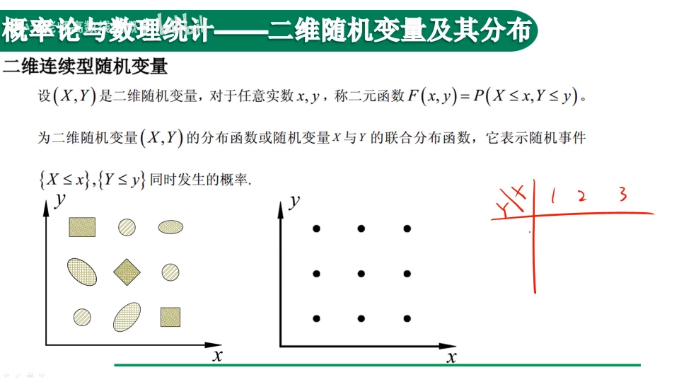

## 一、先立图像：把概率当成质量

### 1.1 离散型：每个概率是一颗有质量的质点

先看最简单的离散情形。$X$ 取 1、2、3，$Y$ 也取 1、2、3，每个格子对应一个概率，比如 $(1,1)$ 处是 $1/20$，$(2,1)$ 处是 $3/20$，某处是 $7/50$。

现在把这些概率**看成不同质量的物体**：在 $(1,1)$ 处放一颗质量 $1/20$ 的小球，在 $(2,1)$ 处放一颗质量 $3/20$ 的小球，依次放下去。学过物理的同学都知道，这些物体可以进一步看成**质点**——只保留位置和质量，不关心形状。[【跳转到 01:15】](https://www.bilibili.com/video/BV12g411u7YT/?t=75)

于是二维平面（横轴 $X$、纵轴 $Y$）上就撒了一把质量不等的质点。

### 1.2 联合分布函数：左下角的质量

按定义，

$$
F(x,y) = P(X \le x,\; Y \le y)
$$

假设小 $x$、小 $y$ 就是平面上某个点，那么「$X \le x$ 且 $Y \le y$」对应的区域，正是这个点**左下角**那一整块无限大的矩形。所以 $F(x,y)$ 就是这块区域里所有质点的质量叠加。[【跳转到 02:30】](https://www.bilibili.com/video/BV12g411u7YT/?t=150)

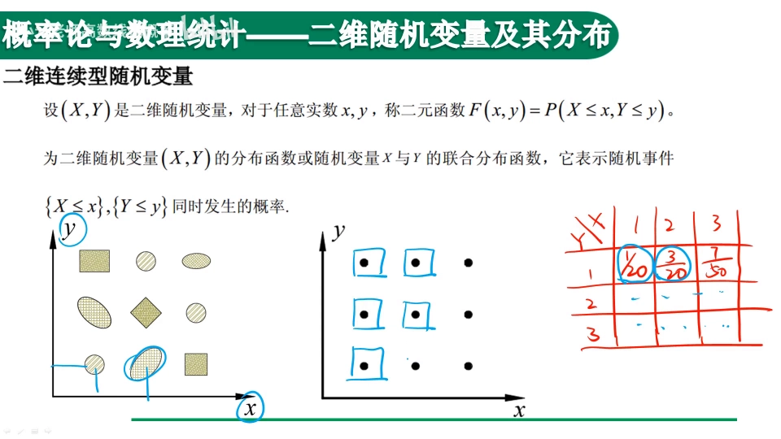

例子里的质点都落在第一象限，只是因为举的概率分布简单；质点完全可以分布在其他象限，图像不变——左下角那块区域始终是无限大的。

## 二、边缘分布：把一个变量「放到正无穷」

### 2.1 边缘分布函数就是一条射线左侧的质量

$F_X(x) = P(X \le x)$ 叫**边缘分布函数**。在图上画一条 $X = x$ 的竖直线，它直上直下，向上到 $Y$ 的正无穷、向下到 $Y$ 的负无穷，是一条无限长的射线。这条射线**左侧所有质点的质量叠加**，就是 $P(X \le x)$。[【跳转到 03:20】](https://www.bilibili.com/video/BV12g411u7YT/?t=200)

那它和 $F(x,y)$ 是什么关系？把联合分布函数里的 $Y$ 直接取到正无穷：

$$
F_X(x) = F(x, +\infty) = \lim_{y \to +\infty} F(x,y)
$$

理由很直观：当 $Y$ 已经是正无穷，那个「左下角矩形」的下边界就被推到了最底下，横线下方包含了 $Y$ 的所有情况，于是它覆盖的区域正好等于那条竖直线左侧的全部区域。同理，

$$
F_Y(y) = F(+\infty, y) = \lim_{x \to +\infty} F(x,y)
$$

[【跳转到 05:00】](https://www.bilibili.com/video/BV12g411u7YT/?t=300)

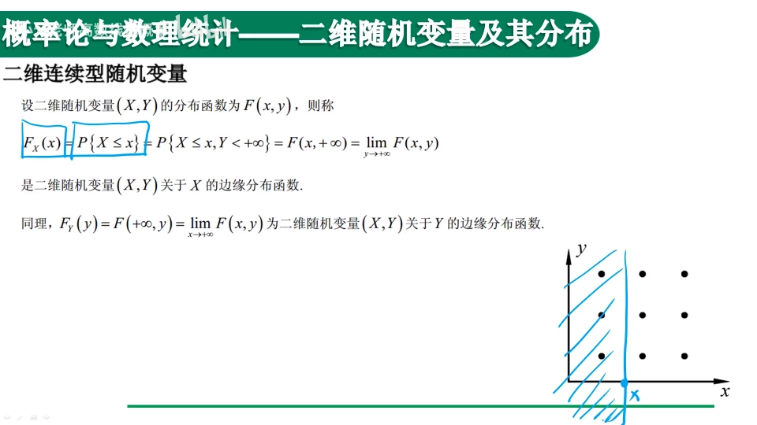

### 2.2 连续型：把「质量」换成「面密度」

换成连续型随机变量，质点就变成了一整块物体，不再是一个个点。这时要先定义概率密度：如果存在非负可积的二元函数 $f(u,v)$，使得

$$
F(x,y) = \int_{-\infty}^{x}\!\!\int_{-\infty}^{y} f(u,v)\,du\,dv
$$

那么 $f(u,v)$ 就叫**联合概率密度**。[【跳转到 05:40】](https://www.bilibili.com/video/BV12g411u7YT/?t=340)

这个抽象定义可以用一个生活场景理解：送一块中间是金、边缘是铁的合金礼物，从金到铁有一个渐变过渡，于是**每个点的密度都不一样**。把这块物体看成没有厚度的薄片，它每一点的**面密度**（多少克每平方厘米）就对应概率密度的数值，而任一区域的质量就是概率。[【跳转到 06:05】](https://www.bilibili.com/video/BV12g411u7YT/?t=365)

于是连续型的所有结论都和离散型一一对应，只是「叠加」换成了「积分」：$F(x,y)$ 仍然是左下角的质量，只不过这个质量要把面密度做二重积分。[【跳转到 08:10】](https://www.bilibili.com/video/BV12g411u7YT/?t=490)

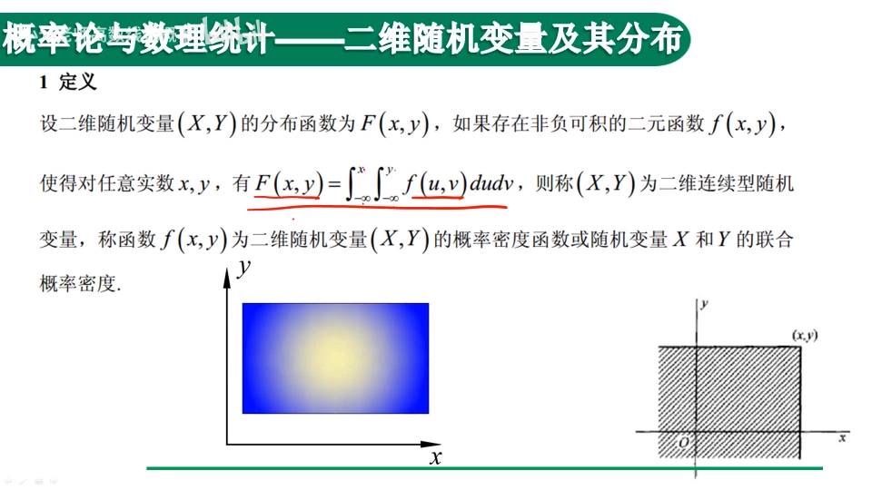

## 三、边缘概率密度：沿一个方向把薄片压扁

### 3.1 面密度压成线密度

边缘分布函数仍然是质量，那**边缘概率密度**是什么？视频给了一个非常形象的操作：把这块合金沿着 $Y$ 方向**压缩**。

压、压、压，$Y$ 方向越来越窄，窄到数学上认为这个方向的宽度**已经是零**——当然现实中压不到零，但数学上可以这么看。这时整块薄片变成了一条线，原来的**面密度**（克每平方厘米）就变成了**线密度**（克每厘米），这条线上的线密度就是 $f_X(x)$。[【跳转到 11:16】](https://www.bilibili.com/video/BV12g411u7YT/?t=676)

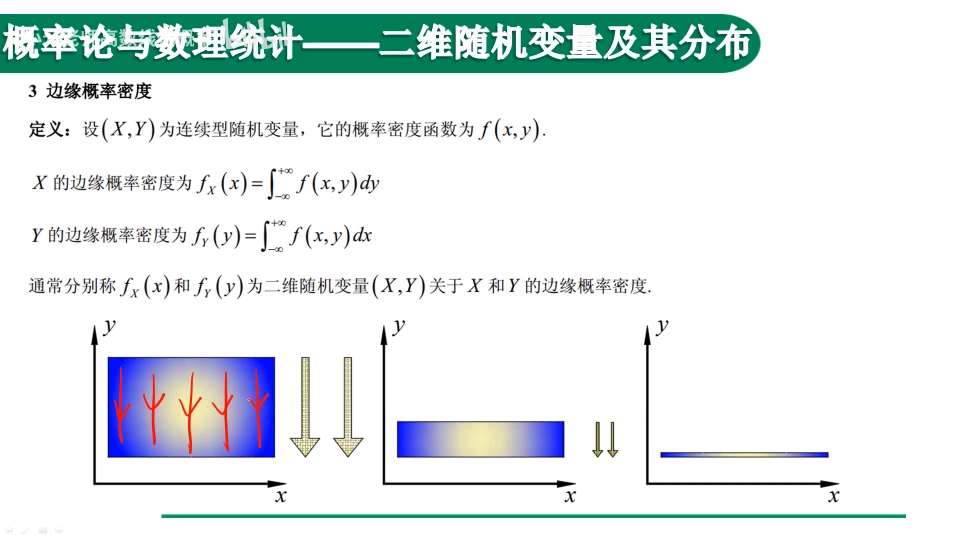

有人会说：压缩不就是把质量叠加吗？——注意，**叠加是离散型的说法**；对连续型，叠加就是积分。一条没有宽度的线上的质量压成一个点，原来的面密度和这个点的线密度之间就是积分关系：

$$
f_X(x) = \int_{-\infty}^{+\infty} f(x,y)\,dy, \qquad
f_Y(y) = \int_{-\infty}^{+\infty} f(x,y)\,dx
$$

单位也能验证这件事：从「克每平方厘米」变成「克每厘米」，正好是对长度 $Y$ 积了一次分。[【跳转到 13:21】](https://www.bilibili.com/video/BV12g411u7YT/?t=801)

### 3.2 为什么结果总要写 X 的取值范围

求完边缘概率密度，最后一般要写成分段函数，并标明 $X$ 的取值范围（从最小值到最大值）。原因就是压缩这个图像：$X$ 从最小到最大的**每个位置**都做了一次积分，每个位置的线密度都算了一遍；范围之外没有质量，概率密度自然是零。[【跳转到 14:36】](https://www.bilibili.com/video/BV12g411u7YT/?t=876)

### 3.3 身高与体重的例子

设 $X$ 是身高，$Y$ 是体重，$X \sim N(1.6,\,1)$（单位米），$Y \sim N(100,\,10)$（单位斤）。把两者的取值画在平面上：大多数人的身高都在均值 1.6 附近，体重都在 100 附近，所以概率密度大的黄色区域集中在中间，四角那些「身高特别矮体重特别大」之类的组合则很罕见。[【跳转到 16:06】](https://www.bilibili.com/video/BV12g411u7YT/?t=966)

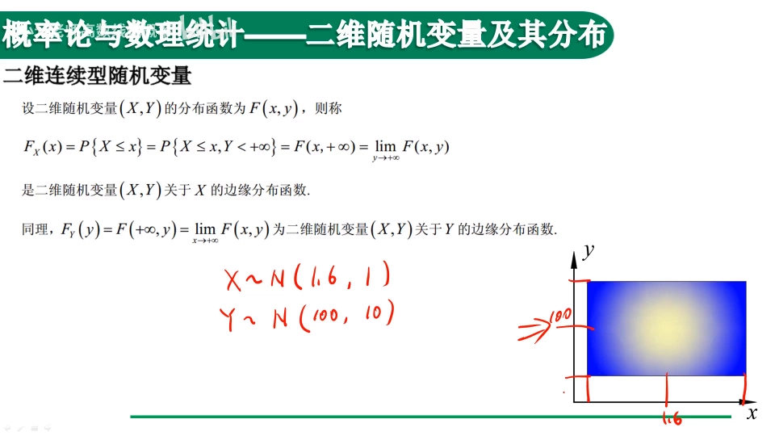

在这个例子里：

- $F(1.6,\,100)$ 算的是「身高比 1.6 小**且**体重比 100 小」的人的概率，即该点左下角的质量；
- $F_X(1.6)$ 算的是「身高小于 1.6」的概率，即竖直线左侧的质量；
- 而**边缘概率密度**回答的是另一个问题：我**不想**再研究二维变量了，只想研究身高这一个变量。怎么把二维问题降成一维？把**同身高**位置上不同体重的密度做积分——因为同样身高的人，体重有胖有瘦。[【跳转到 19:26】](https://www.bilibili.com/video/BV12g411u7YT/?t=1166)

有了 $f_X(x)$，想算「身高落在 $A$ 到 $B$ 之间的概率」就直接对它积分，这就是边缘概率密度的用处。[【跳转到 20:16】](https://www.bilibili.com/video/BV12g411u7YT/?t=1216)

## 四、条件概率密度：固定一个变量，只看一条线

### 4.1 公式与含义

条件概率密度的公式和条件概率很像：

$$
f_{X\mid Y}(x\mid y) = \frac{f(x,y)}{f_Y(y)}, \qquad f_{Y\mid X}(y\mid x) = \frac{f(x,y)}{f_X(x)}
$$

分母是另一个变量**单独**的概率密度，分子是联合概率密度。[【跳转到 21:01】](https://www.bilibili.com/video/BV12g411u7YT/?t=1261)

它和边缘概率密度有点像，但关键区别在于：边缘密度是**整块薄片压成一条线**，而条件密度是**只留下一条线**——把 $Y$ 固定成某个具体值 $y=b$，然后研究这条线上 $X$ 的密度分布。[【跳转到 21:26】](https://www.bilibili.com/video/BV12g411u7YT/?t=1286)

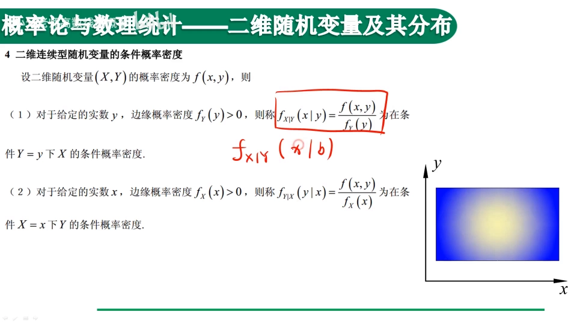

用身高体重说：$f_{X\mid Y}(x\mid 101)$ 研究的是「体重 101 斤的人，身高怎么分布」；$f_{Y\mid X}(y\mid 1.85)$ 研究的是「身高 1 米 85 的人，体重怎么分布」。[【跳转到 22:16】](https://www.bilibili.com/video/BV12g411u7YT/?t=1336)

### 4.2 固定 $Y=b$ 之后，$X$ 的范围会变

视频换了一个不规则的心形区域来说明一件容易忽略的事：**条件会影响另一个变量的取值范围**。

假设概率密度只在心形内部非零，外部为零。取 $Y=b$，这条水平线正好横穿心形顶部，与边界交于两处，于是 $X$ 的允许范围是**两段**；换一个 $b'$ 靠下的位置，$X$ 的范围就只剩**一段**了。所以写条件密度时，$X$ 的上下限是**受 $Y$ 的取值约束**的，不能照抄联合密度的范围。[【跳转到 24:46】](https://www.bilibili.com/video/BV12g411u7YT/?t=1486)

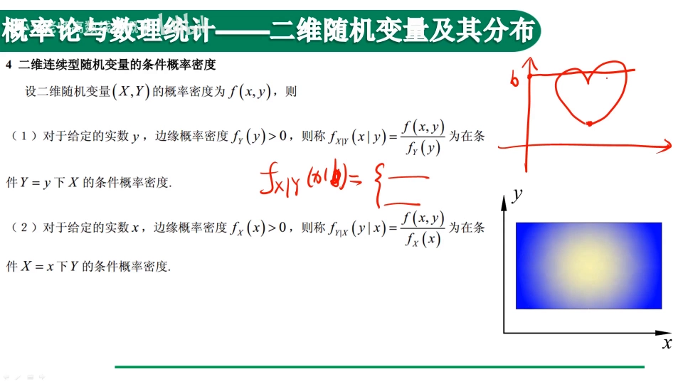

### 4.3 条件概率密度用来算条件概率

条件概率密度最典型的用途是求条件概率。比如求「体重 $Y=110$ 的条件下，身高介于 1.6 到 1.7 的概率」。

注意，这个概率**不能**直接用条件概率公式算：连续型随机变量里 $P(Y=110)=0$，会变成 $0/0$ 型；而洛必达、泰勒这些极限工具也用不上，因为 $P(Y=110)$ 根本写不成一个函数关系。正确的做法是**对条件概率密度积分**：

$$
P(1.6 \le X \le 1.7 \mid Y = 110) = \int_{1.6}^{1.7} f_{X\mid Y}(x \mid 110)\,dx
$$

直观上，你其实已经研究了「所有体重 110 的人」的密度怎么分配：这条线上哪里人多、哪里人少，看这条线就明白了。[【跳转到 26:51】](https://www.bilibili.com/video/BV12g411u7YT/?t=1611)

## 五、升到三维：概率是体积，边缘密度是横截面面积

### 5.1 从柱状图到曲面

前面一直用「质量」理解概率。把质量画成柱状图——横轴 $X$、纵轴 $Y$、竖轴 $Z$ 是概率——二维离散型随机变量就成了三维空间里的一丛柱子，柱高就是概率。[【跳转到 28:36】](https://www.bilibili.com/video/BV12g411u7YT/?t=1716)

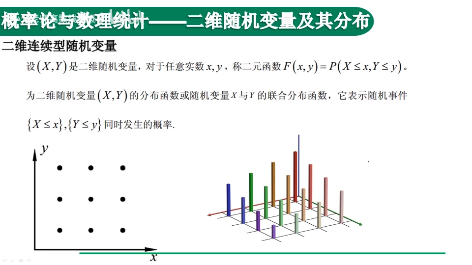

让柱子越来越密、密到连成一片，顶点就连成一个**曲面**——这就过渡到连续型随机变量，$Z = f(x,y)$ 就是这张曲面。[【跳转到 30:41】](https://www.bilibili.com/video/BV12g411u7YT/?t=1841)

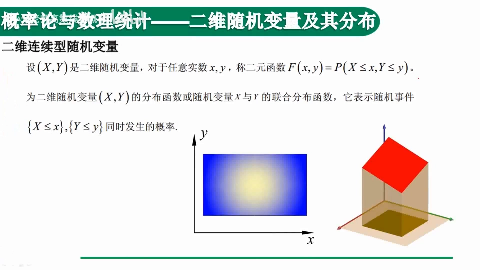

### 5.2 概率 = 曲顶柱体的体积

在三维视角下，平面图里的「质量」就变成了「体积」：

- **联合分布函数** $F(x,y)$：点 $(x,y)$ 后侧那一整块**曲顶柱体**的体积；
- **边缘分布函数** $F_X(x)$：一块竖直隔板后侧的曲顶柱体体积。[【跳转到 33:47】](https://www.bilibili.com/video/BV12g411u7YT/?t=2027)

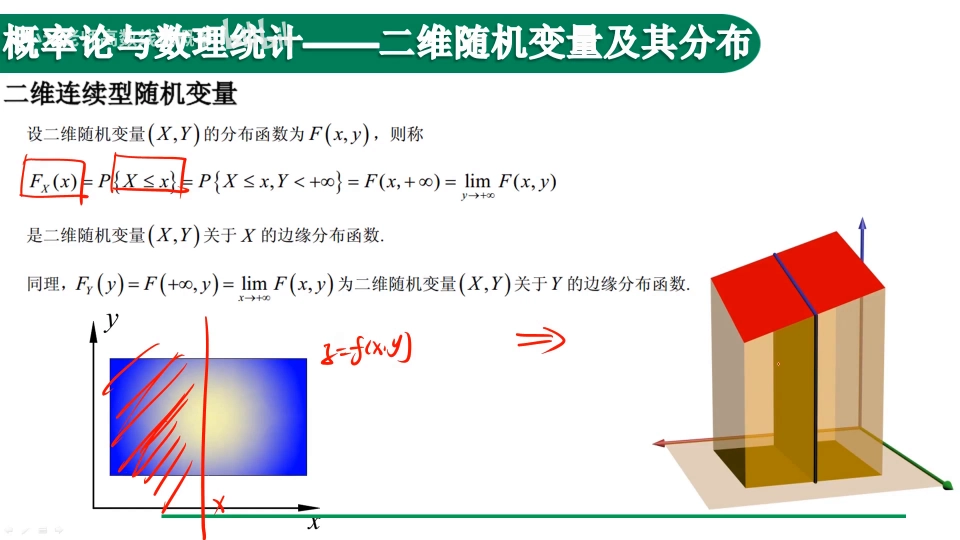

顺带解释了一个课堂现象：老师讲「$Y \le X$ 的概率」时往往只画平面上的一块区域，那其实只是三维区域在平面上的**投影**；严格说来，真正的概率是这块区域上方曲顶柱体的体积。徒手画三维图太麻烦，所以只画投影，简单题照样能做对。[【跳转到 35:14】](https://www.bilibili.com/video/BV12g411u7YT/?t=2114)

### 5.3 边缘密度 = 横截面面积

边缘概率密度 $f_X(x) = \int f(x,y)\,dy$ 这个积分，其实就是二重积分的第一步：固定 $x=a$，沿 $Y$ 方向积一次，算的是**横截面的面积**。让 $a$ 变化，就是算出不同位置的横截面面积，得到一个关于 $X$ 的函数——这就是边缘概率密度。[【跳转到 36:18】](https://www.bilibili.com/video/BV12g411u7YT/?t=2178)

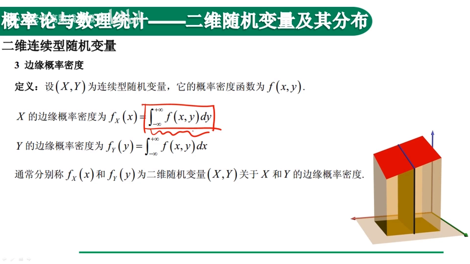

### 5.4 条件密度 = 横截面的轮廓

条件概率密度则是**只看某一个横截面**：把 $X$ 固定在 1.75，这个横截面单独拿出来看，它的顶部轮廓就是 $f_{Y\mid X}(y\mid 1.75)$——即「身高 1 米 75 的人，体重分布长什么样」。[【跳转到 38:22】](https://www.bilibili.com/video/BV12g411u7YT/?t=2302)

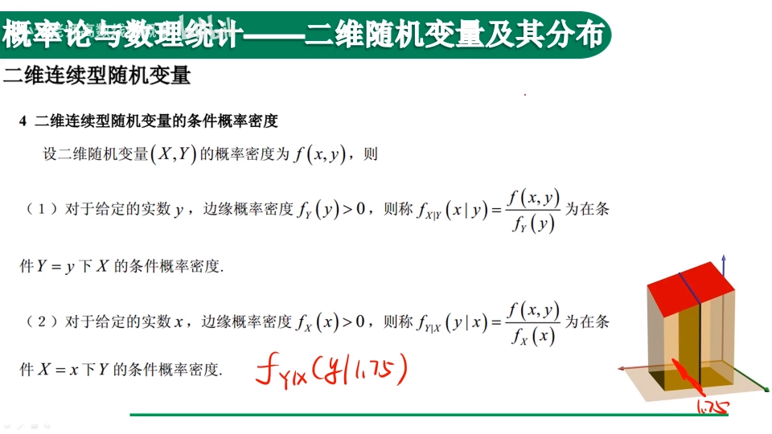

一句话对照三者的三维图像：**联合分布是体积，边缘密度是横截面面积，条件密度是横截面的轮廓**。

## 六、回到生成任务：条件分布就是「固定一部分变量」后的分布

这套图像对理解生成模型很有用，因为它把「条件」这件事说得非常具体。

联合分布 $f(x,y)$ 描述的是两个变量**一起**的规律；一旦把 $Y$ 固定成 $y$，剩下的就不再是联合分布，而是**沿着一条线**的分布 $f_{X\mid Y}(x\mid y)$。这正是条件生成在做的事：把要控制的那部分变量（比如文本、类别、分子骨架）固定住，让模型只在剩下的变量上给出分布，再从那个分布里采样。

由此还能看出两种做法的区别：

- **直接从联合分布采样、再丢掉不合条件的样本**：采到的样本落在整块薄片上，只有恰好落在 $Y=y$ 这条线上的才被留下——在连续情形下这条线测度为零，几乎采不到，效率极低；
- **直接在条件分布上采样**：一开始就只在 $Y=y$ 这条线上取点，不需要「先采再筛」。

而边缘分布 $f_X(x)$ 回答的是另一个问题：如果不关心 $Y$ 了，只看 $X$ 的规律，就把 $Y$ 积掉（在薄片图像里就是压扁）。**边缘化 = 把不关心的变量积分掉**，这一步在生成模型里反复出现。

## 小结

- 全篇只有一个图像：**概率是质量，概率密度是面密度**；离散型用质点叠加，连续型用积分叠加。
- **联合分布函数** $F(x,y)$：点 $(x,y)$ 左下角区域的质量。
- **边缘分布函数**：$F_X(x) = F(x,+\infty)$，即一条无限长竖直线左侧的质量；把另一个变量推到正无穷即可。
- **边缘概率密度**：$f_X(x) = \int f(x,y)\,dy$，把薄片沿一个方向压扁，面密度变线密度；几何上是横截面面积。
- **条件概率密度**：$f_{X\mid Y}(x\mid y) = f(x,y)/f_Y(y)$，固定一个变量、只看一条线；几何上是横截面的轮廓，且另一个变量的取值范围会随固定值变化。
- 三维视角：概率 = 曲顶柱体体积，联合分布是体积，边缘密度是截面面积，条件密度是截面轮廓。
- 连续型里 $P(Y=y)=0$，所以条件概率必须对条件密度积分，不能套用离散的条件概率公式。

## 关键术语速查

| 术语 | 一句话解释 |
| --- | --- |
| 联合分布函数 $F(x,y)$ | $P(X \le x,\ Y \le y)$，即点 $(x,y)$ 左下角区域的质量 |
| 边缘分布函数 $F_X(x)$ | $F(x,+\infty)$，只关心 $X$ 时的累积概率 |
| 联合概率密度 $f(x,y)$ | 薄片在点 $(x,y)$ 处的面密度，二重积分后给出概率 |
| 边缘概率密度 $f_X(x)$ | 把联合密度对 $Y$ 积分（压扁），得到的一维线密度 |
| 条件概率密度 $f_{X\mid Y}(x\mid y)$ | 固定 $Y=y$ 后，这条线上 $X$ 的密度，等于联合密度除以边缘密度 |
| 曲顶柱体体积 | 三维视角下的概率，即密度曲面在某个区域上方的体积 |
| 横截面 | 固定一个变量后切出的切片，其面积对应边缘密度、轮廓对应条件密度 |