# 优化交叉熵训练 GAN 为何必然模式坍塌：从 JS 散度到反向 KL 的推导

> 视频来源：[【公式推导】优化交叉熵（JS散度）训练GAN，会导致模型稳定性和模式坍塌问题【理论证明】](https://www.bilibili.com/video/BV11P6fY2E7y/)（Bilibili · hallo128）｜时长约 53 分钟
> 导读：这支视频跟着邱锡鹏《神经网络与深度学习》13.3.5 的推导走一遍，把"GAN 训练不稳定"和"模式坍塌"两个老毛病还原成同一个式子：最小化交叉熵等价于最小化 JS 散度，而生成器真正在优化的主项是反向 KL。本文按推导顺序重排，术语逐个解释，适合第一次接触生成模型评估的读者。

## 本讲要解决的核心问题（SCQA）

**背景**：GAN 由一个生成器和一个判别器对抗训练，目标是交叉熵形式的最大最小博弈。大家知道它"能生成逼真的图像"，也知道它"难训"。

**冲突**：实际训练里 GAN 经常出现两个毛病。一是训练不稳定，损失忽上忽下；二是模式坍塌（mode collapse），训着训着生成器只会生成少数几类样本，别的都不管了。

**疑问**：这两个毛病是调参没调好、算力不够，还是目标函数本身就把模型往这个方向推？

**回答（中心思想）**：是目标函数决定的，而且可以严格推出来。交叉熵目标在最优判别器下化简为 JS 散度，于是有两个后果：分布不重叠时 JS 散度恒为常数 $\log 2$，对生成器参数的梯度为零，这就是训练不稳定的来源；而生成器那一项真正在优化的主项是**反向 KL 散度**，反向 KL 只要求"准"、不要求"全"，所以模式坍塌是这套目标的必然后果。

---

## 一、模式坍塌：生成器只学会了真实分布的一部分

### 1.1 生成任务天生是多解的

视频用一个最朴素的例子说明"多解性"（同一条件下有多个合理输出）。手写数字识别里，一、二、三、四一直到九，这九个数字其实各自都有自己的图像生成分布，而且彼此不一样：在同一个图像域上，"一"是这样的，"二"是那样的，"三"又是另一种样子 [【跳转到 01:12】](https://www.bilibili.com/video/BV11P6fY2E7y/?t=72)。

这就是生成任务和分类任务的根本差别：分类任务要回答"这张图是几"，答案唯一；生成任务要回答"给我一个数字"，而合理的答案有一整个分布。模型要学的是这个分布本身，不是一个点。

### 1.2 生成器会"偷懒"：只覆盖一部分

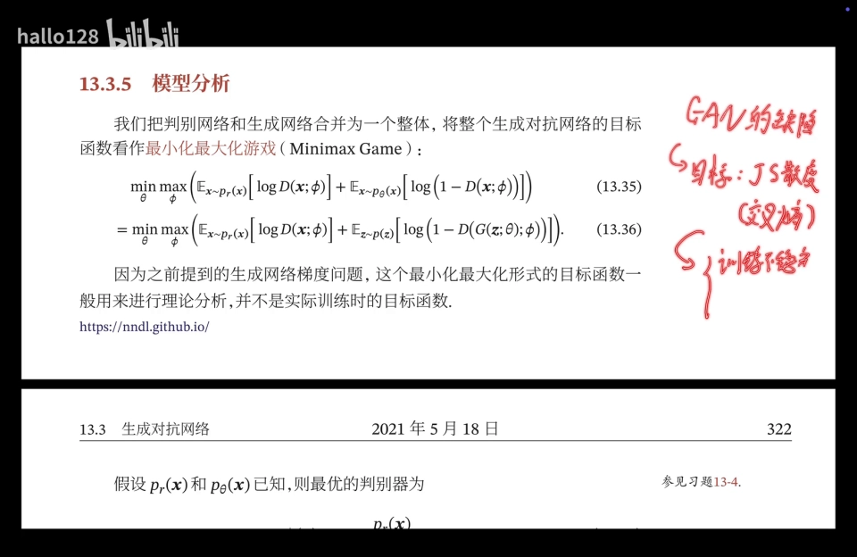

模式坍塌说的就是：生成器发现生成"一"这个图像很简单，而且几乎不会出错，于是它大量地去生成"一"，复杂的比如八、九它就不生成、不去管 [【跳转到 02:02】](https://www.bilibili.com/video/BV11P6fY2E7y/?t=122)。

后果很有意思：如果只看"生成得像不像"这类指标，它的表现可能非常好，因为"一"它确实画得很像。但整个生成器没办法生成更复杂的东西。你要说它没有接近真实图像，也不是——它只是**接近了真实分布的一部分，没有全部覆盖到** [【跳转到 02:27】](https://www.bilibili.com/video/BV11P6fY2E7y/?t=147)。

这里就出现了本小节要区分的两件事：

- **覆盖（coverage）**：真实分布里有概率的地方，模型是不是都能生成出来；
- **保真（fidelity）**：模型生成出来的东西，是不是真的像真实数据。

模式坍塌 = 保真还过得去，覆盖严重不足。后面所有推导，本质上都是在解释"为什么这套目标会奖励低覆盖"。

---

## 二、把目标函数化简成 JS 散度

### 2.1 分析顺序：先固定最优判别器

GAN 的目标函数是一个最大最小问题（书上编号 13.35）：

$$
\min_{\theta}\max_{\phi}\ \Big( \mathbb{E}_{x\sim p_r(x)}\big[\log D(x;\phi)\big] + \mathbb{E}_{x\sim p_\theta(x)}\big[\log\big(1-D(x;\phi)\big)\big] \Big)
$$

其中 $p_r$ 是真实数据分布，$p_\theta$ 是生成器产生的分布（可以理解为"假数据"的分布），$D$ 是判别器。

实际训练是分两步走的：一步优化判别器 $D$，一步优化生成器 $G$；分析的时候才把两者写在一起 [【跳转到 04:07】](https://www.bilibili.com/video/BV11P6fY2E7y/?t=247)。既然我们关心的是生成器好不好，那就先假设判别器已经训到了最优，再来看生成器该怎么优化。

### 2.2 最优判别器长什么样

给定 $p_r$ 和 $p_\theta$，最优判别器是：

$$
D^*(x) = \frac{p_r(x)}{p_r(x)+p_\theta(x)}
$$

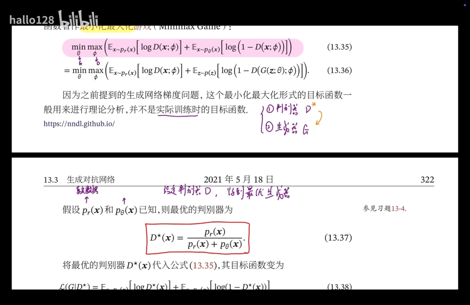

直觉很好理解：在某个样本点上，如果真实数据在那里的密度更大，判别器就该说"真"；如果生成数据密度更大，就该说"假"。它输出的其实是一个"谁更可能"的比例。

### 2.3 代入后的配方技巧

把 $D^*$ 代回目标函数，会得到一个形如 $p_r \log \frac{p_r}{p_r+p_\theta} + p_\theta \log \frac{p_\theta}{p_r+p_\theta}$ 的式子。这里有一个容易被忽略的小动作：在 log 里面给分子分母同乘 $\frac{1}{2}$ [【跳转到 08:26】](https://www.bilibili.com/video/BV11P6fY2E7y/?t=506)。

为什么要这么做？因为 $p_r$ 和 $p_\theta$ 各自都在 $[0,1]$ 之间，但它们的和 $p_r+p_\theta$ 可能落在 $[0,2]$，不是一个合法的概率分布。而 KL 散度、JS 散度里面的东西必须都是分布，所以要把和除以 2，得到

$$
p_a(x) = \frac{1}{2}\big(p_r(x)+p_\theta(x)\big)
$$

这是一个"平均分布"，它是合法的概率密度 [【跳转到 09:41】](https://www.bilibili.com/video/BV11P6fY2E7y/?t=581)。

### 2.4 结果：交叉熵目标 = JS 散度

配方之后，式子变成 KL 散度之和：

$$
\mathcal{L}(G\mid D^*) = \mathrm{KL}(p_r, p_a) + \mathrm{KL}(p_\theta, p_a) - 2\log 2 = 2\,\mathrm{JS}(p_r, p_\theta) - 2\log 2
$$

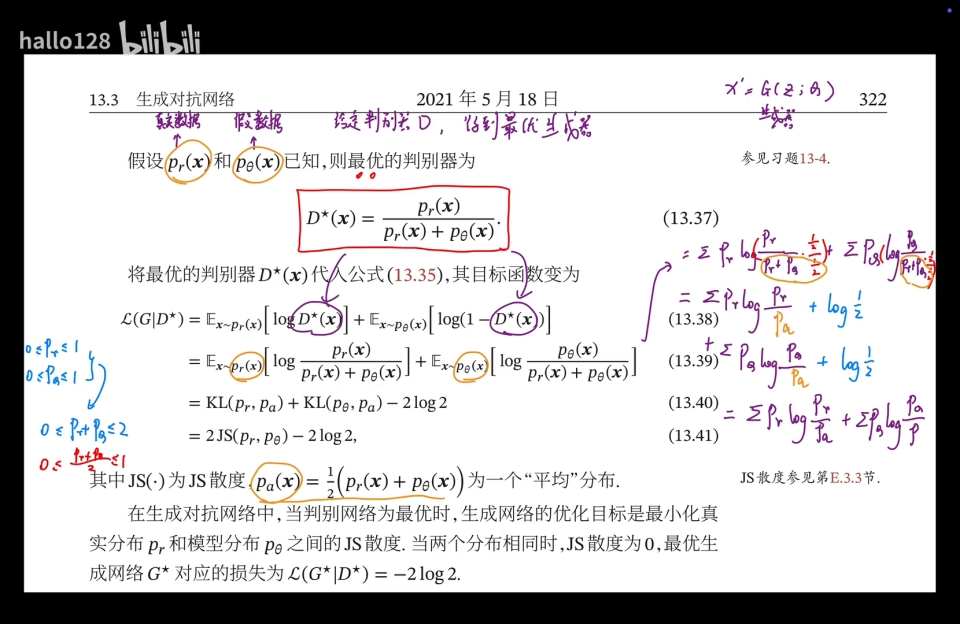

也就是说：**"优化交叉熵"和"最小化 JS 散度"是同一件事**。这也解释了为什么视频开头说"缺陷都来自目标函数"——我们以为在优化一个对抗游戏，实际在优化一个具体的分布距离。

JS 散度（Jensen-Shannon divergence）的定义就是把两个方向的 KL 取平均，因此它有两个关键性质：

1. **对称**：$\mathrm{JS}(p,q)=\mathrm{JS}(q,p)$。KL 本身不对称，交换顺序值就变了，取平均才对称 [【跳转到 12:11】](https://www.bilibili.com/video/BV11P6fY2E7y/?t=731)。
2. **有界**：$\mathrm{JS}(p,q)\in[0,\log 2]$。这个性质后面会变成大麻烦。

---

## 三、第一个后果：训练不稳定来自 JS 散度的"有界"

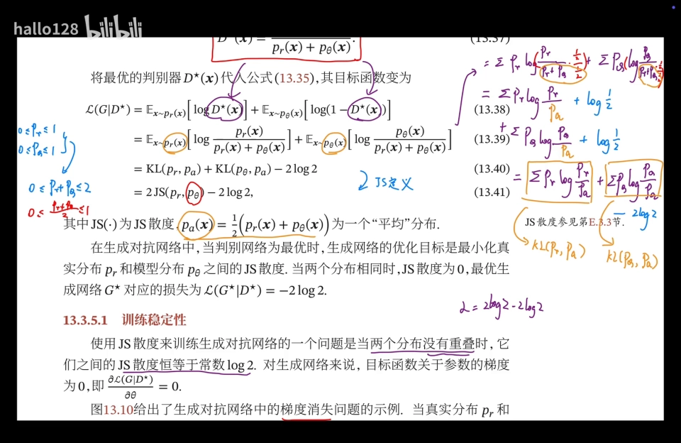

### 3.1 不重叠时，梯度直接归零

当两个分布完全没有重叠时，JS 散度恒等于常数 $\log 2$ [【跳转到 14:56】](https://www.bilibili.com/video/BV11P6fY2E7y/?t=896)。

这一步很致命：目标函数变成了常数，常数对参数 $\theta$ 求导就是 0，于是生成器拿不到任何梯度信号 [【跳转到 18:16】](https://www.bilibili.com/video/BV11P6fY2E7y/?t=1096)。训练当然就不稳定了——不是梯度太大，而是**梯度消失了**。

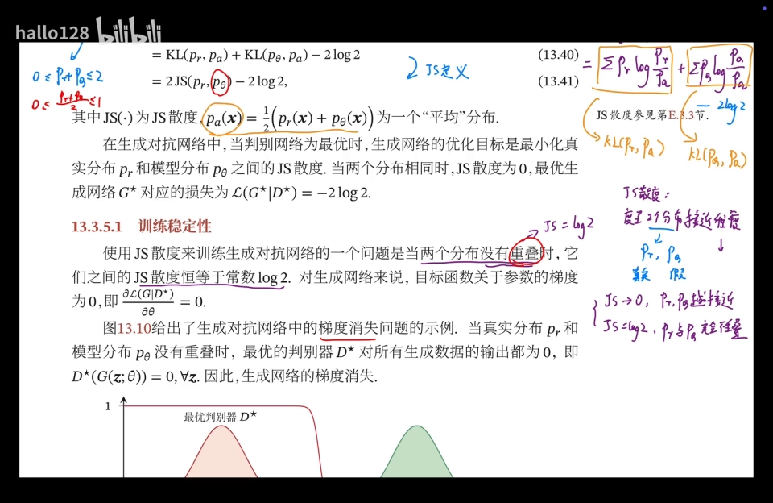

图 13.10 画的就是这个场景：真实数据（左）和生成数据（右）各是一团，中间是空的。最优判别器在真实数据那侧输出 1、在生成数据那侧输出 0，中间几乎垂直跳变。判别器把两者完美分开了，生成器反而学不到"该往哪边走"。

### 3.2 JS 度量的是"有没有重叠"，不是"离得多远"

这里有个反直觉的点值得强调。我们习惯把"分布距离"想成两个峰之间的水平距离，但 JS 散度不是这样工作的。

视频里说得很直白：不管两个分布距离有多远，只要它们完全不重叠，JS 散度就是 $\log 2$；反过来，如果它们有重叠的部分，JS 散度就不会那么大 [【跳转到 17:01】](https://www.bilibili.com/video/BV11P6fY2E7y/?t=1021)。甚至可以构造两个**平均值很接近**、但各自非常集中、完全不重叠的分布——这时 JS 散度依然很大 [【跳转到 17:51】](https://www.bilibili.com/video/BV11P6fY2E7y/?t=1071)。

所以 JS 散度回答的问题是"两个分布有没有重叠、重叠多少"，而不是"两个分布的中心隔多远"。在高维图像空间里，真实分布和模型分布一开始几乎必然不重叠，于是 JS 散度早早饱和在 $\log 2$，梯度消失。

### 3.3 工程上的折中：别把判别器训到最优

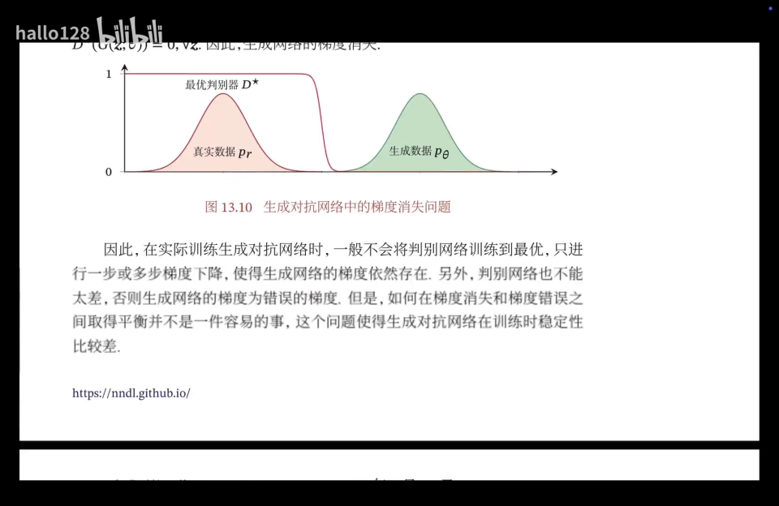

既然"最优判别器"会带来梯度消失，实际训练就不会真的把判别器训到最优，只做一步或几步梯度下降，让生成器的梯度依然存在 [【跳转到 18:33】](https://www.bilibili.com/video/BV11P6fY2E7y/?t=1113)。

但判别器也不能太差，否则生成器拿到的是"错误的梯度"。视频的原话是：如何在梯度消失和梯度错误之间取得平衡并不容易，这个平衡问题使得 GAN 训练稳定性比较差。

这就是"训练不稳定"的完整解释：它不是一个可以靠调学习率根治的工程问题，而是 JS 散度有界这个数学性质的直接后果。

---

## 四、第二个后果：模式坍塌来自反向 KL

### 4.1 只看生成器那一项

分析模式坍塌时，只需要看生成器自己的目标。把最优判别器代进去，生成器部分化简为（书上 13.46）：

$$
\mathcal{L}'(G\mid D^*) = -\,\mathrm{KL}(p_\theta, p_r) + 2\,\mathrm{JS}(p_r,p_\theta) - 2\log 2 - \mathbb{E}_{x\sim p_r}\big[\log D^*(x)\big]
$$

其中后两项与生成器参数 $\theta$ 无关，可以扔掉。于是

$$
\arg\max_{\theta} \mathcal{L}'(G\mid D^*) = \arg\min_{\theta}\ \mathrm{KL}(p_\theta, p_r) - 2\,\mathrm{JS}(p_r,p_\theta)
$$

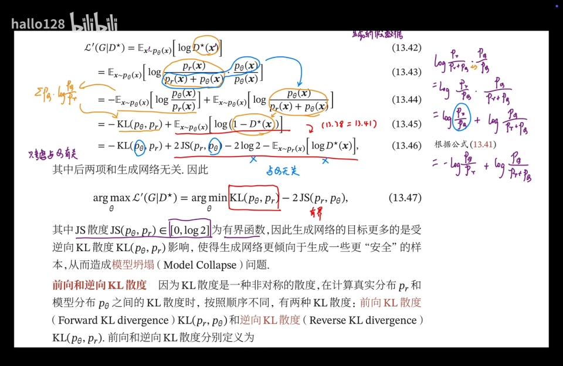

关键观察：JS 散度有界，取值只在 $[0,\log 2]$ 之间，"零和 $\log 2$ 本来就不太大"，所以它对整个式子的影响有限；真正主导优化方向的是第一项 $\mathrm{KL}(p_\theta, p_r)$ [【跳转到 27:57】](https://www.bilibili.com/video/BV11P6fY2E7y/?t=1677)。

注意这个 KL 的**方向**：真实分布在后、模型分布在前，即 $\mathrm{KL}(p_\theta \,\|\, p_r)$。视频把它称为**逆向 KL 散度**（reverse KL）。而 GAN 的目标恰好就是逆向的 [【跳转到 30:27】](https://www.bilibili.com/video/BV11P6fY2E7y/?t=1827)。

### 4.2 前向 KL 与逆向 KL：一个不对称的散度

KL 散度不对称，按顺序不同有两种写法：

$$
\text{前向：}\quad \mathrm{KL}(p_r, p_\theta) = \int p_r(x)\log\frac{p_r(x)}{p_\theta(x)}\,\mathrm{d}x
$$

$$
\text{逆向：}\quad \mathrm{KL}(p_\theta, p_r) = \int p_\theta(x)\log\frac{p_\theta(x)}{p_r(x)}\,\mathrm{d}x
$$

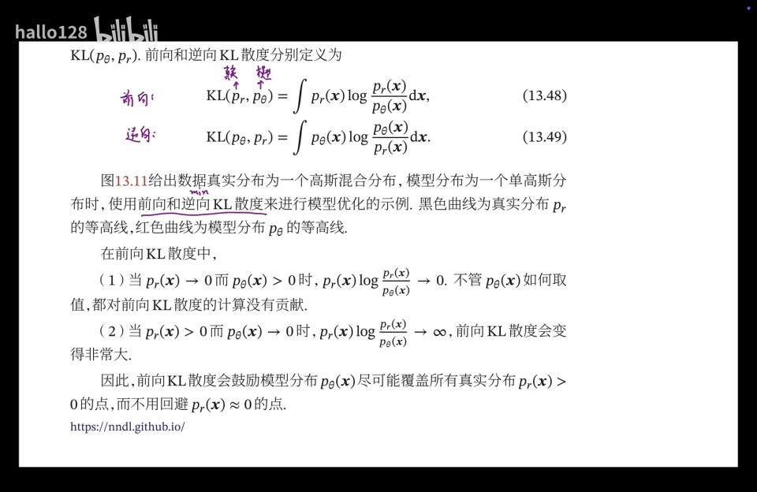

两个式子的差别只是 $p_r$ 和 $p_\theta$ 换了位置，但"谁乘在 log 前面"决定了谁有否决权。下面用视频给的例子逐条看。

### 4.3 图 13.11：双峰的真实分布 vs 单峰的模型分布

视频用的例子是：真实分布是一个**高斯混合分布**（两个峰），模型分布是一个**单高斯**（一个峰）。黑色等高线是真实分布 $p_r$，红色等高线是模型分布 $p_\theta$ [【跳转到 30:52】](https://www.bilibili.com/video/BV11P6fY2E7y/?t=1852)。

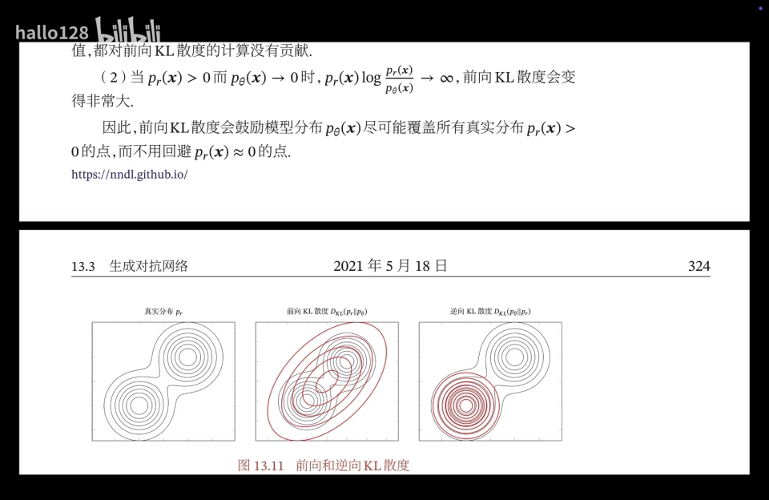

这张图是全篇最重要的一张：**同一个真实分布、同一个模型族，只因为散度方向不同，拟合结果就完全不同**。中间那张把模型摊开、试图盖住两个峰；右边那张只贴住一个峰，另一个峰完全不管。

### 4.4 前向 KL：必须覆盖全，但可以"多覆盖"

前向 KL 是 $\int p_r \log \frac{p_r}{p_\theta}$，被 $p_r$ 加权，所以要分两种情况看 [【跳转到 34:58】](https://www.bilibili.com/video/BV11P6fY2E7y/?t=2098)：

- **情况一：$p_r(x)\to 0$ 而 $p_\theta(x)>0$**。此时乘在前面的 $p_r$ 趋于零，整项趋于零，对 KL 没有贡献。也就是说，模型在真实分布没有概率的地方乱放概率，是**没有惩罚**的。
- **情况二：$p_r(x)>0$ 而 $p_\theta(x)\to 0$**。此时 $\log \frac{p_r}{p_\theta} \to \infty$，KL 散度会变得非常大。也就是说，真实分布有概率的地方，模型必须也有概率，否则惩罚无穷大。

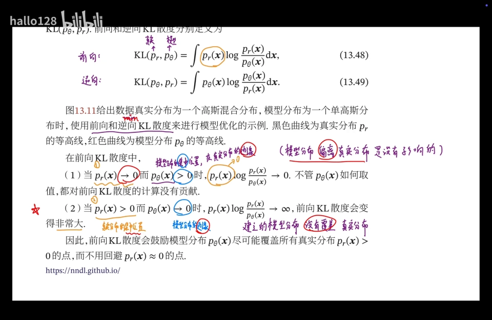

所以前向 KL 的偏好是：**真实分布的所有峰都必须覆盖到，覆盖得准不准可以商量**。视频的总结是"前向 KL 更偏向于要覆盖全，两个分布的重合度可以不那么高" [【跳转到 43:20】](https://www.bilibili.com/video/BV11P6fY2E7y/?t=2600)。代价是它可能把概率摊到真实分布不该有的地方，也就是常说的"平均化"。

### 4.5 逆向 KL：必须准，但可以不覆盖全

逆向 KL 是 $\int p_\theta \log \frac{p_\theta}{p_r}$，被 $p_\theta$ 加权，所以"模型在哪放概率"才是重点 [【跳转到 45:24】](https://www.bilibili.com/video/BV11P6fY2E7y/?t=2724)：

- **情况一：$p_r(x)\to 0$ 而 $p_\theta(x)>0$**。此时 $\frac{p_\theta}{p_r}\to\infty$，KL 散度趋于无穷大。也就是说，模型在真实分布没有概率的地方放概率，是**不可接受的**。
- **情况二：$p_\theta(x)\to 0$**。不管 $p_r$ 是多少，$p_\theta$ 乘在前面就是零，整项为零。也就是说，模型完全忽略真实分布的某些峰，是**没有惩罚**的。

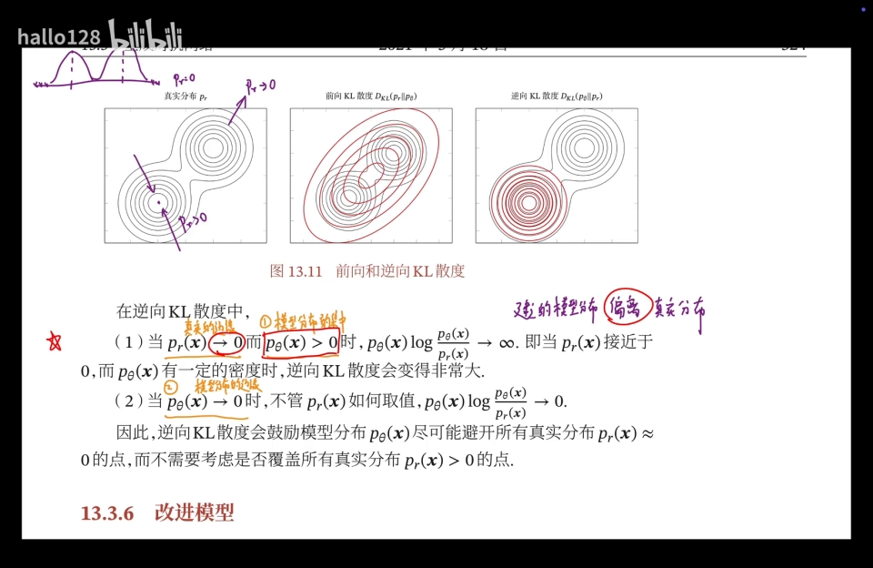

所以逆向 KL 的偏好是：**模型放概率的地方必须是真实分布有概率的地方，但真实分布有几个峰、你覆盖了几个，它不管**。视频的说法是"它会鼓励我们的模型分布尽可能集中到一个峰值就可以了" [【跳转到 50:05】](https://www.bilibili.com/video/BV11P6fY2E7y/?t=3005)。

用一句话概括这对差异：前向 KL 是"宁可摊薄，不能漏"，逆向 KL 是"宁可漏掉，不能乱放"。

### 4.6 回到 GAN：模式坍塌是数学上的必然

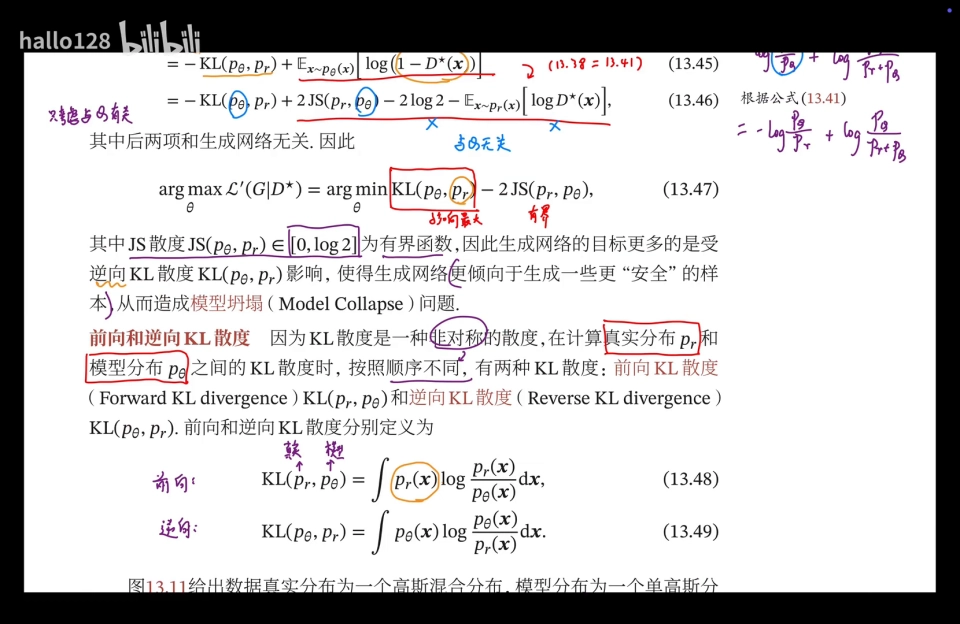

把 4.1 和 4.5 接起来，结论就出来了：

1. 生成器的目标化简后，主导项是逆向 KL $\mathrm{KL}(p_\theta, p_r)$；
2. 逆向 KL 允许模型忽略真实分布的某些峰（情况二无惩罚），但不允许模型在真实分布没有概率的地方放概率（情况一发散）；
3. 于是最优策略是：找一个真实分布有概率、自己又能拟合得比较准的峰，把概率全压上去，其他峰直接放弃。

这就是视频反复说的"生成器倾向于生成一些**安全**的样本"——难的地方不去碰，只挑简单的、肯定没错的生成 [【跳转到 28:47】](https://www.bilibili.com/video/BV11P6fY2E7y/?t=1727)。落回到手写数字的例子，就是只画"一"，不画"八"和"九"。

---

## 五、这套图景对理解生成任务的三点含义

### 5.1 多解性决定了"覆盖"必须被单独评价

生成任务的多解性意味着真实分布本身是多峰的。既然多峰，那么"生成得像不像"（保真）和"峰有没有都覆盖到"（覆盖）就是两个独立的问题，一个指标无法同时回答。只看保真，模式坍塌的模型会得到很高的分数——因为它生成的那一类确实很像。

### 5.2 散度的有界性决定了梯度信号的质量

JS 散度有界在数学上是好事（距离有定义、不会发散），在优化上是坏事：一旦两个分布不重叠，它就饱和成常数 $\log 2$，梯度为零。这解释了为什么"训不动"和"训得动但方向错"会同时出现在同一个模型上，也解释了为什么实际训练必须在两者之间做折中。

### 5.3 散度的方向决定覆盖行为

前向 KL 与逆向 KL 只差一个顺序，却分别对应"覆盖全"与"只求准"两种完全不同的拟合结果。所以在读任何生成模型的论文时，看到一个 KL 项，第一件该问的事不是"系数多大"，而是"谁在前、谁在后"。这直接决定了这个模型是倾向于摊薄覆盖，还是倾向于收缩到少数模式。

---

## 小结

- 生成任务天生多解：一个条件对应一整个分布，模型要学分布而不是学一个点。
- 模式坍塌的表现是"保真尚可、覆盖不足"：只生成真实分布的一部分，指标还可能很好看。
- GAN 的交叉熵目标在最优判别器下等价于最小化 JS 散度：$\mathcal{L}(G\mid D^*)=2\,\mathrm{JS}(p_r,p_\theta)-2\log 2$。
- JS 散度有界于 $[0,\log 2]$，两分布不重叠时恒为 $\log 2$，对生成器参数的梯度为零——这是训练不稳定的数学来源。
- 生成器目标的主导项是逆向 KL $\mathrm{KL}(p_\theta,p_r)$：它允许忽略真实分布的峰，但不允许在真实分布没有概率的地方放概率。
- 因此模式坍塌不是调参失误，而是这套目标的必然结果；前向 KL 与逆向 KL 的差别，就是"覆盖全"与"只求准"的差别。

## 关键术语速查

| 术语 | 一句话解释 |
| --- | --- |
| 模式坍塌（mode collapse） | 生成器只覆盖真实分布的少数几个峰，其余模式完全不生成 |
| 多解性 | 同一条件下存在多个合理输出，因此生成任务的目标是一个分布而非一个点 |
| 覆盖与保真 | 覆盖看真实分布的模式是否都被生成到，保真看生成样本是否像真实数据 |
| 最优判别器 $D^*$ | 给定两个分布时的最优判别输出，等于 $p_r/(p_r+p_\theta)$ |
| JS 散度 | 两个方向 KL 的平均，对称且取值有界于 $[0,\log 2]$ |
| 前向 KL | $\mathrm{KL}(p_r,p_\theta)$，惩罚"漏掉真实分布"，鼓励覆盖全，允许摊薄 |
| 逆向 KL | $\mathrm{KL}(p_\theta,p_r)$，惩罚"在真实分布之外放概率"，允许忽略部分模式 |
| 平均分布 $p_a$ | $(p_r+p_\theta)/2$，为了让 KL 里的对象仍是合法分布而引入 |
| 安全样本 | 生成器挑容易拟合、肯定不出错的模式生成，是模式坍塌的直观表现 |