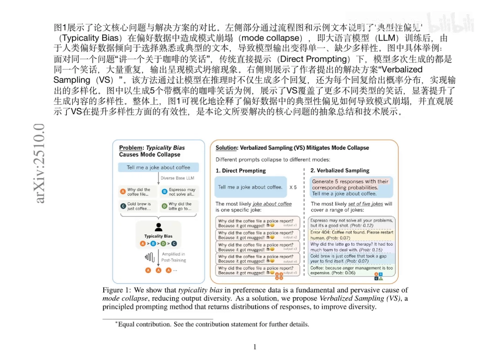
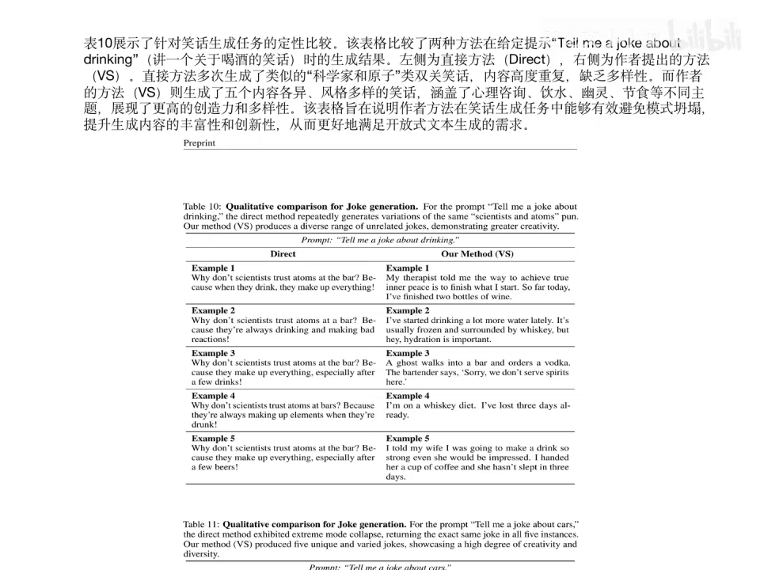
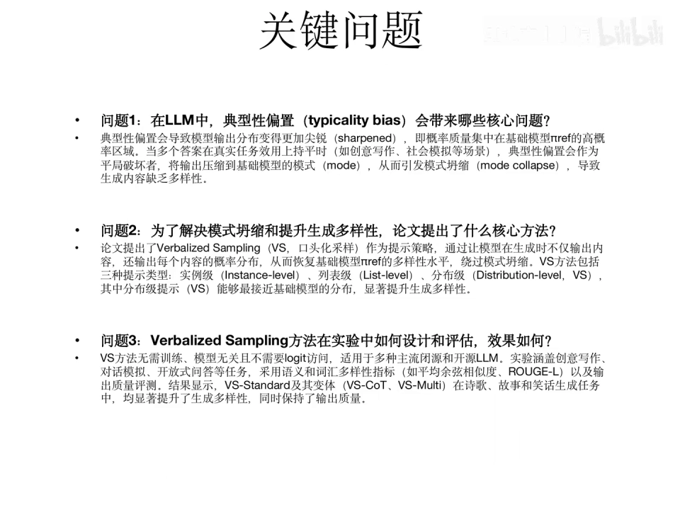
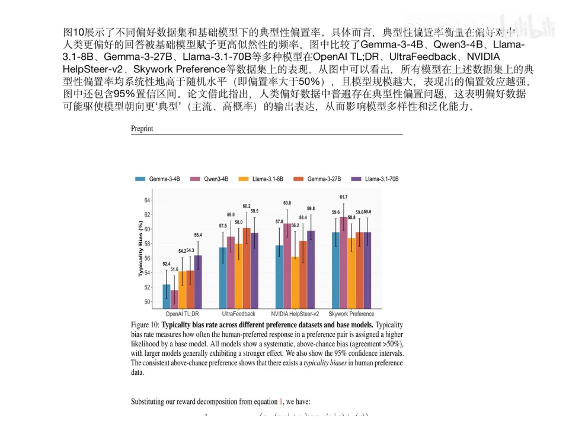
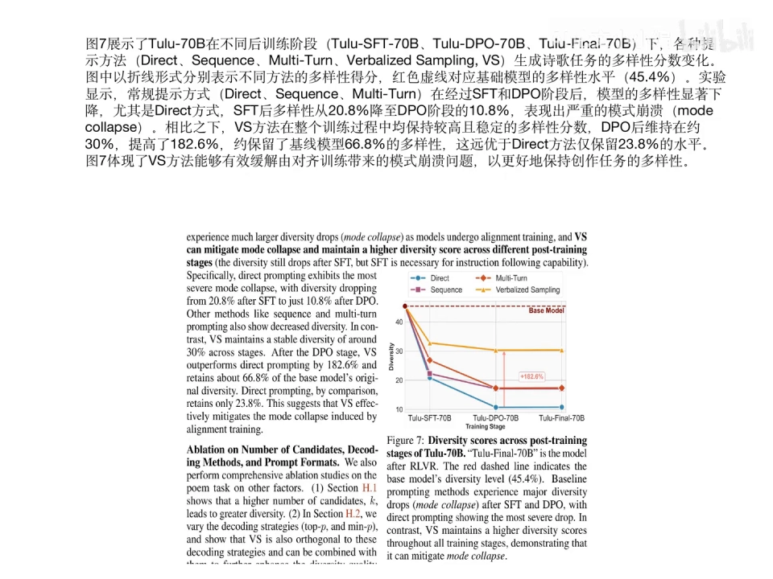
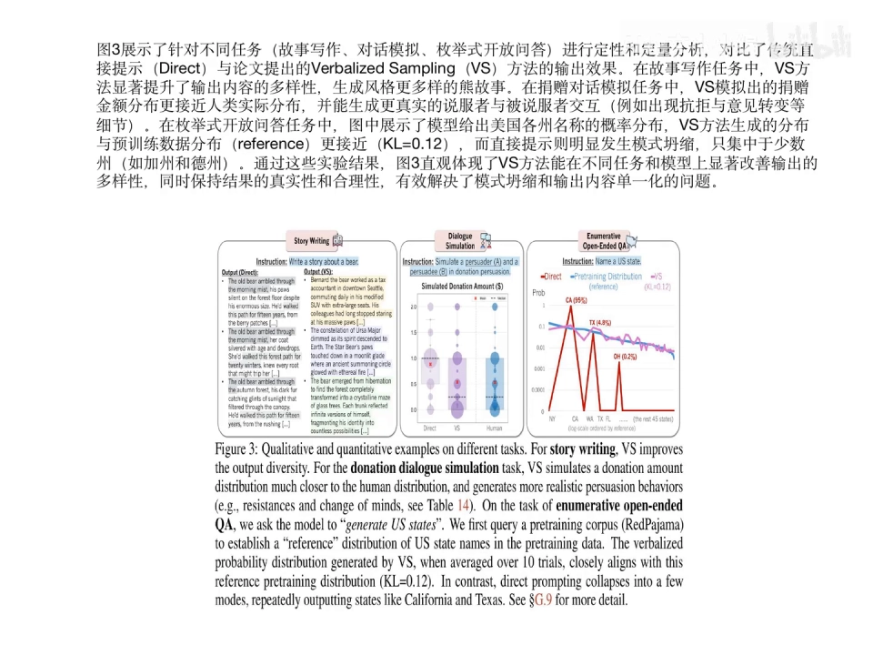
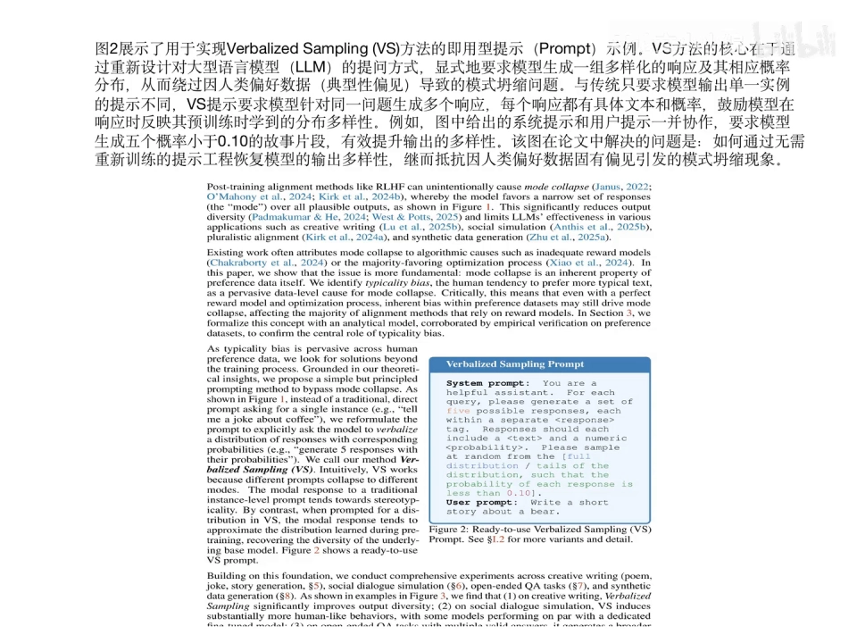
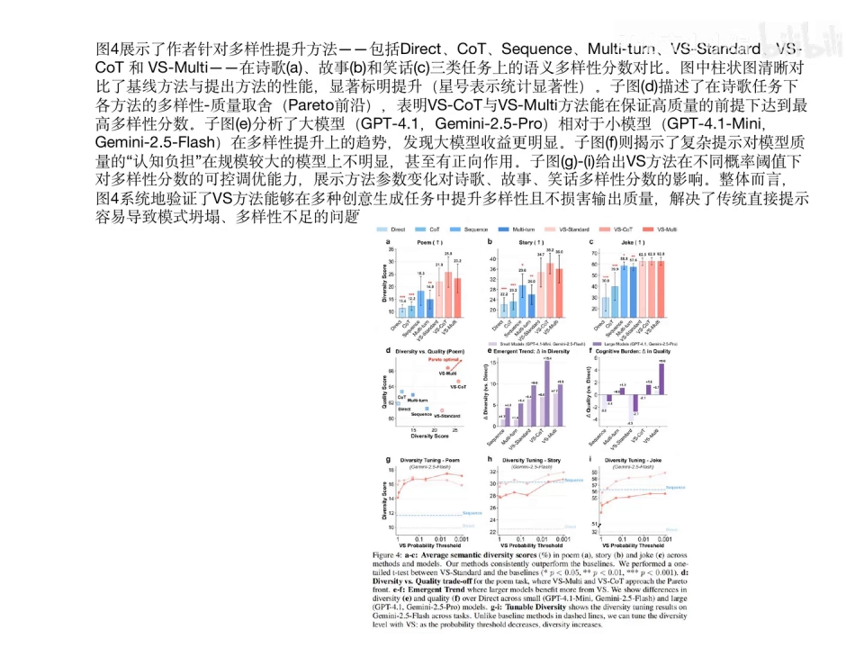
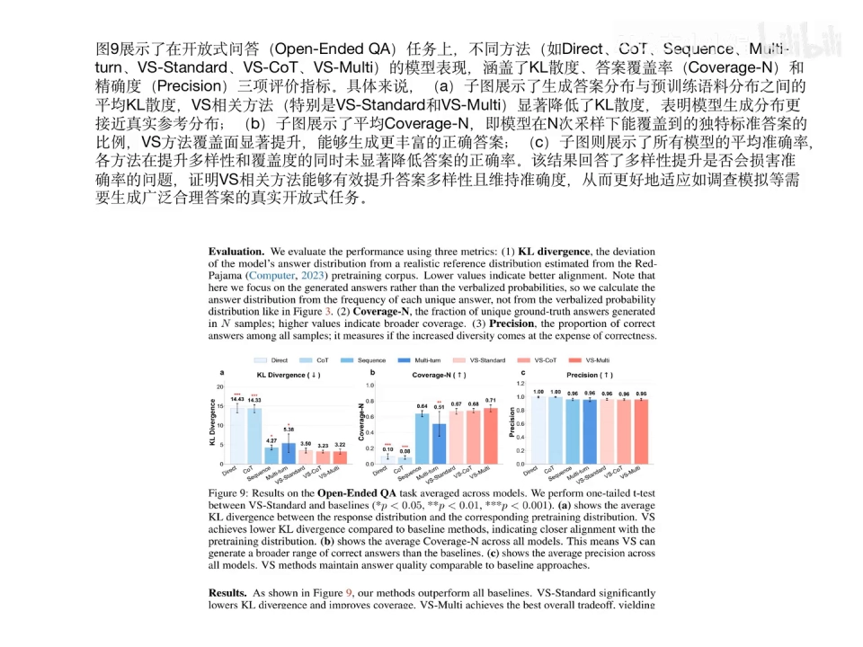
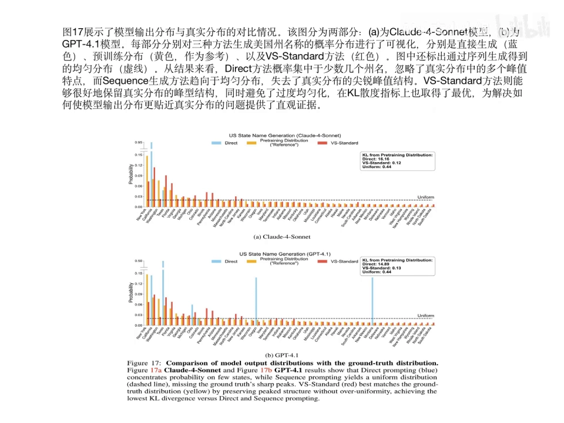

# 语言化采样：后训练模型为何越对齐越同质，以及如何用提示恢复多样性

> 视频来源：[为什么不同大模型在很多问题的回答偏向同质化？语言化采样：如何缓解模式崩溃并释放大模型多样性](https://www.bilibili.com/video/BV1jXSeBUEKA/)（Bilibili · 论文精读）｜时长约 58 分钟
> 导读：这支视频逐段读一篇关于 Verbalized Sampling（语言化采样）的论文。它把"模型越对齐越没意思"这件事追到了数据层：人类偏好数据里的典型性偏见。本文按"现象—原因—后果—解法—怎么评估"重排，并把"覆盖度"与"保真度"的权衡单独讲清楚。

## 本讲要解决的核心问题（SCQA）

**背景**：大模型经过 SFT、DPO、RLHF 等后训练对齐之后，回答更"讨人喜欢"了：更流畅、更符合人类偏好。

**冲突**：但同一类问题问很多次，答案越来越像。让它讲五个关于咖啡的笑话，五个是同一个笑话；让它列举美国的州，它反复只给加州和德州。

**疑问**：这是奖励模型不够好、优化过程有偏，还是数据本身就有问题？如果数据有偏见，那还有没有办法在不重训模型的前提下把多样性找回来？

**回答（中心思想）**：模式坍塌的根子在偏好数据里的**典型性偏见**——人类标注者偏爱熟悉、流畅、可预测的文本，即使奖励模型和优化过程都完美，这个偏见仍会把输出分布压窄。解法不需要重训：把"给我一个答案"改成"给我一组答案以及每个答案的概率"（语言化采样），就能把被压掉的模式重新释放出来，而且不牺牲准确率和安全性。

---

## 一、现象：同一个问题，五次同一个笑话

论文开篇给了一个非常具体的例子。面对同一个问题"讲一个关于咖啡的笑话"，传统直接提示（direct prompting）下模型多次生成的都是同一个笑话，大量重复输出，呈现模式坍缩现象 [【跳转到 01:54】](https://www.bilibili.com/video/BV1jXSeBUEKA/?t=114)。

这种重复不是"偶尔撞车"。视频后面给的定性对比里，针对"讲一个关于汽车的笑话"，直接方法在五个事例中生成了**完全相同**的笑话（"Why did the car get a flat tire? Because it ran over a fork in the road"），是极端的模式坍缩 [【跳转到 48:05】](https://www.bilibili.com/video/BV1jXSeBUEKA/?t=2885)。

这就引出了本小节要区分的两件事：**样本看起来像不像**（保真）和**答案空间覆盖得全不全**（覆盖）。上面这些笑话每一个单独看都通顺、都像笑话，保真没问题；问题出在覆盖——模型把整个"笑话空间"压成了一个点。

---

## 二、原因：不是算法不行，是偏好数据有偏见

### 2.1 典型性偏见是什么

论文把原因定在数据层，叫**典型性偏见**（typicality bias）：人类标注者倾向于选择更熟悉、流畅、可预测的文本作为高分样本 [【跳转到 06:10】](https://www.bilibili.com/video/BV1jXSeBUEKA/?t=370)。

这个定义听起来平淡，但它的推论很强：**即使奖励模型和优化过程本身是完美的，也难以避免模式崩溃**。因为奖励模型学的就是这批偏好数据，数据里的偏见会被原样学进去。所以依赖奖励模型的主流对齐方法都容易受它影响。

### 2.2 机制：分布被"变尖锐"

视频用一句话概括机制：典型性偏见会导致模型输出分布变得更加**尖锐**（sharpened），即概率质量集中在基础模型的高概率区域 [【跳转到 09:37】](https://www.bilibili.com/video/BV1jXSeBUEKA/?t=577)。

在真实任务效用持平的场景（创意写作、社会模拟）里，多个答案其实一样好，此时典型性偏见就充当"平局破坏者"，把输出压缩到基础模型的少数几个模式（mode）上，于是模式坍塌。

这里值得停一下：**分布变尖锐**和**分布变窄**不是一回事。变尖锐是"把已有概率重新分配，让高概率的更高"；而模式坍塌是"整片低概率区域直接归零"。前者还能靠调温度缓解，后者调温度也救不回来——因为那些模式的概率已经被压到接近零了。

### 2.3 实证：偏置率系统性高于随机水平

论文定义了一个可测的量：**典型性偏置率**，衡量在偏好对中"人类更偏好的回答恰好被基础模型赋予更高自然性"的频率。在 OpenAssistant、UltraFeedback、NVIDIA HelpSteer、Skywork、Preference 等数据集上，Gemma-3-4B、Qwen-3-4B、Llama-3.1-8B、Gemma-3-27B、Llama-3.1-70B 等模型的偏置率**全部系统性高于随机水平**（大于 50%），而且模型规模越大，偏置效应越强 [【跳转到 25:10】](https://www.bilibili.com/video/BV1jXSeBUEKA/?t=1510)。

还有一个更细的证据：用 Bradley-Terry 回归控制正确性之后，典型性分数更高的文本被判定为"更有用"的概率显著提升，优势比在 1.42 到 1.83 之间 [【跳转到 43:30】](https://www.bilibili.com/video/BV1jXSeBUEKA/?t=2610)。这说明典型性偏见是**独立于语义正确性**存在的——一段话哪怕同样正确，只要更"典型"，就更容易被标成好答案。

---

## 三、后果：覆盖塌缩在四类任务上的具体表现

### 3.1 创意写作：多样性随对齐阶段单调下降

视频给的最直观的一组数是诗歌生成的多样性分数 [【跳转到 16:05】](https://www.bilibili.com/video/BV1jXSeBUEKA/?t=965)：

- 基础模型（未对齐）的多样性水平是 45.4%（图中红色虚线）；
- 直接提示：SFT 后降到 20.8%，DPO 后再降到 10.8%；
- 语言化采样：DPO 后仍维持在约 30%，比直接提示提高了 182.6%，保留了基础模型 66.8% 的多样性；
- 而直接提示只保留了 23.8%。

这条曲线说明模式坍塌不是某个训练阶段的意外，而是**随对齐推进持续加剧**的过程。

### 3.2 枚举型问答：只给加州和德州

第三个任务是"列举美国的州"。这是一个典型的多解任务：50 个州都是正确答案。但直接提示下，模型的输出分布明显坍塌，只集中于少数几个州，比如加州和德州 [【跳转到 05:14】](https://www.bilibili.com/video/BV1jXSeBUEKA/?t=314)。

论文的做法是先用 RedPajama 预训练语料统计一个"参考分布"，再看模型输出分布离它有多远。语言化采样生成的分布与预训练分布更接近，KL 等于 0.12。

这个实验设计很重要：它给出了一个**可计算的覆盖度标准**——真实分布不需要人来定义，用预训练语料里的经验分布当参考就行。

### 3.3 对话模拟：分布形状不对，行为就不真

在说服性对话模拟任务（Persuasion for Good）里，模型要模拟劝说者与被劝说者围绕慈善捐赠的对话。视频指出，语言化采样模拟出的捐赠金额分布更接近人类实际分布，并能生成更真实的说服者与被劝说者交互，例如出现抗拒与意见转变等细节 [【跳转到 04:24】](https://www.bilibili.com/video/BV1jXSeBUEKA/?t=264)。

这里评价的不是"这句话像不像人说"，而是**整个行为分布的匹配程度**（用 KS 检验和 LE 距离衡量）。模式坍塌的模型会把所有被劝说者都模拟成"立刻同意捐款"，单个样本看很自然，整体分布完全失真。

### 3.4 合成数据：多样性不足会拖累下游

最后一个后果比较隐蔽。用模型合成数学题去微调小模型时，直接提示生成的数据因为模式坍塌，反而可能降低下游性能；而语言化采样生成的数据，微调后平均准确率最高达到 37.5% [【跳转到 23:15】](https://www.bilibili.com/video/BV1jXSeBUEKA/?t=1395)。

也就是说，模式坍塌不只影响"用户体验"，它还会污染训练数据：一批同质化的合成数据，等于只教了模型一种解法。

---

## 四、解法：把"要一个答案"改成"要一个分布"

### 4.1 核心思路

语言化采样（Verbalized Sampling，VS）的做法简单到近乎取巧：不问"写一个关于熊的故事"，而问"生成 5 个不同的故事，并给出每个故事的概率，要求每个概率小于 0.10" [【跳转到 03:59】](https://www.bilibili.com/video/BV1jXSeBUEKA/?t=239)。

为什么这样能奏效？视频的解释是：传统提示是**实例级**的，模型只需要收敛到某一个模式；而 VS 是**分布级**的，它要求模型把"预训练时学到的整个分布"摊开给你看，于是自然绕过了后训练压窄分布的那一步 [【跳转到 07:00】](https://www.bilibili.com/video/BV1jXSeBUEKA/?t=420)。

论文把提示分成三个层级，这是理解 VS 的关键框架：

| 提示层级 | 典型做法 | 每次要模型给什么 |
| --- | --- | --- |
| 实例级（instance-level） | 直接生成、链式思考（CoT） | 一个候选，无概率 |
| 列表级（list-level） | 序列生成、多轮生成 | 多个候选，无概率 |
| 分布级（distribution-level，即 VS） | 生成多个候选并附带概率 | 多个候选 + 每个的概率 |

只有在分布级，模型才需要显式表达"哪些答案概率高、哪些低"，这正是被后训练抹掉的信息。

### 4.2 三个变体与可控性

VS 有 standard、CoT、Multi 三种变体，分别通过一步、逐步和多轮对话进一步增强多样性 [【跳转到 07:50】](https://www.bilibili.com/video/BV1jXSeBUEKA/?t=470)。它的三个工程优点是：无需训练、模型无关、不需要 logit 访问。

更实用的一点是**可调**：通过调整概率阈值，可以连续调节多样性 [【跳转到 11:48】](https://www.bilibili.com/video/BV1jXSeBUEKA/?t=708)。而且它和温度、top-p 这些解码策略是**正交**的，可以叠加使用。

图 4 的子图 d 值得单独看：横轴是多样性、纵轴是质量，理想位置是右上角。VS-CoT 与 VS-Multi 在保证高质量的前提下达到了最高的多样性分数 [【跳转到 12:59】](https://www.bilibili.com/video/BV1jXSeBUEKA/?t=779)。这条 Pareto 前沿就是"覆盖与保真可以同时要好"的证据——它不是靠牺牲质量换多样性。

这里就碰到了"样本多样性"和"模型不确定性"的分界。调温度是在**已有分布上把概率摊平**，它不改变分布里有哪些模式；而 VS 是把**被压掉的模式重新拉回分布里**。所以两者能叠加，而且叠加后效果更好——因为它们改的是不同的东西。

---

## 五、怎么评价覆盖：三个指标必须一起看

### 5.1 单一指标会被模式坍塌骗过

这是本小节最值得记住的方法论。看第二、三节的例子：一个模式坍塌的模型，它生成的那一类样本**质量很高**，准确率也不低。如果只用一个"质量分"或"准确率"来评价，它甚至会赢。

视频里反复出现的一个数字能说明问题：在开放式问答任务上，各方法的精确度（Precision）都在 0.95 以上，几乎贴在一起 [【跳转到 18:10】](https://www.bilibili.com/video/BV1jXSeBUEKA/?t=1090)。也就是说，**Precision 这个指标对模式坍塌几乎不敏感**——因为它只看"生成的答案对不对"，不看"该覆盖的答案覆盖了没有"。

### 5.2 三项指标的分工

论文在开放式问答任务上用三项指标 [【跳转到 18:35】](https://www.bilibili.com/video/BV1jXSeBUEKA/?t=1115)：

1. **KL 散度**：生成答案分布与参考分布（预训练语料估计出的真实分布）之间的距离，越低越好。它衡量"整体分布形状对不对"。
2. **Coverage-N**：在 N 次采样中能覆盖到的独特标准答案比例，越高越好。它衡量"该覆盖的答案覆盖了多少"，是覆盖度的直接度量。
3. **Precision**：所有采样中正确答案的比例，越高越好。它衡量"生成的东西对不对"，是保真度的直接度量。

结果：VS 显著降低了 KL 散度、显著提升了 Coverage-N，而 Precision 没有显著下降。三个数一起看，才能说"多样性上去了、质量没塌"。

### 5.3 覆盖与保真的两种失败方向

图 17 是整篇论文里最能说明"覆盖 vs 保真"的一张图。它把三种方法的输出分布画在一起，黄色是预训练分布（参考）[【跳转到 31:50】](https://www.bilibili.com/video/BV1jXSeBUEKA/?t=1910)：

- **直接生成（蓝色）**：概率集中在少数几个州，忽略了真实分布中的多个峰值——这是**模式坍塌**，覆盖不足，保真尚可。与预训练分布的 KL 是 16.16。
- **序列生成（虚线，均匀分布）**：趋向均匀分布，失去了真实分布的尖锐峰值结构——这是**过度均匀化**，覆盖上去了但保真崩了。KL 是 0.44，看起来比直接生成"好"，但它其实是另一种失真。
- **语言化采样（红色）**：既保留了峰形结构，又避免了过度均匀化，KL 是 6.12。

这张图揭示了一个容易踩的坑：**"KL 更小"不等于"更接近真实分布"**。均匀分布的 KL 是 0.44，比语言化采样的 6.12 还小，但它显然更失真。原因是对着均匀分布算 KL 时，参考分布的尖锐峰值被"摊平"这个操作掩盖了。所以评估覆盖不能只看一个数，还要看分布的形状。

用 precision / recall 的语言说：直接生成是低 recall（漏掉大量模式）、高 precision；序列生成是低 precision（生成大量真实分布里没有的答案）、高 recall；理想的方法应该在两者的前沿上。

### 5.4 人工评分作为交叉验证

自动指标之外，论文还做了人类评测：每个任务由 30 名标注者对三种提示方法在十个主题下生成的 90 对输出做多样性评分，用 1（非常相似）到 4（非常不同）的四分制 [【跳转到 19:50】](https://www.bilibili.com/video/BV1jXSeBUEKA/?t=1190)。

结果 VS-Standard 在诗歌、故事、笑话上都拿到最高的多样性评分，分别是 2.39、3.06、3.01。标注者一致性用 Gwet's AC1 和 Krippendorff's alpha 衡量，笑话和故事任务一致性较高（0.86 / 0.87），诗歌任务较低（0.54）——这也提醒我们，"多样性"这种主观指标本身就有测量噪声。

---

## 六、样本多样性不等于模型不确定性

这一节是本节学习目标里最容易混淆的一点，用视频里的事实把它说清楚。

**模式坍塌不是"模型很确定"**。模型输出同质化，不是因为它对答案有把握，而是因为后训练把分布压窄了。证据是：同一个模型，在同样的权重下，只要换一种提问方式（VS），就能生成完全不同的五个答案 [【跳转到 02:19】](https://www.bilibili.com/video/BV1jXSeBUEKA/?t=139)。权重没变、知识没变，变的只是"要不要把分布摊开"。所以同质化是**表达层**的问题，不是**知识层**的确定。

**调温度也不是在表达不确定性**。温度、top-p 是在已有分布上重新分配概率；如果某些模式的概率已经被压到接近零，调温度也召不回来。这解释了为什么 VS 与温度正交、可以叠加。

**真正的不确定性是另一回事**。模型对"这个答案对不对"有没有把握，属于认知层面的不确定性；而生成任务的多样性来自真实分布本身的多峰性——同一个问题本来就有多个合理答案。前者是"我不知道"，后者是"答案本来就不止一个"。把两者混为一谈，就会出现"多样性低说明模型很自信"这种错误推论。

一个可操作的判断方法是看**参考分布**：如果模型输出分布与参考分布的 KL 很大、Coverage-N 很低，那是覆盖问题（分布被压窄）；如果模型在多次采样中给出互相矛盾的答案却都伴随高置信度，那才是不确定性/校准问题。两者的修法完全不同。

---

## 七、局限：这套方法解决了什么、没解决什么

视频最后如实列出了论文的局限 [【跳转到 23:45】](https://www.bilibili.com/video/BV1jXSeBUEKA/?t=1425)：

- 研究主要关注人类偏好数据中的典型性偏见，**未深入探讨其他可能影响模式崩溃的因素**；
- VS 方法虽然有效，但其实用性和泛化能力在更广泛任务和数据集上仍需进一步验证；
- 实验显示**强大模型受益更多**，说明方法对不同规模模型的适用性存在差异；
- 未能完全解决所有创造性和多样性相关问题，实际应用中如何平衡创造性提升与事实准确性、安全性仍需持续探索。

安全性方面论文做了检查：在 353 个 StrongREJECT 有害提示上，所有方法的拒绝率都超过 97%，VS 相比直接提示只低 0.3 到 0.8 个百分点，差异很小 [【跳转到 58:05】](https://www.bilibili.com/video/BV1jXSeBUEKA/?t=3485)。多样性提升没有以安全性为代价。

---

## 小结

- 后训练让模型更"讨喜"，代价是输出分布被压窄，表现为模式坍塌：同一个问题反复给同一个答案。
- 根因在数据层：人类偏好数据里的典型性偏见，即使奖励模型和优化过程完美也会驱动坍塌。
- 后果分四类：创意写作多样性随对齐阶段单调下降、枚举型问答只覆盖少数答案、对话模拟的行为分布失真、合成数据同质化拖累下游。
- 解法是语言化采样：把实例级提示换成分布级提示，让模型输出多个候选及其概率，无需重训、模型无关、不需要 logit。
- 评估覆盖必须三件套一起看：对参考分布的 KL、Coverage-N、Precision；单看 Precision 会被模式坍塌骗过。
- 覆盖与保真有两个失败方向：模式坍塌（低覆盖）和过度均匀化（低保真），后者甚至可能给出更小的 KL。
- 样本多样性不等于模型不确定性：前者是分布形状问题，后者是认知问题，修法完全不同。

## 关键术语速查

| 术语 | 一句话解释 |
| --- | --- |
| 模式坍塌（mode collapse） | 模型只输出少数几种典型答案，忽略其他同样合理的答案 |
| 典型性偏见（typicality bias） | 人类标注者偏爱熟悉、流畅、可预测文本的倾向，是模式坍塌的数据层根因 |
| 分布变尖锐（sharpened） | 概率质量向基础模型的高概率区域集中，是坍塌的中间状态 |
| 语言化采样（VS） | 要求模型生成多个候选并给出每个候选概率的提示策略 |
| 实例级 / 列表级 / 分布级提示 | 要一个答案 / 要多答案 / 要多答案加概率，只有第三级能表达分布 |
| Coverage-N | N 次采样覆盖到的独特正确答案比例，衡量覆盖度 |
| Precision | 采样中正确答案的比例，衡量保真度，对模式坍塌不敏感 |
| 过度均匀化 | 输出趋向均匀分布、丢掉真实分布峰形，是覆盖上去但保真崩掉的另一种失败 |
| 多样性调节 | 通过调整 VS 的概率阈值连续控制多样性，与温度、top-p 正交 |