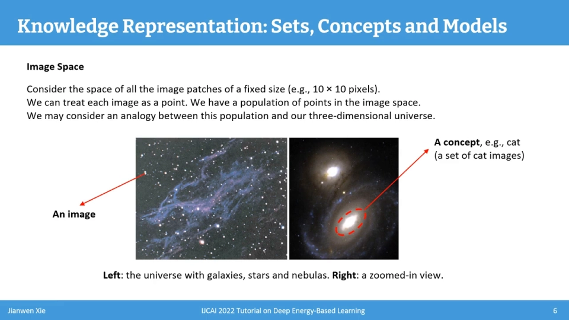
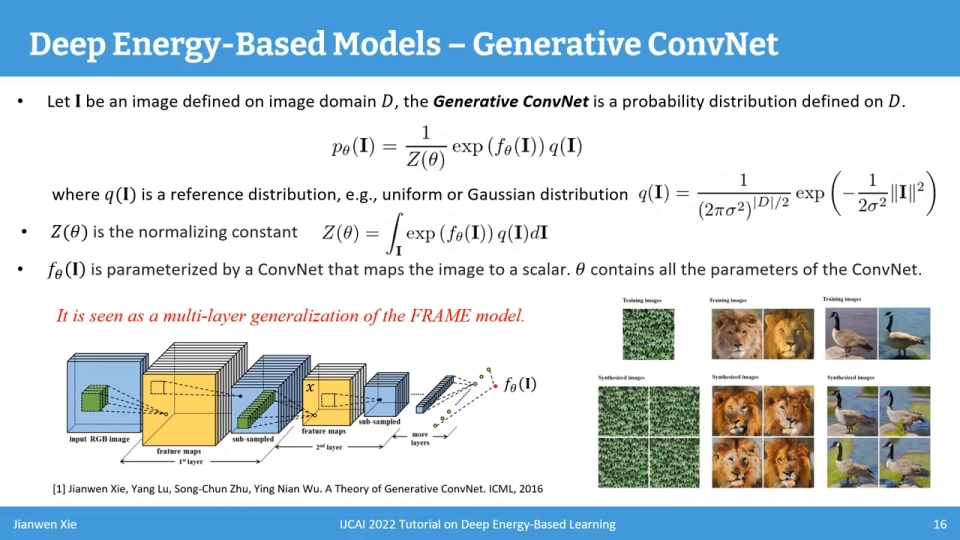
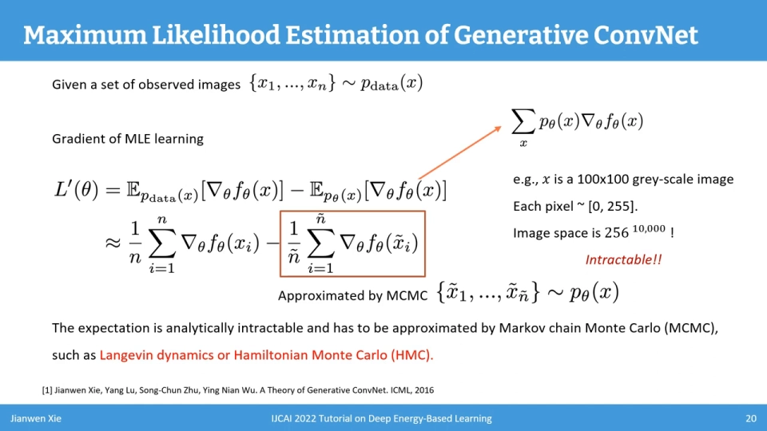
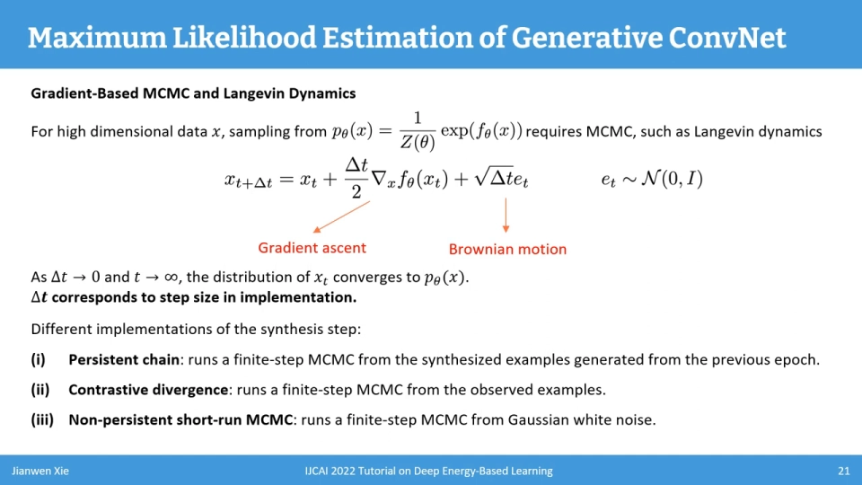
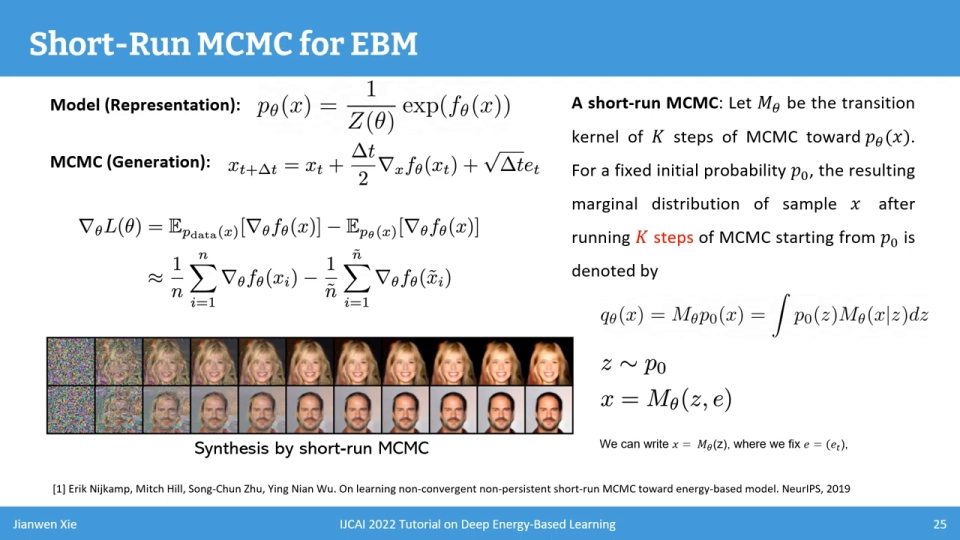

# 从能量到样本：为什么采样难，朗之万动力学怎么工作

> 视频来源：[IJCAI 2022 教程：深度学习——能量模型 Energy-based Learning](https://www.bilibili.com/video/BV1eG41177XY/)（Bilibili · 搬运自 Jiawen Xie 的 IJCAI 2022 教程）｜时长约 60 分钟
> 导读：这是一份系统性教程，把"能量模型"当作概率模型的一类来讲。本文只取其中的"能量 → 分布 → 采样"这一段：能量怎样写成概率密度、为什么采样是绕不开的一步、朗之万动力学凭什么能从能量分布里抽样本。训练侧的持久链、对比散度、协同学习等内容属于下一小节，本文不展开。

## 本讲要解决的核心问题（SCQA）

**背景**：我们想把"图像"当成随机变量来建模。一张图像是一堆像素亮度值，是典型的高维对象；某类图像（比如猫）的整体，可以用一个带参数的概率分布来描述。[【跳转到 01:43】](https://www.bilibili.com/video/BV1eG41177XY/?t=103)

**冲突**：一旦要写出这个分布，就会撞上两堵墙。第一堵墙是**归一化**：用能量写出的密度 $p(x)\propto\exp(f(x))$ 里，分母要对整个图像空间积分，而图像空间大到无法枚举。第二堵墙是**采样**：无论训练还是生成，我们都需要"从模型分布里抽一批样本"，可这个分布只有一个未归一化的表达式，抽不出来。

**疑问**：既然分布写不全、也抽不出样本，能量模型凭什么还能用？

**回答（中心思想）**：因为**只要知道能量的梯度就够了**。朗之万动力学给出一个迭代式：

$$
x_{t+\Delta t}=x_t+\frac{\Delta t}{2}\nabla_x f_\theta(x_t)+\sqrt{\Delta t}\,e_t,\qquad e_t\sim\mathcal N(0,I)
$$

它只用到 $\nabla_x f_\theta$（能量的梯度，配分函数 $Z$ 在求导时消失了），不需要 $Z$ 本身；当步长 $\Delta t\to 0$ 且步数 $t\to\infty$ 时，$x_t$ 的分布收敛到目标分布 $p_\theta(x)$。**这就是"从能量里抽样本"的全部机制**：梯度负责往高概率处走，噪声负责让样本按概率高低分配、而不是全部挤在峰顶。

## 一、把图像空间想成一片星空

教程开头给了一个很好用的图像。考虑所有固定尺寸（比如 $10\times10$ 像素）的图像块构成的空间，每张图像是这个空间里的一个点。[【跳转到 02:33】](https://www.bilibili.com/video/BV1eG41177XY/?t=153)

这个点集在空间里的分布**高度不均匀**——就像宇宙中质量的分布：有恒星那样高度聚集的区域，也有星云那样稀疏的区域。自然图像块在图像空间里的分布也一样，既有高密度的"星团"，也有低密度的"星云"。[【跳转到 03:03】](https://www.bilibili.com/video/BV1eG41177XY/?t=183)

在这个类比里，一个"概念"就是**一组共享某些充分统计量的图像**，也就是空间里的一团高密度区域。而这样一团区域，可以用能量模型、最大熵模型或指数族模型来表示。[【跳转到 03:33】](https://www.bilibili.com/video/BV1eG41177XY/?t=213)

**建模的目标因此变得很具体：写一个函数，让高密度区域的值大、低密度区域的值小。**

## 二、能量模型：把分布写成"指数除以归一化常数"

### 2.1 一个具体例子：Generative ConvNet

教程用 Generative ConvNet 作为贯穿的例子。设 $I$ 是图像域上的一张图像，则

$$
p_\theta(I)=\frac{1}{Z(\theta)}\exp\big(f_\theta(I)\big)\,q(I)
$$

其中：

- $f_\theta(I)$ 是一个卷积网络输出的**标量**，$\theta$ 是它的全部参数。它就是"负能量"——$f$ 越大，概率越大；
- $q(I)$ 是一个**参考分布**，比如均匀分布或高斯分布，用来给"什么算一张正常的图"提供一个基准；
- $Z(\theta)=\int_I \exp(f_\theta(I))\,q(I)\,\mathrm{d}I$ 是**归一化常数**（配分函数），保证所有概率加起来等于 1。

这个形式可以看成 FRAME 模型的多层推广：FRAME 模型的能量是若干平移不变的势函数之和，而这里的 $f_\theta$ 换成了整个卷积网络的输出。[【跳转到 05:55】](https://www.bilibili.com/video/BV1eG41177XY/?t=355)

### 2.2 三个角色，一句话记住

| 角色 | 数学对象 | 作用 | 好不好算 |
| --- | --- | --- | --- |
| 能量 | $f_\theta(I)$ | 给每张图打一个"像不像"的标量分 | 好算，一次前向传播 |
| 归一化常数 | $Z(\theta)$ | 让密度积分为 1 | 难算，要对整个图像空间积分 |
| 密度 | $p_\theta(I)$ | 真正的概率密度 | 分子好算，分母难算 |

这张表就是能量模型的全部尴尬：**分子随手可得，分母高不可攀**。后面所有的技巧，都是围绕"怎么在不知道分母的情况下干活"展开的。

## 三、为什么"采样"是绕不开的一步

### 3.1 训练的第一步就要求采样

最大似然是训练能量模型的常用方法：给定训练样本，目标是最大化它们的对数密度。对参数求梯度，会得到两项之差：

$$
\nabla_\theta L(\theta)=\mathbb E_{p_{\text{data}}(x)}\big[\nabla_\theta f_\theta(x)\big]-\mathbb E_{p_\theta(x)}\big[\nabla_\theta f_\theta(x)\big]
$$

第一项是**在数据上**的平均，直接拿训练集算就行；第二项是**在模型自己的分布上**的平均——你必须先从 $p_\theta(x)$ 里抽一批样本，才能估计它。[【跳转到 09:45】](https://www.bilibili.com/video/BV1eG41177XY/?t=585)

### 3.2 为什么不能硬算

因为那个期望是对整个图像空间的积分。以 $100\times100$ 的灰度图为例，每个像素取 0 到 255，图像空间的大小是 $256^{10000}$——这个数字大到无法枚举，更别说遍历。[【跳转到 10:35】](https://www.bilibili.com/video/BV1eG41177XY/?t=635)

所以教程的结论很直接：**这个期望在解析上不可算，只能用马尔可夫链蒙特卡洛（MCMC）近似**，例如朗之万动力学或哈密顿蒙特卡洛。[【跳转到 11:00】](https://www.bilibili.com/video/BV1eG41177XY/?t=660)

于是问题被压缩成一句话：**给我一个能从 $p_\theta(x)=\frac{1}{Z(\theta)}\exp(f_\theta(x))$ 里抽样本的算法。**

## 四、朗之万动力学：梯度上升加布朗运动

### 4.1 迭代式

对高维数据 $x$，朗之万动力学的更新是：

$$
x_{t+\Delta t}=x_t+\frac{\Delta t}{2}\nabla_x f_\theta(x_t)+\sqrt{\Delta t}\,e_t,\qquad e_t\sim\mathcal N(0,I)
$$

把它拆成两项看，每一项都有明确的物理含义：

- **第一项 $\frac{\Delta t}{2}\nabla_x f_\theta(x_t)$：梯度上升。** 它沿着 $f$ 增大的方向走一小步，也就是往"更像数据"的方向走。如果只有这一项，它就是我们最熟悉的梯度上升（等价于在能量上做梯度下降）。
- **第二项 $\sqrt{\Delta t}\,e_t$：布朗运动。** 它每一步注入一点高斯噪声，强度与 $\sqrt{\Delta t}$ 成正比。

### 4.2 为什么噪声不能省

如果去掉噪声、只保留梯度项，所有样本都会滑向最近的峰顶然后停住——你得到的是一堆**同一个点**，而不是"按概率高低分布的一批点"。而我们要的恰恰是后者：能量低的地方样本多、能量高的地方样本少。

噪声的作用就是**让样本在峰与峰之间来回跳**，从而按能量的高低分配停留时间。这也解释了为什么噪声强度必须与 $\sqrt{\Delta t}$ 成正比：步长越小，每步要走得越"碎"，噪声的累积效果才能和梯度项保持平衡。

### 4.3 收敛条件

教程给出的结论是：**当 $\Delta t\to 0$ 且 $t\to\infty$ 时，$x_t$ 的分布收敛到 $p_\theta(x)$**；实现时 $\Delta t$ 就是步长。[【跳转到 11:50】](https://www.bilibili.com/video/BV1eG41177XY/?t=710)

两个条件缺一不可：

- $\Delta t\to 0$：步子要足够小，否则离散化误差会让样本停在错误的地方；
- $t\to\infty$：链要跑得足够久，否则样本还没"忘记"初始位置。

注意这里最关键的一点：**整个更新式里只有 $\nabla_x f_\theta$，没有 $Z(\theta)$**。因为 $Z$ 与 $x$ 无关，对 $x$ 求导时直接消失了。这正是能量模型能绕开配分函数的根本原因——**采样只需要能量的形状，不需要它的绝对高度**。

### 4.4 从"能采样"到"能生成"

有了采样器，生成就变成一件很朴素的事：从某个初始点出发跑若干步朗之万动力学，最后停下来的那个 $x$ 就是一个样本。教程展示过一组人脸生成的序列：从随机初始化的图像开始，随着步数增加，图像逐渐"显影"成一张脸。左图用的是 50 步朗之万采样。

## 五、采样的两个现实困难

### 5.1 多模态：链会卡在局部

朗之万动力学是一个**迭代算法，每一步只做局部移动**。[【跳转到 15:50】](https://www.bilibili.com/video/BV1eG41177XY/?t=950)

问题在于 $p_\theta(x)$ 可能是高度多模态的：能量景观里有好几个峰（比如"猫"和"狗"两团高密度区域），而基于梯度的 MCMC 很容易困在离起点最近的那个峰里，翻不过中间的低概率"山谷"。

更麻烦的是：**从不同起点出发的链可能根本不混合**——它们各自待在自己的峰附近，谁也不会跑到对方那里去。于是你跑了很多条链，得到的样本却只覆盖了分布的一部分。

### 5.2 短程 MCMC：干脆承认它不收敛

既然跑不到收敛，教程介绍了一个务实的转向：**短程 MCMC（short-run MCMC）**。做法是从固定的初始分布 $p_0$ 出发，只跑**固定 K 步**，得到的边缘分布记为 $q_\theta(x)$。[【跳转到 16:40】](https://www.bilibili.com/video/BV1eG41177XY/?t=1000)

由于没有收敛，$q_\theta(x)\neq p_\theta(x)$，而且高度依赖初始化。但换个角度看，这反而不是坏事：**这 K 步 MCMC 可以看成一个带初始噪声的生成器或潜变量模型**——

$$
z\sim p_0,\qquad x=M_\theta(z)
$$

其中 $M_\theta$ 就是 K 步 MCMC 的转移核，$z$ 是初始噪声。[【跳转到 17:30】](https://www.bilibili.com/video/BV1eG41177XY/?t=1050)

这个视角很实用：一个"不收敛的采样器"被重新解释成一个"生成器"，于是采样问题变成了生成问题，可以按生成模型那一套来训练和评估。教程后面用它做图像重构、潜空间插值，都验证了这个解释是站得住的。

### 5.3 采样器的三种启动方式

教程还列了合成步（也就是采样步）的三种实现，区别只在**从哪里出发**：[【跳转到 12:15】](https://www.bilibili.com/video/BV1eG41177XY/?t=735)

- **持久链（persistent chain）**：从上个 epoch 合成的样本出发，跑有限步；
- **对比散度（contrastive divergence）**：从观测到的真实样本出发，跑有限步；
- **非持久短程 MCMC**：从高斯白噪声出发，跑有限步。

这三者的差别是训练策略的差别（属于下一小节的内容），但它们共用同一个采样器——朗之万动力学。**采样器是同一个，变的只是起点。**

## 六、把这条链收拢

| 环节 | 问题 | 本教程给出的答案 | 关键困难 |
| --- | --- | --- | --- |
| 能量 | 怎么给图像打分 | 卷积网络输出一个标量 $f_\theta(I)$ | 无 |
| 分布 | 怎么变成概率 | $p_\theta(I)=\exp(f_\theta(I))q(I)/Z(\theta)$ | $Z$ 要对整个图像空间积分 |
| 采样 | 怎么抽出样本 | 朗之万动力学：梯度上升 + 布朗运动 | 多模态导致链不混合，只能跑短程 |

一句话总结这条链的因果关系：**因为 $Z$ 算不出来，所以不能直接算概率；因为概率算不出来，所以只能靠采样来估计期望；因为采样只需要能量梯度（$Z$ 求导后消失），所以朗之万动力学恰好够用；又因为能量景观是多模态的，所以采样只能近似。**

## 小结

- **图像空间像一片星空**：自然图像只占据极少数高密度区域，建模就是写出这片"星图"的密度。
- **能量模型把密度写成 $\exp(f)/Z$**：$f$ 是网络输出的标量（负能量），$Z$ 是归一化常数。
- **$Z$ 是对整个图像空间的积分**，$256^{10000}$ 这样的空间根本无法枚举，所以密度只能"算到分子"。
- **最大似然的梯度里有一项要在模型分布上求期望**，这一项只能靠采样近似——采样不是可选项，是必需品。
- **朗之万动力学 = 梯度上升 + 布朗运动**：梯度把样本推向高概率处，噪声让样本按概率分配；$\Delta t\to 0$、$t\to\infty$ 时收敛到目标分布。
- **采样只需要 $\nabla_x f_\theta$**，配分函数在求导时消失，这是绕开 $Z$ 的关键。
- **多模态是采样器的天敌**：链容易困在局部峰，不同起点出发的链可能不混合。
- **短程 MCMC 把"不收敛的采样器"变成"带潜变量的生成器"**：$x=M_\theta(z)$，$z$ 是初始噪声。

## 关键术语速查

| 术语 | 一句话解释 |
| --- | --- |
| 能量函数 $f_\theta(x)$ | 网络输出的标量，越大表示越像数据（负能量） |
| 参考分布 $q(x)$ | 密度公式里给"正常图像"提供基准的分布，如均匀或高斯 |
| 配分函数 $Z(\theta)$ | 归一化常数，等于 $\exp(f)$ 在整个空间上的积分，通常算不出来 |
| 最大似然梯度 | 数据上的期望减去模型分布上的期望，后者需要采样估计 |
| MCMC | 马尔可夫链蒙特卡洛，用一条马尔可夫链的轨迹来近似从目标分布采样 |
| 朗之万动力学 | 梯度上升加布朗运动的迭代采样器，$\Delta t\to0$、$t\to\infty$ 时收敛到目标分布 |
| 步长 $\Delta t$ | 每次迭代走多远；太小收敛慢，太大离散化误差大 |
| 多模态与局部模态 | 能量景观有多个峰，链容易困在起点附近的峰里 |
| 混合（mixing） | 链能否在不同模态之间来回移动；不混合意味着样本覆盖不全 |
| 短程 MCMC | 只跑固定 K 步、不追求收敛的 MCMC，可视为带潜变量的生成器 |