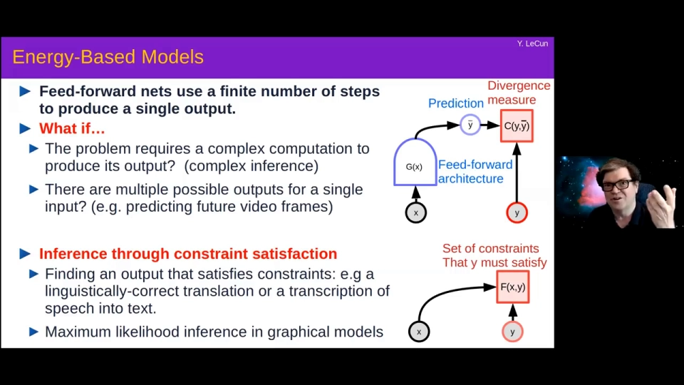
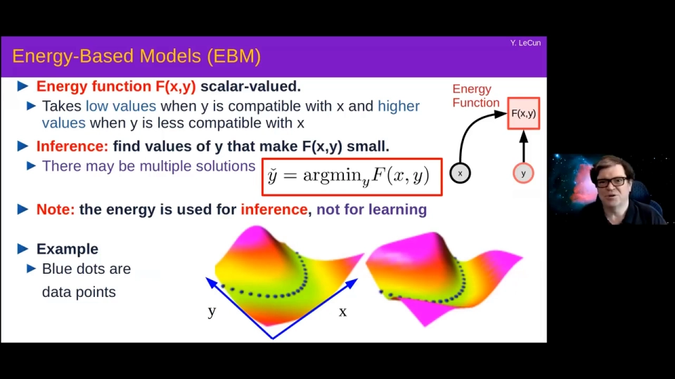
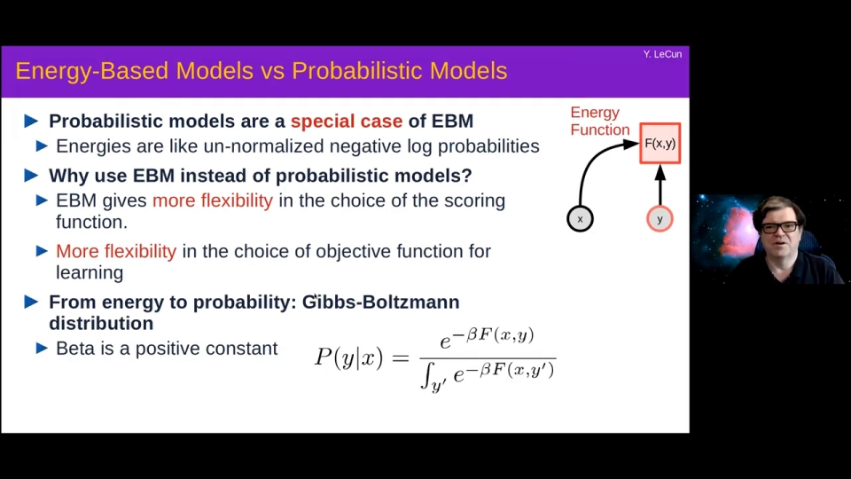
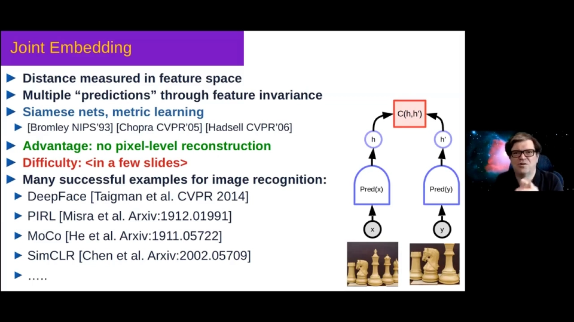
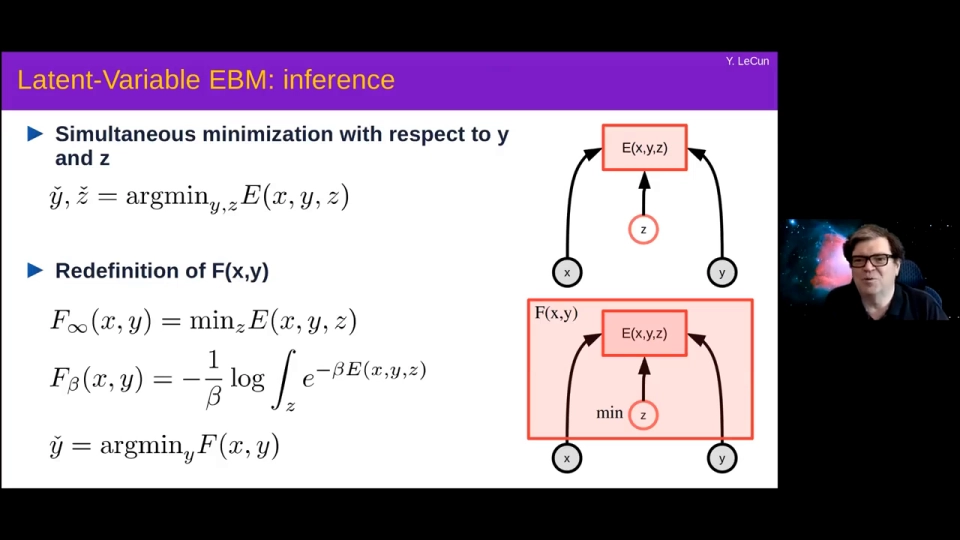

# 能量函数如何变成概率分布：从"相容性打分"到 Gibbs-Boltzmann 分布

> 视频来源：[基于能量的学习模型 by Yann LeCun](https://www.bilibili.com/video/BV1Jg411g7nq/)（Bilibili · 搬运自 Picture Language Seminar，讲者 Yann LeCun）｜时长约 76 分钟（正片约 47 分钟，其余为问答）
> 导读：这是一场面向物理学听众的讲座，LeCun 用"能量"这一个标量把预测、推理和概率串了起来。本文只取其中一条主线：**能量函数是什么、它怎样变成概率分布、温度在其中扮演什么角色**。讲座后半段关于自监督学习与对比方法的内容不在本文范围；训练（配分函数的梯度、负样本）留给同节另一篇。

## 本讲要解决的核心问题（SCQA）

**背景**：我们熟悉的神经网络是"前馈"的——输入 $x$，经过有限步计算，输出一个 $\hat y$，再拿 $\hat y$ 和正确答案 $y$ 算一个误差，反向传播调参数。这套流程在分类、语音识别、机器翻译上都极其成功。[【跳转到 00:56】](https://www.bilibili.com/video/BV1Jg411g7nq/?t=56)

**冲突**：可是有些任务天生不服从"一个输入对应一个输出"。给定一段视频，接下来可能发生的事情非常多：手可以这样动，头可以那样转，话可以说得不一样。如果硬要模型只给一个答案，并且用平方误差去训练它，那么"使误差最小"的那个答案就是所有可能性的**平均值**——你会得到一团模糊的、四不像的画面。[【跳转到 14:53】](https://www.bilibili.com/video/BV1Jg411g7nq/?t=893)

**疑问**：既然"一个输入一个输出"的函数形式装不下多解性，那该换成什么？换掉之后，"概率"又从哪里来？

**回答（中心思想）**：换成一个**能量函数** $F(x,y)$。它不再输出答案，而是给"$x$ 与 $y$ 有多相容"打一个标量分：相容就低，不相容就高。推理因此从"算一次"变成"找一个使能量最低的 $y$"。而只要再补一步归一化，这个能量就能变成概率分布：

$$
P(y\mid x)=\frac{e^{-\beta F(x,y)}}{\displaystyle\int_{y'} e^{-\beta F(x,y')}\,\mathrm{d}y'}
$$

也就是说，**能量是"未归一化的负对数概率"**，分母那个积分（配分函数 $Z$）只负责把总概率凑成 1。本文沿着"能量 → 分布 → 采样"这条链，把每一步的含义讲清楚。

## 一、为什么需要能量：前馈网络装不下多解性

### 1.1 前馈网络的隐含假设

LeCun 在幻灯片上把这件事写得很直白：前馈网络用**有限步计算**产生**一个输出**。这在两种情形下会出问题：

- 输出本身需要复杂计算才能得到（复杂推理）；
- 一个输入对应**多个**可能输出（例如预测视频的后续帧）。

右图对比了两种结构：上面是"前馈架构 + 误差度量"，下面是"能量函数 $F(x,y)$ + 一组 $y$ 必须满足的约束"。注意下面这张图里**没有"正确答案"的位置**——$y$ 不是被算出来的，而是被检验的。

### 1.2 多解性带来的"模糊平均"

LeCun 举的例子很生活化：他正在讲话，你可以预测他下一秒会做什么，但无法精确预测。如果你要求系统给出一个"使平方误差最小"的单一预测，数学上最优的答案就是所有可能结果的**平均**，也就是一个模糊的版本。[【跳转到 15:18】](https://www.bilibili.com/video/BV1Jg411g7nq/?t=918)

这不是模型不够大，而是**目标函数选错了**：平方误差 + 单一输出，天然只能表达"平均"，无法表达"这里有好几种都合理的可能"。

## 二、能量函数：把"预测"改成"打分"

### 2.1 定义：一个标量，衡量相容性

能量函数 $F(x,y)$ 是**标量值**的：

- 当 $y$ 与 $x$ 相容时，它取**低**值；
- 当 $y$ 与 $x$ 不相容时，它取**高**值。

所以 $F(x,y)$ 度量的其实是 $x$ 与 $y$ 之间的**不相容程度**。[【跳转到 15:43】](https://www.bilibili.com/video/BV1Jg411g7nq/?t=943)

### 2.2 推理：找最低点，而不是算一次

有了能量，推理（inference）就变成：

$$
\tilde y=\arg\min_{y} F(x,y)
$$

LeCun 特别强调了一句容易被忽略的话：**能量在这里是用于推理的，不是用于学习的**。[【跳转到 16:08】](https://www.bilibili.com/video/BV1Jg411g7nq/?t=968)

图下方的两个彩色曲面就是"能量景观"：横轴是 $y$，纵轴是能量，蓝点（数据）落在谷底。如果能量是连续可微的，找谷底就可以直接用梯度下降；如果能量是离散的，推理会更麻烦一些。

### 2.3 同一个预测，可以有很多能量函数

一个重要的观察：**能量函数不是唯一的**。幻灯片举的例子是 $x$、$y$ 都是标量、真实关系是 $y=x^2$ 这类情形——只要"给定 $x$ 时能量最低的那个 $y$"相同，两个不同的能量函数就给出相同的预测。[【跳转到 16:47】](https://www.bilibili.com/video/BV1Jg411g7nq/?t=1007)

这解释了为什么基于能量的模型比概率模型"更宽松"：它只承诺"低能量处是合理答案"，不承诺一个唯一的数值。代价是——**能量本身没有概率含义**，想让它变成概率，必须再加一步。

### 2.4 两种形式：条件与无条件

- **条件**能量模型：观察到 $x$，建模 $y$，即 $F(x,y)$；
- **无条件**能量模型：只有 $y$，没有 $x$，即 $F(y)$。

无条件的情形有个微妙之处：你可能只观测到 $y$ 的**一个子集**，而且事先并不知道会观测到哪一部分。比如一张图被物体挡住，你不知道遮挡会出现在哪里、会挡住什么。[【跳转到 17:24】](https://www.bilibili.com/video/BV1Jg411g7nq/?t=1044)

## 三、从能量到概率：Gibbs-Boltzmann 分布

### 3.1 一句话：能量是未归一化的负对数概率

这是全篇最关键的一步。LeCun 说，Gibbs 和 Boltzmann 很久以前就发现，可以用 **Gibbs 公式（最大熵）**把能量函数转成概率分布：对能量取指数，再归一化。[【跳转到 18:10】](https://www.bilibili.com/video/BV1Jg411g7nq/?t=1090)

$$
P(y\mid x)=\frac{e^{-\beta F(x,y)}}{\displaystyle\int_{y'} e^{-\beta F(x,y')}\,\mathrm{d}y'}
$$

把公式拆开看，只有两件事：

1. **分子** $e^{-\beta F(x,y)}$：能量越低，指数越大，概率越大。这就是"低能量 = 高概率"的全部来源。取指数而不是直接取倒数，是为了保证结果恒正、并且让"能量的差"变成"概率的比"。
2. **分母** $\int_{y'} e^{-\beta F(x,y')}\,\mathrm{d}y'$：这就是**配分函数** $Z(x)$。它跟 $y$ 无关，只是一个让所有概率加起来等于 1 的**归一化常数**。

所以幻灯片上的那句总结值得记住：**概率模型是能量模型的特例，能量就像"未归一化的负对数概率"**。反过来说，能量模型比概率模型更一般——你可以只定义能量、不谈概率。

### 3.2 为什么配分函数是个麻烦

LeCun 在讲完公式后马上补了一句：**分母这一项在很多情况下是难以计算的**（intractable）。[【跳转到 18:35】](https://www.bilibili.com/video/BV1Jg411g7nq/?t=1115)

难在哪？难在它是**对整个空间的积分**。图像是 $10\times10$ 像素、每个像素取 0 到 255，空间就已经大到无法枚举；真实图像的维度还要高得多。只要你想知道"某个 $y$ 的绝对概率是多少"，就必须把这个积分算出来。

本小节只需要记住这个结论：**$Z$ 存在、但它难算**。至于"难算到什么程度、训练时怎么绕开它"，是下一小节（配分函数、负样本与对比散度）的内容。

### 3.3 更极端的情况：能量模型可以根本没有概率解释

LeCun 还指出了一种更彻底的情形。以联合嵌入架构为例：把 $x$ 和 $y$ 分别送进两个网络得到向量 $h$、$h'$，再用 $h$ 与 $h'$ 的距离作为能量。[【跳转到 19:05】](https://www.bilibili.com/video/BV1Jg411g7nq/?t=1145)

这种架构表达多模态的方式很巧妙：预测器可能存在一个**不变子空间**，一整族不同的 $y$ 都映射到同一个 $h'$，于是它们的能量完全相同——"多个都合理的答案"就自然出现了。

但代价是：**这个能量模型不一定能变成概率模型**。因为对所有 $y$ 积分时，配分函数可能根本不收敛，你得额外加各种正则化才能让它有定义。[【跳转到 20:20】](https://www.bilibili.com/video/BV1Jg411g7nq/?t=1220)

LeCun 由此给出了他对能量模型的定位：**你可以绕开概率论，用一个更弱、但不那么难处理的东西来代替它**。[【跳转到 21:10】](https://www.bilibili.com/video/BV1Jg411g7nq/?t=1270)

## 四、温度 β：能量与概率之间的"汇率"

### 4.1 β 是逆温度

公式里的 $\beta$ 是一个**正常数**，幻灯片上称它为"逆温度"（inverse temperature）。它的作用是把能量的尺度换算成概率的"陡峭程度"：

- $\beta$ 越大（温度越低），能量差被放大，概率越集中在最低点附近——分布变得"尖锐"；
- $\beta$ 越小（温度越高），能量差被压缩，概率分布变得"平坦"。

这就是统计物理里温度的角色：温度高，系统愿意待在较高能量的状态；温度低，系统几乎只待在最低能量状态。

### 4.2 零温度极限：从"采样"退化成"取最小值"

LeCun 讲潜变量模型时，把这件事写成了两个极限。先看潜变量模型：能量是 $E(x,y,z)$，推理要对 $y$ 和 $z$ 同时最小化。[【跳转到 21:48】](https://www.bilibili.com/video/BV1Jg411g7nq/?t=1308)

把 $z$ 消掉有两种方式：

$$
F_\infty(x,y)=\min_{z} E(x,y,z)
\qquad\text{（零温度极限）}
$$

$$
F_\beta(x,y)=-\frac{1}{\beta}\log\int_z e^{-\beta E(x,y,z)}\,\mathrm{d}z
\qquad\text{（有限温度）}
$$

第二式值得多看两眼：它就是**对 $z$ 的对数配分函数**，LeCun 说这基本上就是统计物理里的**亥姆霍兹自由能**。[【跳转到 23:03】](https://www.bilibili.com/video/BV1Jg411g7nq/?t=1383)

于是"边缘化"和"自由能"这两个听起来很物理的词，在机器学习里就是一句话：**把不关心的变量 $z$ 通过对 $e^{-\beta E}$ 积分消掉**。而 $\beta\to\infty$ 时，积分被最大值主导，自由能退化为"对 $z$ 取最小"——这就是为什么"取最小值"是"采样"的极限情形。

### 4.3 换来的还是同一个麻烦

LeCun 紧接着说：这个积分**可能依旧是难以计算的**，所以实践中常常要用变分近似之类的办法。[【跳转到 23:28】](https://www.bilibili.com/video/BV1Jg411g7nq/?t=1408)

这句话其实点出了整条链的软肋：**能量好定义、推理（找最低点）也还算好做，但从能量到"归一化的概率"这一步，总会撞上积分**。后面所有关于训练和采样的技术，本质上都是在绕开这个积分。

## 五、这条链上，"采样"落在哪里

把本文的三步连起来看：

| 环节 | 要回答的问题 | 数学形式 | 难度 |
| --- | --- | --- | --- |
| 能量 | $x$ 与 $y$ 有多相容 | $F(x,y)$，标量 | 由网络定义，好算 |
| 分布 | 每个 $y$ 的概率是多少 | $e^{-\beta F}/Z$ | 分子好算，$Z$ 难算 |
| 采样 | 怎样得到一批"像数据"的 $y$ | 从 $p(y\mid x)$ 抽样本 | 依赖上一步，通常只能近似 |

LeCun 在这场讲座里主要讲了前两步，并且把"推理"实现为**最小化能量**——也就是只取能量景观的谷底，得到一个（或一族）最相容的 $y$。这在很多任务上已经够用，但它给出的是**一个点**，不是**一批服从分布的样本**。

要真正"从 $e^{-\beta F}/Z$ 里抽样"，需要的是马尔可夫链蒙特卡洛（MCMC）一类的迭代采样器，其中最有名的一种是**朗之万动力学**：每一步沿着能量的负梯度走一小步，再叠加一点高斯噪声。梯度负责把样本往低能量处拉，噪声负责让它不要在谷底"卡死"、从而按概率高低分配停留时间。这条"为什么加噪声就能采样"的机制，见同节另一篇《从能量到样本：为什么采样难，朗之万动力学怎么工作》。

## 小结

- **前馈网络装不下多解性**：一个输入对应多个合理输出时，平方误差 + 单一输出只能给出"模糊的平均"。
- **能量函数 $F(x,y)$ 是一个标量打分器**：相容则低、不相容则高；推理就是 $\arg\min_y F(x,y)$，可以用梯度下降做。
- **能量函数不唯一**：只要最低点相同，不同的能量给出相同的预测；代价是能量本身没有概率含义。
- **Gibbs-Boltzmann 分布把能量变成概率**：$P(y\mid x)=e^{-\beta F(x,y)}/Z$，分子保证"低能量 = 高概率"，分母 $Z$ 只负责归一化。
- **$Z$ 是对整个空间的积分**，维度一高就无法计算；本小节只需记住"它存在且难算"。
- **$\beta$ 是逆温度**：$\beta$ 大则分布尖锐、$\beta$ 小则平坦；$\beta\to\infty$ 时自由能退化为"对潜变量取最小"。
- **能量模型可以比概率模型更弱**：联合嵌入那类能量在积分时可能不收敛，于是干脆放弃概率解释。
- **采样是这条链的最后一环**：本讲把推理做成"找最低点"，真正的"按分布抽样"要靠 MCMC / 朗之万动力学。

## 关键术语速查

| 术语 | 一句话解释 |
| --- | --- |
| 能量函数 $F(x,y)$ | 给"$x$ 与 $y$ 是否相容"打分的标量函数，越低越相容 |
| 推理（inference） | 给定 $x$ 求使能量最低的 $y$，即 $\arg\min_y F(x,y)$ |
| 推理与学习 | 推理用能量找答案，学习改能量函数本身，两者是不同的事 |
| Gibbs-Boltzmann 分布 | $P(y\mid x)=e^{-\beta F(x,y)}/Z$，把能量转成概率的标准公式 |
| 配分函数 $Z$ | 分母上的归一化积分 $\int e^{-\beta F}\,\mathrm{d}y$，保证概率总和为 1，通常难以计算 |
| 逆温度 $\beta$ | 控制分布尖锐程度的正常数；$\beta$ 大则集中在低能量处 |
| 自由能 $F_\beta$ | $-\frac{1}{\beta}\log\int_z e^{-\beta E(x,y,z)}\,\mathrm{d}z$，把潜变量边缘化后的等效能量 |
| 零温度极限 | $\beta\to\infty$ 时自由能退化为 $\min_z E(x,y,z)$，即"取最小值" |
| 联合嵌入 | 用两个网络分别编码 $x$ 和 $y$，以特征距离作能量；靠不变子空间表达多模态 |