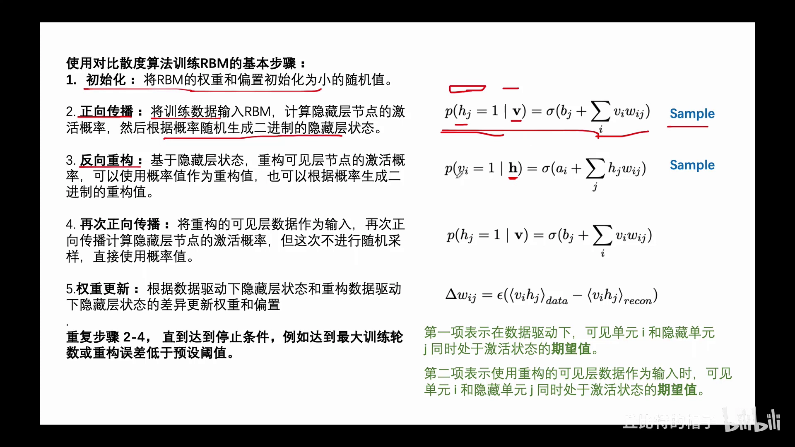
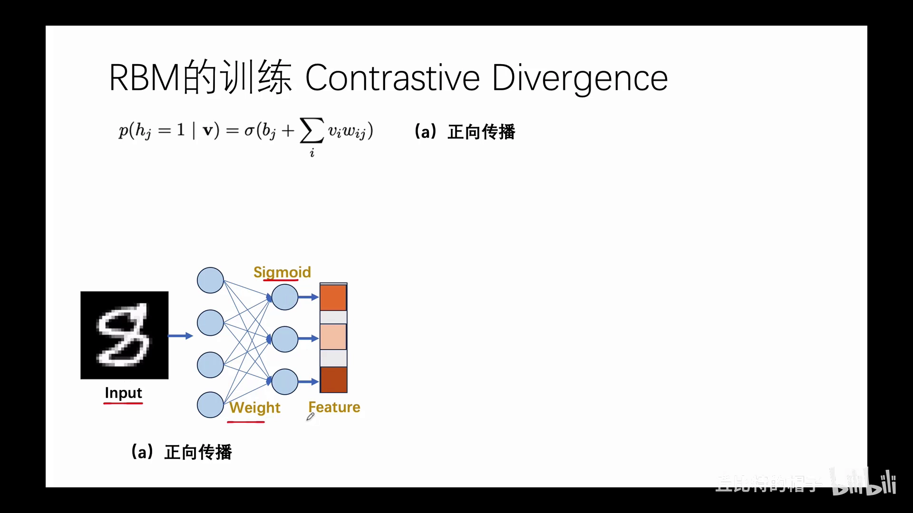
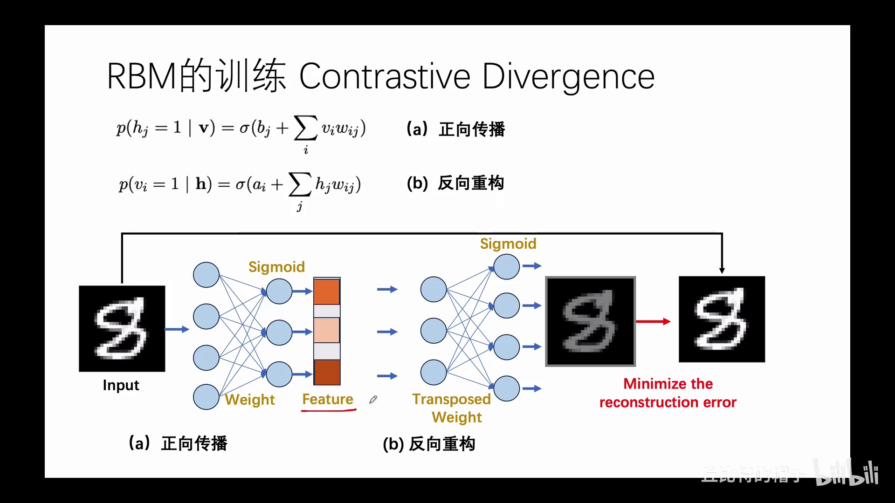
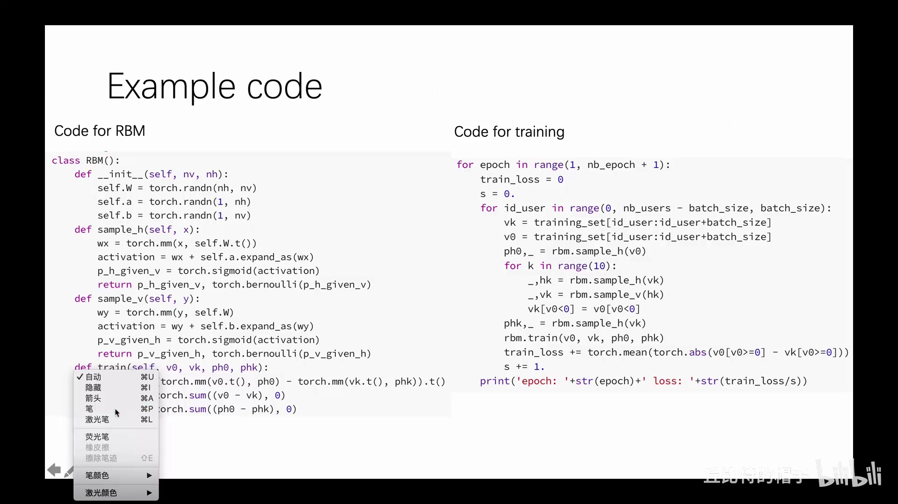
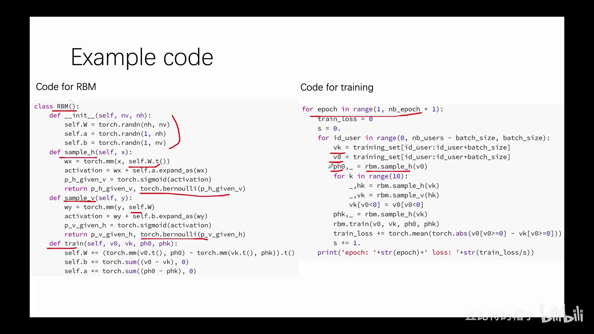
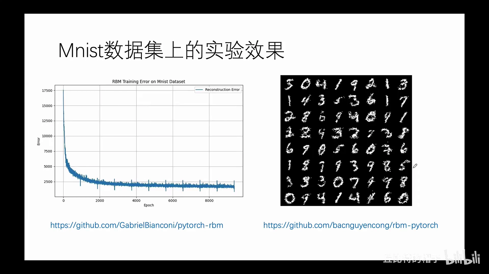
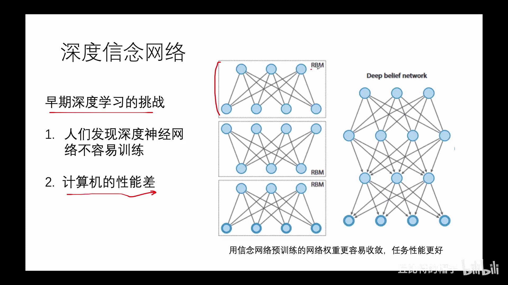

# 对比散度怎么训练 RBM：正向传播、k 步吉布斯重构与权重更新公式

> 视频来源：[2024诺贝尔"物理学"奖成果-受限玻尔兹曼机(RBM)讲解](https://www.bilibili.com/video/BV1UU2PYUEtZ/)（Bilibili · 丘比特的帽子）｜时长约 19 分钟
> 导读：这支视频把 RBM 的训练拆成「正向传播 → 反向重构 → 重复 k 次 → 用两个期望之差更新权重」四步，并逐行讲了 PyTorch 实现。本文只讲**训练侧**：能量函数与玻尔兹曼分布的定义见同小节另一篇《配分函数算不出来怎么办》，这里一句话带过。文中时间戳可跳回原片核对。

## 本讲要解决的核心问题（SCQA）

**背景**：RBM 是一个两层、层内无连接的生成模型，可见层放数据（比如一张手写数字图像），隐藏层放「想象出来的」解释变量。给定权重，它的联合分布由能量函数决定——这部分在《能量模型：能量函数、概率分布与采样》里已经建立。[【跳转到 01:26】](https://www.bilibili.com/video/BV1UU2PYUEtZ/?t=86)

**冲突**：知道了分布怎么写，并不等于知道**参数怎么学**。RBM 里既有 0/1 的随机采样，又有「可见层→隐藏层→可见层」的多次往返，整个计算图对权重不可微，标准的反向传播直接失效。[【跳转到 08:38】](https://www.bilibili.com/video/BV1UU2PYUEtZ/?t=518)

**疑问**：既然不能反向传播，那 RBM 到底靠什么更新权重？「对比散度（Contrastive Divergence）」这个名字里的「对比」，对比的又是什么？

**回答（中心思想）**：对比散度把训练变成**两相的减法**。它先用数据做一次正向传播，记下「数据驱动下可见单元与隐藏单元同时激活的期望」；再从数据出发做 k 次「隐藏层采样—可见层重构」的往返，得到一个**重构样本**，记下「模型自己想象出来的期望」；最后把两个期望相减，乘上学习率去更新权重。数据相把概率往上推，重构相把概率往下拉，两者的差就是这一步该走的方向。[【跳转到 11:08】](https://www.bilibili.com/video/BV1UU2PYUEtZ/?t=668)



## 一、先看清训练的骨架：一次正向、一次重构、k 次往返

视频把整个训练压缩成五个步骤，值得先整体看一遍再抠细节：

1. **初始化**：把 RBM 的权重和偏置初始化成小的随机值。
2. **正向传播**：把训练数据输入 RBM，计算隐藏层节点的**激活概率**，再按这个概率随机生成二进制的隐藏层状态。
3. **反向重构**：基于隐藏层状态，重构可见层节点的激活概率；可以用概率值本身当重构值，也可以按概率再采出二进制值。
4. **再次正向传播**：把重构出来的可见层数据当输入，再算一次隐藏层激活概率，但这次**不采样**，直接用概率值。
5. **权重更新**：根据「数据驱动下的隐藏层状态」和「重构数据驱动下的隐藏层状态」的差异来更新权重和偏置。

然后重复第 2–4 步，直到达到停止条件，比如跑满最大训练轮数，或者重构误差低于预设阈值。[【跳转到 11:08】](https://www.bilibili.com/video/BV1UU2PYUEtZ/?t=668)

这套骨架里有两个容易看漏的设计：第 2、3 步要**采样**，第 4 步**不采样**。原因在第 5 步的公式里——更新需要的是「期望」，而采样会引入噪声，所以最后一轮只取概率的期望值。

## 二、正向传播与反向重构：两个条件概率

### 2.1 正向传播：给定可见层，隐藏单元等于 1 的概率

RBM 的层内没有连接，所以给定可见层 $\mathbf{v}$ 之后，每个隐藏单元的条件概率可以单独算：

$$
p(h_j = 1 \mid \mathbf{v}) = \sigma\!\left(b_j + \sum_i v_i w_{ij}\right)
$$

其中 $\sigma$ 是 sigmoid 函数，$b_j$ 是隐藏单元的偏置，$w_{ij}$ 是可见单元 $i$ 与隐藏单元 $j$ 之间的权重。视频特意强调：这里把网络的前向计算写成了**概率**形式，而不是写成确定性的激活值。[【跳转到 05:43】](https://www.bilibili.com/video/BV1UU2PYUEtZ/?t=343)

这一步和普通神经网络的前向传播长得几乎一样：输入乘权重、加偏置、过 sigmoid。区别在后面——普通网络拿到激活值就往下传，RBM 要把它当成**伯努利分布的参数**，再抛一次硬币采出 0 或 1。



### 2.2 反向重构：给定隐藏层，可见单元等于 1 的概率

反向重构用的是**同一组权重的转置**，只换一个偏置：

$$
p(v_i = 1 \mid \mathbf{h}) = \sigma\!\left(a_i + \sum_j h_j w_{ij}\right)
$$

这里 $a_i$ 是可见单元的偏置，$w_{ij}$ 还是那个 $w_{ij}$，只是求和的下标从「对 $i$ 求和」变成「对 $j$ 求和」，等价于乘 $W^{\mathsf{T}}$。[【跳转到 06:58】](https://www.bilibili.com/video/BV1UU2PYUEtZ/?t=418)

视频用一张图对比了这两步：左边是「图像 → 权重 → sigmoid → 特征」，右边是「特征 → 转置权重 → sigmoid → 重构图像」，最后用箭头标出「最小化重构误差」。作者说这看起来很像 autoencoder，但有三点不同：

- 正向传播和反向重构之间要**往返非常多次**，不是一次编码一次解码；
- 中间**夹着采样**，整个网络一般不可微，所以没法用反向传播训练；
- 编码器部分的权重和解码器部分的权重是**转置关系**，是同一份参数，而不是两套独立参数。



## 三、k 步往返：$v_0 \to h_0 \to v_1 \to \cdots \to v_k$

把上面两步交替执行，就得到对比散度里的「吉布斯链」：

$$
\mathbf{v}_0 \;\to\; \mathbf{h}_0 \;\to\; \mathbf{v}_1 \;\to\; \mathbf{h}_1 \;\to\; \cdots \;\to\; \mathbf{v}_k
$$

具体走法是：给定第 0 时刻的可见状态 $\mathbf{v}_0$ 放进去，按 $p(h_j=1\mid\mathbf{v})$ 采出 $\mathbf{h}_0$；再按 $p(v_i=1\mid\mathbf{h})$ 采出 $\mathbf{v}_1$；再前馈得到 $\mathbf{h}_1$……如此反复。[【跳转到 09:03】](https://www.bilibili.com/video/BV1UU2PYUEtZ/?t=543)

两个细节决定了这一步的实现方式：

- **每次都要采样。** 因为 sigmoid 输出的是 0.9、0.1、0.8 这样的概率值，必须按概率采成 0/1 的 one-hot 向量，才能作为下一层的输入。视频说这一步「做了一个 sample」。[【跳转到 10:18】](https://www.bilibili.com/video/BV1UU2PYUEtZ/?t=618)
- **最后一轮不采样。** 迭代到第 $k$ 轮之后，再做一次正向传播，但这次直接使用 sigmoid 的输出（连续的概率值），因为更新公式要的是期望，不是又一份二进制样本。[【跳转到 11:08】](https://www.bilibili.com/video/BV1UU2PYUEtZ/?t=668)

为什么走 $k$ 步就够？关键在于**链的起点不是随机噪声，而是数据本身**。视频反复强调这个往返要「非常多次」、要「达到一定条件才截止」，说明步数越多、链尾越接近模型分布；而对比散度的近似是：从数据出发只走有限 $k$ 步，就用链尾的 $\mathbf{v}_k$ 当作负样本。起点已经站在数据上，所以不需要走远——这正是「对比散度」这个名字里「对比」的来源：拿数据附近的样本和模型走几步之后的样本作对比。

## 四、权重更新公式：数据相减重构相

### 4.1 公式

$$
\Delta w_{ij} = \varepsilon\left(\langle v_i h_j\rangle_{\text{data}} - \langle v_i h_j\rangle_{\text{recon}}\right)
$$

其中 $\varepsilon$ 是学习率。视频对两项的解释是：

- 第一项 $\langle v_i h_j\rangle_{\text{data}}$：在**数据驱动**下，可见单元 $i$ 和隐藏单元 $j$ 同时处于激活状态的**期望值**；
- 第二项 $\langle v_i h_j\rangle_{\text{recon}}$：把**重构出来的可见层数据**作为输入时，可见单元 $i$ 和隐藏单元 $j$ 同时处于激活状态的期望值。[【跳转到 11:58】](https://www.bilibili.com/video/BV1UU2PYUEtZ/?t=718)

偏置的更新形式完全平行：可见层偏置用 $\langle v_i\rangle_{\text{data}} - \langle v_i\rangle_{\text{recon}}$，隐藏层偏置用 $\langle h_j\rangle_{\text{data}} - \langle h_j\rangle_{\text{recon}}$。

### 4.2 为什么是「相减」

把这个公式读成一句话：**凡是数据里常见的共现模式，就把对应权重往上推；凡是模型自己幻想出来的共现模式，就把对应权重往下拉。**

- 第一项是**正相**：$v_i$ 和 $h_j$ 在真实数据里经常一起亮，说明这条边应该更强。
- 第二项是**负相**：$v_i$ 和 $h_j$ 在模型采样里经常一起亮，但数据里并不常见，说明模型高估了这条边，应该削弱。

如果模型已经完美拟合了数据，两项相等，梯度为零，训练自然停下。所以这个减法不是随手写的启发式，它对应的是对数似然梯度里「数据期望减模型期望」的结构——只是把「模型期望」换成了「从数据出发走 k 步得到的重构期望」。

### 4.3 一个 batch 里怎么算

视频说明了实现层面的对应关系：第一项在代码里就是「一个 batch 的输入 $\mathbf{v}_0$ 与隐藏层输出 $\phi_0$ 相乘」，取期望等价于对整个 batch 求平均；第二项是「第 $k$ 轮的可见层 $\mathbf{v}_k$ 与第 $k$ 轮隐藏层分布 $\phi_k$ 相乘」。两项相减再乘学习率，就是这一步的权重增量。[【跳转到 11:33】](https://www.bilibili.com/video/BV1UU2PYUEtZ/?t=693)

写成矩阵形式就是：

$$
W \;\leftarrow\; W + \varepsilon\left(\mathbf{v}_0^{\mathsf{T}}\phi_0 - \mathbf{v}_k^{\mathsf{T}}\phi_k\right)
$$

## 五、代码：一个 RBM 类加一个训练循环

视频给出了 PyTorch 实现，结构非常紧凑。

**模型部分**只有一个 `RBM` 类：`__init__` 里建权重 `W`（形状 $n_h \times n_v$）和两个偏置 `a`、`b`；`sample_h` 和 `sample_v` 分别对应正向传播与反向重构，两者都是「矩阵乘 + 加偏置 + sigmoid」，最后都做一次 `torch.bernoulli` 伯努利采样；`train` 方法负责用两个期望之差更新参数。[【跳转到 12:36】](https://www.bilibili.com/video/BV1UU2PYUEtZ/?t=756)

```python
class RBM:
    def __init__(self, nv, nh):
        self.W = torch.randn(nh, nv)      # 权重
        self.a = torch.randn(1, nh)       # 隐藏层偏置
        self.b = torch.randn(1, nv)       # 可见层偏置

    def sample_h(self, x):                # 正向传播：给定 v，采 h
        wx = torch.mm(x, self.W.t())
        activation = wx + self.a.expand_as(wx)
        p_h_given_v = torch.sigmoid(activation)
        return p_h_given_v, torch.bernoulli(p_h_given_v)

    def sample_v(self, y):                # 反向重构：给定 h，采 v
        wy = torch.mm(y, self.W)
        activation = wy + self.b.expand_as(wy)
        p_v_given_h = torch.sigmoid(activation)
        return p_v_given_h, torch.bernoulli(p_v_given_h)

    def train(self, v0, vk, ph0, phk):    # 两个期望之差
        self.W += (torch.mm(v0.t(), ph0) - torch.mm(vk.t(), phk)).t()
        self.b += torch.sum((v0 - vk), 0)
        self.a += torch.sum((ph0 - phk), 0)
```

**训练部分**是双层循环：外层是 epoch，内层按 batch 取数据。每个 batch 里先调用 sample_h(v0) 拿到数据相的概率 ph0；然后把 vk 初始化成 v0，跑一个十轮的往返链，每轮先用 sample_h(vk) 采出 hk，再用 sample_v(hk) 采出新的 vk；链结束后再调用一次 sample_h(vk)，得到重构相的概率 phk（这一步不采样）；最后调用 `rbm.train(v0, vk, ph0, phk)` 更新参数。[【跳转到 13:26】](https://www.bilibili.com/video/BV1UU2PYUEtZ/?t=806)

```python
for epoch in range(1, nb_epoch + 1):
    train_loss = 0
    s = 0.
    for id_user in range(0, nb_users - batch_size, batch_size):
        vk = training_set[id_user:id_user+batch_size]
        v0 = training_set[id_user:id_user+batch_size]
        ph0, _ = rbm.sample_h(v0)
        for k in range(10):               # k 步吉布斯往返
            _, hk = rbm.sample_h(vk)
            _, vk = rbm.sample_v(hk)
            vk[v0 < 0] = v0[v0 < 0]       # 缺失值保持缺失
        phk, _ = rbm.sample_h(vk)
        rbm.train(v0, vk, ph0, phk)
        train_loss += torch.mean(torch.abs(v0[v0 >= 0] - vk[v0 >= 0]))
        s += 1.
    print('epoch: ' + str(epoch) + ' loss: ' + str(train_loss / s))
```

注意代码里的 for k in range(10)：这就是 $k=10$ 的对比散度，即 CD-10。每一步往返都要多一次前馈加一次采样，所以 $k$ 直接决定每个 batch 的计算量。视频没有讨论 $k$ 的调参，只演示了 $k=10$ 能收敛。





## 六、在 MNIST 上的效果

视频最后跑了一个 MNIST 实验。左图是重构误差随 epoch 的变化：起步阶段从一万多迅速下降，到两千个 epoch 附近进入平台期，之后缓慢下降并伴随波动；右图是从训练好的 RBM 里采样出来的手写数字，能看出笔画的粗细和倾斜，但边缘比较毛糙、部分数字已经难以辨认。[【跳转到 16:08】](https://www.bilibili.com/video/BV1UU2PYUEtZ/?t=968)

这张图很值得初学者多看一眼：它同时说明了对比散度**能跑通**（误差确实稳定下降、样本确实像数字）和它的**局限**（样本边缘毛糙，质量远不如今天的生成模型）。视频没有展开讲训练不稳定的原因，但从前面的公式能看出苗头：负相用的是 k 步短链的近似而不是真正的模型分布，两项之差本身就是一个有偏的估计。



## 七、为什么这套 20 多年前的方法值得拿诺奖

视频用最后三分钟交代了历史位置。早期深度学习面对两个困难：一是网络越深性能越好、越容易拟合复杂数据，但**深度网络不容易训练**；二是当时的**计算机性能差**。[【跳转到 16:50】](https://www.bilibili.com/video/BV1UU2PYUEtZ/?t=1010)

Hinton 等人的办法是：把多层受限玻尔兹曼机**逐层叠起来训练**——先训练最底下一层 RBM，把它的隐藏层输出当作下一层的可见层输入，再训练下一层，如此一层层往上。全部训练完之后把它们套在一起，就得到**深度信念网络（Deep Belief Network, DBN）**。用这种「预训练 + 微调」的权重初始化，网络更容易收敛，任务性能也更好。[【跳转到 17:15】](https://www.bilibili.com/video/BV1UU2PYUEtZ/?t=1035)



作者的评价很克制：这项工作距今至少 20 多年，不能用现代人的眼光去评判；它看起来简单，但确实帮深度学习度过了迷茫期，并一路影响到后来的 LeNet、AlexNet、ResNet，直到今天的 Transformer 和大模型。[【跳转到 18:05】](https://www.bilibili.com/video/BV1UU2PYUEtZ/?t=1085)

## 小结

- **训练骨架是四步循环**：正向传播取数据相 → 反向重构取重构相 → 重复 k 次 → 用两个期望之差更新权重。
- **两个条件概率共用一组权重**：$p(h_j=1\mid\mathbf{v})$ 用 $W$，$p(v_i=1\mid\mathbf{h})$ 用 $W^{\mathsf{T}}$，这是 RBM 与 autoencoder 的关键区别。
- **采样不可微是核心障碍**：正因为不能反向传播，才需要对比散度这种「用采样绕开求导」的办法。
- **权重更新是相减**：$\Delta w_{ij} = \varepsilon(\langle v_ih_j\rangle_{\text{data}} - \langle v_ih_j\rangle_{\text{recon}})$，数据相往上推、重构相往下拉。
- **k 步是近似**：理想负样本要从模型平稳分布取，实际从数据出发只走 k 步；$k$ 越大越准，代价越高。
- **最后一轮不采样**：更新公式要的是期望，所以链尾只取 sigmoid 的概率值。
- **历史意义**：RBM 的逐层预训练催生了深度信念网络，是深度学习走出低谷的关键一步。

## 关键术语速查

| 术语 | 一句话解释 |
| --- | --- |
| 可见层 / 隐藏层 | 可见层放观测到的数据，隐藏层放需要「想象」才能解释数据的潜在变量 |
| 正向传播 | 给定可见层，按 $p(h_j=1\mid\mathbf{v})$ 算出并采出隐藏层状态 |
| 反向重构 | 给定隐藏层，按 $p(v_i=1\mid\mathbf{h})$ 回推可见层，得到重构样本 |
| 吉布斯往返 | 在可见层与隐藏层之间交替采样，一次往返就是一步 |
| 对比散度 CD-k | 从数据出发只走 k 步吉布斯链，用链尾样本近似负相 |
| 正相 / 负相 | 数据驱动下的共现期望 / 模型采样下的共现期望，两者相减得到更新方向 |
| 伯努利采样 | 把 sigmoid 输出的概率按抛硬币变成 0 或 1，使下一层拿到二值输入 |
| 深度信念网络 | 多层 RBM 逐层预训练后叠成的深度网络，用来解决深层网络难训练的问题 |