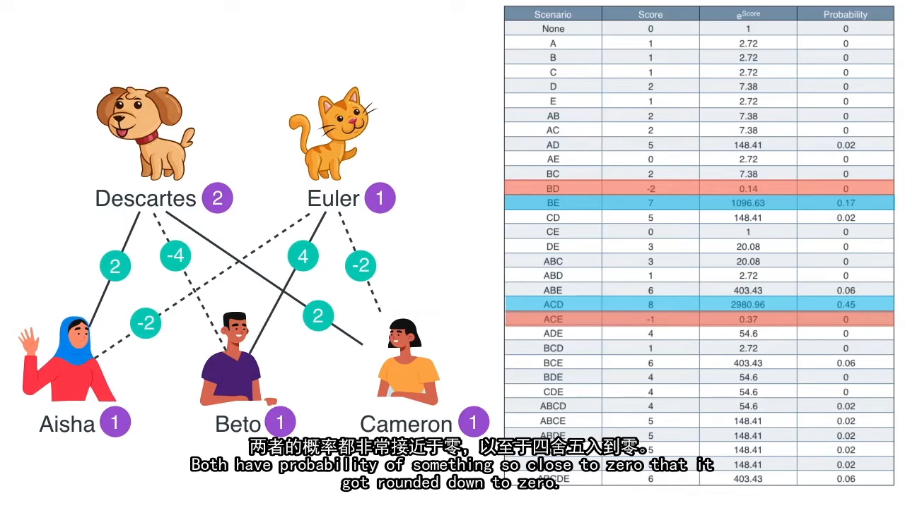
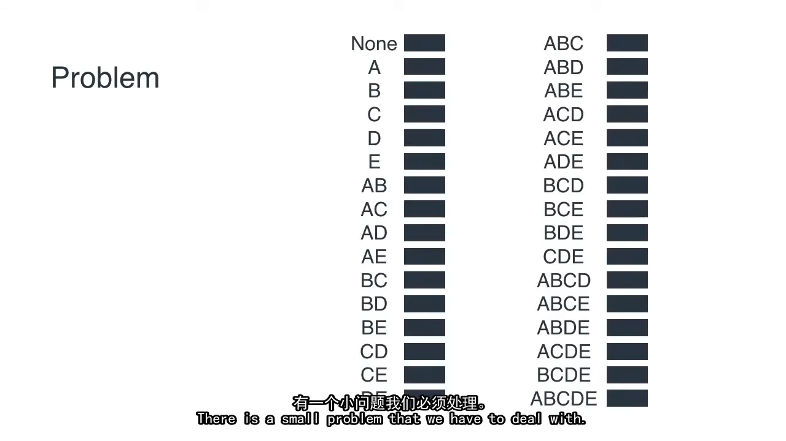
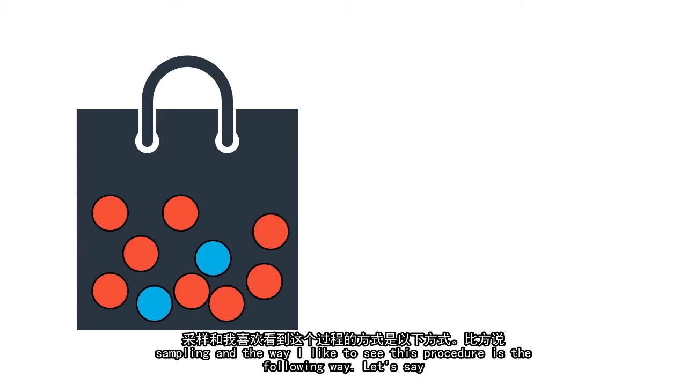
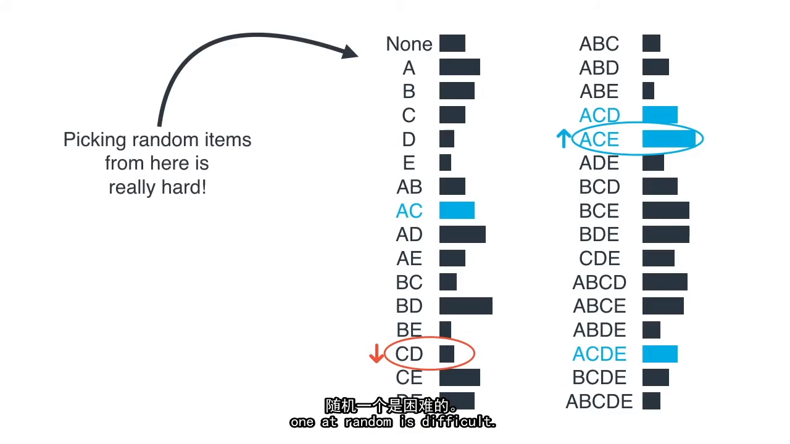
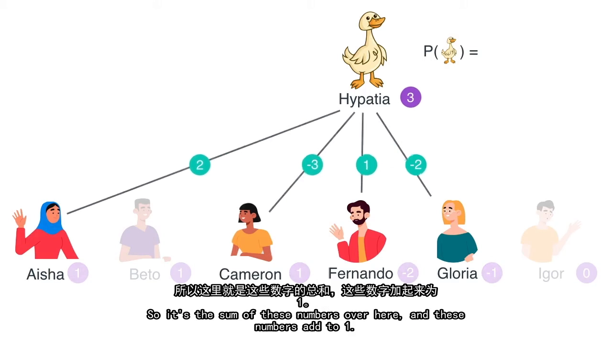
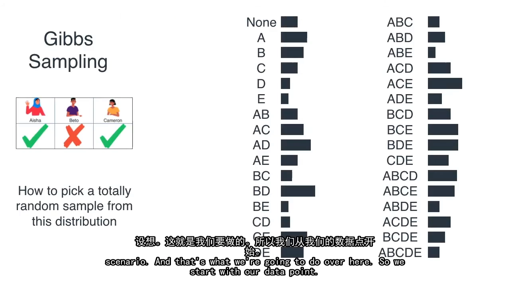
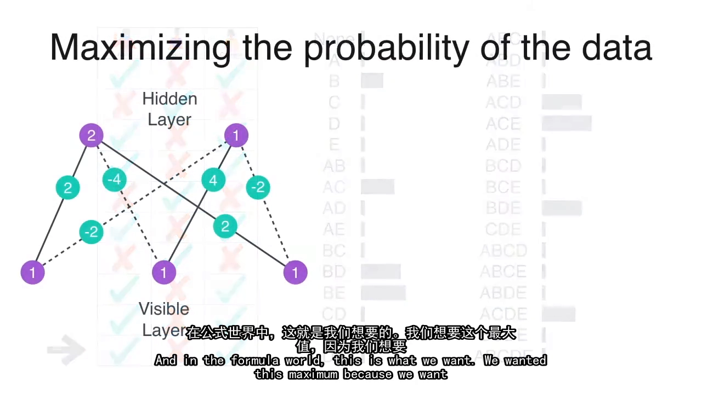
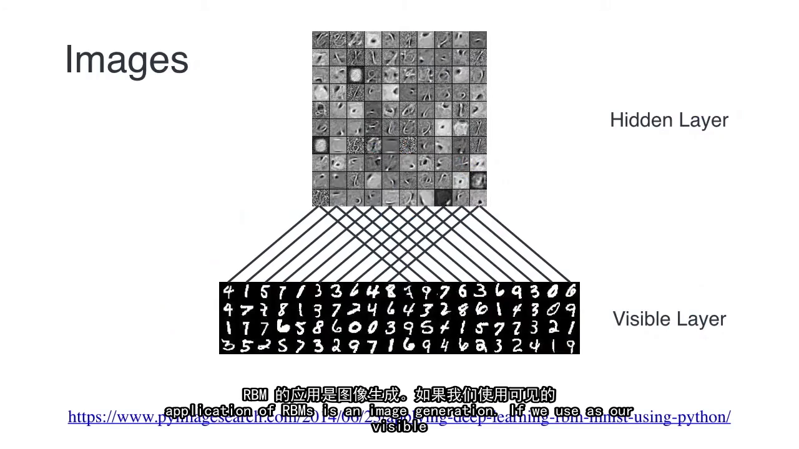

# 配分函数算不出来怎么办：用采样近似负相，把对比散度讲成「加概率、减概率」

> 视频来源：[动画讲解受限玻尔兹曼机RBM生成模型（2024诺贝尔物理奖模型）](https://www.bilibili.com/video/BV1841hYREwV/)（Bilibili · 数源创域，Luis Serrano 原片的中文配音版）｜时长约 37 分钟
> 导读：这支视频用「三个朋友和两只宠物」的 32 种场景，把配分函数为什么不可算、以及对比散度怎么绕开它，全部画成了条形图的加减。本文只讲**训练侧**：能量函数与玻尔兹曼分布的定义见同小节另一篇《对比散度训练 RBM》，这里只回指一句。文中时间戳可跳回原片核对。

## 本讲要解决的核心问题（SCQA）

**背景**：RBM 用能量定义概率。给定可见层 $\mathbf{v}$ 和隐藏层 $\mathbf{h}$，先算一个「得分」$S(\mathbf{v},\mathbf{h})$（能量取负），再用 softmax 把它变成概率。这套写法在《能量模型：能量函数、概率分布与采样》里已经建立。[【跳转到 06:46】](https://www.bilibili.com/video/BV1841hYREwV/?t=406)

**冲突**：训练的目标是让数据在模型下的概率最大，也就是最大化似然。可一旦把概率写成 $p = e^{S}/Z$，分母的**配分函数** $Z$ 就是「所有可能场景的 $e^{S}$ 之和」。场景数随节点数指数增长：5 个节点有 32 种，200 个可见节点加 100 个隐藏节点就是 $2^{300}$ 种——比已知宇宙的原子数还多。$Z$ 算不出来，概率就算不出来，梯度也算不出来。[【跳转到 16:18】](https://www.bilibili.com/video/BV1841hYREwV/?t=978)

**疑问**：既然归一化常数不可算，训练是不是就无从下手了？

**回答（中心思想）**：不必真的算出 $Z$，只需要**近似那个「减号项」**。对数似然的梯度可以写成两个期望之差：一个来自数据，一个来自模型。数据那一项直接拿训练集算；模型那一项本来要对整个 $2^{300}$ 空间求和，改用**从数据出发、随机走若干步**采出来的样本来估计。于是训练变成一句大白话：**把和数据一致的场景概率往上加，把随机走到的场景概率往下减**。这就是对比散度。[【跳转到 15:04】](https://www.bilibili.com/video/BV1841hYREwV/?t=904)

## 一、先把「概率」摆到桌面上：一张 32 行的表

视频用一个具体的小世界做例子，值得完整复述，因为后面所有抽象都落在这张表上。

**可见层**是三个人：Aisha、Beto、Cameron。他们有时来、有时不来。**隐藏层**是两只宠物：狗 Descartes 和猫 Euler——我们看不到它们，但需要「想象」它们的存在，才能解释人为什么这样出现。[【跳转到 03:33】](https://www.bilibili.com/video/BV1841hYREwV/?t=213)

数据里只观察到两种模式：要么只有 Cameron 来，要么只有 Beto 来。可这两个人互不相识。真正的解释藏在宠物身上：Aisha 和 Cameron 喜欢狗但不喜欢猫，Beto 爱猫但对狗过敏。于是「只有 Cameron 来」对应「狗在场」，「只有 Beto 来」对应「猫在场」。

给每条边和每个节点配上数字（权重与偏置）之后，**一个场景的得分**就是这些数字的和。比如「所有人都来」得分是 6，「只有 Cameron 和狗来」得分是 8，「Beto 和狗一起来」得分是 $2+1-4=-1$——最后一个得分很低，因为 Beto 对狗过敏，这个场景在物理上讲不通。[【跳转到 05:35】](https://www.bilibili.com/video/BV1841hYREwV/?t=335)

把 5 个节点（3 人 + 2 宠物）的所有 0/1 组合列出来，正好 $2^5 = 32$ 种场景。每种场景算一个得分，再按下面的三步变成概率：

1. **取指数**：$e^{S}$。指数函数把任意实数（包括负数）变成正数，解决了「得分可能为负、不能直接当概率」的问题。
2. **求和**：把 32 个 $e^{S}$ 加起来，这个和就是**配分函数** $Z$。
3. **归一化**：每个场景的概率 $= e^{S} / Z$。

视频特别提醒：表里有些概率显示为 0，其实不是真的 0，只是太小了被四舍五入掉；真实值加起来严格等于 1。[【跳转到 09:53】](https://www.bilibili.com/video/BV1841hYREwV/?t=593)

写成公式就是：

$$
p(\mathbf{v},\mathbf{h}) = \frac{e^{-E(\mathbf{v},\mathbf{h})}}{Z}, \qquad Z = \sum_{\mathbf{v},\mathbf{h}} e^{-E(\mathbf{v},\mathbf{h})}
$$

其中能量 $E = -\sum_i b_i v_i - \sum_j a_j h_j - \sum_{i,j} w_{ij} v_i h_j$，得分 $S = -E$。

## 二、训练的目标：让数据那几个场景的概率变高

在训练之前，先问一句「我们到底想要什么」。

假设权重全是零。这时 32 个场景的得分都是 0，$e^{0}=1$，$Z=32$，每个场景概率都是 $1/32$——模型认为任何场景出现的可能性都一样，也就是什么都没学到。[【跳转到 11:26】](https://www.bilibili.com/video/BV1841hYREwV/?t=686)

而数据告诉我们：大多数时候要么是「Aisha + Cameron 出现、Beto 不出现」，要么是「Beto 出现、Aisha 和 Cameron 不出现」。所以我们要的分布是：**与数据一致的那几个场景概率高，其余全部低**。

这里有一个容易被忽略的细节，视频专门用一段讲清楚：**我们不需要让某个完整场景（人 + 宠物）概率很高**。真正要拟合的是**可见层**的分布——人。宠物是我们想象出来的，把它们「边缘化掉」之后，只要「只有 Aisha 和 Cameron」的所有场景概率**之和**高、「只有 Beto」的所有场景概率**之和**也高，就足够了。[【跳转到 20:03】](https://www.bilibili.com/video/BV1841hYREwV/?t=1203)

这也解释了为什么训练完之后，很多「Aisha 和 Cameron 出现但不带狗」的场景概率依然很低——它们对可见层的边缘概率贡献很小，模型没必要记住它们。

## 三、配分函数为什么不可算：$2^{300}$ 与宇宙的原子数

现在到了全片的关键转折。

训练要最大化对数似然。把概率写成 $e^{S}/Z$ 之后取对数、再对权重求导，会得到两个期望之差：一项在**数据分布**下取期望（蓝色，正在被提高的那些场景），一项在**模型分布**下取期望（红色，正在被降低的那些场景）。[【跳转到 15:29】](https://www.bilibili.com/video/BV1841hYREwV/?t=929)

问题出在第二项。它要对**所有可能场景**按模型概率加权求和，而场景数是：

$$
2^{n_v + n_h}
$$

5 个节点是 $2^5 = 32$，勉强能列表。但一个稍大的 RBM 有 200 个可见节点和 100 个隐藏节点，就是 $2^{300}$ 种可能。视频给了一个直观的对比：$2^{300}$ 比已知宇宙的原子数量还大；就算把每一种组合都存进一个原子里，也还是不够空间。[【跳转到 15:56】](https://www.bilibili.com/video/BV1841hYREwV/?t=956)

于是结论很硬：**所有概率的总和，也就是配分函数，实际上是无法计算的**。$Z$ 算不出来，模型概率 $p = e^{S}/Z$ 就算不出来，那个「模型期望」自然也算不出来。

这就是能量模型训练的核心困难。注意它不是工程问题（不是「算得慢」），而是**组合爆炸**：节点数每加一个，状态空间翻一倍。

## 四、绕开 $Z$：把「求和」换成「采样」

视频用了一个很妙的比喻来解释接下来怎么办。

假设你有一个装满红色和蓝色珠子的袋子，大多数是红色的，而你**想要一袋蓝色珠子**。你背后有无限的蓝色珠子，但必须保持袋子里珠子总数不变。

最直接的想法是：把红珠子全挑出来，换成同样数量的蓝珠子。但有个问题——**你其实能看到背后**，也就是说，这个「一步到位」的操作需要知道整个分布，而这正是我们做不到的事。[【跳转到 16:40】](https://www.bilibili.com/video/BV1841hYREwV/?t=1000)

于是换一个笨办法：从袋子里随机摸一颗扔掉，塞一颗蓝珠子进去；再随机摸一颗扔掉，再塞一颗蓝珠子进去……运气不好摸到蓝珠子也没关系，塞回去的还是蓝珠子。所以每一步要么变好一点，要么原地不动。**做足够多次，袋子就会变成大部分是蓝的。**[【跳转到 17:30】](https://www.bilibili.com/video/BV1841hYREwV/?t=1050)

这个「一颗一颗替换」的过程，就是采样。对应到训练里：

- 想提高的那几个场景（与数据一致的），**直接选**——因为数据就在手上；
- 想降低概率的那些场景，**没法全选**（太多了），只能**随机选一个**来降。

于是「提高所有一致场景、降低所有其他场景」被近似成「提高一个一致场景、降低一个随机场景」，重复很多次。

## 五、采样怎么落地：RBM 的层内独立是关键

「随机选一个场景」听起来简单，其实很难——因为我们要按**模型概率**来选，而不是均匀随机。条形图越高的场景，越应该被选中。[【跳转到 23:31】](https://www.bilibili.com/video/BV1841hYREwV/?t=1411)

RBM 的结构在这里救场：**同一层内的节点之间没有连接**。这带来两个可用的性质。

### 5.1 给定一层，另一层的每个节点独立采样

要找某只宠物出现的概率，**只需要知道哪些人出现了**，不需要知道其他宠物——条件独立。所以可以逐个节点算条件概率，再用 sigmoid 抛硬币：

$$
p(h_j = 1 \mid \mathbf{v}) = \sigma\!\left(b_j + \sum_i v_i w_{ij}\right)
$$

视频举了个具体例子：鸭子 Hypatia 的分数是 3，她和 Aisha、Cameron、Fernando、Gloria 之间的边分别是 $2, -3, 1, -2$（Beto 和 Igor 不在场，他们的边不计）。假设 Aisha、Cameron、Fernando、Gloria 在场，把 Hypatia 自己的分数和这些边的权重加起来等于 1，$\sigma(1) \approx 0.73$，所以 Hypatia 出现的概率是 73%。[【跳转到 27:10】](https://www.bilibili.com/video/BV1841hYREwV/?t=1630)

对人也是同理：给定宠物状态，每个人的出现概率只依赖宠物，与其他人的状态无关。

### 5.2 要一个「完全随机」的样本，就随机走步

第二个问题更麻烦：怎么得到一个**完全来自模型分布**的样本（而不是给定数据条件后的样本）？

视频的比喻是「在世界上找一个完全随机的点」：世界太大，但总得从某个地方出发，然后**随机走很多步**。走的步数足够多，你最终到达的地方就近似是随机的；步数不够，概率可能不准，但「我们就这么接受」。[【跳转到 31:46】](https://www.bilibili.com/video/BV1841hYREwV/?t=1906)

具体走法是**在可见层和隐藏层之间交替采样**：

1. 从当前场景出发（比如「Aisha 和 Cameron 出现」）；
2. 固定人，从宠物里采样，得到一个新的宠物组合；
3. 固定宠物，从人里采样，得到一个新的人物组合；
4. 重复，总是在人和宠物之间交替。

这就是吉布斯采样。**走多少步是一个超参数**，取决于算力：步数越多，结果越接近真正的随机样本。[【跳转到 32:43】](https://www.bilibili.com/video/BV1841hYREwV/?t=1963)

## 六、把训练一步完整走一遍

现在所有零件都齐了，可以拼出对比散度的一步：

1. **取一个数据点**，比如「Aisha 和 Cameron 出现、Beto 没出现」。
2. **正相（蓝色）**：从与这个数据点一致的场景里，按 RBM 给出的概率采一个（比如「Aisha、Cameron、Euler 出现」），把它的权重**加一点**——加多少由学习率决定，视频用的是 0.1。学习率是事先选定的超参数，通常希望它小一些，因为它是模型迈步的步长。[【跳转到 21:41】](https://www.bilibili.com/video/BV1841hYREwV/?t=1301)
3. **负相（红色）**：从当前场景出发随机跳很多步，得到一个近似来自模型分布的「完全随机」场景（比如「Cameron 和 Descartes 出现」），把它的权重**减一点**，减的量同样对应学习率。[【跳转到 22:31】](https://www.bilibili.com/video/BV1841hYREwV/?t=1351)
4. **遍历数据、重复多轮**，权重就会慢慢逼近「能复现数据分布」的那一组。

注意第 2、3 步在做什么：**加的那一步把数据附近的概率往上推，减的那一步把模型自己幻想出来的概率往下拉**。这正是第三节里那个「两个期望之差」的梯度，只不过期望被换成了单次采样，求和被换成了走步。

视频还补了一句诚实的提醒：因为负相是随机选的，有可能运气不好，把刚刚提高过的概率又降下去；但因为这样的操作要做很多次，这种坏运气出现的概率非常小。[【跳转到 18:26】](https://www.bilibili.com/video/BV1841hYREwV/?t=1106)

## 七、训练完之后：RBM 里装的是整个分布

视频最后回到「这有什么用」。

训练好的 RBM 编码了所有可能场景的概率，换句话说，它**捕获了原始数据的概率分布**。有了分布，生成新样本就只是「从分布里挑点」。[【跳转到 35:06】](https://www.bilibili.com/video/BV1841hYREwV/?t=2106)

一个具体的应用是图像生成：把 MNIST 图像的像素铺成可见层，训练一个 RBM。训练完之后看隐藏层，会发现它变成了几十种不同的「手写笔触」——有的像横、有的像圈、有的像斜撇；每一张真实数字，都是这些笔触的某种组合。反过来，随机采样这个 RBM，就能生成相当像样的手写数字。[【跳转到 35:36】](https://www.bilibili.com/video/BV1841hYREwV/?t=2136)

## 小结

- **训练目标**是最大化数据在模型下的概率，也就是让与数据一致的场景概率高、其他场景概率低。
- **配分函数 $Z$ 是所有场景 $e^{S}$ 之和**，场景数随节点数指数增长（$2^{300}$ 级别），所以 $Z$ 不可算，模型概率与梯度都不可算。
- **梯度是两个期望之差**：数据相往上推，模型相往下拉。
- **绕开的办法是采样**：不求和，改用「随机替换珠子」式的逐步采样来近似模型相。
- **RBM 的层内独立让采样可行**：给定一层，另一层每个节点可以单独用 sigmoid 算条件概率再抛硬币。
- **完全随机样本靠随机走步**：在可见层与隐藏层之间交替采样（吉布斯采样），步数是超参数。
- **对比散度的一步**就是：从数据条件采一个场景加权重，从随机走步采一个场景减权重。
- **训练完的 RBM 捕获了整个分布**，可以直接采样生成，隐藏层还学到了可复用的局部笔触。

## 关键术语速查

| 术语 | 一句话解释 |
| --- | --- |
| 得分 / 能量 | 得分是节点与边权重之和，能量是得分的负数；得分越高场景越可能 |
| softmax | 先取指数再除以总和，把任意得分变成一组和为 1 的正概率 |
| 配分函数 $Z$ | 所有可能场景 $e^{S}$ 的总和，是概率的归一化常数，无法精确计算 |
| 正相 / 负相 | 数据驱动下要提高的期望 / 模型采样下要降低的期望 |
| 对比散度 | 用「从数据出发走几步」的样本近似负相，从而绕开配分函数的训练方法 |
| 条件独立 | RBM 层内无连接，给定一层时另一层各节点互不影响，可逐个采样 |
| 吉布斯采样 | 在可见层与隐藏层之间交替抽样，走足够多步后近似得到模型分布的样本 |
| 学习率 | 每次把权重加减多少，是事先选定的超参数，通常取小值 |
| 边缘化 | 把隐藏层求和掉，只看可见层的分布；训练真正要匹配的是这个边缘分布 |