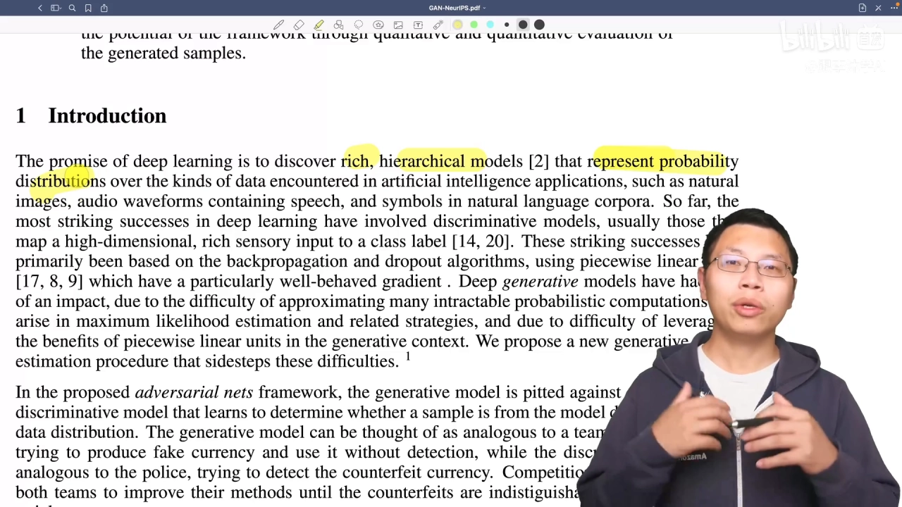
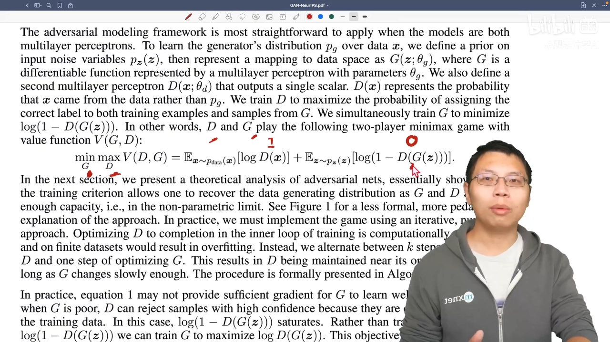
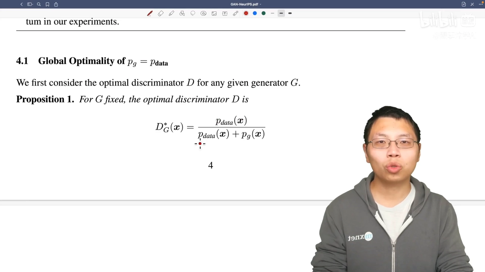
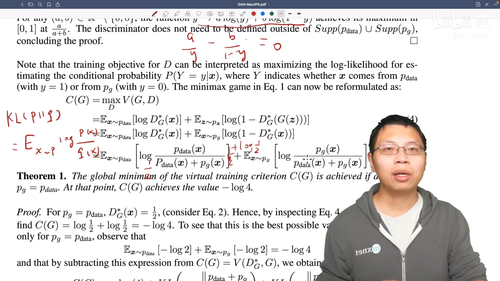
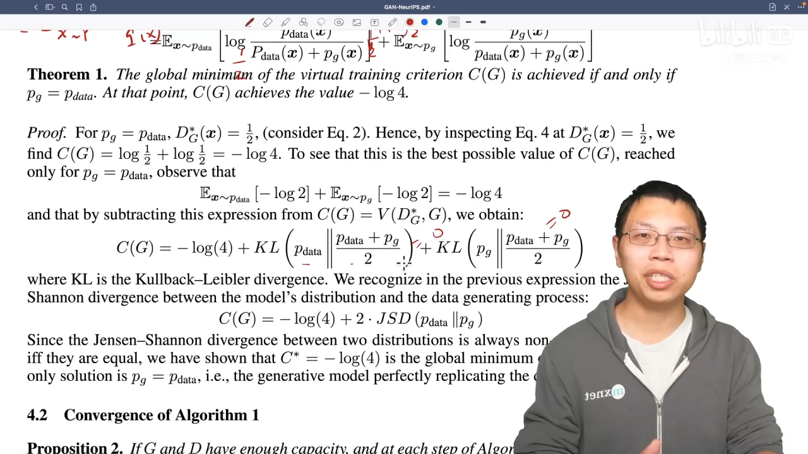
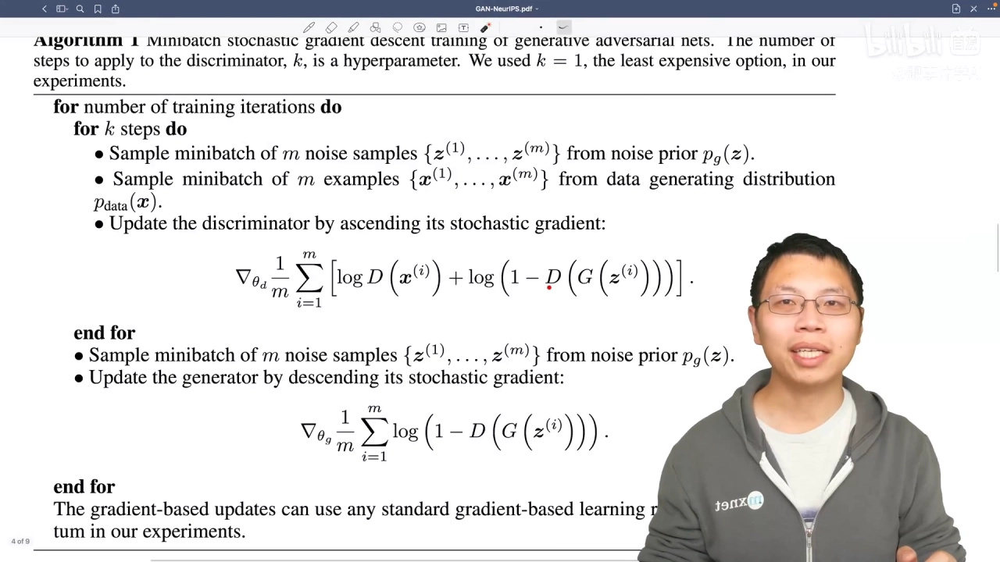
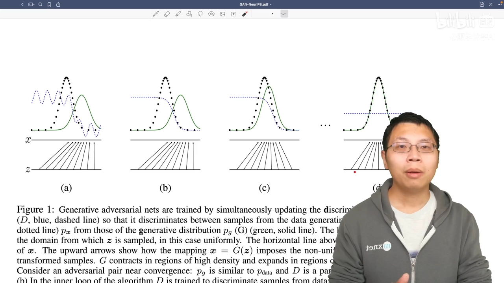
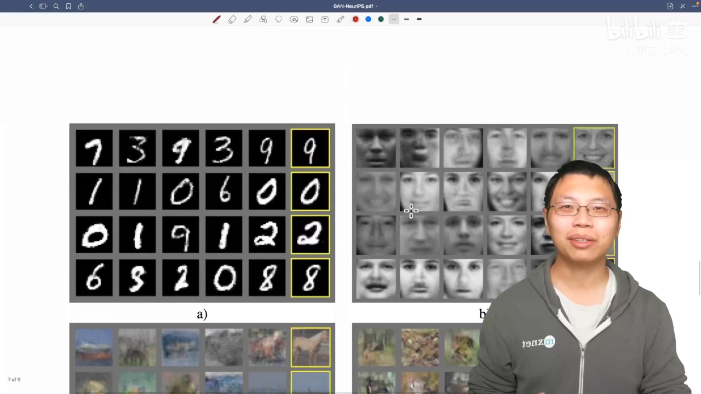

# minimax目标为什么等价于最小化JS散度：GAN论文的目标函数与收敛证明

> 视频来源：[GAN论文逐段精读【论文精读】](https://www.bilibili.com/video/BV1rb4y187vD/)（Bilibili · 跟李沐学AI）｜时长约 46 分钟
> 导读：这篇逐段精读走完 Goodfellow 等人 2014 年的 GAN 原始论文，重点在第 3、4 章：minimax 目标函数怎么写、固定生成器时最优判别器是什么、代回去为什么变成 JS 散度、算法 1 的 k 为什么不能太大也不能太小。本文按「动机 → 目标 → 证明 → 算法 → 结果」重排，术语逐个解释。生成器/判别器的直观框架见同节另一篇（李宏毅 GAN 基本概念）；模式坍塌的完整推导见 [1.1.6](../../../README.md#m04-1-1-6)。

## 本讲要解决的核心问题（SCQA）

**背景**：生成模型的目标是拟合数据分布 $p_{\text{data}}$。传统做法是写出一个带参数的密度 $p_\theta(x)$，然后最大化对数似然。[【跳转到 07:21】](https://www.bilibili.com/video/BV1rb4y187vD/?t=441)

**冲突**：在高维数据上，这条路很难走。要算似然就得对分布做大量近似，而要从学到的分布里采样同样困难；论文导论里把这一点直接点明：深度生成模型进展不多，原因就在于「最大化似然时需要对概率分布做很多近似，这些近似带来巨大的计算困难」。[【跳转到 08:11】](https://www.bilibili.com/video/BV1rb4y187vD/?t=491)

**疑问**：能不能干脆不算似然，换一个计算上更友好的训练信号？

**回答（中心思想）**：可以。训练一个判别器 $D$ 做「真图 vs 生成图」的二分类，用它的判断结果反过来指导生成器 $G$——这就是 **adversarial（对抗）** 的含义。整个框架写成一个 min-max 目标 $V(G,D)$；论文第 4 章证明：固定 $G$ 时最优判别器是 $D^*(x)=\frac{p_{\text{data}}(x)}{p_{\text{data}}(x)+p_g(x)}$，代回目标函数后得到 $C(G)=-\log 4+2\,\mathrm{JSD}(p_{\text{data}}\,\|\,p_g)$。**所以最小化这个对抗目标，就是在最小化生成分布与真实分布之间的 JS 散度**，全局最优解恰好是 $p_g=p_{\text{data}}$。

## 一、论文的出发点：绕开似然

### 1.1 标题里的三个词

标题只有三个词。**Generative**：机器学习模型分两大类，判别模型判断一个数据属于什么类别或预测一个实数值；生成模型要生成数据本身。**Adversarial**：对抗的，指两个网络目标相反。**Nets**：networks 的简写。[【跳转到 01:48】](https://www.bilibili.com/video/BV1rb4y187vD/?t=108)

论文摘要写得极简，几乎可以直接抄进教科书：提出一个新框架，同时训练两个模型——生成模型 $G$ 捕捉数据分布，判别模型 $D$ 估计「一个样本来自训练数据而不是来自 $G$」的概率；$G$ 的训练目标是让 $D$ 犯错的概率最大；这个框架对应一个两人 minimax 博弈；在任意函数空间里存在唯一解，此时 $G$ 恢复出训练数据分布，$D$ 处处等于 $\frac12$。[【跳转到 04:45】](https://www.bilibili.com/video/BV1rb4y187vD/?t=285)

### 1.2 导论：深度学习擅长判别，不擅长生成

导论第一句说，深度学习的承诺是发现丰富的、有层次的模型，这些模型能对 AI 应用里遇到的数据（自然图像、语音波形、自然语言符号）给出**概率分布的表示**。这其实也是 Bengio 一派一直强调的观点：深度学习不只是深度神经网络，神经网络只是手段之一。[【跳转到 07:46】](https://www.bilibili.com/video/BV1rb4y187vD/?t=466)



### 1.3 造假者与警察

论文用了一个流传很广的比喻：生成模型是造假币的人，判别模型是警察。造假者不断提升技术，警察不断提升鉴别能力，最后造假者造出的钱和真币一模一样，警察再也分不出来——这时生成的数据就与真实数据同分布了。[【跳转到 09:06】](https://www.bilibili.com/video/BV1rb4y187vD/?t=546)

## 二、目标函数：一个 min，一个 max

### 2.1 记号

- $p_{\text{data}}$：真实数据分布，只能通过采样接触；
- $z\sim p_z(z)$：噪声先验，通常取 100 维标准高斯；
- $G(z;\theta_g)$：生成器，一个 MLP，把 $z$ 映射到数据空间；
- $D(x;\theta_d)$：判别器，一个 MLP，输出一个标量，表示 $x$ 来自真实数据（而不是 $p_g$）的概率。[【跳转到 16:32】](https://www.bilibili.com/video/BV1rb4y187vD/?t=992)

论文用「4K 游戏画面」举例：一张 4K 图约 800 万像素，每个像素是一个随机变量，所以 $x$ 是 800 万维随机向量，由背后的游戏程序（也就是 $p_g$）控制。想生成这样的图，有两条路：反汇编游戏代码，真正搞清楚分布；或者不管代码，假设背后只有 100 个隐变量在控制人物位置等逻辑，用一个 MLP 强行把 $z$ 映射成看起来一样的 $x$。GAN 走的是第二条路——**代价是看到一张真实图片时，很难反推出它对应的 $z$**。[【跳转到 17:47】](https://www.bilibili.com/video/BV1rb4y187vD/?t=1067)

### 2.2 价值函数 $V(G,D)$

判别器要最大化「把真假分开」的概率，生成器要最小化它。合起来就是论文的式 (1)：

$$
\min_G \max_D V(G,D) = \mathbb{E}_{x\sim p_{\text{data}}}\big[\log D(x)\big] + \mathbb{E}_{z\sim p_z}\big[\log\big(1-D(G(z))\big)\big]
$$



两项的含义可以逐项读：

- 第一项 $\mathbb{E}_{x\sim p_{\text{data}}}\log D(x)$：真实样本，$D$ 输出越接近 1，这一项越接近 0；
- 第二项 $\mathbb{E}_{z}\log(1-D(G(z)))$：生成样本，$D$ 输出越接近 0，这一项越接近 0；
- $D$ 完美时两项都为 0，$D$ 犯错时两项都是负数，所以 $D$ 要 **max**；
- $G$ 只出现在第二项里，它要让 $D(G(z))$ 尽量大，也就是让 $D$ 把假图当真图，所以 $G$ 要 **min**。[【跳转到 21:16】](https://www.bilibili.com/video/BV1rb4y187vD/?t=1276)

一个 min、一个 max，这就是博弈论里的**两人 min-max 游戏**；双方都再也无法单方面改进时，达到**纳什均衡（Nash equilibrium）**。[【跳转到 22:31】](https://www.bilibili.com/video/BV1rb4y187vD/?t=1351)

### 2.3 早期梯度饱和：换成非饱和损失

式 (1) 在实践中有个问题。训练早期 $G$ 很弱，生成图和真图差得远，$D$ 很容易把它们完美分开，于是 $D(G(z))\to 0$、$\log(1-D(G(z)))\to 0$，对 $G$ 的梯度几乎为零，学不动。[【跳转到 28:42】](https://www.bilibili.com/video/BV1rb4y187vD/?t=1722)

论文的建议是：训练 $G$ 时不要最小化 $\log(1-D(G(z)))$，而是**最大化 $\log D(G(z))$**。两者在 $D$ 最优时目标一致，但后者在 $D$ 很小的时候梯度不会饱和。代价是数值上可能出现 $\log 0$，后续工作会再改进。[【跳转到 29:32】](https://www.bilibili.com/video/BV1rb4y187vD/?t=1772)

## 三、最优判别器与 JS 散度

### 3.1 固定 $G$，最优 $D$ 是什么

论文第 4.1 节先固定 $G$，求最优判别器。把期望写成积分：

$$
V(G,D)=\int_x \Big[p_{\text{data}}(x)\log D(x) + p_g(x)\log\big(1-D(x)\big)\Big]\,\mathrm{d}x
$$

对每个 $x$ 单独看，被积函数是 $a\log y + b\log(1-y)$ 的形式（$a=p_{\text{data}}(x)$，$b=p_g(x)$，$y=D(x)$）。它是关于 $y$ 的凸函数，求导令其为零：

$$
\frac{a}{y}-\frac{b}{1-y}=0 \;\Longrightarrow\; y^*=\frac{a}{a+b}
$$

于是得到命题 1：

$$
D^*(x)=\frac{p_{\text{data}}(x)}{p_{\text{data}}(x)+p_g(x)}
$$



这个式子的两个直接推论很有用：它的值一定落在 $[0,1]$；当 $p_g=p_{\text{data}}$ 时，$D^*(x)=\frac12$——**判别器对任何输入都只能瞎猜**。反过来看，如果训练出来的二分类器在两个分布之间只能给出 $\frac12$，就说明两个分布重合了。这正是统计里的 **two-sample test**：与其在高维上找检验统计量，不如直接训练一个分类器看它能不能分开两组样本。工程上常用它检查「新环境的测试数据和训练数据是不是同一个分布」。[【跳转到 31:20】](https://www.bilibili.com/video/BV1rb4y187vD/?t=1880)

### 3.2 代回去：从 KL 到 JS

把 $D^*$ 代回 $V$，得到只与 $G$ 有关的 $C(G)=\max_D V(G,D)$。论文的推导核心是把两项分别凑成 KL 散度：

$$
C(G)=-\log 4 + \mathrm{KL}\!\left(p_{\text{data}}\,\Big\|\, \frac{p_{\text{data}}+p_g}{2}\right) + \mathrm{KL}\!\left(p_g\,\Big\|\, \frac{p_{\text{data}}+p_g}{2}\right)
$$



两个 KL 散度的参照分布都是 $m=\frac{p_{\text{data}}+p_g}{2}$，这正是 **JS 散度（Jensen-Shannon divergence）** 的定义：

$$
\mathrm{JSD}(p\,\|\,q)=\frac12\mathrm{KL}\!\left(p\,\Big\|\, \frac{p+q}{2}\right)+\frac12\mathrm{KL}\!\left(q\,\Big\|\, \frac{p+q}{2}\right)
$$

所以

$$
C(G)=-\log 4 + 2\,\mathrm{JSD}(p_{\text{data}}\,\|\,p_g)
$$



### 3.3 三个结论

1. **全局最小值是 $-\log 4$**：因为 JS 散度恒非负，$C(G)$ 的最小值就是 $-\log 4$；
2. **取到最小值的充要条件是 $p_g=p_{\text{data}}$**：JS 散度只在两个分布相等时为 0；
3. **此时 $D^*=\frac12$**：判别器完全分不开真假，训练目标达成。

这就是「minimax 目标等价于最小化 JS 散度」的完整含义。顺带一个性质对比：**KL 散度不对称**（$p$ 与 $q$ 不能互换），而 **JS 散度对称**，互换两个分布结果不变。有人评价说，正因为 GAN 用的是这个对称散度，训练才相对容易一些；后续工作则尝试换更好的目标函数。[【跳转到 39:04】](https://www.bilibili.com/video/BV1rb4y187vD/?t=2344)

## 四、算法 1：为什么要交替，$k$ 为什么不能太大也不能太小

### 4.1 算法流程

论文的算法 1 是一个双层循环：

```
for 训练迭代次数 do
    for k 步 do
        采样 m 个噪声样本 {z^(1), ..., z^(m)} ~ p_z
        采样 m 个真实样本 {x^(1), ..., x^(m)} ~ p_data
        对判别器做梯度上升：
            ∇_θd (1/m) Σ [ log D(x^(i)) + log(1 - D(G(z^(i)))) ]
    end for
    采样 m 个噪声样本 {z^(1), ..., z^(m)} ~ p_z
    对生成器做梯度下降：
        ∇_θg (1/m) Σ log(1 - D(G(z^(i))))
end for
```



注意生成器那一步只算第二项——第一项里根本没有 $G$。[【跳转到 25:58】](https://www.bilibili.com/video/BV1rb4y187vD/?t=1558)

### 4.2 $k$ 的取舍

$k$ 是判别器每次迭代更新多少步。它不能太小，也不能太大：

- **太小**：生成器已经变了，判别器却没跟上，用旧的 $D$ 去指导新的 $G$，意义不大；
- **太大**：$D$ 被训练到完美，第二项变成 0，对 0 求导，$G$ 就学不动了。

用警察与造假者比喻：警察太强，造假者一出手就被连锅端，没动力改进工艺；警察太弱，造假者随便造也能过关，同样没动力。最好是两方实力相当、相爱相杀。[【跳转到 27:38】](https://www.bilibili.com/video/BV1rb4y187vD/?t=1658)

### 4.3 收敛判断为什么难

这里有两个模型、两个方向相反的目标：一个往上走，一个往下走。「一方不动、另一方还在动」算不算收敛？「两方都在抖动」算不算收敛？都不好说。所以 GAN 的收敛在实践中非常不稳定，这也是后续大量改进工作的起点。[【跳转到 28:28】](https://www.bilibili.com/video/BV1rb4y187vD/?t=1708)

论文的命题 2 声称算法 1 能收敛到 $p_g=p_{\text{data}}$，但它依赖两个理想假设：$G$、$D$ 有足够容量，且每一步都把 $D$ 优化到最优。实际算法只迭代了 $k$ 步，所以这个证明并不能直接保证算法 1 有效——用李沐的话说，论文把坑留给了后面的人。[【跳转到 41:34】](https://www.bilibili.com/video/BV1rb4y187vD/?t=2494)

## 五、图 1 的几何直觉：一步一步把绿线推到黑点上

论文图 1 用一维例子说明训练过程：$z$ 从均匀分布采样，真实数据 $x$ 近似高斯（黑点），生成分布 $p_g$ 是绿线，判别器 $D$ 是蓝色虚线。



逐阶段看：

1. **初始**：绿线（生成分布）与黑点（真实分布）错开，$D$ 学得一般；
2. **更新 $D$**：$D$ 在真实数据密集处输出接近 1、在生成数据密集处输出接近 0，把两者分开；
3. **更新 $G$**：把绿线峰值往 $D$ 打高分的方向挪一点，$D$ 就被骗了一部分；
4. **收敛**：绿线与黑点重合，$D$ 对任何值都输出 $0.5$，再也分不出来。[【跳转到 24:49】](https://www.bilibili.com/video/BV1rb4y187vD/?t=1489)

## 六、结果、优缺点与后续

论文的实验按今天的标准看相当粗糙：MNIST 数字还像样，人脸和其他数据集分辨率很低，要试很多次才能挑出几张能看的。但在当时已经足够震撼——「像电视刚出来时，分辨率很低，大家还是很惊讶」。[【跳转到 42:19】](https://www.bilibili.com/video/BV1rb4y187vD/?t=2539)



论文自己总结的优缺点也很直接：

- **缺点**：训练难，$G$ 与 $D$ 必须均衡，不均衡时生成的图惨不忍睹；
- **优点（论文的说法）**：生成器没有直接去拟合真实样本的像素特征，因此能生成比较锐利的边缘——不过李沐指出，这个说法后来被发现并不完全成立。[【跳转到 43:00】](https://www.bilibili.com/video/BV1rb4y187vD/?t=2580)

future work 里列了很多方向，第一个就是 **conditional GAN**：现在的生成完全不受控，随便给个 $z$ 看运气出图，理想情况是能指定想要生成什么。这篇文章之后出现了几万份改进与应用工作，本文不展开变体。[【跳转到 43:20】](https://www.bilibili.com/video/BV1rb4y187vD/?t=2600)

至于模式坍塌——生成器只覆盖真实分布的少数模式——它是这套目标的结构性后果，本系列 [1.1.6](../../../README.md#m04-1-1-6) 已从 JS 散度与反向 KL 完整推导，这里只做回指。

## 七、顺带一提：这篇论文的写法

李沐在精读里反复强调这篇论文的写作值得学：摘要极简、只讲「GAN 是什么」；导论很短，先讲自己为什么做这件事，再讲 GAN 在干什么；第 3 章给目标函数与优化方法，第 4 章给两个理论结果（最优解存在且唯一、算法能收敛），第 5 章实验，最后是 future work。这种「我提出了一个全新的东西」的写法，前提是你确信它能写进教科书；如果工作是在别人基础上改进，就必须花篇幅讲清区别与贡献。[【跳转到 43:43】](https://www.bilibili.com/video/BV1rb4y187vD/?t=2623)

另外两个值得一提的细节：论文正文其实没有出现「GAN」这个缩写，名字是后来的人加的；相关工作里关于 predictability minimization（Jürgen Schmidhuber 1992 年的工作）的那段长讨论，源于审稿争议——对方认为 GAN 只是把 PM 的某个模块反过来。李沐的评论是：一个真正有用的技术常会在不同领域被重新发现，功劳往往归于「教会大家这个算法的人」。[【跳转到 14:54】](https://www.bilibili.com/video/BV1rb4y187vD/?t=894)

从更一般的角度看，GAN 还留下两点影响：它是无监督的（不需要人工标号），但它用**有监督的损失函数**（真假二分类）来做无监督学习——标号来自「样本是采来的还是生成的」，这被视为后来自监督学习（如 BERT）的一个灵感来源。[【跳转到 45:23】](https://www.bilibili.com/video/BV1rb4y187vD/?t=2723)

## 小结

- GAN 的动机是绕开难算的似然：用判别器的二分类信号代替似然，作为生成器的训练目标。
- 目标函数是 $\min_G\max_D V(G,D)$，两项分别对应真图打高分、假图打低分。
- 固定 $G$ 时最优判别器 $D^*(x)=\frac{p_{\text{data}}}{p_{\text{data}}+p_g}$；代回后 $C(G)=-\log 4+2\,\mathrm{JSD}(p_{\text{data}}\,\|\,p_g)$，所以最小化对抗目标就是最小化 JS 散度。
- 全局最优值 $-\log 4$，当且仅当 $p_g=p_{\text{data}}$ 时取到，此时 $D^*=\frac12$（可用作 two-sample test）。
- 算法 1 交替更新：内层 $k$ 步更新 $D$，再一步更新 $G$；$k$ 要保证两者进度相当，收敛判断困难。
- 理论证明依赖「$D$ 每步都最优」的理想假设，实践中并不成立，这是后续改进工作的起点。

## 关键术语速查

| 术语 | 一句话解释 |
| --- | --- |
| $p_{\text{data}}$ / $p_g$ | 真实数据分布 / 生成器隐含的分布，两者都只能采样、写不出密度 |
| $V(G,D)$ | 对抗训练的价值函数，两个期望项之和 |
| minimax | 一方最小化、一方最大化的两人博弈形式 |
| 纳什均衡 | 双方都无法单方面改进的状态，对应 $p_g=p_{\text{data}}$、$D=\frac12$ |
| JS 散度 | 对称的分布差异度量，等于两个 KL 散度（参照分布为两者平均）的平均 |
| 非饱和损失 | 训练 $G$ 时改用最大化 $\log D(G(z))$，避免早期梯度消失 |
| $k$ | 每轮迭代中判别器更新的步数，控制两者实力平衡 |
| two-sample test | 用二分类器能否分开两组样本，判断它们是否来自同一分布 |
| 隐式分布 | 能采样但写不出密度的模型，GAN 的生成器属于这一类 |