# 生成器与判别器如何互相推动：GAN 的基本框架与交替训练

> 视频来源：[第14讲：生成式对抗网络 GAN（一）基本概念介绍-李宏毅2021《机器学习》](https://www.bilibili.com/video/BV1GQW9zDELG/)（Bilibili · 搬运自李宏毅 2021 春季机器学习课程）｜时长约 39 分钟
> 导读：这是 GAN 的第一堂课，讲的是「为什么生成任务要输出一个分布」「生成器和判别器各自做什么」「两者怎样交替训练」。本文只覆盖这一课的基本框架，minimax 目标函数的数学推导与 JS 散度留给同节另一篇（李沐 GAN 论文精读）；DCGAN、WGAN、StyleGAN 等变体不在本文范围。

## 本讲要解决的核心问题（SCQA）

**背景**：到目前为止，我们学到的 network 都是一个 function：给它一个 $x$，它输出一个 $y$。这个 $y$ 可以是数值、类别，也可以是序列；输入可以是图片，也可以是序列。这套框架已经能涵盖多数日常问题。[【跳转到 00:13】](https://www.bilibili.com/video/BV1GQW9zDELG/?t=13)

**冲突**：但有些任务天生是**多解**的。比如给机器一段游戏画面，让它预测下一帧：同一个转角，玩的人可能向左转，也可能向右转，两种都是对的。如果用我们熟悉的监督学习去训练一个「一个输入一个输出」的网络，网络会两边讨好，最后给出一个既不完全向左、也不完全向右的结果——画面糊掉，甚至小精灵会分裂成两只。[【跳转到 05:42】](https://www.bilibili.com/video/BV1GQW9zDELG/?t=342)

**疑问**：既然「一个输入一个输出」装不下多解性，那网络应该输出什么？输出变成分布以后，又该用什么目标去训练它？

**回答（中心思想）**：让网络额外吃一个随机向量 $z$，输出就从一个点变成一整个分布，这样的网络叫 **generator**。而训练 generator 的办法不是去和标准答案比距离，而是再训练一个 **discriminator** 来给「像不像真的」打分，让 generator 去骗过它。两个网络交替训练、互相推动，这就是 **GAN（Generative Adversarial Network，生成式对抗网络）** 的基本框架。

## 一、生成任务要的不是一个答案，而是一个分布

### 1.1 一个输入一个输出，装不下多解

李宏毅用 **video prediction（视频预测）** 做例子：给机器《精灵宝可梦》过去几帧的游戏画面，让它输出下一帧画面。训练资料很好收集——不断录制有人在玩游戏的画面就行，给定过去几帧，下一帧是什么，资料里都有。[【跳转到 04:52】](https://www.bilibili.com/video/BV1GQW9zDELG/?t=292)

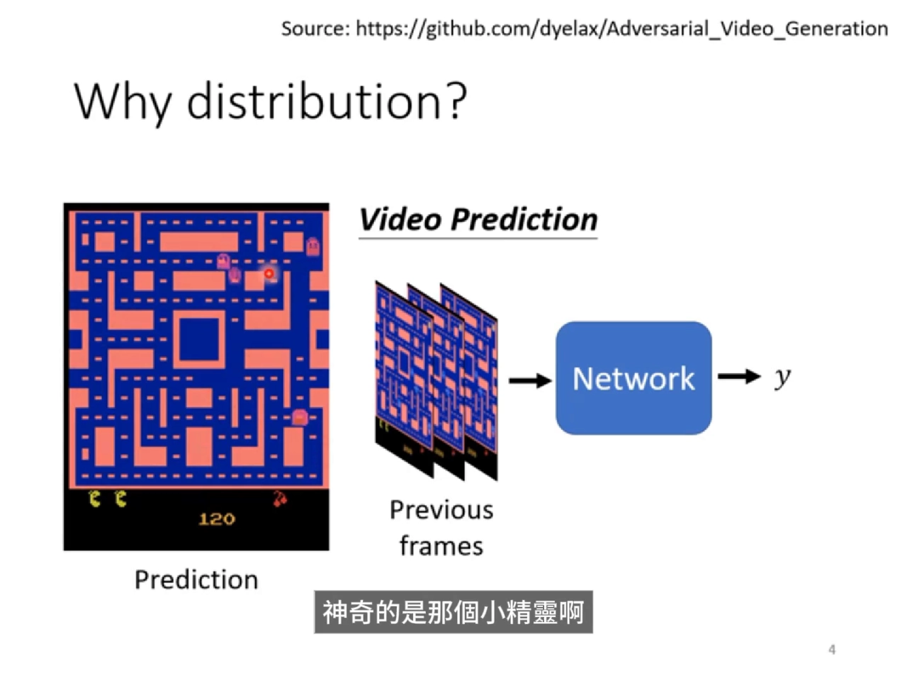

用监督学习训练下去，结果却很怪：画面模模糊糊，角色会变，小精灵走到转角会分裂成两只，有时候还会消失。原因不在网络不够大，而在**目标本身**：训练资料里同一个转角既有向左转的样本，也有向右转的样本，网络被要求同时靠近这两个答案，数学上最优的解就是它们的「平均」——一个既左又右、实际上不成立的画面。[【跳转到 06:57】](https://www.bilibili.com/video/BV1GQW9zDELG/?t=417)

### 1.2 加一个随机输入 $z$，输出就从点变成分布

解决办法是给网络多加一个输入：一个从**简单分布**里采样出来的随机向量 $z$。所谓「简单」，意思是它的公式你写得出来、你也知道怎么从它采样，比如高斯分布（normal distribution）或均匀分布（uniform distribution）。$z$ 的形状由你自己定，但必须够简单。[【跳转到 01:53】](https://www.bilibili.com/video/BV1GQW9zDELG/?t=113)

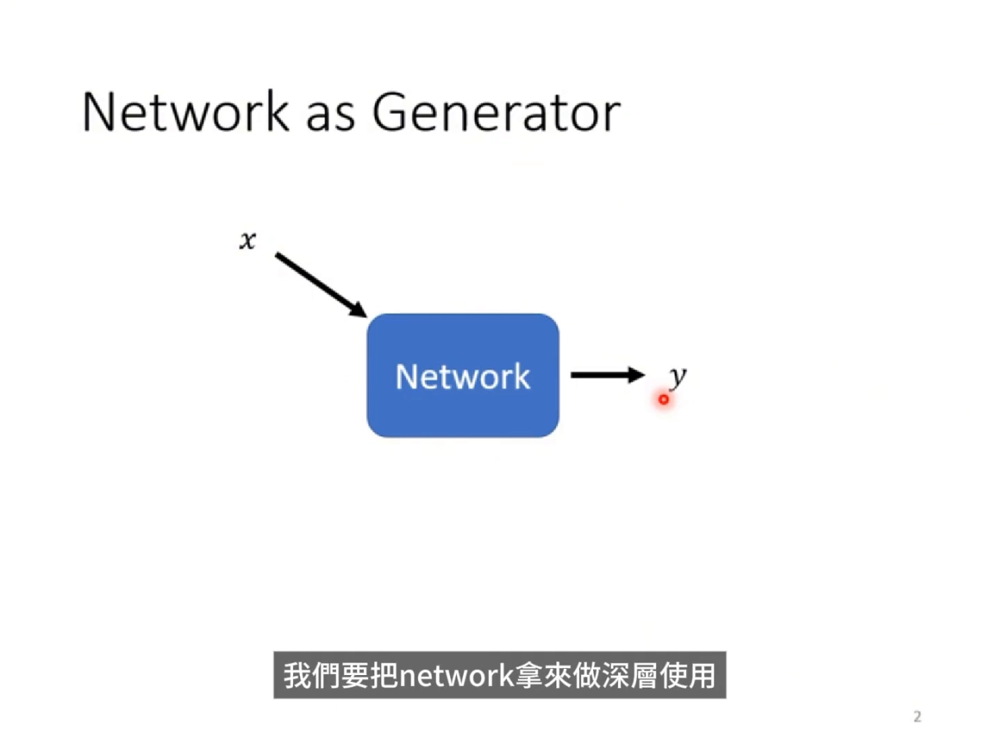

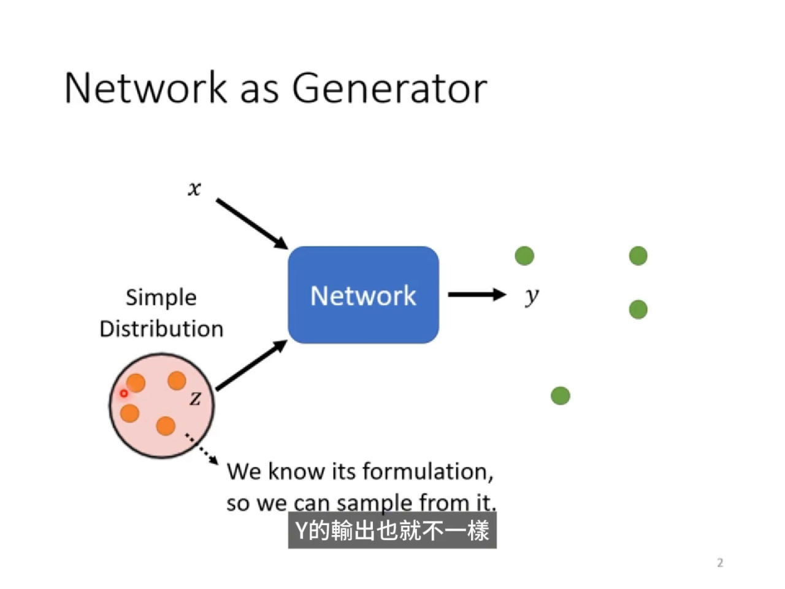

$x$ 和 $z$ 怎么同时进入网络？做法很自由：两个向量直接拼接成一个更长的向量，或者长度相同时直接相加，都可以。[【跳转到 01:28】](https://www.bilibili.com/video/BV1GQW9zDELG/?t=88) 关键在于**每次使用网络时 $z$ 都重新采样**，所以同样的 $x$ 每次得到的 $y$ 都不一样，$y$ 的取值集合就构成了一个分布。这种「能够输出一个分布」的网络，就叫 **generator（生成器）**。

举一个具体的小例子：如果 $z$ 是一个二元随机变量（只有 0 和 1，各占 50%），网络完全可以学到「$z=1$ 时向左转、$z=0$ 时向右转」，于是向左和向右两种可能都被覆盖，而不是被平均掉。[【跳转到 08:12】](https://www.bilibili.com/video/BV1GQW9zDELG/?t=492)

### 1.3 什么时候真的需要分布

需要「一点创造力」的任务就需要分布。更具体的说法是：我们要找一个 function，但同样的输入有多种可能的输出，而且这些输出都是对的。画一个红眼睛的角色，每个人心里想的都不一样；问一句「辉夜是谁」，答案也可以有很多种。这类任务里，输出一个分布才是正确的建模方式。[【跳转到 08:53】](https://www.bilibili.com/video/BV1GQW9zDELG/?t=533)

## 二、GAN 的两个网络：一个造假，一个鉴定

### 2.1 Generator：从低维 $z$ 生成高维样本

以二次元人脸生成为例。$z$ 通常是一个低维向量（50 维、100 维都行，由你决定），从高斯分布采样。generator 要做的事情其实没那么神秘：一张 $64\times 64$ 的彩色图片就是一个 $64\times 64\times 3$ 维的向量，所以 generator 就是产生一个非常高维的向量，整理一下就是一张人脸。[【跳转到 15:00】](https://www.bilibili.com/video/BV1GQW9zDELG/?t=900)

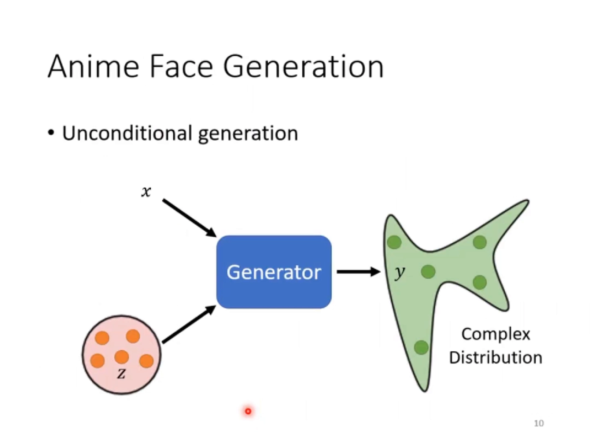

这里用的是 **unconditional generation（无条件生成）**：先把条件 $x$ 拿掉，generator 只吃 $z$、只输出 $y$。条件生成是后面的话题。[【跳转到 13:45】](https://www.bilibili.com/video/BV1GQW9zDELG/?t=825)

### 2.2 Discriminator：一张图进，一个分数出

GAN 和普通生成模型不同的地方，是要多训练一个 **discriminator（判别器）**。它也是一个 neural network，输入一张图片，输出一个标量分数：**分数越大代表越像真的**。[【跳转到 16:33】](https://www.bilibili.com/video/BV1GQW9zDELG/?t=993)

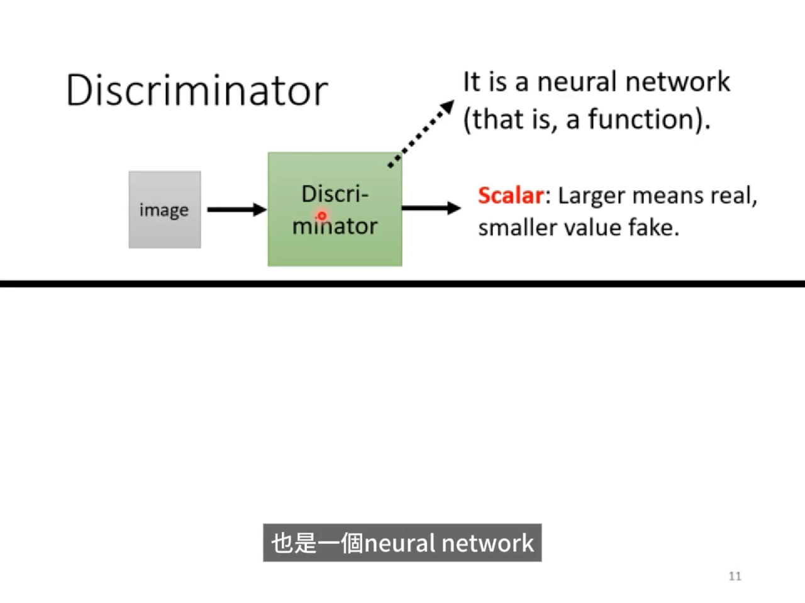

两个网络的架构完全由你设计：generator 是网络，discriminator 也是网络，用 CNN、用 Transformer 都可以，只要能产生你要的输入输出。图像任务里 discriminator 通常会大量使用 CNN，因为卷积在处理影像上有天然优势。[【跳转到 17:23】](https://www.bilibili.com/video/BV1GQW9zDELG/?t=1043)

### 2.3 为什么多一个判别器：枯叶蝶与天敌的演化

李宏毅用生物拟态讲直觉。枯叶蝶长得像枯叶，是为了躲开天敌波波——波波只吃彩色的东西，看到棕色的就以为是枯叶。但波波也会演化，进化成比比鸟后开始看纹路：没有叶脉的是蝴蝶，有叶脉的才是真枯叶。压力之下，枯叶蝶又演化出叶脉。再往后，比比鸟进化成大比鸟，鉴别能力更强。[【跳转到 19:26】](https://www.bilibili.com/video/BV1GQW9zDELG/?t=1166)

对应到 GAN：**枯叶蝶是 generator，天敌是 discriminator**。generator 不需要一开始就知道「人脸该长什么样」，它只需要不断躲开 discriminator 的判据；而 discriminator 每识破一个破绽，就逼 generator 补上一个新的细节。

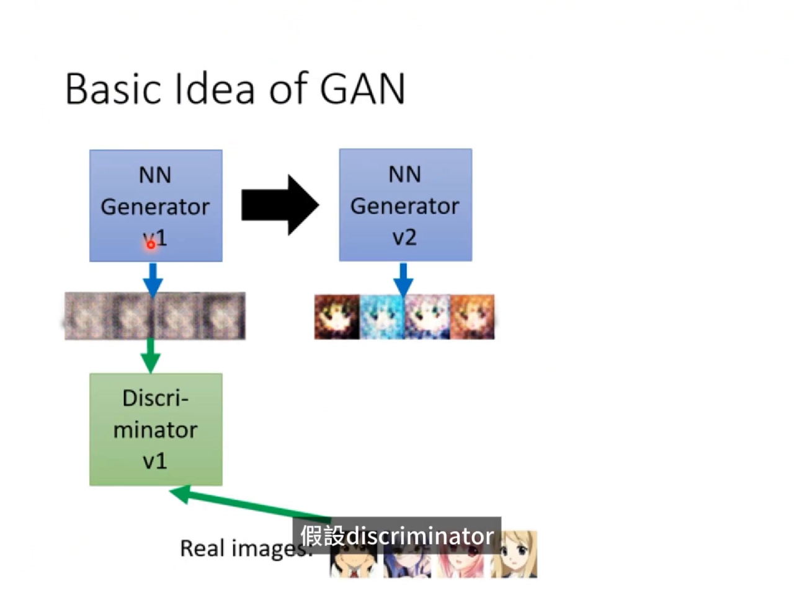

这个演化过程可以逐代看：第一代 generator 参数完全是随机的，输出是一堆杂讯；第一代 discriminator 只要看「有没有两个黑黑的圆球（眼睛）」就能分辨真假；于是第二代 generator 学会画眼睛。第二代 discriminator 发现生成的图都没有头发、没有嘴巴，第三代 generator 就把嘴巴加上去……discriminator 越来越严苛，generator 的图就越来越像二次元人物。[【跳转到 22:04】](https://www.bilibili.com/video/BV1GQW9zDELG/?t=1324)

顺带一提，原始论文把两者写成敌人（造假钞的人 vs 警察），但「对抗」只是拟人化的说法，它们其实是亦敌亦友的合作关系。[【跳转到 22:54】](https://www.bilibili.com/video/BV1GQW9zDELG/?t=1374)

## 三、交替训练：固定一个，更新另一个

### 3.1 Step 1：固定 generator，训练 discriminator

训练开始前先初始化两个网络的参数。第一步是**定住 generator，只训练 discriminator**。此时 generator 参数还是随机的，丢一堆 $z$ 进去，吐出来的就是电视机坏掉那种杂讯，跟正常二次元人物完全不像。[【跳转到 24:23】](https://www.bilibili.com/video/BV1GQW9zDELG/?t=1463)

然后从真实图库里采样一批二次元头像，和 generator 生成的图混在一起，训练 discriminator 分辨两者。具体做法可以是分类：真图标 1、生成图标 0，训练一个二分类器；也可以当回归做，让真图输出 1、假图输出 0。[【跳转到 26:03】](https://www.bilibili.com/video/BV1GQW9zDELG/?t=1563)

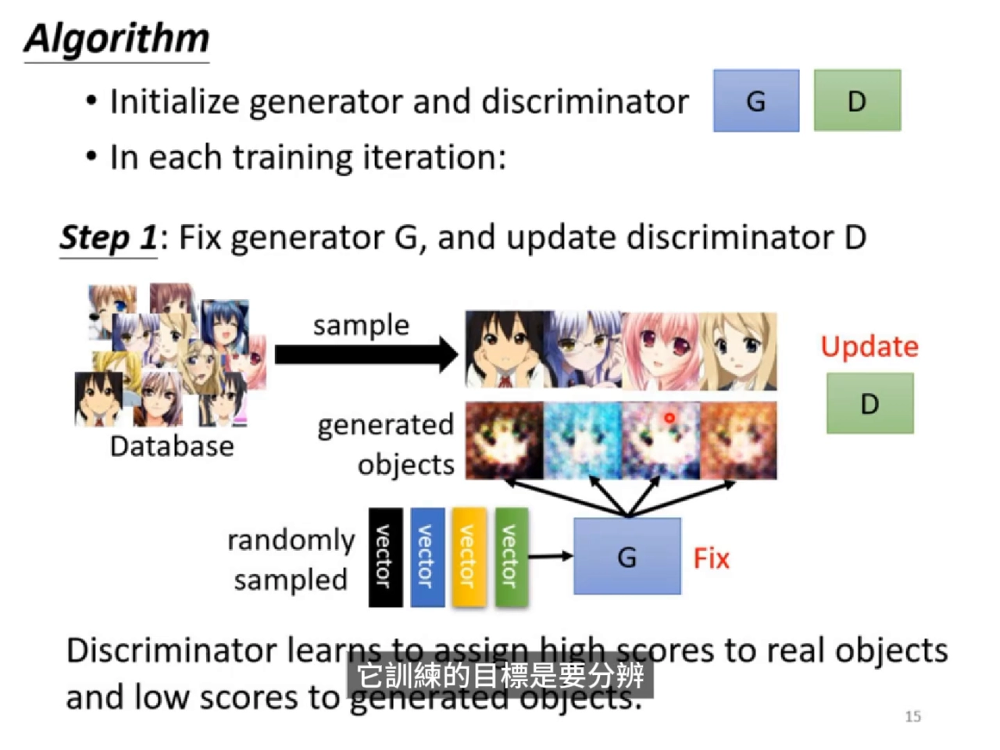

### 3.2 Step 2：固定 discriminator，训练 generator

第二步反过来：定住 discriminator，只更新 generator，目标是**骗过 discriminator**，也就是让 discriminator 给自己的图打高分。[【跳转到 26:44】](https://www.bilibili.com/video/BV1GQW9zDELG/?t=1604)

实现上有一个很直观的技巧：把 generator 和 discriminator 直接接成**一个更大的网络**。比如 generator 五层、discriminator 五层，接起来就是十层；其中某一层的输出维度正好等于「像素数 $\times 3$」，把它 reshape 一下就是一张图片。整个大网络吃一个 $z$、输出一个分数，我们只调整属于 generator 的那几层参数，让分数越大越好。[【跳转到 28:24】](https://www.bilibili.com/video/BV1GQW9zDELG/?t=1704)

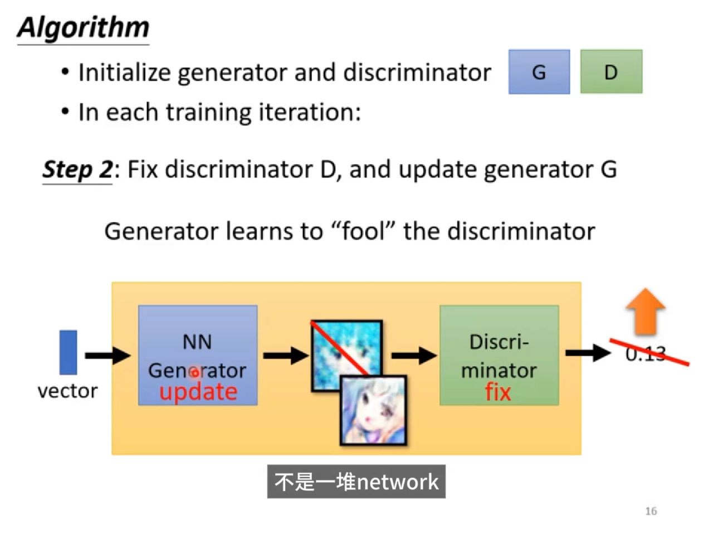

**为什么 discriminator 的参数不能动？** 因为如果允许调最后几层，这个游戏立刻就被 hack 了：直接把输出层那个神经元的 bias 设成 1000 万，分数当然要多大有多大，但生成器什么也没学到。[【跳转到 29:14】](https://www.bilibili.com/video/BV1GQW9zDELG/?t=1754)

至于怎么调 generator，方法跟训练普通网络没有区别：定一个目标（discriminator 的输出取负号就是 loss），用 gradient descent 让 loss 变小；或者直接用 gradient ascent 让 discriminator 的输出变大，两件事等价。[【跳转到 30:29】](https://www.bilibili.com/video/BV1GQW9zDELG/?t=1829)

### 3.3 反复循环

两个步骤合起来就是一次迭代：训练一阵子 discriminator，再训练一阵子 generator，然后用新的 generator 生成新的图片给 discriminator 练，如此往复。当其中一者在训练时，另一者固定不动。[【跳转到 31:12】](https://www.bilibili.com/video/BV1GQW9zDELG/?t=1872)

后面的课程会说明，这个循环写成数学就是一个 min-max 目标；这里只需要记住它的工程形态：**两个网络、两个目标、交替更新**。

## 四、训练起来是什么样子

李宏毅展示了自己 2017 年训练二次元人脸的过程，横轴是 generator 被更新的次数：

- **100 次**：完全是杂讯，看不出在做什么；
- **1000 次**：出现了两个眼睛；
- **2000 次**：嘴巴出来了；
- **5000 次**：已经有人脸的样子，而且机器自己学到「动画人物要有水汪汪的大眼睛」，眼睛都画得很大、带反白；
- **1 万次**：形状出来了，但整体模糊，像水彩画；
- **2 万次、5 万次**：越来越清楚，他停在 5 万次。[【跳转到 32:24】](https://www.bilibili.com/video/BV1GQW9zDELG/?t=1944)

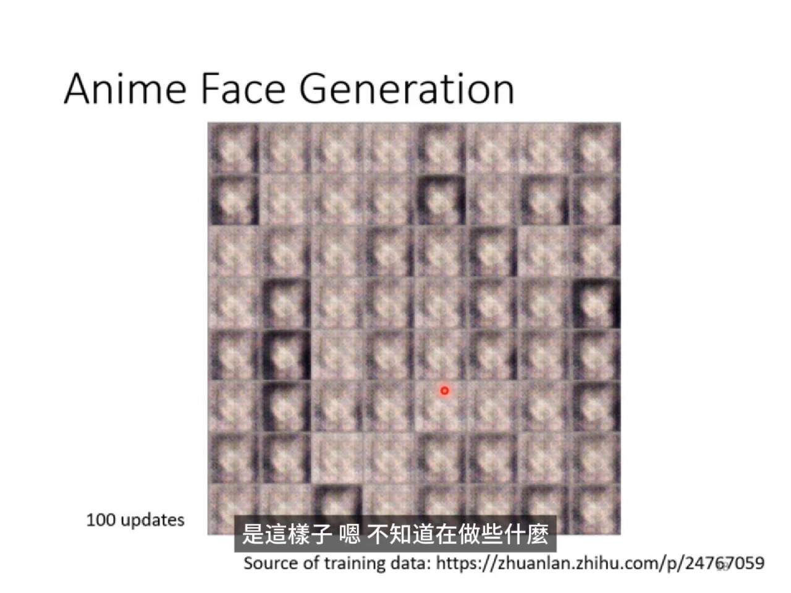

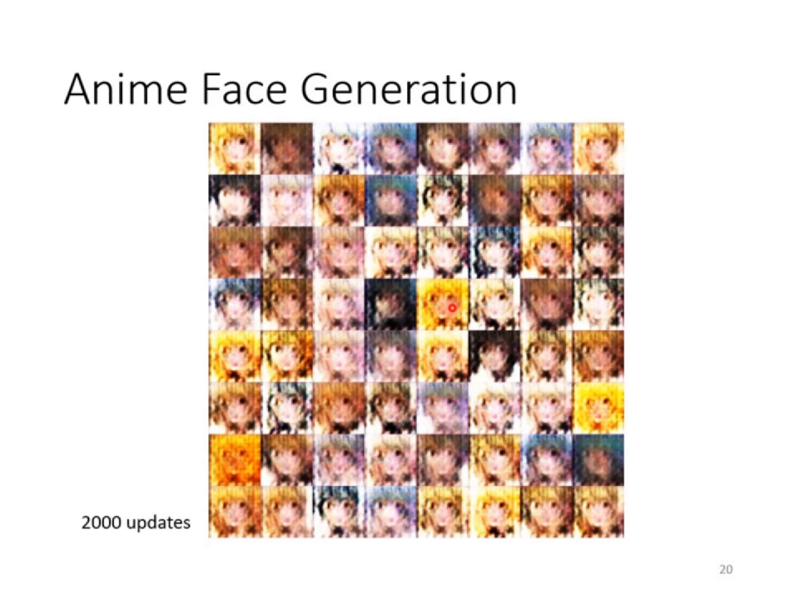

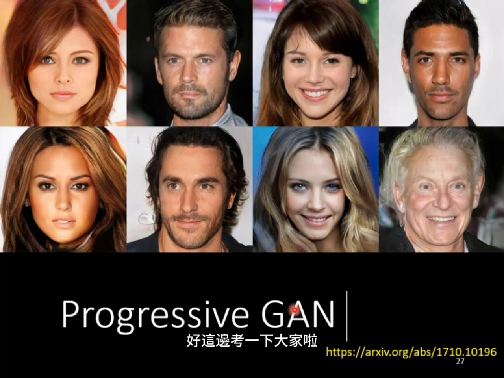

除了生成新样本，GAN 还有一个很有意思的性质：**对输入向量做内插（interpolation）**，输出会连续变化。把「往左看的人」和「往右看的人」的 $z$ 做线性内插，得到的不是两张脸叠在一起的双面人，而是逐渐转向正面的脸——训练时从没告诉过机器这件事，它自己学到了「左」和「右」之间的连续结构。[【跳转到 36:52】](https://www.bilibili.com/video/BV1GQW9zDELG/?t=2212)

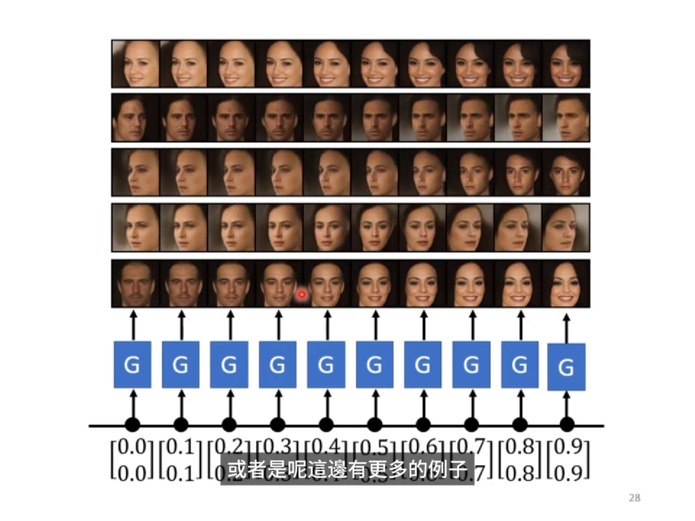

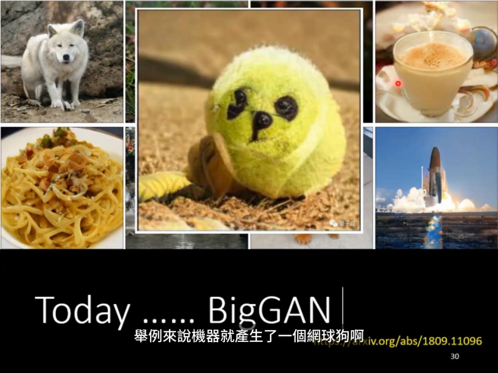

## 五、这条路线换来了什么，又付出了什么

把 GAN 放到「生成路线」这张地图上看，它的取舍很清楚。

**换来的：不需要显式似然。** generator 只负责「把 $z$ 变成样本」，从来不计算 $p(x)$；discriminator 提供的分数代替了似然，成为训练信号。这就是所谓**隐式分布（implicit distribution）**：你能采样，但写不出密度。好处是绕开了归一化常数和复杂积分，坏处是你也没法直接评估某个样本的概率。

**付出的：难以反推 $z$，训练也不稳。** 因为 generator 不是真的理解数据背后的生成程序，看到一张真实图片时，很难找到它对应的 $z$；只能反过来「随机给一个 $z$，看手气生成一张还像样的图」。另外两个网络必须实力相当才能一起进步，一方太强都会让训练停摆，收敛判断也不容易——这部分在论文精读那篇里会展开。[【跳转到 18:12】](https://www.bilibili.com/video/BV1GQW9zDELG/?t=1092)

还有一类更隐蔽的失败：generator 只学会生成少数几类样本，其余模式全丢掉，也就是**模式坍塌（mode collapse）**。它为什么是这套目标的必然后果，本系列 [1.1.6 多解性、不确定性与模式覆盖](../../../README.md#m04-1-1-6) 已有专文从 JS 散度与反向 KL 推导，这里不再重复。

## 小结

- 生成任务的核心困难是多解：一个输入对应多个正确输出，用「一个输出 + 平方误差」训练只会得到模糊的平均。
- 给网络加一个从简单分布采样的 $z$，输出就从点变成分布；这样的网络叫 generator。
- GAN 多训练一个 discriminator，它给「像不像真的」打分；generator 的目标是骗过它。
- 训练是交替的：固定 G 训 D（真假二分类），固定 D 训 G（把 G、D 接成一个大网络，只更新 G）；反复循环。
- 演化类比解释了为什么「多一个判别器」有用：判别器每识破一个破绽，就逼生成器补上一个细节。
- GAN 是隐式分布路线：能采样、不能算似然；代价是难以反推 $z$、训练不稳定、可能模式坍塌。

## 关键术语速查

| 术语 | 一句话解释 |
| --- | --- |
| generator（生成器） | 吃一个随机向量 $z$，输出一个样本的网络；输出随 $z$ 变化，因此代表一个分布 |
| discriminator（判别器） | 吃一个样本，输出一个标量分数；分数越大越像真实数据 |
| $z$ | 从简单分布（如标准高斯）采样的隐变量，维度自定，通常 50–100 维 |
| unconditional generation | 只由 $z$ 决定输出，不附加条件 $x$ |
| 隐式分布 | 模型能采样但写不出密度函数，GAN 属于这一类 |
| mode collapse（模式坍塌） | 生成器只覆盖真实分布的少数几个模式，其余全部丢弃 |
| adversarial | 「对抗的」，指两个网络目标相反、互相推动，只是拟人化说法 |