# 掩码扩散就是随机顺序的自回归：似然分解、并行采样与误差的统一视角

> 视频来源：[【Frontier】扩散模型和自回归的本质区别以及联系起来的桥梁](https://www.bilibili.com/video/BV1i3t56uEE7/)（Bilibili · 至高机器智能，约 45 分钟）
> 导读：这是 Stefano Ermon 在 Simons Institute 的一场学术报告，用掩码扩散模型（masked diffusion）作桥梁，证明"并行生成"与"感知质量"这两条被当作扩散专属的特性其实并不根本：连续时间下掩码扩散等价于随机顺序自回归，并行采样只是离散化的产物，而感知质量差距可以用损失加权补上。报告后半段转向"学习顺序 + 插入"以超越两条路线。字幕由 AI 生成、术语错拼较多（掩码扩散被识别成"质量扩散/大规模扩散"、ELBO 被识别成"肘部"、BERT 被识别成"鸟类"），本文已按上下文订正。

## 本讲要解决的核心问题（SCQA）

**背景**：生成式 AI 的产业叙事习惯把模型分成两大范式。自回归模型是各类最先进成果的核心（尤其是大语言模型），通常与**序列计算**和**压缩（似然）**联系在一起；扩散模型驱动了几乎所有图像与视频产品，通常与**并行生成**和**更强的感知质量**联系在一起。

**冲突**：这套分工被当成了模型的本质属性——"自回归只能一个一个吐 token，所以慢；扩散画质好，所以图像必须用扩散"。但如果这些特性只是实现细节的副产品，那所谓"两条路线之争"就站不住脚。

**疑问**：究竟是什么真正区分了自回归与扩散？并行生成和感知质量是扩散模型的内在优势吗？

**回答（中心思想）**：都不是本质区别。把掩码扩散模型放到连续时间下看，它的逆过程就是一个**随机顺序的自回归模型**——所有元素按一个从均匀分布中抽出的顺序逐个解码。由此得到两个结论：第一，**并行采样只是离散化的产物**，它利用的是"随着已生成元素变多、剩余元素的预测性变强"这一事实；第二，**感知质量的差距可以用损失加权补上**，把连续扩散里成熟的加权技巧映射到掩码扩散的 ELBO 上，画质差距基本闭合。真正值得追求的不是"选哪条路线"，而是**超越固定顺序与随机顺序，去学习生成顺序**。

## 一、被当作分界线的两条特性

报告开头就给出一张维恩图：左边是自回归（AR），右边是扩散（Diffusion），中间的交集写着"掩码扩散 / 随机顺序自回归"。

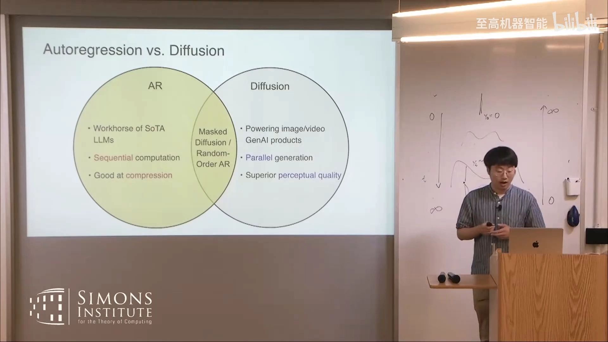

- **自回归一侧**：SoTA 大语言模型的主力、序列计算、擅长压缩（即擅长给出高似然）。
- **扩散一侧**：驱动图像/视频生成产品、并行生成、更优的感知质量。
- **交集**：掩码扩散模型，也叫随机顺序自回归模型。

整场报告[【跳转到 01:26】](https://www.bilibili.com/video/BV1i3t56uEE7/?t=86)就是在证明：**交集里的这个模型同时具备两侧的特性**，因此"并行"和"画质"并不是扩散模型的专利。

## 二、掩码扩散：把"抹掉"当作加噪

### 2.1 前向过程：逐步替换成 mask

掩码扩散（也叫吸收扩散，absorbing diffusion）最早由 Austin 等人在 2021 年提出[【跳转到 02:16】](https://www.bilibili.com/video/BV1i3t56uEE7/?t=136)。核心思想很朴素：假设我们有一组离散元素（例如一段文本），然后逐步把部分元素替换成一个特殊的 mask 标记。

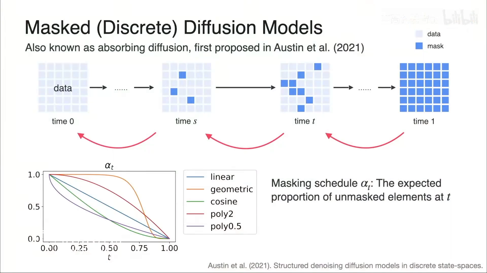

整个过程由一个调度 $\alpha_t$ 控制：$\alpha_t$ 是时间 $t$ 时**未被掩码元素的期望比例**。$t=0$ 时全是数据，$t=1$ 时全是 mask。图上还画了线性、几何、余弦、poly2、poly0.5 几种常见的调度曲线——它们形状不同，后面会看到这个形状直接决定采样行为。

### 2.2 反向过程：一个非常简单的二元逻辑

扩散模型的核心是"引入加噪过程，再通过逆向过程构建生成模型"，也就是把 mask 还原成实际数据。报告里（基于他们 2024 年的 MD4 论文）给出一个关键简化：转向连续时间后，当 $s$ 趋近 $t$ 时，逆向分布 $q(x_s \mid x_t)$ 有一个非常简单的形式。

它首先**跨所有维度分解**，因此可以独立处理每个元素：

- 如果该元素是 mask 标记：以概率 $\alpha(s)/\alpha(t)$ 被解码，以剩余概率保持 mask 状态。这是一个非常简单的二元逻辑。
- 如果该标记已被解码：按最优去噪分布 $p(x_0 \mid x_t)$ 为它赋值。注意只需要这个分布的**边缘分布**，因为每个标记是独立解码的。
- 已被解码的标记会保持解码状态直到过程结束——因为这是逆向过程，信息只会被补回，不会被重新抹掉。

整个过程中唯一未知的就是那个条件分布[【跳转到 04:19】](https://www.bilibili.com/video/BV1i3t56uEE7/?t=259)，也就是给定 $x_t$ 的**最优去噪器**。我们用神经网络（Transformer + softmax）去近似它，因为要预测的是解码后的离散值。

### 2.3 训练目标：一个加权交叉熵的积分

MD4 的第二个主要成果，是证明这种掩码扩散模型的连续时间 ELBO（证据下界）可以写成一个非常简洁的形式——**基本上就是交叉熵损失的积分**：

$$
\log p_\theta(x_0) \ge -\int_0^1 \frac{\alpha'_t}{1-\alpha_t}\, \mathbb{E}_{q(x_t\mid x_0)}\left[\sum_{n:\,x_t^{(n)}=m} \left(x_0^{(n)}\right)^{\top} \log \mu_\theta^{(n)}(x_t, t)\right] \mathrm{d}t
$$

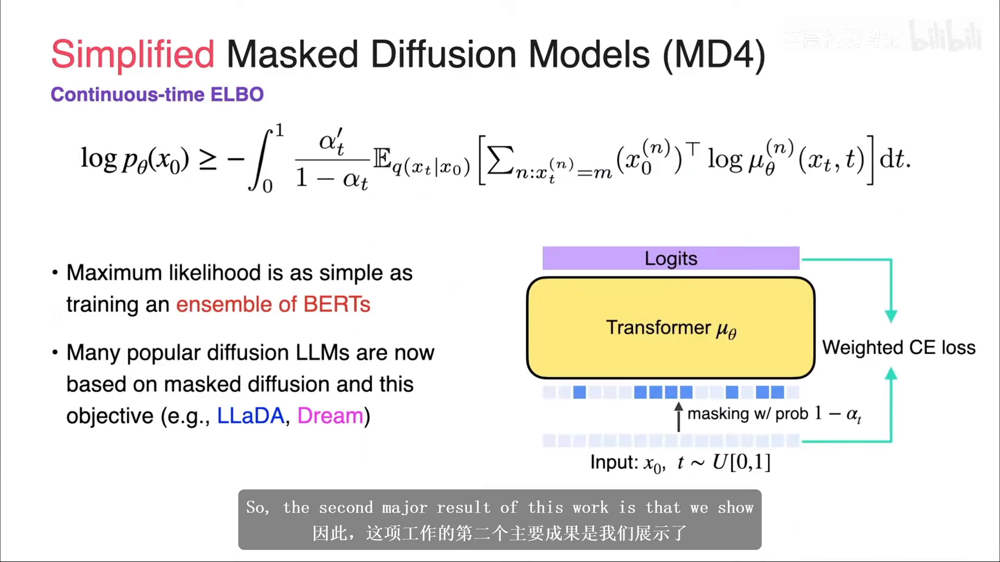

怎么估计它[【跳转到 04:53】](https://www.bilibili.com/video/BV1i3t56uEE7/?t=293)？报告给了四步：

1. 从数据 $x_0$ 出发，随机取一个时间点 $t \sim U[0,1]$；
2. 以概率 $1-\alpha(t)$ 独立地随机掩码各元素；
3. 把部分掩码的数据输入 Transformer，让它预测原始数据；
4. 计算预测值与原始数据之间的交叉熵损失，再乘上权重因子 $\alpha'_t / \alpha_t$。

报告用一句话点出这个目标的身份：**"最大似然训练简化为训练一组 BERT 的集成（ensemble of BERTs）"**。如果你熟悉 BERT——GPT 时代之前最流行的预训练范式——这本质上就是它，只不过掩码比率是从分布中随机抽取的，而不是固定比例。这个目标在做的其实是**忠实的压缩**：它试图最大化数据的似然，这正是掩码扩散语言模型能取得优异困惑度的关键。

也正因为如此，社区对"以扩散为中心的语言模型"非常兴奋，如今许多流行模型（如 LLaDA、Dream）都基于掩码扩散和这个目标。

## 三、等价性：连续时间下它就是随机顺序自回归

### 3.1 从"解码时间"看顺序

人们兴奋的第一个原因是**更快的生成**：扩散模型可以并行生成。图里那些着色标记——同色标记未被掩码——是在同一步骤并行生成的，这与自回归逐个预测下一个标记完全不同。

但报告马上给出一个反直觉的结论[【跳转到 07:32】](https://www.bilibili.com/video/BV1i3t56uEE7/?t=452)：掩码扩散与**随机顺序自回归**存在理论联系。"随机顺序"指逐个生成元素，但顺序是从所有可能排列中均匀抽取的。

理解等价性的关键是看连续时间的逆过程。令 $\tau_n$ 表示第 $n$ 个元素的**解码时间**。由于是连续时间，所有 $\tau_n$ 必然存在一个排序——图上左侧的时间轴画出的正是这个"塔状"结构：先解出 $x_{\sigma_1}$，再解 $x_{\sigma_2}$，然后 $x_{\sigma_3}$ 与 $x_{\sigma_4}$ 几乎同时，依此类推。

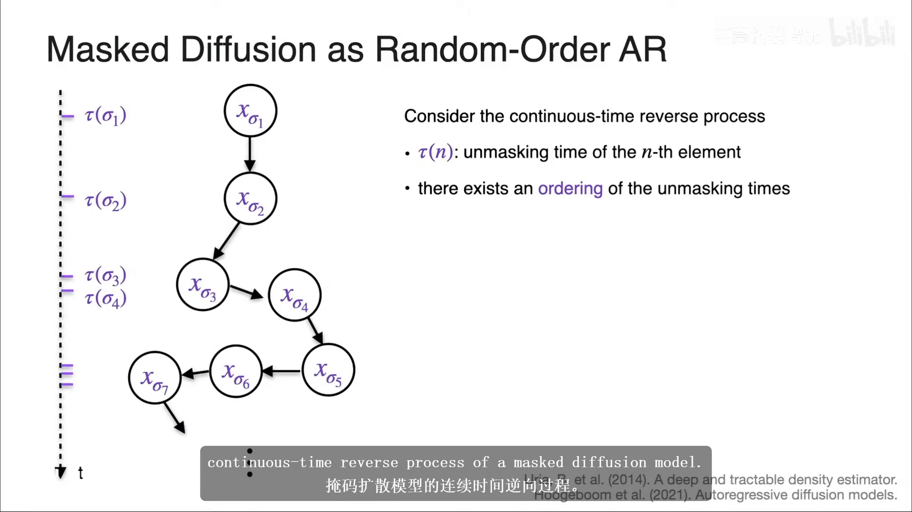

### 3.2 为什么顺序是均匀随机的

既然存在顺序，就要问这个顺序的分布是什么。答案从累积分布函数来：

$$
\Pr(\tau_n \le t) = \Pr\big(x_t^{(n)} = m\big) = 1 - \alpha(t)
$$

而按定义，$1-\alpha(t)$ 正是 $t$ 时刻被掩码元素的比例。**如果 $\alpha(t)$ 是全局共享、应用于所有标记的，那么每个元素的解码时间服从同一个分布，所有元素的解码顺序就在所有排列上均匀分布**——这正是"随机顺序"的含义。

反过来，如果你对不同标记使用不同的 $\alpha_t$，这种等价性就不再成立（报告提到论文里有专门一章讨论这种广义的掩码扩散模型，但没有展开）。

于是得到第一个结论：

> 掩码扩散模型在连续时间下，就是一个随机顺序的自回归模型。

### 3.3 那"并行采样"到底意味着什么

这里有个表面矛盾：既然它就是一个自回归模型（逐个解码），为什么还能并行采样？

报告的答案是：**并行采样来自逆过程的离散化**[【跳转到 09:37】](https://www.bilibili.com/video/BV1i3t56uEE7/?t=577)。实际采样时我们要把时间轴划分成若干区间；由于所有未掩码时间是随机分布的，其中一些可能恰好落在同一个区间里。在掩码扩散模型里，我们本质上只需**打破落入同一区间的维度之间的依赖，独立地生成它们**——这就是并行采样的本质。

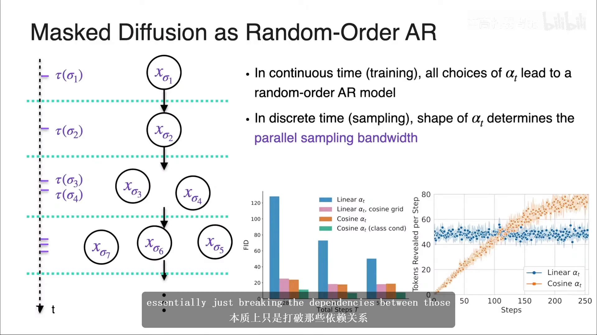

由此[【跳转到 10:52】](https://www.bilibili.com/video/BV1i3t56uEE7/?t=652)，$\alpha_t$ 的形状有了明确的作用：它决定未掩码时间的分布，也决定**并行采样的带宽**（每步能同时解出多少标记）。

- 线性 $\alpha_t$：带宽很窄，几乎每步只解一个标记，接近纯自回归。
- 余弦 $\alpha_t$：呈现"从慢到快"的特性——开始时每步只解码少量标记，随后逐渐增加。图上右侧的曲线显示，余弦调度每步解出的 token 数随步数稳步上升，而线性调度始终维持在低位。

报告指出，这种"慢到快"的调度已被证明能提升图像采样质量（相比线性调度）。**注意这里的因果链**：不是"扩散模型天生并行"，而是"离散化 + 特定调度形状"造出了并行。

## 四、采样误差从哪来：学习误差与离散化误差

有两项工作[【跳转到 11:47】](https://www.bilibili.com/video/BV1i3t56uEE7/?t=707)分析了掩码扩散模型的采样误差，给出一个干净的分解：

$$
\mathrm{KL}\big(p_{\text{data}}(x) \,\|\, p_{\text{sampl}}(x)\big) \le \epsilon_{\text{learn}} + \epsilon_{\text{disc}}
$$

- $\epsilon_{\text{learn}}$：**神经网络近似误差**，来自去噪器没学准。
- $\epsilon_{\text{disc}}$：**离散化误差**，来自把连续时间切成有限步。

离散化误差取决于数据分布的**信息轮廓（information profile）**：

$$
f(i) = \mathbb{E}_{p_{\text{data}}(x),\,\sigma\sim\mathrm{Unif}}\left[\log p_{\text{data}}\big(x_{\sigma_{i+1}} \mid x_{\sigma_{\le i}}\big)\right], \quad i = 0,\dots,N-1
$$

它的解释是：**随着我们解封更多维度，剩余维度的平均可预测性如何增长**。离散化误差则是这个函数与其阶梯近似之间的差：

$$
\epsilon_{\text{disc}} = \mathbb{E}_{\nu(a)}\left[\sum_{i=0}^{N-1} f(i) - \sum_{k=0}^{K-1}(a_{k+1}-a_k) f(a_k)\right]
$$

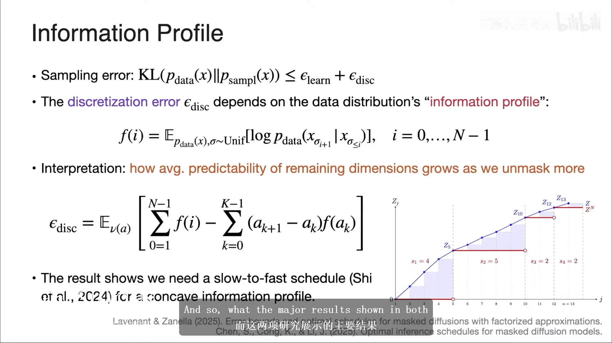

这张图把两件事说清楚了：

1. **最精细的离散化就是标准自回归**——每步只解封一个标记，无法更精确。
2. **只做 $k$ 步（$k \ll n$）就是并行采样**——用精度换速度。

而且如果信息轮廓是**凹形**的（一开始解封就能从数据里获取大量信息，之后信息获取速度逐渐变慢），那么最优的离散化步长选择就应该是"慢到快"的调度——这正好解释了余弦调度为什么效果好。

**这一段是本节最核心的对照结论**[【跳转到 13:02】](https://www.bilibili.com/video/BV1i3t56uEE7/?t=782)：：两条路线的采样误差结构是同一个式子，差别只在 $\epsilon_{\text{disc}}$ 的大小——自回归把 $\epsilon_{\text{disc}}$ 压到最小（每步一个元素），代价是步数等于序列长度；并行采样把步数压到 $k$，代价是 $\epsilon_{\text{disc}}$ 变大。这不是"两种误差累积机制"，而是**同一个误差预算在步数与精度之间的分配**。

## 五、感知质量的差距：用损失加权补上

### 5.1 差距是真的

如果"并行"只是离散化的产物，那人们用扩散模型做图像/视频的理由就只剩"感知质量"了。报告先承认这个差距确实存在：在 MD4 论文里，他们报告的掩码扩散模型**似然值与强连续扩散模型相当**，但按 FID 衡量的感知质量仍明显落后于连续扩散类模型，两者之间存在显著差距。

如果这个差距是根本性的，那结论就应该是：掩码扩散（或随机顺序自回归）无法在样本质量上超越连续扩散。但报告接下来推翻了这个结论。

### 5.2 连续扩散的秘密武器：损失加权

回顾连续扩散的损失[【跳转到 16:17】](https://www.bilibili.com/video/BV1i3t56uEE7/?t=977)：它具有"对噪声图像做积分运算"的结构，其中去噪用的是欧氏损失而不是交叉熵。虽然 ELBO 结构是训练隐变量模型的标准教科书方法，但**实际训练连续扩散模型时用的是它的变体**——在损失中引入额外加权因子，从而在不同噪声区域给去噪过程赋予不同权重。

报告展示了一张表，列出实践中使用的多种加权函数（如 iDDPM、ADM、EDM、VDM++ 等），核心信息是：**这些加权函数（表中任意一种）都能提升标准 ELBO 的感知质量**。这一点已被广泛认可，人们也一直在寻找更优的加权函数——但尽管应用广泛，**我们仍缺乏有效的损失加权理论**。

### 5.3 把加权"翻译"到掩码扩散

报告的思路是：建立一个损失加权的理论框架，使它也能等效地应用于掩码扩散模型，而不必做大量实证搜索。做法分两步。

**第一步：构造"配备最优解码器"的模型族。** 把学到的去噪器替换为真实的逆向转移（前向过程的基后验分布）来做逆向步骤，就得到"部分使用最优逆向转移"的模型：其中部分步骤仍用学到的去噪器。由此定义一系列模型，索引 $i$ 从 1 到 $t$。

**主张一**：增加 $i$（引入更多最优逆向步骤）会提供更好的 ELBO 用于训练，即 $L_{i+1}$ 显著大于 $L_i$（在数据分布上的平均意义下）。加入额外的最优逆向步骤会让下界更接近数据与模型的差异。虽然第一项依赖于我们无法访问的最优逆向转移，但它是常数，求梯度时不影响训练。

**主张二**[【跳转到 19:58】](https://www.bilibili.com/video/BV1i3t56uEE7/?t=1198)：常见的扩散目标函数其实是所有这些改进 ELBO 的加权和。

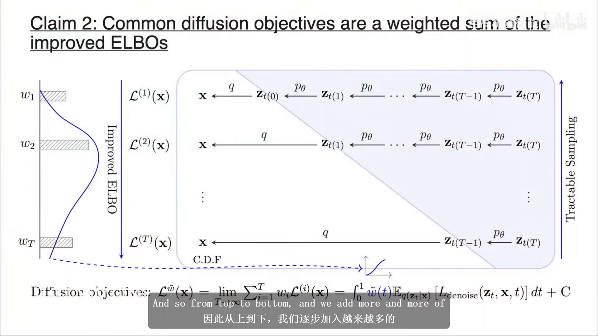

这里有个必须点出的张力：ELBO 从上到下不断改善，但**同时得到一个难以采样的模型**——因为我们无法从最优逆向步骤中采样。所以尽管 ELBO 更好，你不能简单地用它训练，否则就无法从该模型采样。

于是实际做法是取所有这些目标函数的**线性组合**：所有噪声水平下的模型都能被训练，同时高噪声水平的去噪模型能接收到更好的信号（因为用了更紧的 ELBO）。报告指出，相关损失里使用的 $t$ 函数实际上是这些权重累积的极限。

### 5.4 理论是无偏的，所以能搬到掩码扩散

这个推导有一个漂亮的性质：**它从未假设具体的转移分布**，因此与扩散过程的具体选择无关。于是它可以直接应用于掩码扩散——得到的目标函数只需在原始掩码扩散 ELBO 中引入权重因子 $w_t$。

约束条件是：$\tilde{w}_t$ 必须是单调函数（因为它是累积分布函数），所以可以选择任何单调递增的 $w_t$。

实践中怎么选[【跳转到 22:15】](https://www.bilibili.com/video/BV1i3t56uEE7/?t=1335)？报告不想搜索，而是**把连续扩散的权重直接映射过来**，并且映射到**对数信噪比（log-SNR）空间**而非时间空间，以保证最终目标与采样方案一致。

一个有意思的观察：某些来自连续扩散的权重（非单调的那几种）映射过来后并不单调，违反了假设，实验里表现更差；而使用单调权重（如 sigmoid 和流匹配）的，在提升样本质量方面表现很好。另外，如果把权重函数设为直接抵消 ELBO 的原始系数（基本抵消 $\alpha'_t/\alpha_t$），得到的时间表与流匹配时间表形状相似，两者效果都不错——**实际上简单方法甚至更好**。

### 5.5 结果：差距基本闭合

应用这种相关加权后，掩码扩散与连续扩散模型在感知质量上的差距基本被闭合。

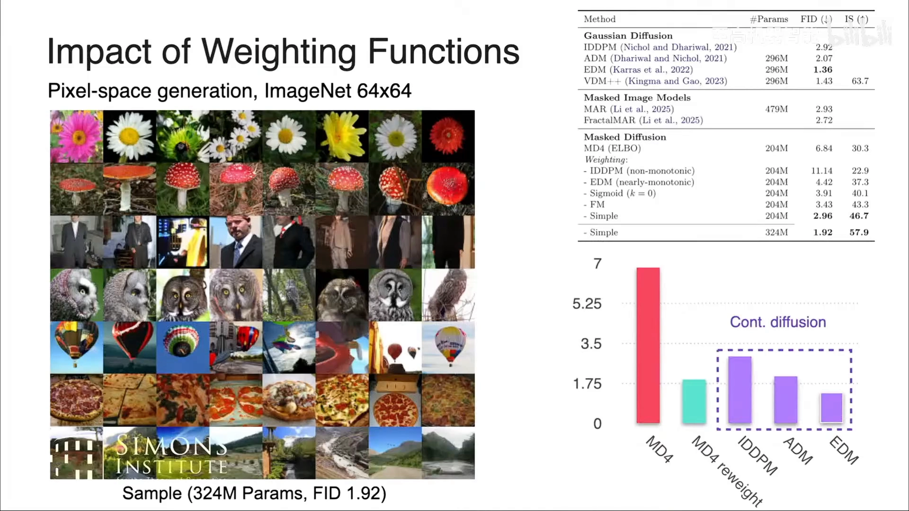

报告给出的数字很具体[【跳转到 23:35】](https://www.bilibili.com/video/BV1i3t56uEE7/?t=1415)：未加权的 MD4（ELBO）FID 为 6.84；改用 iDDPM 的非单调权重反而更差（11.14）；EDM 接近单调（4.42）；sigmoid（3.91）、流匹配（3.43）、simple（2.96）逐级改善；把模型放大到 324M 参数后 FID 达到 **1.92**，已经进入连续扩散（iDDPM 2.92、ADM 2.07、EDM 1.36、VDM++ 1.43）的区间。注意这是**像素空间生成、高分辨率、没有分词器**的结果，因此是一项相当有挑战性的任务。

## 六、超越两条路线：学习顺序与"插入"

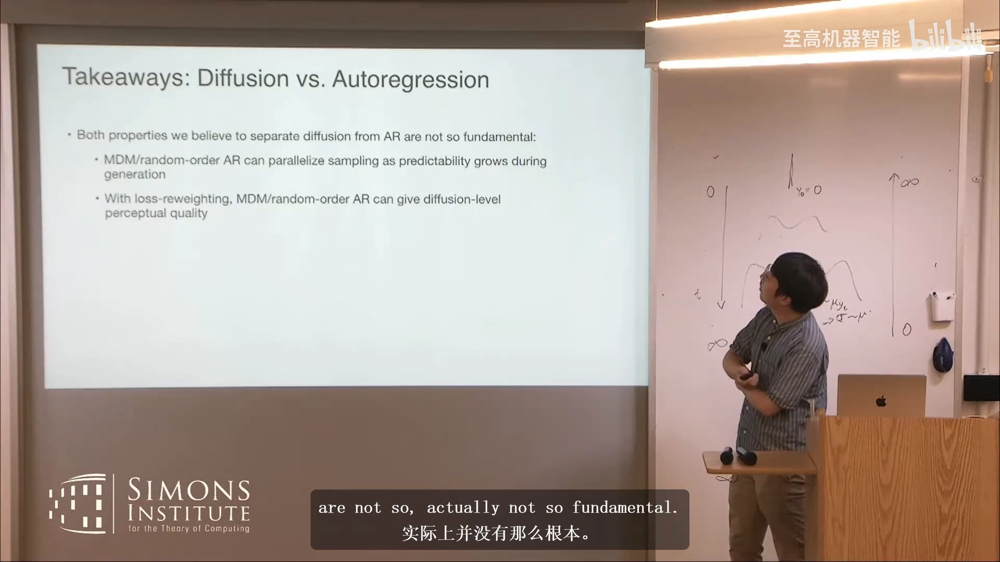

报告到这里完成了对"两条特性并不根本"的论证：掩码扩散（随机顺序自回归）可以通过采样实现并行，也可以达到扩散级的感知质量。接下来的问题是：**如何超越固定顺序与随机顺序的生成？**

### 6.1 从固定顺序到学习顺序

一个直接的扩展是：不再固定方向（左到右）或随机选择下一个位置，而是**学习一个策略**，根据当前部分生成的内容来选择下一个位置——只需把这个策略分布定义为在尚未生成的位置上分配概率。这类模型叫"学习顺序自回归模型"。

但报告认为有一个改进版本更合理，它引入了新操作：**插入（insertion）**。

### 6.2 为什么非单调生成必须有插入

在非单调生成[【跳转到 26:05】](https://www.bilibili.com/video/BV1i3t56uEE7/?t=1565)（不遵循从左到右或从右到左）中，模型需要同时预测**生成的值**和**绝对位置**，而后者实际上非常困难，比预测元素的值更难。

报告用一段代码举例：如果模型选择先生成 `if` 条件及其语句之后的内容，那么在生成 `else` 分支之前，它必须知道需要保留多少掩码或位置。这在掩码扩散或学习顺序自回归模型里非常不自然——**你需要在生成内容之前就猜出条件块的长度**。引入插入操作完全解决了这个问题：你不需要预留位置，只需要决定"插在哪里"。

### 6.3 插入过程的定义

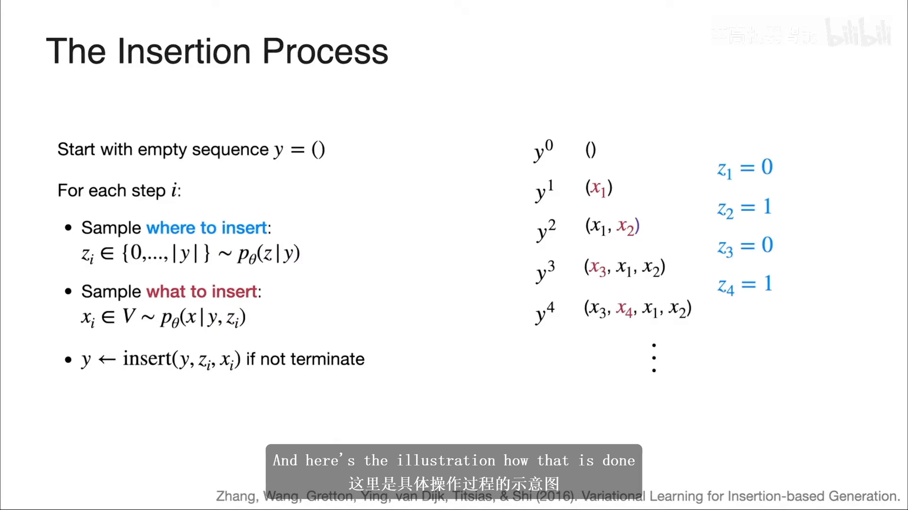

形式化地：从空序列 $y=()$ 开始，每一步

1. 采样**插在哪里**：$z_i \in \{0,\dots,\lvert y\rvert\} \sim p_\theta(z \mid y)$；
2. 采样**插什么**：$x_i \in V \sim p_\theta(x \mid y, z_i)$；
3. 执行 $y \leftarrow \mathrm{insert}(y, z_i, x_i)$，若未终止则继续。

图右侧给了一个具体例子：$y^0=()$ 时 $z_1=0$ 插入 $x_1$；$y^1=(x_1)$ 时 $z_2=1$ 插入 $x_2$；$y^2=(x_1,x_2)$ 时 $z_3=0$ 在最前面插入 $x_3$；$y^3=(x_3,x_1,x_2)$ 时 $z_4=1$ 插入 $x_4$。**注意位置索引是相对于当前序列的**，这就是它灵活的原因，也是它难训的原因。

### 6.4 训练难点与解法：置换双射

最大似然估计对这类模型不可行，因为存在大量潜在变量（每一个插入位置都是隐变量），因此需要变分学习。但一写 ELBO 就遇到挑战：**需要指定所有插入槽位的分布**，而这很困难，因为不同的插入路径可能生成同一个序列——你可以选择不同的插入方式，仍然得到相同的序列，只是顺序不同。

这些不同的序列路径并不存在于固定坐标系中，因为插入时位置是相对于当前序列的。报告的解决方案（也是本工作的主要贡献）是建立一种**"插入与弹出"的置换操作**，从而用**最终序列的排列**来重新参数化似然，而不是用这些插入槽变量。

具体地，若 $\sigma_i$ 表示最终序列中第 $i$ 个生成元素的索引，就可以把插入槽序列与排列 $\sigma$ 建立双射；于是最终似然可以写成"对所有排列求和"的形式，内部项只包含生成元素和生成内容。这看起来显而易见，但证明并不直观。一旦得到这个似然，就可以针对排列 $\sigma$ 做标准的变分推断——因为 $\sigma$ 是一个具有固定坐标系的全局对象，不必担心它动态变化。这个分解还允许基于梯度的训练，并可配合方差缩减方法。

### 6.5 实验：分子字符串与规划

**分子字符串**[【跳转到 31:21】](https://www.bilibili.com/video/BV1i3t56uEE7/?t=1881)。把分子写成一维字符串表示后，插入模型表现相当好。与其他非单调生成方法（其他自回归模型、学习顺序自回归模型）相比，插入模型的优势主要来自**有效性**——生成的语法是否正确。表格里插入类模型的 V（有效性）指标达到 97 左右，明显高于 AO-ARM（83.1）与 LO-ARM（89.7），也高于固定顺序的 FO-ARM Transformer（98.5 的有效性虽高，但 KL 散度与 FCD 指标更差）。

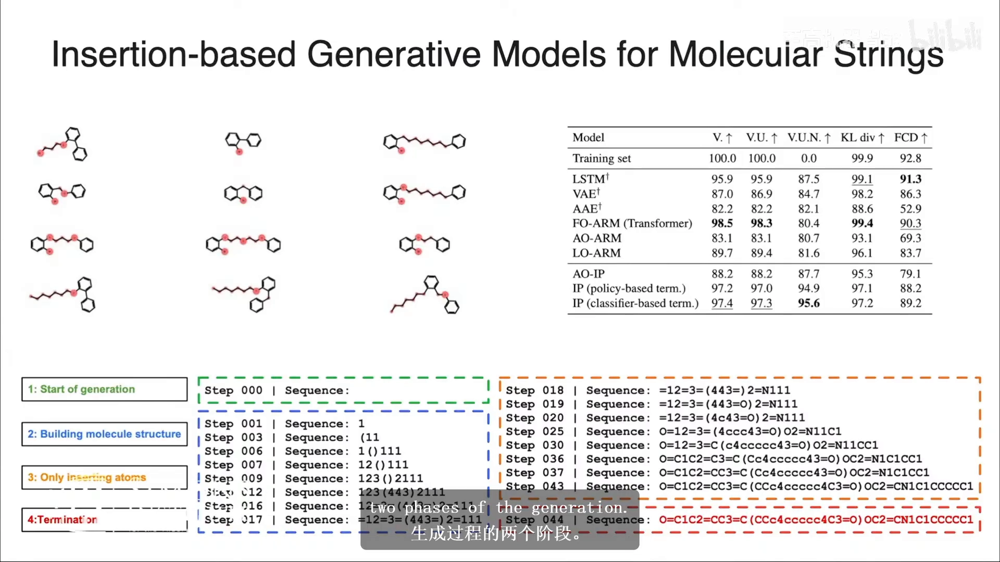

更有意思的是两个现象：

1. **新颖性更高**。如果比较分布指标，这些模型对训练分布的拟合会略逊于固定顺序自回归模型；但如果观察样本的新颖性，允许插入的模型有显著优势。
2. **两阶段自发涌现**。训练插入模型时，它会自动发现生成的两个阶段：第一阶段学习生成分子结构（通过生成括号和数字表示是否存在闭合），第二阶段从结构转向插入原子。这个过程完全由训练算法自动发现，**从未在初始时指定任何内容**。

**规划任务**[【跳转到 33:56】](https://www.bilibili.com/video/BV1i3t56uEE7/?t=2036)。把插入模型改造后可以做条件生成，规划就是一个好例子：从起点出发实现目标，可能存在一些软性目标。做法是把它视为序列生成问题——通过插入来实现子目标和通往目标的路径，用目标作为初始序列。与扩散模型（固定画布、缺乏灵活性）和从左到右自回归模型相比，插入模型的准确率更高；从简单迷宫到复杂迷宫只需逐步增加复杂度。

## 七、落地与边界：报告里的问答

报告最后的问答部分给出了几个务实的判断，值得单独记下来。

**离散扩散的权重为什么研究得少？** 因为报告只解决了连续扩散的情形。没有多少人真正对离散扩散的权重函数感兴趣，部分原因是"感知质量"更偏理论理解层面，而不是让离散扩散实际用于生成高分辨率图像和视频；而且连续扩散效果非常好，报告的结果基本显示可以匹配性能，但还不清楚能否真正超越。**缺乏实用动机**导致这方面研究较少。

**最有说服力的应用场景在哪？** 报告认为这些模型提供了多种思考语言建模的方式，并且已经推动了实际进展——最典型的是**推测解码**：如今人们用掩码预测模型作为推测草稿（报告提到名为 Flash 的论文），在原始序列中加入少量掩码、并行预测后续几个 token 作为草稿，再用推测解码验证。

**为什么还没大规模部署？** 因为运行成本极高；如果不采用推测解码，就意味着必须把模型类型从自回归换成这种，然后重建整个语言模型训练栈。而目前还缺乏"扩散模型能提供更高质量"的证据。所以仅从效率角度看，推测解码方式更实用。报告希望未来的扩散语言模型论文在讨论效率优势时，能与这些先进的推测解码算法对比。

**插入模型能否迁移到文本？** 报告认为这很难，因为分子领域的数据集非常干净且是单一模态，而文本存在太多不同类型，性能很大程度上依赖数据分布。可行的路径是先筛选出干净的数据集，预期能观察到改进，再逐步扩展；直接应用于互联网语料可能看不到显著改进，因为插入也增加了复杂度，并非所有数据都需要这种处理。

## 小结

- 被当作分界线的两条特性——并行生成与感知质量——并不来自模型本质，而是实现与调度的产物。
- 掩码扩散把"抹掉元素"当作加噪，$\alpha_t$ 是未被掩码元素的期望比例；反向过程是一个简单的二元逻辑：mask 以 $\alpha(s)/\alpha(t)$ 的概率被解码，已解码的保持解码。
- 它的连续时间 ELBO 就是一个加权交叉熵的积分：最大似然训练简化成"训练一组 BERT"，因此能获得优异的困惑度。
- 连续时间下，掩码扩散等价于随机顺序自回归：每个元素的解码时间 $\tau_n$ 服从同一分布，故解码顺序在所有排列上均匀分布。
- 并行采样是离散化的产物：把时间轴切成区间后，落入同一区间的维度之间的依赖被打破、独立生成；$\alpha_t$ 的形状决定并行带宽，余弦调度的"慢到快"效果更好。
- 采样误差分解为学习误差与离散化误差，后者由数据分布的信息轮廓决定；最精细的离散化就是标准自回归，$k$ 步并行采样则是同一误差预算在步数与精度之间的重新分配。
- 感知质量差距可以用损失加权补上：把连续扩散的权重经 log-SNR 映射到掩码扩散的 ELBO 上，FID 从 6.84 一路降到 1.92，进入连续扩散区间。
- 要超越两条路线，就要超越固定顺序与随机顺序：学习顺序 + 插入操作，配合"插入—弹出"的置换双射做变分训练，在分子字符串与规划任务上都取得了更好的有效性与新颖性。

## 关键术语速查

| 术语 | 一句话解释 |
| :--- | :--- |
| 掩码扩散模型 | 把部分元素替换成 mask 作为加噪的离散扩散模型，也叫吸收扩散。 |
| $\alpha_t$ | 时间 $t$ 时未被掩码元素的期望比例，其形状决定训练目标与并行采样带宽。 |
| 随机顺序自回归 | 逐个生成元素，但生成顺序从所有排列中均匀抽取。 |
| 连续时间 ELBO | 证据下界在时间步趋于无穷小时的极限，掩码扩散下简化为加权交叉熵的积分。 |
| 并行采样带宽 | 采样时同一步能同时解出的标记数量，由 $\alpha_t$ 的形状决定。 |
| 信息轮廓 | $f(i)$，解封 $i$ 个维度后剩余维度的平均可预测性，决定离散化误差的大小。 |
| 离散化误差 | 把连续时间切成有限步带来的分布偏差，与学习误差共同构成采样误差上界。 |
| 损失加权 | 在 ELBO 的各个噪声区域上乘不同权重，牺牲部分似然换取感知质量。 |
| 插入生成 | 每步先决定插在哪里、再决定插什么，摆脱固定顺序与绝对位置预测。 |
| 置换双射 | 把插入槽序列与最终序列的排列一一对应，使似然可以按排列求和并做变分训练。 |