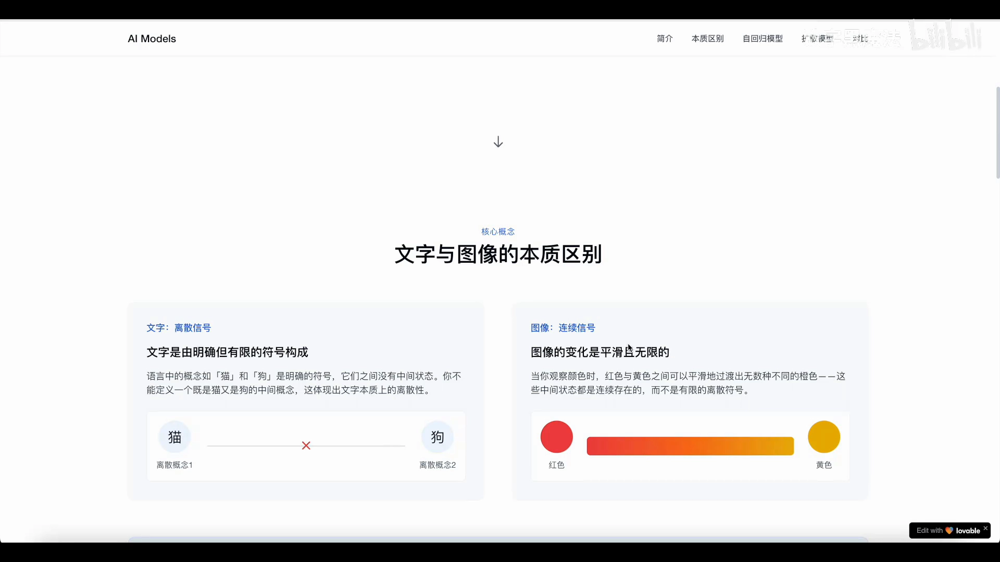
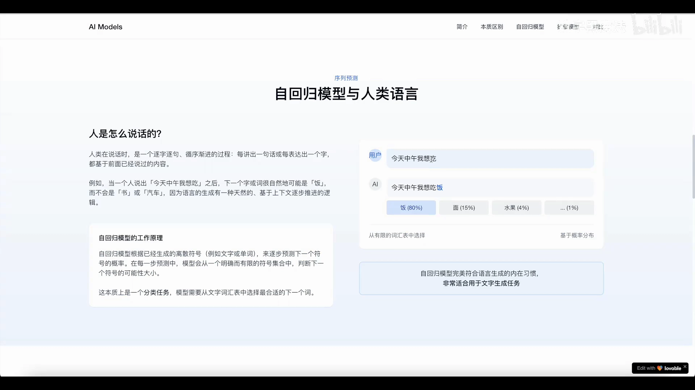
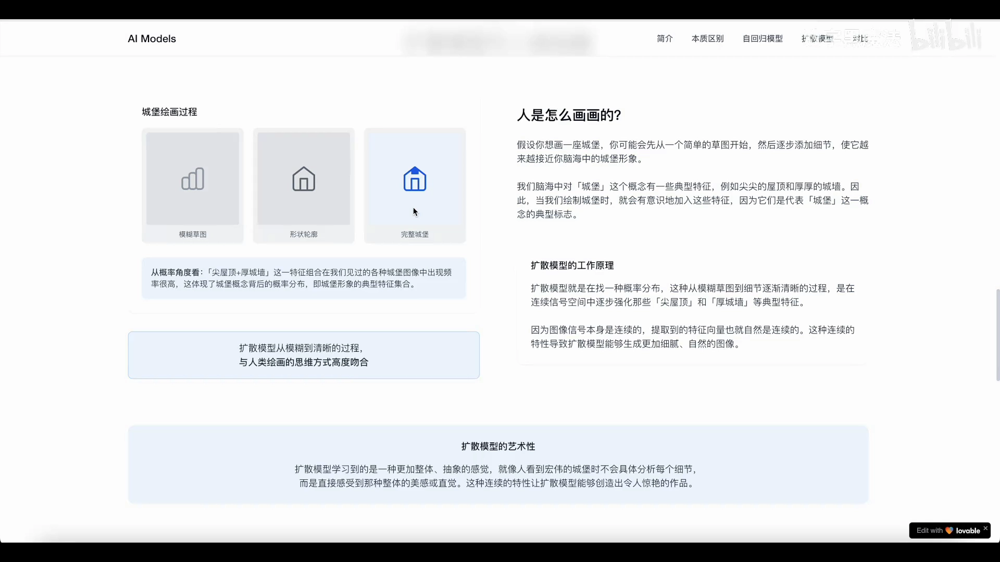
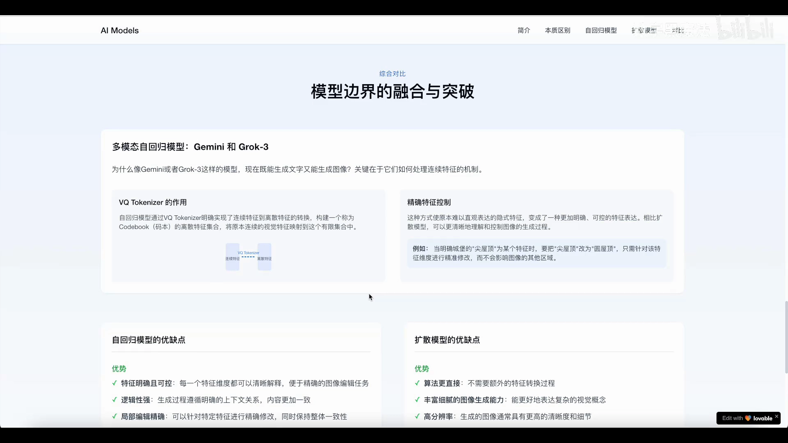
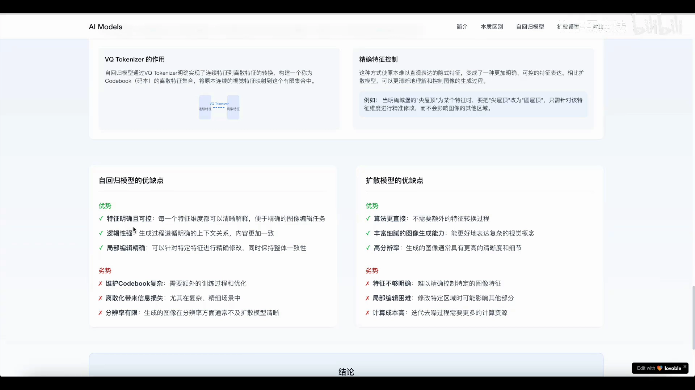
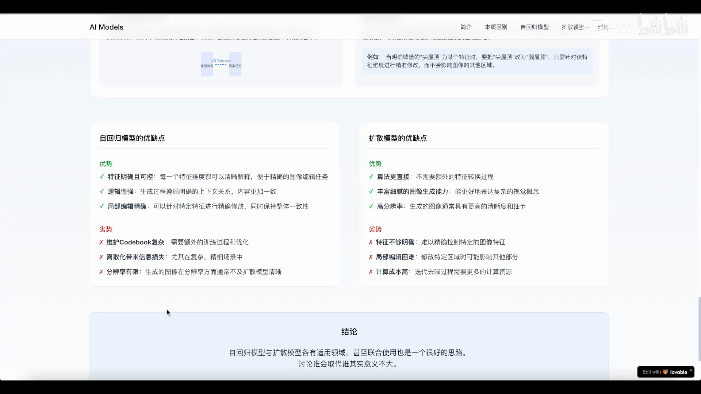

# 离散与连续：为什么文字走自回归、图像走扩散

> 视频来源：[Gemini逆袭Controlnet？扩散模型和自回归模型的真正秘密](https://www.bilibili.com/video/BV1z8XpYKEnr/)（Bilibili · 数字黑魔法，约 12 分钟）
> 导读：这支视频不推导公式，而是从"人怎么说话、人怎么画画"切入，把两条路线的适用条件归结为信号的离散与连续；后半段借 Janus 的技术报告解释多模态自回归如何用 VQ Tokenizer 把图像变成离散符号，并给出两条路线的优缺点对照表。字幕里的模型名、模块名已按通行写法订正。

## 本讲要解决的核心问题（SCQA）

**背景**：主流的文字生成模型几乎都是自回归的，主流的图片、视频生成模型几乎都偏爱扩散模型。这两条路线各自在自己的地盘上占据统治地位。

**冲突**：边界正在松动。自回归的多模态模型（如 Gemini）在图片一致性上惊艳了整个圈子，扩散大语言模型项目 Mercury 又因为极快的文本生成速度引发关注。既然两条路线都能"越界"，那它们原本的分工是必然的吗？

**疑问**：自回归和扩散的真正区别在哪里？如果差别不在模型本身，那在选择技术路线时，我们究竟在选择什么？

**回答（中心思想）**：两条路线的分工来自**被生成信号的数学性质**——文字是离散符号，图像是连续信号。离散信号适合"从有限符号集里挑一个"的分类式预测，所以自回归天然贴合；连续信号适合"在连续空间里逐步强化特征、向高概率区域靠拢"，所以扩散天然贴合。两条路线的差别不是能力高低，而是**表示方式带来的取舍**：自回归换来明确可控的特征维度，代价是必须先把连续信号离散化（信息损失）并维护一个 codebook；扩散换来细腻的画质与高分辨率，代价是特征维度难以解释、局部编辑困难。

## 一、真正的分界线：离散信号与连续信号

### 1.1 文字是离散的

文字由一系列明确、有限的符号构成。语言里有"猫"和"狗"这两个明确的符号概念，但你不可能在猫和狗之间找到一个中间状态——我们没办法定义一个"既是猫又是狗"的中间符号。这就是文字本质上的离散性[【跳转到 00:54】](https://www.bilibili.com/video/BV1z8XpYKEnr/?t=54)。

### 1.2 图像是连续的

图像是平滑、无限的。在红色和黄色之间，可以找出无数种不同的橙色，这些中间状态都是连续存在的，所以它不是有限的离散符号[【跳转到 01:19】](https://www.bilibili.com/video/BV1z8XpYKEnr/?t=79)。

视频还给出一个更深的观察：**文字本身就是人发明的、对连续世界的一种抽象或采样**。我们看到不同品种的狗，无论是小狗还是老狗，都被统一成"狗"这个概念，并用"狗"这个字来表示。也就是说，离散符号是连续世界的粗粒化结果——这个"粗粒化会丢信息"的直觉，后面会变成自回归生成图像的具体代价。

### 1.3 分工是"最短路径"的结果

正是由于这样的差异，决定了早期的生成任务会选择不同的模型方向。视频用了一个"仿生学"的说法：人怎么做，就让模型怎么做。两条路线各自贴合一种人类行为，因此都是解决对应问题的最短路径。

## 二、自回归贴合"说话"：在有限符号集里做分类

### 2.1 人说话是逐字推进的

人说话是一个逐字逐句、循序渐进的过程：表达一个字的时候，都是根据前面说过的话。举个例子，"我今天想吃……"，你要预测下一个字，可能会说"我想吃火锅""我想吃烧烤"，但大概率不会说"我想吃书""我想吃汽车"。这就是语言天然具有的、基于上下文的推进逻辑。

### 2.2 自回归做的就是同一件事

自回归模型根据已生成的离散符号，预测下一个符号的概率。每一步它从有限的符号集里判断哪个符号概率最大——**本质上这是一个分类任务**，模型从词表里选出最合适的下一个词[【跳转到 02:34】](https://www.bilibili.com/video/BV1z8XpYKEnr/?t=154)。

写成概率形式，就是链式分解（推导见 [M02 §4.1.4 自回归预测与条件似然](../../../../M02_序列建模与大模型架构/README.md#m02-4-1-4)）：

$$
p(x) = \prod_{t=1}^{T} p(x_t \mid x_{<t})
$$

每个因子都是一次"在词表上做分类"，训练目标就是逐位置的交叉熵：

$$
\mathcal{L}_{\text{AR}} = -\sum_{t=1}^{T} \log p_\theta(x_t \mid x_{<t})
$$

**为什么离散信号特别适合这条路？** 因为"下一个符号"天然是一个有限集合上的选择问题，分类头可以直接给出整个词表的概率分布；而"下一个像素"是连续值，没有"有限候选集"可挑。

## 三、扩散贴合"画画"：在连续空间里向高概率区域靠拢

### 3.1 人画画是从草图到细节

你想画一个城堡，可能会先从一个简单的草图去构思，然后逐步加形状、加轮廓、加细节，最终画出接近脑子里那个城堡的样子。

而且人的脑子可能对"城堡"这个概念有一些典型特征的预设[【跳转到 03:24】](https://www.bilibili.com/video/BV1z8XpYKEnr/?t=204)：它会有尖屋顶、会有厚厚的城墙。当我们把这些特征加得足够多之后，它们集合起来就变成了"城堡"这个概念。

### 3.2 扩散模型在做的正是"强化特征"

从数学角度看，像尖屋顶、厚城墙这样的特征组合，在我们设想的城堡图案里出现的概率很高。这句话体现出来的是：**城堡这个概念背后，是这些特征的概率分布，是特征的集合**。

所以当我们用扩散模型生成图片时，做的一件事就是让图像中的这些特征尽可能向想表达的那个概念的高概率区域靠拢。在连续空间里，我不断把尖屋顶画得更尖、更像屋顶，不断强化城墙的质地让它看起来像厚城墙，最终画出来的城堡就真的很像真实的城堡。

视频的总结是[【跳转到 04:14】](https://www.bilibili.com/video/BV1z8XpYKEnr/?t=254)：**扩散模型就是在找一种概率分布，找的是从模糊草图到细节逐渐变清晰的这样一个过程**。这个过程和人们绘画的思维方式是吻合的，所以扩散模型天然适合图像生成任务。

用公式写，就是反向去噪链：

$$
p(x_0) = p(x_T)\prod_{t=1}^{T} p(x_{t-1} \mid x_t)
$$

网络学的是每一步"从带噪的连续张量里减去一点噪声"，监督信号是连续的回归目标（噪声预测的均方误差），而不是离散的分类：

$$
\mathcal{L}_{\text{DM}} = \mathbb{E}_{x_0,\, t,\, \epsilon}\left\lVert \epsilon - \epsilon_\theta(x_t, t) \right\rVert^2
$$

### 3.3 连续特征没有明确边界，这是优点也是缺点

这里要补一句关键的限制：用扩散模型生成城堡时，虽然我们有尖屋顶、厚城墙这种明显的典型特征预设，但由于图像信号本身是连续的，**截取到的特征自然也是连续的**[【跳转到 04:39】](https://www.bilibili.com/video/BV1z8XpYKEnr/?t=279)。这种连续特征导致我们很难明确指出哪些维度对应尖屋顶、哪些维度对应厚城墙——因为这些特征之间没有明确的边界。

所以扩散模型学到的特征，是一种整体的、抽象的、无法用语言表述的感觉[【跳转到 05:29】](https://www.bilibili.com/video/BV1z8XpYKEnr/?t=329)。这就像人第一次看到一个非常宏伟的建筑：你不会具体分析画面里哪些细节让它变得宏伟，也说不清它的设计语言是什么，很多时候就是直观地感受到那种整体的美感。

画面之所以能有效传递这种直觉或美的概念，是因为审美本身就难以表述、难以用明确边界去定义，它依靠的是大量微妙特征相互融合、相互作用。这也是为什么扩散模型有时确实能生成让人觉得惊艳的作品——视频把这个叫做"扩散模型 AI 的一种想象力"。

## 四、自回归生成图像：先离散化，再当作语言

### 4.1 问题：自回归擅长离散，图像却是连续的

图片是连续的，自回归擅长处理离散信号。那怎样才能让自回归模型去生成图片？

视频给的答案是[【跳转到 07:55】](https://www.bilibili.com/video/BV1z8XpYKEnr/?t=475)：**加一个模块做转换**——先把图片的连续信号转成离散信号，再用自回归模型处理。多模态自回归模型（视频以 DeepSeek 的 Janus-Pro 为例，其技术报告是后续讨论的来源）做的就是这样一件事。

### 4.2 VQ Tokenizer 与 codebook

在自回归模型里引入的新模块叫 **VQ Tokenizer**[【跳转到 08:20】](https://www.bilibili.com/video/BV1z8XpYKEnr/?t=500)（向量量化分词器），它明确实现了连续特征到离散特征的转换。VQ Tokenizer 会构建一个叫 **codebook（码本）** 的离散特征集合，把原本的连续特征映射到这个集合里。

还是拿城堡图片举例：经过 VQ Tokenizer 之后，它就会变成"这个城堡的轮廓是什么样的、透视关系是什么样的、纹理是什么样的、上面有什么"。这样一来，原本难以直观表达的隐式连续特征，就变成了更明确、更可控的显式特征。

注意一个诚实的前提：**codebook 里的特征维度并不是人直接定义的**——不是说我想要"尖屋顶""厚城墙"这两个特征，它就出现在 codebook 里。但相比于扩散模型，我们能够通过 codebook 更清晰地理解图像的生成过程。

### 4.3 由此解释"图像编辑更强"

既然每一个维度都可以清晰解释[【跳转到 09:35】](https://www.bilibili.com/video/BV1z8XpYKEnr/?t=575)，那么当我们想把城堡的尖屋顶改成圆屋顶时，只需要针对那个特征维度所在的区域做精准修改，不必担心影响图像的其他区域。所以这种明确的特征表示为图像编辑任务提供了很大便利，而且能最大程度保持图像的一致性。

视频据此推测：Gemini 或 Grok 3 这类模型在图像编辑任务上比扩散模型更强，关键就在于它们如何处理连续特征——先把连续特征离散化，再在离散空间里做精确的局部修改。

## 五、两条路线的取舍：一张对照表

视频最后给出一张完整的优缺点对照。把它整理成表格（表格里的"优势/劣势"都是视频原话的归纳）：

| 维度 | 自回归（离散化后） | 扩散（连续空间） |
| :--- | :--- | :--- |
| 特征可控性 | 优势：每个特征维度可清晰解释，便于精确编辑 | 劣势：特征不够明确，难以精确控制特定特征 |
| 生成逻辑 | 优势：遵循明确的上下文关系，内容更一致 | 优势：算法更直接，不需要额外特征转换 |
| 局部编辑 | 优势：可针对特定特征精确修改并保持一致 | 劣势：修改特定区域可能影响其他部分 |
| 画质与细节 | 劣势：离散化带来信息损失，复杂精细场景尤其明显 | 优势：丰富细腻，能表达复杂视觉概念 |
| 分辨率 | 劣势：通常不及扩散模型清晰 | 优势：更高清晰度与细节 |
| 额外成本 | 劣势：需维护 codebook，多一套训练与优化 | 劣势：迭代去噪需要更多计算资源 |

这张表解释了两件事：

1. **为什么自回归在复杂图像上会遇到瓶颈**[【跳转到 10:25】](https://www.bilibili.com/video/BV1z8XpYKEnr/?t=625)。把连续信号映射到有限的离散特征里，肯定会有信息损失，而且这种损失尤其体现在复杂、精细的场景上。前面说过，连续特征能更好地表达美学直觉这种艺术性的抽象概念；当这些连续性信号被强行离散化之后，很有可能造成细节或整体美感的下降。毕竟有些美的东西，你真的没办法用显式的、或者说用语言去精确描述。
2. **为什么扩散在编辑上吃力**。它的优势是算法直接、画质细腻、分辨率高；劣势是特征不明确、局部编辑困难、迭代去噪的计算成本高。

视频的结论很克制[【跳转到 11:15】](https://www.bilibili.com/video/BV1z8XpYKEnr/?t=675)：自回归模型和扩散模型虽然有交叉的地方，但整体而言都有自己的适用领域，而且**联合起来使用很可能有更好的思路**，所以没有必要去讨论谁会取代谁。

## 六、怎么用这套框架做技术选型

视频最后把话题落到"怎么选"上，可以整理成三个判断问题：

1. **被生成的信号是离散的还是连续的？** 离散（文字、代码、离散 token）优先自回归；连续（图像、音频波形、视频帧）优先扩散。这是最根本的一条。
2. **下游任务要不要"可解释、可局部修改"的特征？** 如果需要精确编辑某个属性且要保持整体一致，离散化 + 自回归的显式特征表示更有利；如果追求画质、细节与分辨率，扩散更合适。
3. **能不能接受额外的模块与信息损失？** 自回归处理图像必须多一套 VQ Tokenizer 与 codebook 的训练与维护，并且要接受离散化带来的细节损失。

视频作者的原话是：只有当我们真正理解技术背后的原理和发展脉络，才能在这个 AI 时代的浪潮中准确选择最适合自己产品的技术方案，真正做出属于自己的判断——"知其然，更要知其所以然"。

## 小结

- 两条路线的分工来自信号的数学性质：文字是离散符号（猫与狗之间没有中间态），图像是连续信号（红与黄之间有无数种橙）。
- 自回归贴合"说话"：每一步在有限符号集上做分类，训练目标是逐位置交叉熵，采样步数等于序列长度。
- 扩散贴合"画画"：从模糊草图逐步强化特征、向概念的高概率区域靠拢，训练目标是噪声预测的回归误差。
- 连续特征没有明确边界，这让扩散能表达难以言说的整体美感，却也让特征维度难以解释、局部编辑困难。
- 自回归要生成图像，必须先加 VQ Tokenizer 把连续特征映射到 codebook 的离散符号上；换来的是可解释、可精确编辑的特征维度。
- 代价是双向的：自回归要维护 codebook 并承受离散化的信息损失（复杂精细场景、分辨率上吃亏）；扩散要付出迭代去噪的计算成本。
- 结论不是"谁取代谁"，而是各有适用领域，联合使用往往更好。

## 关键术语速查

| 术语 | 一句话解释 |
| :--- | :--- |
| 离散信号 | 由有限、明确的符号构成，符号之间没有中间状态，如文字。 |
| 连续信号 | 取值平滑、可无限细分，任意两点之间都存在中间值，如图像颜色。 |
| 自回归模型 | 根据已生成的符号预测下一个符号的概率，本质是有限集合上的分类。 |
| 扩散模型 | 从噪声出发逐步去噪，在连续空间中让特征向目标概念的高概率区域靠拢。 |
| VQ Tokenizer | 向量量化分词器，把连续特征映射到离散码本，使自回归能处理图像。 |
| codebook（码本） | 离散特征集合；连续特征被量化到其中最近的条目，因此会带来信息损失。 |
| 特征边界 | 连续特征向量中难以指认"哪个维度对应哪个语义"的性质，导致局部编辑困难。 |
| 多模态自回归 | 把不同模态都转成离散 token、用同一套自回归目标生成的模型路线。 |