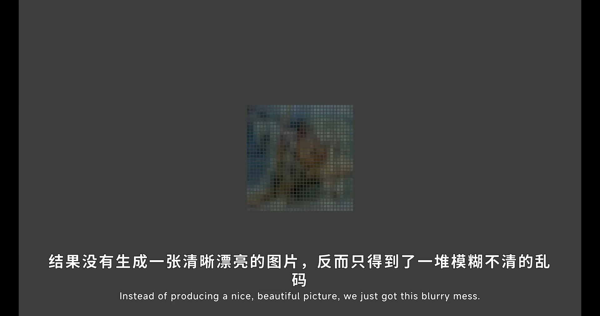
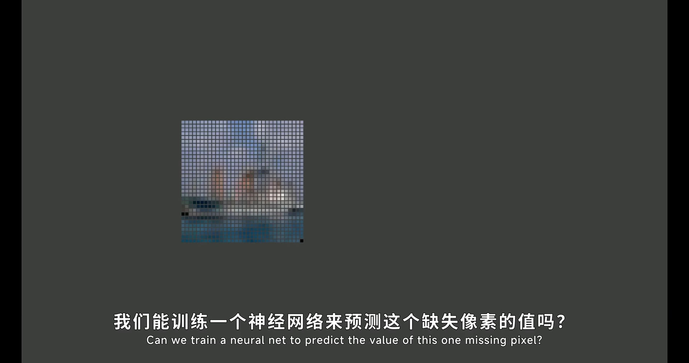
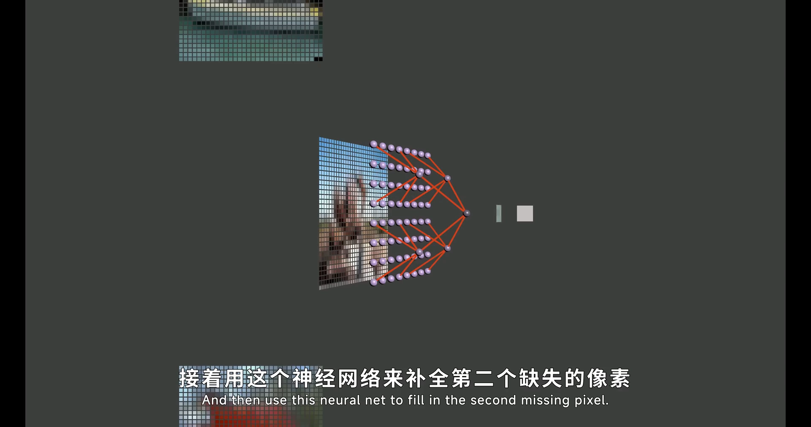
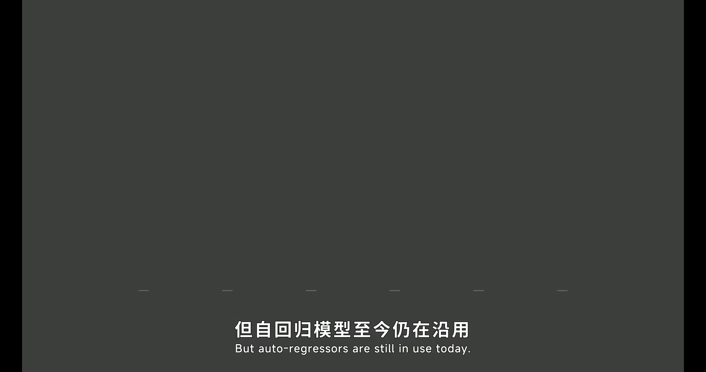
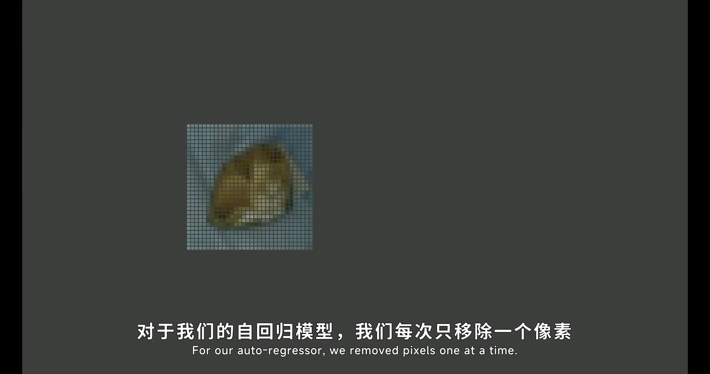
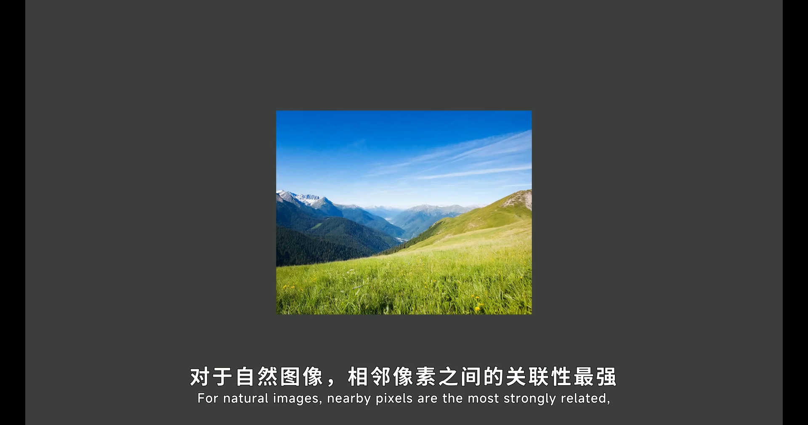
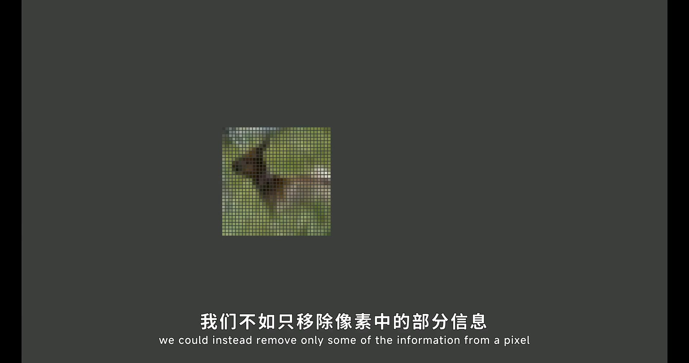
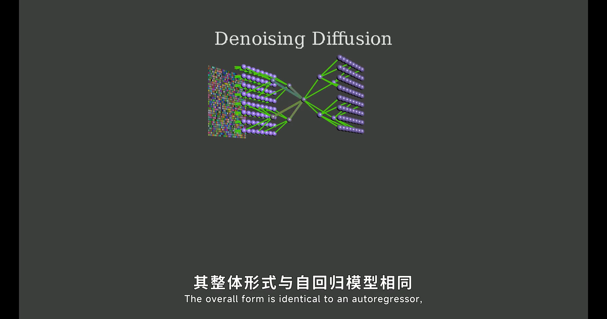
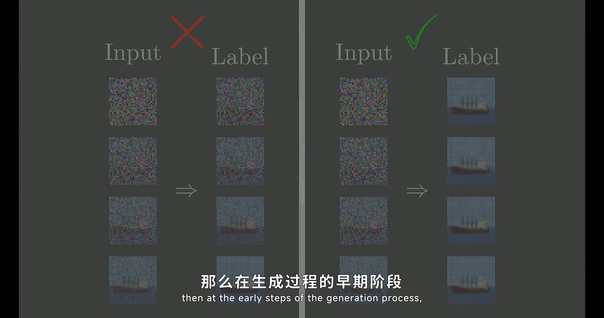
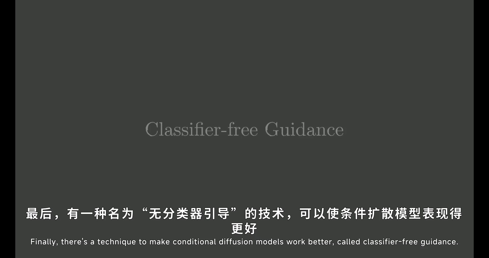

# 自回归与扩散的分岔点：一次预测多少像素决定采样步数

> 视频来源：[自回归 vs 扩散模型，谁更胜一筹?](https://www.bilibili.com/video/BV11xjMzxErX/)（Bilibili · NeuroHacks，约 20 分钟）
> 导读：这是一支"从零搭出两条路线"的讲解视频——它不比较两个现成模型，而是从"补全一个缺失像素"出发，一步步把自回归改造成扩散，从而把两条路线的差别归结到一个可计算的问题上：每一步允许模型同时决定多少个值。本文按视频的推导顺序复述，并补上链式分解与训练目标的写法。

## 本讲要解决的核心问题（SCQA）

**背景**：生成式 AI 的模型都建立在同一项底层技术上——深度神经网络，而神经网络做的事说到底是"曲线拟合"式的预测：给它大量「输入—标签」样本，它学会对没见过的新输入给出标签。

**冲突**：可预测不等于能生成。一个只会拟合一堆点的网络，凭什么能画出训练集里不存在的新图像？更奇怪的是：同样是"逐步生成"，自回归在文本上统治了十几年，到了图像上却几乎全面让位给扩散模型。

**疑问**：两条路线真正的差别是什么？是模型结构、是训练目标，还是别的什么？

**回答（中心思想）**：自回归和扩散共享同一副骨架——先定义"信息被逐步去掉"的过程，再训练网络去逆转它。真正的分岔点在于**每一步去掉多少信息、去掉的是离散的像素还是连续的噪声**：自回归一步只去掉一个元素，于是采样步数等于序列长度、训练必须靠因果结构并行；扩散一步在所有位置均匀地加一点噪声，于是采样步数被压缩到百步量级、训练可以随机抽时间步。理解了这一点，"误差累积"和"适用条件"就都是它的推论。

## 一、两条路线共用同一副骨架：先去掉信息，再学会逆转

### 1.1 从"补全一个缺失像素"开始

视频的第一步不是讲模型，而是讲一个失败实验。假设我们有一个图像数据集，想训练网络生成风格相似的新图像。最直接的做法是：不关心输入到输出的映射，随便选一个输入（比如一张全黑图）当占位符，直接拿目标图像当标签训练。

结果是一团模糊。[【跳转到 02:55】](https://www.bilibili.com/video/BV11xjMzxErX/?t=175)

原因出在预测器的本性上：**同一个输入对应多个可能标签时，网络会学到这些标签的平均值**。

- 对类别标签，平均值仍然有意义：一张图既可以标"猫"也可以标"狗"，网络输出"0.5 的猫 + 0.5 的狗"，反而比原来任何一个标签信息更全。
- 对图像像素，平均值毫无意义：把多张图像平均起来，得到的只是一团糊。

于是视频把任务改小：不做全新生成，只补全一个缺失的像素[【跳转到 03:45】](https://www.bilibili.com/video/BV11xjMzxErX/?t=225)。

这一步成功了，因为**只预测一个像素时，平均不会造成模糊**——一堆颜色的平均仍是一种颜色[【跳转到 04:10】](https://www.bilibili.com/video/BV11xjMzxErX/?t=250)。

### 1.2 自回归：把"补一个像素"串成一条链

接下来是自然的推广：缺两个像素，就再训练一个网络专门处理"缺两个像素"的情形，用第二个缺失像素的值当标签，填完它，剩下的一个缺失像素交给第一个网络。对图像里每个像素都这么做，就得到一组网络，每个网络负责回答同一个问题：

> 当这个像素以及它之后的所有像素都缺失时，这个像素应该是什么颜色？

于是可以从全黑图像出发，一个像素一个像素地把图像补出来。关键在于**每个网络只预测一个像素，所以没有模糊效应**。

这就是自回归模型[【跳转到 07:00】](https://www.bilibili.com/video/BV11xjMzxErX/?t=420)。它有一个"去除"过程（逐个元素地把信息拿掉），和一个"生成"过程（训练网络逆转去除、把元素加回来）。写成概率语言就是链式分解——这条式子在 [M02 §4.1.4 自回归预测与条件似然](../../../../M02_序列建模与大模型架构/README.md#m02-4-1-4) 已经推过，这里只借用结论：

$$
p(x) = \prod_{t=1}^{T} p(x_t \mid x_{<t})
$$

其中 $x_{<t}$ 是已经生成的前 $t-1$ 个元素。**这个乘积有几个因子，采样就要走几步**——这是理解后面所有取舍的钥匙。

还有两个容易被忽略但很重要的性质：

1. **标签来自数据本身**。生成器的标签就是原图的像素颜色，不需要人工标注。对网络来说这只是一次曲线拟合，和别的练习没有区别，所以可以直接用互联网上未标注的图像训练。
2. **自回归是最古老的生成模型**。最早的应用可追溯到 1927 年，用来建模太阳黑子的时间序列。今天它最著名的实例是 ChatGPT：给定一段不完整的文本，用 Transformer 输出下一个词的概率分布。

### 1.3 随机采样：从"唯一答案"到"每次不同"

按上面的做法，模型是确定性的：再跑一次，生成完全相同的图像，没有创造性。

解决办法是采样。所有预测器其实输出的是**可能取值的概率分布**，平时我们取概率最大的那个；想要多样性，就从分布里随机采一个值。每一步都随机采到不同的值，后续步骤的条件就变了，于是每次得到的图像完全不同。

这一步把"补全"变成了真正的生成：同一个模型，不同的随机数，不同的样本。

## 二、为什么"一次多预测几个"会糊：平均效应与相关性

### 2.1 加速的第一个想法：一次预测一块

自回归的致命弱点是慢。生成几千个词的文本，需要为每个元素评估一次网络，这还可以接受；但大图像有上百万个像素，逐像素生成根本跑不动。视频里用 GPT-4 的网络示意图说明这一点：结构没问题，问题是运行时间太长。

第一个加速思路很直接[【跳转到 08:35】](https://www.bilibili.com/video/BV11xjMzxErX/?t=515)：不必一次只移除一个像素，可以一次移除 4×4 的像素块，训练网络一次预测全部 16 个缺失像素。这样每次评估产出 16 个像素，速度快 16 倍。

### 2.2 上限在哪里：一致性无法保证

但这条路有上限。极端情况下，如果一次生成图像里的每个像素，就又回到了最初的问题：很多种填法被平均成一团模糊。

视频把原因讲得很清楚[【跳转到 09:00】](https://www.bilibili.com/video/BV11xjMzxErX/?t=540)：**当我们同时预测一堆像素时，模型必须同时为它们全部决定取值**。缺失部分有很多种补法，模型输出的是这些补法的平均，它无法保证这些值彼此一致。

相比之下，一次只预测一个像素时，模型能看到之前已经生成的像素，于是可以调整对这个像素的预测，与已生成的内容保持一致。

这就给出了那个核心权衡：

> 一次生成的元素越多，需要的计算越少，但生成质量越差。

### 2.3 例外：值彼此独立时，同时预测不掉质量

这个权衡有一个前提：被预测的值彼此相关。假设这些值统计独立，知道一个值对预测其他值毫无帮助，模型就不需要看先前生成的值——即使知道它们是什么，也不会改变对下一个值的预测。这种情况下同时预测全部成员，质量不受影响。

于是问题变成：**怎么让被同时预测的值尽可能彼此无关？**

对自然图像，相邻像素相关性最强[【跳转到 10:48】](https://www.bilibili.com/video/BV11xjMzxErX/?t=648)，因为它们通常属于同一物体，知道一个像素的值往往就能猜到附近像素的颜色。

所以成块移除像素恰恰是最坏的选择。应该移除彼此远离、更可能无关的像素：每一步随机移除一组散落的像素，就能在每步移除更多像素而不明显降低质量。按随机顺序移除，是最大化"平均分散程度"的好办法。

## 三、加噪声：把"去除信息"做到最分散

### 3.1 两个过程的视角

把生成模型看成两个过程会更清楚：

- **去除过程**：逐步从输入中去掉信息，直到什么都不剩；
- **生成过程**：用神经网络逆转去除，把信息加回来。

到目前为止我们做的是"完全移除"像素。但也可以只移除一部分信息：给像素加一点随机噪声，我们不知道原始值确切是多少，但知道它现在接近噪声值。

更进一步：与其每步移除一大堆像素，不如给整张图像加噪声[【跳转到 12:08】](https://www.bilibili.com/video/BV11xjMzxErX/?t=728)。这样一步就能从每个像素上去掉一点信息，**这是最分散的去除方式**。因为它更分散，每步可以去掉更多信息而不降低生成质量。

### 3.2 从"加噪声"到"从噪声分布里采样"

这里有个技术障碍：生成新图像需要从某种初始状态启动网络。如果只是不断加噪声，值会越来越大，永远不会收敛到任何东西。

解决办法是稍微改动噪声步骤：**先把原始值缩放，再加噪声**。这样重复多次后，原图信息会消失，结果等同于直接从噪声分布里随机采样。于是生成可以从任何一个这样的噪声样本开始。

这就是去噪扩散模型[【跳转到 13:23】](https://www.bilibili.com/video/BV11xjMzxErX/?t=803)。把它写成概率语言，就是反向链：

$$
p(x_T)\prod_{t=1}^{T} p(x_{t-1} \mid x_t)
$$

其中 $x_T$ 是纯噪声，$x_0$ 是数据。前向过程 $q(x_t \mid x_{t-1})$ 是固定的加噪，反向过程 $p(x_{t-1}\mid x_t)$ 由网络学习——这部分机制在 [§3.1.1 前向噪声过程与噪声日程](../../../README.md#m04-3-1-1) 与 [§3.1.2 反向扩散](../../../README.md#m04-3-1-2) 展开。

### 3.3 结果：整体形式与自回归相同，只是每步去掉的信息更分散

视频给出一句非常关键的总结：**扩散模型的整体形式和自回归相同，唯一的区别是我们在每一步通过加噪声来去除信息**，并且可以在整张图像上分散地去除，让被预测的值尽可能彼此独立，从而用更少的网络评估。

代价换来的收益是数量级的[【跳转到 13:48】](https://www.bilibili.com/video/BV11xjMzxErX/?t=828)：

| 路线 | 采样步数量级 | 每步产出 | 训练能否因果并行 |
| :--- | :--- | :--- | :--- |
| 自回归 | 与元素个数同阶（图像可达上百万步） | 1 个元素（或一小块） | 能，靠因果架构 |
| 扩散 | 约 100 步 | 整张图的所有像素 | 不能，需随机抽时间步 |

## 四、训练目标：一条链上的交叉熵，与一次回归的噪声预测

### 4.1 自回归：用因果架构一次评估训练所有步

视频里描述的理想做法是每一步用一个不同的网络，预测最准但极其低效。实际中会用**同一个模型完成每一步**，预测稍差一点，但省下的计算完全值得。

训练方式[【跳转到 14:38】](https://www.bilibili.com/video/BV11xjMzxErX/?t=878)：从每个输入里随机移除一些像素，训练网络预测下一个像素；还可以把"移除了多少像素"作为输入喂给网络，让它知道自己该生成第几个元素。

问题是：对每张训练图像，网络只针对该图像的一个生成步骤训练，而我们希望它对每个生成步骤都训练。按最直接的做法，每个生成步骤都要评估一次网络，计算量爆炸。

幸运的是有一类特殊架构——**因果架构**[【跳转到 15:53】](https://www.bilibili.com/video/BV11xjMzxErX/?t=953)，它允许对所有生成步骤同时训练，而只需评估网络一次。所有流行的网络架构都有因果版本，比如因果卷积网络和因果 Transformer。因果架构给出的预测稍差一些，但自回归几乎总是用它，因为训练快得多；而生成过程仍然完全一样。

用损失写出来，自回归的监督信号就是每个位置的负对数似然（交叉熵）：

$$
\mathcal{L}_{\text{AR}} = -\sum_{t=1}^{T} \log p_\theta(x_t \mid x_{<t})
$$

**训练时一次前向就能算出所有位置的损失**（因果掩码保证位置 $t$ 只看到 $x_{<t}$），**采样时却必须串行跑 $T$ 次**。这个"训练并行、采样串行"的不对称，是自回归路线的结构性特征。

### 4.2 扩散：不能因果并行，只能随机抽时间步

扩散模型不能用因果架构，所以必须为每个数据点随机选择生成步骤来训练。这就是扩散训练"随机抽一个 $t$、加一次噪、算一次损失"的做法：

$$
\mathcal{L}_{\text{DM}} = \mathbb{E}_{x_0,\, t,\, \epsilon}\left\lVert \epsilon - \epsilon_\theta(x_t, t) \right\rVert^2
$$

**训练是并行的**（各时间步之间没有因果依赖，可以随机抽样），**采样是串行的**（必须从 $t=T$ 走到 $t=0$）。注意两条路线的"并行/串行"位置正好相反：自回归靠因果结构把训练并行化，扩散靠随机抽时间步把训练并行化。

### 4.3 预测干净图像，还是预测噪声

视频还讨论了一个实现细节，它直接关系到误差怎么被吸收。

最初描述的扩散模型是"预测比上一步稍微不那么嘈杂的图像"。但实际中，**每步直接预测原始完全干净的图像效果更好**。原因是任务更容易：如果让网络预测下一步的嘈杂图像，它就得学会在不同噪声水平下生成图像，等于浪费容量去学"生成带噪版本"；如果总让它预测干净图像，模型只需要学"怎么生成干净图像"，而这正是我们关心的。

但直接预测干净图像有麻烦[【跳转到 17:30】](https://www.bilibili.com/video/BV11xjMzxErX/?t=1050)：生成早期模型只拿到纯噪声，原始干净图像可以是任何东西，于是又会得到一团模糊。所以改成**预测加到图像上的噪声**，拿到预测的噪声值后代入公式，反推出干净图像。

这样做的好处正好回答了"扩散怎么处理误差"：模型在生成后期的输出是**不确定的**——干净图像可以加任何噪声，所以模型输出的是一系列不同噪声的平均值，而这仍然是有效的噪声。换句话说，**扩散把"平均"这件事安排在了噪声上，而噪声的平均仍是合法噪声**；自回归把平均安排在像素上，像素的平均就是模糊。

## 五、误差累积：为什么串行链条更脆弱

把上面的机制放在一起，"误差累积"的差别就清楚了。

**自回归：误差沿链条传递，且每一步都以自己的输出为条件。** 生成第 $t$ 个元素时，输入是模型自己生成的前 $t-1$ 个元素。前面任何一步采到偏离的值，都会成为下一步的条件，模型只能"顺着已经生成的内容保持一致"——视频原话是"模型可以改变对这个像素的预测以便与已经生成的内容保持一致"。这种一致性既是优点（局部不矛盾），也是风险（错误不会被撤销，只会被后续步骤合理化）。序列越长，链条越长，单点偏差被继承的机会越多。这也解释了为什么自回归在长序列上需要谨慎的采样策略。

**扩散：误差被分摊到所有像素上，并且每步都有机会修正。** 每一步预测的是整张图（或整张图的噪声），单个位置的偏差会被"平均"到所有位置上；同时因为加噪过程是分散的，后续步骤仍然在重新预测整张图，而不是在已有结果上追加。视频的表述是：因为去除信息更分散，"你可以在每个步骤中移除更多的信息，而不会降低生成质量"。

需要说明的是，扩散并不是"没有误差累积"——采样步数有限、每步预测都有残差，误差同样会积累；它改变的是误差的**形态**：从"沿序列单向传播"变成"在所有位置上被平均、并随噪声日程重新分配"。这也是为什么采样器与步数的选择（见 [§3.2.4 生成采样器](../../../README.md#m04-3-2-4)）在扩散里是一个独立的研究问题。

## 六、条件生成：两条路线共用的接口

视频最后把条件生成讲成同一个接口：把文本作为额外输入喂给网络，训练时用图像与对应文本描述的配对数据（通常来自互联网图像的 alt text 标签），就能得到"这段提示可能合理地对应"的图像。原则上，只要能找到合适的训练数据，就可以用任何条件训练生成模型（视频举例：以草图为条件的生成模型）。

对扩散还有一个常用技巧[【跳转到 19:09】](https://www.bilibili.com/video/BV11xjMzxErX/?t=1149)——**无分类器指导（classifier-free guidance）**：训练时有时给模型文本提示、有时不给，让同一个模型学会在有条件和无条件下分别预测；去噪的每一步把模型跑两次，一次带提示、一次不带，用带提示的预测减去不带提示的预测，就消掉了与提示无关的细节，只留下来自提示的部分，使生成结果更贴合提示。

视频用一句话收尾："生成式 AI 和所有机器学习一样，只是曲线拟合。"这句玩笑背后是本文的骨架：两条路线的差别不在"是不是神经网络"，而在**把哪个量当作被平均的对象、把信息以什么粒度去掉**。

## 小结

- 自回归与扩散共享同一副骨架：定义"信息被逐步去掉"的过程，再训练网络逆转它；差别在每步去掉多少、去掉什么。
- 自回归一步只去掉一个元素，联合分布写成链式乘积 $p(x)=\prod_t p(x_t\mid x_{<t})$，**采样步数等于序列长度**。
- 一次预测多个元素能加速，但被同时预测的值若相关，模型只能输出平均，平均像素就是模糊；只有值彼此独立时同时预测才不掉质量。
- 扩散把"去除"改成"加噪声"，是信息去除最分散的方式，因此每步能去掉更多信息，采样压缩到约 100 步。
- 训练目标上：自回归是逐位置的交叉熵，靠因果架构一次前向训练所有位置；扩散是噪声预测的均方误差，靠随机抽时间步并行训练。两者都是"训练并行、采样串行"。
- 误差累积的形态不同：自回归的偏差沿链条单向继承并被后续步骤合理化；扩散把平均安排在噪声上，误差被分摊到所有位置并随噪声日程重新分配。
- 条件生成是两条路线共用的接口，无分类器指导是扩散上把条件信号放大的常用技巧。

## 关键术语速查

| 术语 | 一句话解释 |
| :--- | :--- |
| 自回归模型 | 把联合分布拆成"给定前面所有元素，预测下一个元素"的乘积，逐元素生成。 |
| 链式分解 | $p(x)=\prod_t p(x_t \mid x_{<t})$，把高维联合分布写成一串条件分布的乘积。 |
| 平均效应 | 同一输入对应多个标签时，回归式网络输出这些标签的均值；对像素就是模糊。 |
| 因果架构 | 带掩码、保证位置 $t$ 只能看到 $x_{<t}$ 的网络，一次前向即可训练所有生成步骤。 |
| 去噪扩散模型 | 前向逐步加噪、反向学习去噪的生成模型，采样从纯噪声出发走约百步。 |
| 噪声预测参数化 | 让网络预测加到图像上的噪声 $\epsilon$，再反推干净图像，比直接预测带噪图像更易学。 |
| 无分类器指导 | 同一步跑有条件和无条件两次，用差值放大条件信号，使结果更贴合提示。 |
| 采样步数 | 生成一个样本需要调用网络的次数；自回归与序列长度同阶，扩散约百步。 |