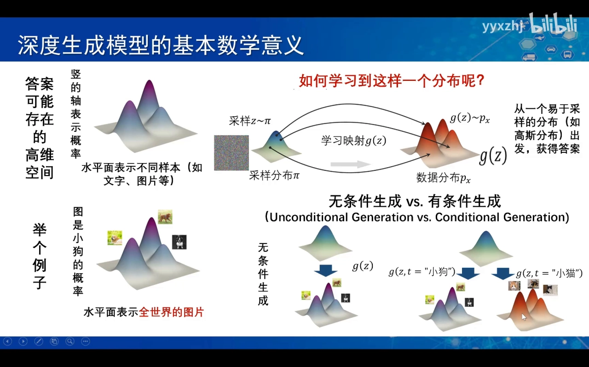
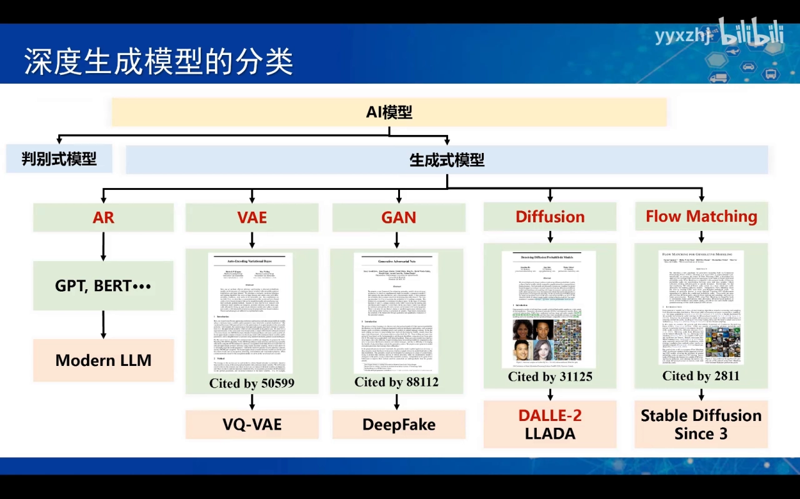
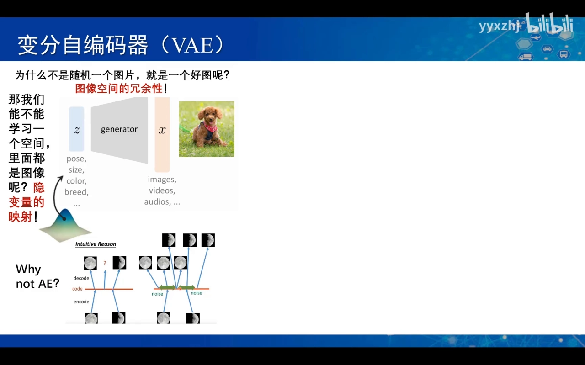
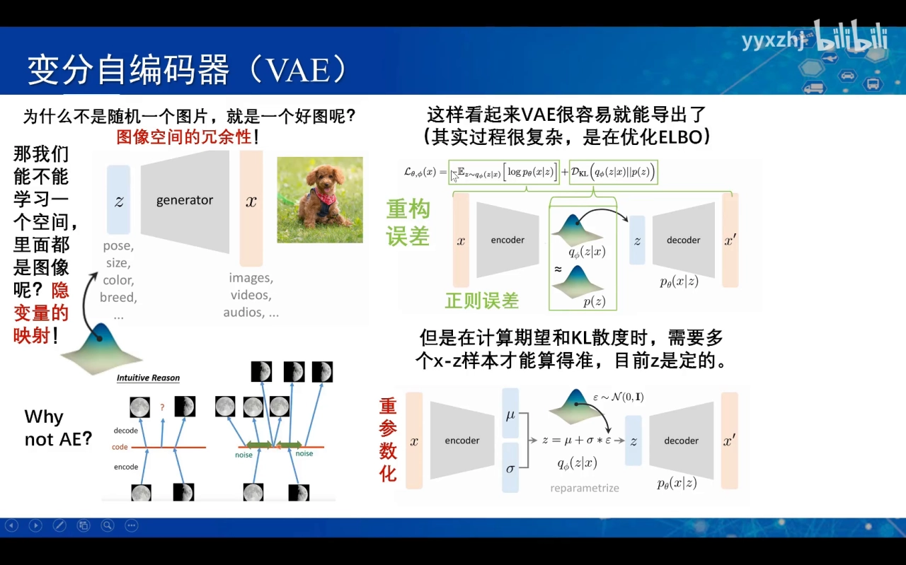
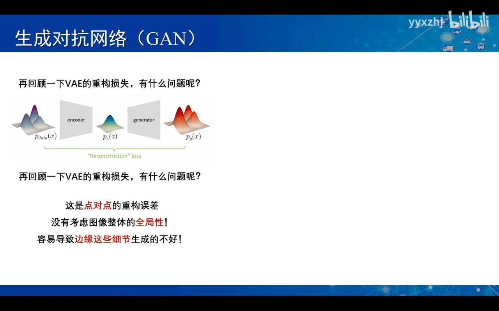
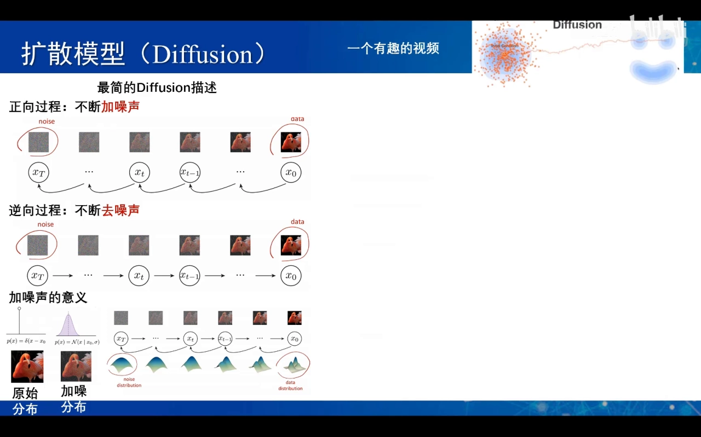
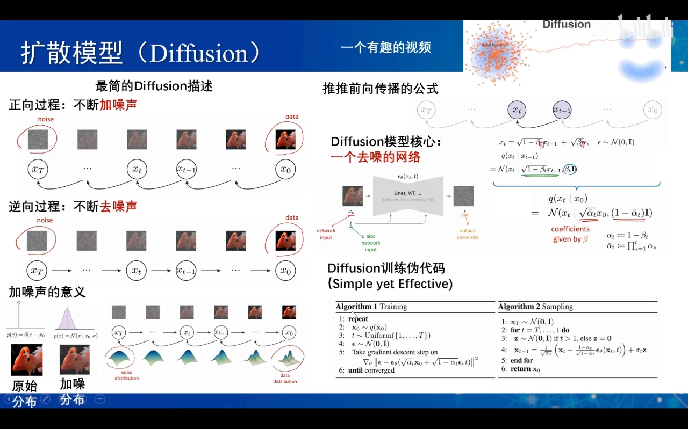
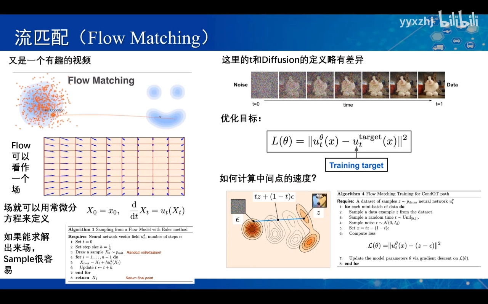
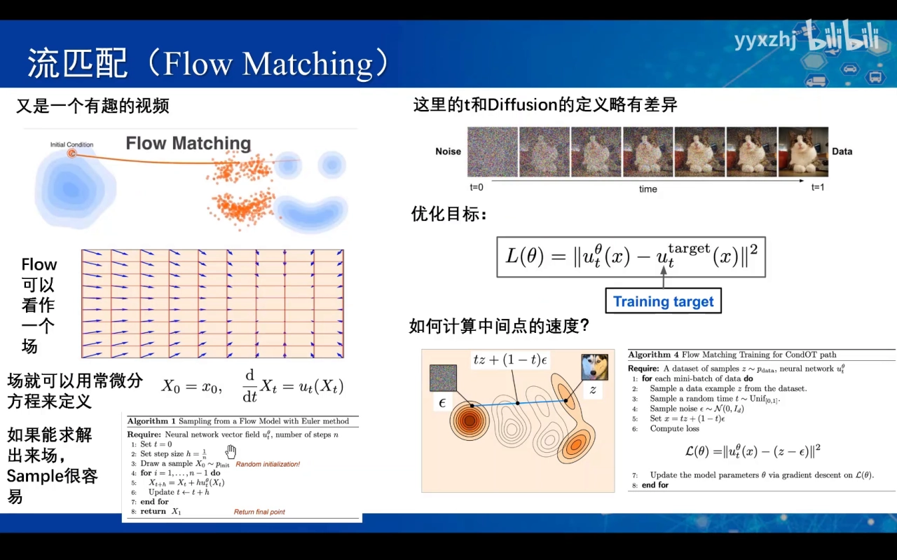
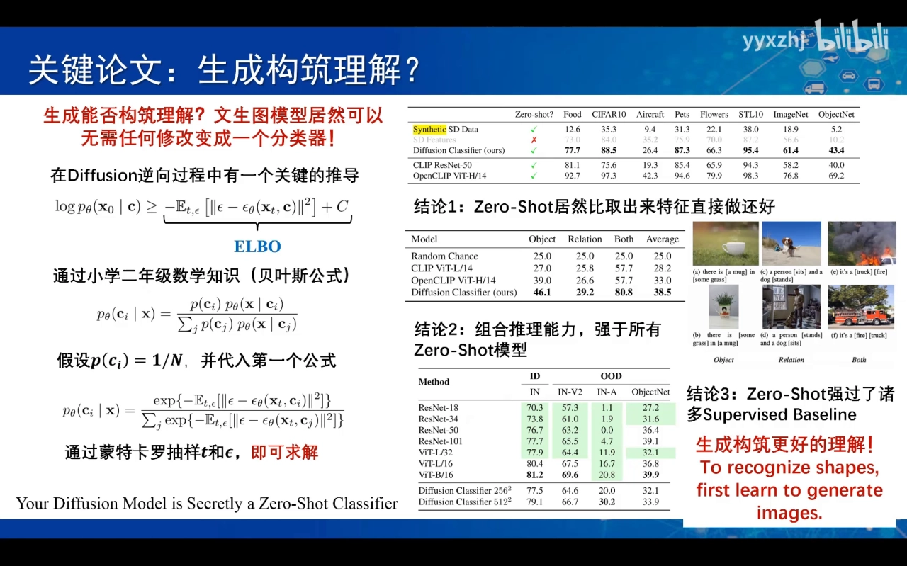

# 五类生成模型共用一张蓝图：从自回归、VAE、GAN到扩散与流匹配的谱系

> 视频来源：[浅谈当下深度生成模型：从VAE、GAN、Diffusion、Flow Matching到世界模型](https://www.bilibili.com/video/BV12m2WBhE1L/)（Bilibili · yyxzhj，约 53 分钟）
> 导读：这是一场按何恺明 MIT「深度生成模型」课程框架展开的综述报告，把自回归、VAE、GAN、扩散、流匹配五条路线并排放在一张分类图上，并用同一句话概括它们的共性——「从易采样的高斯分布出发，学一个映射到数据分布」。本文按这条主线复述五条路线各自的机制与代价，并补上横向对照表；视频末尾关于世界模型（Genie 2、Marble、Veo 3）的讨论属于另一主题，本文只在结尾一句带过。

## 本讲要解决的核心问题（SCQA）

**背景**：今天被称为「生成式 AI」的东西五花八门——写文章的 GPT、画图的 Stable Diffusion、做人脸的风格 GAN、做视频的即梦。它们面向的对象完全不同，工程实现也几乎没有交集。

**冲突**：正因为名字都叫「生成」，一个常见的误解是「所有生成模型都是扩散模型」，或者反过来「扩散只是 GAN 的替代品」。可如果它们真是彼此替代的关系，为什么 2024 年之后 Stable Diffusion 3 会从 diffusion 转向 flow matching？为什么文本上自回归仍然压着扩散打，图像上却反过来？

**疑问**：这些路线到底共享什么、又在哪一步分道扬镳？给定一个具体任务，应该按什么标准选路线？

**回答（中心思想）**：五条路线共享同一张蓝图——**先从一个人人会采样的分布（通常是标准高斯）里取一个点，再学一个映射把它送到数据分布上**。差别只在「这个映射被拆成几步、每一步学什么」：自回归把映射拆成逐元素的条件概率，VAE 用一次编码—解码完成映射并顺手给出似然，GAN 干脆不写映射的显式形式、只让判别器打分，扩散把映射拆成上千步去噪，流匹配把映射写成一个连续速度场的积分。理解了这一点，「训练稳不稳、采样贵不贵、模式覆盖全不全、能不能算似然」就都是这条拆法带来的推论，而不是玄学。

## 一、先看结论：五条路线是同一张蓝图的不同填法

### 1.1 生成任务的四个共同点

报告一开始没有讲模型，而是先归纳「生成」这件事到底难在哪。它列了四条共同点[【跳转到 03:06】](https://www.bilibili.com/video/BV12m2WBhE1L/?t=186)：

1. **一个输入对应多种甚至无穷种回答**。你问「什么是深度生成模型」，不同的人给出不同的答案。
2. **不同回答的可信度不同**。有人答得随意（「能生成东西的就是」），有人答得学术（「一类什么样的机器学习模型」），后者明显更可信。
3. **训练集里大概率没有见过同样的问题与解法**。训练集里只有熊猫、只有吉他，但用户要的是「熊猫弹吉他」。
4. **输出往往比输入更复杂、更高维**。一句「我骑着龙」很简单，生成出的画面却要自带天空、大地、光影。

第 1、2 条合起来，就逼出了一个数学形式：存在一个高维空间，横轴是「所有可能的样本」，纵轴是「这个样本作为真正答案的概率」。**生成就是在这个分布里采样，采到概率高的地方，结果就更可信**[【跳转到 06:30】](https://www.bilibili.com/video/BV12m2WBhE1L/?t=390)。

### 1.2 一张蓝图：从好采样的分布映射到数据分布

问题随之而来：高维分布既难学、也难采样——它「看不见摸不着」。但有一件事很容易：**从高斯分布里采样**。于是所有路线共用的蓝图出现了[【跳转到 08:15】](https://www.bilibili.com/video/BV12m2WBhE1L/?t=495)：

$$
z \sim \pi \quad(\text{通常是标准高斯}), \qquad x = g(z) \sim p_{\text{data}}
$$

只要学到映射 $g$，采样就退化成「采一个噪声、过一次网络」。报告的原话是：VAE 也好、GAN 也好、Diffusion 也好、Flow Matching 也好，**核心原理都是在一个高斯分布上采一个点，然后做一个映射**。

这张幻灯片还有一个容易被忽略的细节：图里把「无条件生成」和「有条件生成」画成了同一张图的两种走法。无条件生成只学 $g(z)$；有条件生成学 $g(z, t)$，其中 $t$ 是条件（「小狗」「熊猫弹吉他」）。**条件不是另一种模型，只是给映射多喂一个输入**——这一点后面讲自回归时会再次出现。

### 1.3 五条路线的分类图

有了蓝图，再看分类图就清楚了[【跳转到 13:15】](https://www.bilibili.com/video/BV12m2WBhE1L/?t=795)：AI 模型先分成判别式与生成式，生成式再分成 AR（自回归）、VAE、GAN、Diffusion、Flow Matching 五支，每支下面挂着代表工作——GPT/BERT、VQ-VAE、DeepFake、DALL·E 2/LLaDA、Stable Diffusion 3。

报告在这里给了一个值得记住的判断：**自回归这一支在文本上最强，扩散这一支在图像上更强**，而扩散因为效率优势，甚至在某些场景下可能反超自回归语言模型——这是当下 AI 的关键争论之一[【跳转到 14:30】](https://www.bilibili.com/video/BV12m2WBhE1L/?t=870)。注意这只是「当下分析」，不是定理；下一节会看到，它其实是「拆法」决定的。

## 二、五条路线各自怎么「填」这张蓝图

### 2.1 自回归：把联合分布拆成一串条件概率

自回归的拆法最直白：不直接学 $p(x)$，而是学一串条件分布，再乘起来。报告用 GPT 举例：给定「this work is hard」，下一个词可能是 harder，也可能是 easier，模型输出的是**下一个 token 的概率分布**，采样一次得到一个词，再把它接回去继续采[【跳转到 15:04】](https://www.bilibili.com/video/BV12m2WBhE1L/?t=904)。

$$
p(x) = \prod_{t=1}^{T} p(x_t \mid x_{<t})
$$

这条式子的推导在 [M02 §4.1.4 自回归预测与条件似然](../../../M02_序列建模与大模型架构/README.md#m02-4-1-4) 与 [1.2.5 自回归与扩散的路线对照](../1.2.5_自回归与扩散的路线对照：似然分解、采样与误差累积/自回归与扩散的分岔点：一次预测多少像素决定采样步数.md) 已经推过，这里只借用结论。

报告补充了两个常被忽略的点：

- **不是所有自回归模型都是生成式模型**。做轨迹预测时，最后一层是 linear 层，输出的是确定的 GPS 坐标，它可以叫自回归，但不能叫生成式——因为它不「生成」多个可能。
- **自回归不等于 GPT**。报告特意纠正了这个误解：只要「用自己的一部分预测另一部分」，就是自回归。把图像的一部分设成 mask、预测被遮住的部分（BERT/MAE 那一路），同样属于自回归，而且**生成顺序可以任意指定**，比 GPT 的单向生成更灵活[【跳转到 18:24】](https://www.bilibili.com/video/BV12m2WBhE1L/?t=1104)。

代价也很清楚：**乘积有几个因子，采样就要走几步**。文本长度上千，采样就是上千次前向；而且每一步的误差会顺着链条传下去。

### 2.2 VAE：显式似然路线，用隐变量换一个可采样的空间

VAE 的出发点是另一个观察：直接从高斯分布采一组 RGB 数值，得到的几乎一定是噪声图，因为**图像空间是冗余的**，绝大多数点不对应任何有意义的图[【跳转到 18:59】](https://www.bilibili.com/video/BV12m2WBhE1L/?t=1139)。所以它想学一个「稠密」的隐空间：里面每个点都能解码成一张像样的图。

做法是编码器把图像压到隐空间、解码器还原，再加两个约束：

- **重建误差**：解码回来要和原图像（MSE/MAE）。
- **KL 散度**：隐变量的分布要贴近标准正态，这样生成时可以直接从 $\mathcal{N}(0, I)$ 采样。

但只做这两件事还不够。如果编码器把每张图映射成一个**点**，那些点之间的位置就没有意义，采样落在空隙里只会得到无意义的图。所以 VAE 让每张图映射成一个**区间**（一个高斯分布），并在采样时注入噪声——这需要**重参数化**把随机性从计算图里挪出去[【跳转到 21:29】](https://www.bilibili.com/video/BV12m2WBhE1L/?t=1289)：

$$
z = \mu + \sigma \odot \varepsilon, \qquad \varepsilon \sim \mathcal{N}(0, I)
$$

VAE 属于**显式似然**路线：它真的写出并优化了数据的对数似然下界（ELBO），所以既能采样、也能给样本打分。代价是那个下界只是下界，而且重建项与 KL 项互相拉扯，训练容易出现「只顾重建」或「只顾贴合先验」的倾斜。

### 2.3 GAN：隐式对抗，绕开逐像素重构

GAN 的动机来自 VAE 重建损失的一个硬伤：**逐像素比较是点对点的，看不到全局**。为了让某个像素的误差小一点，模型可能在它旁边连续画出好几条边缘，整体看上去就糊了[【跳转到 25:45】](https://www.bilibili.com/video/BV12m2WBhE1L/?t=1545)。

于是换一个「裁判」：不再逐像素比，而是训练一个神经网络判别器来判断「这张图真不真」。这就有了两个网络、两个目标：

- 判别器想让生成图被识破；
- 生成器想骗过判别器。

报告特别强调，**这两个目标不能塞进一个 loss 里一起优化**——那样最优解就是「一半真一半假」，loss 卡在 0.5。必须用 minimax 博弈的方式**交替训练**：训生成器时冻住判别器，训判别器时冻住生成器，循环往复[【跳转到 27:00】](https://www.bilibili.com/video/BV12m2WBhE1L/?t=1620)。

GAN 是**隐式**路线：它只提供一个采样器 $g(z)$，从不写出 $p(x)$，因此**算不出似然**，也就算不出「这个样本的概率是多少」。它的优势是采样极快（一次前向），劣势是训练不稳定、容易模式崩塌——这两点在 [1.2.3 对抗生成（GAN）](../1.2.3_对抗生成（GAN）：生成器、判别器与训练目标/生成器与判别器如何互相推动：GAN的基本框架与交替训练.md) 里已经展开，这里只作为谱系中的一格。

### 2.4 扩散：把「一步去噪」拆成上千步

扩散的拆法与前三者都不同：它不直接学 $z \mapsto x$，而是先定义一个**加噪过程**（不断往图上加噪，直到变成纯噪声），再学它的逆过程（从纯噪声一步步去噪）[【跳转到 27:45】](https://www.bilibili.com/video/BV12m2WBhE1L/?t=1665)。

报告给了一个很好的直觉解释：原始数据分布是数轴上的一个**尖峰**，很难直接命中；加噪之后，样本被摊成一段**区间**，于是「从区间里一步步收缩回那个点」就比「一步命中尖峰」容易得多。

加噪不能简单地把图和高斯噪声相加（那样均值会一直是 $x_0$，采样困难），而要加权求和，比例由一个关键变量 $\beta_t$ 控制，通常取 cosine 一类的日程。有了它，加噪可以**一步到位**：

$$
x_t = \sqrt{\bar\alpha_t}\, x_0 + \sqrt{1-\bar\alpha_t}\, \varepsilon, \qquad \varepsilon \sim \mathcal{N}(0, I)
$$

训练因此变得极简：取一张图、随机取 $t$、随机取噪声，让网络预测「这一步加进去的噪声是什么」[【跳转到 31:55】](https://www.bilibili.com/video/BV12m2WBhE1L/?t=1915)。

扩散属于**得分/去噪**路线：它不显式给出 $p(x)$，但每一步都在估计「往哪个方向走能提高数据密度」，也就是得分函数的方向。代价是**采样必须迭代**——DDPM 原论文需要上千步，这是它最贵的部分。

### 2.5 流匹配：把去噪看成一场连续的输运

流匹配是五条里最新的一条，也是 Stable Diffusion 3 之后的主流底座。报告用一段对比视频说明差别：扩散的样本轨迹「滋啦滋啦」地曲折前进，流匹配的轨迹则非常丝滑[【跳转到 41:29】](https://www.bilibili.com/video/BV12m2WBhE1L/?t=2489)。

原因是它换了一个视角：**把生成看成「场」中的运动**。就像在电磁场里放一根针，针会顺着场走到终点；样本点顺着速度场 $u_t$ 从噪声分布流到数据分布，于是整个过程可以用一个常微分方程描述：

$$
\frac{d}{dt} x_t = u_t(x_t)
$$

这个改动的直接后果是**采样步数大幅下降**：报告说扩散可能需要 1000 步，流匹配「可能只需要三五十步」。训练目标也很朴素——既然只有噪声和真实图像，就假设两者之间是一条直线，取中间点 $t z + (1-t)\varepsilon$，让网络预测这条直线的速度 $z - \varepsilon$：

$$
L(\theta) = \left\lVert u_t^\theta(x) - (z - \varepsilon) \right\rVert^2
$$

报告还讲了一个有意思的产业细节：Stable Diffusion 这个厂牌名字里带 Diffusion，却在 flow matching 表现更好之后**调转船头**，Stable Diffusion 3 用的就是 flow matching[【跳转到 44:32】](https://www.bilibili.com/video/BV12m2WBhE1L/?t=2672)。这说明路线选择看的是效率与效果，不是名字。

## 三、横向对照：五条路线差在哪几个维度

把上面五节压缩成一张表，就是本小节要的谱系对照。表中「显式似然」指能否直接写出并优化 $p(x)$；「采样代价」指生成一个样本需要几次网络前向。

| 路线 | 学什么（训练目标） | 显式似然 | 训练稳定性 | 采样代价 | 模式覆盖倾向 | 典型场景 |
| :--- | :--- | :--- | :--- | :--- | :--- | :--- |
| 自回归 AR | 逐元素条件分布 $p(x_t \mid x_{<t})$ | 有（精确的链式分解） | 高（就是监督学习） | 高（步数等于序列长度） | 覆盖好，但受生成顺序影响 | 文本、代码、离散 token |
| VAE | ELBO：重建误差 + KL 正则 | 有（下界） | 中（两项互相拉扯、后验坍缩） | 低（一次解码） | 偏保守，容易只覆盖主要模式 | 潜表示、压缩、需要似然的场景 |
| GAN | 生成器与判别器的 minimax 博弈 | 无（隐式） | 低（交替训练易失衡） | 最低（一次前向） | 易模式崩塌，覆盖差 | 高保真图像、实时生成 |
| 扩散 Diffusion | 回归每一步加入的噪声 $\varepsilon$ | 无（但可估 ELBO） | 高（回归任务，目标明确） | 高（数十到上千步） | 覆盖好，多样性可调 | 图像、音频、视频、动作规划 |
| 流匹配 Flow Matching | 回归概率路径上的速度场 $u_t$ | 无（可算连续似然） | 高（同样是回归） | 中低（数十步，可少至几步） | 覆盖好，路径更直 | 新一代图像/视频底座 |

表格里最值得盯的是两条对角线：

- **「显式似然」与「采样代价」并不同向**。VAE 有似然但采样一次；GAN 没有似然但采样一次；扩散没有似然却要上千步。**能不能算似然，和生成快不快，是两件独立的事**。
- **「训练稳定性」与「模式覆盖」也不同向**。GAN 训练最不稳、覆盖最差；扩散训练最稳、覆盖最好。这不是巧合：扩散把「一步生成」拆成上千个简单的回归任务，每个任务都容易学；GAN 把「生成」和「评判」耦合成一个博弈，任何一方过强都会破坏平衡。

至于**得分匹配**与**流匹配**的关系，本讲只讲到这里：score-based model 与 DDPM 的详细对照、以及流匹配与扩散在训练目标与概率路径上的异同，由同系列的 [4.2.4 流匹配与扩散的训练目标、概率路径和采样对照](../../../README.md#m04-4-2-4) 继续展开。

## 四、怎么给一个任务选路线

把上面的维度换成决策顺序，大致是这样四问：

**第一问：输出是离散 token 还是连续信号？** 离散（文本、代码、氨基酸序列）优先自回归——它的链式分解天然匹配「一个接一个吐符号」，而且似然可直接算，便于做语言建模那一套评估。连续（图像、音频、坐标、构象）则优先扩散或流匹配。

**第二问：能不能接受迭代采样？** 如果推理预算宽松（离线生成图片、视频、结构），扩散/流匹配的迭代不是问题，换来的是稳定训练与好覆盖。如果必须一次前向出结果（实时渲染、嵌入式、大规模筛选），GAN 或 VAE 的一次解码更合适。

**第三问：需不需要似然？** 需要给样本打分、做异常检测、做密度估计时，只有显式似然路线（自回归、VAE、归一化流）能直接给数；扩散只能给 ELBO 下界，GAN 完全给不出。

**第四问：多样性重要还是保真度重要？** 需要覆盖长尾（科学数据、分子构象、罕见病样本）时，扩散/流匹配的覆盖更好；只求「好看」且模式集中（人脸、特定风格）时，GAN 仍然划算。

报告本身给了一个更凝练的版本：**扩散在图像上更好，自回归在文本上更好**，而流匹配因为路径更直、采样更快，正在成为新的默认底座[【跳转到 14:30】](https://www.bilibili.com/video/BV12m2WBhE1L/?t=870)。但它也提醒，这只是当下的经验判断，不是终局。

## 五、一个副产品：生成里蕴含理解

报告中间插了一篇论文，值得单独一提，因为它从另一个角度说明了「路线不只是工程选择」。这篇论文叫《Your Diffusion Model is Secretly a Zero-Shot Classifier》——**一个文生图模型，不做任何修改就能当分类器用**[【跳转到 35:30】](https://www.bilibili.com/video/BV12m2WBhE1L/?t=2130)。

思路是：扩散模型的训练目标本身就给出了 $\log p_\theta(x \mid c)$ 的一个下界（ELBO），再用贝叶斯公式反解 $p(c \mid x)$，就得到一个零样本分类器。实验结果是：它不用训练就超过了 CLIP 这类零样本模型，甚至把 Stable Diffusion 的特征接一个 linear 层做判别都比不过它。

这张幻灯片上写着报告的副标题：**To recognize shapes, first learn to generate images**（要认识形状，先学会生成图像）。换句话说，生成路线的选择不只影响「画得好不好」，也影响模型内部到底学到了什么。

视频最后二十分钟转向世界模型（Genie 2、Marble、Veo 3），讨论「可玩的世界」与「内嵌世界知识」两类定义，属于另一条主题线，此处不展开。

## 小结

- 五条路线共用一张蓝图：**从易采样的分布取点，学一个映射送到数据分布**；差别只在映射被拆成几步、每步学什么。
- 自回归把映射拆成逐元素条件概率：似然精确、训练就是监督学习，但采样步数等于序列长度；而且自回归不等于 GPT，生成顺序可以任意指定。
- VAE 用隐变量换一个可采样的稠密空间，是显式似然路线；重建项与 KL 项互相拉扯，训练不如扩散稳。
- GAN 用判别器替代逐像素重构，是隐式路线：采样最快、算不出似然、训练最不稳、覆盖最差。
- 扩散把一步去噪拆成上千步回归，训练最稳、覆盖最好，代价是采样必须迭代。
- 流匹配把生成写成连续速度场的积分，路径更直，采样步数从上千降到数十步，Stable Diffusion 3 之后成为新底座。
- 选型四问：离散还是连续、能否接受迭代、要不要似然、多样性还是保真度。
- 不要把「生成」等同于「扩散」：文本上的主流仍是自回归，实时场景仍有 GAN 的位置，需要似然的场合只有显式似然路线能给数。

## 关键术语速查

| 术语 | 一句话解释 |
| :--- | :--- |
| 显式似然 | 模型能写出 $p(x)$ 或它的下界并直接优化，因此可以给任意样本打概率分 |
| 隐式模型 | 只提供采样器 $g(z)$，不写出 $p(x)$，无法计算似然（GAN 是代表） |
| ELBO | 对数似然的下界，VAE 与扩散都用它作为可优化的替代目标 |
| 重参数化 | 把 $z = \mu + \sigma\varepsilon$ 写成可导形式，让采样节点的梯度能回传 |
| 得分函数 | $\nabla_x \log p(x)$，指向「密度上升最快」的方向；扩散每一步都在估计它 |
| 概率流 ODE | 用确定性常微分方程描述样本随时间的移动，边缘分布与随机过程相同 |
| 流匹配 | 直接回归概率路径上的速度场，训练目标是最小二乘，采样用 ODE 积分 |
| 模式崩塌 | 生成器只覆盖数据分布的少数模式，输出多样性骤降 |
| 后验坍缩 | 解码器强到不依赖隐变量，隐空间退化为无用信息 |