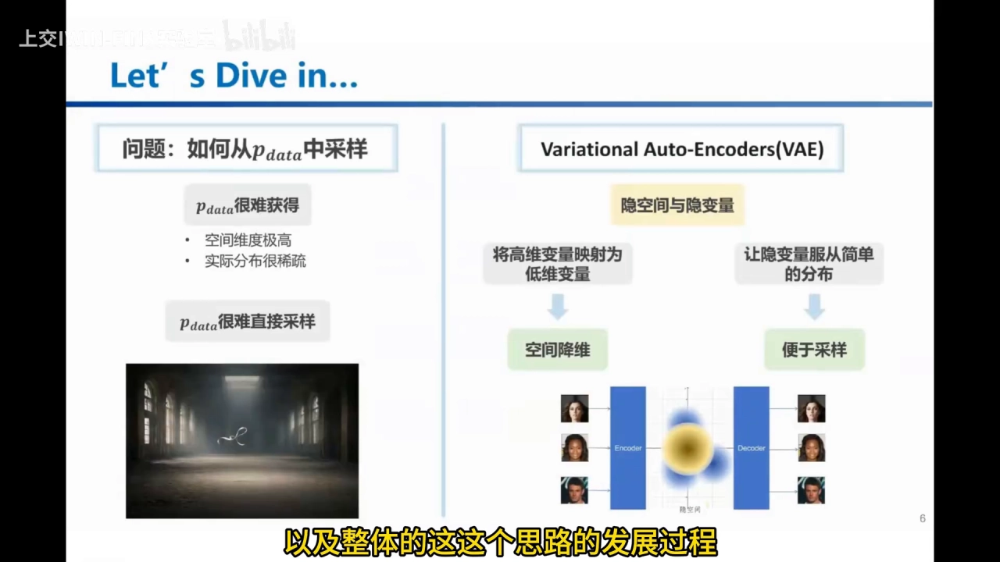
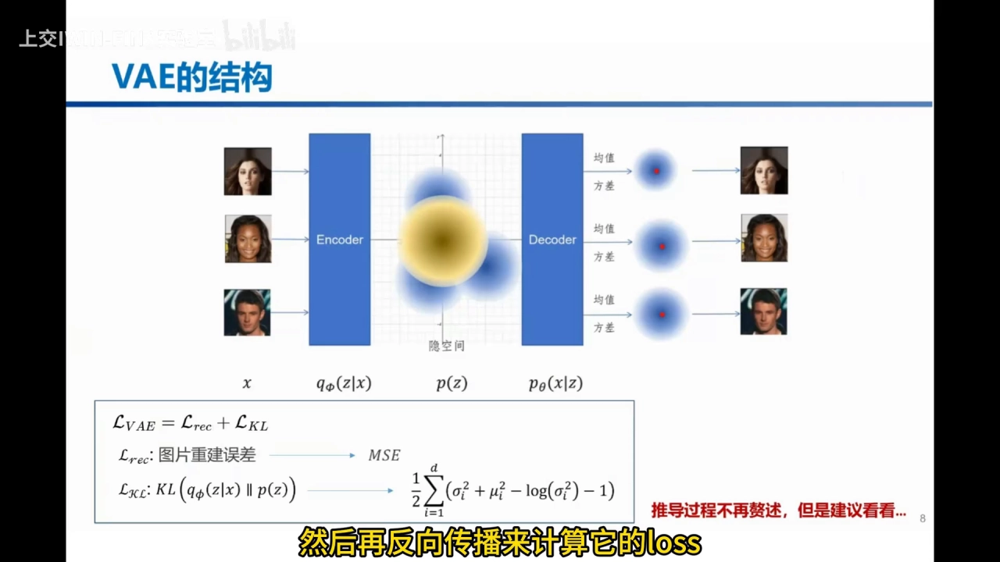
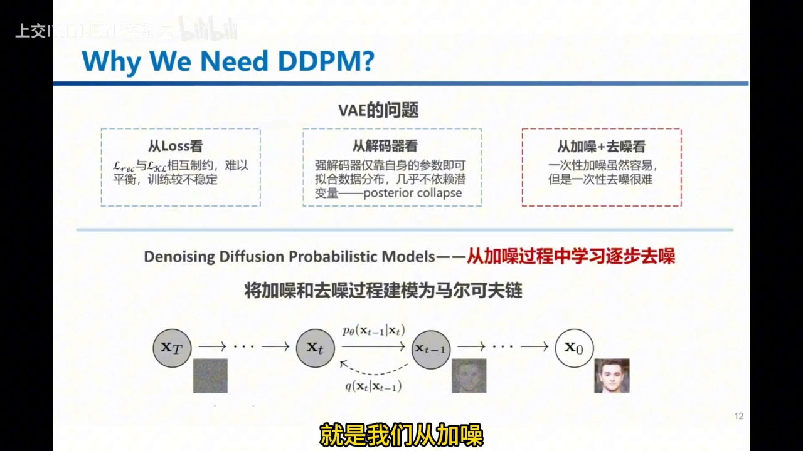
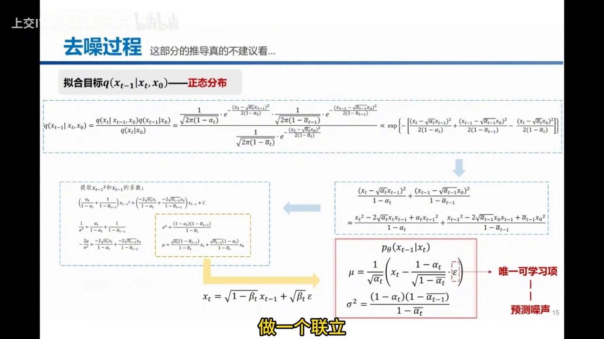
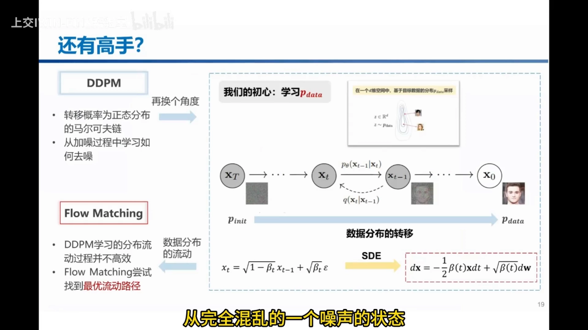
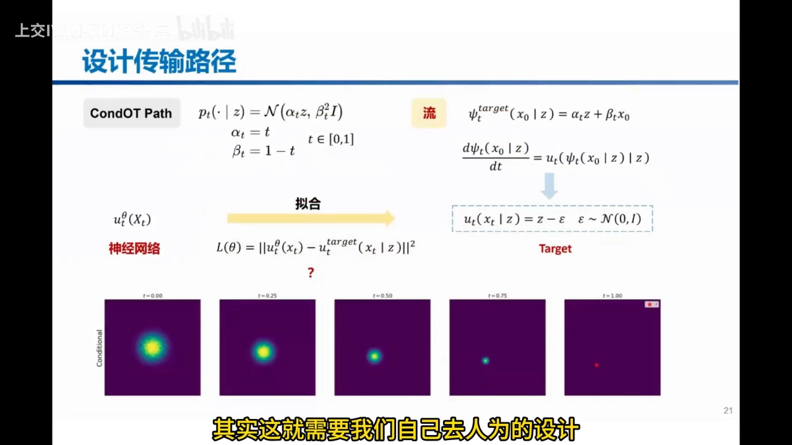
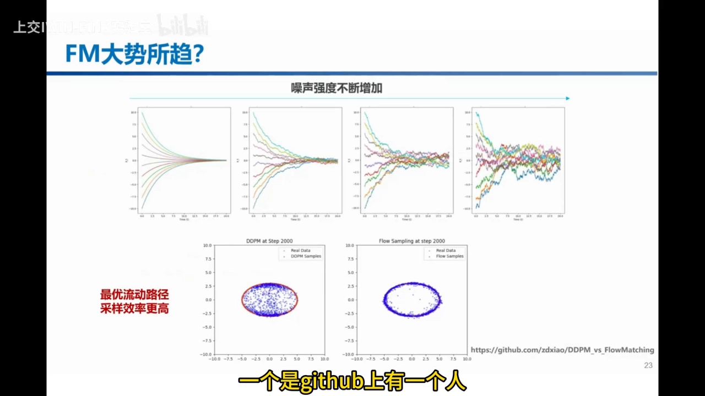
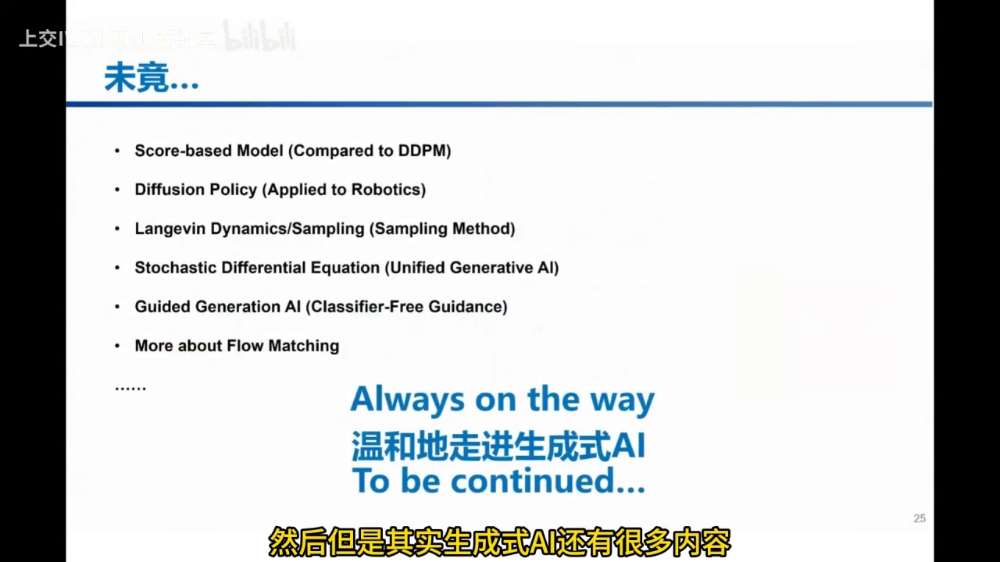

# 从VAE到DDPM再到流匹配：三条路线的统一视角与采样效率取舍

> 视频来源：[温和地走进生成式AI：从VAE到Flow Matching](https://www.bilibili.com/video/BV17q9uBxEpo/)（Bilibili · 上海交大「温和地走进」系列讲座，约 53 分钟）
> 导读：这是一场从「我们到底要解决什么问题」出发的推导型讲座，把 VAE、DDPM、Flow Matching 三条路线依次拆开，最后用 SDE/ODE 把它们收进同一个框架。本文按讲座顺序复述推导，重点保留三样东西：每条路线的目标函数怎么来的、训练为什么稳或不稳、采样为什么贵或不贵。

## 本讲要解决的核心问题（SCQA）

**背景**：生成式 AI 的模型名字越来越花——VAE、GAN、DDPM、score-based、flow matching。它们各自都有一套论文与符号，读起来像是彼此独立的发明。

**冲突**：但真正动手时，你会发现它们在做同一件事：把一个好采样的分布搬到一个难采样的分布上。更奇怪的是，DDPM 与 score-based model 的论文符号完全不同，结论却几乎一样；而 flow matching 只把「加噪」换成「走直线」，采样步数就从上千降到几十。

**疑问**：这三条路线到底是三个发明，还是同一个东西的三种写法？如果是后者，为什么有的训练稳、有的不稳？为什么有的采样贵、有的便宜？

**回答（中心思想）**：三条路线都在解同一个问题——**如何从 $p_{\text{data}}$ 采样**。VAE 的答案是「学一个隐空间，让采样在隐空间里发生」；DDPM 的答案是「把一步去噪拆成上千步，每步只学噪声」；flow matching 的答案是「设计一条从噪声到数据的传输路径，学这条路径上的速度场」。一旦用 SDE/ODE 写出来，它们就变成同一个「分布输运」问题的三种参数化：**随机性越强，路径越曲折、采样越贵，但多样性越好；路径越直，采样越省，但需要人为设计路径**。

## 一、先把问题说清楚：生成 = 从 $p_{\text{data}}$ 里采样

讲座开场先做了一个定位：2010 到 2020 年的传统 AI 主要在做「认识世界」——分类、识别、预测、控制、决策，都是从已知数据里学规律再做应用，局限在已有认知里；2020 年之后，尤其是 2022 年 ChatGPT 发布之后，生成式 AI 开始做「改造世界」[【跳转到 01:57】](https://www.bilibili.com/video/BV17q9uBxEpo/?t=117)。

那么「生成内容」在数学上是什么？讲座的回答很朴素：**内容都是向量**。图像是像素的高、宽与 RGB 数值，视频多一个时间维，动作是动作维度上的向量；数据集就是一堆向量的集合。生成就是**从这些已有向量里造出新的向量**。

$$
\text{生成} \;=\; \text{从 } p_{\text{data}} \text{ 中采样一个向量}
$$

于是所有生成式 AI 的方法，都是在回答同一个问题：**如何从 $p_{\text{data}}$ 中采样**[【跳转到 05:27】](https://www.bilibili.com/video/BV17q9uBxEpo/?t=327)。

这个问题难在两点[【跳转到 06:13】](https://www.bilibili.com/video/BV17q9uBxEpo/?t=373)：

1. **$p_{\text{data}}$ 很难获得**：空间维度极高，而真实数据分布极其稀疏——讲座用了一个很形象的比喻，把高维特征空间想象成一个三维大房子，$p_{\text{data}}$ 只是飘在房间里的一条丝带。
2. **$p_{\text{data}}$ 很难直接采样**：即使知道了密度函数的形式，从一个复杂的、高维的密度里抽样本也没有通用办法。

这也解释了为什么后面三条路线**都聚焦在高斯噪声上**：高斯分布是真的好采样。三条路线的差别，只在于「怎么把高斯样本变成数据样本」。

## 二、VAE：把采样搬到隐空间去做

### 2.1 思路：降维 + 让隐变量服从简单分布

VAE 对上面两个难点各给了一个对策：

- **空间降维**：用 encoder 把高维的真实特征映射成低维的隐变量，在低维空间里分布更密集、更好学。
- **便于采样**：让隐变量服从简单的分布（标准正态），这样生成时直接从 $\mathcal{N}(0, I)$ 采样即可。

### 2.2 为什么不能直接用 AE

一个自然的反问：AE 也是 encoder 加 decoder，为什么不直接把 VAE 的 encoder 拿掉，从隐空间采样再解码？

讲座的回答是：**AE 的目标本来就不是生成**。它要的是数据的有效表示——把高维压到低维、便于做匹配和检索。它的 encoder 把输入映射成隐空间里**离散的点**，这些点之间没有定义任何东西；你从中间随便采一个点，解码出来大概率是噪声，而不是有意义的图[【跳转到 10:29】](https://www.bilibili.com/video/BV17q9uBxEpo/?t=629)。

VAE 的改动就一句话：**把每张图映射成一个正态分布，并让这些分布尽可能贴近标准正态**。这样分布与分布之间会重叠，重叠区域同时带有两张图的共同特征——从重叠区采样再解码，就得到了「训练集里没有、但合理」的新内容[【跳转到 11:19】](https://www.bilibili.com/video/BV17q9uBxEpo/?t=679)。

### 2.3 结构、损失与重参数化

结构上，输入 $x$ 经 encoder $q_\phi(z \mid x)$ 得到隐变量 $z$，$z$ 的分布 $p(z)$ 希望接近标准正态；再经 decoder $p_\theta(x \mid z)$ 还原。decoder 输出的是一个正态分布，但生成时只取它的均值，所以等价于一个确定的点。

损失由两项组成：

$$
\mathcal{L}_{\text{VAE}} = \mathcal{L}_{\text{rec}} + \mathcal{L}_{\text{KL}}, \qquad
\mathcal{L}_{\text{rec}} = \text{MSE}(x, x'), \qquad
\mathcal{L}_{\text{KL}} = \mathrm{KL}\!\left(q_\phi(z \mid x) \,\middle\|\, p(z)\right)
$$

- **重建误差**：保证输出和输入尽可能一致，即生成质量。
- **KL 散度**：保证隐变量分布贴近标准正态，即「便于采样、便于融合」。

讲座对这两项的关系有一个精到的说法：**它们互相制衡**。过于偏向重建，生成的新内容就太像训练集，没有创新性；过于偏向 KL，融合得太多，又会生成我们不希望的内容[【跳转到 15:03】](https://www.bilibili.com/video/BV17q9uBxEpo/?t=903)。

还有一处工程细节必须提：隐空间的采样是随机的，而反向传播需要连续可导。解决办法是**重参数化**——把 $z = \mu + \sigma\varepsilon$ 里的随机性全部推给 $\varepsilon$，让 $z$ 对 $\mu$、$\sigma$ 确定且可导[【跳转到 16:51】](https://www.bilibili.com/video/BV17q9uBxEpo/?t=1011)。这也是「为什么选高斯」的一个隐藏理由：高斯分布允许这种写法。

## 三、DDPM：把「一次去噪」拆成上千次

### 3.1 VAE 的三个问题

讲座在进入 DDPM 之前，先把 VAE 的短板列清楚[【跳转到 20:40】](https://www.bilibili.com/video/BV17q9uBxEpo/?t=1240)：

1. **从 loss 看**：$\mathcal{L}_{\text{rec}}$ 与 $\mathcal{L}_{\text{KL}}$ 相互制约，难以平衡，训练较不稳定。
2. **从解码器看**：如果解码器足够强，仅靠自身参数就能拟合「隐变量到输出」的映射，它几乎不依赖隐变量——这就是**后验坍缩**，隐空间退化成无用信息。
3. **从加噪与去噪看**：VAE 是「一次性加噪、一次性去噪」。一次性加噪很容易（把一幅画全涂黑就行），但一次性去噪很难（把黑色去掉、还原那幅画）。

第三条是 DDPM 的切入点：**如果去噪很难，那就把它拆成很多小步**。就像在画上画一笔再去掉一笔，比一次涂黑再还原容易得多。

### 3.2 加噪：为什么要加权，而不是直接加噪

DDPM 把加噪和去噪建模成一个马尔可夫链。加噪（熵增）本身永远简单，但有一个坑：如果直接注入均值为零、方差为 $I$ 的高斯噪声，那么每一步之后均值一直是 $x_0$，不同图片最终服从的是**不同均值**的分布，采样依然困难。

所以要把加噪公式设计成让所有图片最终都收敛到**同一个**标准正态：

$$
x_t = \sqrt{1-\beta_t}\, x_{t-1} + \sqrt{\beta_t}\, \varepsilon, \qquad \beta_t \in (0, 1) \text{ 随 } t \text{ 递增}
$$

累乘之后可以一步到位：

$$
x_t = \sqrt{\bar\alpha_t}\, x_0 + \sqrt{1-\bar\alpha_t}\, \varepsilon, \qquad \bar\alpha_t = \prod_{s=1}^{t} \alpha_s, \quad \alpha_t = 1 - \beta_t
$$

当 $t \to T$ 时 $\sqrt{\bar\alpha_t} \to 0$、$\sqrt{1-\bar\alpha_t} \to 1$，于是 $x_T$ 就是标准高斯——好采样。

### 3.3 去噪：从贝叶斯公式推到「只学噪声」

去噪要学的是后验 $q(x_{t-1} \mid x_t)$。直接算算不出来，因为 $q(x_t)$ 要考虑所有可能的原始输入。于是做一个关键简化：**把 $x_0$ 也放进条件里**，得到 $q(x_{t-1} \mid x_t, x_0)$。由于马尔可夫性，$q(x_t \mid x_{t-1})$ 里的 $x_0$ 可以省略，于是三项都是高斯，可以解析求解[【跳转到 27:33】](https://www.bilibili.com/video/BV17q9uBxEpo/?t=1653)。

推导的结果是：后验的方差 $\sigma^2$ 完全由 $\beta_t$ 这些已知日程决定，均值 $\mu$ 里唯一的未知量是 $\varepsilon$。所以 **DDPM 的神经网络只需要预测噪声**：

$$
\mathcal{L}_{\text{DDPM}} = \left\lVert \varepsilon - \varepsilon_\theta\!\left(\sqrt{\bar\alpha_t}\,x_0 + \sqrt{1-\bar\alpha_t}\,\varepsilon,\; t\right) \right\rVert^2
$$

这就是为什么 DDPM 的论文里只说「训练一个噪声预测器」——推导那么长，最终结论就这一句。

### 3.4 采样：为什么必须迭代

生成时从 $x_T \sim \mathcal{N}(0, I)$ 出发，用训练好的网络预测噪声、按公式算出 $\mu$ 和 $\sigma^2$，从对应的正态分布里采一个 $x_{t-1}$，重复 $T$ 次，最后取 $x_0$ 的均值。

讲座在这里给了一句很关键的评语：**这样的过程比 VAE 的训练效果更稳定，生成效果也更稳定**[【跳转到 32:00】](https://www.bilibili.com/video/BV17q9uBxEpo/?t=1920)。原因不难理解：VAE 要同时平衡两个互相拉扯的损失项，而 DDPM 每一步只是一个「预测噪声」的回归任务，目标明确、没有第二项来捣乱。

代价也很明确：**采样必须迭代**。实验里设 1000 步，就要跑 1000 次网络前向。这是扩散最贵的部分，也是后面 flow matching 要解决的痛点。

## 四、Flow Matching：把加噪换成一条更直的路

### 4.1 换个角度看 DDPM：它其实在做分布输运

讲座在讲 flow matching 之前，先做了一次视角切换——「不忘初心」：我们最初要的是学 $p_{\text{data}}$ 并从中采样。那么 DDPM 做到了吗？

把 $x_T$ 处的分布记作 $p_{\text{noise}}$、生成结果 $x_0$ 的分布记作 $p_{\text{data}}$，DDPM 其实实现了一次**分布转移**：从完全混乱的噪声状态，一步步转移到目标数据分布。只不过它的手段是学到的去噪网络。

把离散的加噪公式连续化，就得到一个 SDE：

$$
dx = -\frac{1}{2}\beta(t)\,x\,dt + \sqrt{\beta(t)}\,dw
$$

这张幻灯片是整场讲座的枢纽。它说明：**DDPM 与 score-based model 不是两套东西，而是同一个 SDE 的两种写法**——讲座在结尾明确说，score-based model 和 DDPM「其实是在做同一件事情」，而 SDE 是统一它们的工具[【跳转到 49:03】](https://www.bilibili.com/video/BV17q9uBxEpo/?t=2943)。

但 SDE 里的随机项是有代价的：每一步都要采样噪声、去掉随机噪声，所以**样本轨迹非常波折**。讲座也没有一味否定这种随机性——它指出随机性正是 DDPM **多样性**的来源[【跳转到 36:47】](https://www.bilibili.com/video/BV17q9uBxEpo/?t=2207)。这是一个很重要的取舍：随机性买来多样性，也买来曲折与昂贵的采样。

### 4.2 Flow Matching：用 ODE 描述一场平滑的输运

flow matching 的想法就是在这个框架下**找一条更直的路径**。它用常微分方程描述整个过程：

$$
\frac{d}{dt} x_t = u_t(x_t)
$$

其中 $u_t$ 是**向量场**（速度场），它描述「这个物理空间里规律的本质」：粒子受它引导，从初始分布流向目标分布。讲座给了三个概念[【跳转到 38:39】](https://www.bilibili.com/video/BV17q9uBxEpo/?t=2319)：

- **向量场** $u_t(x)$：整个 flow matching 要学的项。
- **轨迹**：某个数据点在流向目标分布过程中形成的一条曲线。
- **流** $\psi_t(x_0)$：一组轨迹的集合，也就是整个分布的演化。

### 4.3 关键设计：传输路径是人选的

flow matching 与 DDPM 最大的不同在于：**概率路径是人为设计的**，不是由加噪日程隐式决定的。最常用的是 CondOT（条件最优传输）路径，取高斯形式：

$$
p_t(\cdot \mid z) = \mathcal{N}\!\left(\alpha_t z,\; \beta_t^2 I\right), \qquad \alpha_t = t, \quad \beta_t = 1 - t, \quad t \in [0,1]
$$

对应的流就是噪声与数据之间的一条**直线**：

$$
\psi_t^{\text{target}}(x_0 \mid z) = \alpha_t z + \beta_t x_0 = t z + (1-t) x_0
$$

对这条直线求导，目标速度就出来了：

$$
u_t^{\text{target}}(x_t \mid z) = z - \varepsilon
$$

于是训练目标就是让网络拟合这个速度：

$$
L(\theta) = \left\lVert u_t^\theta(x_t) - (z - \varepsilon) \right\rVert^2
$$

### 4.4 一个必须回答的疑问

讲座在这里停了一下，提了一个很好的问题：这个损失函数是**以某个具体目标点 $z$ 为条件**的，它引导分布趋向一个固定的点。但数据集里有很多目标点，学到的 $u_t$ 到底能不能把噪声引导成各种各样的数据？

讲座给的回答是直观的：训练过程中不断从数据集里取不同的 $z$，取够多之后，网络学到的 $u_t$ 自然能覆盖各种目标点；而 flow matching 的大量复杂推导，都是在证明「条件目标」与「边缘目标」在期望意义下等价[【跳转到 43:28】](https://www.bilibili.com/video/BV17q9uBxEpo/?t=2608)。

### 4.5 采样：把 ODE 离散化

生成过程就是解这个 ODE。工程上把它写成欧拉迭代：

$$
x_{t+h} = x_t + h \cdot u_t^\theta(x_t)
$$

$h$ 是步长。讲座说得很直白：整体架构其实相当简洁[【跳转到 45:52】](https://www.bilibili.com/video/BV17q9uBxEpo/?t=2752)。

## 五、三条路线的横向取舍

### 5.1 采样效率：路径越直，步数越少

讲座给了一个很直观的实验：同样拟合一个椭圆分布，**2000 步采样时 DDPM 的样本还比较杂乱，而 flow matching 已经基本收敛到目标椭圆**[【跳转到 47:32】](https://www.bilibili.com/video/BV17q9uBxEpo/?t=2852)。

上半部分的四张图更能说明原因：从左到右不断增加噪声强度（越来越像 DDPM），轨迹从「几乎是一条直线」变成「来回震荡的曲线」。**噪声强度越大，到达目标分布所需的努力越大**；但反过来，噪声越大，最终生成的分布也越多样。

这就把三条路线的取舍写成了一句话：

- **VAE**：一次解码，最省；但隐空间被压成一次映射，训练要靠两个互相制衡的损失项。
- **DDPM / score-based**：上千步，最贵；换来的是稳定的回归训练与最好的多样性。
- **Flow Matching**：数十步，居中；路径是人选的，可以设计得更直，代价是「路径设计」本身成了新的自由度。

### 5.2 一张对照表

| 维度 | VAE | DDPM / score-based | Flow Matching |
| :--- | :--- | :--- | :--- |
| 学什么 | 隐变量后验 + 解码器 | 每一步的噪声 $\varepsilon$ | 速度场 $u_t(x)$ |
| 目标函数 | 重建误差 + KL 正则 | 噪声回归的 MSE | 速度回归的 MSE |
| 训练稳定性 | 中（两项互相制衡、后验坍缩） | 高（单一回归目标） | 高（单一回归目标） |
| 采样步数 | 1（一次解码） | 数十到上千 | 数十，可更少 |
| 路径形状 | 一次映射 | 随机、曲折 | 可设计为直线 |
| 多样性来源 | 隐空间采样 | 每步注入的随机噪声 | 路径设计 + 初始噪声 |
| 主要短板 | 模糊、后验坍缩 | 采样贵 | 路径设计需人为选择 |

### 5.3 为什么「统一视角」重要

讲座最后列了一串「未竟」的内容，第一条就是 score-based model，并特意说明：把它和 DDPM 对比会发现**两者在做同一件事**，而 SDE 是把它们统一起来的工具[【跳转到 49:03】](https://www.bilibili.com/video/BV17q9uBxEpo/?t=2943)。

这个统一视角的实用价值在于：**你不需要把每个新模型当成新发明去学**。看到一个新方法，先问三件事——它用什么参数化（噪声、得分还是速度）、它的路径是随机还是确定、它的目标是条件还是边缘。答案往往能把它归到已有的格子里。

## 六、怎么用这套视角做选型

把讲座的内容整理成判断规则：

**需要一次前向出结果，且能接受略糊**：VAE（或它的潜空间版本）。它最省，而且能给出似然下界，适合做压缩、表示学习、需要密度估计的场景。

**需要最好的覆盖与最稳的训练，且能接受迭代**：DDPM / score-based。单一回归目标几乎不会训崩，随机性带来多样性，适合科学数据、分子构象这类「长尾比好看更重要」的任务。

**需要采样快，同时保持扩散级的质量**：flow matching。路径可以人为设计成直线，采样步数能压到几十步，这也是 Stable Diffusion 3 之后主流底座转向它的原因。

**需要注意的边界**：这三条路线都是连续空间的。离散 token（文本、代码）上，自回归仍是主流；这一点在 [1.2.5 自回归与扩散的路线对照](../1.2.5_自回归与扩散的路线对照：似然分解、采样与误差累积/自回归与扩散的分岔点：一次预测多少像素决定采样步数.md) 里有专门讨论。同样，讲座提到的 diffusion policy（把 DDPM 用到机器人动作规划）说明这套机制可以搬到非图像的连续对象上，但那属于应用层，不改变路线本身的取舍。

## 小结

- 三条路线解的是同一个问题：从 $p_{\text{data}}$ 采样；难点是分布难获得、也难直接采样，所以都借高斯分布做起点。
- VAE 把采样搬到隐空间：encoder 把每张图映射成一个正态分布并贴近标准正态，损失是重建误差加 KL，两项互相制衡，还可能出现后验坍缩。
- DDPM 把「一次去噪」拆成上千次：加噪要加权设计才能收敛到同一个标准正态；去噪推导的结论是网络只需预测噪声，训练因此比 VAE 稳。
- 把 DDPM 的加噪公式连续化就得到 SDE；score-based model 与 DDPM 是同一件事的两种写法。
- Flow Matching 在同一个框架下换一条更直的路径：人为设计传输路径（CondOT 取直线），学速度场，用 ODE 积分采样。
- 取舍的核心是随机性：随机性越强，路径越曲折、采样越贵，但多样性越好；路径越直，采样越省，但路径设计成了新的自由度。
- 统一视角的用法：看一个新模型，先问它的参数化、路径随机性与目标条件，就能把它归位。

## 关键术语速查

| 术语 | 一句话解释 |
| :--- | :--- |
| $p_{\text{data}}$ | 真实数据的概率分布；生成的目标就是从它里面采样 |
| 隐空间 | encoder 把高维数据压到的低维空间，VAE 要求它接近标准正态 |
| 后验坍缩 | 解码器强到不依赖隐变量，隐空间退化为无用信息 |
| 重参数化 | 把 $z = \mu + \sigma\varepsilon$ 写成可导形式，让随机采样节点的梯度能回传 |
| 马尔可夫链 | 下一状态只依赖当前状态的过程；DDPM 用它建模加噪与去噪 |
| 噪声预测器 | DDPM 实际训练的网络，输入加噪图与时间步，输出这一步加入的噪声 |
| SDE | 随机微分方程；把 DDPM 的离散加噪连续化后得到的描述 |
| 向量场 / 速度场 | 空间每一点上的瞬时速度；flow matching 要学的就是它 |
| 流 | 一组轨迹的集合，描述整个分布随时间的演化 |
| CondOT 路径 | 条件最优传输路径，取噪声与数据之间的直线插值，是最常用的传输路径 |
| 欧拉迭代 | 把 ODE 离散化求解的最简方式：$x_{t+h} = x_t + h\,u_t(x_t)$ |