# 后验塌缩：KL 压到零、潜变量被解码器绕过，怎么从曲线认出来并救回来

> 视频来源：[【概率机器学习（伴读）】21 章：VAE（中）泛化与后验坍缩：β-VAE、InfoVAE 与六种对策（21.3–21.4）](https://www.bilibili.com/video/BV11ZWo6PE2p/)（Bilibili · 橙橙橙橙橙橙铭，约 14 分钟）
> 导读：这支视频是《概率机器学习》第 21 章中段的伴读，前半段讲 VAE 的几种变体（β-VAE、InfoVAE、多模态、半监督、序列），后半段专门处理训练里最容易出岔子的**后验塌缩**并给出六种对策。本文按本小节的任务取舍：只保留与"训练动态和诊断"直接相关的部分——重建为什么糊、β 这个旋钮、塌缩的机制与识别信号、六种对策的取舍；多模态、半监督、序列三节的公式细节只作一句话交代。ELBO 的推导与 KL 闭式解见本系列 2.1.9，重参数化与梯度路径见 2.1.10 的另一篇。

## 本讲要解决的核心问题（SCQA）

**背景**：标准 VAE 训练时同时优化两项——重建项让解码器把 $z$ 还原成 $x$，KL 项让编码器输出的后验贴近先验。两项都在下降，损失曲线看起来很健康。

**冲突**：可训练出来的模型常常有两个怪现象：生成的图总是偏糊；更糟的是，当解码器足够强（文本用 RNN、图像用 PixelCNN）时，模型干脆"不理"潜变量 $z$，自己就能把 $x$ 生成出来。此时 ELBO 反而被拉满，潜变量却什么有用的东西都没学到。

**疑问**：糊和塌缩是同一个病吗？怎么从训练曲线上判断潜变量已经被绕过？又该怎么救？

**回答（中心思想）**：糊和塌缩是同一枚硬币的两面，都是**解码器太容易完成任务**的结果。糊来自"多个 $x$ 挤进同一个 $z$、解码器只能输出它们的平均"；塌缩则是极端情形——存在一组生成参数使 $p_\theta(x\mid z)$ 与 $z$ 无关，于是真实后验等于先验，编码器只要让 $q_\phi(z\mid x)$ 也等于先验，两项 KL 全部归零，ELBO 拉满而潜变量被完全剪掉。识别靠的是**KL 项过早趋零、重建项不再随之改善、逐维 KL（潜变量利用率）大面积为零**；对策分两类——改训练调度（KL 退火、循环退火）与改目标/结构（码率下限、自由比特、跳跃连接、改进变分推断、换掉 ELBO）。

## 一、先看一个更早的症状：图为什么总是糊

### 1.1 固定方差的高斯解码器等价于平方误差

视频开篇先回答"VAE 生成的图为什么总是有点糊"。考虑一种常见情形：解码器是一个方差固定、只输出均值的高斯，于是对数似然退化成负的平方误差，即式 21.23。换句话说，训练目标就是在比较重建出来的图像和原图差了多少[【跳转到 00:34】](https://www.bilibili.com/video/BV11ZWo6PE2p/?t=34)。

### 1.2 糊的根源：多个 x 挤进同一个 z

关键在后半句。把编码器看成一个确定的映射，每个 $x$ 都被压到某个 $z$ 上；反过来看，会有许多不同的 $x$ 落到同一个 $z$ 上，记作集合 $\mathcal{X}(z)=\{x: e_\phi(x)=z\}$。对固定的推断网络、在平方损失下，解码器能给出的最优答案就是这些 $x$ 的**平均值**[【跳转到 00:53】](https://www.bilibili.com/video/BV11ZWo6PE2p/?t=53)。你让它输出一张平均值图像，它自然就是糊的——好比把三张不同的人脸叠在一起取平均，轮廓有了，细节全没了。

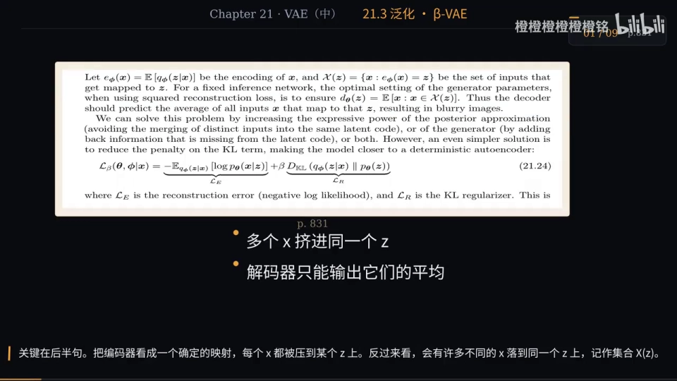

书里给了三条路：提高后验近似的表达能力（别让不同的输入挤进同一个编码）、提高生成器的能力（让 $z$ 之外还能补回信息），以及一个更省事的办法——把 KL 项的系数调小一点，让模型更接近确定性自编码器[【跳转到 01:23】](https://www.bilibili.com/video/BV11ZWo6PE2p/?t=83)。

## 二、β 旋钮：重建细节与压缩的配比

### 2.1 一个系数把两种模型连起来

重建误差 $\mathcal{L}_E$ 不动，KL 正则 $\mathcal{L}_R$ 前面乘一个系数 $\beta$，这个目标就叫 **β-VAE**（式 21.24）[【跳转到 01:41】](https://www.bilibili.com/video/BV11ZWo6PE2p/?t=101)：

$$
\mathcal{L}_\beta(\theta,\phi;x)=-\underbrace{\mathbb{E}_{q_\phi(z\mid x)}\big[\log p_\theta(x\mid z)\big]}_{\mathcal{L}_E}+\beta\underbrace{D_{KL}\big(q_\phi(z\mid x)\,\Vert\,p_\theta(z)\big)}_{\mathcal{L}_R}
$$

$\beta=1$ 就是标准 VAE，$\beta=0$ 退化成普通自编码器。一个旋钮两端连着两种模型，$\beta$ 从零扫到无穷，就在率失真曲线上划来划去：$\beta$ 小一些，潜变量里多存些信息，重建更清楚；$\beta$ 大于一，压缩得更狠，表示更紧凑[【跳转到 01:51】](https://www.bilibili.com/video/BV11ZWo6PE2p/?t=111)。可以把它想成一个音量旋钮，只不过调的不是声音，而是**重建细节和压缩之间的配比**。

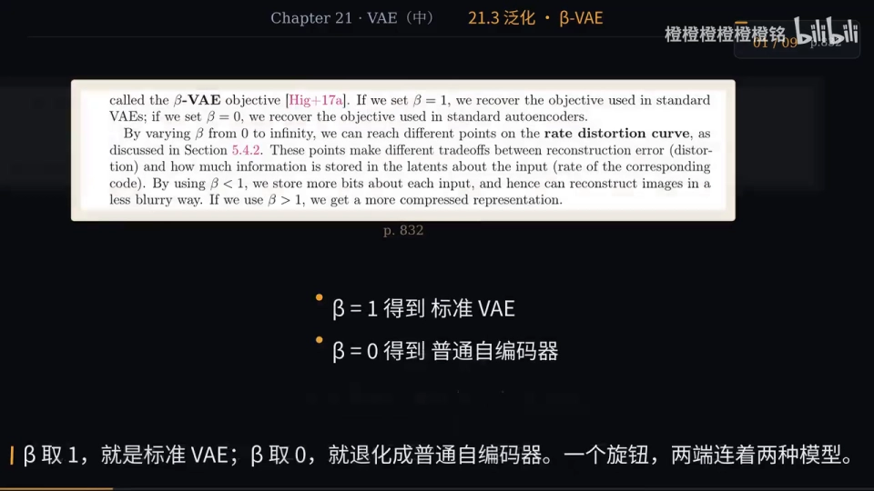

### 2.2 副作用：解耦，以及解耦的不可辨识

$\beta$ 调大还有个意外收获：它能诱导出**解耦**的表示——潜变量的每个维度只负责描述输入里的一类变化因素，就像调音台上一个推子只调人声、一个只调鼓、一个只调吉他。这件事可以用**总相关**度量（式 21.25），它比较的是联合分布与各边缘分布乘积之间的 KL 距离；所有维度彼此独立时总相关恰好为零，这就是真正的解耦[【跳转到 02:39】](https://www.bilibili.com/video/BV11ZWo6PE2p/?t=159)。

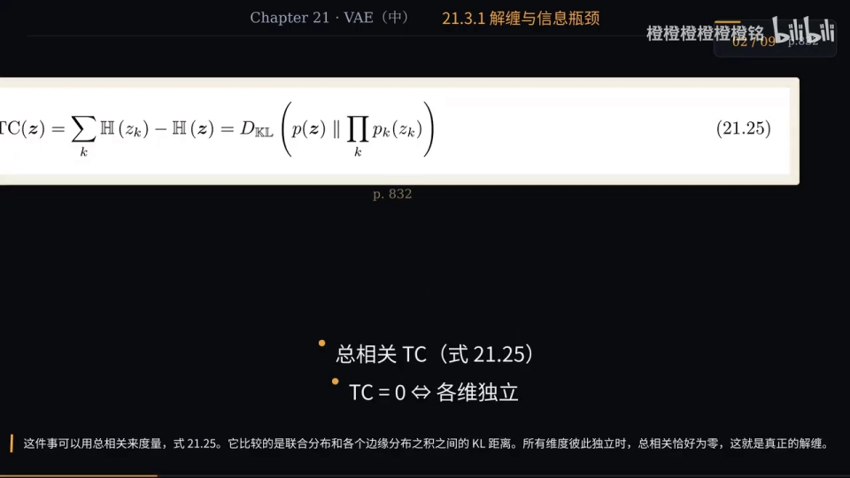

但故事还有下一半：有另一篇工作证明**非线性的潜变量模型是不可辨识的**——任何一组解耦的表示，都能找到一组完全纠缠、但似然一模一样的表示。所以光调 $\beta$ 是不够的，还得靠编码器、解码器、先验、数据和算法给出的归纳偏置，才可能得到"对的那组"潜变量[【跳转到 02:54】](https://www.bilibili.com/video/BV11ZWo6PE2p/?t=174)。这一点与本系列 2.2.2 的可辨识性小节同一主题，这里只记结论。

## 三、后验塌缩：ELBO 拉满，潜变量白学

### 3.1 现象

视频把话题推进到 21.4 节：如果解码器足够强，比如文本用 RNN、图像用 PixelCNN，VAE 干脆就不需要潜变量 $z$[【跳转到 10:41】](https://www.bilibili.com/video/BV11ZWo6PE2p/?t=641)。这个现象叫**后验塌缩**（posterior collapse），也叫变分过度剪枝：后验被剪成了纯粹的先验，什么都不剩。

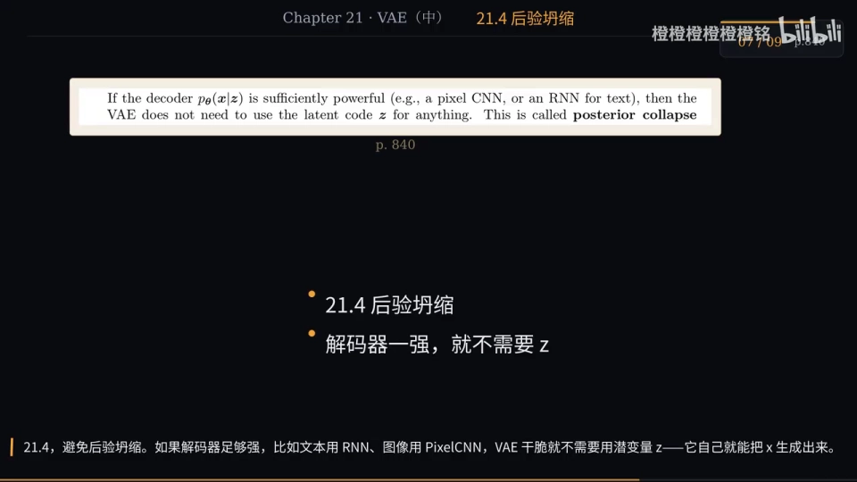

### 3.2 机制：两项 KL 同时归零

为什么会这样？回看式 21.21：如果存在一组生成参数，使得不管 $z$ 取什么，解码出来的分布都和数据分布一模一样，那么第一项 KL 就等于零；这时生成器与潜码无关，真实后验等于先验，而推断参数只要让 $q_\phi(z\mid x)$ 也等于先验，第二项 KL 同样归零[【跳转到 11:06】](https://www.bilibili.com/video/BV11ZWo6PE2p/?t=666)。

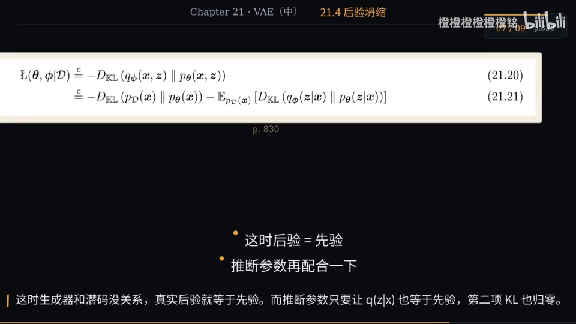

**ELBO 是拉满了，可潜变量什么有用的东西都没学到**——这正是潜变量模型最不想看到的结局。注意这里的"塌缩"不是训练崩了，而是优化目标被一种退化解满足了：损失曲线漂亮，模型却退化成了一个不带条件的自回归/强解码器。

### 3.3 怎么辨认：三个可观测信号

视频没有给出一张监控面板，但它的机制描述直接给出了可以盯的量。把塌缩的成因翻译成训练日志上的现象，就是三条互相印证的信号：

| 信号 | 健康训练 | 后验塌缩 |
| --- | --- | --- |
| KL 项曲线 | 先升后稳，维持在一个非零水平 | 很早被压到接近 0 并一直贴着 0 |
| 重建项曲线 | 随 KL 下降继续改善 | 塌缩后重建项几乎不再改善，或改善完全由解码器自身容量带来 |
| 逐维 KL（潜变量利用率） | 多数维度有非零贡献 | 大面积为 0，少数维度承担全部信息 |

第三条来自视频后面"自由比特"里的写法：KL 项可以按维度拆开，每一维各算各的（式 21.58）[【跳转到 12:29】](https://www.bilibili.com/video/BV11ZWo6PE2p/?t=749)。逐维 KL 就是"这一维用了多少信息"的直接读数；把它画成直方图，塌缩表现为大量维度贴着零。

还有一个更本质的读数：**$x$ 与 $z$ 之间的互信息**。塌缩的定义就是生成器与潜码无关，也就是互信息为零；视频在讲 InfoVAE 时正是用这一项来显式约束的[【跳转到 13:50】](https://www.bilibili.com/video/BV11ZWo6PE2p/?t=830)。互信息本身不好直接算，但逐维 KL 与"改 $z$ 后重建是否变化"这两件事，都是它的可操作代理。

### 3.4 反例：潜变量有用时长什么样

视频给了一个正面例子说明 $z$ 有用：图 21.9 把分子写成 SMILES 字符串，用 VAE-RNN 编码成 $z$，再在 $z$ 上做梯度上升，就能生成性质更好的新分子——**前提是 $z$ 没有塌掉**[【跳转到 11:24】](https://www.bilibili.com/video/BV11ZWo6PE2p/?t=684)。这类"在潜空间里做优化"的下游任务，是塌缩最直接的受害者：$z$ 一旦与 $x$ 无关，在 $z$ 上做任何搜索都不会改变输出。

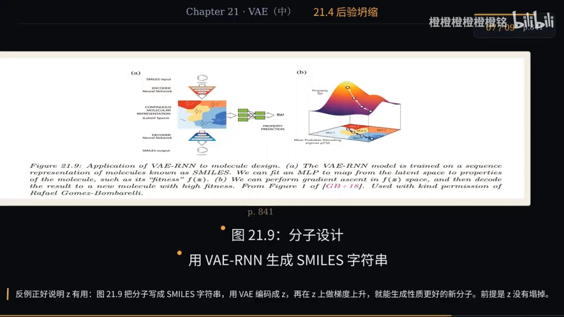

## 四、六种对策：改调度与改目标

视频把对策列成六条，前三条动的是"训练怎么走"，后三条动的是"目标与结构"。按这个分组记最省力。

### 4.1 改训练调度

**对策一：KL 退火（KL annealing）。** 训练刚开始时先把 KL 项的权重 $\beta$ 设成 0，也就是当普通自编码器来练，再一点点加到 1，慢慢过渡成标准的最大似然训练[【跳转到 11:38】](https://www.bilibili.com/video/BV11ZWo6PE2p/?t=698)。注意这和 β-VAE 恰好相反：那边是用大于一的 $\beta$ 压细节，这边是从零涨到一，让模型先学会重建、再慢慢上约束。$\beta$ 的调度要调，常见做法是**循环退火**：把 0 到 1 的过程重复好几轮，每一轮都把上一轮学到的表示当起点[【跳转到 11:43】](https://www.bilibili.com/video/BV11ZWo6PE2p/?t=703)。

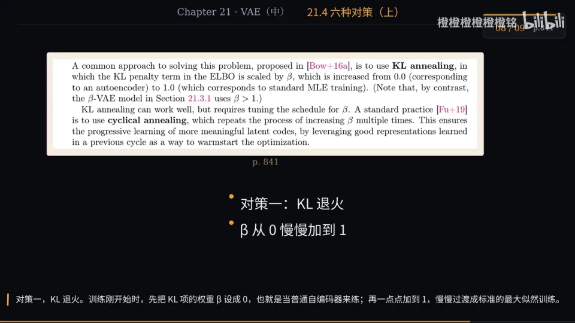

**对策二：给码率设下限。** 思路是别的都不动，只限制后验的灵活度，让它没法轻易退化成先验：比如改用 von Mises-Fisher 分布并固定它的集中度，或者用 $\delta$ 让码率至少不低于 $\delta$[【跳转到 12:08】](https://www.bilibili.com/video/BV11ZWo6PE2p/?t=728)。

**对策三：自由比特（free bits）。** 先把 KL 项按维度拆开写（式 21.58），再把每一维的 KL 换成铰链损失（式 21.59）：某一维的 KL 低于阈值 $\lambda$ 时就不再继续往下压[【跳转到 12:29】](https://www.bilibili.com/video/BV11ZWo6PE2p/?t=749)。就像给每个维度一笔免费额度，额度以内随便用，模型不用为这点信息付钱，自然也就不会拼命把它压到零。

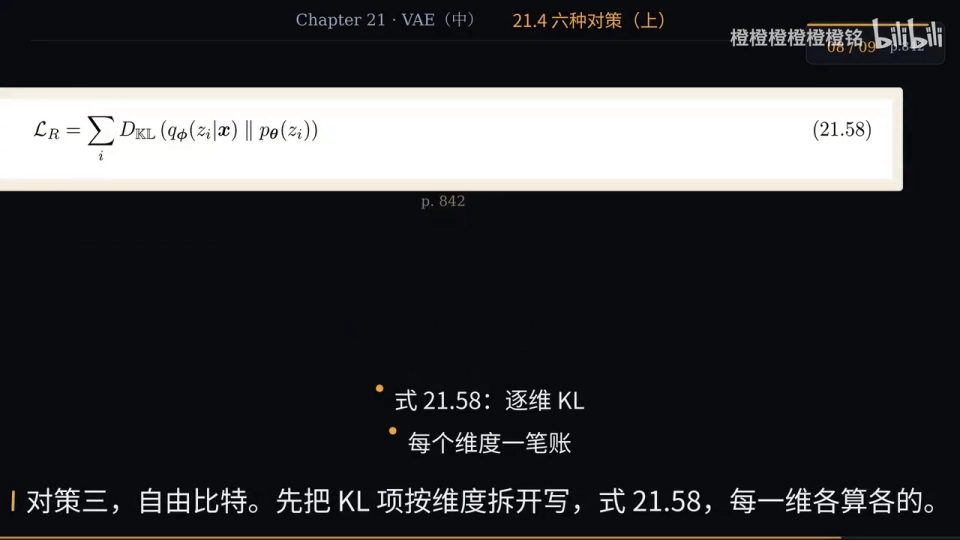

### 4.2 改结构与目标

**对策四：加跳跃连接。** 塌缩的一个原因是 $z$ 与 $x$ 之间连得不够紧，那就直接加一条从输入到输出的捷径，也就是 Skip-VAE（图 21.10），思路和残差网络一样，给梯度留一条直通车。但要留意：这样重建更容易了，同时也更容易绕开 $z$，所以得配合别的办法一起用[【跳转到 12:53】](https://www.bilibili.com/video/BV11ZWo6PE2p/?t=773)。

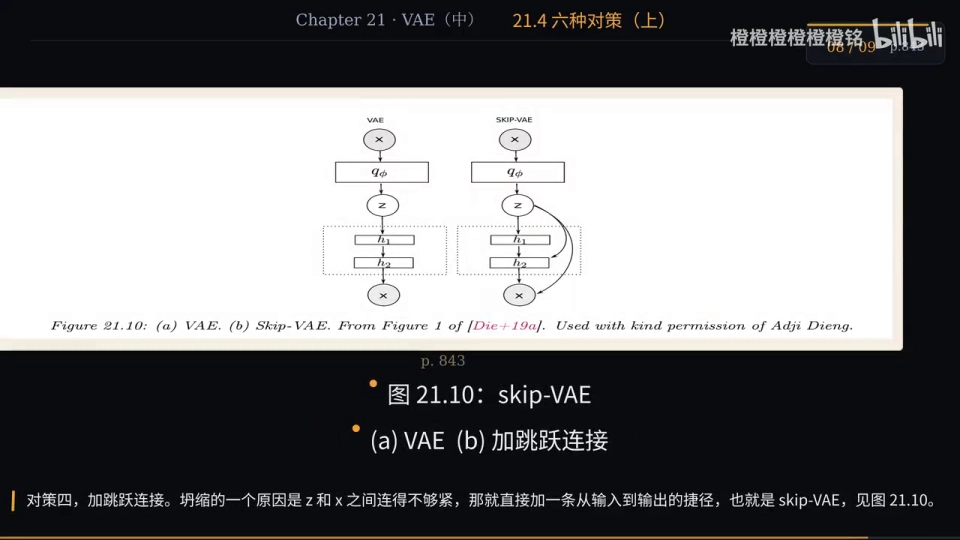

**对策五：改进变分推断。** 塌缩有一部分原因是后验近似得太差，那就一开始把推断网络多训练几步，让它更忠实地逼近真实后验。但这只解决了**摊销差距**那一部分；更根本的问题是变分 KL 项会惩罚那些离先验太远的后验，而先验又往往太简单，根本配不上聚合后验。更根本的办法是换一个更紧的下界、更准的后验近似，或者更强的生成模型——这最后一个正是下一期的主题：层级 VAE[【跳转到 13:20】](https://www.bilibili.com/video/BV11ZWo6PE2p/?t=800)。

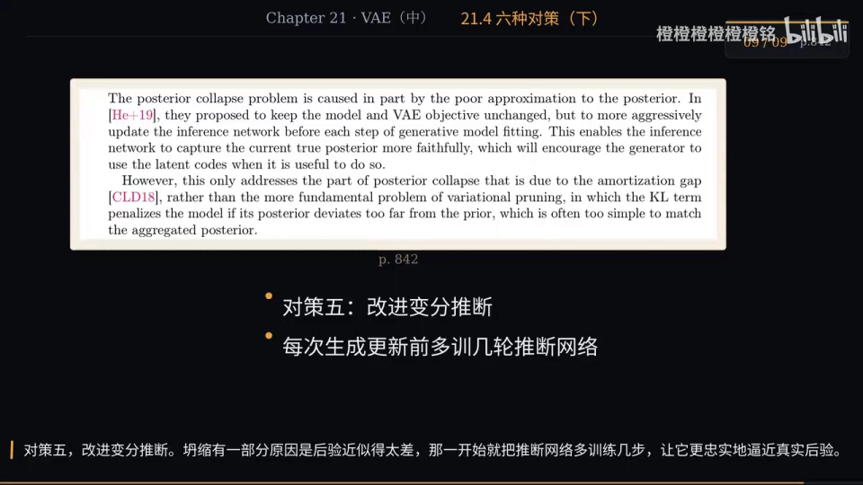

**对策六：换掉目标函数。** 干脆不用 ELBO，改用 InfoVAE 这类目标：它显式要求 $x$ 与 $z$ 之间互信息不为零，塌缩自然就没了[【跳转到 13:50】](https://www.bilibili.com/video/BV11ZWo6PE2p/?t=830)。

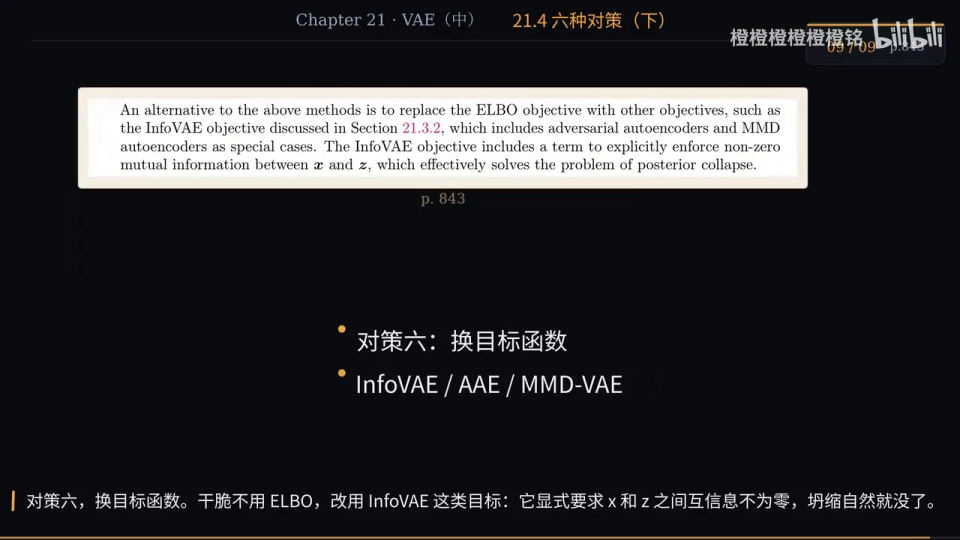

### 4.3 为什么这些对策会出现在 InfoVAE 之前

视频的顺序是先讲变体、再讲塌缩，看起来绕，其实有因果：InfoVAE 的一般目标（$\alpha$ 控制互信息 $I(X;Z)$ 的权重、$\lambda$ 控制两个 KL 的取舍）本来就是为了修标准 ELBO 的两个毛病——解码器够强时模型不理潜码，以及数据空间与后验空间的 KL 不一致[【跳转到 04:02】](https://www.bilibili.com/video/BV11ZWo6PE2p/?t=242)。

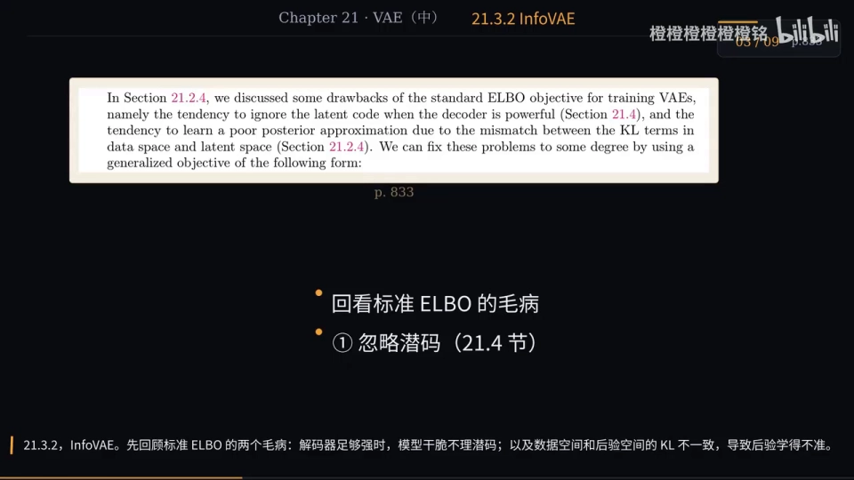

区别在于：标准 ELBO 只是**间接**地惩罚丢信息，而 InfoVAE 干脆给"记住多少信息"单独计分并显式奖励它[【跳转到 04:15】](https://www.bilibili.com/video/BV11ZWo6PE2p/?t=255)。麻烦在于互信息项直接算不出来，因为里面含了聚合后验 $q(z)$；但它可以改写——先从数据里采 $x$、再从 $q(z\mid x)$ 采 $z$，就得到 $q(z)$ 的样本，也就是说 $q(z)$ 成了一个只靠采样定义的隐式分布。取 $\alpha=1$ 时 InfoVAE 化简成"重建项减去 $\lambda$ 倍的后验到先验的距离"，把 KL 换成 MMD，整个目标变得完全可以计算[【跳转到 04:54】](https://www.bilibili.com/video/BV11ZWo6PE2p/?t=294)。这一套还顺带把几个模型串了起来：取 $\alpha=1-\lambda$ 得到 β-VAE，取 $\alpha=0$、$\lambda=1$ 又回到标准 ELBO。

## 五、边界：这一节没做的事

- 视频讲的是"塌缩怎么发生、怎么救"，**没有**给出各对策在同一数据集上的定量对比，也没有给出 $\beta$ 调度的具体超参；对策之间的强弱排序不能从本文读出。
- 六种对策里，KL 退火与自由比特直接改的是训练动态；跳跃连接与换目标改的是模型与目标本身。实际使用时常需要组合，视频也明确说 Skip-VAE 要"配合别的办法一起用"。
- 视频顺带讲的多模态 VAE（产品专家 POE、半监督 M2、序列 VAE-RNN）属于变体谱系，与塌缩只在"解码器越强越容易塌"这一点上相关，本文不再展开。

## 小结

- 重建糊的根源是多个 $x$ 挤进同一个 $z$，平方损失下解码器只能输出它们的平均；糊与塌缩是同一枚硬币的两面。
- β-VAE 用一个系数把标准 VAE（$\beta=1$）与普通自编码器（$\beta=0$）连起来，$\beta$ 调的是重建细节与压缩的配比；$\beta>1$ 还能压低总相关、诱导解耦，但非线性潜变量模型本身不可辨识。
- 后验塌缩的机制：存在使 $p_\theta(x\mid z)$ 与 $z$ 无关的生成参数时，真实后验等于先验，编码器只要让 $q_\phi(z\mid x)$ 也等于先验，两项 KL 一起归零，ELBO 拉满而潜变量被剪掉。
- 识别看三条：KL 项过早趋零、重建项不再随之改善、逐维 KL（潜变量利用率）大面积为零；本质读数是 $x$ 与 $z$ 的互信息。
- 对策分两组：改调度（KL 退火、循环退火、码率下限、自由比特）与改结构目标（跳跃连接、改进变分推断、换掉 ELBO）。
- 最根本的一条：先验太简单、KL 惩罚太硬，是塌缩的结构性原因；更紧的下界、更强的生成模型（层级 VAE）是下一步。

## 关键术语速查

| 术语 | 一句话解释 |
| --- | --- |
| 后验塌缩 | 解码器足够强时潜变量被完全忽略，$q_\phi(z\mid x)$ 退化成先验，ELBO 反而拉满 |
| 变分过度剪枝 | 后验塌缩的另一种叫法，强调是 KL 惩罚把后验剪成了先验 |
| β-VAE | 在 KL 项前乘系数 $\beta$ 的 VAE，$\beta=1$ 为标准 VAE，$\beta=0$ 退化为自编码器 |
| 率失真曲线 | 重建误差与潜变量所存信息量之间的取舍曲线，$\beta$ 扫过就得到不同工作点 |
| 总相关 | 联合分布与各边缘分布乘积之间的 KL，为零意味着各维独立（解耦） |
| KL 退火 | 训练初期把 KL 权重设为 0，再逐渐升到 1，让模型先学会重建 |
| 循环退火 | 把 0 到 1 的退火过程重复多轮，每轮以上一轮的表示为起点 |
| 自由比特 | 给每一维 KL 设一个阈值，低于阈值不再惩罚，避免维度被压到零 |
| 码率下限 | 直接限制后验灵活度或设最小码率 $\delta$，使 KL 不能轻易归零 |
| 摊销差距 | 推断网络一次前向给出的近似与逐样本最优后验之间的差距 |
| 聚合后验 | $q(z)=\mathbb{E}_{p(x)}[q(z\mid x)]$，只能靠"采 x 再采 z"得到样本 |