# 采样为什么能反传：重参数化把随机性移出计算图，梯度分两路回到均值与标准差

> 视频来源：[VAE 论文精读：中间抽了一次样，梯度怎么传回去？](https://www.bilibili.com/video/BV1RUy7zBEKX/)（Bilibili · 直觉透镜，约 18 分钟）
> 导读：这支视频逐节精读 Kingma 与 Welling 的《Auto-Encoding Variational Bayes》，只回答一个问题——编码器和解码器中间隔着一次随机抽样，梯度到底怎么传回去？本文保留它的主线：计算图上的断点、对数导数估计为什么不可用、一维高斯手算出的两条梯度路径、SGVB 估计器，以及论文图 2 的学习曲线与技巧的适用边界。ELBO 的推导与 KL 闭式解的来历见本系列 2.1.9，重参数化在代码里的样子见 2.1.2，本文只在必要处回指。

## 本讲要解决的核心问题（SCQA）

**背景**：反向传播要求从输入到损失函数的每一步运算都能给出导数，就像一串环环相扣的齿轮。普通自编码器满足这个要求：图片 $x$ 被压成一个确定的向量 $z$，再解码还原，全程确定可导。

**冲突**：变分自编码器偏偏在编码器和解码器正中间塞进了一步随机抽样——前向传播走到一半，网络得先掷一次骰子抽出 $z$。抽样器的出口没有"参数到样本"的代数式，解码器算出的导数传到抽样器门口就断了。

**疑问**：既然梯度过不去，VAE 还怎么训练？那行 z = mu + sigma * eps 究竟做了什么，让梯度能绕过这次抽样？

**回答（中心思想）**：重参数化把**随机性移出计算图**：先从一个与网络参数无关的固定分布里采噪声 $\varepsilon$，再用确定性可微的式子 $z=\mu+\sigma\odot\varepsilon$ 把噪声搬到目标位置。于是 $\varepsilon$ 成了网络的**输入**而不是待求导的节点，梯度沿两条路径回到编码器：对均值是 $\partial z/\partial\mu=1$，对标准差是 $\partial z/\partial\sigma=\varepsilon$。噪声本身不需要梯度，梯度却完整地回来了。

## 一、断点在哪里：随机抽样器挡住了反向传播

### 1.1 前向图上的三个角色

视频先把论文图 1 的生成模型摆出来：实线是生成模型 $p_\theta(z)p_\theta(x\mid z)$，虚线是变分近似 $q_\phi(z\mid x)$，变分参数 $\phi$ 与生成参数 $\theta$ 一起学[【跳转到 05:44】](https://www.bilibili.com/video/BV1RUy7zBEKX/?t=344)。

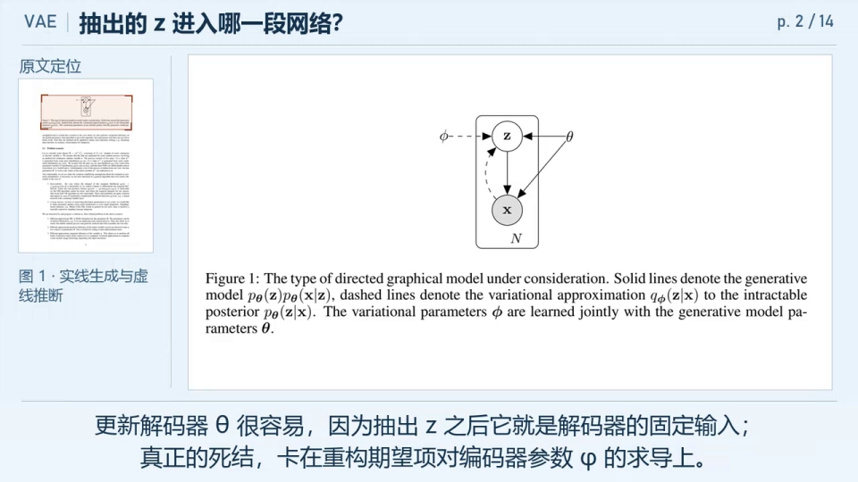

更新解码器 $\theta$ 很容易：抽出 $z$ 之后它就是解码器的固定输入，梯度照常回传。真正的死结卡在**重构期望项对编码器参数 $\phi$ 的求导**上。顺着计算图看：输入 $x$ 经过编码器算出分布参数，送进黑盒随机抽样器，吐出 $z$，再交给解码器算出待求期望的函数 $f(z)$。反向传播时，解码器清楚地算出了 $f(z)$ 对 $z$ 的导数，好比靶场裁判喊了一嗓子："刚才那个 $z$ 偏右了，往左挪一点。"[【跳转到 05:44】](https://www.bilibili.com/video/BV1RUy7zBEKX/?t=344)

可这句指令退到黑盒抽样器门口就断了：参数被输进摇号箱，彩球乱撞调出号码 $z$，参数与样本 $z$ 之间没有确定性的代数式，梯度根本传不回编码器 $\phi$[【跳转到 06:09】](https://www.bilibili.com/video/BV1RUy7zBEKX/?t=369)。

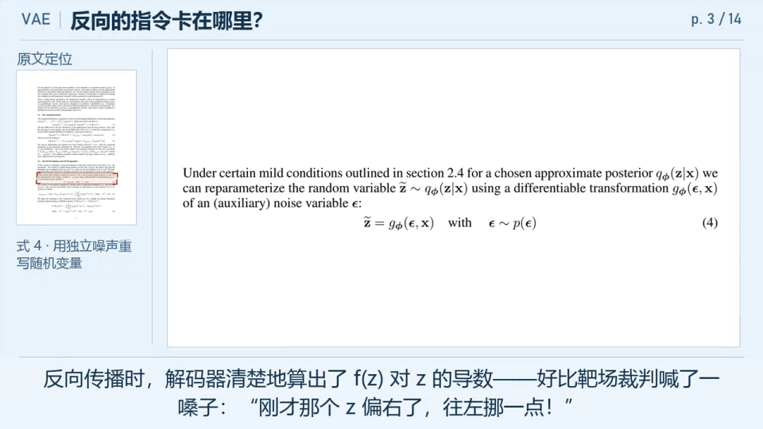

### 1.2 对数导数估计：能算，但方向信息被扔掉了

学过强化学习的同学会想到原论文第 2.2 节给出的**对数导数估计**（也叫得分函数估计）：

$$
\nabla_\phi\,\mathbb{E}_{q_\phi(z\mid x)}\big[f(z)\big]=\mathbb{E}_{q_\phi(z\mid x)}\big[f(z)\,\nabla_\phi\log q_\phi(z\mid x)\big]
$$

念出来就是：期望对 $\phi$ 求梯度，等于对"函数值乘上对数密度的梯度"求期望[【跳转到 06:34】](https://www.bilibili.com/video/BV1RUy7zBEKX/?t=394)。

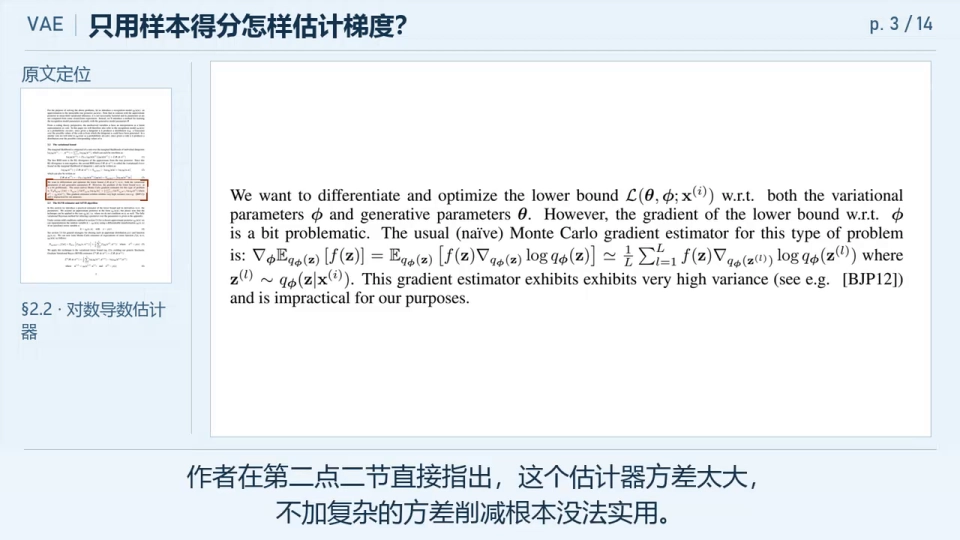

问题在于作者紧接着就指出：**这个估计器方差太大**，不加复杂的方差削减根本没法使用。视频的比喻很到位——好比教蒙眼射手射箭，裁判明明算出了 $f(z)$ 对 $z$ 的方向导数，对数导数估计却把方向信息扔了，只把 $f(z)$ 当成总分乘在外面，告诉射手"这箭得三分"；射手不知道偏左偏右，只能靠大量试探瞎蒙，训练自然抖动剧烈[【跳转到 06:59】](https://www.bilibili.com/video/BV1RUy7zBEKX/?t=419)。

一句话对比：对数导数估计保留了随机性，却丢掉了"往哪边调"的信息；我们真正想要的是**既保留随机抽样，又把方向导数传回编码器**。

## 二、重参数化：把噪声从"抽样结果"变成"输入"

### 2.1 一维高斯的手算

论文第 2.4 节给出一维高斯的例子。假设对当前输入 $x$，隐变量 $z$ 服从均值为 $\mu$、方差为 $\sigma^2$ 的正态分布。作者没有直接从这个分布里黑盒抽样，而是先在网络主干外引入辅助噪声变量 $\varepsilon$，让它服从均值为零、方差为一的标准正态分布，不含任何可学习参数；再用确定性的算术式写出 $z$[【跳转到 07:49】](https://www.bilibili.com/video/BV1RUy7zBEKX/?t=469)：

$$
z=\mu+\sigma\varepsilon,\qquad \varepsilon\sim\mathcal{N}(0,1)
$$

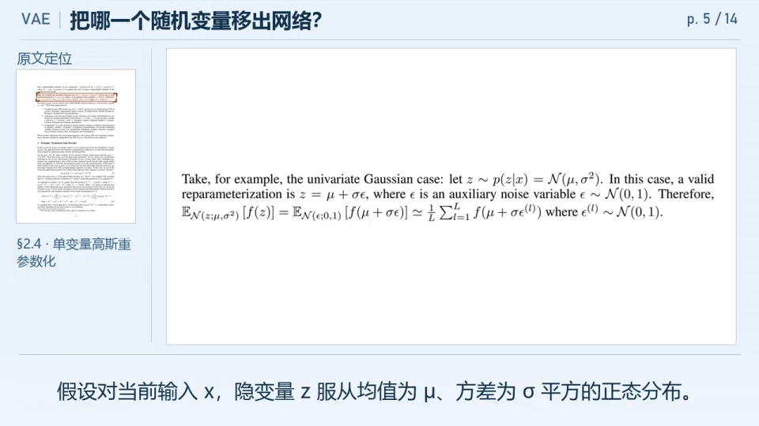

这里有个必须核对清楚的细节：**乘在 $\varepsilon$ 前面的是标准差 $\sigma$，不是方差 $\sigma^2$**。因为 $\varepsilon$ 的均值是零、方差是一，只有乘上标准差缩放后，方差才会变成 $\sigma^2$，加上 $\mu$ 之后 $z$ 才严格服从 $\mathcal{N}(\mu,\sigma^2)$[【跳转到 08:14】](https://www.bilibili.com/video/BV1RUy7zBEKX/?t=494)。写代码时把 `logvar` 直接当 $\sigma$ 乘进去，是这个技巧最常见的实现错误。

### 2.2 两条梯度路径：固定同一次噪声

代入具体数字：编码器给出 $\mu=2$、$\sigma^2=9$，开方得 $\sigma=3$；这一次抽样抽到 $\varepsilon=0.5$，并且**把这次抽出的 $\varepsilon$ 牢牢固定住**。前向计算得 $z=2+3\times0.5=3.5$[【跳转到 09:04】](https://www.bilibili.com/video/BV1RUy7zBEKX/?t=544)。

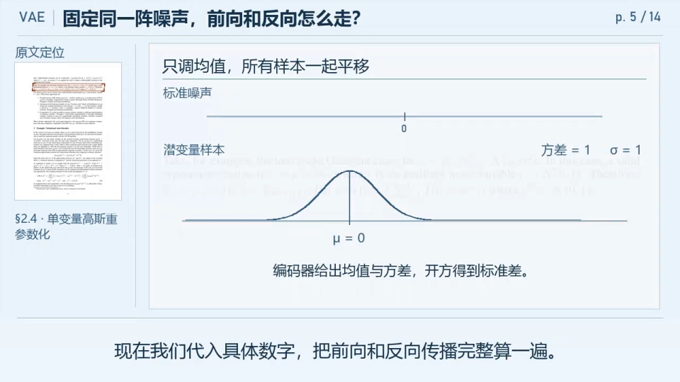

假设解码器在 $z=3.5$ 处给出从样本 $z$ 回来的上游导数 $-2$，意思是 $z$ 再往右增大目标函数就会上升，裁判要求落点往左收。保持 $\varepsilon=0.5$ 不变，往回算两条路径[【跳转到 09:54】](https://www.bilibili.com/video/BV1RUy7zBEKX/?t=594)：

- **对均值 $\mu$**：$\partial z/\partial\mu=1$，所以重构项对 $\mu$ 的梯度是 $-2\times1=-2$。梯度上升时 $\mu$ 从 2 往左调小，把瞄准中心往左移。
- **对标准差 $\sigma$**：$\partial z/\partial\sigma=\varepsilon=0.5$，所以重构项对 $\sigma$ 的梯度是 $-2\times0.5=-1$。梯度上升时 $\sigma$ 从 3 调小，收紧散步倍率；同样 0.5 的右风吹来，落点自然往左收。
- **对噪声 $\varepsilon$**：它已经剥离成主干外的旁路输入，根本不需要对它求导。

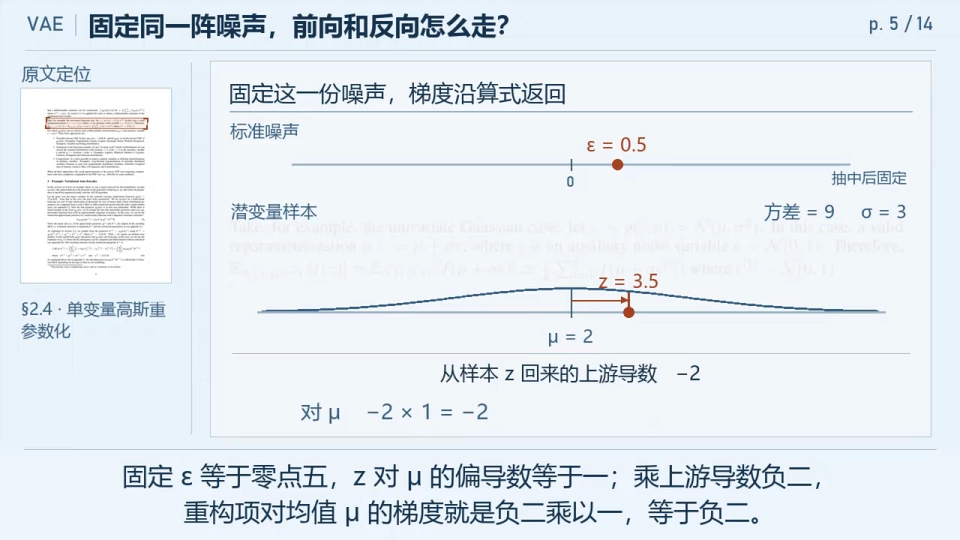

这两条路径的差别正是重参数化的全部内容：**均值负责平移，标准差负责缩放**；同一个 $\varepsilon$ 既决定了样本落在哪，也决定了"缩放"这一路的梯度大小。$\varepsilon$ 是正的 0.5，所以收紧 $\sigma$ 就等于把落点往左拉——方向信息一点没丢。

### 2.3 一般形式：一步换元积分

把一维例子推广到第 2.3 节。重参数化之前，我们要对"概率密度 $q_\phi(z\mid x)$ 乘以 $f(z)$"的积分求 $\phi$ 的梯度；因为参数 $\phi$ 嵌在密度里，外面的梯度算子没法穿过积分号只对 $f(z)$ 求导。重参数化之后，随机变量写成确定性可微变换[【跳转到 11:09】](https://www.bilibili.com/video/BV1RUy7zBEKX/?t=669)：

$$
\tilde z=g_\phi(\varepsilon,x),\qquad \varepsilon\sim p(\varepsilon)
$$

其中 $p(\varepsilon)$ 与 $\phi$ 无关。在多维对角高斯下，$g_\phi(\varepsilon,x)=\mu+\sigma\odot\varepsilon$，$\odot$ 是逐元素相乘[【跳转到 11:59】](https://www.bilibili.com/video/BV1RUy7zBEKX/?t=719)。

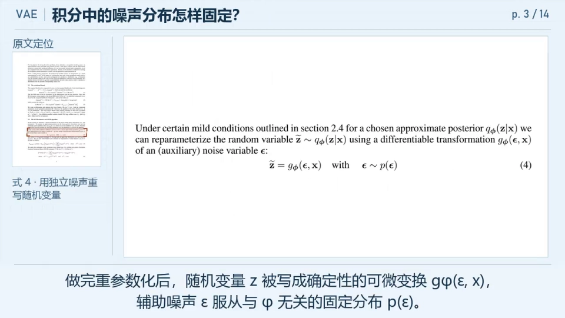

这在微积分里就是**一步换元积分**：$f(z)$ 在 $q_\phi(z\mid x)$ 下的期望，严格等于复合函数 $f(g_\phi(\varepsilon,x))$ 在固定分布 $p(\varepsilon)$ 下的期望。期望底下的分布不再含参数 $\phi$，对 $\phi$ 求梯度的算子就能直接移进期望内部，按链式法则写成"$f$ 对 $z$ 的导数乘上 $g_\phi$ 对 $\phi$ 的导数"[【跳转到 12:24】](https://www.bilibili.com/video/BV1RUy7zBEKX/?t=744)。最后抽 $L$ 个独立噪声求算术平均，就得到论文第 2.3 节的**随机梯度变分贝叶斯估计器（SGVB）**。

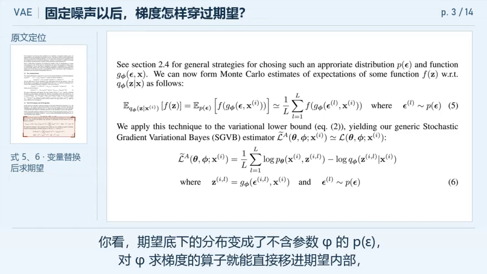

## 三、落到训练：抽样次数与 KL 项

### 3.1 L 取多大

实战第一个问题是单样本抽样次数 $L$。作者的训练经验是：只要小批量样本数 $M$ 足够大（实验里取 $M=100$），$L$ 取一就够用[【跳转到 13:14】](https://www.bilibili.com/video/BV1RUy7zBEKX/?t=794)。但视频特别提醒别把它读成"抽一次就精确"：单张图只抽一次仍有明显波动，靠的是 100 个样本的小批量平均与多步迭代优化[【跳转到 13:39】](https://www.bilibili.com/video/BV1RUy7zBEKX/?t=819)。

### 3.2 KL 项不需要抽样

与此同时，论文第 3 节公式 (10) 与附录 B 把目标里的 KL 正则项积出了闭式解，省去了这一项的抽样误差。隐空间共 $J$ 维、先验为标准正态、编码器输出对角高斯时[【跳转到 14:04】](https://www.bilibili.com/video/BV1RUy7zBEKX/?t=844)：

$$
\mathcal{L}(\theta,\phi;x^{(i)})\simeq\frac{1}{2}\sum_{j=1}^{J}\left(1+\log(\sigma_j^{(i)})^2-(\mu_j^{(i)})^2-(\sigma_j^{(i)})^2\right)+\frac{1}{L}\sum_{l=1}^{L}\log p_\theta(x^{(i)}\mid z^{(i,l)})
$$

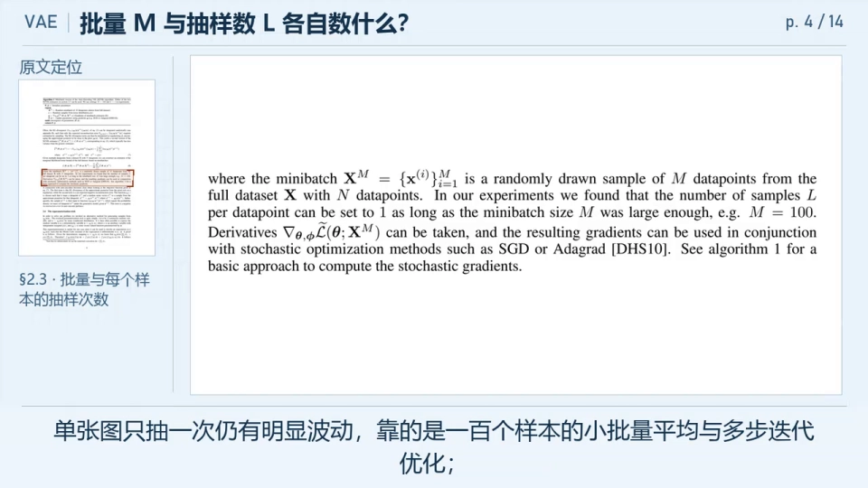

可以口算核对：当均值为零、方差为一时，括号里是 $1+0-0-1=0$；一旦偏离标准正态，这项解析公式就直接给出精确梯度[【跳转到 14:54】](https://www.bilibili.com/video/BV1RUy7zBEKX/?t=894)。这个式子的来历（ELBO 怎么拆成重建项与 KL 项、高斯 KL 怎么积出来）在 2.1.9 已完整推过，这里只当结论用。

## 四、论文实验与技巧的边界

### 4.1 图 2：AEVB 收敛更快、下界更高

论文第 5 节在 MNIST 与 Frey Face 上对比了 AEVB 与经典 Wake-Sleep 算法，并让基线使用相同的编码器[【跳转到 15:19】](https://www.bilibili.com/video/BV1RUy7zBEKX/?t=919)。横轴是累计评估的训练样本数，纵轴是每个数据点的平均证据下界估计值；四条曲线分别是 AEVB 与 Wake-Sleep 的训练集、测试集[【跳转到 15:44】](https://www.bilibili.com/video/BV1RUy7zBEKX/?t=944)。

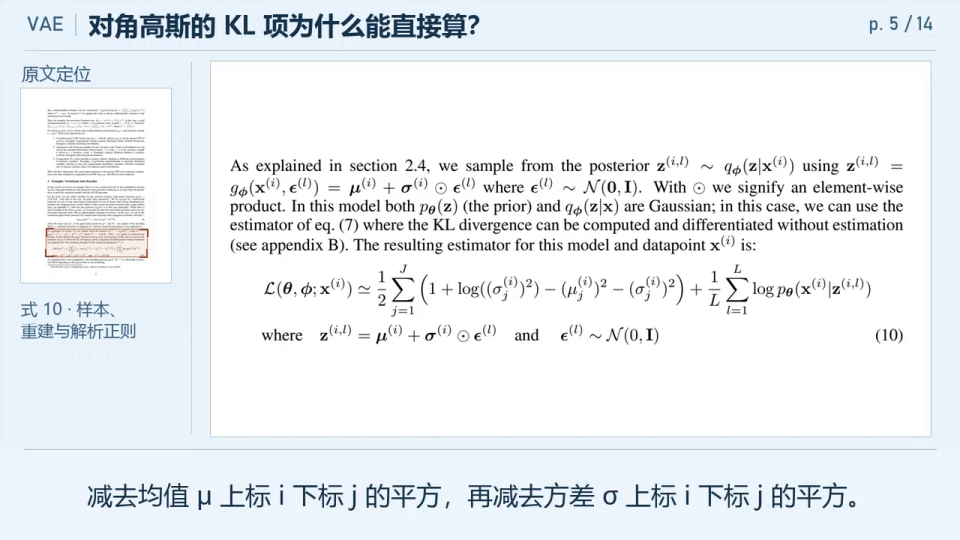

读图时别把结论说得太绝对：并非每条曲线从起点就全程领先，早期阶段也有接近或交叉。作者给出的整体结论是**AEVB 收敛明显更快，最终收敛到的下界也更高**[【跳转到 16:34】](https://www.bilibili.com/video/BV1RUy7zBEKX/?t=994)。再对比 $N_z=200$ 与 $N_z=3$ 两张子图：隐变量增至 200 维，测试集下界并未出现更严重的过拟合，作者把原因解释为 KL 项起到了正则化作用——但这是对现象的理论解释，图 2 本身并没有做剥离 KL 项的消融实验[【跳转到 16:59】](https://www.bilibili.com/video/BV1RUy7zBEKX/?t=1019)。

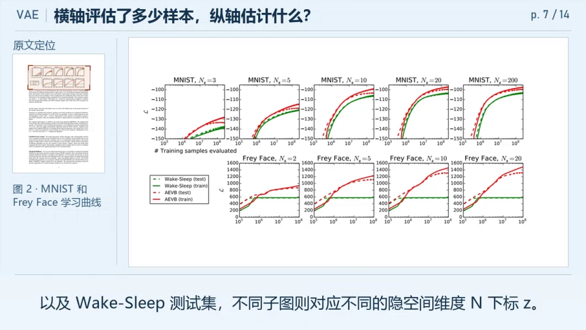

### 4.2 连续实数才可导：离散潜变量会碰壁

$z=\mu+\sigma\varepsilon$ 能对参数求偏导，前提是隐变量 $z$ 是**连续实数**。如果换成离散类别（比如掷硬币取 0 或 1），就算把随机噪声移到门外，中间也绕不开取最大值的操作，导数处处为零或在跳变点无定义，标准重参数化就会碰壁[【跳转到 17:24】](https://www.bilibili.com/video/BV1RUy7zBEKX/?t=1044)。

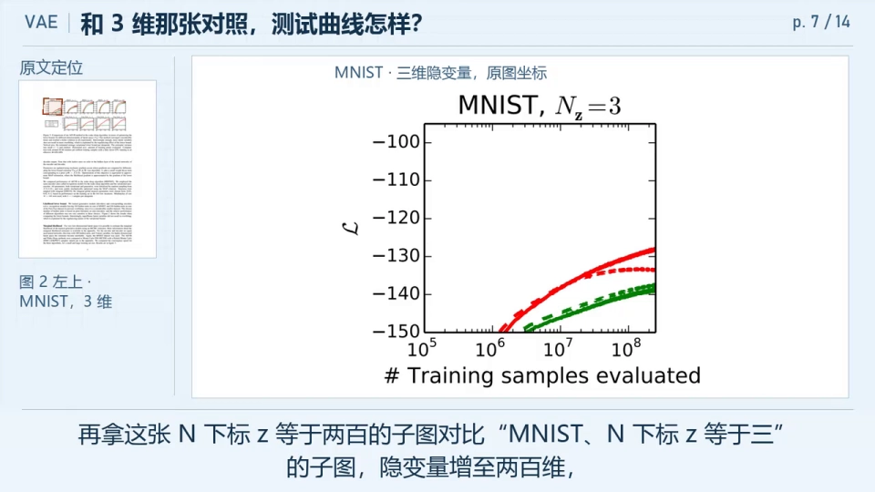

这也启发了后来的 Gumbel-Softmax 松弛与 VQ-VAE。回过头看，这行代码背后是一个很干净的思想：**当我们没法对黑盒随机过程直接求导时，就把纯粹的随机性剥离到系统之外，把确定性的结构留给微积分**[【跳转到 17:49】](https://www.bilibili.com/video/BV1RUy7zBEKX/?t=1069)。

## 五、这一步在整条训练链上的位置

把本文放回本系列：2.1.2 讲了"编码器为什么输出分布、z = mu + sigma * eps 在代码里怎么写"；2.1.9 讲了"这个损失函数从哪来、KL 闭式解怎么积"；本文补上中间那段**梯度怎么走**——断点在哪、$\partial z/\partial\mu$ 与 $\partial z/\partial\sigma$ 各是什么、为什么 $\varepsilon$ 只当输入。而"梯度能走通"并不等于"潜变量一定被用上"：训练里还有一个更隐蔽的失败模式，KL 项过早压到零、解码器干脆绕过 $z$，也就是后验塌缩，那是本系列另一篇的主题。

## 小结

- 反向传播要求每一步都有导数；VAE 在编码器与解码器之间插入随机抽样，抽样器出口没有"参数→样本"的代数式，梯度到此断掉。
- 对数导数估计能把梯度算出来，但把方向信息扔给了标量乘子，方差极大，训练抖动。
- 重参数化把随机性移出计算图：先采与参数无关的 $\varepsilon\sim\mathcal{N}(0,1)$，再用 $z=\mu+\sigma\odot\varepsilon$ 搬移；$\varepsilon$ 从此是输入而不是待求导的节点。
- 两条梯度路径：$\partial z/\partial\mu=1$（平移），$\partial z/\partial\sigma=\varepsilon$（缩放）；固定同一次 $\varepsilon$ 才能读出这两条路径。
- 一般形式是换元积分：期望底下的分布变成不含 $\phi$ 的 $p(\varepsilon)$，梯度算子可以移进期望内部，得到 SGVB 估计器。
- $M=100$ 时 $L=1$ 够用，但单样本仍有波动，靠小批量平均；KL 项有闭式解，只有重建项需要抽样。
- 前提是连续实数潜变量；离散类别需要 Gumbel-Softmax 或 VQ-VAE 这类替代方案。

## 关键术语速查

| 术语 | 一句话解释 |
| --- | --- |
| 重参数化技巧 | 把采样写成 $z=\mu+\sigma\odot\varepsilon$，随机性交给与参数无关的噪声，使梯度可回传 |
| 辅助噪声 $\varepsilon$ | 从标准正态采样的旁路输入，不含可学习参数，不需要求导 |
| 对数导数估计 | 用 $f(z)\nabla_\phi\log q_\phi$ 的期望估计梯度，无偏但方差极大 |
| SGVB | 随机梯度变分贝叶斯估计器，用 $L$ 个噪声样本对重参数化后的期望做蒙特卡洛平均 |
| 上游导数 | 反向传播中损失对当前节点的导数，本文里是 $\partial f/\partial z$ |
| 换元积分 | 变量替换后对固定分布求期望，使参数不再藏在积分号内的密度里 |
| Gumbel-Softmax | 对离散类别做连续松弛，让"取最大值"这一步重新可导 |