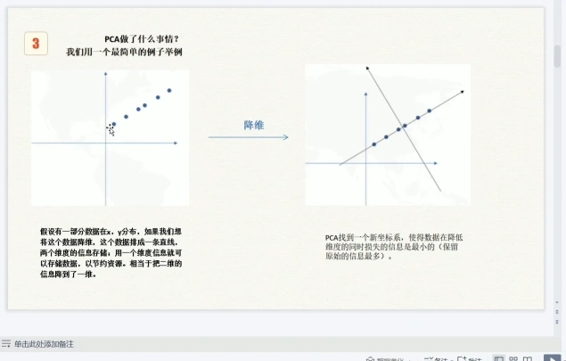
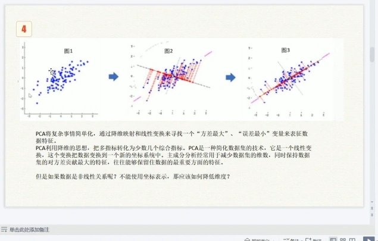
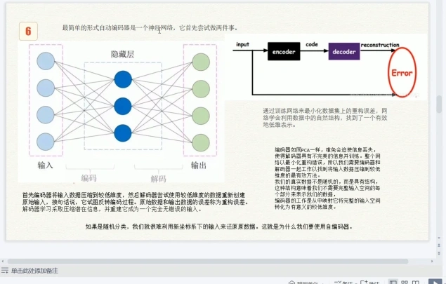
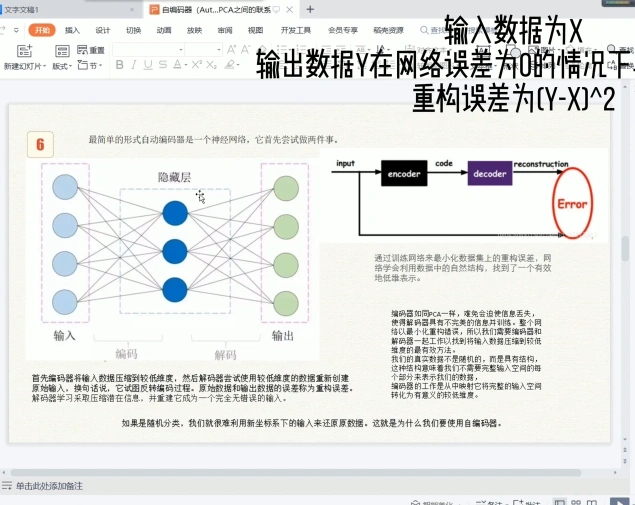
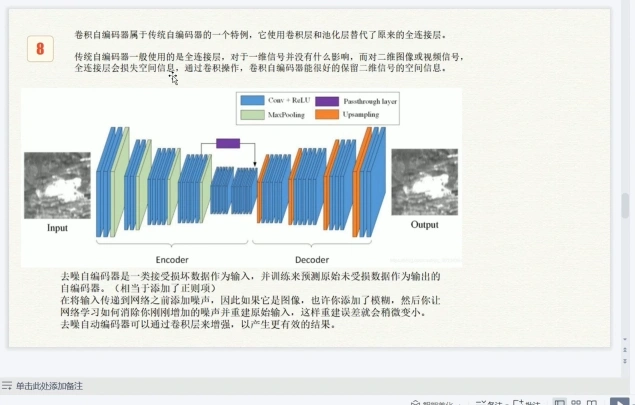
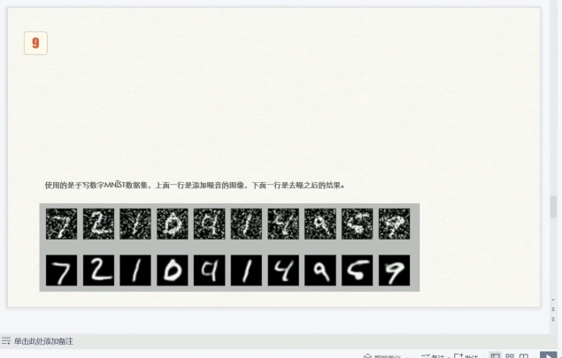
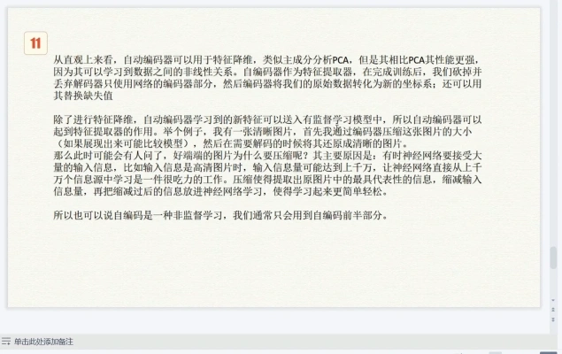

# 从 PCA 到自编码器：线性投影之后，为什么还要用重建误差学非线性降维

> 视频来源：[自编码器（AutoEncoder）对数据的降维和去噪 & 其与PCA之间的联系](https://www.bilibili.com/video/BV1ZP4y1j7xu/)（Bilibili · 来包番茄沙司，约 7 分钟）
> 导读：这是一支从 PCA 讲起的对照式讲解：先说明 PCA 是在找一个"损失信息最小"的线性投影，再说明自编码器把这个投影换成可学习的编码器与解码器，从而能表达非线性结构。视频还顺手带出了卷积自编码器与去噪自编码器两个变体，最后回答"好端端的图片为什么要压缩"。本文按讲解顺序复述，并补上 PCA 与自编码器在目标函数上的对应关系。

## 本讲要解决的核心问题（SCQA）

**背景**：降维这件事有一个经典答案——主成分分析（PCA）。给定一堆二维点，PCA 能找到一个新坐标系，让数据在其中一个轴上几乎不分散，于是只保留另一个轴就把二维降到了一维。

**冲突**：但 PCA 的这一步本质上是**线性变换**：它只能把数据投影到一条直线（或一个平面）上。真实数据往往不落在直线上，而是弯的、卷的——这时无论怎么转坐标系，投影都会损失大量信息。

**疑问**：如果数据是非线性关系、不能用坐标轴表示，该怎么降维？降维之后又凭什么保证"低维的那几个数"还代表原来的数据？

**回答（中心思想）**：自编码器把降维写成一对可学习的映射——编码器把输入压到低维，解码器把低维还原回输入，两者一起最小化**重构误差**。解码器不是多余的：它是唯一能迫使低维表示"保留住还原所需信息"的力量。因为编码器和解码器都是神经网络，这套框架可以表达非线性，因此比 PCA 更强；代价是它需要训练、需要数据，而且低维表示不再像主成分那样有明确的方差解释。

## 一、PCA 做的事：找一个损失信息最小的线性投影

视频用一个最简单的例子开场：一部分数据分布在 XY 坐标系下，呈一条直线[【跳转到 00:00】](https://www.bilibili.com/video/BV1ZP4y1j7xu/?t=0)。

用两个维度的信息 X 和 Y 存储这些数据，其实有冗余。把坐标系做一次**线性变换**，让数据只落在新坐标系的 X 轴上、Y 轴上没有信息，数据就从二维降到一维了[【跳转到 00:25】](https://www.bilibili.com/video/BV1ZP4y1j7xu/?t=25)。

但真实数据很少严格落在一条直线上，只是**近似**落在一条直线附近。这时"降维"就变成了一个优化问题：要找一个降维映射（线性变换），使得**映射后的方差最大、误差最小**——也就是说，把这些点投影到这条直线上之后，**损失的信息最少**[【跳转到 00:50】](https://www.bilibili.com/video/BV1ZP4y1j7xu/?t=50)。

视频把 PCA 的定位总结为一句话：**利用降维的思想，把多指标转化为少数几个综合指标**。它是一个线性变换，把数据变换到一个新坐标系中，常用于减少数据维度，同时保持数据中对方差贡献最大的特征。

然后它抛出了那个转折问题：**如果数据是非线性关系呢？如果它不能用坐标表示，那应该如何降低维度？**

## 二、换成神经网络：编码器加解码器

### 2.1 编码与解码

最简单的自编码器就是一个神经网络，它尝试做两件事[【跳转到 01:15】](https://www.bilibili.com/video/BV1ZP4y1j7xu/?t=75)：

- **编码**：编码器把输入数据压缩到较低维度；
- **解码**：解码器尝试用较低维度的数据重新创建原始数据。

换句话说，**解码器试图反转编码的过程**。用式子写就是

$$
z = f_\theta(x), \qquad \hat{x} = g_\phi(z)
$$

$x$ 是输入，$z$ 是低维表示（隐藏层的激活值），$\hat{x}$ 是重构结果。

### 2.2 为什么必须留着解码器

视频在这里专门回应了一个常见疑问：**只要编码器行不行？**

答案是不行。如果模型没有经过训练，只是一个"输入到隐藏层"的映射，那么这个隐藏层很难通过解码来还原数据，因此它也就不能很好地表示数据的特征[【跳转到 02:30】](https://www.bilibili.com/video/BV1ZP4y1j7xu/?t=150)。

原因在于：**数据不是随机的，它具有某种结构**。就像 PCA 里数据具有线性结构一样，编码器的工作是把完整的输入空间映射到有意义的低维空间。而"有意义"这件事必须由某个目标来定义——没有解码器，就没有任何东西要求隐藏层保留信息，编码器的权重只是随机赋予的，隐藏层也就无法代表原始数据。

反过来，**训练好整个自编码器之后，我们通常只使用编码部分**，把解码器丢掉：此时隐藏层已经可以有力地代表数据信息，从而达到数据压缩和降维的目的[【跳转到 03:26】](https://www.bilibili.com/video/BV1ZP4y1j7xu/?t=206)。

这就解释了自编码器"训练时用两半、使用时只用一半"的结构：**解码器只是训练期的脚手架**。

### 2.3 训练目标：重构误差

如果编码过程中没有信息损失，解码器完全可以调整参数使得输入等于输出。但编码器如同 PCA 一样难免有信息丢失，所以输入和输出不可能完全相等。于是训练目标就是**最小化数据集上的重构误差**[【跳转到 02:05】](https://www.bilibili.com/video/BV1ZP4y1j7xu/?t=125)：

$$
\mathcal{L} = \frac{1}{N}\sum_{i=1}^{N}\left\lVert x_i - g_\phi\!\left(f_\theta(x_i)\right)\right\rVert^2
$$

视频用一句很直白的话说明了这个目标在理想情况下的含义：输入数据为 $X$，输出数据为 $Y$，在误差为 0 的情况下 $Y$ 与 $X$ 相同，而重构误差就是 $(Y-X)^2$。

注意这里的差别：PCA 优化的是"投影后保留的方差"，是一个**有闭式解的线性代数问题**；自编码器优化的是"重构误差"，是一个**靠梯度下降训练的神经网络问题**。当编码器和解码器都取线性、且用平方误差时，二者的最优解是一致的——这正是"自编码器像 PCA"的准确含义；一旦加入非线性激活，自编码器就能拟合 PCA 做不到的弯曲结构。

## 三、两个变体：卷积自编码器与去噪自编码器

### 3.1 卷积自编码器：为二维信号保留空间信息

视频介绍的第一个变体是**卷积自编码器**：它属于传统自编码器的一个特例，只是用卷积层和池化层代替了原来的全连接层[【跳转到 03:51】](https://www.bilibili.com/video/BV1ZP4y1j7xu/?t=231)。

为什么要换？因为全连接层对**一维信号**没什么影响，但对**二维数据或视频信号**会损失空间信息：如果输入是一张图片，全连接层会把图片展平成一个向量，相邻像素上下左右的关系就很难被学到。而通过卷积操作，卷积自编码器能很好地保留二维信号的空间信息。

### 3.2 去噪自编码器：输入加噪，输出干净

第二个变体是**去噪自编码器**。它的做法是：接受一系列**损坏**的数据作为输入，去预测**未受损**的原始数据作为输出——也就是在输入图片上加噪声，输入是加噪的图，输出是原始图[【跳转到 04:41】](https://www.bilibili.com/video/BV1ZP4y1j7xu/?t=281)。

视频把它解释为"相当于给输入加入了正则项"：让网络去学习如何消除刚刚加入的噪声并重建原始输入，这样重构误差也会变小一些[【跳转到 05:06】](https://www.bilibili.com/video/BV1ZP4y1j7xu/?t=306)。

去噪自编码器的意义不止于"修图"：它强迫网络学到的表示对**输入的微小扰动**保持稳定，而不是死记训练样本。这正是普通自编码器的一个软肋——输入稍微偏离训练分布，编码就会跑到别的区域去。

## 四、压缩到底为了什么

视频最后的总结把前面的内容收成三条[【跳转到 05:30】](https://www.bilibili.com/video/BV1ZP4y1j7xu/?t=330)：

1. **降维与压缩**：自编码器可以用于无监督的特征降维和数据压缩，思路类似 PCA，但它能表示非线性特征，因此比 PCA 性能更强。
2. **特征提取**：训练完成后可以只用编码器，把输入变成低维特征，再送入下游模型。
3. **压缩的实际动机**：有时候神经网络需要大量输入信息，而高清图片的输入信息量可能成千上万；直接让网络从成千上万个原始数值中学习是一件非常吃力的事。压缩可以提取出原图最具代表性的信息，缩减数据量、信息量和维度，再把缩减后的特征放进网络学习，学习起来会更轻松[【跳转到 05:55】](https://www.bilibili.com/video/BV1ZP4y1j7xu/?t=355)。

## 小结

- PCA 找一个**线性**投影，使降维后损失的信息最少；它有闭式解，但只能处理线性结构。
- 自编码器把降维写成**编码器 + 解码器**的一对映射，用**重构误差**训练，因此可以表达非线性。
- 解码器是训练期的脚手架：没有它，隐藏层就没有任何压力去保留信息；训练完成后通常只保留编码器。
- 卷积自编码器用卷积与池化替代全连接，保住二维信号的空间结构；去噪自编码器用"加噪输入、干净输出"迫使表示对扰动稳定。
- 压缩的动机是让下游网络面对更少、更有代表性的输入，而不是为了把图片变小这件事本身。

## 关键术语速查

| 术语 | 一句话解释 |
| --- | --- |
| 主成分分析（PCA） | 寻找使投影后方差最大、信息损失最小的线性变换，实现线性降维 |
| 自编码器（AE） | 由编码器与解码器组成的网络，用重构误差训练，实现非线性降维 |
| 编码器 | 把输入压缩成低维表示的那一半网络 |
| 解码器 | 把低维表示还原成输入的那一半网络，只在训练时必需 |
| 重构误差 | 输入与重构输出之间的差异，是自编码器唯一的训练信号 |
| 卷积自编码器 | 用卷积层与池化层替代全连接层的自编码器，保留空间信息 |
| 去噪自编码器 | 输入加噪、输出干净的自编码器，使表示对输入扰动更稳定 |