# 自编码器的瓶颈：潜空间压得越小，重建与结构一起变差

> 视频来源：[动画解释自编码器如是如何工作的及其应用](https://www.bilibili.com/video/BV1kw4m1r783/)（Bilibili · 技术Flow，译自 Deepia 的 Autoencoders｜Deep Learning Animated，约 11.5 分钟）
> 导读：这支视频不推公式，而是把自编码器当成一台"压缩—还原"机器，用 MNIST 上的一组对照实验演示"潜维度调大调小会发生什么"，最后用三个失败现象说明为什么"能重建"不等于"能生成"。本文按视频顺序复述，并补上视频里没有写出的重建损失与压缩率算式；变分自编码器只在结尾出现一句，推导留给下一小节。

## 本讲要解决的核心问题（SCQA）

**背景**：一张 28×28 的手写数字图存下来要 784 个数，一段表格数据、一张脑部磁共振图像更是成千上万个数字。而很多任务其实并不需要这么多数字——要判断一张图是几、一个人是男是女，往往只需要几个能概括它的量。

**冲突**：可是"概括"和"还原"是一对矛盾。压得越狠越省事，也越容易把关键信息一起丢掉；不压又等于没做。更麻烦的是，"还原得像"这件事本身是可以被优化的，但优化好了并不自动意味着那几个压缩后的数字变得"好用"。

**疑问**：一台网络要怎样同时学会压缩和还原？压到多小才算合适？压出来的那几个数究竟有什么用，又在哪里失效？

**回答（中心思想）**：自编码器把"压缩"和"还原"绑在同一个目标上训练——编码器把输入压成潜向量，解码器把潜向量还原成输入，两者一起最小化**重建误差**。于是**瓶颈的宽度（潜维度）成为唯一的旋钮**：太小则重建失败、潜空间混乱，太大则失去压缩的意义。而且，重建误差只管"每个训练样本能不能还原"，不管"潜空间里那些没被编码过的位置对应什么"——所以普通自编码器擅长降维与特征提取，却不擅长凭空生成新样本。

## 一、自编码器的骨架：编码器压、瓶颈存、解码器还原

### 1.1 三个部件与一个目标

视频开篇先给了一个生活化的类比：你要向朋友描述一个人，可以从发型、身高、年龄、肤色一路说下去，但最后你可能只用两个数字——年龄和身高。这显然不是"最好的"描述，却是**非常紧凑**的描述。

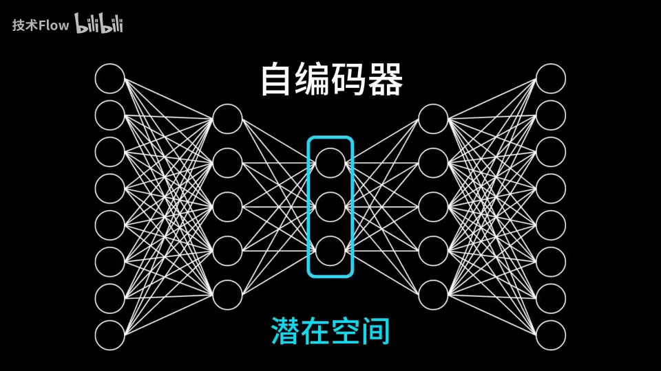

自编码器做的就是同一件事，只是对象换成了数据。它的基本架构由三部分组成[【跳转到 01:14】](https://www.bilibili.com/video/BV1kw4m1r783/?t=74)：

- **编码器（encoder）**：把输入数据压缩成低维的**潜在空间表示**，捕捉输入的基本特征；
- **瓶颈（bottleneck）**：网络中最小的那一层，保存这个压缩表示；
- **解码器（decoder）**：从压缩表示重建输入数据。

写成式子就是一对映射：

$$
z = f_\theta(x), \qquad \hat{x} = g_\phi(z)
$$

其中 $x$ 是原始输入（比如一张 784 维展平的图像），$z$ 是潜向量（比如 2 维或 5 维），$\hat{x}$ 是重建结果。$\theta$ 是编码器参数，$\phi$ 是解码器参数。

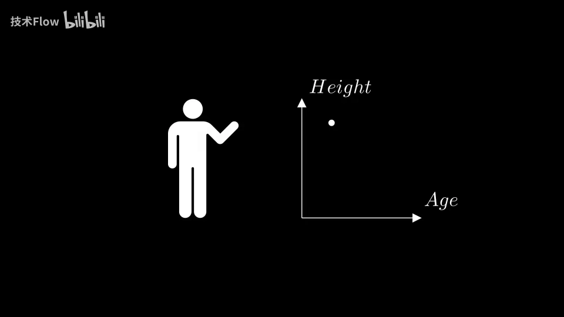

视频先用一个四维的表格数据演示：输入是一个 $2\times 2$ 的矩阵，编码器把它压成一个二维潜向量，在潜空间里就是一个点。

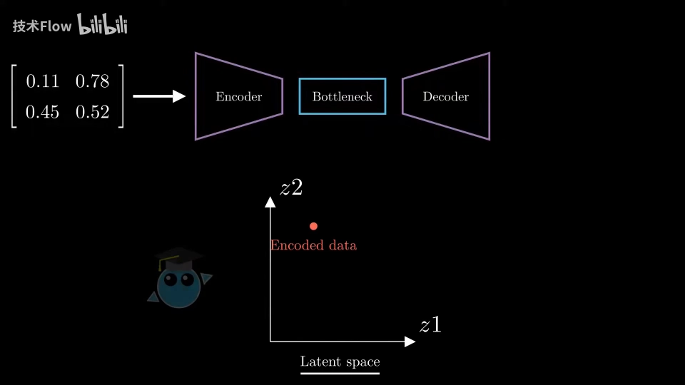

同样的流程也适用于图像。视频用一张兔子的图片举例：编码器把图像减少到几个关键特征，瓶颈层保存这些特征，解码器再从这些低维特征重建图像[【跳转到 01:39】](https://www.bilibili.com/video/BV1kw4m1r783/?t=99)。

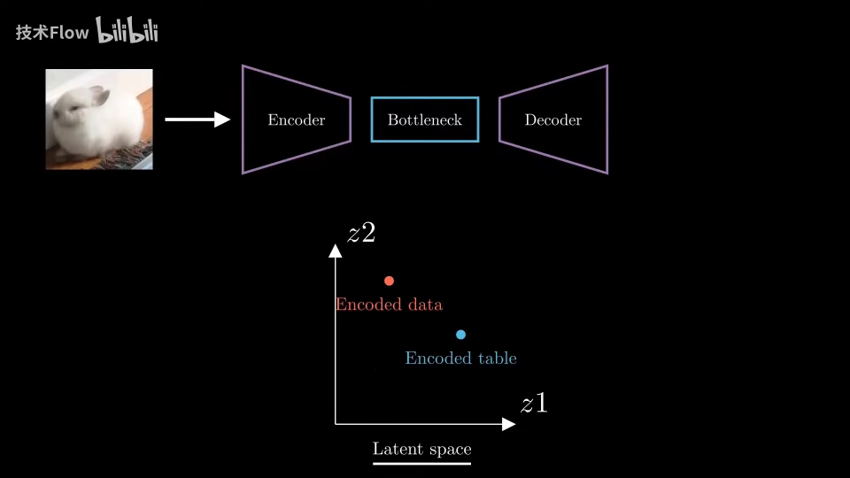

### 1.2 用均方误差度量"还原得像不像"

训练自编码器的重点是**最小化原始数据与其重建版本之间的差异**。这个目标同时推动两件事：解码器学会从压缩表示准确重建原始数据，编码器学会在压缩时保留关键信息[【跳转到 02:04】](https://www.bilibili.com/video/BV1kw4m1r783/?t=124)。

怎么度量两幅图像的差异？视频给的答案是最朴素的一种：**逐个像素比较**。计算对应像素的差值，再取这些差值的平均——这就是**均方误差（MSE, mean squared error）**[【跳转到 02:54】](https://www.bilibili.com/video/BV1kw4m1r783/?t=174)。每个差值都被平方，一是保证所有项非负，二是让大偏差受到更重的惩罚：

$$
\mathcal{L}_{\text{MSE}}(x, \hat{x}) = \frac{1}{N}\sum_{i=1}^{N}\left(\hat{x}_i - x_i\right)^2
$$

这里 $N$ 是元素个数（一张 28×28 的图就是 784），$x_i$ 和 $\hat{x}_i$ 分别是原图与重建图的第 $i$ 个像素值。这个标量就是"两幅图之间的距离"。

> 补充一句：当像素被归一到 $[0,1]$ 区间时，另一种常见选择是逐像素的二元交叉熵（BCE）。两者都在度量逐像素差异，区别在于对大偏差的惩罚形状不同；视频里只用到 MSE。

### 1.3 训练曲线：误差从高到低

一个典型的训练场景是这样的：一开始重建误差很高，因为权重是随机初始化的；随着训练推进，误差下降，重建结果越来越接近输入[【跳转到 03:19】](https://www.bilibili.com/video/BV1kw4m1r783/?t=199)。

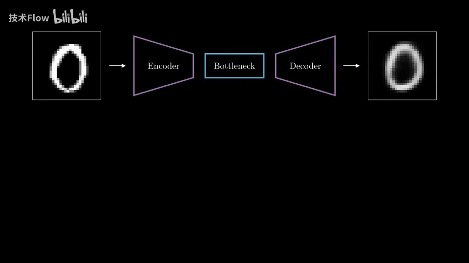

注意这里有一个容易被忽略的细节：**重建目标是输入自己**。自编码器不需要人工标注，标签就是数据本身，所以它属于无监督（自监督）学习。

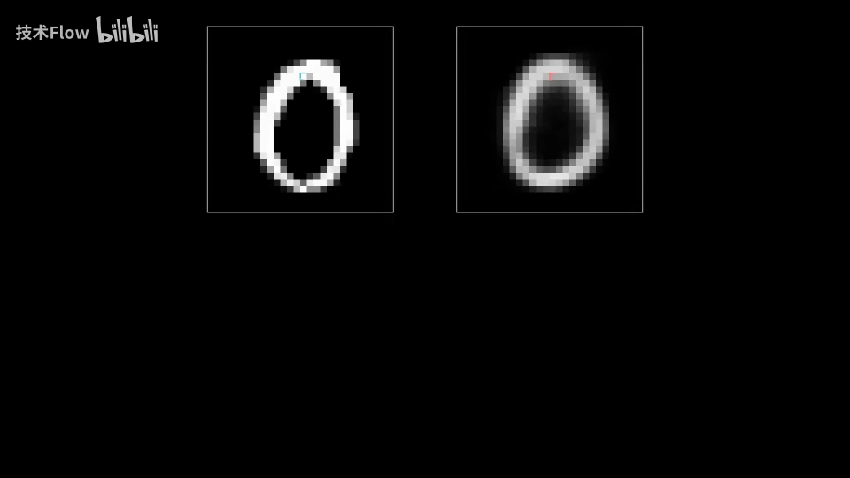

## 二、瓶颈宽度是唯一的旋钮：潜维度的取舍

### 2.1 潜维度就是瓶颈里的神经元个数

潜空间的维度由**瓶颈层中的神经元数量**决定[【跳转到 03:44】](https://www.bilibili.com/video/BV1kw4m1r783/?t=224)。如果瓶颈里有两个神经元，潜空间就是二维的；此时可以把每个神经元的激活值当成平面上的两个坐标来画图：第一个神经元激活强，编码点就落在图的右侧；第二个神经元激活强，点就落到上方。

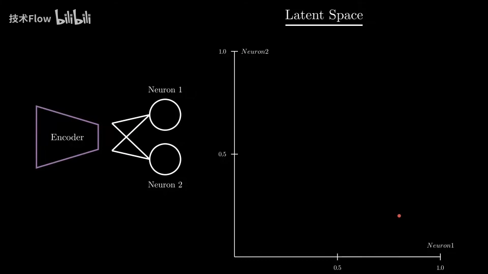

于是"压缩率"有了一个非常直白的算法：输入有 $d$ 维、潜向量有 $k$ 维，压缩比就是 $d : k$。一张 28×28 的图有 784 维，压到 2 维就是 392 比 1。这个 $k$ 就是设计自编码器时最重要的那个超参数。

### 2.2 太小：重建失败，4 变成 9

视频做了一个非常干净的对照实验：用完全相同的方式训练多个网络，**只改变潜维度**[【跳转到 06:14】](https://www.bilibili.com/video/BV1kw4m1r783/?t=374)。

结果是：**潜空间太小，自编码器难以识别数据的基本特征**，即使训练很久，重建质量依然差。在二维潜空间里，一个"4"被重建成"9"。

### 2.3 变大：簇分开了，重建也对了

把潜维度调到 9，同一个"4"就能被正确重建[【跳转到 06:39】](https://www.bilibili.com/video/BV1kw4m1r783/?t=399)。

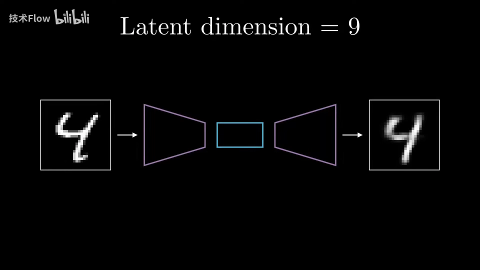

但视频紧接着追问了一个更关键的问题：我们真正想要的其实是一个"好用的潜空间"，为什么要在乎重建质量？答案是——**重建质量差，通常就意味着潜空间组织得差**[【跳转到 07:04】](https://www.bilibili.com/video/BV1kw4m1r783/?t=424)。

- 二维潜空间：重建不好，潜空间也不够有条理，能看到一些簇，但它们互相重叠、挤在同一片区域里。
- 五维潜空间：簇明显分开了，"1"主要在右上角，"2"大致在中间，"7"稍微靠右。

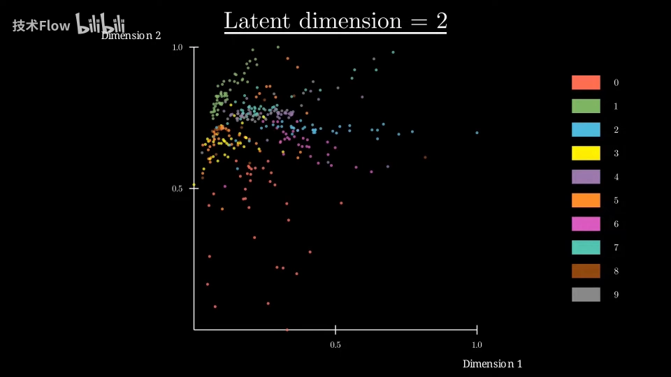

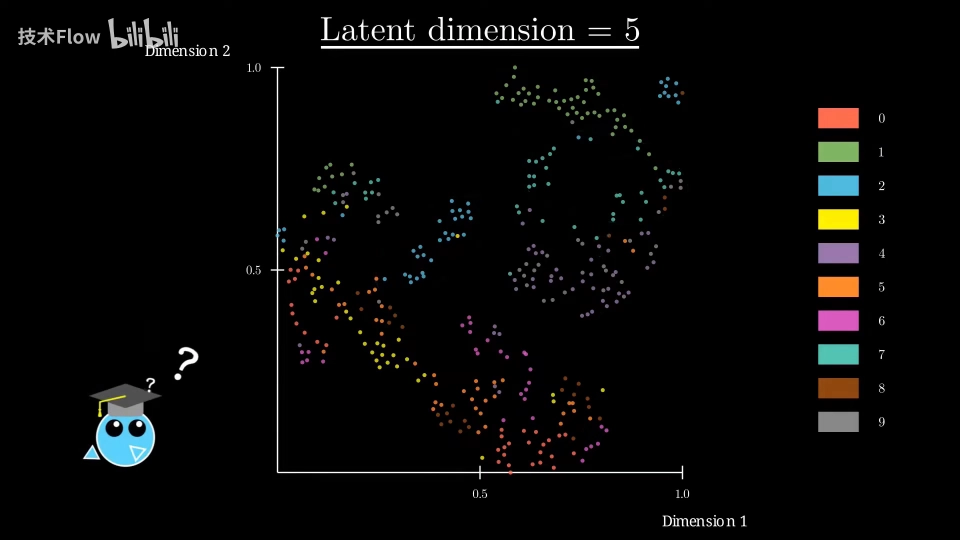

这就把"压缩率"和"表示质量"连成了一条因果链：**瓶颈越窄 → 可用的编码位置越少 → 不同类别的数据被迫挤在一起 → 既还原不准，也分不开**。

### 2.4 高维潜空间怎么画成二维图

五维潜空间没法直接画。视频给的做法是：**投影**潜空间，保留最重要的两个维度来可视化[【跳转到 07:29】](https://www.bilibili.com/video/BV1kw4m1r783/?t=449)。这一点值得记住——你看到的二维散点图是高维潜空间的一个投影，图上的"距离"不完全等于潜空间里的距离。

## 三、潜空间的组织是重建误差的副产品

### 3.1 同类聚成簇

如果自编码器训练得很好，数字 7 的每个实例都会落到潜空间的同一片区域；数字 4 的实例也会形成自己的簇，而且理想情况下这个簇与其他类别相隔很远[【跳转到 04:34】](https://www.bilibili.com/video/BV1kw4m1r783/?t=274)。

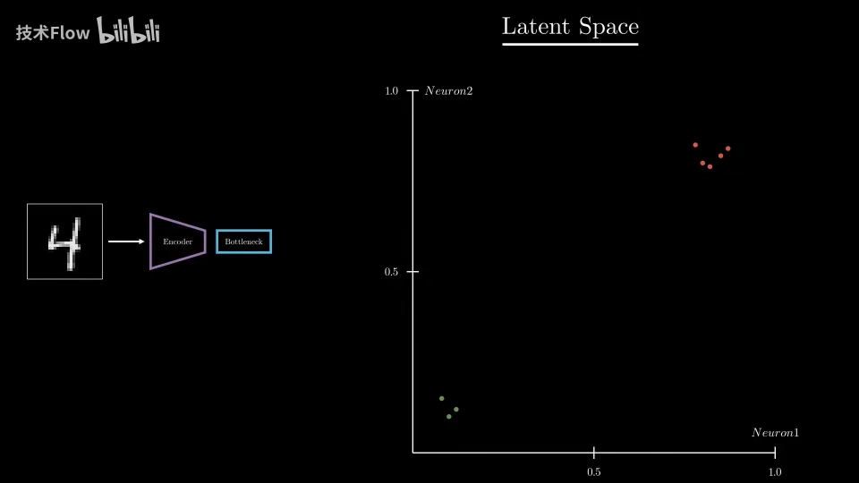

### 3.2 训练过程中潜空间如何演化

把每个 epoch 的潜表示都画出来，可以看到一个动态过程：早期训练阶段潜表示移动很多，簇逐渐成形；经过若干 epoch 后训练收敛，潜表示不再大幅变化[【跳转到 05:24】](https://www.bilibili.com/video/BV1kw4m1r783/?t=324)。

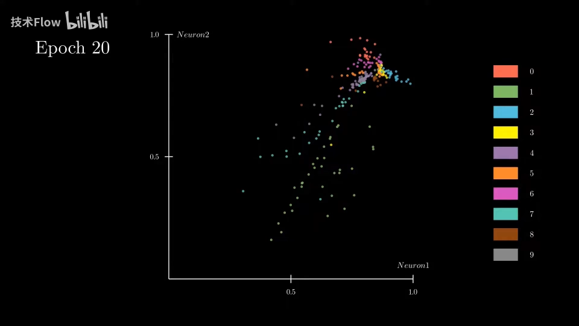

视频强调，这种组织**不是完美的**，但已经足以让数据变得更好处理：例如最近邻分类算法在这样的表示上就能给出不错的结果。这就是自编码器作为**特征提取器**的价值——训练完成后你往往只保留编码器，把潜向量当作下游模型的输入。

### 3.3 重建差 = 组织差

前面 2.2 节和 2.3 节的对照实验，到这里可以合成一句话：**重建误差是潜空间组织的代理指标**。在五维潜空间里，仍然有编码得不好的样本——某个"2"的图像被编码到"9"的簇附近，于是被重建成了 9；某个"3"被编码得不好，被重建成了 8[【跳转到 08:19】](https://www.bilibili.com/video/BV1kw4m1r783/?t=499)。

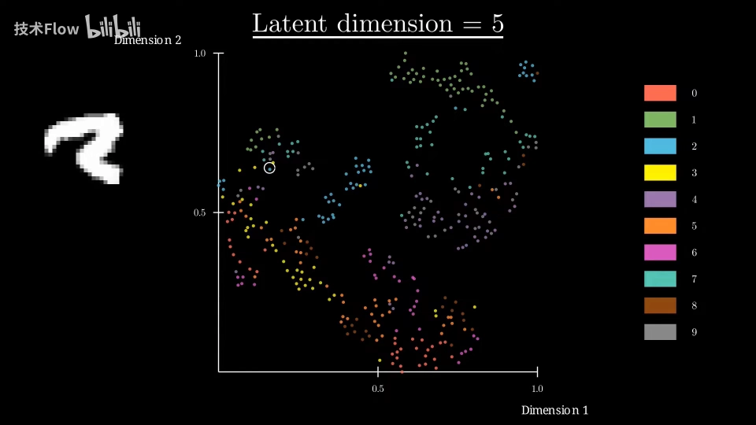

换句话说，重建错误的样本，正是那些**被放错了位置**的样本。

## 四、能重建不等于能生成：三个失败症状

视频后半段转向局限。它先给出一句判断：自编码器最大的优势也是它最大的局限——**潜在空间**。如果只依赖重建损失去组织潜空间，得到的表示通常"可接受"，但不会像我们希望的那样清晰[【跳转到 09:50】](https://www.bilibili.com/video/BV1kw4m1r783/?t=590)。随后它给出三个具体症状。

### 4.1 症状一：簇的边界是糊的

前面已经看到，簇虽然存在，但重叠、稀疏、边界不清。对分类来说这还能用，对"精确控制生成"来说就不够。

### 4.2 症状二：潜空间里的中点没有意义

这是最关键的一条。我们直觉上会期待：在潜空间里取两个编码点的中点，解码出来应该是两张图的"混合"。**事实并非如此**[【跳转到 10:15】](https://www.bilibili.com/video/BV1kw4m1r783/?t=615)。

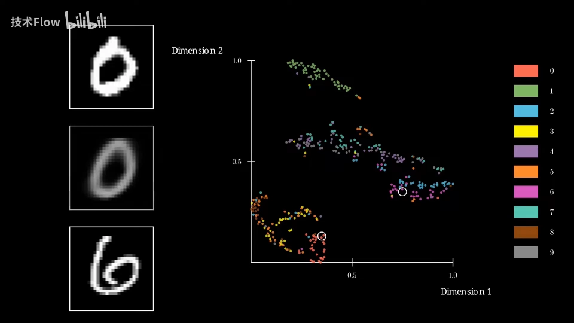

视频举的例子是 0 和 6：两者的潜向量之间隔着一段距离，中间本该有一个"5"的位置，但那里**根本没有被编码过任何东西**。所以取中点得到的只是一团无意义的模糊图像。

这条症状直接回答了本小节的另一半问题——**重建好 ≠ 能生成**。重建误差只约束了"训练样本的编码点附近"这一小片区域，潜空间里其余的位置没有任何约束：既没有"必须解码出合法样本"的要求，也没有"必须符合某个分布"的要求。因此从潜空间里随机采样一个点再解码，得到的通常不是一张合理的图。

### 4.3 症状三：加一点噪声就崩

第三个症状是鲁棒性。自编码器学到了大量与任务无关的特征，以至于在输入上加一点噪声，它就无法重建了[【跳转到 10:25】](https://www.bilibili.com/video/BV1kw4m1r783/?t=625)。

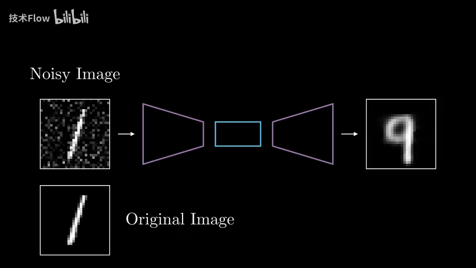

这说明学到的映射是"贴着训练分布"的，稍微偏离就会被推到别的簇里去。视频在这里收尾：这正是为什么大多数现代自编码器实现要**规范化潜空间**，其中最著名的一类叫**变分自编码器（VAE）**——它给潜空间加上分布约束，让"采样"这件事重新变得有意义[【跳转到 10:50】](https://www.bilibili.com/video/BV1kw4m1r783/?t=650)。具体怎么做，是下一小节的内容。

## 五、一个真实用例：从脑部 MRI 的潜表示读出性别

视频给的应用例子是医学影像。设想一家每年接诊数百万患者的医院，可能做几十万次磁共振检查；医院有患者的脑部 MRI，但性别信息在数据处理中丢失了[【跳转到 08:44】](https://www.bilibili.com/video/BV1kw4m1r783/?t=524)。而性别结合年龄等信息对很多判断都有用——偏偏即使经验丰富的医生，也无法只靠看脑部 MRI 就确定性别。

做法是训练一个自编码器，把脑部 MRI 编码到更低维的空间，再在这个低维表示上区分男女[【跳转到 09:18】](https://www.bilibili.com/video/BV1kw4m1r783/?t=558)。

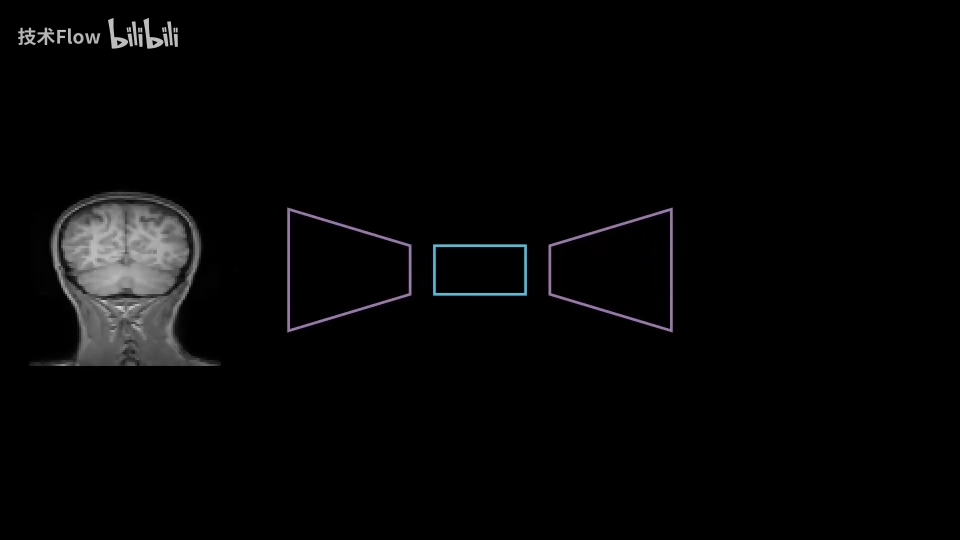

这个例子体现的是自编码器最常见的用法：**不是为了重建，而是为了得到一个便于下游任务处理的低维表示**。重建只是训练手段。

## 小结

- 压缩和还原是同一个目标的两面，训练信号只有重建误差，标签就是输入自己。
- 潜维度是唯一的旋钮：$k$ 太小则重建差、簇重叠；$k$ 变大则重建变好、簇分开，但压缩率下降、下游任务未必更好。
- 重建误差是潜空间组织的代理指标，重建错的样本往往就是被放错位置的样本。
- 潜空间不是分布，只是编码点的集合：插值无意义、随机采样无意义，所以普通自编码器不能当生成模型用。
- 想让潜空间"可以被采样"，需要额外的约束——这就是 VAE 的起点。

## 关键术语速查

| 术语 | 一句话解释 |
| --- | --- |
| 自编码器（AE） | 由编码器、瓶颈、解码器组成的网络，目标是让输出尽量等于输入 |
| 潜空间（latent space） | 瓶颈层激活值构成的空间，输入数据在这里被表示成少数几个数 |
| 瓶颈（bottleneck） | 网络中最窄的一层，其神经元个数决定潜维度 |
| 潜维度 $k$ | 潜向量的长度，直接决定压缩率与表示能力 |
| 重建误差 | 输入与重建输出之间的差异，常用均方误差 MSE 度量 |
| 压缩率 | 输入维度与潜维度之比，如 784 维压到 2 维约为 392 比 1 |
| 插值 | 在潜空间两点间取中间点再解码；普通 AE 上通常得到无意义的模糊结果 |
| 变分自编码器（VAE） | 给潜空间加上分布约束的自编码器，使潜空间可以被采样 |