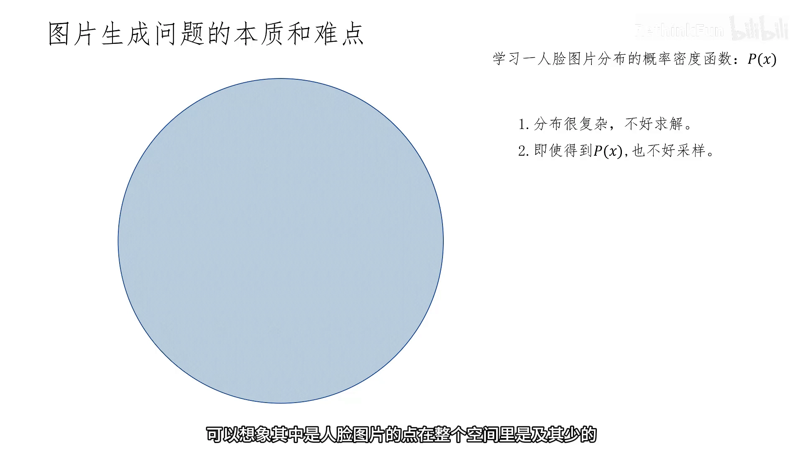
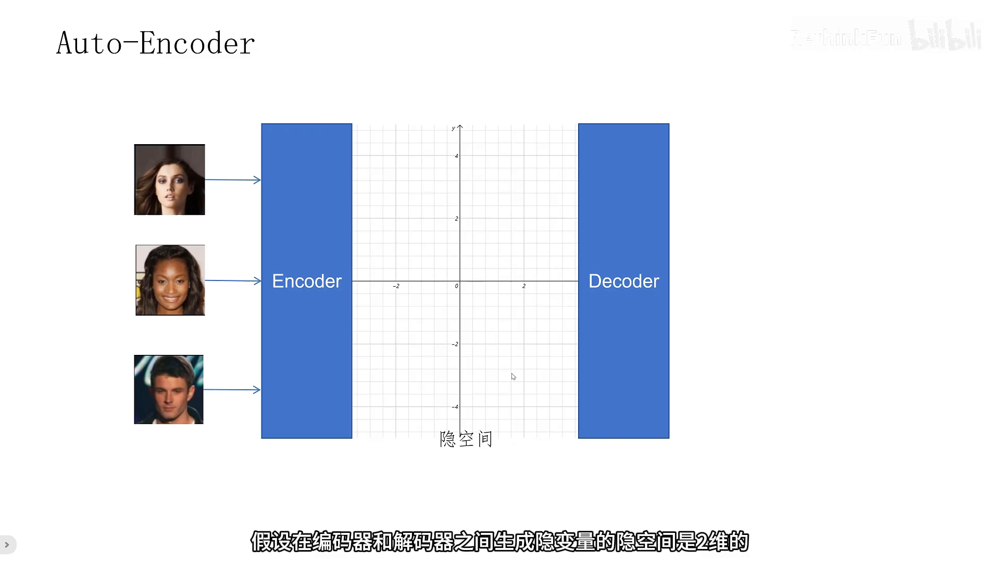
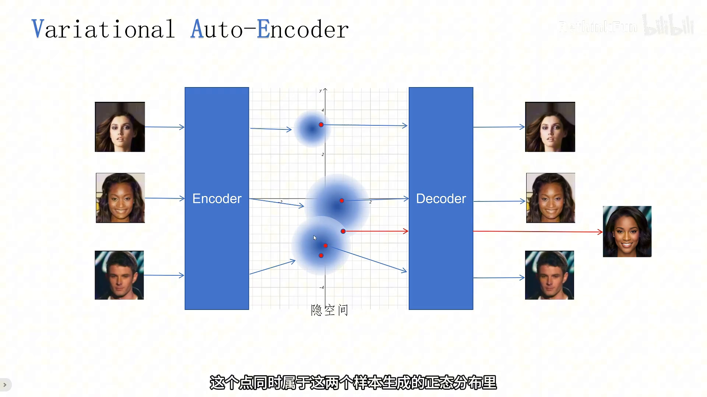
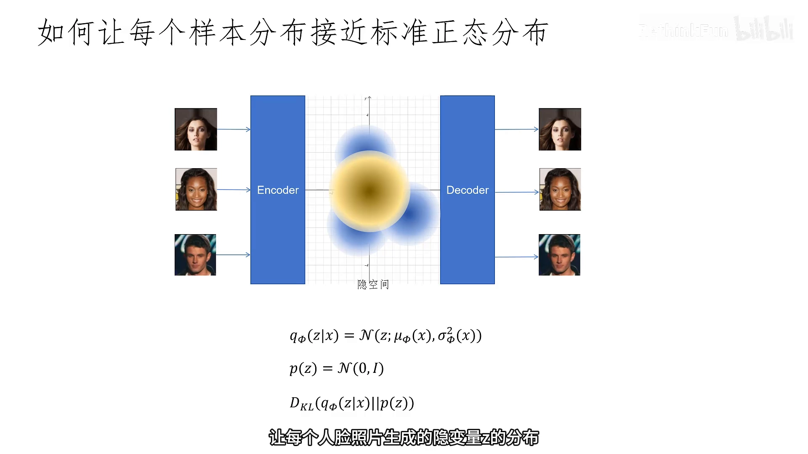
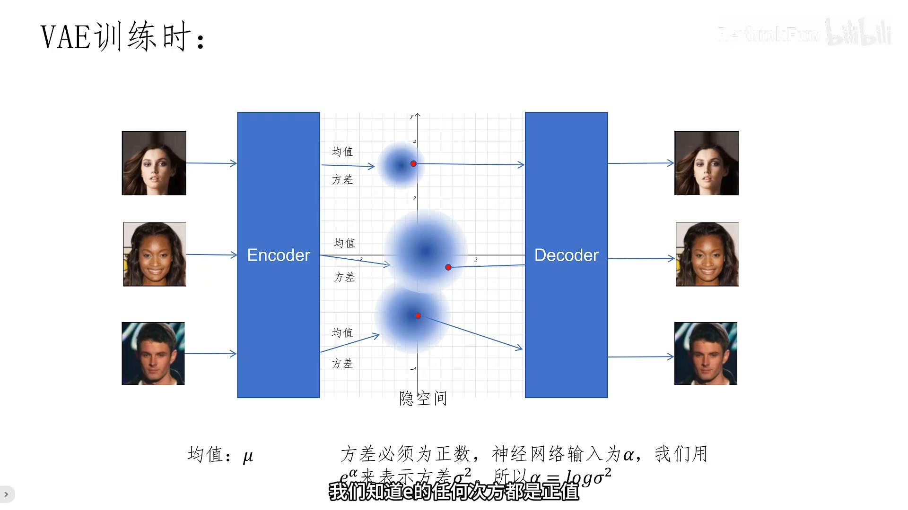
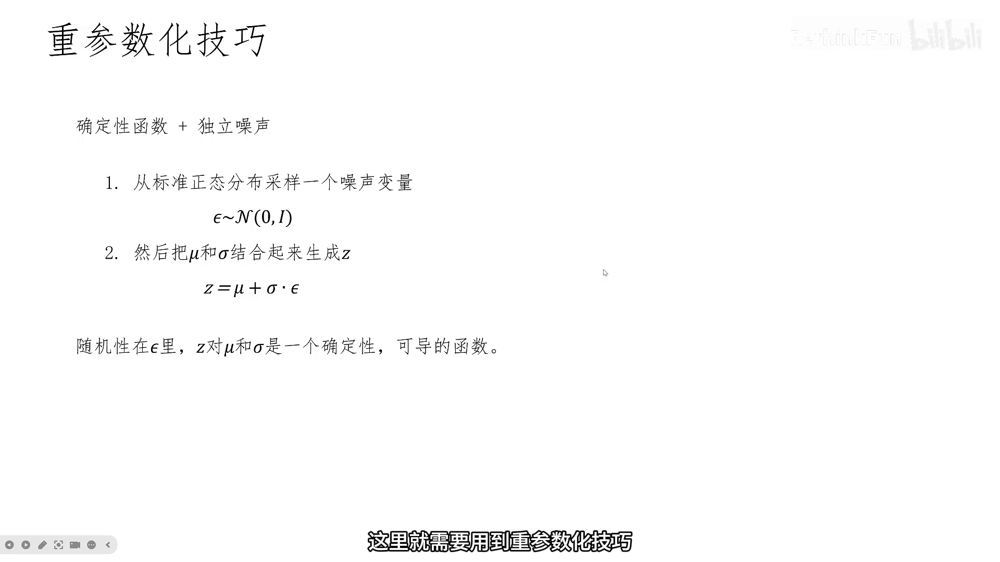
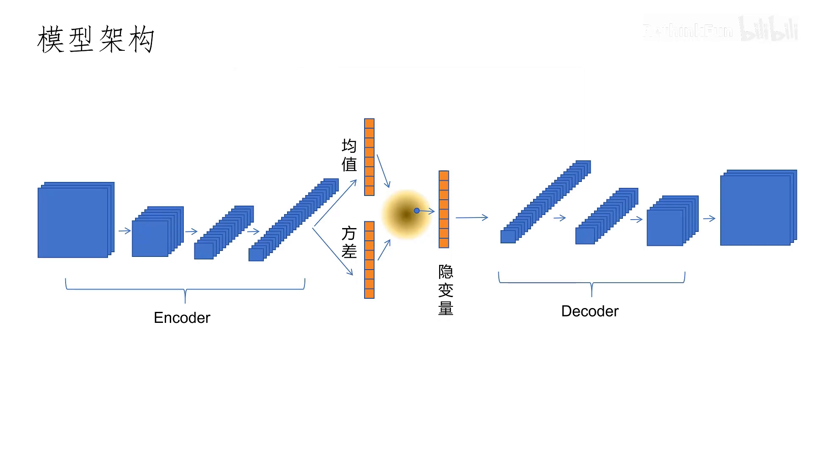
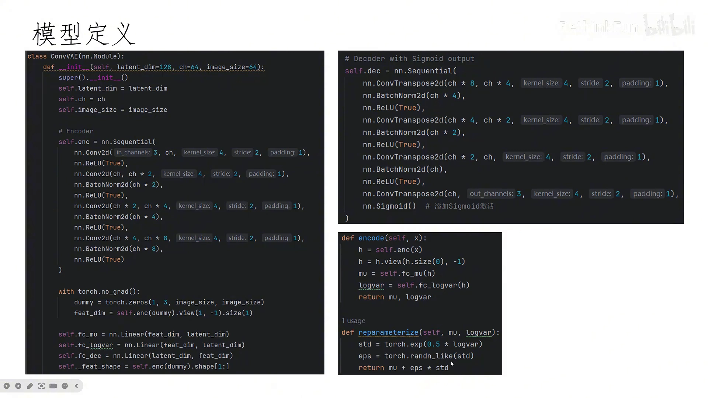
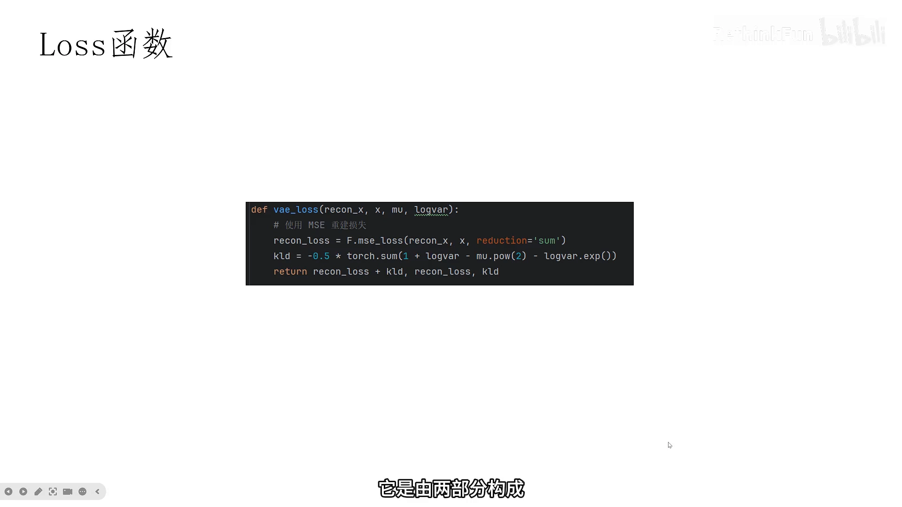
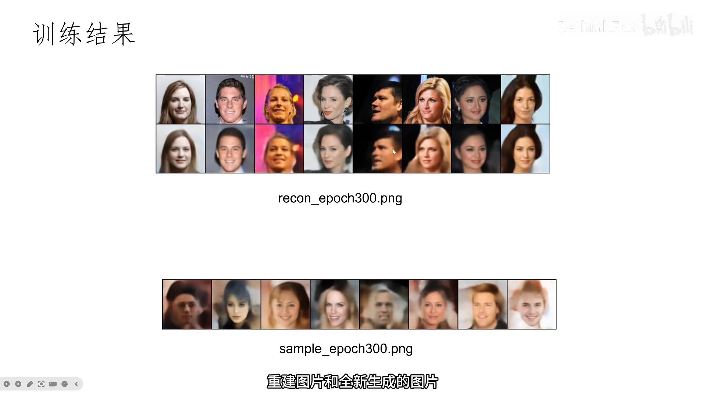

# 从隐变量到可运行的VAE：均值、方差、重参数化与卷积实现

> 视频来源：[VAE算法讲解（变分自编码器 Variational Auto-Encoder）](https://www.bilibili.com/video/BV1xFxMz1EMS/)（Bilibili · RethinkFun，约 30 分钟）
> 导读：这支视频的讲法很有特点——先用"隐空间里只有极少数区域能解码出人脸"这个几何直觉，把 VAE 的损失函数**猜**出来，再用数学推导证明猜得对，最后落到一份可运行的 PyTorch 卷积 VAE 代码。本文按视频顺序复述，重点放在"为什么编码器要输出均值和方差"以及"重参数化在代码里长什么样"；ELBO 的逐步推导与 KL 项的解析形式只保留结论，细节见本系列 2.1.9 一节。

## 本讲要解决的核心问题（SCQA）

**背景**：生成图片的目标，是学会人脸图片的概率密度函数 $p(x)$，然后从中采样。但 $p(x)$ 不像正态分布、均匀分布那样几个参数就能写出来，它复杂到无法求解；更麻烦的是，即使求出来了，也很难从里面采样。

**冲突**：引入低维隐变量 $z$ 可以让问题变简单——隐变量维度低、好采样，只要有一个网络把它映射成图片就行。可"用自编码器不就有现成的编码器和解码器了吗"这个想法立刻碰壁：自编码器的隐空间里，只有极少数点能解码出图片，其余区域全是噪声。

**疑问**：怎样改造自编码器，才能让隐空间变成一片"随便采一个点都能出图"的区域？改造之后，梯度还能反传吗？代码怎么写？

**回答（中心思想）**：VAE 做了两件事。第一，让编码器输出一个**正态分布**（均值 $\mu$ 与方差 $\sigma^2$）而不是一个点，这样可采样的空间从"点"扩成"团"，重叠区还能生成兼顾多个样本特征的新图；第二，用 **KL 散度**把所有样本的分布都拉向标准多元正态分布 $\mathcal{N}(0,I)$，于是从先验里采点就总能出图。为了让采样可导，再用**重参数化** $z=\mu+\sigma\odot\epsilon$ 把随机性挪到噪声 $\epsilon$ 上。最终损失就是"重建项 + KL 项"，可以完整地用卷积网络实现。

## 一、图片生成问题的本质：$p(x)$ 求不出也采不动

视频开篇先把问题摆清楚。一张黑白人脸图片由几万个像素构成，每个像素的灰度值都可以看作一个随机变量，整张照片就是这几万个随机变量的联合分布。可以想象，其中真正"是人脸图片"的点在整个空间里极其稀少，空间里几乎所有的点都是噪声[【跳转到 00:05】](https://www.bilibili.com/video/BV1xFxMz1EMS/?t=5)。



理想情况是：拿到 $p(x)$ 就能在里面随机采样出人脸图片。但这条路有两个坎：

1. **分布太复杂**：它不像正态分布、均匀分布或者指数分布，只要几个参数就能表达；
2. **采样太难**：即使得到了这个概率密度函数，也很难从里面采样。

## 二、隐变量：把"难采样的高维分布"换成"好采样的低维分布"

破局的办法是引入**隐变量**。从像素角度看，一张 100×100 的彩色人脸图片需要 3 万个维度来表达；但如果能抽象到"头发长短、脸的宽度、眼睛大小、鼻子高度"这类隐变量上，用 128 个隐变量就足以描述这张脸。

关键在于：这些隐变量不需要人手工定义，可以让神经网络自己学，并且**强制它们服从一个简单的分布**，比如正态分布——正态分布的每一次采样都是有效的采样。再从隐变量到真实图片做一个映射，这个映射同样交给神经网络去拟合。

于是问题被拆成了两半：低维、好采样的隐变量分布（简单），以及隐变量到图片的映射（用网络学）。视频用一句话总结：隐变量维度低、好采样，便于我们生成图片。

## 三、为什么不能"训练个自编码器，只用它的解码器"

学过自编码器的同学到这里会立刻想到：自编码器的编码器不就是把图片映射到隐变量、解码器不就是把隐变量映射回图片吗？那训练好之后只取出解码器，随机生成一个隐变量丢进去，不就能生成图片了？

视频的回答很干脆：**答案是否定的**。它把隐空间设成二维来讲原因[【跳转到 04:25】](https://www.bilibili.com/video/BV1xFxMz1EMS/?t=265)：



- 对每张训练图片，编码器输出的隐变量向量都是一个**确定的点**，这个点经解码器可以还原回原图；
- 但隐空间内只有极少部分的点或区域能还原成图片，在绝大部分区域采样一个隐变量，生成的图片都是噪声。

这和本系列 2.1.1 一节的结论一致：普通自编码器只优化"训练样本能否还原"，对潜空间里没被编码过的位置不作任何保证。

## 四、VAE 的两步改造：先扩成分布，再拉向标准正态

### 4.1 第一步：让编码器输出一个正态分布

VAE 想到的办法是让编码器生成的不是一个点，而是一个正态分布，然后从这个分布里任意抽取一个点，把这个点代表的隐变量传入解码器，要求它能还原出原来输入的图片。这样隐空间内"有意义、可采样"的空间就大大增加了。

更有意思的是重叠带来的新能力：如果某个采样点同时落在两个样本各自的正态分布里，训练时就会要求它同时生成像这两张人脸的图片，最终生成的人脸会兼顾两者的特征，从而形成一张**训练数据集里不存在的新人脸**[【跳转到 05:40】](https://www.bilibili.com/video/BV1xFxMz1EMS/?t=340)。



这是 VAE 生成能力的几何来源：**新样本产生于分布的重叠区**。

### 4.2 第二步：还不够，因为分布的位置和大小各不相同

但只做到这一步仍然有问题：每个训练样本生成的分布，均值和方差都不一样，覆盖的隐空间大小和区域也不一样，还是存在很多没有被覆盖到的隐空间。在这些地方采样，依然生成不出人脸。

VAE 的优化方法是：让所有训练样本经过编码器生成的多元正态分布都尽量靠近**多元标准正态分布**，而且各个维度之间相互独立——也就是让每个样本的隐变量分布都尽量靠近均值为零、方差为一的正态分布。这样训练调整之后，所有样本的分布都更靠近标准多元正态，生成时从标准正态里采样得到的隐变量就总能生成一张人脸图片。

用公式表达，就是编码器给出的近似后验、先验、以及两者之间的 KL 散度[【跳转到 11:38】](https://www.bilibili.com/video/BV1xFxMz1EMS/?t=698)：

$$
q_\phi(z\mid x) = \mathcal{N}\big(z;\ \mu_\phi(x),\ \sigma_\phi^2(x)\big), \qquad p(z) = \mathcal{N}(0, I), \qquad D_{\mathrm{KL}}\big(q_\phi(z\mid x)\,\|\,p(z)\big)
$$



### 4.3 编码器怎样输出"方差"：一个必须为正的数

这里有一个实现层面的细节，视频讲得很清楚。编码器要输出正态分布的两个参数：均值 $\mu$ 可以是任意实数，但**方差必须为正数**。而神经网络最后一层的输出可正可负，直接当方差用会出问题。

解法是让网络输出一个 $\alpha$，再用指数函数把它变成方差。因为 $e$ 的任何次方都是正值：

$$
\sigma^2 = e^{\alpha}, \qquad \alpha = \log \sigma^2
$$

所以网络原始输出的 $\alpha$ 其实就是 $\log\sigma^2$。这也解释了为什么几乎所有 VAE 代码里编码器输出的都是 `logvar` 而不是 `var`。



### 4.4 符号约定与解码器的输出

视频随后统一了符号，这套符号值得记住：

- $x$：输入的人脸照片；$z$：隐变量；
- $q_\phi(z\mid x)$：给定 $x$，编码器把 $x$ 映射到不同 $z$ 的概率密度函数，$\phi$ 是编码器参数；
- $p(z)$：期望的隐变量分布，取标准多元正态，生成时就从这里采样；
- $p_\theta(x\mid z)$：给定 $z$，解码器把 $z$ 映射到不同 $x$ 的概率密度函数，$\theta$ 是解码器参数。

关于 $p_\theta(x\mid z)$，视频做了一个实用的简化：虽然也可以让解码器输出正态分布的均值和方差、再从里面采样图片，但没有必要——**直接让解码器输出这个正态分布的均值，并把它当作最终图片**。所以解码器实际上就是一个确定性的映射，训练时用的是均方误差。

## 五、重参数化：让梯度穿过采样这一步

### 5.1 问题出在哪

普通自编码器的 loss 就是解码器输出图片与输入图片逐像素的 MSE，整个网络就是一个普通的前馈网络，反传没有障碍。但换成 VAE 之后，反向传播会卡住：

- 编码器输出的是正态分布的**参数**；
- 解码器输入的是从该正态分布**采样**出来的点；
- 采样操作不可导，梯度算不出来，反向传播在采样这一步就中断了[【跳转到 10:21】](https://www.bilibili.com/video/BV1xFxMz1EMS/?t=621)。

### 5.2 解法：确定性函数 + 独立噪声

重参数化技巧可以概括成一句口诀：**确定性函数 + 独立噪声**。

1. 先从标准正态分布采样一个噪声变量 $\epsilon \sim \mathcal{N}(0,1)$；
2. 再用编码器给出的 $\mu$ 和 $\sigma$ 把它组合成 $z$：

$$
z = \mu + \sigma \cdot \epsilon
$$

这样随机性完全在 $\epsilon$ 里，而 $z$ 对 $\mu$ 和 $\sigma$ 是一个确定性的、可导的函数，从正态分布里随机采样这一步的可导性问题就解决了[【跳转到 10:32】](https://www.bilibili.com/video/BV1xFxMz1EMS/?t=632)。



### 5.3 于是 loss 变成两项

与自编码器不同，VAE 还有一个额外限制：让每张人脸照片映射到隐空间的分布都尽量接近标准正态分布。这个约束用 KL 散度实现，加进 loss 里。所以最终 VAE 的 loss 由两部分构成：

$$
\mathcal{L} = \underbrace{\lVert x - \hat{x}\rVert^2}_{\text{重建 loss}} \;+\; \underbrace{D_{\mathrm{KL}}\big(q_\phi(z\mid x)\,\|\,p(z)\big)}_{\text{KL loss}}
$$

- **重建 loss**：要求重建的图片尽可能和原始输入图片一致；
- **KL loss**：要求每张图片生成的分布尽可能接近标准多元正态分布。

视频强调，实际训练时这两个 loss 是一个**互相博弈**的过程：要让每张图都重建得好，就需要在隐空间里把不同的人脸尽可能区分开、让它们离得尽可能远；而 KL loss 又要求所有图片生成的分布都尽可能靠近标准正态。前者想把点推开，后者想把分布收拢，最终的平衡点决定了模型的重建质量与潜空间规整程度。

到这里，视频用"直观理解"的方式，从自编码器的演化**猜**出了 VAE 的 loss 构成。

## 六、数学推导：猜出来的 loss 是对的

视频随后用大多数教程的标准路线，从最大似然出发把同一个 loss 推一遍（这一段的完整推导属于本系列 2.1.9 一节的内容，这里只记录骨架）：

1. 目标：让解码器生成所有训练样本的联合概率最大，即最大化 $\prod_i p_\theta(x_i)$；取对数、加负号，变成最小化负对数似然。
2. 对单个样本，$p_\theta(x)$ 要对隐空间所有 $z$ 积分：$p_\theta(x) = \int p(z)\,p_\theta(x\mid z)\,dz$。
3. 分子分母同乘编码器 $q_\phi(z\mid x)$，凑成"在 $q_\phi$ 下的期望"。
4. 用 Jensen 不等式把 log 移进期望内部，得到**证据下界（ELBO）**。
5. 把 log 内的除法拆成相减，期望拆成两个期望：第一项正好是 $q_\phi(z\mid x)$ 对 $p(z)$ 的 KL 散度，第二项是重建似然的期望。

得到的结论与前面猜的完全一致：一个图片重建 loss，加一个 KL 散度 loss。接着视频把 KL 项算成了可直接编程的闭式解——对两个对角高斯，逐维相加即可：

$$
D_{\mathrm{KL}}\big(q_\phi(z\mid x)\,\|\,p(z)\big) = -\frac{1}{2}\sum_{i=1}^{D}\Big(1 + \log\sigma_i^2 - \mu_i^2 - \sigma_i^2\Big)
$$

其中 $D$ 是隐空间维度，$\mu_i$、$\sigma_i^2$ 都是编码器网络的输出。至此 VAE 的 loss 有了可计算的表达式。

## 七、代码实现：一个卷积 VAE 的完整流程

### 7.1 数据与模型架构

训练数据是 20 多万张人脸图片。模型不是全连接网络，而是卷积 VAE，架构如下[【跳转到 23:34】](https://www.bilibili.com/video/BV1xFxMz1EMS/?t=1414)：



- **编码器**：输入 RGB 三通道图片，经过几个卷积层下采样，每个卷积层通道数翻倍、长宽减半；最后一个卷积层把特征拉平，经过两个线性层分别得到**均值和方差**（严格说是方差的 log 值），维度都是隐空间维度（这里设为 128）。
- **采样**：在隐空间的正态分布里采样得到一个隐变量。
- **解码器**：隐变量先经一个线性层改变维度，再 reshape 成特征图，形状与编码器最后一个卷积层输出一致；然后经过几个转置卷积上采样，每个都是尺寸翻倍、通道数减半，最终得到 RGB 三通道图片。

### 7.2 编码器与重参数化的代码

模型定义部分，`ConvVAE` 继承自 `nn.Module`，初始化参数包括隐空间维度 128、初始卷积通道数 64、图片大小 64。编码器每个卷积层都用 `kernel_size=4, stride=2, padding=1`，这组设置是生成网络里编码器的常见配置，可以保证每次下采样特征图宽高正好减半；每个卷积后接 BatchNorm 与 ReLU。

代码里还有一处工程细节：用一次 `torch.no_grad()` 的前向，让一个全零的假输入过一遍编码器，**动态获得**特征维度，再据此定义 `fc_mu`、`fc_logvar` 两个线性层，以及把隐变量映射回特征维度的 `fc_dec`。



`encode` 方法做的事就是：卷积提特征 → 拉平 → 两个线性层分别得到 `mu` 和 `logvar`。`reparameterize` 方法则是把公式直接翻译成三行代码[【跳转到 27:29】](https://www.bilibili.com/video/BV1xFxMz1EMS/?t=1649)：

```python
def reparameterize(self, mu, logvar):
    std = torch.exp(0.5 * logvar)      # logvar -> 标准差
    eps = torch.randn_like(std)        # eps ~ N(0, 1)
    return mu + eps * std              # z = mu + sigma * eps
```

注意 `torch.exp(0.5 * logvar)`：因为 `logvar` 是 $\log\sigma^2$，乘 0.5 再取指数就得到标准差 $\sigma$。

解码器部分，最后几层是转置卷积，最后的激活函数是 `sigmoid`，把输出像素值归一化到 0~1；相应地，输入图片时用 `ToTensor` 把 0~255 的整数也归一化到 0~1，两边尺度对应。

### 7.3 loss 与训练循环

loss 函数只有短短三行，把前面推导的两项写出来[【跳转到 28:36】](https://www.bilibili.com/video/BV1xFxMz1EMS/?t=1716)：



```python
def vae_loss(recon_x, x, mu, logvar):
    recon_loss = F.mse_loss(recon_x, x, reduction='sum')
    kld = -0.5 * torch.sum(1 + logvar - mu.pow(2) - logvar.exp())
    return recon_loss + kld, recon_loss, kld
```

训练循环和普通自编码器几乎一样：定义模型与优化器，逐 epoch 统计总 loss、重建 loss、KL loss，前向传播算 loss、反向传播更新梯度。区别在于每若干个 epoch 会保存 checkpoint 并生成**两张**图：一张是训练图片的重建结果，另一张是在隐空间里随机采样后全新生成的图片。

### 7.4 训练结果

训练 300 个 epoch 后，重建图片与原始图片已经相当接近；而从标准正态里随机采样再解码，得到的是一批训练集中并不存在的、模糊但结构合理的人脸[【跳转到 30:01】](https://www.bilibili.com/video/BV1xFxMz1EMS/?t=1801)。



这张图恰好把 VAE 的两条通道同时展示了出来：上排是**重建通道**（编码再解码），下排是**生成通道**（先验采样再解码）。生成结果偏模糊，也是 VAE 的常见现象——正则项把每个样本的分布撑成一片区域，模型倾向于输出区域内所有可能图像的平均。

## 小结

- 直接学 $p(x)$ 有两个坎：分布太复杂求不出，即使求出也不好采样；引入低维隐变量把问题拆成"好采样的简单分布"加"一个可学的映射"。
- 普通自编码器不能生成：隐空间里只有极少数点能解码出图片，其余区域全是噪声。
- VAE 第一步：编码器输出正态分布的均值与方差，可采样区域从"点"扩成"团"，重叠区还能生成兼顾多个样本特征的新图。
- VAE 第二步：用 KL 散度把所有样本的分布拉向标准多元正态，于是从先验采样就能稳定出图。
- 方差必须为正，所以网络输出 $\log\sigma^2$，用 $\sigma^2=e^{\alpha}$ 保证非负；这也是代码里到处是 `logvar` 的原因。
- 采样不可导，用重参数化 $z=\mu+\sigma\odot\epsilon$ 把随机性转移到噪声上，梯度得以回传。
- 最终 loss = 重建项 + KL 项，两项互相博弈；KL 项对对角高斯有闭式解，可以直接写成三行代码。

## 关键术语速查

| 术语 | 一句话解释 |
| --- | --- |
| 隐变量 $z$ | 低维、服从简单分布的变量，编码器把图片映射到它，解码器把它映射回图片 |
| 隐空间 | 所有隐变量构成的空间；VAE 要求它整体接近标准多元正态分布 |
| 近似后验 $q_\phi(z\mid x)$ | 编码器输出的高斯，用均值 $\mu_\phi(x)$ 与方差 $\sigma_\phi^2(x)$ 描述 |
| 先验 $p(z)$ | 生成时采样的分布，取标准多元正态 $\mathcal{N}(0,I)$ |
| 似然 $p_\theta(x\mid z)$ | 解码器给出的"由 $z$ 生成 $x$"的概率，实现上取它的均值作为输出图片 |
| 重参数化技巧 | 用 $z=\mu+\sigma\odot\epsilon$ 把采样改写成"确定性变换 + 外部噪声"，使梯度可回传 |
| $\log\sigma^2$（logvar） | 网络实际输出的量，保证方差恒正；取指数即得方差 |
| KL 散度 | 衡量两个分布差异的量，这里用来把每个样本的分布拉向标准正态 |
| 后验塌缩 | 当 KL 项压过重建项时，编码器忽略输入、输出退化为先验的现象（本讲未展开） |