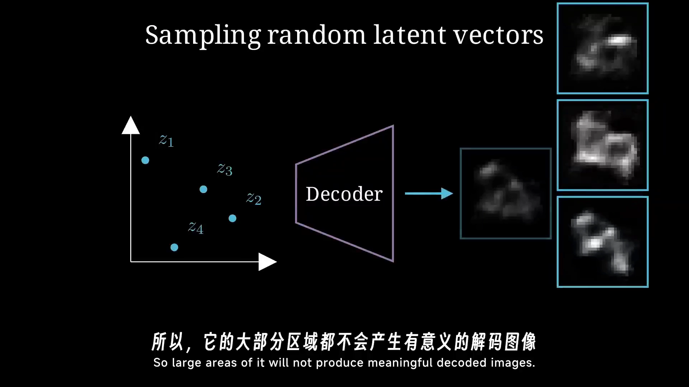
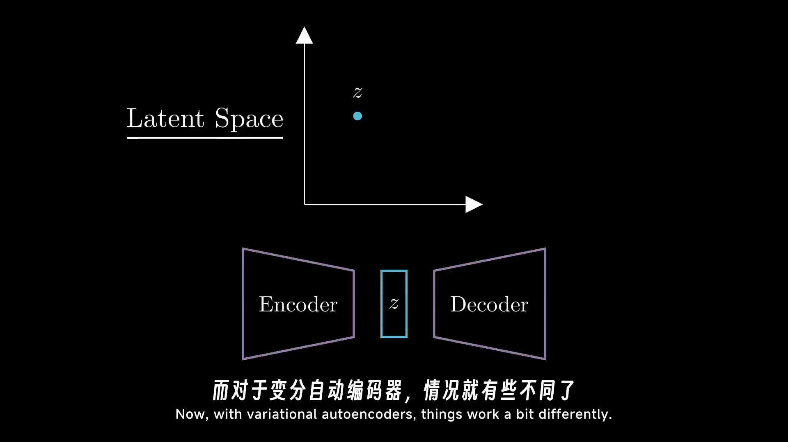
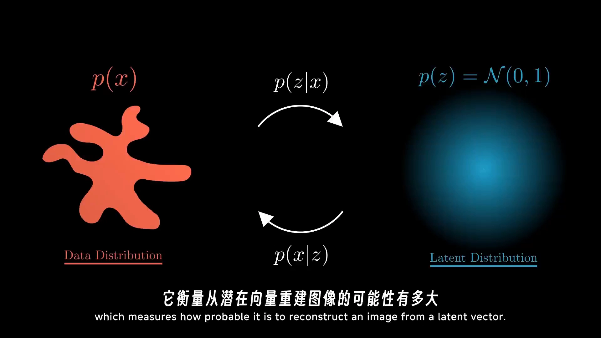
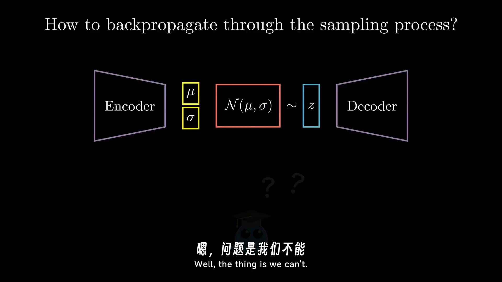
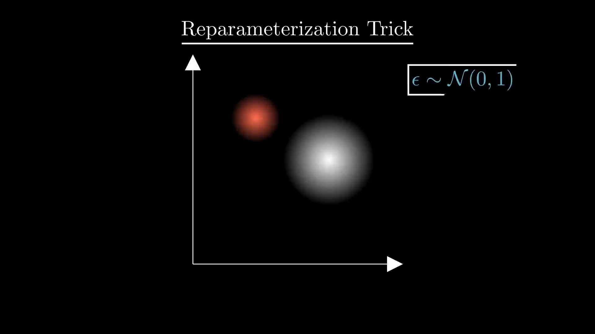
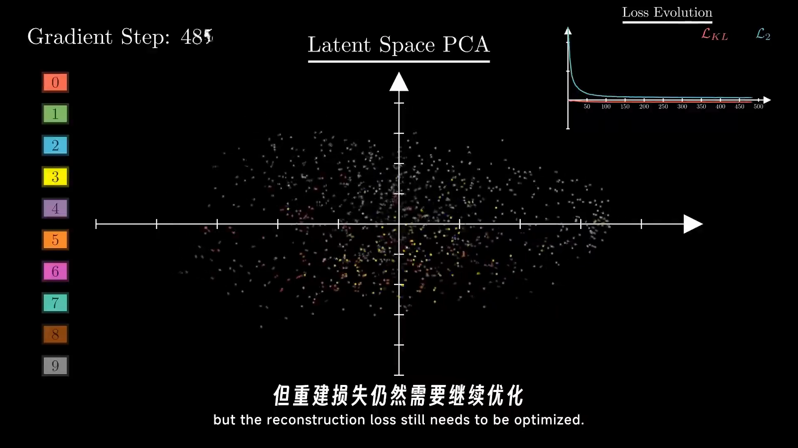
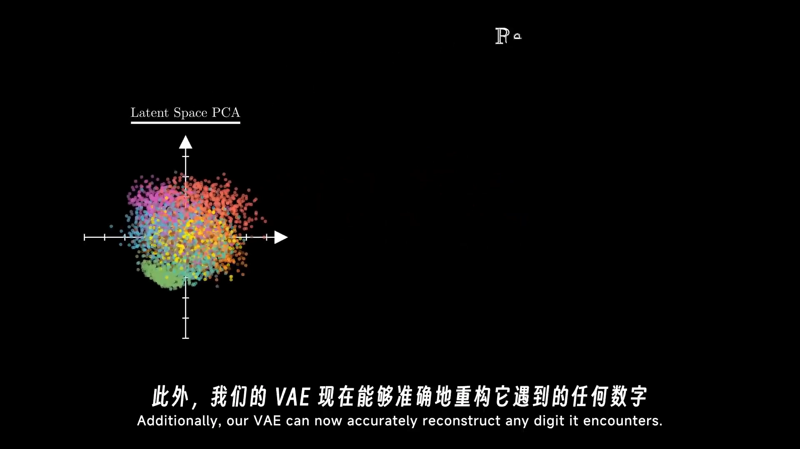
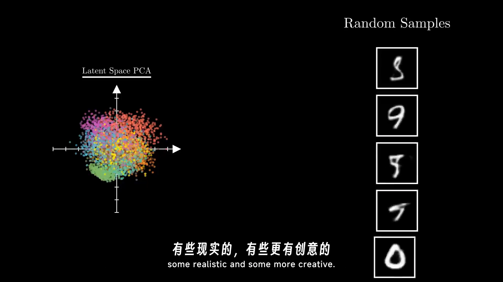
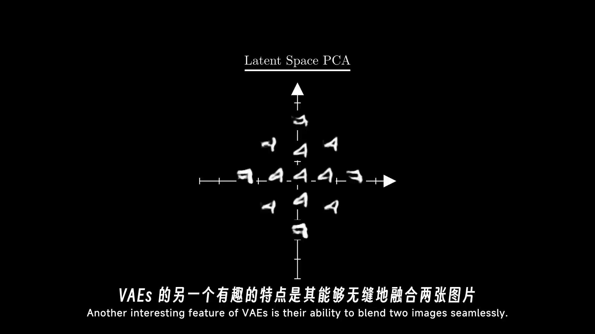
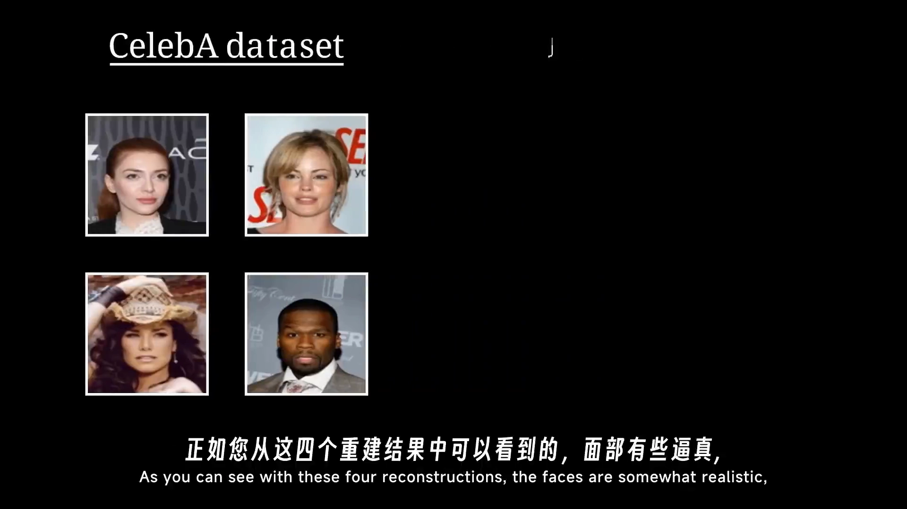

# 变分自编码器：编码器输出一个分布，采样才能生成新样本

> 视频来源：[VAE原理动画拆解](https://www.bilibili.com/video/BV1TJE8zoEJa/)（Bilibili · NeuroHacks，英文原声配中文字幕，约 20 分钟）
> 导读：这支动画视频不从公式出发，而是先用"普通自编码器为什么生成不出新图"制造问题，再一步步把编码器的输出从一个点换成一个高斯分布，最后用潜空间的演化动画说明"为什么从标准正态里随便采一个点就能出图"。本文按视频顺序复述；ELBO 的完整分解只点到为止，推导留给本系列 2.1.9 一节。

## 本讲要解决的核心问题（SCQA）

**背景**：自编码器由编码器和解码器组成，编码器把一张图片压成几十维的潜向量，解码器再把潜向量还原成图片。训练好之后，解码器显然"会画图"——它能把潜向量变成图像。

**冲突**：可是如果直接从潜空间里随机取一个点丢给解码器，得到的几乎都是噪声。也就是说，解码器会"还原"，却不会"创作"。原因不在解码器，而在编码器：它把每张训练图片压成了一个孤立的点，这些点之间的大片区域从来没有被训练过。

**疑问**：能不能改造编码器，让潜空间变成一整片"处处可用"的区域，使得随便采一个点都能解码出合理的图像？

**回答（中心思想）**：变分自编码器（VAE）的做法是让编码器不再输出一个点，而是输出一个**概率分布**（高斯分布的均值 $\mu$ 和方差 $\sigma^2$），再从分布里采样出潜变量 $z$ 送进解码器。为了让采样这一步能被反向传播，它引入**重参数化技巧** $z=\mu+\sigma\odot\epsilon$，把随机性挪到一个与网络参数无关的噪声 $\epsilon$ 上。再配合一个把每个样本的分布都往标准正态拉的正则项，训练完成后潜空间就近似成为标准正态分布——于是"从先验采样再解码"就成了一条可用的生成路径。

## 一、普通自编码器为什么生成不了新图

### 1.1 一个很自然的想法

自编码器的逻辑很朴素：把图片压缩成低维表示，再重构回原始形式。一张图片通常包含数百万个数值，而低维表示通常只是一个含 10 到 100 个数字的向量，这个向量所在的空间就叫**潜在空间**（latent space）[【跳转到 00:59】](https://www.bilibili.com/video/BV1TJE8zoEJa/?t=59)。

既然解码器能从潜表示重构图片，那"从潜空间随机采样一个点、再送进解码器"来生成新数据，看起来是顺理成章的。

### 1.2 但潜空间是杂乱无章的

视频给出的答案是：这条路走不通。主要原因是潜空间没有被组织过，其中大部分区域解码不出有意义的图像[【跳转到 01:41】](https://www.bilibili.com/video/BV1TJE8zoEJa/?t=101)。

另一种做法是先编码一张图像，再在它的潜表示邻域内采样：这会得到相似但不完全一样的图像。可惜潜空间的结构太差，附近的点往往并不对应原图像有意义的变体；而如果采样得离原图足够近，最后得到的就只是同一个重建结果[【跳转到 02:02】](https://www.bilibili.com/video/BV1TJE8zoEJa/?t=122)。

这正是本系列 2.1.1 一节讲过的现象：普通自编码器只优化"每个训练样本能不能还原"，从不管潜空间里那些没被编码过的位置对应什么。所以它的潜空间是**一堆孤岛**，而不是一片连续的土地。

## 二、把"一个点"换成"一个分布"

### 2.1 编码器的输出从一个点变成两个参数

VAE 的改动只有一句话：编码器不再把输入映射到一个点，而是把输入转换成一个概率分布，具体选为高斯分布。也就是说，编码器输出的是这个高斯的两个参数——均值 $\mu$ 和标准差 $\sigma$[【跳转到 11:20】](https://www.bilibili.com/video/BV1TJE8zoEJa/?t=680)。

用概率的语言写出来，就是"给定图像 $x$，潜变量 $z$ 服从一个由 $x$ 决定的高斯分布"：

$$
q_\phi(z\mid x) = \mathcal{N}\big(z;\ \mu_\phi(x),\ \sigma_\phi^2(x)\big)
$$

其中 $\phi$ 是编码器的参数。这个 $q_\phi(z\mid x)$ 在术语上叫**近似后验**：它是对"看到图像 $x$ 之后，潜变量 $z$ 应该是什么样"这一后验分布的近似。之所以是"近似"，因为真正的后验分布算不出来，只能用一族高斯去逼近它——这就是 VAE 里"变分"二字的来源。

### 2.2 生成路径为什么因此变宽

一旦编码器输出的是分布而不是点，可采样的区域就从"一个点"膨胀成"一小团"。视频用 MNIST 讲了这个变化的意义：训练时，如果某个采样点同时落在两个样本各自的高斯分布里，这个点就会被要求同时生成像这两个样本的图像，最终得到的是一张兼顾两者特征、训练集里并不存在的新图。

这就解释了 VAE 生成能力的来源：**新样本来自分布之间的重叠区**。重叠区越宽，能生成的新图越多。

## 三、采样不可导，所以需要重参数化

### 3.1 卡住的地方

理论上，我们只要算出损失、反向传播、更新权重就行。但这里有一个硬障碍：编码器输出的是分布的参数，解码器的输入是从这个分布里**采样**出来的点，而"采样"这个操作是不可导的，梯度传到采样这一步就断了[【跳转到 12:10】](https://www.bilibili.com/video/BV1TJE8zoEJa/?t=730)。

### 3.2 把随机性挪出去

重参数化技巧（reparameterization trick）的解法非常轻巧：不从 $\mathcal{N}(\mu,\sigma^2)$ 直接采样，而是先从**标准正态**里采一个噪声 $\epsilon$，再用确定性的变换把它搬到目标位置：

$$
\epsilon \sim \mathcal{N}(0, 1), \qquad z = \mu + \sigma \odot \epsilon
$$

这样，随机性完全落在 $\epsilon$ 上，而 $z$ 对 $\mu$ 和 $\sigma$ 来说是一个**确定的可导函数**。梯度可以沿着 $z \to \mu,\sigma$ 一路回传，整个网络就能端到端训练了[【跳转到 12:35】](https://www.bilibili.com/video/BV1TJE8zoEJa/?t=755)。

值得强调的是，这不是近似：$\mu + \sigma\epsilon$ 与直接从 $\mathcal{N}(\mu,\sigma^2)$ 采样在分布上完全等价，只是把"随机"和"可导"这两件事拆开了。这也是后面扩散模型里"加噪—去噪"参数化反复使用的同一个技巧。

## 四、训练之后，潜空间真的变成了标准正态

### 4.1 正则项在做什么

只让编码器输出分布还不够：每个样本的分布可能各自散落在潜空间各处，覆盖不到的区域依然生成不出东西。VAE 的第二个改动是加一个约束，让**每个样本的分布都尽量靠近标准正态分布** $\mathcal{N}(0,I)$，且各维度相互独立。

实现方式是在损失里加一项 KL 散度，衡量近似后验与先验之间的差距：

$$
\mathcal{L} = \underbrace{\mathbb{E}_{q_\phi(z\mid x)}\big[-\log p_\theta(x\mid z)\big]}_{\text{重建项}} + \underbrace{D_{\mathrm{KL}}\big(q_\phi(z\mid x)\,\|\,p(z)\big)}_{\text{正则项}}
$$

其中第一项要求"采样出的 $z$ 能重构回 $x$"，第二项要求"$z$ 的分布别跑离标准正态"。视频在这里只做了直观解释：整个目标可以看作**一种带正则化的重构损失**——第一项是通常的 L2 损失，第二项给潜空间施加一个正态分布的形状[【跳转到 10:30】](https://www.bilibili.com/video/BV1TJE8zoEJa/?t=630)。

对两个高斯分布，这个 KL 项有闭式解，可以直接算出来再反传；视频结尾的附录用 Jensen 不等式把它从对数似然一步步推出来。完整的 ELBO 分解、下界含义与 KL 项的解析形式，见本系列 2.1.9 一节，这里不展开。

### 4.2 潜空间的演化过程

视频用一段动画展示了训练中潜空间的变化，这是全片最直观的部分：

- 训练初期，所有图像都被编码到潜空间的同一小块区域；
- 几轮梯度更新之后，正则项把潜向量推向正态分布的形态；
- 大约两到三个 epoch 后，KL 项的值已经很小，潜空间几乎不再变化，但重建损失仍在继续优化。

训练完成后，潜空间看起来就是一个二维正态分布，不同数字按类别聚成不同颜色的团块[【跳转到 14:44】](https://www.bilibili.com/video/BV1TJE8zoEJa/?t=884)。

### 4.3 于是"从先验采样再解码"成立了

这时候生成就变成了一件非常机械的事：从标准正态里采一个 $z$，直接送进解码器。因为训练时已经逼着所有样本的分布都贴近标准正态，所以先验里的点基本都落在"有数据"的区域，解码出来就是合理的图像[【跳转到 15:09】](https://www.bilibili.com/video/BV1TJE8zoEJa/?t=909)。

这也正是 VAE 与普通自编码器最本质的差别：普通自编码器只有"编码—解码"这条**重建通道**，VAE 多出了一条"**先验采样—解码**"的生成通道，而这条通道是靠正则项把潜空间改造成标准正态才修通的。

## 五、连续潜空间带来的两个附带能力

### 5.1 在潜空间里插值

因为潜空间被正则化成了一整片连续区域，沿着两个潜向量之间的直线走，解码结果会平滑地变化。视频演示了把两张图像分别编码、再在两者之间平滑过渡，得到的中间帧始终是连贯的图像[【跳转到 15:41】](https://www.bilibili.com/video/BV1TJE8zoEJa/?t=941)。

普通自编码器做不到这一点：它的潜空间里，微小的移动往往直接导致无意义或扭曲的结果。

### 5.2 代价是模糊

VAE 的弱点同样明显：它生成的图像倾向于非常模糊。视频在 CelebA 名人肖像上训练了一个较大的 VAE，重构结果的面部还算逼真，但背景只是一团模糊[【跳转到 16:55】](https://www.bilibili.com/video/BV1TJE8zoEJa/?t=1015)。

视频特别强调：**这不是网络架构的问题，而是损失函数里那个正则化项造成的**。KL 项逼着每个样本的分布去覆盖一片区域，模型于是倾向于输出"区域内所有可能图像的平均"，平均的结果就是模糊。

此外，基础版 VAE 还缺乏条件控制，无法指定"生成某一类图像"；后续的条件 VAE、VQ-VAE 等变体正是为了解决这些问题而提出的。

## 小结

- 普通自编码器把每张图片压成一个孤立的点，潜空间里大片区域没有训练过，所以随机采样再解码只能得到噪声。
- VAE 的核心改动是让编码器输出一个高斯分布的两个参数 $\mu_\phi(x)$ 与 $\sigma_\phi^2(x)$，再从分布中采样 $z$ 送进解码器。
- 采样不可导，用重参数化 $z=\mu+\sigma\odot\epsilon$ 把随机性转移到与参数无关的 $\epsilon$ 上，梯度就能回传。
- 训练目标由重建项与 KL 正则项组成，后者把每个样本的分布拉向标准正态，从而把潜空间改造成"处处可用"的连续区域。
- 潜空间变成标准正态之后，"从先验采样再解码"成为一条独立的生成路径，这是 VAE 与普通自编码器的根本差别。
- 代价是生成结果偏模糊、缺乏条件控制；模糊来自正则项而非网络容量。

## 关键术语速查

| 术语 | 一句话解释 |
| --- | --- |
| 潜在空间（latent space） | 编码器输出的低维向量所在的空间，VAE 里它是一个概率分布所在的空间 |
| 近似后验 $q_\phi(z\mid x)$ | 给定图像 $x$ 时潜变量 $z$ 的分布，用一个由编码器输出的高斯去逼近真正的后验 |
| 先验 $p(z)$ | 生成时使用的潜变量分布，VAE 假设它就是标准正态 $\mathcal{N}(0,I)$ |
| 似然 $p_\theta(x\mid z)$ | 给定潜变量 $z$ 时解码器生成图像 $x$ 的概率，由解码器参数 $\theta$ 决定 |
| 重参数化技巧 | 用 $z=\mu+\sigma\odot\epsilon$ 把"采样"改写成"确定性变换加外部噪声"，使梯度可以通过 |
| KL 散度 | 衡量两个分布差异的量，这里用来把近似后验拉向标准正态 |
| 重建项 | 损失中要求采样出的 $z$ 能还原 $x$ 的部分，通常用 MSE 或交叉熵实现 |