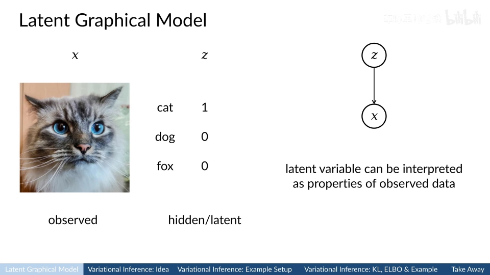
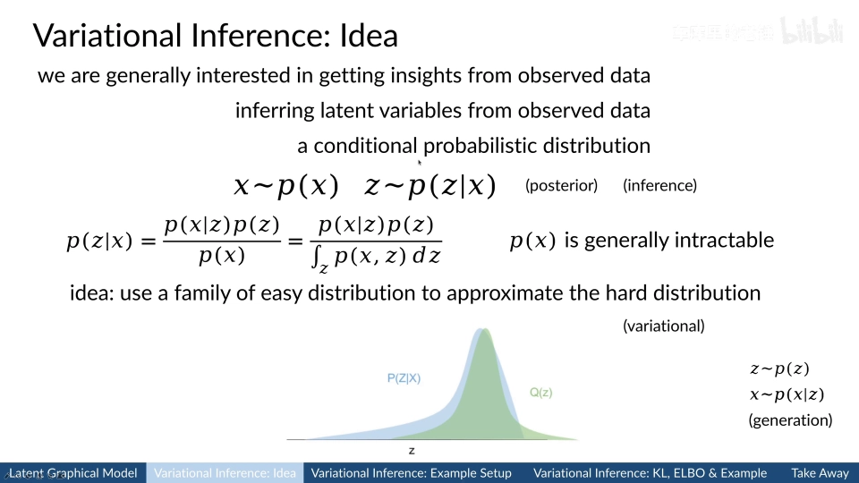
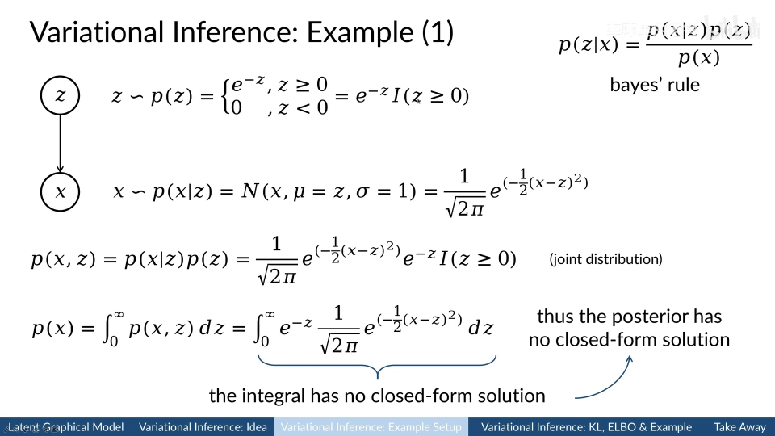
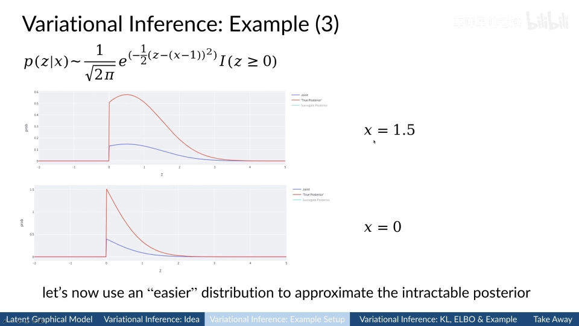
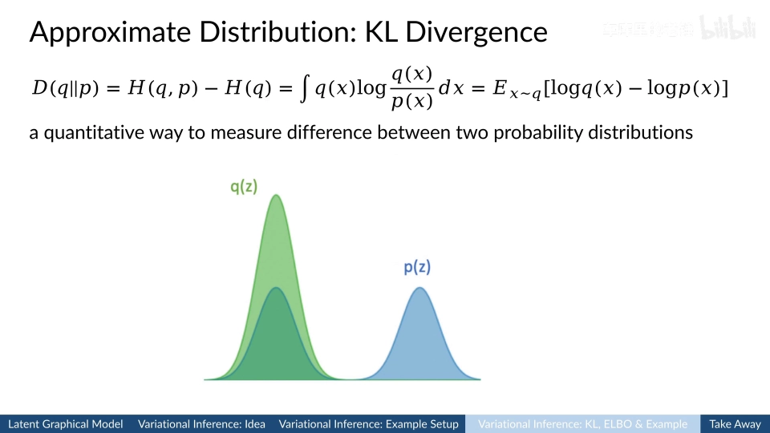
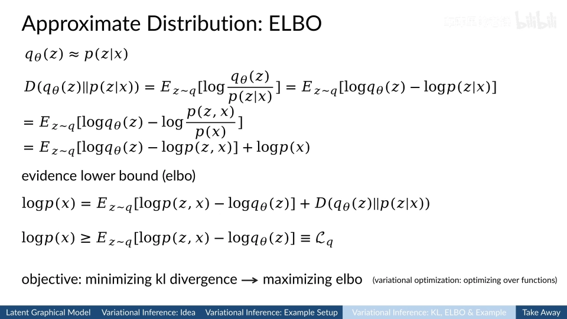
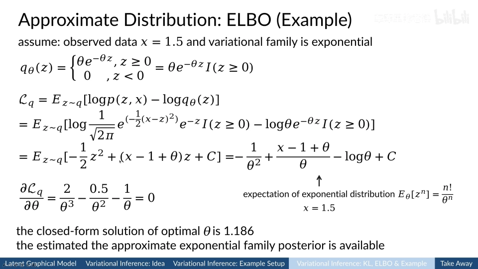
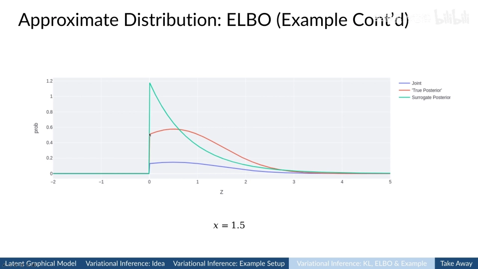
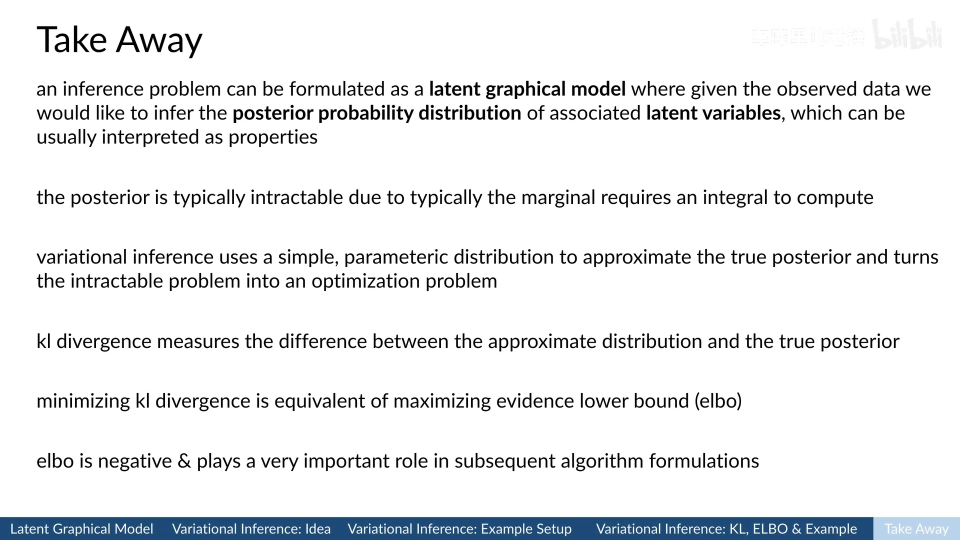

# 变分推理：把算不出的后验换成一个可优化的下界

> 视频来源：[【15分钟】了解变分推理](https://www.bilibili.com/video/BV1Gs4y157BU/)（Bilibili · 车库里的老锤，约 16 分钟）
> 导读：这支视频不直接讲 VAE，而是先把「变分推理」这件事本身讲透：为什么后验算不出来、为什么用一个简单分布去近似、为什么最小化 KL 会变成最大化 ELBO，最后用一个一维例子把 ELBO 真的算到底、解出最优参数。本文按视频顺序复述，并把视频里口述的推导写成完整式子；VAE 的网络结构与重参数化不在本文范围，见同系列 2.1.2 与 2.1.10。

## 本讲要解决的核心问题（SCQA）

**背景**：我们手上有一批观测数据，比如一张猫的图片。我们希望知道这张图片「为什么长这样」——它属于哪一类动物、有哪些属性。在概率模型里，这些看不见的属性就是**隐变量** $z$。

**冲突**：想知道 $z$，就要算后验 $p(z\mid x)$。按贝叶斯公式，分母是边缘分布 $p(x)=\int p(x,z)\,dz$，要对所有隐变量积分。这个积分在绝大多数模型里没有解析解，于是后验也就没法算。

**疑问**：既然真实后验算不出来，我们还能不能「近似地」得到它？近似得好不好怎么度量？度量的目标又该怎么优化？

**回答（中心思想）**：变分推理把「算后验」换成了「找一个最像后验的简单分布」。具体做法是：先指定一族可参数化的分布 $q_\theta(z)$，用 KL 散度度量它和真实后验的差距；再证明

$$
\log p(x) = \underbrace{\mathbb{E}_{q}\left[\log p(z,x)-\log q_\theta(z)\right]}_{\text{ELBO}} + D_{KL}\big(q_\theta(z)\,\Vert\,p(z\mid x)\big)
$$

左边 $\log p(x)$ 对给定数据是常数，KL 又恒非负，所以**最小化 KL 等价于最大化 ELBO**。ELBO 里只有 $q_\theta$ 和联合分布 $p(z,x)$，两者都能算，于是「推断」这个不可解的积分问题变成了「优化」这个可解的问题。

## 一、隐变量图模型：把「属性」写成看不见的变量

### 1.1 观测变量与隐变量

视频开篇给了一个最小的例子[【跳转到 00:37】](https://www.bilibili.com/video/BV1Gs4y157BU/?t=37)：我们有一张猫的图片，这张图片本身是可以被观察到的，叫**被观测变量**，记作 $x$。这张图片还有一些属性，比如它属于哪一类动物。假设用一个三维变量、以独热编码（one-hot，只有一位是 1、其余是 0）的方式表示类别：猫是 $(1,0,0)$，狗是 $(0,1,0)$，狐狸是 $(0,0,1)$。这个变量 $z$ 就叫**隐变量**。

隐变量 $z$ 和观测变量 $x$ 之间画一条从 $z$ 指向 $x$ 的箭头，就构成了一个**隐变量图模型**。箭头方向的含义是：先有属性，再由属性决定观测到的样子。所以隐变量可以理解为被观测变量的属性[【跳转到 01:02】](https://www.bilibili.com/video/BV1Gs4y157BU/?t=62)。

### 1.2 推理就是「由 x 反推 z」

**推理（inference）**指的是：通过观测数据去获得对数据的见解或知识。看到一张图片，想知道它是哪一类动物，就是从被观测变量去推理无法直接观测的隐变量[【跳转到 01:32】](https://www.bilibili.com/video/BV1Gs4y157BU/?t=92)。

用条件概率写出来：先按 $p(x)$ 采样得到一个观测样本 $x$，再由条件概率 $p(z\mid x)$ 对隐变量 $z$ 采样——这个条件概率就是**后验概率**，因为它描述了「在给定观测变量的条件下，隐变量的分布」。

按贝叶斯定理展开：

$$
p(z\mid x)=\frac{p(x\mid z)\,p(z)}{p(x)}=\frac{p(x\mid z)\,p(z)}{\int p(x,z)\,dz}
$$

分子是**似然**（likelihood，给定隐变量时观测出现的概率）乘**先验**（prior，隐变量本身的分布）；分母是边缘分布，需要对所有隐变量积分[【跳转到 02:22】](https://www.bilibili.com/video/BV1Gs4y157BU/?t=142)。

### 1.3 卡住的地方：那个积分

问题就出在分母。联合分布 $p(x,z)$ 的形式通常不简单，这个积分基本无法计算；$p(x)$ 算不出来，后验 $p(z\mid x)$ 也就无从计算[【跳转到 02:47】](https://www.bilibili.com/video/BV1Gs4y157BU/?t=167)。

## 二、变分的想法：用一族简单分布去近似

既然真实后验形式复杂，那就换一个思路：**找一组相对简单、并且可以参数化的概率分布去近似它**。这个「近似」的过程就叫**变分（variational）**；用近似分布去完成「给定观测变量时隐变量概率分布的估计」，整个过程叫**变分推理（variational inference, VI）**。

写成式子，就是我们选一族分布 $q_\theta(z)$，其中 $\theta$ 是可调参数，希望 $q_\theta(z)\approx p(z\mid x)$。注意这里 $q$ 只依赖 $z$，因为 $x$ 已经是给定的观测值。

视频还顺便点了一句「另一半」：如果反过来，先对隐变量采样 $z\sim p(z)$，再在给定 $z$ 的情况下用似然 $p(x\mid z)$ 对被观测变量采样，那就是**生成**过程[【跳转到 03:37】](https://www.bilibili.com/video/BV1Gs4y157BU/?t=217)。推理是 $x\to z$，生成是 $z\to x$，两者方向相反。

## 三、一个能算到底的一维例子

抽象的框架讲完，视频用一维例子把每一步都算出来[【跳转到 04:00】](https://www.bilibili.com/video/BV1Gs4y157BU/?t=240)。

**设定**：隐变量服从参数为 1 的指数分布，也就是只在 $z\ge 0$ 上有密度：

$$
p(z)=e^{-z}\,I(z\ge 0)
$$

其中 $I(\cdot)$ 是**指示函数**：括号内条件成立取 1，不成立取 0。观测变量服从均值为 $z$、方差为 1 的高斯分布：

$$
p(x\mid z)=\mathcal{N}(x;\ \mu=z,\ \sigma=1)=\frac{1}{\sqrt{2\pi}}e^{-\frac{1}{2}(x-z)^2}
$$

这样，观测变量就通过「均值」这个参数和隐变量关联了起来。

联合分布是两者相乘：

$$
p(x,z)=p(x\mid z)\,p(z)=\frac{1}{\sqrt{2\pi}}e^{-\frac{1}{2}(x-z)^2}\,e^{-z}I(z\ge 0)
$$

边缘分布则是对 $z$ 从 0 到无穷积分：

$$
p(x)=\int_0^\infty e^{-z}\frac{1}{\sqrt{2\pi}}e^{-\frac{1}{2}(x-z)^2}\,dz
$$

这个积分**没有闭式解**，所以后验也就没有闭式解。

### 3.1 后验正比于联合分布

不过这里有个好用的性质：数据 $x$ 已经被观测到，对隐变量来说 $p(x)$ 只是一个常数。所以

$$
p(z\mid x)\ \propto\ p(x,z)
$$

把联合分布整理一下，可以发现在 $z\ge 0$ 的部分它就是一个高斯分布，于是后验也就正比于一个均值为 $x-1$ 的高斯分布（限制在 $z\ge 0$ 上）[【跳转到 05:40】](https://www.bilibili.com/video/BV1Gs4y157BU/?t=340)。

上图两条曲线验证了这一点：蓝色是联合分布，红色是用数值方法算出来的「真实后验」，两者的形状确实是同一比例关系。

### 3.2 那为什么不直接用联合分布？

这是个很自然的疑问：联合分布好算，长得又和后验很像，为什么还要折腾后验？

视频的答案是：**不同观测值对应的 $p(x)$ 不一样**。$x=1.5$ 时的 $p(x)$ 和 $x=0$ 时的 $p(x)$ 是两个不同的数，所以「不同观测值下的联合分布」之间根本不可比——它们没有统一归一化。只有归一化之后的后验分布，才能放在一起比较[【跳转到 06:30】](https://www.bilibili.com/video/BV1Gs4y157BU/?t=390)。

这一点在分类任务里最直观：图像分类本质上就是「在不同观测变量下比较各类别后验概率」的操作。如果拿未归一化的联合分布去比，比较结果会被每个样本的 $p(x)$ 缩放，失去意义。

## 四、用 KL 散度度量「像不像」

要谈近似，先要有「距离」。视频用 **KL 散度（Kullback–Leibler divergence）** 来衡量两个分布的差异，它的定义是交叉熵减去熵：

$$
D_{KL}\big(q\,\Vert\,p\big)=\int q(z)\log\frac{q(z)}{p(z)}\,dz=\mathbb{E}_{z\sim q}\big[\log q(z)-\log p(z)\big]
$$

直观理解：在 $z$ 服从 $q$ 的情况下，对 $\log\frac{q}{p}$ 求期望。两个分布越像，这个值越接近 0；差得越远，值越大。它是一个定量衡量两个分布区别的通用方法[【跳转到 07:34】](https://www.bilibili.com/video/BV1Gs4y157BU/?t=454)。

有了 KL，目标就很自然了：为了让近似分布 $q_\theta(z)$ 接近真实后验 $p(z\mid x)$，就**最小化两者之间的 KL 散度**。

## 五、从 KL 到 ELBO：一次移项得到的下界

### 5.1 推导

把 KL 写开，其中的 $p(z\mid x)$ 用贝叶斯定理展开：

$$
D_{KL}\big(q_\theta(z)\,\Vert\,p(z\mid x)\big)
=\mathbb{E}_{q}\left[\log q_\theta(z)-\log\frac{p(x,z)}{p(x)}\right]
$$

因为 $p(x)$ 与 $z$ 无关，可以把它从期望里提出来：

$$
D_{KL}\big(q_\theta(z)\,\Vert\,p(z\mid x)\big)
=\mathbb{E}_{q}\big[\log q_\theta(z)-\log p(x,z)\big]+\log p(x)
$$

移项，把期望那一项挪到左边：

$$
\log p(x)=\underbrace{\mathbb{E}_{q}\big[\log p(x,z)-\log q_\theta(z)\big]}_{\text{ELBO}}+\underbrace{D_{KL}\big(q_\theta(z)\,\Vert\,p(z\mid x)\big)}_{\ge 0}
$$

视频把推导的每一步都写在幻灯片上：展开后验 → 把 $p(x)$ 提出期望 → 整理成「证据 = 期望项 + KL」的形式[【跳转到 08:32】](https://www.bilibili.com/video/BV1Gs4y157BU/?t=512)。

### 5.2 三项各自的性质

这个等式里三项各有性质[【跳转到 09:22】](https://www.bilibili.com/video/BV1Gs4y157BU/?t=562)：

- $\log p(x)$ 叫**证据（evidence）**，是对数据似然取 log。数据已经观测到，所以它对隐空间是一个**定值**；
- KL 散度**永远大于等于零**，只有当近似分布与真实后验完全一致时才等于零；
- 中间那一项（ELBO）与 KL 项此消彼长：KL 小，ELBO 就大；KL 大，ELBO 就小。

### 5.3 为什么必须绕道 ELBO

既然目标是「最小化 KL」，为什么不直接优化 KL？

因为 KL 里含有 $p(z\mid x)$，而真实后验我们根本不知道——这正是最初算不出来的东西[【跳转到 09:47】](https://www.bilibili.com/video/BV1Gs4y157BU/?t=587)。

反过来看 ELBO：

$$
\text{ELBO}=\mathbb{E}_{q}\big[\log p(x,z)-\log q_\theta(z)\big]
$$

里面只有两个量——联合分布 $\log p(x,z)$ 和近似分布 $\log q_\theta(z)$，都相对容易计算。而且因为左边是常数、KL 非负，下面这个不等式永远成立：

$$
\log p(x)\ \ge\ \mathbb{E}_{q}\big[\log p(x,z)-\log q_\theta(z)\big]
$$

也就是说，ELBO 是证据 $\log p(x)$ 的**下界**，这正是它名字的来源：**evidence lower bound**，简称 **ELBO**（视频里口播成「elbow」，是同一个东西）[【跳转到 10:37】](https://www.bilibili.com/video/BV1Gs4y157BU/?t=637)。

于是整个逻辑闭环了：**想最小化 KL → 等价于最大化 ELBO → 而 ELBO 可以算、可以求梯度**。变分推理把不可解的推断问题，转成了可解的优化问题。

## 六、把 ELBO 真的算一遍

光有式子还不够，视频回到那个一维例子，把 ELBO 算到底[【跳转到 11:27】](https://www.bilibili.com/video/BV1Gs4y157BU/?t=687)。

**设定**：观测到 $x=1.5$；近似分布也选指数分布，参数为 $\theta$：

$$
q_\theta(z)=\theta e^{-\theta z}I(z\ge 0)
$$

注意这个 $q$ 和隐变量的先验 $p(z)=e^{-z}$ 没有关系——先验是模型假设，$q$ 是我们自己挑的近似族，只是这里恰好也选了指数分布。

代入 ELBO：

$$
\mathcal{L}_q=\mathbb{E}_{z\sim q}\big[\log p(z,x)-\log q_\theta(z)\big]
$$

把联合分布和 $q$ 的密度代进去，两个指示函数在 $z\ge 0$ 上恒为 1，取 log 后为 0，可以直接忽略；再把与 $z$ 无关的项当常数提出，利用指数分布的矩性质

$$
\mathbb{E}_{\theta}[z^n]=\frac{n!}{\theta^n}
$$

就能把期望显式算出来：

$$
\mathcal{L}_q=-\frac{1}{\theta^2}+\frac{x-1+\theta}{\theta}-\log\theta+C
$$

### 6.1 求最优 θ

最大化 ELBO 就是对 $\theta$ 求梯度、令其为零：

$$
\frac{\partial \mathcal{L}_q}{\partial\theta}=\frac{2}{\theta^3}-\frac{0.5}{\theta^2}-\frac{1}{\theta}=0
$$

解这个方程，得到闭式解 $\theta=1.186$（这里 $x=1.5$ 已代入）[【跳转到 13:07】](https://www.bilibili.com/video/BV1Gs4y157BU/?t=787)。

把 $\theta=1.186$ 代回去，就得到了这个例子里「与真实后验最接近」的近似分布。上图里绿色是优化后的近似后验，红色是数值解出的真实后验。视频作者自己评价：虽然不是那么像，但确实有一定的相似度——这也说明**近似族选得窄，ELBO 再优化也只能到这个程度**。

### 6.2 这个例子的边界

视频特意强调：这里能算出解析解，是因为一维、指数族、共轭结构都恰好凑齐了。实际应用中数据维度和分布复杂度都高得多，通常不会有任何解析解，只能靠数值优化[【跳转到 13:57】](https://www.bilibili.com/video/BV1Gs4y157BU/?t=837)。这个例子的价值在于把框架的逻辑走通一遍，而不是提供通用解法。

## 七、这套框架在 VAE 里的位置

视频结尾的总结把整条线索收拢[【跳转到 14:52】](https://www.bilibili.com/video/BV1Gs4y157BU/?t=892)：

1. 推断问题可以写成隐变量图模型：给定观测数据，推断相关隐变量的后验分布；隐变量通常可理解为观测数据的属性。
2. 后验通常不可解，因为边缘分布要对隐变量积分。
3. 变分推理用一族简单的、可参数化的分布去近似真实后验，把不可解的推断变成可解的优化。
4. KL 散度度量近似分布与真实后验的差异；最小化 KL 等价于最大化 ELBO。
5. ELBO 是负数（因为它是概率的 log，概率小于 1），在后续算法推导中扮演重要角色。

把第 3、4 条落到 VAE 上：编码器网络输出的就是 $q_\phi(z\mid x)$ 的参数（均值与方差），解码器给出 $p_\theta(x\mid z)$，而 ELBO 可以进一步拆成「重建项 − KL 正则项」两项。这一步拆分、以及高斯情形下 KL 的解析形式，是同一系列中 VAE 那一篇的主题；网络结构与重参数化技巧分别见 2.1.2 与 2.1.10。

## 小结

- **隐变量图模型**把观测数据 $x$ 和看不见的属性 $z$ 用箭头连起来，推理就是由 $x$ 反推 $z$ 的后验 $p(z\mid x)$。
- 后验卡在分母：$p(x)=\int p(x,z)\,dz$ 一般没有解析解，所以真实后验也算不出来。
- **变分**的思路是选一族可参数化的简单分布 $q_\theta(z)$ 去近似后验；用 **KL 散度**度量差距。
- 由 $D_{KL}(q\Vert p(z\mid x))=\mathbb{E}_q[\log q-\log p(x,z)]+\log p(x)$ 移项得 $\log p(x)=\text{ELBO}+D_{KL}$；左边是常数、KL 非负，所以 **ELBO 是证据的下界**，最小化 KL 等价于最大化 ELBO。
- 直接优化 KL 不可行（含未知的真实后验），而 ELBO 只含 $q_\theta$ 与联合分布 $p(x,z)$，可算可导。
- 一维指数族例子把 ELBO 算到底，解出 $\theta=1.186$；近似族选得窄时，最优近似也只能「有点像」。
- 在 VAE 中，$q_\phi(z\mid x)$ 由编码器给出、$p_\theta(x\mid z)$ 由解码器给出，ELBO 进一步拆成重建项与 KL 正则项。

## 关键术语速查

| 术语 | 一句话解释 |
| --- | --- |
| 隐变量（latent variable） | 观测不到、但被认为决定了观测数据的变量，通常代表数据的属性 |
| 后验（posterior） | 给定观测数据后隐变量的条件分布 $p(z\mid x)$，是推理的目标 |
| 边缘分布（marginal） | 把联合分布对隐变量积分掉得到的 $p(x)$，一般不可解 |
| 变分（variational） | 用一族简单可参数化的分布去近似复杂分布的做法 |
| 变分推理（VI） | 把「求后验」这个积分问题转成「优化近似分布」的框架 |
| KL 散度 | 衡量两个分布差异的非负量，等于交叉熵减熵，两分布相同才为零 |
| 证据（evidence） | $\log p(x)$，对给定数据是常数，也是 ELBO 的上界 |
| ELBO | evidence lower bound，$\mathbb{E}_q[\log p(x,z)-\log q(z)]$，是 $\log p(x)$ 的下界 |
| 指示函数 $I(\cdot)$ | 条件成立取 1、不成立取 0，用来把分布限制在某个区间上 |