# 扩散模型三种参数化：噪声、原图与速度预测

> 视频来源：[v-prediction](https://www.bilibili.com/video/BV18g4F6SEav/)（Bilibili · 月球上的人在歌颂）｜时长约 8.5 分钟
> 导读：这支视频不用推导 ELBO，而是把同一个加噪样本画成平面上的一个点，用投影几何说明 $\epsilon$ 预测、$x_0$ 预测与 $v$ 预测如何互相换算，以及为什么在噪声很大时，$\epsilon$ 预测的同等误差换回原图会被放大很多倍。本文按视频顺序复述，并保留全部数值例子。

## 本讲要解决的核心问题（SCQA）

**背景**：扩散模型的网络可以输出噪声 $\epsilon$，也可以输出原图 $x_0$，还可以输出速度 $v$。采样时，我们总要先把这些输出换算成"原图估计 $\hat x_0$"，再按噪声日程重新混合。

**冲突**：三种输出在数学上可以互相换算，但**同样大小的预测误差，换回原图之后被放大的倍数完全不同**：噪声预测在高噪声区会被放大到几十倍，速度预测却始终不超过误差本身。

**疑问**：三种参数化的监督对象分别是什么？换算公式怎么来？误差放大倍数由什么决定？

**回答（中心思想）**：三种参数化是同一个加噪式 $x_t=a x_0+b\epsilon$ 的三个"投影坐标"；把 $(x_0,\epsilon)$ 看成平面上的点，$x_t$ 是一个方向的投影、$v$ 是与之垂直的另一个方向的投影。因为两个方向垂直，$x_t$ 与 $v$ 合起来能唯一还原该点；也正因为垂直，$v$ 上的误差不会像 $\epsilon$ 那样被 $1/a$ 放大。

## 一、三种参数化共用一个加噪式

### 1.1 设定：系数落在单位圆上

先固定一张原图 $x_0$，再取一份与它形状相同的高斯噪声 $\epsilon$，加噪后的状态是

$$
x_t=a\,x_0+b\,\epsilon
$$

[【跳转到 00:18】](https://www.bilibili.com/video/BV18g4F6SEav/?t=18)

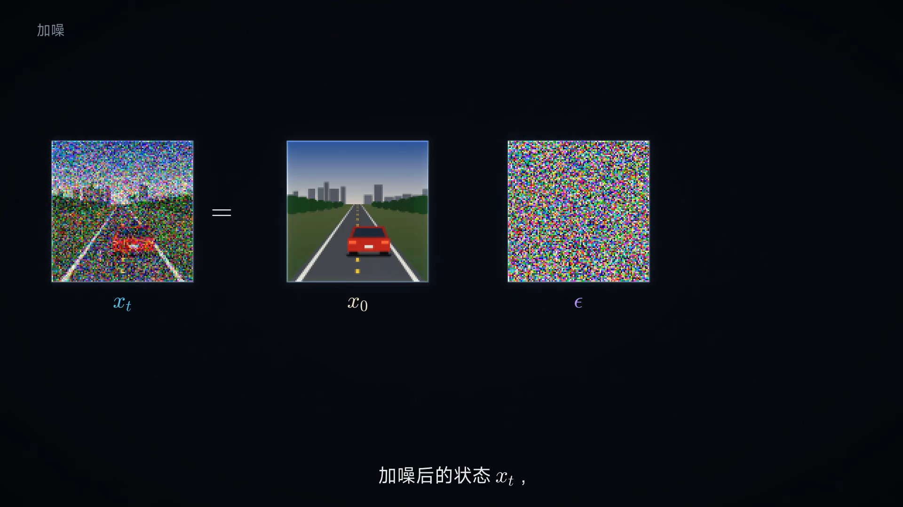

视频采用最常见的设定：$a,b\ge 0$ 且 $a^2+b^2=1$。于是点 $(b,a)$ 落在单位圆上，$a$ 可以写成某个角 $\varphi$ 的余弦、$b$ 写成它的正弦：

$$
a=\cos\varphi,\qquad b=\sin\varphi
$$

角度从 $0$ 转到 $90^\circ$：原图系数 $a$ 变小、噪声系数 $b$ 变大，正好对应"加噪越来越多"。采样时我们手里只有 $x_t$ 和当前的 $a,b$，没有 $x_0$ 也没有 $\epsilon$。

### 1.2 三种监督对象

- **$\epsilon$ 预测**：网络输出 $\hat\epsilon$，再用加噪式反解原图：$\hat x_0=\dfrac{x_t-b\hat\epsilon}{a}$。
- **$x_0$ 预测**：网络直接输出 $\hat x_0$，不需要换算。
- **$v$ 预测**：网络输出 $\hat v$，用 $x_0=a x_t-b v$ 换回原图（后文推导）。

其中 $v$ 的定义是

$$
v=a\,\epsilon-b\,x_0
$$

[【跳转到 04:05】](https://www.bilibili.com/video/BV18g4F6SEav/?t=245)

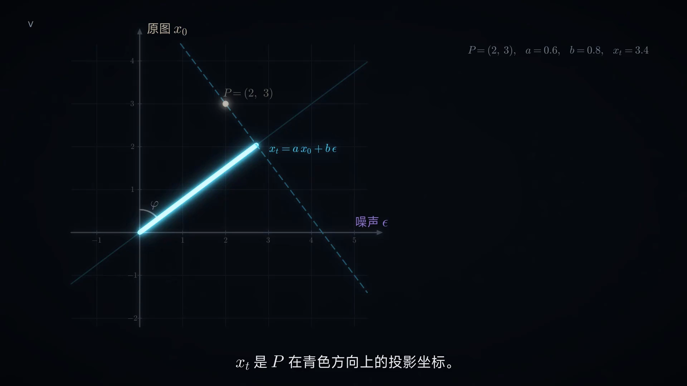

### 1.3 $v$ 为什么叫"速度"

把 $a,b$ 写回余弦与正弦，$x_t=\cos\varphi\,x_0+\sin\varphi\,\epsilon$。固定 $x_0$ 与 $\epsilon$，只改变角度 $\varphi$，对 $\varphi$ 求导：

$$
\frac{\mathrm{d}x_t}{\mathrm{d}\varphi}=-\sin\varphi\,x_0+\cos\varphi\,\epsilon=a\,\epsilon-b\,x_0=v
$$

[【跳转到 04:30】](https://www.bilibili.com/video/BV18g4F6SEav/?t=270)

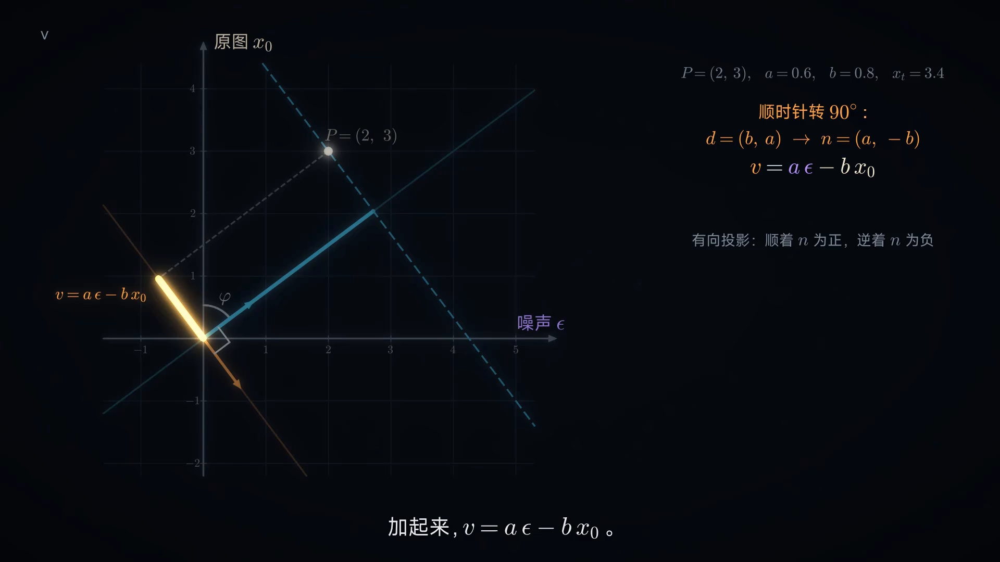

所以 $v$ 是 $x_t$ 随"噪声水平角度"变化的速率——视频强调：求导时 $\varphi$ 用弧度，图中角度以度显示。

### 1.4 三者的换算表

把上面几个式子整理一下，三种参数化之间的换算关系是：

| 已知量 | 换回原图 $\hat x_0$ | 换成噪声 $\hat\epsilon$ | 换成速度 $\hat v$ |
| :--- | :--- | :--- | :--- |
| $\hat\epsilon$ | $\dfrac{x_t-b\hat\epsilon}{a}$ | — | $a\hat\epsilon-b\hat x_0$ |
| $\hat x_0$ | — | $\dfrac{x_t-a\hat x_0}{b}$ | $a\hat\epsilon-b\hat x_0$ |
| $\hat v$ | $a x_t-b\hat v$ | $b x_t+a\hat v$ | — |

注意表里 $\hat x_0$ 与 $\hat\epsilon$ 的互相换算都要除以 $a$ 或 $b$，而换成 $v$、或从 $v$ 换回来，只做乘加——这一点决定了后文的误差放大差异。

## 二、几何图像：$x_t$ 与 $v$ 是两个垂直方向的投影

### 2.1 把 $(x_0,\epsilon)$ 看成一个点

视频只取一个分量做数值例子：$x_0=3$，$\epsilon=2$，$a=0.6$，$b=0.8$。把这两个数化成平面上的点 $P=(2,3)$，横坐标是噪声、纵坐标是原图。

画一个"青色方向"，它的横向分量是 $b=0.8$、纵向分量是 $a=0.6$，长度为一，与横轴的夹角正是 $\varphi$。把 $P$ 垂直投影到青色方向上，投影长度是 $b\times 2+a\times 3=1.6+1.8=3.4$——这正是 $x_t=a x_0+b\epsilon$。

[【跳转到 02:00】](https://www.bilibili.com/video/BV18g4F6SEav/?t=120)

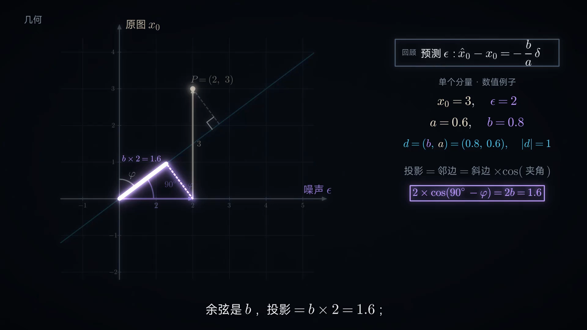

### 2.2 只知道 $x_t$，点只能落在一条直线上

反过来，所有投影坐标都等于 3.4 的点，排成一条与青色方向垂直的直线（等 $x_t$ 线）。所以只知道 $x_t$，我们只知道 $P$ 在这条线上的某处。

预测噪声，就是估计 $P$ 的横坐标：横坐标固定的点排成一条竖线，竖线与等 $x_t$ 线的交点就是"估计点"——横坐标是噪声估计，纵坐标是由它换算出的原图估计。

[【跳转到 02:50】](https://www.bilibili.com/video/BV18g4F6SEav/?t=170)

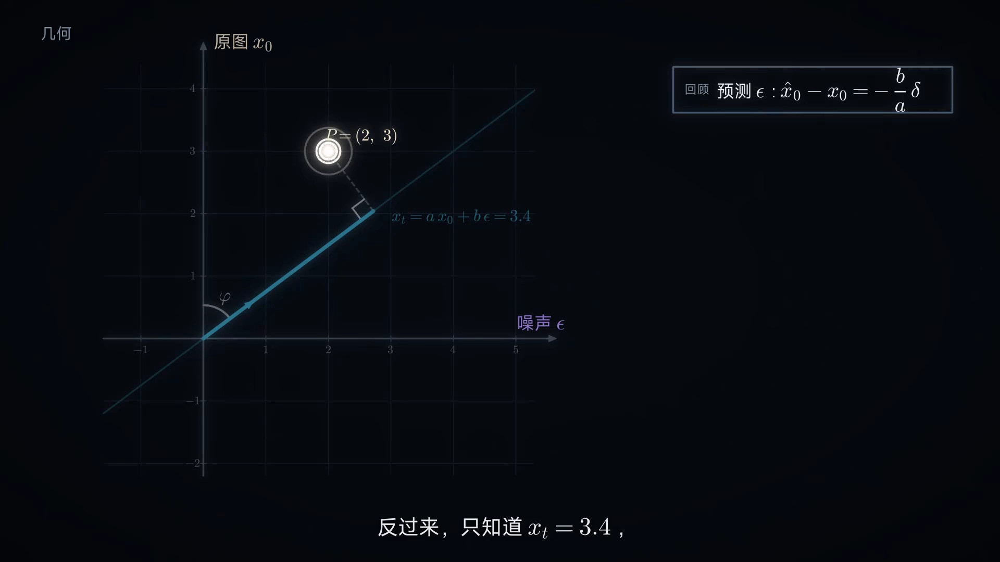

### 2.3 两个投影坐标互相垂直，才能唯一还原

再取一个与青色方向垂直的方向，画成橙色：把青色方向顺时针转 $90^\circ$，横向分量变成 $a$、纵向分量变成 $-b$。$P$ 在橙色方向上的投影坐标就叫 $v$。把 $P$ 拆成两步：横着走 $\epsilon$ 的投影是 $a\epsilon$；竖着向上走 $x_0$ 的投影朝橙色箭头反方向，记负号，是 $-b x_0$。加起来正是 $v=a\epsilon-b x_0$。

[【跳转到 05:20】](https://www.bilibili.com/video/BV18g4F6SEav/?t=320)

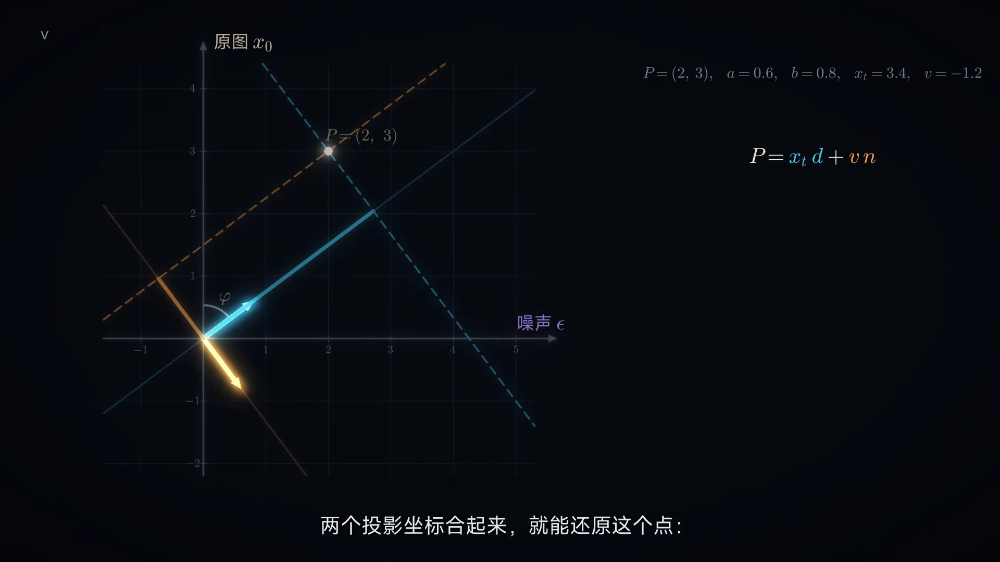

因为两个方向垂直，知道 $x_t$ 与 $v$ 就能唯一确定 $P$。只看竖直方向：青色方向的纵向分量是 $a$，贡献 $a x_t$；橙色方向的纵向分量是 $-b$，贡献 $-b v$。于是

$$
x_0=a\,x_t-b\,v
$$

代入数值：$0.6\times 3.4+0.8\times 1.2=3$，确实回到 $x_0=3$。

[【跳转到 05:45】](https://www.bilibili.com/video/BV18g4F6SEav/?t=345)

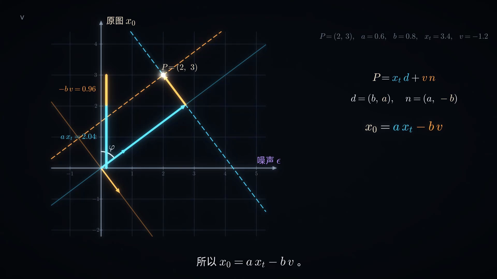

## 三、误差放大：为什么高噪声时 $\epsilon$ 预测吃亏

### 3.1 受控实验：只测换算，不测网络

为了只比较"换算"本身的影响，视频做了一个受控实验：让噪声估计等于真值，再人为加上一小段扰动 $\delta$，即 $\hat\epsilon=\epsilon+\delta$。把 $x_t$ 与 $\hat\epsilon$ 都代入 $\hat x_0=(x_t-b\hat\epsilon)/a$，两项 $b\epsilon$ 相互抵消，剩下

$$
\hat x_0-x_0=-\frac{b}{a}\,\delta
$$

[【跳转到 01:03】](https://www.bilibili.com/video/BV18g4F6SEav/?t=63)

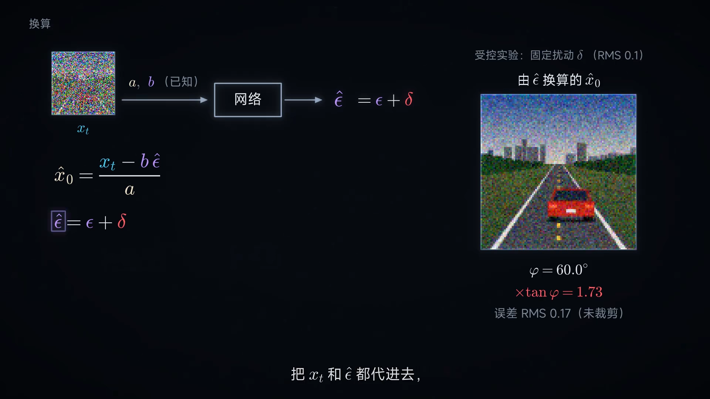

也就是说，原图误差是扰动的 $b/a$ 倍；而 $b/a=\tan\varphi$。问题出在**除以 $a$**：角度接近 $90^\circ$ 时 $a\to 0$，放大倍数急剧上升——$80^\circ$ 约 5.7 倍，$89^\circ$ 约 57 倍。

在图上看得更清楚：噪声估计多出 $\delta$，竖线右移，交点沿等 $x_t$ 线滑下去；沿等 $x_t$ 线有 $a\Delta x_0+b\Delta\epsilon=0$，所以纵向变化就是 $-(b/a)\delta$。角度越大，$a$ 越小，等 $x_t$ 线越陡，竖线稍微一动，交点就滑出很远。

[【跳转到 03:15】](https://www.bilibili.com/video/BV18g4F6SEav/?t=195)

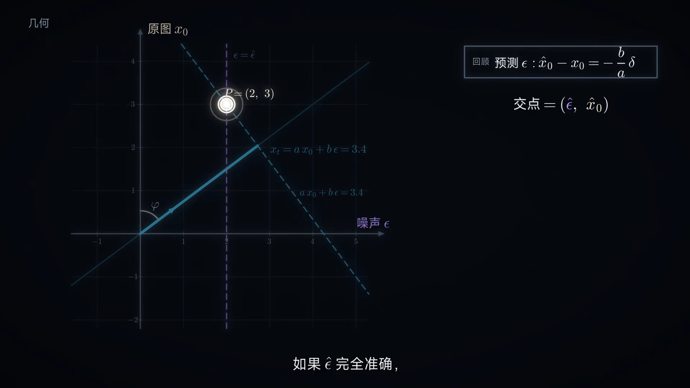

### 3.2 $v$ 预测：误差只乘一个不超过 1 的系数

换成 $v$ 预测，把 $v$ 换成 $v+\delta$，代入 $x_0=a x_t-b v$：

$$
\hat x_0-x_0=-b\,\delta
$$

[【跳转到 06:10】](https://www.bilibili.com/video/BV18g4F6SEav/?t=370)

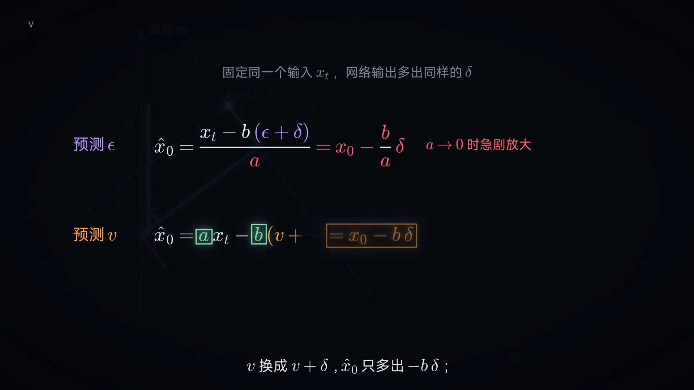

因为 $b=\sin\varphi\le 1$，这次换算**不会放大扰动**。图上也能看出：等 $v$ 线沿橙色方向平移，交点沿等 $x_t$ 线移动；两条线互相垂直、橙色方向长度为一，所以交点沿橙色方向只移动 $\delta$，纵向变化就是 $b\delta$。

[【跳转到 06:35】](https://www.bilibili.com/video/BV18g4F6SEav/?t=395)

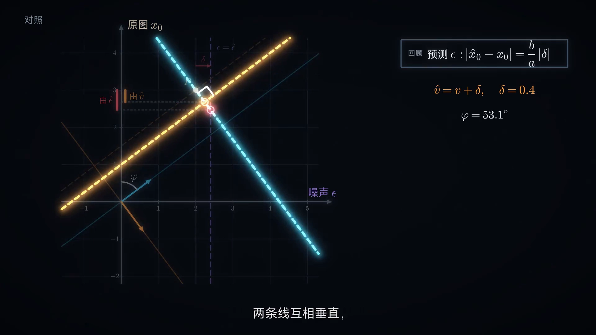

### 3.3 整张图上的对比

把同样的计算用到每个像素：同一份扰动、角度 $85^\circ$，用噪声预测换算，误差被放大 $11$ 倍多（即 $\tan 85^\circ$）；用 $v$ 换算，误差和扰动差不多大（即 $\sin 85^\circ$）。

[【跳转到 07:00】](https://www.bilibili.com/video/BV18g4F6SEav/?t=420)

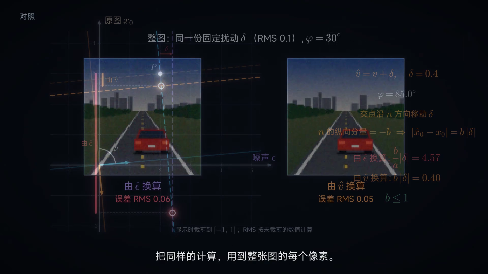

视频在这里特意加了一句边界说明：**这里只比较换算对误差的影响，不说明实际训练出的 $v$ 网络一定更准**。网络本身的拟合误差是另一回事，本节讨论的是"给定同样的输出误差，换回原图后剩多少"。

## 四、换算规则如何进入 DDIM 采样

这张图还能顺带解释确定性的 DDIM 采样。DDIM 的一步是：先估计 $\hat x_0$ 与 $\hat\epsilon$，再按更小的噪声水平把它们重新混合：

$$
x_s=a_s\,\hat x_0^{(t)}+b_s\,\hat\epsilon^{(t)}
$$

用 $x_t$ 与 $\hat v$ 表示，就是

$$
\hat x_0=a_t x_t-b_t \hat v,\qquad \hat\epsilon=b_t x_t+a_t \hat v
$$

[【跳转到 07:22】](https://www.bilibili.com/video/BV18g4F6SEav/?t=442)

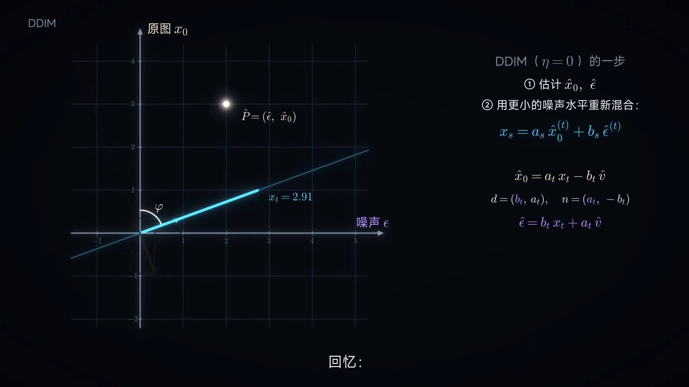

在图上，这一对估计就是一个点；"用 $a,b$ 混合原图与噪声"相当于在青色方向上投影。这一步内先固定刚算出的估计点，只把青色方向从当前角度转到下一时刻更小的角度，新的投影坐标就是 $x_s$；得到 $x_s$ 后，再把它和新的时刻一起输入网络，重新估计。

## 五、把结论收成一句话

固定同样大小的扰动 $\delta$：

- 噪声预测换回原图要**除以 $a$**，误差大小乘上 $b/a=\tan\varphi$，角度接近 $90^\circ$ 时急剧放大；
- $v$ 预测换回原图只乘 $a$ 与 $b$，误差大小乘上 $b=\sin\varphi\le 1$，不会超过扰动本身。

[【跳转到 08:12】](https://www.bilibili.com/video/BV18g4F6SEav/?t=492)

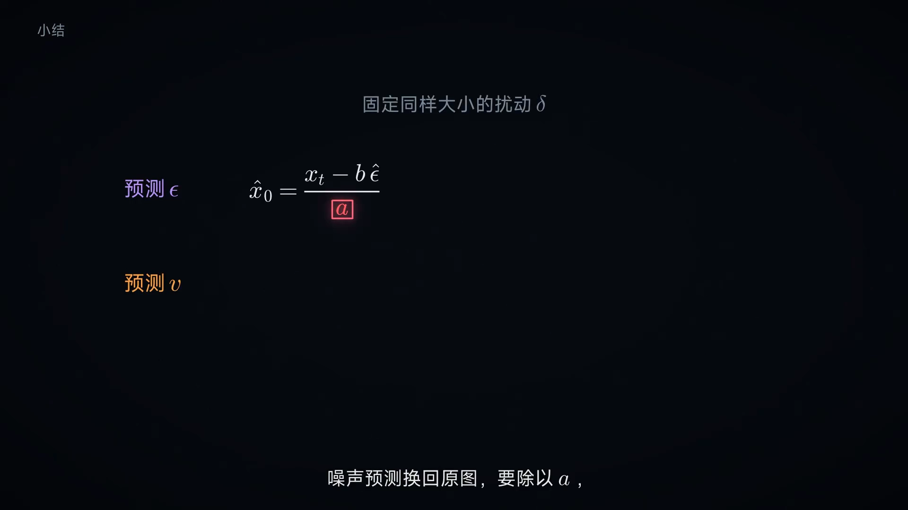

## 小结

- 三种参数化共用同一个加噪式 $x_t=a x_0+b\epsilon$，$a=\cos\varphi$、$b=\sin\varphi$；区别只在于"把哪个量交给网络输出"。
- $v=a\epsilon-b x_0$ 是 $x_t$ 对角度的导数，所以叫速度；它与 $x_t$ 构成两个互相垂直的投影坐标，合起来能唯一还原 $(x_0,\epsilon)$。
- 换算关系：$\hat x_0=(x_t-b\hat\epsilon)/a$，$\hat x_0=a x_t-b\hat v$，$\hat\epsilon=b x_t+a\hat v$。
- 误差放大：$\epsilon$ 预测的换算误差按 $\tan\varphi$ 放大（高噪声区发散），$v$ 预测按 $\sin\varphi$ 缩放（始终不超过扰动本身）。
- 边界：以上只说明换算环节的误差传播，不能推出"训练出的 $v$ 网络必然更准"。

## 关键术语速查

| 术语 | 一句话解释 |
| --- | --- |
| 参数化（parameterization） | 决定网络输出哪个量：噪声 $\epsilon$、原图 $x_0$ 还是速度 $v$ |
| 噪声日程角度 $\varphi$ | 用 $a=\cos\varphi$、$b=\sin\varphi$ 表示加噪程度，$\varphi$ 越大噪声越重 |
| 等 $x_t$ 线 | 平面上所有投影坐标等于同一个 $x_t$ 的点组成的直线，与青色方向垂直 |
| $v$ 预测 | 让网络输出 $v=a\epsilon-b x_0$，即 $x_t$ 随角度的变化率 |
| 误差放大因子 | 换算回原图时误差乘上的系数：$\epsilon$ 为 $\tan\varphi$，$v$ 为 $\sin\varphi$ |
| DDIM 一步 | 用 $(\hat x_0,\hat\epsilon)$ 按更小的噪声水平重新混合得到 $x_s$ |