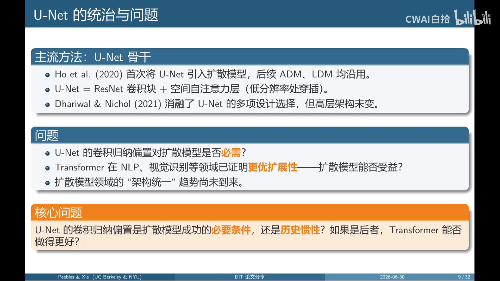
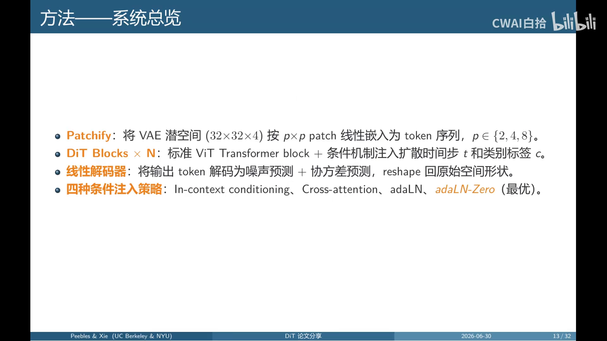
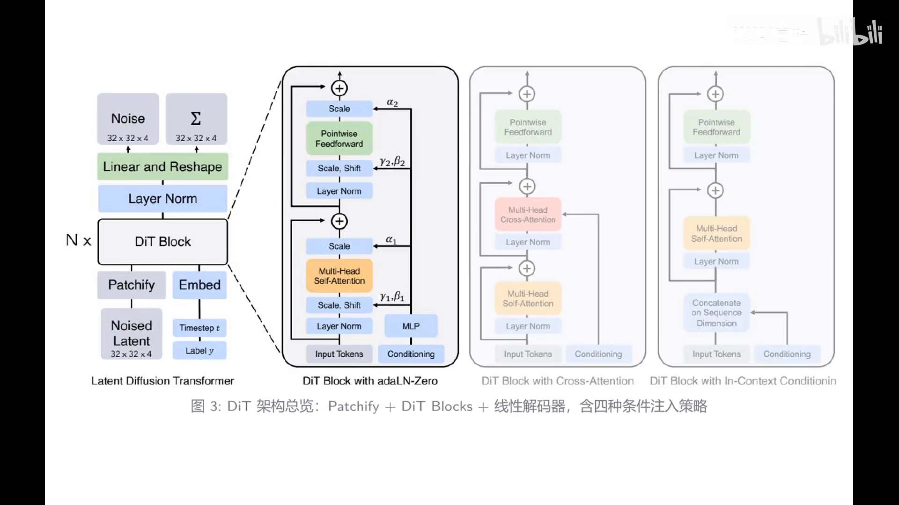
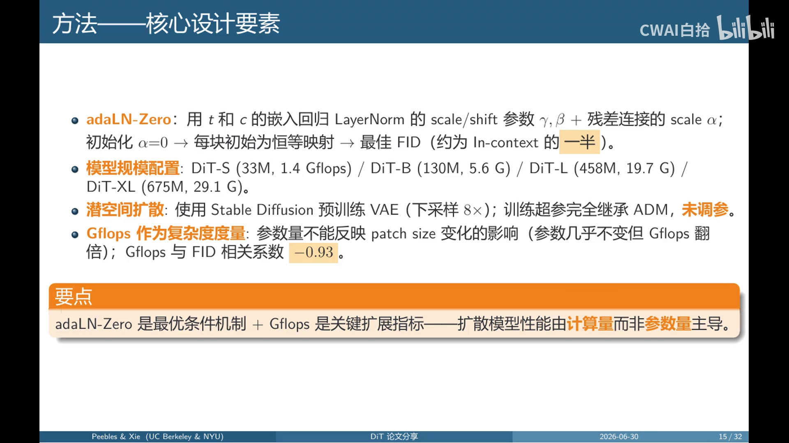
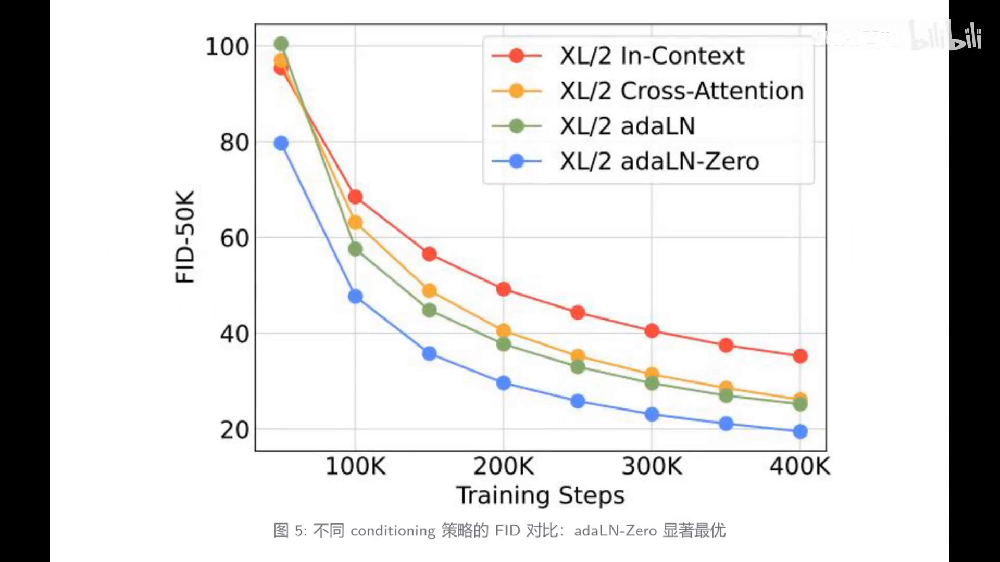
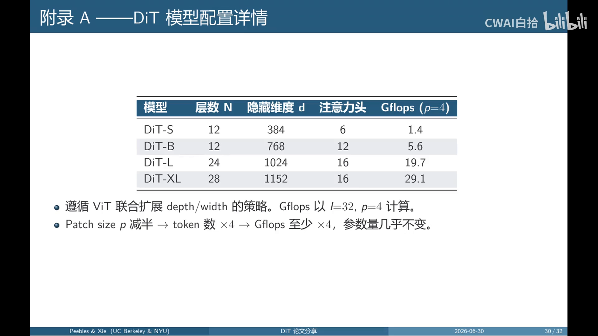
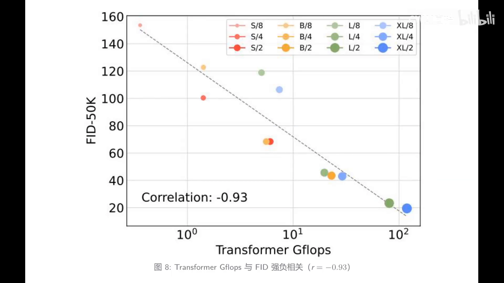
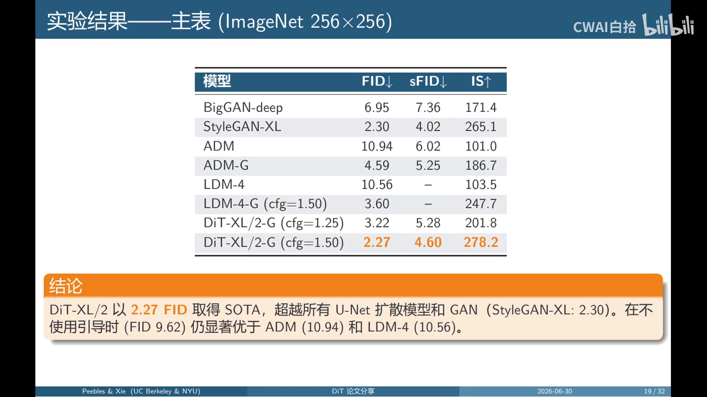
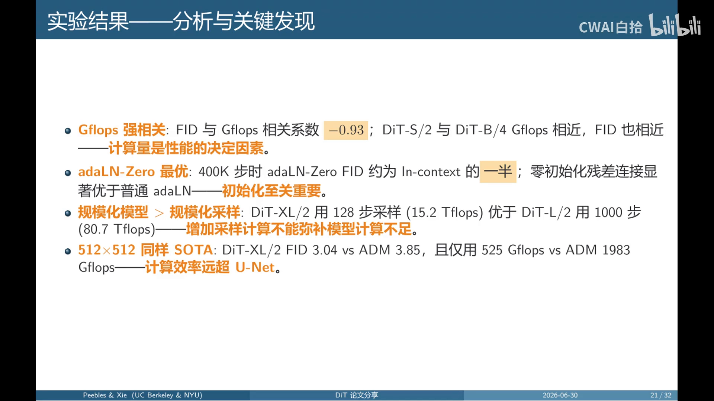
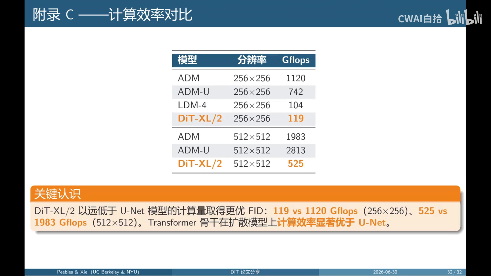

# DiT：用 Transformer 换掉 U-Net，以及时间步该怎么注入

> 视频来源：[【ICCV 2023 (Oral)】DiT 可扩展的基于 Transformer 的扩散模型](https://www.bilibili.com/video/BV1DFTB6GExp/)（Bilibili · UP 主「白拾的物理AI组会」）｜时长约 15 分钟
> 导读：这是一次论文精读报告，按「动机—方法—实验—局限」讲完 *Scalable Diffusion Models with Transformers*。本文聚焦本小节关心的两件事：时间步与类别条件如何注入 DiT block（四种策略的对比与 adaLN-Zero 的零初始化技巧），以及用 FLOPs 而非参数量衡量容量后得到的扩展性结论。字幕为 AI 生成，论文名、会议名与数值已按论文订正（原字幕把 ICCV 误识为 CVPR）。

## 本讲要解决的核心问题（SCQA）

**背景**：自 2020 年 Ho 等人把 U-Net 引入扩散模型以来，DDPM、ADM、LDM 等主流工作都沿用 U-Net 骨干。它的核心是 ResNet 卷积块，加上在低分辨率处穿插的空间自注意力层。Dhariwal 和 Nichol 在 2021 年对 U-Net 做了详尽的消融，但高层架构始终没变。

**冲突**：与此同时，Transformer 在 NLP 和视觉识别上已经证明扩展性更好。那 U-Net 的**卷积归纳偏置**到底是扩散模型成功的必要条件，还是仅仅来自历史惯性？

**疑问**：如果只是惯性，标准 ViT 能不能直接当扩散骨干？如果能，时间步 $t$ 和类别 $c$ 这些条件该怎么注入 Transformer block？模型该按什么度量做大？

**回答（中心思想）**：DiT 用标准 ViT 替换 U-Net，在潜空间上做 patchify + Transformer block + 线性解码器，性能反而更好（ImageNet 256 上 FID 2.27）。条件注入的四种方案里，**adaLN-Zero**——用 $t$ 和 $c$ 的嵌入回归 LayerNorm 的缩放/平移与残差缩放，并把残差缩放初始化为 0——明显最优。更关键的结论是：扩散模型的性能由 **FLOPs（计算量）而非参数量**决定，FID 与 FLOPs 的相关系数高达 $-0.93$。

## 一、动机：U-Net 的统治，以及一个没被验证过的假设

报告先把历史讲清楚，因为 DiT 的问题意识就藏在这段历史里。[【跳转到 03:42】](https://www.bilibili.com/video/BV1DFTB6GExp/?t=222)

- **事实**：Ho et al. (2020) 首次把 U-Net 引入扩散模型，后续 ADM、LDM 均沿用；U-Net = ResNet 卷积块 + 空间自注意力层（在低分辨率处穿插）。
- **问题**：U-Net 的卷积归纳偏置对扩散模型是否**必需**？Transformer 在别的领域已证明更优扩展性，扩散模型能否受益？扩散模型领域的「架构统一」趋势尚未到来。
- **核心问题**：如果不是必需，Transformer 能否做得更好？

这也是本小节「残差骨干与感受野」这条线的起点：U-Net 的归纳偏置是「局部 + 层次化」，而 Transformer 的归纳偏置是「全局 + 扁平序列」，两者的差别最终会体现在感受野和扩展性上。

论文横跨三个研究领域：扩散模型、ViT 的架构规模化、图像生成的架构设计空间。最直接的对比对象是两个同样用 U-Net 的模型：**ADM** 在像素空间运行，需要 1120 GFLOPs；**LDM** 在潜空间运行只需要 104 GFLOPs。DiT 的关键差异是首次系统研究 Transformer 作为扩散骨干的扩展性，并且**用 FLOPs 而非参数量**衡量模型复杂度与性能的关系——报告称这是一个重要的方法论创新。[【跳转到 04:37】](https://www.bilibili.com/video/BV1DFTB6GExp/?t=277)

## 二、方法：三个组件 + 四种条件注入策略

DiT 的架构只有三个组件，非常简洁：[【跳转到 05:19】](https://www.bilibili.com/video/BV1DFTB6GExp/?t=319)

1. **patchify**：把 VAE 潜空间的 $32\times32\times4$ 表示按 $p\times p$ 的 patch 线性嵌入为 token 序列，$p \in \{2,4,8\}$；
2. **DiT block × N**：标准 ViT Transformer block，**加上条件机制**来注入扩散时间步 $t$ 和类别标签 $c$；
3. **线性解码器**：把输出 token 解码为噪声预测和对角协方差预测，再 reshape 回原始空间形状。

注意第 2 条的措辞：block 本身是「标准 ViT block」，**唯一的增量就是条件机制**。所以「时间步怎么进网络」这个问题，在 DiT 里被压缩成了一个非常具体的工程选择——而论文试了四种。

### 2.1 四种条件注入策略

| 策略 | 做法 | 计算开销 | 效果 |
| --- | --- | --- | --- |
| in-context conditioning | 把 $t$ 和 $c$ 的嵌入当作两个额外 token 拼进输入序列（类似 ViT 的 cls token） | 可忽略 | 最差，400K 步时 FID 约 100 |
| cross-attention | 在自注意力之后再加一层交叉注意力，以 $t$ 和 $c$ 的拼接序列为条件 | 最大，约 +15% GFLOPs | 介于两者之间 |
| adaLN | 用 $t$ 和 $c$ 的嵌入回归 LayerNorm 的缩放/平移参数 | 可忽略 | 明显优于前两者 |
| **adaLN-Zero** | 在 adaLN 基础上再回归残差连接的缩放 $\alpha$，并把 $\alpha$ **初始化为 0** | 可忽略 | **最优**，FID 约为 in-context 的一半 |

这张图值得细看：最左侧是整体流程（Noised Latent → Patchify → N × DiT Block → Layer Norm → Linear and Reshape → 噪声与协方差），中间那个放大框就是 adaLN-Zero 的 block——注意 $\gamma_1,\beta_1$、$\gamma_2,\beta_2$、$\alpha_1$、$\alpha_2$ 全部由「Conditioning」分支回归出来，而 Conditioning 的输入正是 Timestep $t$ 与 Label $y$ 的嵌入。[【跳转到 03:08】](https://www.bilibili.com/video/BV1DFTB6GExp/?t=188)

### 2.2 adaLN-Zero 为什么最优：把 block 初始化成恒等映射

这是全篇最漂亮的一个技巧，报告给了两句话的解释：它通过时间步 $t$ 和类别 $c$ 的嵌入来回归 LayerNorm 的 scale 和 shift 参数 $\gamma$ 和 $\beta$，以及残差连接的 scale $\alpha$；**关键技巧是把 $\alpha$ 初始化为零**，使每个 DiT block 初始为恒等映射。[【跳转到 06:26】](https://www.bilibili.com/video/BV1DFTB6GExp/?t=386)

用公式写出来更清楚。标准 LayerNorm 是

$$
\mathrm{LN}(h) = \frac{h - \mu}{\sigma}\odot \gamma_0 + \beta_0
$$

adaLN 把固定的 $\gamma_0,\beta_0$ 换成由条件嵌入算出来的 $\gamma(c),\beta(c)$；adaLN-Zero 再多一个残差缩放 $\alpha(c)$：

$$
h \leftarrow h + \alpha(c)\cdot \mathrm{Block}\big(\mathrm{adaLN}(h, c)\big)
$$

当 $\alpha$ 初始化为 0 时，残差分支一开始输出全零，整个 block 就是恒等映射 $h \mapsto h$。深层网络在训练初期等价于「什么都不做」，梯度不会在刚开局时被随机初始化搅乱，因此收敛更快、最终 FID 更低。

> **与 U-Net 的对照**：U-Net 里时间步通过 AdaGN 调制每个 ResNet 模块（见本小节另一篇博客）；DiT 里时间步通过 adaLN 调制每个 Transformer block。**位置一样（每个 block 都注入）、思路一样（用条件回归归一化参数）、差别在归一化的种类与是否额外回归残差缩放**。这类「条件 → 调制参数」的做法属于 FiLM 家族。

### 2.3 四种策略的实测差距

Figure 5 的横轴是训练迭代次数，纵轴是 FID（越低越好）。三条结论：

- adaLN-Zero 在所有训练阶段都显著优于其他三种；
- 400K 步时，adaLN-Zero 的 FID 大约是 in-context conditioning 的**一半**；
- cross-attention 性能居中，但计算开销最大。

报告的评价是：「条件机制的选择对扩散模型性能有决定性影响。」[【跳转到 05:56】](https://www.bilibili.com/video/BV1DFTB6GExp/?t=356)

## 三、容量怎么量：FLOPs 而不是参数量

这是 DiT 最具方法论价值的部分，也是本小节「网络容量」问题的答案。

### 3.1 为什么参数量不够用

四档模型规模覆盖了很宽的范围：DiT-S（33M 参数、1.4 GFLOPs）、DiT-B（130M、5.6 G）、DiT-L（458M、19.7 G）、DiT-XL（675M、29.1 G）。[【跳转到 13:18】](https://www.bilibili.com/video/BV1DFTB6GExp/?t=798)

关键在于 patch size 这个旋钮：**$p$ 减半 → token 数变成 4 倍 → GFLOPs 至少 4 倍，但参数量几乎不变**。所以「参数多」和「算得多」在 DiT 里是两件可以分开的事——这就给了论文一个天然的实验设计：固定参数量、只改 patch size，看性能跟谁走。

### 3.2 结论：FID 与 FLOPs 强负相关

Figure 8 的横轴是模型 FLOPs（对数刻度），纵轴是 FID，每个点代表一个 DiT 模型，相关系数 **$-0.93$**，几乎是一条直线。更有说服力的是：DiT-S/2 与 DiT-B/4 参数量相差很大，但因为 FLOPs 相近，FID 也非常接近。[【跳转到 08:57】](https://www.bilibili.com/video/BV1DFTB6GExp/?t=537)

报告把这句结论重复了三次：**计算量而非参数量，才是扩散模型性能的决定因素。**

## 四、结果：SOTA 与「容量 vs 采样步数」

实验设计相当系统：设计空间扫查（4 种规模 × 3 种 patch size = 12 个模型，全部在 ImageNet 256 上训练 400K 步）、条件机制消融（用 DiT-XL/2 分别测四种策略）、SOTA 对比（DiT-XL/2 在 256 上训练到 7M 步，在 512 上也训练到 3M 步）。评测协议是 250 步 DDPM 采样、50K 样本、ADM 官方 TensorFlow 评估套件，并使用分类器自由引导（CFG 取 1.25 与 1.50），同时报告 sFID、IS、precision、recall。

关键数字：

- DiT-XL/2 在 CFG = 1.50 时取得 **FID 2.27**，是当时所有扩散模型中的最优结果；此前最好的扩散模型 LDM-4-G 是 3.60，ADM-G 是 4.59；甚至比 GAN 类方法中的 StyleGAN-XL（2.30）还低 0.03。
- 即使**不用**分类器自由引导，DiT-XL/2 的 FID 是 9.62，仍显著优于 ADM 的 10.94 和 LDM-4 的 10.56——说明 Transformer 骨干本身就有更强的生成能力，不依赖引导技巧。[【跳转到 08:19】](https://www.bilibili.com/video/BV1DFTB6GExp/?t=499)

### 4.1 四个关键发现

1. **FLOPs 强相关**：FID 与 FLOPs 相关系数 $-0.93$，计算量是性能的决定因素。
2. **adaLN-Zero 最优**：400K 步时 FID 约为 in-context 的一半；零初始化残差连接显著优于普通 adaLN——初始化至关重要。
3. **规模化模型 > 规模化采样**：DiT-XL/2 只用 **128 步**采样（15.2 TFLOPs）就优于 DiT-L/2 用 **1000 步**采样（80.7 TFLOPs）。也就是说，**增加采样计算不能弥补模型计算的不足**。
4. **512 分辨率同样 SOTA**：DiT-XL/2 取得 FID 3.04，优于 ADM 的 3.85，且只用 525 GFLOPs，而 ADM 需要 1983 GFLOPs。[【跳转到 09:28】](https://www.bilibili.com/video/BV1DFTB6GExp/?t=568)

第 3 条正是本小节「判断网络容量与采样步数的权衡」的直接答案：**在固定总预算下，先加模型容量，再加采样步数。** 报告的说法是「规模化模型比规模化采样更有效」。

### 4.2 计算效率：Transformer 为什么更省

| 模型 | 分辨率 | GFLOPs |
| --- | --- | --- |
| ADM | 256×256 | 1120 |
| ADM-U | 256×256 | 742 |
| LDM-4 | 256×256 | 104 |
| DiT-XL/2 | 256×256 | 119 |
| ADM | 512×512 | 1983 |
| ADM-U | 512×512 | 2813 |
| DiT-XL/2 | 512×512 | 525 |

在 256 分辨率上，DiT 的计算量只有 ADM 的约十分之一；在 512 上只有约四分之一。报告给的解释是：**Transformer 没有 U-Net 那种逐层递增的特征图通道数，计算分布更均匀高效。**[【跳转到 14:38】](https://www.bilibili.com/video/BV1DFTB6GExp/?t=878)

## 五、局限与研究脉络

作者自己列了四条局限：[【跳转到 11:21】](https://www.bilibili.com/video/BV1DFTB6GExp/?t=681)

1. 只覆盖类别条件生成，没有探索文本条件（但 DiT 可以作为文本到图像模型的即插即用骨干）；
2. 最大模型只有 675M 参数，受限于当时的 TPU 算力，没测试更大规模的扩展行为；
3. 只在 ImageNet 上验证，没测试扩展行为在更大规模、更多样数据上的泛化性；
4. 使用固定的预训练 VAE 并冻结参数，潜空间质量可能限制 DiT 的上限。

参考体系勾勒出一条清晰的脉络：Transformer（Attention Is All You Need）→ ViT → DDPM / ADM / LDM → DiT；此外还引用了 Ho 和 Salimans 的分类器自由引导、BigGAN、StyleGAN-XL。其中 DDPM 正是首次把 U-Net 引入扩散模型的工作。

## 小结

- **问题不是「U-Net 好不好」，而是「卷积归纳偏置是否必需」**：DiT 用标准 ViT 替换 U-Net，在 ImageNet 256 上把 FID 从 LDM 的 3.60 降到 2.27，答案是否定的。
- **DiT 只加了条件机制**：patchify → N 个标准 ViT block（+ 条件注入）→ 线性解码器；结构极简，复杂度全在「条件怎么进」。
- **adaLN-Zero 是最优注入方式**：条件嵌入回归 LayerNorm 的 $\gamma,\beta$ 与残差缩放 $\alpha$，$\alpha$ 初始化为 0 使 block 起始为恒等映射；400K 步时 FID 约为 in-context 的一半。
- **容量要用 FLOPs 量**：patch size 减半让 token 数 ×4、FLOPs 至少 ×4，而参数量几乎不变；FID 与 FLOPs 相关系数 $-0.93$。
- **先加模型，再加步数**：DiT-XL/2 用 128 步（15.2 TFLOPs）胜过 DiT-L/2 用 1000 步（80.7 TFLOPs），采样计算补不了模型计算。
- **计算效率来自结构**：没有 U-Net 逐层递增的通道数，256 分辨率上只需 ADM 约十分之一的 GFLOPs 就取得更好 FID。

## 关键术语速查

| 术语 | 一句话解释 |
| --- | --- |
| DiT | Diffusion Transformer，用标准 ViT 替换 U-Net 作为扩散模型骨干 |
| patchify | 把潜空间表示按 $p\times p$ 切成 patch 并线性嵌入成 token 序列 |
| in-context conditioning | 把时间步与类别嵌入当额外 token 拼进序列，不改 block 结构 |
| cross-attention | 在自注意力后加一层交叉注意力接收条件，开销最大 |
| adaLN | 用条件嵌入回归 LayerNorm 的缩放 $\gamma$ 与平移 $\beta$ |
| adaLN-Zero | adaLN 再加残差缩放 $\alpha$ 且初始化为 0，使 block 初始为恒等映射 |
| GFLOPs | 前向一次所需的浮点运算量，衡量「算多少」而非「有多少参数」 |
| 归纳偏置 | 模型结构自带的对数据的先验假设，如卷积的局部性与平移等变性 |
| 分类器自由引导（CFG） | 用条件与无条件预测的线性组合放大条件信号，本片取 1.25 与 1.50 |