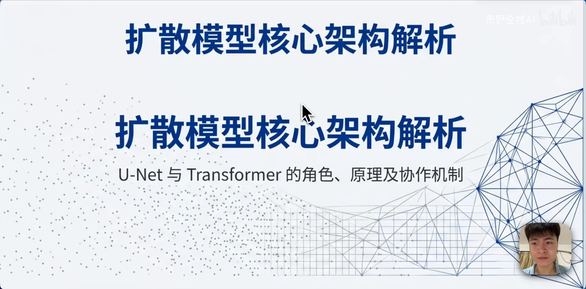
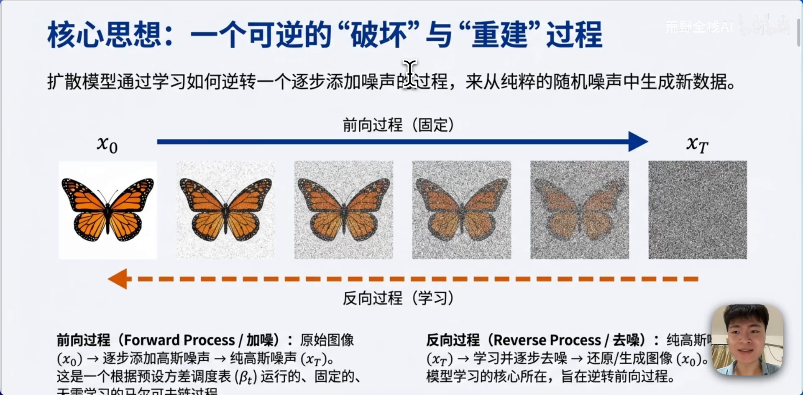
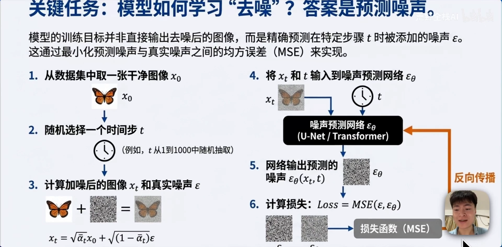
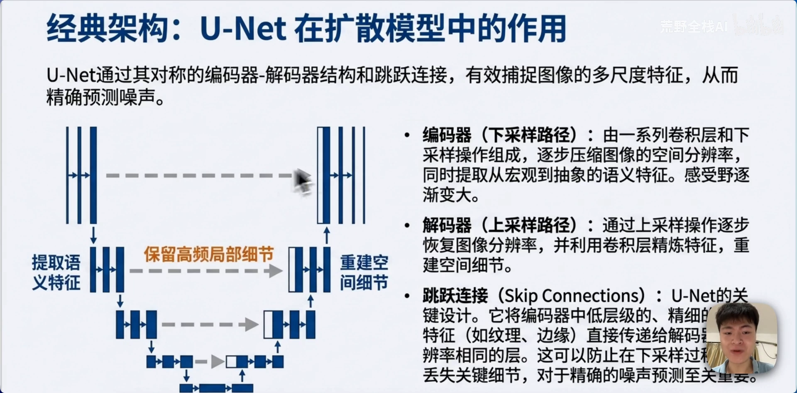
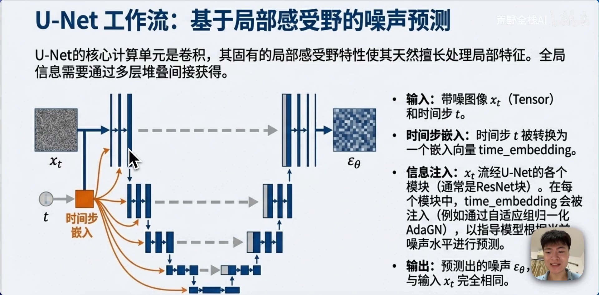
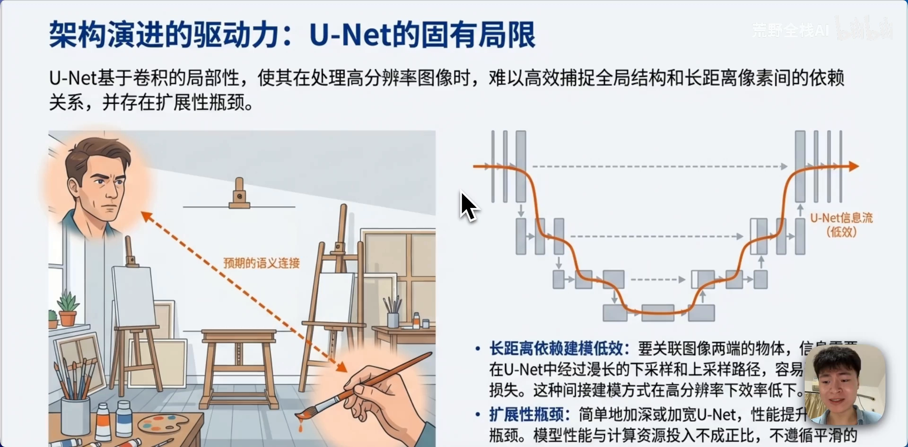
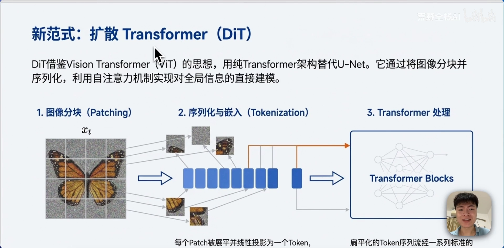
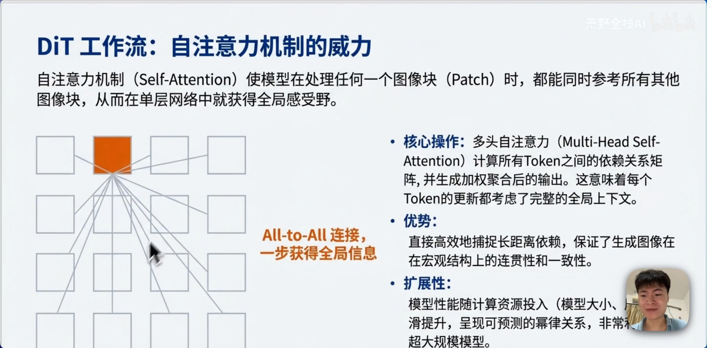
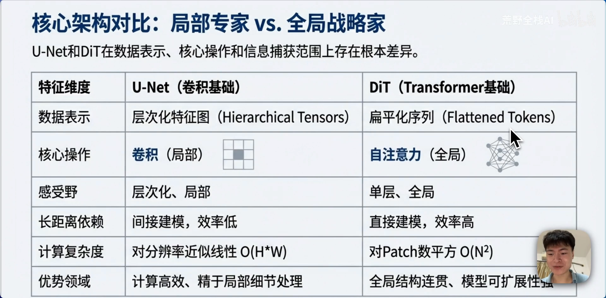
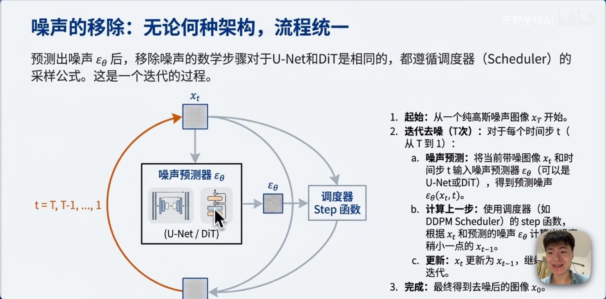

# 扩散模型核心架构：U-Net 与 DiT 这两个「噪声预测器」

> 视频来源：[扩散模型核心架构解析：从 U-Net 到 Diffusion Transformer](https://www.bilibili.com/video/BV1Y8mtBpEUi/)（Bilibili · UP 主「荒野芯智观察」）｜时长约 32 分钟
> 导读：这支视频面向入门读者，用「产品 / 内核 / 骨干」三层区分把 U-Net、DiT、Stable Diffusion 的关系讲清楚，再对比两条骨干路线的感受野与扩展性，最后强调网络只负责预测噪声、真正的图像更新由调度器完成。字幕为 AI 生成，术语（U-Net、DiT、ResNet、AdaGN 等）已按上下文订正。

## 本讲要解决的核心问题（SCQA）

**背景**：扩散模型的训练目标很朴素——给一张带噪图像和它对应的时刻 $t$，让网络说出这一步加进去的噪声是什么。前向加噪是固定的，反向去噪是学出来的。

**冲突**：既然要预测的是「一张图那么大」的噪声，那这个预测器该长什么样？2020 到 2023 年大家用 U-Net，之后又几乎全部换成 DiT。同一个任务，为什么骨干会换掉？换了之后，时间步 $t$ 又是怎么进到网络里的？

**疑问**：U-Net 和 DiT 的差别到底在「感受野」还是「参数多少」？网络容量和采样步数，哪个更值得加？「换个骨干」和「换个预测目标」是同一件事吗？

**回答（中心思想）**：去噪网络是一个以 $(x_t, t)$ 为输入、以噪声 $\epsilon$ 为输出的函数；U-Net 用卷积 + 跳跃连接在层次化特征图上逐层扩大感受野，DiT 把图像切成 token 用自注意力一步拿到全局感受野。前者局部高效但长距离依赖要绕远路、扩展性有上限，后者全局直连、随算力平滑变强但复杂度是 token 数的平方。而无论用哪个骨干，它都只输出噪声，把噪声变成图像是调度器的活——所以「骨干结构」和「预测目标（参数化）」是两件可以分开替换的事。

## 一、先分清三个名字：产品、内核与骨干

视频开场先做了一次概念切割，因为这三个词经常被混着用：

| 名字 | 是什么 | 例子 |
| --- | --- | --- |
| Stable Diffusion | 一个**产品**的名字，是一系列产品 | Stable Diffusion 3、2、1 |
| U-Net / DiT | 产品内部的**内核**，也就是噪声预测器 | 早期 SD 用 U-Net，现在基本换成 DiT |
| 扩散模型 | 上面这些内核共同遵循的**生成范式** | 前向加噪、反向去噪 |

UP 主的说法很直接：它们不是竞争关系，而是「内核层面的从属关系」——产品选哪个内核是工程决定，内核遵循哪套范式是数学决定。[【跳转到 00:25】](https://www.bilibili.com/video/BV1Y8mtBpEUi/?t=25)

## 二、去噪网络到底在学什么：输入 $(x_t, t)$，输出 $\epsilon$

在讲结构之前，先把任务定死，否则很容易把「网络」和「采样器」搞混。

扩散模型的核心思想是一个可逆的「破坏」与「重建」过程：把原图 $x_0$ 一步步加高斯噪声，记录每一步的时间步，一直到 $x_T$ 变成纯噪声；反向则从纯噪声出发，学习逐步去噪还原成图像。[【跳转到 01:10】](https://www.bilibili.com/video/BV1Y8mtBpEUi/?t=70)

这里有个关键前提：噪声是**人工一步步加进去的**，所以每一步加了什么我们完全知道；如果不知道，就没有监督信号可以训练模型。

训练流程可以拆成六步（视频里的板书就是这六步）：

1. 从数据集取一张干净图像 $x_0$；
2. 从 $1$ 到 $1000$ 中随机抽一个时间步 $t$；
3. 按公式算出加噪图像 $x_t$ 和真实噪声 $\epsilon$：

$$
x_t = \sqrt{\bar\alpha_t}\, x_0 + \sqrt{1-\bar\alpha_t}\, \epsilon
$$

4. 把 $x_t$ 和 $t$ 一起输入噪声预测网络 $\epsilon_\theta$；
5. 网络输出预测噪声 $\epsilon_\theta(x_t, t)$；
6. 计算损失并反向传播：

$$
\mathcal{L} = \left\| \epsilon - \epsilon_\theta(x_t, t) \right\|^2
$$

这张板书值得记住两点。第一，**网络的输入有两个**：带噪图像 $x_t$ 和当前步数 $t$——少一个都不行，因为同一个 $x_t$ 在不同噪声水平下该去掉的噪声完全不同。第二，**网络的输出只有一个**：噪声 $\epsilon$，不是去噪后的图像。UP 主反复强调这一点，因为后面讲调度器时全靠它。[【跳转到 07:19】](https://www.bilibili.com/video/BV1Y8mtBpEUi/?t=439)

那为什么不干脆让网络一步输出干净图像？视频给了两个理由：一步到位「非常非常难」；而且加噪本身是逐步的过程，预测噪声自然也该逐步做，否则没有对应的 ground truth 可监督。[【跳转到 02:25】](https://www.bilibili.com/video/BV1Y8mtBpEUi/?t=145)

## 三、U-Net：残差卷积骨干 + 跳跃连接，靠堆层换感受野

U-Net 大概在 2020 到 2023 年统治了图像生成领域。它的结构由三部分组成：编码器、解码器、跳跃连接。[【跳转到 10:15】](https://www.bilibili.com/video/BV1Y8mtBpEUi/?t=615)

### 3.1 编码器、解码器与跳跃连接各干什么

- **编码器（下采样路径）**：卷积 + 下采样，不断压缩空间分辨率，提取从宏观到抽象的语义特征。分辨率一路降低，通道数一路提高，**感受野随之逐渐变大**——因为它是多层提取，层数越深，一个神经元能「看到」的原图范围越大。
- **解码器（上采样路径）**：逐步恢复分辨率，重塑细节。它不是直接输出一张图片，而是操作特征向量：图片被「拍扁」成一排排像素值（每个像素有 R、G、B 三个数），模型原来怎么拆的，现在就怎么合回去。
- **跳跃连接（U-Net 的关键设计）**：把编码器中低层级、保留高频局部细节的特征（纹理、边缘）直接传给解码器中**分辨率相同**的层，防止在下采样过程中丢掉关键细节。

为什么非要这条「捷径」？视频的解释是：卷积网络没有 RNN 那种序列记忆，层数越深、抽象越久，早先的细节就越容易被忘掉；跳跃连接相当于把细节原封不动地递到后面，[【跳转到 13:09】](https://www.bilibili.com/video/BV1Y8mtBpEUi/?t=789)「给予它们关键的细节，防止丢失」。

### 3.2 时间步怎么进网络：转成嵌入向量，注入每一个模块

这是本节最核心的机制问题。U-Net 的输入同样是 $(x_t, t)$，但 $t$ 是一个标量，没法直接和一张 $H\times W\times 3$ 的特征图做运算，所以要经过三步：

1. **时间步嵌入**：把标量 $t$ 转换成一个嵌入向量 `time_embedding`；
2. **逐模块注入**：$x_t$ 流经 U-Net 的各个模块（通常是 ResNet 残差块），在每个模块里 `time_embedding` 都会被注入进去；
3. **调制而非拼接**：注入方式是让嵌入去**调制**特征，视频里点名的做法是自适应组归一化 AdaGN（adaptive group normalization）。

这张图里那几条从「时间步嵌入」方块射向各层的橙色箭头，就是本节学习目标里说的「时间步条件化」。它要解决的是一个很实际的问题：**同一个网络要应付从第 999 步到第 1 步的所有噪声水平**。如果 $t$ 不进去，网络根本不知道该做多大程度的修改。UP 主的说法是：告诉它当前时间点，它才能「有针对性地修改」——比如已经到第 999 步，这张图需要改进的地方就不多了。[【跳转到 14:41】](https://www.bilibili.com/video/BV1Y8mtBpEUi/?t=881)

> **补充说明（非视频内容）**：把标量 $t$ 变成向量的常见做法是正弦位置编码，再用一个小 MLP 映射成调制参数；AdaGN 的典型形式是 $\mathrm{AdaGN}(h, t) = \gamma(t) \odot \mathrm{GroupNorm}(h) + \beta(t)$，其中 $\gamma(t), \beta(t)$ 由时间嵌入经线性层得到。这种「用条件向量回归归一化的缩放/平移参数」的思路就是 FiLM 类调制，DiT 里的 adaLN 是同一族做法（见本小节另一篇 DiT 博客）。

### 3.3 局部感受野的代价：长距离依赖要绕远路，扩展性有上限

U-Net 的核心计算单元是卷积，卷积天生只有**局部**感受野，全局信息必须靠多层堆叠间接获得。视频用一幅画室插画说明了代价：想建立「左上角的人脸」和「右下角握笔的手」之间的语义联系，卷积核只能一格一格挪过去——先找 A 和 B、A 和 C、A 和 D，最后才轮到 A 和 E。[【跳转到 16:10】](https://www.bilibili.com/video/BV1Y8mtBpEUi/?t=970)

由此引出两个问题：

- **长距离依赖建模低效**：要关联图像两端的物体，信息得走过漫长的下采样和上采样路径，容易在途中损失；分辨率越高，这种间接建模越不划算。
- **扩展性瓶颈**：把 ResNet 的层从 4 层堆到 100 层，效果并不会更好。视频的描述是边际收益递减——一开始可能涨 4% 的准确率，后面只涨 1% 甚至零点几，甚至不涨、甚至倒退。

这两条就是架构演进的驱动力。

## 四、DiT：把图像切成 token，用自注意力一步拿到全局感受野

DiT（Diffusion Transformer）借鉴 ViT 的思路，用纯 Transformer 架构替代 U-Net。它的作用完全一样——预测这一步到下一步的噪声——只是做法不同：**把图像分块并序列化，用自注意力直接对全局信息建模**。[【跳转到 18:03】](https://www.bilibili.com/video/BV1Y8mtBpEUi/?t=1083)

### 4.1 patchify → tokenize → Transformer blocks

1. **图像分块（patchify）**：把 $x_t$ 切成 $P\times P$ 的块；
2. **序列化与嵌入（tokenize）**：每个 patch 展平成一个长向量（RGB 三个通道的灰度值排成一行），再线性投影成一个 token；
3. **Transformer 处理**：token 序列流经一系列标准 Transformer block，主体是多头自注意力。

因为一切都变成了向量，UP 主顺带指出一个好处：用户提示词也能转成向量，于是「按提示词生成」和「按噪声水平去噪」在同一个向量空间里就能对齐——点击到「蝴蝶的头」这个位置，那里的相似度分数就会很高，模型就知道这块该画出蝴蝶的头。[【跳转到 19:38】](https://www.bilibili.com/video/BV1Y8mtBpEUi/?t=1178)

### 4.2 all-to-all：单层就拿到全局感受野

DiT 的关键优势在自注意力：处理任何一个 patch 时，都能同时参考其他所有 patch，是一个 **all-to-all** 的连接。每个 token 的更新都完整考虑了全局上下文，因此能高效捕捉长距离依赖，保证生成图像在宏观结构上的连贯性。[【跳转到 20:46】](https://www.bilibili.com/video/BV1Y8mtBpEUi/?t=1246)

而且扩展性完全不同：模型性能随计算资源投入（模型大小、层数）平滑提升，呈现可预测的幂律关系，非常适合构建超大规模模型。UP 主的判断很直白——DiT 做深一点、头做多一点、层做深一点，「是真的有回报」；U-Net 则有上限。

## 五、两条路线的对照：局部专家 vs 全局战略家

视频最后给了一张对照表，把差异压到六个维度上：

| 特征维度 | U-Net（卷积基础） | DiT（Transformer 基础） |
| --- | --- | --- |
| 数据表示 | 层次化特征图（hierarchical tensors） | 扁平化序列（flattened tokens） |
| 核心操作 | 卷积（局部） | 自注意力（全局） |
| 感受野 | 层次化、局部 | 单层、全局 |
| 长距离依赖 | 间接建模，效率低 | 直接建模，效率高 |
| 计算复杂度 | 对分辨率近似线性 $O(HW)$ | 对 patch 数平方 $O(N^2)$ |
| 优势领域 | 计算高效、精于局部细节 | 全局连贯、模型可扩展性强 |

这张表还有两个容易被忽略的注脚：

- **复杂度不是「谁更先进」而是「谁更适合场景」**。自注意力是 token 数的平方，卷积是近似线性。所以在算力紧张的边缘设备上，DiT 并不划算，U-Net 仍有位置。UP 主的原话是：不能说 U-Net 现在完全没用，主流大模型（如 Sora）确实不用了，但某些边缘侧场景还会用。[【跳转到 24:42】](https://www.bilibili.com/video/BV1Y8mtBpEUi/?t=1482)
- **DiT 用的是编码器式结构**。2017 年《Attention is All You Need》的图左边是编码器、右边是解码器；GPT/LLaMA 这类大语言模型用的是 decoder-only，不能看后面的信息（因为后面要自回归生成）；而这里要的是「同时看到所有信息」，所以用的是编码器。UP 主特意提醒：它和大语言模型里的 Transformer 不是同一个用法，别搞混。[【跳转到 23:17】](https://www.bilibili.com/video/BV1Y8mtBpEUi/?t=1397)

## 六、网络只输出噪声：调度器负责把噪声变成图

这是全片最值得记住的一条工程分工。无论 U-Net 还是 DiT，预测出噪声之后的移除步骤**完全相同**，都遵循调度器（scheduler）的采样公式。[【跳转到 26:47】](https://www.bilibili.com/video/BV1Y8mtBpEUi/?t=1607)

采样循环可以写成：

1. **起始**：从纯高斯噪声 $x_T$ 开始；
2. **迭代去噪**（$T$ 次，$t = T, T-1, \ldots, 1$）：
   - a. 噪声预测：把 $x_t$ 和 $t$ 输入噪声预测器 $\epsilon_\theta$（U-Net 或 DiT），得到 $\epsilon_\theta(x_t, t)$；
   - b. 计算上一步：用调度器（如 DDPM scheduler）的 step 函数，根据 $x_t$ 和预测噪声算出噪声稍小的 $x_{t-1}$；
   - c. 更新：$x_t \leftarrow x_{t-1}$，继续迭代；
3. **完成**：得到去噪后的图像 $x_0$。

UP 主把这条分工讲得很重：「噪声预测器永远只能预测噪声，不能用来干别的」。它生成出来的只能是噪声，不能直接产出一张有意义的图片；想得到图片，必须通过调度器把上一步噪声更多的图减去预测出的噪声。[【跳转到 27:12】](https://www.bilibili.com/video/BV1Y8mtBpEUi/?t=1632)

### 网络容量与采样步数的分工

这条分工直接决定了「加算力该加在哪」：

- **加网络容量**（更深更宽、更多 token）= 让每一步的噪声估计更准，是**模型计算**；
- **加采样步数**（把 $T$ 拆得更细）= 让同一条去噪轨迹走得更稳，是**采样计算**。

视频里没有给出具体的步数-质量曲线，但它把两者的边界划清了：网络负责「这一步该去多少」，调度器负责「怎么把这一步落到像素上」。这也解释了为什么更换采样器（DDPM step 换成别的调度公式）不需要重训网络——网络没变，变的只是把 $\epsilon$ 翻译成 $x_{t-1}$ 的那条公式。

## 七、辨析：网络结构与参数化选择是两件事

本节标题里还有一句「把网络结构与参数化选择区分开」，用视频里的材料就能说清：

| 维度 | 网络结构（骨干） | 参数化（预测目标） |
| --- | --- | --- |
| 决定什么 | 感受野、容量、计算复杂度 | 输出头代表哪个物理量 |
| 本片中的取值 | U-Net 或 DiT | 噪声 $\epsilon$（即 $\epsilon$-prediction） |
| 换掉它要付什么代价 | 要重训整个骨干 | 只改输出头的含义与损失的目标量 |
| 与另一项是否耦合 | 不耦合：两种骨干都能预测 $\epsilon$ | 不耦合：同一骨干可换预测目标 |

视频里所有公式写的都是 $\epsilon$：训练时最小化 $\|\epsilon - \epsilon_\theta(x_t,t)\|^2$，采样时把预测出的 $\epsilon$ 交给调度器。也就是说，**U-Net 与 DiT 之争是「用什么函数逼近」，$\epsilon$ / $x_0$ / $v$ 之争是「让这个函数输出什么」**。两者可以自由组合，这也是为什么换骨干要重训、换参数化只需改目标和权重（参数化的具体比较见 3.1.3 小节）。

## 八、从图片到视频：为什么更离不开全局感受野

视频最后延伸到视频生成（如 Sora 2）。图片和视频的差别在于视频多了一条时间轴 $T$：60 帧就是每秒 60 张图，必须保证帧间连贯——这一帧出现的桌子，下一帧不能凭空消失，隔三四秒还得记得它在。[【跳转到 28:22】](https://www.bilibili.com/video/BV1Y8mtBpEUi/?t=1702)

用传统 U-Net 很可能到那里就忘掉了（虽然可以实时提醒，但非常低效），这正是 DiT 的 all-to-all 能发挥作用的时刻。UP 主也坦白了工业级难度：对齐文字和图片两个维度已经很不容易，而视频还要同时对齐文本、音频、图像、时间四个维度。

## 小结

- **三个名字别混**：Stable Diffusion 是产品，U-Net / DiT 是它可选的内核（噪声预测器），扩散模型是它们共同遵循的范式。
- **网络的任务被钉死**：输入是 $(x_t, t)$，输出是噪声 $\epsilon$，损失是 MSE；它不输出干净图像。
- **时间步必须进网络**：标量 $t$ 先转成嵌入向量，再注入 U-Net 的每个 ResNet 模块（AdaGN 调制），否则同一个网络无法区分第 999 步和第 1 步。
- **U-Net 靠结构换感受野**：编码器下采样扩大感受野，解码器恢复分辨率，跳跃连接补回高频细节；代价是长距离依赖要绕远路、加深加宽边际收益递减。
- **DiT 靠注意力换感受野**：patchify → tokenize → Transformer，all-to-all 单层即全局，扩展性平滑；代价是 $O(N^2)$ 复杂度，边缘侧不划算。
- **噪声预测器 ≠ 图像生成器**：预测出 $\epsilon$ 之后，由调度器的 step 函数算出 $x_{t-1}$，循环 $T$ 次才得到图。
- **结构与参数化正交**：换骨干要重训，换预测目标只改输出头与损失；U-Net/DiT 之争和 $\epsilon$/$x_0$/$v$ 之争不在同一层。

## 关键术语速查

| 术语 | 一句话解释 |
| --- | --- |
| 噪声预测器 | 输入带噪图像 $x_t$ 与时间步 $t$、输出所加噪声 $\epsilon$ 的网络，U-Net 或 DiT 都是它的实现 |
| 时间步嵌入（time embedding） | 把标量 $t$ 变成向量的表示，使网络能区分不同噪声水平 |
| AdaGN | 自适应组归一化，用时间嵌入回归归一化的缩放/平移参数来调制特征 |
| 跳跃连接 | 把编码器同分辨率的低层特征直接送到解码器，防止细节在下采样中丢失 |
| 感受野 | 一个神经元在原始输入上能「看到」的范围；卷积靠堆层扩大，自注意力单层即全局 |
| patchify | 把图像切成 $P\times P$ 的小块，每块展平并线性投影成一个 token |
| 自注意力 | 让每个 token 与所有 token 计算相关性并加权聚合，形成 all-to-all 连接 |
| 调度器（scheduler） | 依据预测噪声把 $x_t$ 更新为 $x_{t-1}$ 的公式实现，与骨干网络解耦 |
| 参数化 | 网络输出头所代表的量（$\epsilon$、$x_0$ 或速度 $v$），与骨干结构可独立选择 |