# 得分匹配：用对数梯度绕开配分函数，从显式到去噪得分匹配

> 视频来源：[Diffusion Models From Scratch | Score-Based Generative Models Explained | Math Explained](https://www.youtube.com/watch?v=B4oHJpEJBAA)（YouTube · Outlier）｜时长约 38 分钟
> 导读：这支视频把扩散模型换成"分数"的视角重讲一遍，从"学 PDF 要算归一化常数"一路推到"网络只需预测加进去的噪声"。本文完整复述这条推导链，并在关键处补上"这一步为什么必须做"的说明。视频末尾约 10 分钟讲连续时间 SDE，本文只交代它与本节的接口，细节留给 3.2.2。

## 本讲要解决的核心问题（SCQA）

**背景**：生成模型的终极目标，是学到数据的概率密度函数 $p(x)$ 并从中采样。一种自然的参数化是"能量形式"：

$$
p_\theta(x)=\frac{e^{-f_\theta(x)}}{Z_\theta}
$$

负指数保证输出非负，$Z_\theta$ 是归一化常数，保证整个密度积分为 1。

**冲突**：要训练它就得算 $Z_\theta=\int e^{-f_\theta(x)}dx$，也就是在整个（可能上百万维的）数据空间上积分。这个积分算不出来，于是要么给模型加限制，要么近似它——两者都在给建模能力上枷锁。

**疑问**：有没有一个量，既保留了"数据在哪个方向更密"的信息，又天然不含归一化常数？

**回答（中心思想）**：有，那就是**得分函数** $s(x)=\nabla_x\log p(x)$。它对 $x$ 求梯度，$Z_\theta$ 与 $x$ 无关，求导时直接消失。于是训练目标从"拟合密度"变成"拟合对数密度的梯度"，即**得分匹配**；而原始得分同样拿不到，于是用分部积分把它改写成只含 $s_\theta$ 的目标（显式得分匹配）；这个目标仍有一个 Jacobian 代价和一个覆盖问题，加噪后改写成**去噪得分匹配（DSM）**，其真值恰好是 $-\epsilon/\sigma^2$——这就是扩散模型"预测噪声"的由来。

## 一、为什么"学密度"这条路走不通

### 1.1 生成模型的起点是 PDF

假设我们有一个数据集，想学到它的概率分布，以便从里面采样、生成新数据。只要有 PDF（概率密度函数），就足以采样：PDF 是一个非负、且积分等于 1 的函数，正态分布的钟形曲线就是最熟悉的例子。

[【跳转到 01:37】](https://www.youtube.com/watch?v=B4oHJpEJBAA&t=97)

我们把数据的 PDF 记作 $p(x)$，它未知，想用 $p_\theta(x)=e^{-f_\theta(x)}/Z_\theta$ 去近似。这里 $f_\theta(x)$ 可以被学习成"在 $x$ 附近概率有多密"：值大表示处在数据密集区，值小表示离数据远。

[【跳转到 02:11】](https://www.youtube.com/watch?v=B4oHJpEJBAA&t=131)

### 1.2 归一化常数 $Z_\theta$ 是这条路的天花板

问题出在 $Z_\theta$：它要求在整个 $x$ 空间上积分，而图像这类数据的空间维度可能高达百万级，积分既没有闭式解也做不了数值近似。要沿这条路走下去，只能给模型加限制（比如限制成某种可归一化的形式），或者近似 $Z_\theta$——两者都是在用建模能力换可计算性。

[【跳转到 03:01】](https://www.youtube.com/watch?v=B4oHJpEJBAA&t=181)

## 二、得分函数：让归一化常数自己消失

### 2.1 取对数再求梯度

视频引入的技巧是"分数"（score）：

$$
s(x)=\nabla_x\log p(x)
$$

乍看只是把事情弄得更复杂。但把它代进能量形式，用对数法则把除法写成减法：

$$
\nabla_x\log p_\theta(x)=\nabla_x\log e^{-f_\theta(x)}-\nabla_x\log Z_\theta
$$

第一项里对数与指数抵消，得到 $\nabla_x(-f_\theta(x))$；第二项为零，因为 $Z_\theta$ 不依赖 $x$——就像 $f(x)=x$ 对 $y$ 求导，$y$ 根本不出现在函数里，导数为零。

[【跳转到 03:26】](https://www.youtube.com/watch?v=B4oHJpEJBAA&t=206)

于是

$$
s_\theta(x)=\nabla_x\log p_\theta(x)=-\nabla_x f_\theta(x)
$$

**归一化常数彻底消失了**。这是整条技术路线的支点：模型不再需要知道"总共有多少概率质量"，只需要知道"在每一点上概率往哪个方向增长"。

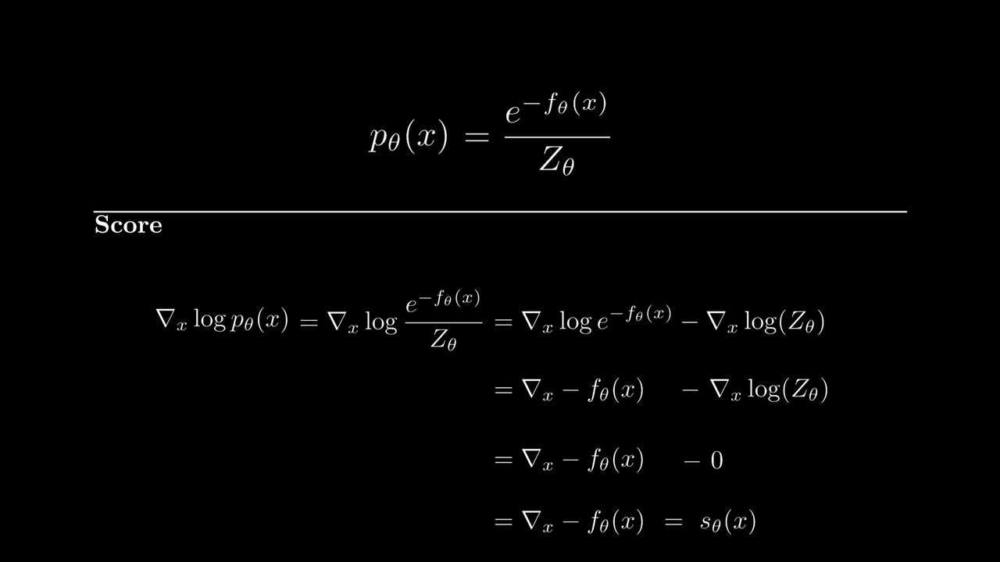

### 2.2 得分的直觉：它是一张"往哪走更像数据"的方向图

得分函数在直觉上非常好懂：它告诉你，把数据空间里的一个点往哪个方向移动，才能提高它出现的概率。因为对数单调递增，"提高对数概率"与"提高概率"是一回事。

[【跳转到 04:16】](https://www.youtube.com/watch?v=B4oHJpEJBAA&t=256)

在二维玩具例子里，把每个点的得分画成箭头（quiver 图），箭头总是指向最近的数据簇。放到图像上也是同理：从高斯分布里随机采一个点，把它输入分数函数，得到的方向就是"该往哪移动才能更靠近图像流形"。

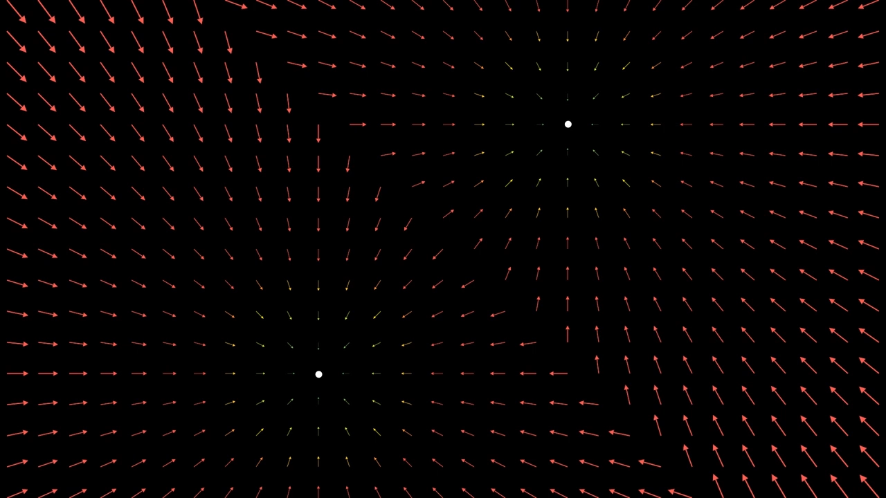

## 三、显式得分匹配：目标写得出，但真值拿不到

### 3.1 最朴素的目标

既然要学的是得分，最自然的做法就是让模型预测的得分去逼近真实得分：

$$
\frac{1}{2}\mathbb{E}_{p(x)}\left[\left\|\nabla_x\log p(x)-s_\theta(x)\right\|_2^2\right]
$$

这就是**得分匹配**（score matching）的原始形式：最小化原始得分与预测得分之间的差异。

[【跳转到 04:41】](https://www.youtube.com/watch?v=B4oHJpEJBAA&t=281)

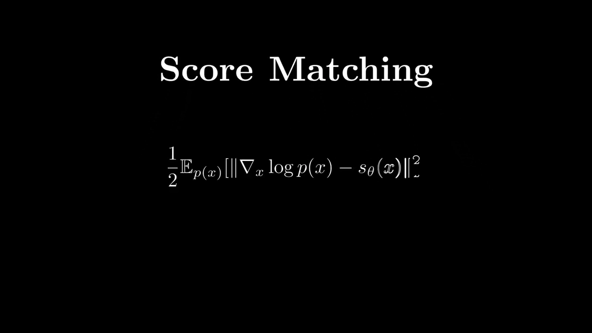

### 3.2 卡点：真实得分 $\nabla_x\log p(x)$ 我们同样没有

我们不知道 $p(x)$，自然也不知道它的对数梯度。于是一连串数学改写登场：

1. 把期望展开成积分；
2. 用代数恒等式 $\|a-b\|^2=a^2-2ab+b^2$ 展开，把三项拆成各自的积分；
3. 对交叉项用 $\nabla_x\log p(x)=\nabla_x p(x)/p(x)$ 把 $p(x)$ 约掉；
4. 对剩下那个含 $\nabla_x p(x)$ 的积分做**分部积分**；
5. 分部积分产生的边界项为零，因为 $x\to\infty$ 时概率密度衰减到零（正态分布就是最好的例子）。

[【跳转到 05:40】](https://www.youtube.com/watch?v=B4oHJpEJBAA&t=340)

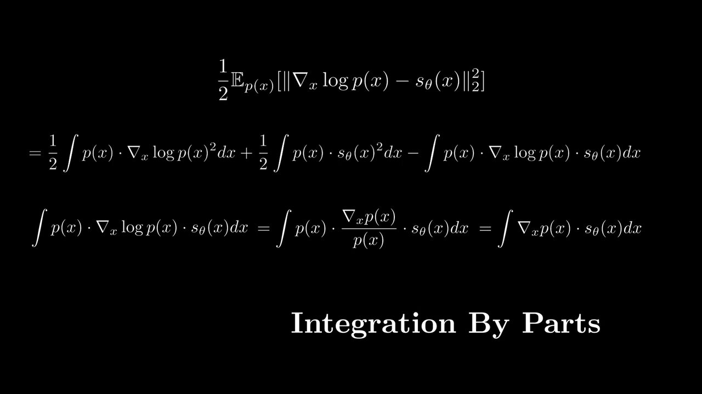

### 3.3 改写后的目标只含 $s_\theta$

做完这些操作，得到一个与原始目标只差一个常数的等价形式：

$$
\frac{1}{2}\mathbb{E}_{p(x)}\left[s_\theta(x)^2\right]+\mathbb{E}_{p(x)}\left[\nabla_x\cdot s_\theta(x)\right]
$$

第一项不含真实得分，只剩模型自己的输出；第二项是模型得分的散度。第一项和第三项（展开时产生的、不含 $s_\theta$ 的常数项）在优化中都可以忽略，因为它们不影响最优解的位置。

[【跳转到 07:08】](https://www.youtube.com/watch?v=B4oHJpEJBAA&t=428)

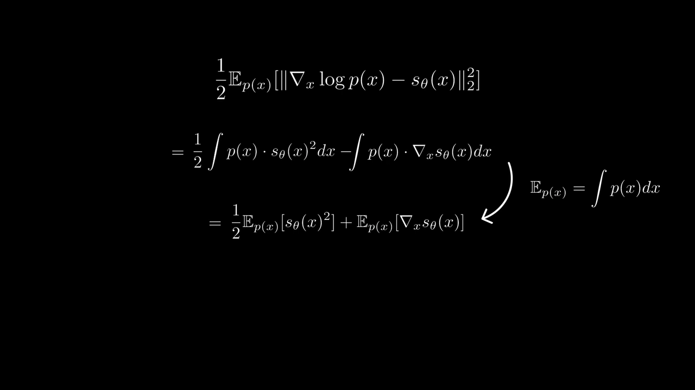

这个式子很漂亮：最小化它意味着两件事——让模型在数据点处的得分为零（数据点就是局部极大值），以及让模型得分的散度项配合着把整体拉平。**换句话说，"得分在数据点处为零"就是"我们正站在数据点上"。**

[【跳转到 07:33】](https://www.youtube.com/watch?v=B4oHJpEJBAA&t=453)

### 3.4 两个绕不过去的问题

**问题一：散度项太贵。** $\nabla_x\cdot s_\theta(x)$ 是 Jacobian 的迹，需要对每个输入维度各做一次反向传播。图像有上百万像素，这个代价不可接受。宋飏等人提出的**切片得分匹配**（sliced score matching）用随机投影绕开它，但视频明确说：最终要到达的方法用不到这个技巧，它在经典大规模生成式 AI 里也没被采用。

[【跳转到 08:23】](https://www.youtube.com/watch?v=B4oHJpEJBAA&t=503)

**问题二：只在"高概率区"学过，却要从"低概率区"开始采样。** 训练时见到的数据点都来自数据空间里概率很高的区域，模型在这些地方学得很好；但采样时我们从随机位置出发，那里模型从没见过，可能根本不知道数据密度在哪个方向。

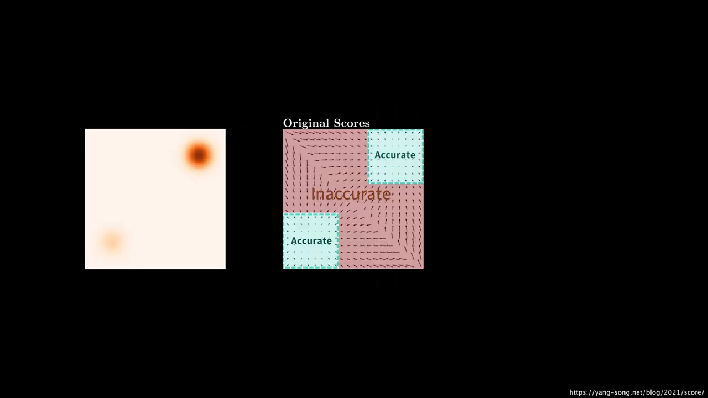

论文里的例子清楚地显示了后果：在很多位置，估计出的得分都指向两个数据簇的中间——那里并不对应任何有效样本。

[【跳转到 09:14】](https://www.youtube.com/watch?v=B4oHJpEJBAA&t=554)

## 四、加噪：用一个超参数同时缓解覆盖问题

### 4.1 给数据加一点高斯噪声

解法出乎意料地简单：给数据加噪。取一个数据点 $x$，加上 $\epsilon\sim\mathcal{N}(0,\sigma^2)$：

$$
\tilde x=x+\epsilon,\qquad \tilde x\sim p_\sigma(\tilde x)
$$

$p_\sigma(\tilde x)$ 的支撑比 $p(x)$ 宽得多，于是"采样起点落在没有数据的区域"这件事不再致命——模型在训练中其实见过那附近的数据。

[【跳转到 09:58】](https://www.youtube.com/watch?v=B4oHJpEJBAA&t=598)

### 4.2 $\sigma$ 是一个需要权衡的超参数

$\sigma$ 大，覆盖的数据空间多，但扰动后的分布与原分布差得远；$\sigma$ 小，分布几乎不变，但覆盖不了多少空间。视频特意提醒：这里的 $\sigma$ 是一个**单个数**，不是扩散模型里随噪声日程变化的量——别把两者混为一谈。

[【跳转到 10:52】](https://www.youtube.com/watch?v=B4oHJpEJBAA&t=652)

## 五、去噪得分匹配：把真值换成可计算的条件得分

### 5.1 关键一步：把 $p_\sigma(\tilde x)$ 换成 $p_\sigma(\tilde x\mid x)$

到这里，目标里仍有一个 $p_\sigma(\tilde x)$ 的得分算不出来。2010 年，Pascal Vincent 注意到得分匹配与**去噪自编码器**（denoising autoencoder）之间的联系：去噪自编码器在瓶颈处加噪、让解码器把噪声与数据分开，而"分开噪声"这件事本质上就是在估计得分。

于是他做了改写：目标里不再出现 $p_\sigma(\tilde x)$，而是出现**条件密度** $p_\sigma(\tilde x\mid x)$：

$$
\frac{1}{2}\mathbb{E}_{x\sim p(x),\,\tilde x\sim p_\sigma(\tilde x\mid x)}\left[\left\|s_\theta(\tilde x)-\nabla_{\tilde x}\log p_\sigma(\tilde x\mid x)\right\|_2^2\right]
$$

这个差别是决定性的：$p_\sigma(\tilde x)$ 的得分算不出来，但 $p_\sigma(\tilde x\mid x)$ 的得分可以**直接写出来**。

[【跳转到 13:13】](https://www.youtube.com/watch?v=B4oHJpEJBAA&t=793)

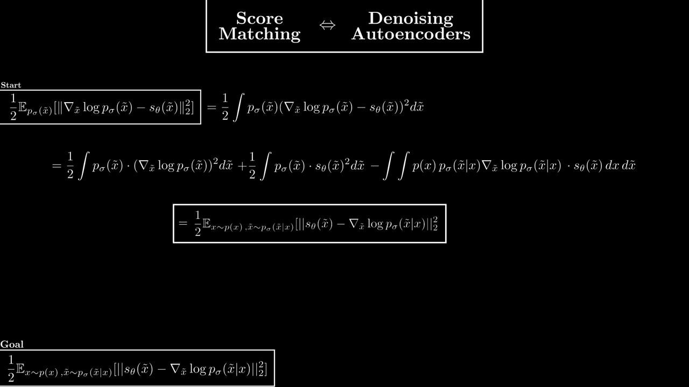

### 5.2 推导骨架

改写过程与前面同构，但把 $x$ 换成 $\tilde x$，并且在处理 $\nabla_{\tilde x}\log p_\sigma(\tilde x)$ 时：

1. 用对数法则把它写成 $\nabla_{\tilde x}p_\sigma(\tilde x)/p_\sigma(\tilde x)$，与外面的 $p_\sigma(\tilde x)$ 约掉；
2. 用**边缘化**把 $p_\sigma(\tilde x)$ 写成 $\int p(x)p_\sigma(\tilde x\mid x)dx$——注意这里用的是边缘化而不是分部积分，因为现在条件密度已知；
3. 用**莱布尼茨积分法则**把梯度移到积分号内（$p(x)$ 不依赖 $\tilde x$，可以直接贴到 $p_\sigma(\tilde x\mid x)$ 上）；
4. 用积分的线性性把 $s_\theta(\tilde x)$ 移进内层积分（它对内层只是常数）；
5. 最后加上再减去一项 $\nabla_{\tilde x}\log p_\sigma(\tilde x\mid x)$，把式子凑成代数恒等式的反向形式。

[【跳转到 14:38】](https://www.youtube.com/watch?v=B4oHJpEJBAA&t=878)

视频在这里很坦诚：这些步骤对当初想出它们的人大概也需要大量思考，看起来"非常随意"是正常的——只要每一步都跟得上、并且记住整体目标就行。

[【跳转到 17:23】](https://www.youtube.com/watch?v=B4oHJpEJBAA&t=1043)

### 5.3 条件得分有闭式解：$-\epsilon/\sigma^2$

因为 $\tilde x=x+\epsilon$，条件密度就是一个以 $x$ 为中心、方差 $\sigma^2$ 的多元高斯：

$$
p_\sigma(\tilde x\mid x)=\frac{1}{(2\pi)^{d/2}\sigma^2}e^{-\frac{1}{2\sigma^2}\|\tilde x-x\|^2}
$$

对它取 $\nabla_{\tilde x}\log$：常数项求导为零，对数与指数抵消，剩下对 $-\frac{1}{2\sigma^2}\|\tilde x-x\|^2$ 求导，用链式法则得到

$$
\nabla_{\tilde x}\log p_\sigma(\tilde x\mid x)=\frac{1}{\sigma^2}(x-\tilde x)
$$

[【跳转到 18:13】](https://www.youtube.com/watch?v=B4oHJpEJBAA&t=1093)

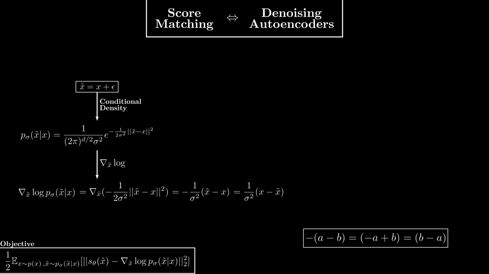

这一步同时解决了前面两个问题：真值可以**直接算**，不需要 Jacobian、不需要对每个输入维度做反向传播；而且训练样本覆盖了整个加噪后的空间。

### 5.4 结果：网络学的是"负噪声"

把 $\tilde x=x+\epsilon$ 代进去、把负号乘进去，两个 $x$ 抵消：

$$
s_\theta(\tilde x)\approx\frac{1}{\sigma^2}(x-\tilde x)=-\frac{\epsilon}{\sigma^2}
$$

也就是说，**模型接收带噪输入，实际学的是预测"所加噪声的相反数"，再乘上 $1/\sigma^2$**。

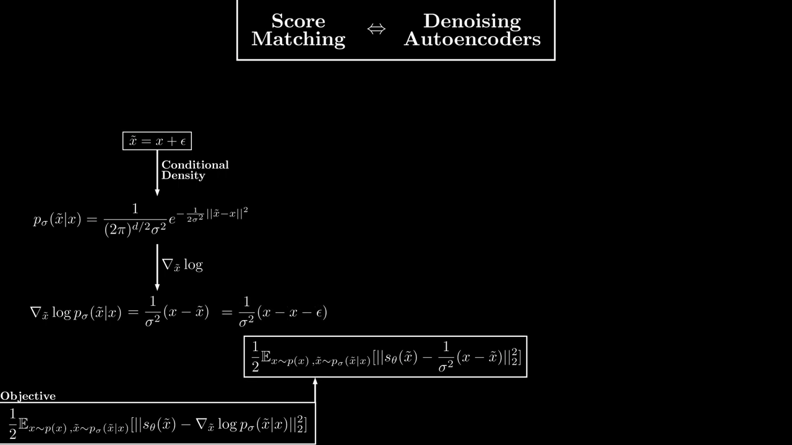

为什么负号是对的？因为得分指向"提高似然"的方向，而加噪是破坏图像；要修复图像，自然要往噪声的**反方向**走。这个"负噪声"的预测正好指向数据流形。

[【跳转到 19:53】](https://www.youtube.com/watch?v=B4oHJpEJBAA&t=1193)

视频在这里点明：如果你已经熟悉扩散模型，会发现这和 **$\epsilon$ 预测**非常像——事实上它们就是同一件事的两种写法（下一节把系数对齐）。

## 六、从得分采样：朗之万动力学

### 6.1 朴素做法会塌缩

训练好之后怎么生成？从数据空间的随机点出发，把点交给分数模型，沿它指的方向走一小步，重复多次：

$$
\tilde x_{i+1}\leftarrow \tilde x_i+\alpha\, s_\theta(\tilde x_i),\qquad i=0,1,\dots,K
$$

$\alpha$ 是个很小的数（比如 0.001）。只走一步容易冲过数据，所以要多步小步走。

[【跳转到 21:41】](https://www.youtube.com/watch?v=B4oHJpEJBAA&t=1301)

但纯梯度上升有个明显缺陷：所有点最终都塌缩到同一个位置——数据集的均值，因为那里密度最高。

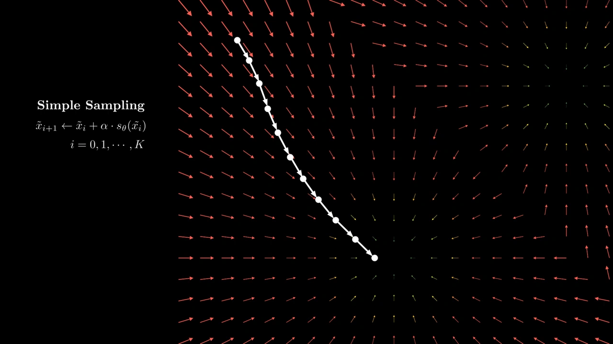

### 6.2 加一点噪声：朗之万动力学

修法叫**朗之万动力学**（Langevin dynamics），改动只有一项：

$$
\tilde x_{i+1}\leftarrow \tilde x_i+\alpha\, s_\theta(\tilde x_i)+\sqrt{2\alpha}\,\epsilon_i
$$

$\epsilon_i$ 是随机高斯噪声，$\sqrt{2\alpha}$ 保证噪声与步长的比例正确（视频没有展开这个系数的推导，并说明它与得分匹配本身关系不大）。

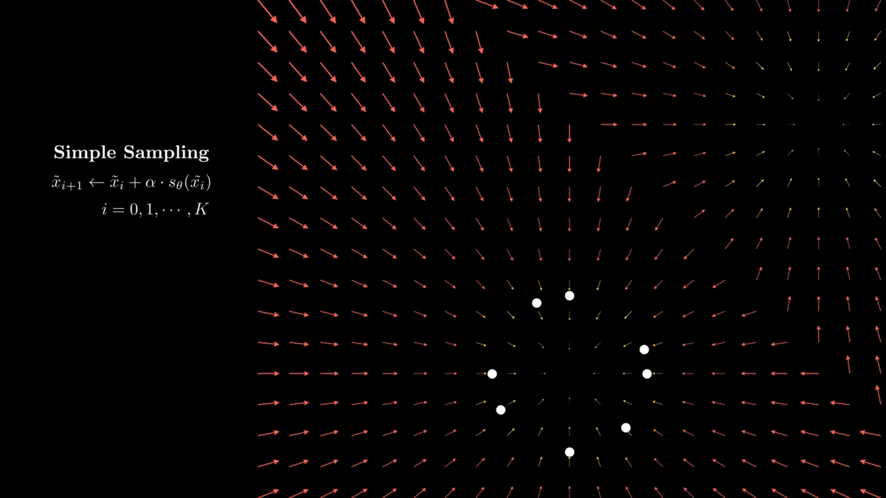

[【跳转到 22:53】](https://www.youtube.com/watch?v=B4oHJpEJBAA&t=1373)

## 七、多噪声水平：把"选一个 $\sigma$"变成"选一串 $\sigma$"

### 7.1 单一 $\sigma$ 的两难

$\sigma$ 大，覆盖广但分布变形；$\sigma$ 小，分布保真但覆盖窄。更麻烦的是：$\sigma$ 很小时 $\tilde x$ 里几乎不含噪声，让网络从几乎看不出噪声的输入里预测 $\epsilon$，训练会非常困难、方差很大。

[【跳转到 24:33】](https://www.youtube.com/watch?v=B4oHJpEJBAA&t=1473)

### 7.2 折中：在一串噪声水平上训练

解法是"全都做"：在高、中、低噪声水平上都训练，实践中让 $\sigma$ 在一个预设区间里变化（视频举例 0.01 到 25），并把噪声水平作为条件输入喂给网络——这是免费的额外信息，能帮模型完成预测任务。

$$
\tilde x_i=x+\epsilon_i,\qquad \epsilon_i\sim\mathcal{N}(0,\sigma_i^2)
$$

[【跳转到 24:53】](https://www.youtube.com/watch?v=B4oHJpEJBAA&t=1493)

宋飏与 Stefano Ermon 的论文是第一个把多噪声水平用于得分匹配的工作，用了 1000 个噪声水平；采样时从最高噪声尺度出发，一边朝数据分布移动，一边降低噪声尺度。

[【跳转到 25:42】](https://www.youtube.com/watch?v=B4oHJpEJBAA&t=1542)

### 7.3 噪声水平趋于无穷 → 随机微分方程

后续论文证明：当噪声水平的数量趋于无穷，噪声扰动就变成一个**随机过程**，可以用随机微分方程（SDE）描述。好处是样本质量更高、实现更简单，还能计算数据的精确似然；更重要的是，它把这条推导链与 DDPM、DDIM、EDM 这些扩散论文接上了。

[【跳转到 26:02】](https://www.youtube.com/watch?v=B4oHJpEJBAA&t=1562)

视频在这里只做了接口性说明：前向 SDE 给数据加噪，Anderson（1982）给出的一般反向 SDE 里恰好出现得分函数，把 DDPM 的加噪过程写成连续形式再离散化（欧拉-丸山方法），就得到论文里的 DDPM 采样器。**这部分内容属于下一节（3.2.2 反向时间 SDE）的主题，本文不展开。**

[【跳转到 30:34】](https://www.youtube.com/watch?v=B4oHJpEJBAA&t=1834)

## 八、把整条链串起来

视频最后用一段话回顾了整条推导：

1. 想学 $p(x)$，但 $p_\theta(x)=e^{-f_\theta(x)}/Z_\theta$ 里的 $Z_\theta$ 要全空间积分，算不出来；
2. 施加"对数 + 梯度"两个算子得到得分，$Z_\theta$ 因为与 $x$ 无关而消失；
3. 想直接拟合真实得分，但真实得分拿不到，于是用分部积分改写成只含 $s_\theta$ 的等价目标；
4. 这个目标有两个毛病：散度项需要 Jacobian（太贵），训练只覆盖高概率区（采样会跑偏）；
5. 加噪解决覆盖问题，代价是 $\sigma$ 的权衡；
6. 借助与去噪自编码器的联系，把 $p_\sigma(\tilde x)$ 换成 $p_\sigma(\tilde x\mid x)$，得到**去噪得分匹配**；
7. 条件得分有闭式解 $-\epsilon/\sigma^2$，于是网络只需预测负噪声——这就是扩散模型里那个熟悉的 $\epsilon$ 预测；
8. 单一 $\sigma$ 的权衡用"多噪声水平"解决；噪声水平趋于无穷就得到 SDE 视角，可以推出 DDPM、DDIM、EDM。

[【跳转到 34:34】](https://www.youtube.com/watch?v=B4oHJpEJBAA&t=2074)

视频里有个比喻：这支视频教的是"通用的造车工程"，DDPM、DDIM、EDM 那些论文教的是造法拉利、保时捷、特斯拉的具体细节。

## 小结

- **得分函数** $s(x)=\nabla_x\log p(x)$ 是"往哪走更像数据"的方向图；对 $x$ 求梯度使归一化常数 $Z_\theta$ 自动消失，这是整个得分路线的支点。
- **得分匹配**直接最小化真实得分与预测得分的平方误差，但真实得分同样未知。
- 用**分部积分**（边界项因密度衰减为零而消失）可把它改写成只含 $s_\theta$ 的等价目标，代价是出现 Jacobian 迹，且训练只覆盖高概率区。
- **加噪**用一个超参数 $\sigma$ 缓解覆盖问题，但引入"覆盖 vs 保真"的权衡。
- **去噪得分匹配**把目标里的 $p_\sigma(\tilde x)$ 换成条件密度 $p_\sigma(\tilde x\mid x)$，后者是高斯，其对数梯度有闭式解 $(x-\tilde x)/\sigma^2=-\epsilon/\sigma^2$。
- 因此"学得分"与"预测负噪声"是同一件事（差一个随时间的缩放系数），这正是扩散模型 $\epsilon$ 预测的理论来源。
- 采样用**朗之万动力学**：沿得分走一小步、再加一点噪声，否则所有点会塌缩到密度最高处。
- 单一噪声水平的两难用**多噪声水平**解决；噪声水平趋于无穷则进入 SDE 视角（见 3.2.2）。

## 关键术语速查

| 术语 | 一句话解释 |
| --- | --- |
| PDF（概率密度函数） | 非负、积分为 1 的函数，描述数据在空间各处的密度 |
| 归一化常数 $Z_\theta$ | 让 $e^{-f_\theta(x)}$ 积分为 1 的系数，需要对整个空间积分，通常算不出来 |
| 得分函数 | $\nabla_x\log p(x)$，指向"提高概率"的方向，与 $Z_\theta$ 无关 |
| 得分匹配 | 最小化真实得分与模型得分的平方误差的训练目标 |
| 显式得分匹配 | 用分部积分把真实得分消掉后的等价目标，含 $s_\theta$ 的散度项 |
| 切片得分匹配 | 用随机投影近似 Jacobian 迹、降低散度项代价的方法 |
| 去噪得分匹配（DSM） | 在加噪数据上，用条件得分 $\nabla_{\tilde x}\log p_\sigma(\tilde x\mid x)$ 作真值的得分匹配 |
| 朗之万动力学 | 沿得分方向走一小步、再加一点高斯噪声的采样过程 |
| 噪声条件分数网络 | 把噪声水平作为条件输入、在一串噪声尺度上训练的得分模型 |
| 前向/反向 SDE | 连续时间极限下给数据加噪与去噪的随机微分方程，反向方程依赖得分函数 |