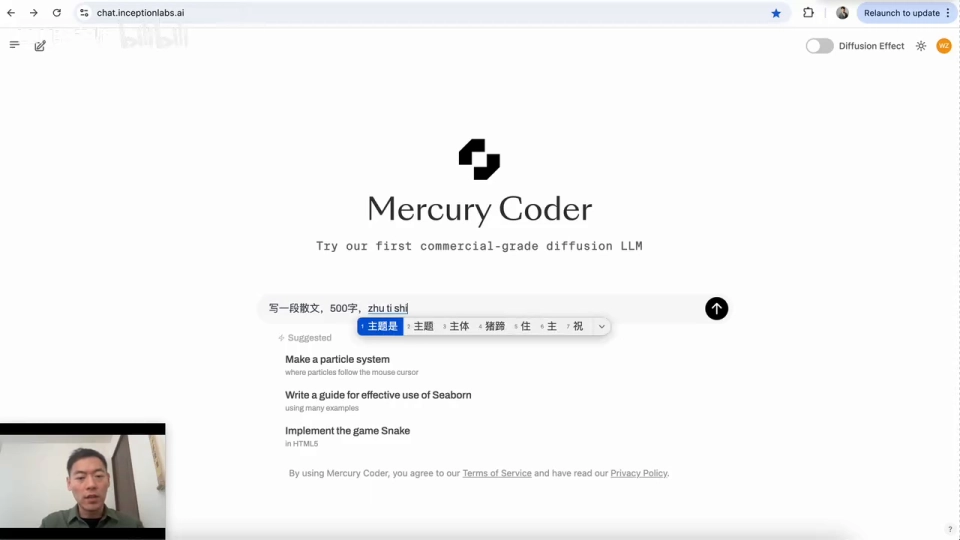
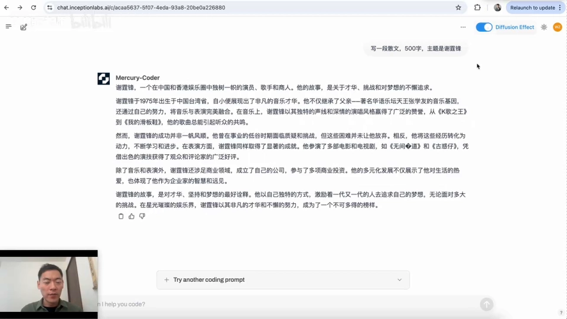
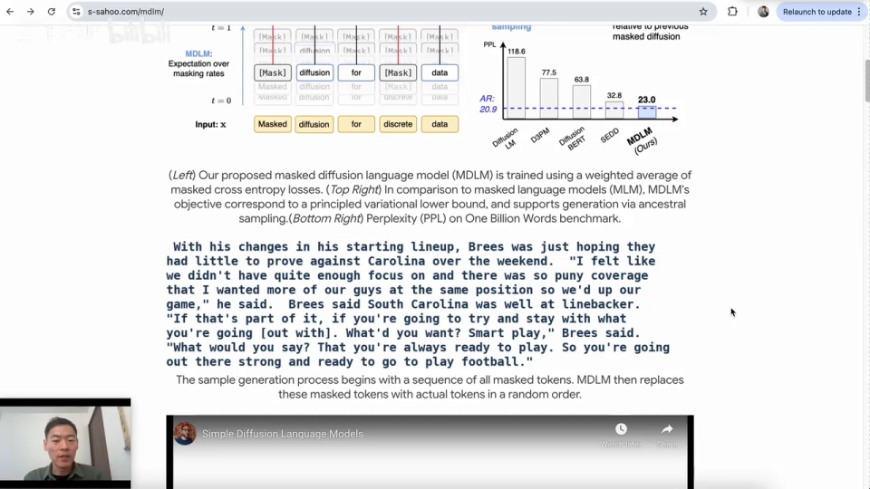
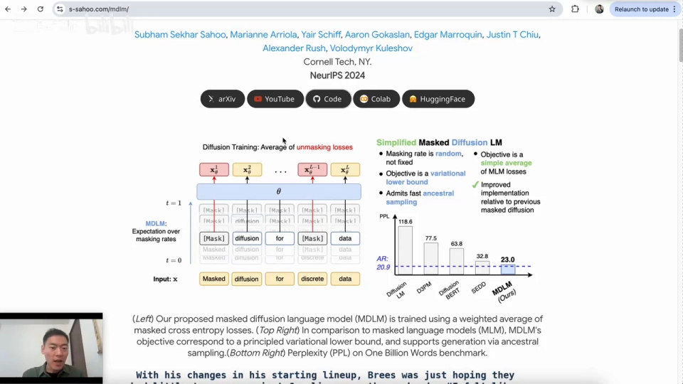
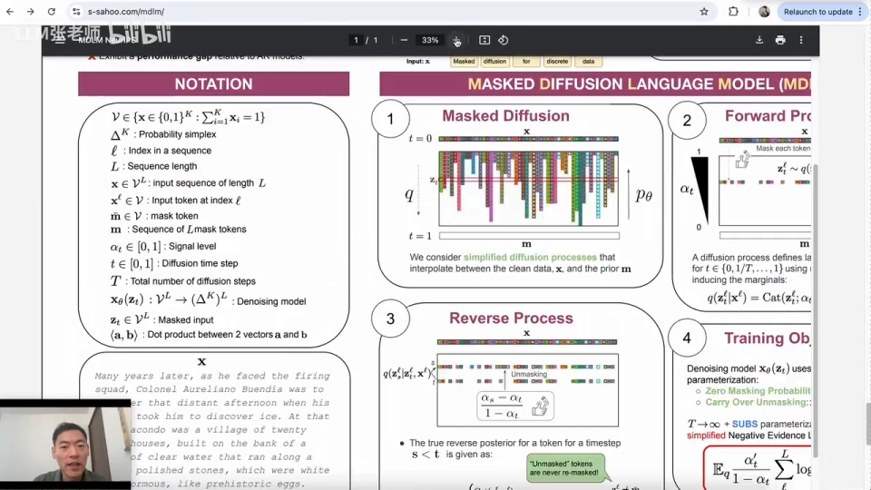
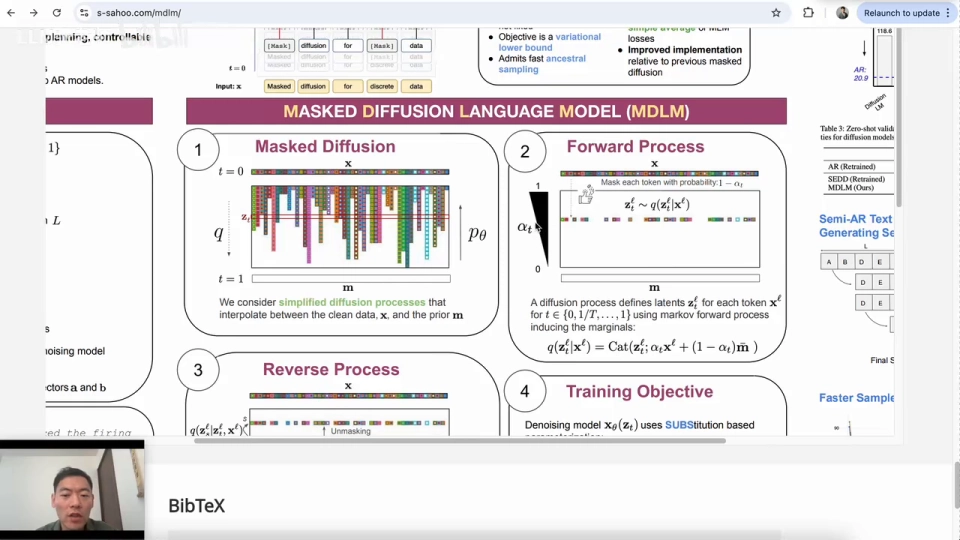
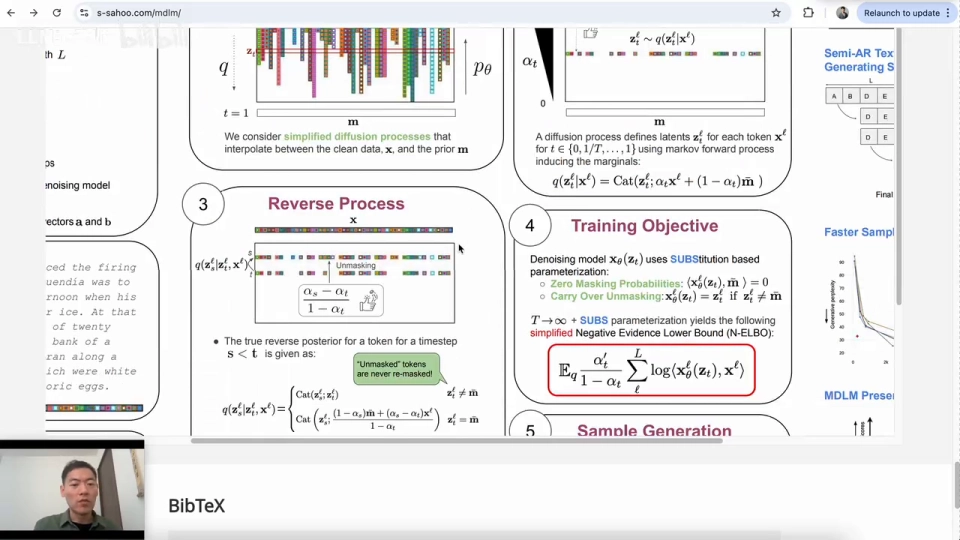
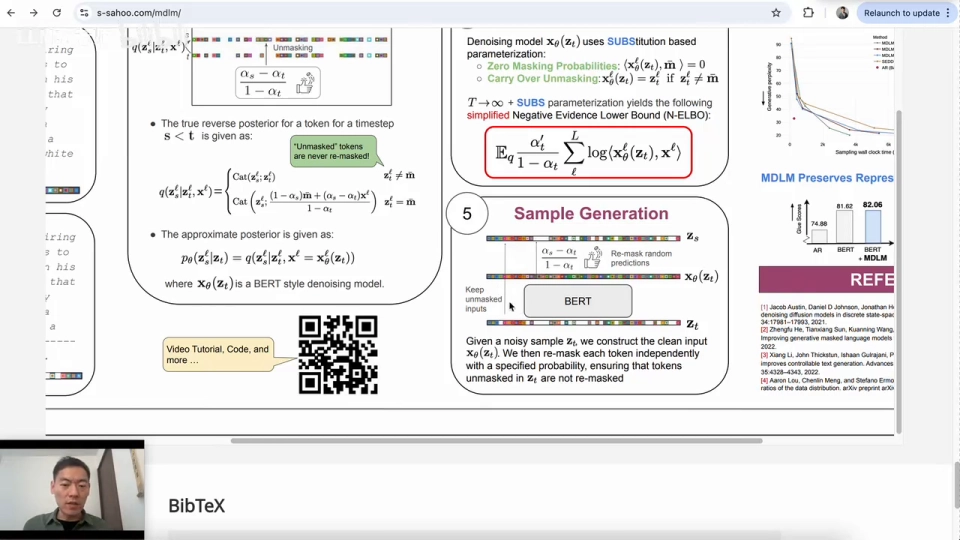
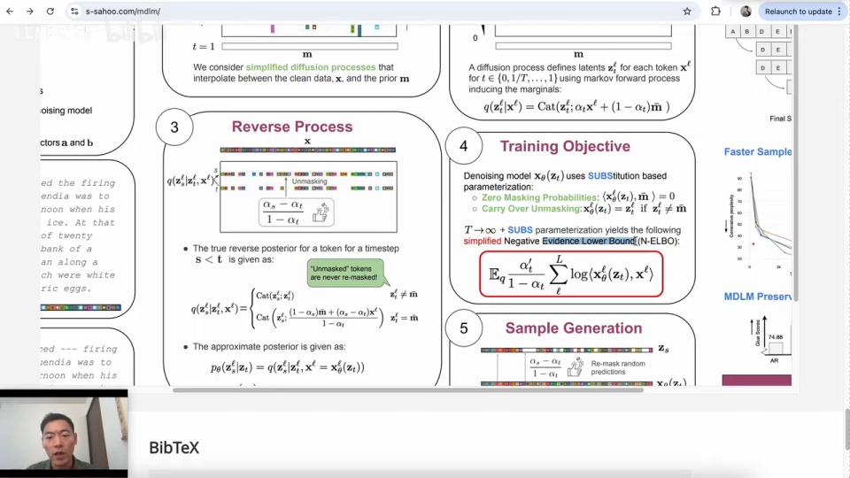
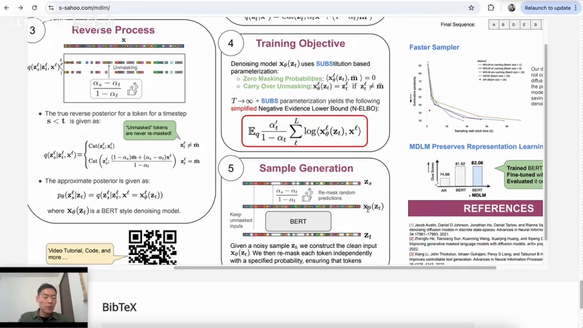

# MDLM 的并行去噪生成：从全掩码出发，一次填回整段文字

> 视频来源：[【有难度】MDLM 超快生成速度的扩散语言模型](https://www.bilibili.com/video/BV1h9XfYxEnk/)（Bilibili · LLM张老师）｜时长约 39 分钟
> 导读：这期视频从「自回归为什么慢」讲起，用论文主页的图解把 MDLM 的加噪、反向过程、训练目标和采样过程走了一遍，最后讨论了长度控制、条件生成与「已解码不再改」带来的局限。本文按这条线索整理，公式部分补上视频口述对应的符号。

## 本讲要解决的核心问题（SCQA）

**背景**：现在的语言模型几乎都是自回归的：一个字一个字（包括标点）往外吐，每吐一个都要把前面所有 token 的注意力重新算一遍。

**冲突**：序列一长，这变成两个瓶颈——计算量随长度线性增长且无法回避重复计算，生成耗时也随长度线性增长，无论用 flash attention 还是 KV cache 都只是常数优化。

**疑问**：图像扩散模型是一次性把整张图从噪声去噪出来的，能不能把「一次性并行」搬到文字上？文字是离散 token，噪声又该怎么加？

**回答（中心思想）**：MDLM 把「加噪」替换成「按比例把 token 换成 `[MASK]`」，把「去噪」替换成「一次性预测所有被掩码位置的原 token」，于是生成变成从全掩码出发、若干步并行填空的过程。每一步都要跑一次全序列的注意力，但步数与文本长度无关，长文本的并行收益就出来了。

## 一、自回归的两个瓶颈

### 1.1 重复计算

自回归生成第 $n$ 个 token 时，最后一个 token 的 query 要和前面所有 token 的 key、value 做矩阵乘法。生成到 2 万字时，第 2 万个字要跟前面 19999 个字算一遍注意力。

[【跳转到 00:41】](https://www.bilibili.com/video/BV1h9XfYxEnk/?t=41)

讲者强调：attention、flash attention、KV cache 这些优化只是把重复计算变便宜，并没有消除「必须按顺序、必须参考全部历史」这件事。

### 1.2 时间随长度线性增长

第二个瓶颈是速度本身：预测 2 万字一定比预测 200 字慢，这是生成范式的性质，不是实现问题。

### 1.3 扩散给出的是另一种角度

图像扩散不是逐像素生成的。一张 $512\times512$ 的图有 25 万多个像素，先给每个像素一个随机初始值，然后去噪 100 步，每一步所有像素同时更新，100 步之后整张图就出来了。

[【跳转到 01:06】](https://www.bilibili.com/video/BV1h9XfYxEnk/?t=66)

搬到文字上就是：假定这段是 500 个字，先把 500 个位置全部铺成噪声，然后在 100 步里去噪，每一步同时把若干位置替换成真实的字。虽然还是 100 步，但每步处理的是整段文本，生成长文本时并行效果就体现出来了。

## 二、把「加噪」定义成「加掩码」

### 2.1 噪声不是数值扰动，而是 `[MASK]`

视频用论文主页的一张图解释前向过程：从下往上看，最下面是干净的输入 $\mathbf{x}$（比如 5 个字），最上面 $t=1$ 时全部变成 `[MASK]`。中间某一步，第一个字被 mask 了，第二个、第三个还是原来的，第四个被 mask，第五个还是原来的。

[【跳转到 09:21】](https://www.bilibili.com/video/BV1h9XfYxEnk/?t=561)

所以这里的「噪声」不是往数值上加高斯扰动，而是把原有 token 抹掉、换成一个专门的占位符。模型的任务就是去拟合这些被抹掉的位置原本是什么。

### 2.2 掩码比例是随机的

论文强调的第一点是 masking ratio is random, not fixed：每一步掩掉多少是随机的，而且有多个步骤。讲者拿 BERT 做对照：BERT 是 encoder，训练时也在一段文字里加掩码让模型预测，但那个掩码比例是固定的、只有一步。MDLM 把它变成随机的、多步的，于是就有了「扩散」的时间轴。

[【跳转到 08:01】](https://www.bilibili.com/video/BV1h9XfYxEnk/?t=481)

同一张图上还有一组困惑度（PPL）对比：Diffusion LM 118.6、D3PM 77.5、Diffusion BERT 63.8、SEDD 32.8、MDLM 23.0，自回归（AR）是 20.9。讲者据此说明：在 MDLM 之前，扩散语言模型和自回归模型有明显差距，MDLM 把差距缩到了十几个点，而换来的是生成速度。

### 2.3 从连续扩散到离散扩散

讲者把 D3PM 作为这条线的起点：D3PM 的论文题目是 *Structured Denoising Diffusion Models in Discrete State Spaces*，做的就是「把扩散模型用到离散状态空间」。MDLM 建立在它之上，针对语言模型做了简化与升级。

D3PM 的框架是马尔可夫链：下一步的状态只取决于上一步的状态，转移概率用类别分布（category）描述——词表有 5 万个，就在 5 万个候选里选一个。转移由一系列 $N \times N$ 的矩阵乘法定义，对应 $T$ 个离散时间步。

## 三、前向过程：每一步按 $1-\alpha_t$ 的比例掩码

### 3.1 符号表

视频把论文里的 notation 面板逐条过了一遍：

- $\mathcal{V} \in \{x \in \{0,1\}^K : \sum_{i=1}^{K} x_i = 1\}$：词表，每个 token 是一个长度为 $K$ 的 one-hot 向量，只有一个位置为 1。
- $\Delta^K$：概率单纯形，即所有合法的概率分布。
- $\ell$：序列中的位置下标；$L$：序列长度；$\mathbf{x} \in \mathcal{V}^L$：长度为 $L$ 的输入序列。
- $\mathbf{m}$：mask token；$\mathbf{m}$ 表示长度为 $L$ 全掩码的序列。
- $\alpha_t \in [0,1]$：信号强度（signal level），从 1 降到 0。
- $t \in [0,1]$：连续扩散时间；$T$：扩散步数。
- $x_\theta(\mathbf{z}_t): \mathcal{V}^L \to (\Delta^K)^L$：去噪网络，输入掩码序列，输出每个位置上的词表分布。
- $\mathbf{z}_t \in \mathcal{V}^L$：第 $t$ 步的掩码输入。
- $\langle \mathbf{a}, \mathbf{b}\rangle$：两个向量的内积。

[【跳转到 16:25】](https://www.bilibili.com/video/BV1h9XfYxEnk/?t=985)

### 3.2 加噪公式

前向过程的边际分布是

$$
q(\mathbf{z}_t^\ell \mid \mathbf{x}^\ell) = \mathrm{Cat}\left(\mathbf{z}_t^\ell;\, \alpha_t \mathbf{x}^\ell + (1-\alpha_t)\mathbf{m}\right)
$$

读法：第 $\ell$ 个位置以 $\alpha_t$ 的概率保持原 token，以 $1-\alpha_t$ 的概率变成 `[MASK]`。$\alpha_t$ 从 1 单调降到 0，所以 $t=0$ 时是干净文本，$t=1$ 时全部是 `[MASK]`。

[【跳转到 22:01】](https://www.bilibili.com/video/BV1h9XfYxEnk/?t=1321)

讲者用具体数字解释：如果某一步 $\alpha_t = 0.4$，那么 $1-0.4=0.6$，就是 60% 的 token 被随机掩掉；到 $t=1$ 时 $\alpha_t=0$，$1-0=1$，百分之百被掩掉，全白。

### 3.3 为什么输出是「category」

被掩码的位置要恢复的不是 0/1，而是 5 万个词表索引中的某一个。所以网络输出的是一个 $K$ 维的类别分布，取概率最高的那个索引，就像 transformer 最后接一个 lm head 输出整个词表的概率一样。

## 四、反向过程：已解码的 token 不再被掩码

### 4.1 一步只恢复一部分

反向过程不是一下子回到干净文本，而是一步一步往回走。从第 $t$ 步到第 $s$ 步（$s<t$）时，只把这两步之间新增的那些被掩码位置恢复出来，其余位置保持不动。

[【跳转到 24:09】](https://www.bilibili.com/video/BV1h9XfYxEnk/?t=1449)

### 4.2 关键比值 $(\alpha_s-\alpha_t)/(1-\alpha_t)$

视频用距离来解释这个比值：$\alpha_s - \alpha_t$ 是 $s$ 到 $t$ 之间新增的掩码量，$1-\alpha_t$ 是到第 $t$ 步为止累积的掩码总量，两者相除就是「这段区间在已掩码总量里的份额」。举个数：$\alpha_s = 0.8$、$\alpha_t = 0.6$，则 $(0.8-0.6)/(1-0.6) = 0.2/0.4 = 0.5$。

这个比值就是「一个仍被掩码的位置，在这一步恢复成原 token」的概率。把它做成系数之后，反向过程的计算就变得很简单。

### 4.3 两条规则

论文的反向过程可以写成两分支：

$$
q(\mathbf{z}_s^\ell \mid \mathbf{z}_t^\ell, \mathbf{x}^\ell) =
\begin{cases}
\mathrm{Cat}(\mathbf{z}_s^\ell;\, \mathbf{z}_t^\ell), & \mathbf{z}_t^\ell \neq \mathbf{m}, \\[4pt]
\mathrm{Cat}\left(\mathbf{z}_s^\ell;\, \dfrac{(1-\alpha_s)\mathbf{m} + (\alpha_s-\alpha_t)\mathbf{x}^\ell}{1-\alpha_t}\right), & \mathbf{z}_t^\ell = \mathbf{m}.
\end{cases}
$$

第一条规则对应「unmasked tokens are never re-masked」：当前 token 如果不是 mask，直接原样返回。第二条对应「仍是 mask 的位置，按上面的比值决定恢复成哪个 token」。

### 4.4 用网络替代真实数据

真实反向过程需要知道干净数据 $\mathbf{x}$，采样时并不知道。做法是把 $\mathbf{x}$ 换成网络预测 $x_\theta(\mathbf{z}_t)$：

$$
p_\theta(\mathbf{z}_s^\ell \mid \mathbf{z}_t^\ell) = q\left(\mathbf{z}_s^\ell \mid \mathbf{z}_t^\ell,\, \mathbf{x} = x_\theta(\mathbf{z}_t)\right)
$$

也就是说，网络是一个 BERT 式的去噪器：输入带掩码的序列，输出每个位置的词表分布，用它去近似「如果知道真实答案，这一步该怎么恢复」。

## 五、训练目标：一个加权平均的掩码交叉熵

### 5.1 从 ELBO 到简化形式

视频把训练目标称为 NELBO（negative evidence lower bound），并说明它和对数似然的关系：训练就是让预测分布和真实分布尽量接近，用对数似然衡量，取负号就是要最小化的量。用 log 而不是原始概率，是因为 log 平滑、能把数值范围压小，不会把误差指数级放大。

在连续时间极限下（$T \to \infty$，步长趋于无穷小），目标化简成

$$
\mathcal{L}_{\text{NELBO}} = \mathbb{E}_q \left[ \int_0^1 \frac{\alpha_t'}{1-\alpha_t} \sum_{\ell=1}^{L} \log \left\langle x_\theta^\ell(\mathbf{z}_t),\, \mathbf{x}^\ell \right\rangle \, dt \right]
$$

[【跳转到 34:01】](https://www.bilibili.com/video/BV1h9XfYxEnk/?t=2041)

### 5.2 权重在做什么

讲者把权重 $\alpha_t'/(1-\alpha_t)$ 的直观讲得很清楚：$\alpha_t$ 越大（掩码越少），分母 $1-\alpha_t$ 越小，权重越大；$\alpha_t$ 越小（掩码越多），权重越小。所以不同噪声水平上的损失被自动平衡了。

### 5.3 为什么不用熵而用 ELBO

视频顺带回答了一个常见疑问：为什么有的地方用熵、有的地方用 ELBO？讲者的解释是，这类过程的中间步骤不可导、不连续，没法直接对一个连续目标求导，所以要用变分下界去近似。他还拿 VAE 举例：Stable Diffusion 的 VAE 同时用了像素级重构损失和散度损失，一个管结构准不准，一个管分布别跑太远。

### 5.4 替代参数化的两个约定

论文用 substitution-based parameterization，包含两个约定：

- **Zero Masking Probabilities**：$x_\theta(\mathbf{z}_t)$ 在 mask 位置上的概率置零，即网络不会预测「这里还是 mask」。
- **Carry Over Unmasking**：如果 $\mathbf{z}_t^\ell \neq \mathbf{m}$，就直接令 $x_\theta^\ell(\mathbf{z}_t) = \mathbf{z}_t^\ell$，即未被掩码的位置原样保留。

第二条正是「未被掩码的位置损失为零」的来源：预测等于真值，内积为 1，$\log 1 = 0$。

## 六、采样：从全掩码出发，每步填一部分

### 6.1 采样循环

采样过程与训练对称：

1. 初始化 $\mathbf{z}_t$ 为全 `[MASK]`（$t=1$）。
2. 把 $\mathbf{z}_t$ 送进 BERT 式去噪网络，得到每个位置的词表分布。
3. 保留未被掩码的输入，对被掩码的位置按分布采样出候选 token。
4. 按指定概率重新掩码一部分位置（re-mask random predictions），保证下一步还有东西可填，同时保证已经 unmask 的位置不再被掩码。
5. 时间往前走一步，重复，直到 $t=0$。

[【跳转到 28:19】](https://www.bilibili.com/video/BV1h9XfYxEnk/?t=1699)

### 6.2 注意力在这里怎么用

这是视频里最容易被误解的一点。MDLM 仍然用 transformer，但用法和自回归完全不同：自回归是每进一个 token 就算一次历史注意力；MDLM 是把整段序列一次性丢进去，一次算出所有位置两两之间的注意力（full attention）。

去噪 100 步就计算 100 次 full attention，每次的区别只是掩码图案不同。注意力做的是「根据已经解码的上下文，推断被掩码的位置应该是什么」，然后把一部分填回去；下一步再根据新填的内容继续推断剩下的。

[【跳转到 35:24】](https://www.bilibili.com/video/BV1h9XfYxEnk/?t=2124)

所以它的复杂度结构是：步数固定（比如 100 步），每步处理整段序列。文本越长，并行的相对收益越大——这正是视频开头演示里「升得很快」的原因。讲者现场用 Mercury Coder（Inception Labs 的产品）演示了写代码和写 500 字散文，生成过程是整段逐渐显形的，而不是逐字蹦出来。

## 七、视频点出的局限与后续方向

### 7.1 长度怎么定

图像扩散的输出尺寸是固定的（$512\times512$、$1024\times1024$），但文本长度千变万化。视频明确指出：这篇论文没有解决动态长度的问题，demo 里能根据问题生成长度不同的答案，是靠后续大规模训练与指令微调做到的。

### 7.2 从全掩码出发意味着什么

讲者把它类比成 Stable Diffusion 从纯高斯噪声出发：初始状态是随机的，模型学到的是「从这个分布出发怎么去噪」，所以不加条件时生成是随机的，不能指定内容。要按指令生成，必须额外加入文本条件等指令机制；不加条件就做不了问答。

### 7.3 已解码不再改，可能不是最优

采样时 unmask 之后就不再变，这带来一个问题：前面某一步在很离散的空间里挑了一个当时概率最高的 token，后面可能发现它不对，但已经改不了了。讲者用人类说话打比方：说到一半发现前面那句话不合适，会回头改。所以采样阶段还有优化空间——允许对已解码的 token 重新掩码、重做判断，这一类改进后来也确实出现了。

### 7.4 速度与准确率的权衡

视频结尾的判断是：MDLM 在准确率上不一定比 decoder-only 的 transformer 差，而生成速度快很多，所以很可能是下一个方向；更可能的形态是扩散与自回归结合——需要精细控制的地方用自回归，需要整体框架的地方用扩散。他还提到参数量上 MDLM 比同规模的纯 transformer 更低。

## 小结

- 自回归的两个瓶颈是重复计算与线性增长的时间；扩散提供的是「整段并行」的另一种角度。
- MDLM 的加噪是把 token 按 $1-\alpha_t$ 的概率替换成 `[MASK]`，$\alpha_t$ 从 1 降到 0，$t=1$ 时全掩码。
- 反向过程一步只恢复一部分，恢复概率是 $(\alpha_s-\alpha_t)/(1-\alpha_t)$，且已解码的 token 不再被掩码。
- 训练目标是对被掩码位置的加权对数似然（NELBO），权重 $\alpha_t'/(1-\alpha_t)$ 平衡不同噪声水平。
- 采样从全掩码出发，每步跑一次全序列注意力，预测后按比例重新掩码，循环到 $t=0$。
- 视频点出的局限：长度需靠后续训练控制、无条件时生成随机、已解码不可改、准确率与速度仍需权衡。

## 关键术语速查

| 术语 | 一句话解释 |
| --- | --- |
| 掩码扩散 | 用「替换成 `[MASK]`」代替加高斯噪声的扩散形式，属于吸收态离散扩散 |
| 信号强度 $\alpha_t$ | 到第 $t$ 步仍未掩码的比例，从 1 降到 0 |
| category 分布 | 在整张词表上给出概率的类别分布，取概率最高者为预测 token |
| NELBO | 负变分下界，MDLM 中化简为加权掩码交叉熵 |
| 祖先采样 | 从 $t=1$ 的全掩码逐步反向采样到 $t=0$ 的生成过程 |
| 重新掩码 | 采样时把一部分已预测位置再变回 `[MASK]`，留待后续步骤继续修正 |
| full attention | 一次性对整段序列计算两两注意力，而非自回归的逐 token 累积 |