# 掩码扩散语言模型 MDLM：把加噪换成掩码，离散扩散化简成一次加权交叉熵

> 视频来源：[MDLM：一个简单有效的掩码扩散语言模型](https://www.bilibili.com/video/BV17usuzvEH4/)（Bilibili · 奇变偶不变GBK）｜时长约 15 分钟
> 导读：这期视频沿着 D3PM 的转移矩阵写法，一步步把「吸收态（mask）扩散」化简到只剩一个插值公式和一个加权交叉熵损失。本文保留推导主线，并对每一步的符号变化补上解释，适合已经知道 DDPM 大致流程、但没看过离散扩散推导的读者。

## 本讲要解决的核心问题（SCQA）

**背景**：在连续数据上，扩散模型的加噪是往数值上加高斯噪声，训练目标是预测噪声或去噪后的样本。语言模型的输入却是一串离散的 token（词表里的编号），没有「加一点小噪声」这种中间状态。

**冲突**：D3PM 给出的通用做法是用一个 $K \times K$ 的状态转移矩阵 $Q_t$ 描述 token 之间怎么互相跳转。这个框架是完备的，但词表长度 $K$ 动辄几万，矩阵既写不下也不好用。

**疑问**：如果只考虑「把 token 换成掩码」这一种加噪方式，转移矩阵还需要吗？前向过程、反向过程和训练目标能化简到什么程度？

**回答（中心思想）**：MDLM 的全部内容可以概括成三句话——加噪是把 token 以一定概率替换成 `[MASK]`，且一旦被掩码就永远保持掩码；反向过程因此只需处理「已恢复」和「仍是掩码」两种状态；训练目标最终化简成只对被掩码位置计算的加权交叉熵。整套推导里没有出现任何高斯噪声。

## 一、先换符号：从行向量到列向量

### 1.1 D3PM 的前向加噪写法

D3PM 把前向加噪写成一次类别分布的转移：

$$
q(\mathbf{x}_t \mid \mathbf{x}_{t-1}) = \mathrm{Cat}(\mathbf{x}_t; \mathbf{x}_{t-1} Q_t)
$$

其中 $\mathbf{x}_{t-1}$ 是 one-hot 行向量，$Q_t$ 是状态转移矩阵，两者相乘后仍是一个行向量（即下一时刻各个 token 的概率）。多步累积写成 $\bar{Q}_t = Q_1 Q_2 \cdots Q_t$，于是可以直接从干净数据跳到任意时刻：

$$
q(\mathbf{x}_t \mid \mathbf{x}_0) = \mathrm{Cat}(\mathbf{x}_t; \mathbf{x}_0 \bar{Q}_t)
$$

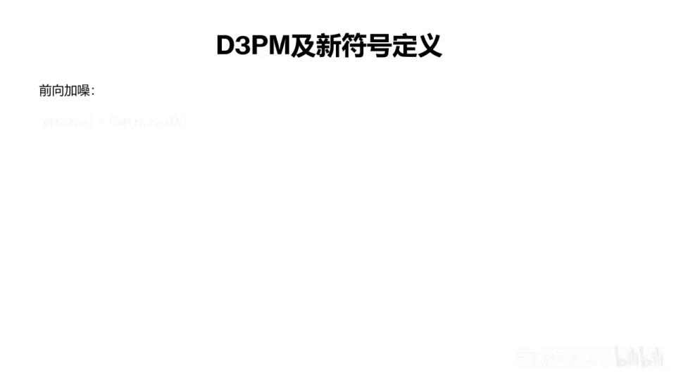

[【跳转到 01:05】](https://www.bilibili.com/video/BV17usuzvEH4/?t=65)

### 1.2 MDLM 论文把行向量改成了列向量

MDLM 沿用同一套框架，但把加噪状态改名为 $\mathbf{z}_t$，并且把向量设成列向量，于是矩阵乘法变成左乘：

$$
q(\mathbf{z}_t \mid \mathbf{z}_{t-1}) = \mathrm{Cat}(\mathbf{z}_t; Q_t \mathbf{z}_{t-1})
$$

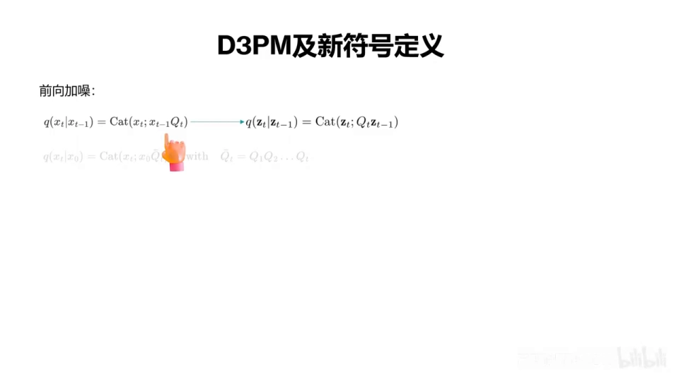

[【跳转到 01:55】](https://www.bilibili.com/video/BV17usuzvEH4/?t=115)

讲者在这里特意提醒：严格来说 $Q_t$ 应该写成 $Q_t^\top$，视频里少写了一个转置。这不是模型差异，只是行列约定不同带来的记号差别，读论文时留意即可。同理，优化目标里的 $q(\mathbf{x}_{t-1}\mid\mathbf{x}_t,\mathbf{x}_0)$ 被改写成 $q(\mathbf{z}_s \mid \mathbf{z}_t, \mathbf{x})$，用 $s<t$ 表示「上一个时间步」，这是为后面过渡到连续时间做准备。

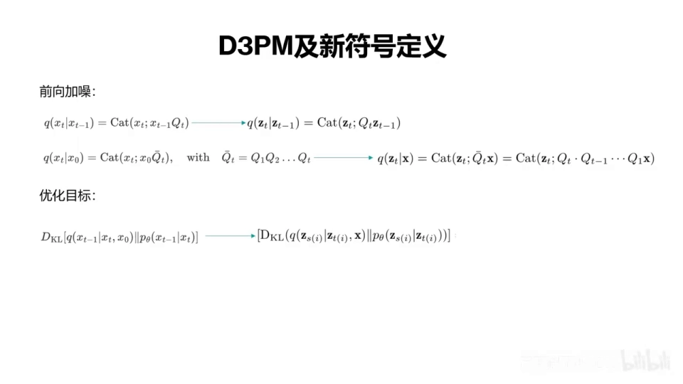

[【跳转到 03:10】](https://www.bilibili.com/video/BV17usuzvEH4/?t=190)

## 二、吸收态：把 `[MASK]` 当作噪声的归宿

### 2.1 给 mask token 留一个词表位置

做法很朴素：假设词表长度为 $K$，第 $K$ 个位置专门留给 `[MASK]`，第 $1$ 到 $K-1$ 个位置才是正常文本 token。把 `[MASK]` 写成 one-hot 向量，就是最后一个位置为 1、其余全为 0 的列向量：

$$
\mathbf{m} = (0,\,0,\,\cdots,\,0,\,1)^\top_{K \times 1}
$$

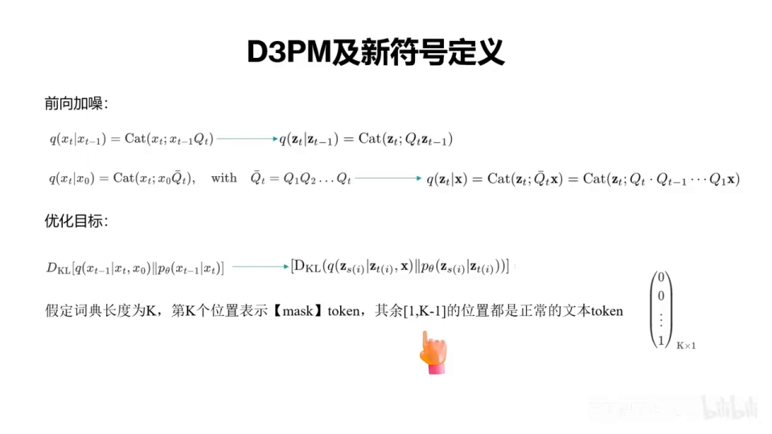

[【跳转到 03:35】](https://www.bilibili.com/video/BV17usuzvEH4/?t=215)

### 2.2 为什么叫「吸收态」

D3PM 讨论过均匀扩散、高斯扩散、吸收态扩散等多种转移方式，MDLM 只取吸收态这一种。所谓吸收态，是指 `[MASK]` 一旦到达就不会再离开：一个 token 被掩码之后，后续所有时刻都保持掩码。这和连续扩散里「噪声越加越大、信息逐渐被淹没」的直觉对应，只是这里的「噪声」是一个具体的符号，而不是数值扰动。

## 三、前向过程：一行插值公式取代转移矩阵

### 3.1 从矩阵乘法到插值

只考虑吸收态后，前向过程可以写成干净数据 $\mathbf{x}$ 与 mask 向量 $\mathbf{m}$ 的凸组合：

$$
q(\mathbf{z}_t \mid \mathbf{x}) = \mathrm{Cat}\left(\mathbf{z}_t; \alpha_t \mathbf{x} + (1-\alpha_t)\mathbf{m}\right),
\qquad
\alpha_t = \prod_{i=1}^{t}(1-\beta_i)
$$

任意两步之间同理：

$$
q(\mathbf{z}_t \mid \mathbf{z}_s) = \mathrm{Cat}\left(\mathbf{z}_t; \alpha_{t|s}\mathbf{z}_s + (1-\alpha_{t|s})\mathbf{m}\right),
\qquad
\alpha_{t|s} = \frac{\alpha_t}{\alpha_s}
$$

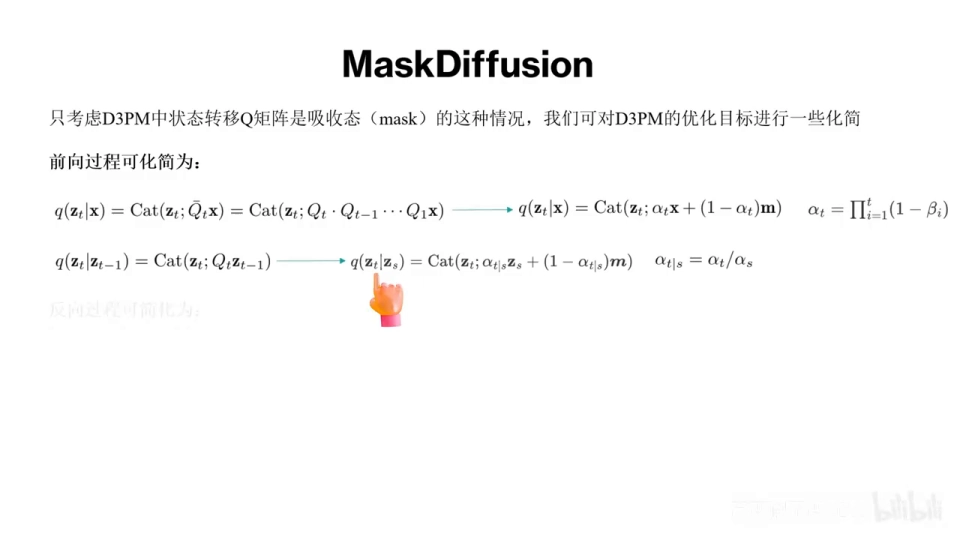

[【跳转到 04:50】](https://www.bilibili.com/video/BV17usuzvEH4/?t=290)

读法很直接：$\alpha_t$ 是「这个位置到第 $t$ 步还没被掩码」的概率，$1-\alpha_t$ 就是「已经被掩码」的概率。$\alpha_{t|s} = \alpha_t/\alpha_s$ 之所以成立，是因为 $\alpha_t$ 是前 $t$ 个 $(1-\beta_i)$ 的连乘，$\alpha_s$ 是前 $s$ 个的连乘，两者相除就把 $s$ 之前的因子约掉了。

### 3.2 反向过程也被化简

原本 D3PM 的反向过程要写成带 $Q$ 矩阵的形式：

$$
q(\mathbf{x}_{t-1} \mid \mathbf{x}_t, \mathbf{x}_0) = \mathrm{Cat}\left(\mathbf{x}_{t-1}; p = \frac{\mathbf{x}_t Q_t^\top \odot \mathbf{x}_0 \bar{Q}_{t-1}}{\mathbf{x}_0 \bar{Q}_t \mathbf{x}_t^\top}\right)
$$

换成吸收态之后，$q$ 分布不再依赖 $Q$ 矩阵，而是按 $\mathbf{z}_t$ 是否等于 $\mathbf{m}$ 分成两支：

$$
q(\mathbf{z}_s \mid \mathbf{z}_t, \mathbf{x}) =
\begin{cases}
\mathrm{Cat}(\mathbf{z}_s; \mathbf{z}_t), & \mathbf{z}_t \neq \mathbf{m}, \\[4pt]
\mathrm{Cat}\left(\mathbf{z}_s; \dfrac{(1-\alpha_s)\mathbf{m} + (\alpha_s-\alpha_t)\mathbf{x}}{1-\alpha_t}\right), & \mathbf{z}_t = \mathbf{m}.
\end{cases}
$$

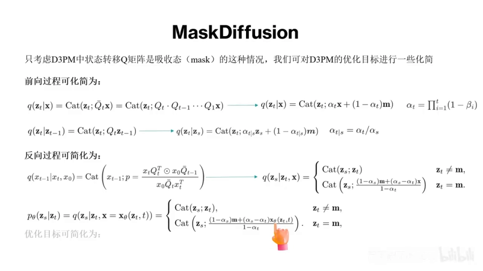

[【跳转到 06:05】](https://www.bilibili.com/video/BV17usuzvEH4/?t=365)

这一步是整个推导的关键转折：$p_\theta$ 直接照抄 $q$ 的形式，只把真实数据 $\mathbf{x}$ 换成神经网络的预测 $x_\theta(\mathbf{z}_t, t)$。于是网络要学的只有一件事——**被掩码的位置原本是哪个 token**。

## 四、把转移矩阵推出来再看一眼

### 4.1 通用形式与吸收态特例

视频并没有停在化简结果上，而是回头把 $Q_{t|s}$ 推出来，说明「去掉矩阵」并不是假设，而是矩阵在这种特殊情形下的必然结果。通用形式是

$$
Q_{t|s} = \alpha_{t|s}\mathbf{I} + (1-\alpha_{t|s})\mathbf{1}\pi^\top
$$

其中 $\pi$ 是目标分布（噪声分布的列向量），$\mathbf{1}$ 是全 1 列向量。取吸收态时 $\pi = \mathbf{m}$。

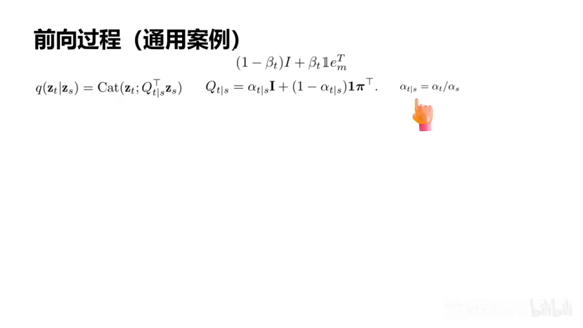

[【跳转到 07:45】](https://www.bilibili.com/video/BV17usuzvEH4/?t=465)

### 4.2 矩阵长什么样

把 $\pi = \mathbf{m}$ 代入并写成矩阵形式，就得到一个几乎是对角阵的 $K \times K$ 矩阵：对角线是 $\alpha_{t|s}$（保持原 token 不变的概率），最后一列是 $1-\alpha_{t|s}$（普通 token 转成 `[MASK]` 的概率），最后一行最后一列是 1（`[MASK]` 保持 `[MASK]` 的概率为 1，这就是「吸收」）。

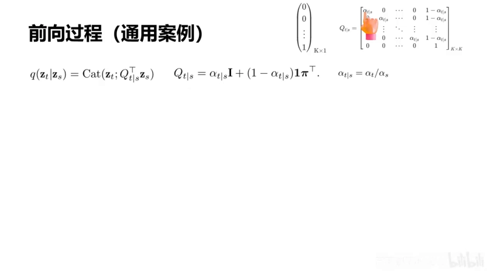

[【跳转到 08:10】](https://www.bilibili.com/video/BV17usuzvEH4/?t=490)

矩阵右下角那个 1 是吸收态最直观的证据：一旦进入 `[MASK]` 这一行，就再也出不去了。

### 4.3 代入化简得到插值公式

把 $Q_{t|s}$ 代回 $q(\mathbf{z}_t \mid \mathbf{z}_s) = \mathrm{Cat}(\mathbf{z}_t; Q_{t|s}^\top \mathbf{z}_s)$，并利用 $\mathbf{1}^\top \mathbf{z}_s = 1$（one-hot 向量各分量之和为 1），就得到

$$
q(\mathbf{z}_t \mid \mathbf{z}_s) = \mathrm{Cat}\left(\mathbf{z}_t; \alpha_{t|s}\mathbf{z}_s + (1-\alpha_{t|s})\mathbf{1}\pi^\top \mathbf{z}_s\right)
= \mathrm{Cat}\left(\mathbf{z}_t; \alpha_{t|s}\mathbf{z}_s + (1-\alpha_{t|s})\mathbf{m}\right)
$$

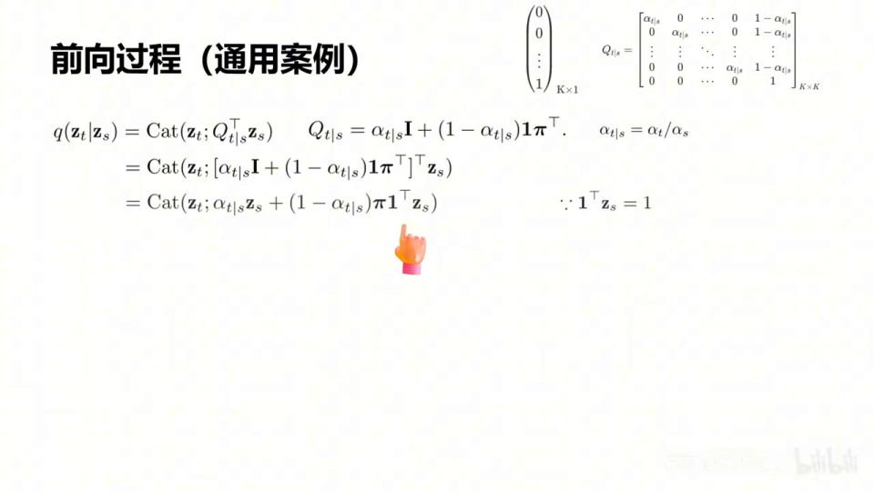

[【跳转到 09:00】](https://www.bilibili.com/video/BV17usuzvEH4/?t=540)

## 五、反向过程的分情况推导

### 5.1 起点：带 $\pi$ 的通用反向式

反向过程的通用表达式是

$$
q(\mathbf{z}_s \mid \mathbf{z}_t, \mathbf{x}) = \mathrm{Cat}\left(\mathbf{z}_s; \frac{[\alpha_{t|s}\mathbf{z}_t + (1-\alpha_{t|s})\mathbf{1}\pi^\top\mathbf{z}_t] \odot [\alpha_s\mathbf{x} + (1-\alpha_s)\pi]}{\alpha_t\mathbf{z}_t^\top\mathbf{x} + (1-\alpha_t)\mathbf{z}_t^\top\pi}\right)
$$

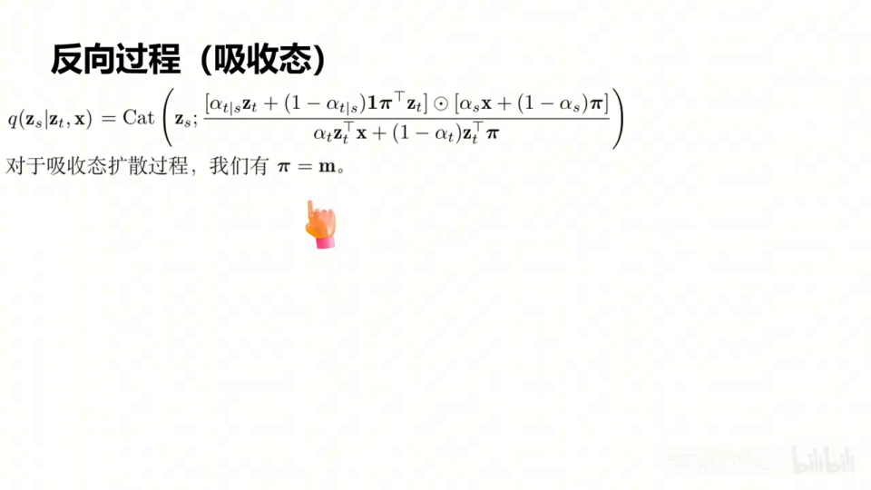

[【跳转到 10:40】](https://www.bilibili.com/video/BV17usuzvEH4/?t=640)

### 5.2 情况一：$\mathbf{z}_t$ 已经是真实 token

此时 $\mathbf{z}_t = \mathbf{x}$，且 $\pi = \mathbf{m}$。利用 one-hot 向量的正交性 $\mathbf{x}^\top\mathbf{m} = 0$、$\mathbf{m}^\top\mathbf{x} = 0$，分子里的交叉项全部归零，只剩下 $\alpha_t \mathbf{x}$，归一化后得到

$$
q(\mathbf{z}_s \mid \mathbf{z}_t, \mathbf{x}) = \mathrm{Cat}(\mathbf{z}_s; \mathbf{z}_t)
$$

含义是：**已经恢复成真实 token 的位置，在更早的时刻也必然还是真实 token**。这正好对应前向过程的吸收性——没被掩码的位置一路都保持原样。

### 5.3 情况二：$\mathbf{z}_t$ 还是掩码

此时 $\mathbf{z}_t = \mathbf{m}$，且 $\mathbf{m}^\top\mathbf{m} = 1$。展开合并同类项后得到

$$
q(\mathbf{z}_s \mid \mathbf{z}_t, \mathbf{x}) = \mathrm{Cat}\left(\mathbf{z}_s; \frac{(1-\alpha_s)\mathbf{m} + (\alpha_s-\alpha_t)\mathbf{x}}{1-\alpha_t}\right)
$$

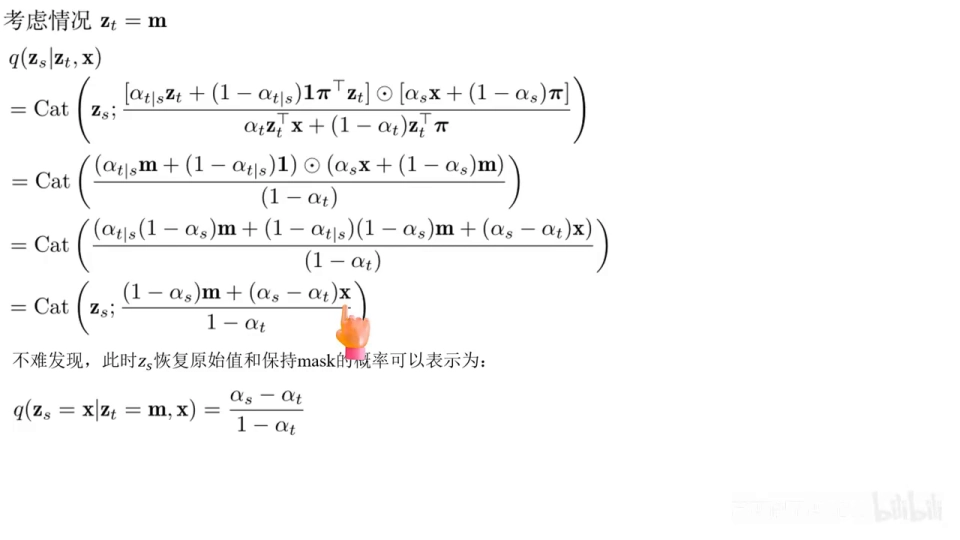

[【跳转到 13:10】](https://www.bilibili.com/video/BV17usuzvEH4/?t=790)

于是「这一步从掩码恢复成原 token」的概率有一个非常干净的表达式：

$$
q(\mathbf{z}_s = \mathbf{x} \mid \mathbf{z}_t = \mathbf{m}, \mathbf{x}) = \frac{\alpha_s - \alpha_t}{1-\alpha_t}
$$

分母 $1-\alpha_t$ 是「到第 $t$ 步为止已经累积的掩码比例」，分子 $\alpha_s-\alpha_t$ 是「$s$ 到 $t$ 之间新增的掩码比例」。换句话说，这一步能恢复多少，取决于这段区间在已掩码总量里占多大份额。

### 5.4 得到可训练的去噪分布

把真实 $\mathbf{x}$ 换成网络预测 $x_\theta(\mathbf{z}_t, t)$，就得到 MDLM 实际使用的参数化：

$$
p_\theta(\mathbf{z}_s \mid \mathbf{z}_t) =
\begin{cases}
\mathrm{Cat}(\mathbf{z}_s; \mathbf{z}_t), & \mathbf{z}_t \neq \mathbf{m}, \\[4pt]
\mathrm{Cat}\left(\mathbf{z}_s; \dfrac{(1-\alpha_s)\mathbf{m} + (\alpha_s-\alpha_t)x_\theta(\mathbf{z}_t, t)}{1-\alpha_t}\right), & \mathbf{z}_t = \mathbf{m}.
\end{cases}
$$

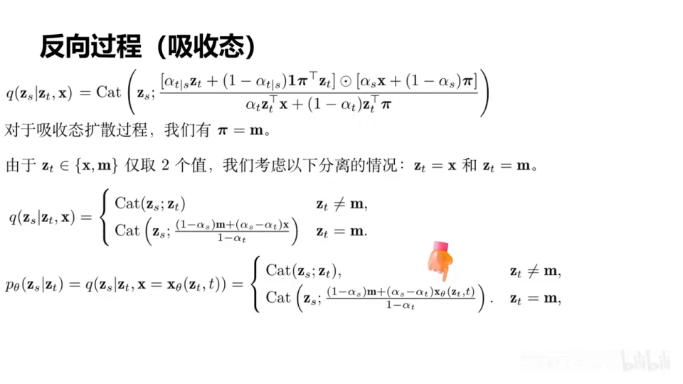

[【跳转到 13:35】](https://www.bilibili.com/video/BV17usuzvEH4/?t=815)

## 六、训练目标：从 KL 散度到加权交叉熵

### 6.1 化简结果

把各步 KL 散度累加（并补上 $X_1 \to X_0$ 的重构项），再取连续时间极限，优化目标化简成

$$
\mathcal{L}_{\text{NELBO}} = \mathbb{E}_q \int_0^1 \frac{\alpha_t'}{1-\alpha_t} \sum_{\ell=1}^{L} \log \left\langle x_\theta^\ell(\mathbf{z}_t),\, \mathbf{x}^\ell \right\rangle \, dt
$$

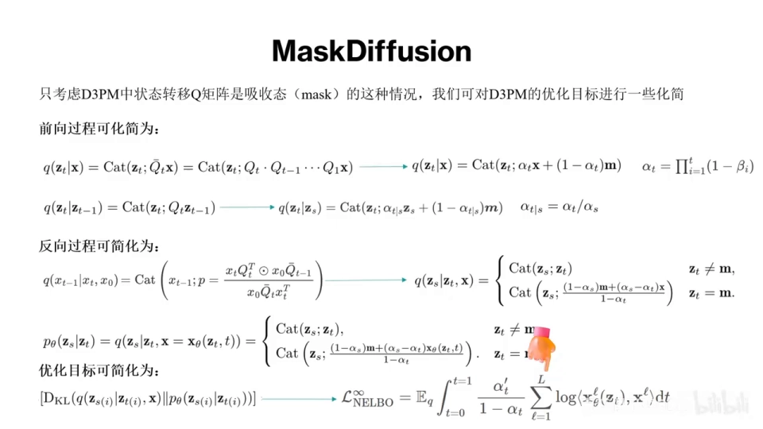

[【跳转到 06:30】](https://www.bilibili.com/video/BV17usuzvEH4/?t=390)

三个部分各司其职：$\sum_\ell$ 是对长度为 $L$ 的句子逐 token 求和（隐含假设各 token 独立）；$\log\langle\cdot,\cdot\rangle$ 是预测分布与真实 one-hot 的内积取对数，即真实 token 的对数概率；前面的 $\alpha_t'/(1-\alpha_t)$ 是权重，$\alpha_t'$ 是 $\alpha_t$ 对时间的导数。

### 6.2 权重在说什么

$\alpha_t$ 越小（掩码越多），分母 $1-\alpha_t$ 越大，权重越小；$\alpha_t$ 接近 1（几乎没掩码）时权重变大。直观上，这个权重是在不同噪声水平之间做平衡，让训练不会被「几乎全掩码」或「几乎没掩码」的极端时刻主导。

### 6.3 算法伪代码

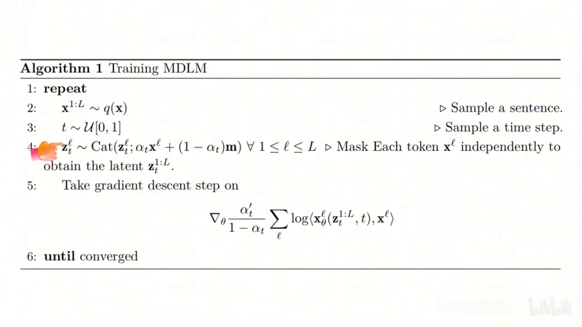

[【跳转到 14:00】](https://www.bilibili.com/video/BV17usuzvEH4/?t=840)

伪代码只有四步：采样一个句子 $\mathbf{x}^{1:L}$；采样一个时刻 $t \sim \mathcal{U}[0,1]$；对每个位置独立地按 $\alpha_t \mathbf{x}^\ell + (1-\alpha_t)\mathbf{m}$ 采样得到 $\mathbf{z}_t$；对

$$
\nabla_\theta\, \frac{\alpha_t'}{1-\alpha_t} \sum_{\ell} \log \left\langle x_\theta^\ell(\mathbf{z}_t^{1:L}, t),\, \mathbf{x}^\ell \right\rangle
$$

做一步梯度下降。注意这里的时间是连续的 $t \in [0,1]$，而不是 $0,1,\dots,T$ 的离散步。

### 6.4 只有被掩码的位置贡献损失

损失里的内积 $\langle x_\theta^\ell, \mathbf{x}^\ell\rangle$ 只在 $\mathbf{z}_t^\ell = \mathbf{m}$ 时有意义。论文的设定是：如果某个位置没被掩码，就让网络输出直接等于输入的真实 token，此时两个相同的 one-hot 内积为 1，$\log 1 = 0$，这一项自动消失。

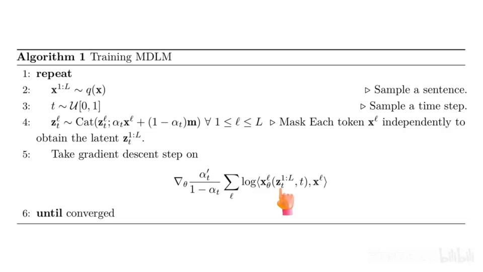

[【跳转到 14:25】](https://www.bilibili.com/video/BV17usuzvEH4/?t=865)

讲者把它类比成 MAE（掩码自编码器）只对被遮住的像素算重建损失。于是整个目标可以读成一句话：**对随机掩码后的句子，在被掩码的位置上做加权平均的交叉熵**。这也解释了为什么 MDLM 和 BERT 的 MLM 损失长得像——区别在于掩码比例是随机的、并且有连续的时间权重，而不是固定比例的单步掩码。

## 小结

- 离散扩散的通用框架用 $K \times K$ 转移矩阵 $Q_t$ 描述 token 跳转；MDLM 只取其中的吸收态，从而摆脱了对矩阵的依赖。
- 吸收态的含义是 `[MASK]` 一旦到达就不再离开，转移矩阵右下角恒为 1 就是这件事的矩阵证据。
- 前向过程化简为插值 $q(\mathbf{z}_t \mid \mathbf{x}) = \mathrm{Cat}(\mathbf{z}_t; \alpha_t\mathbf{x} + (1-\alpha_t)\mathbf{m})$，$\alpha_t$ 是累积保留概率。
- 反向过程只有两种情形：已是真实 token 就保持不动，仍是掩码就以 $\frac{\alpha_s-\alpha_t}{1-\alpha_t}$ 的概率恢复。
- 训练目标化简成逐 token 的加权对数似然，权重 $\alpha_t'/(1-\alpha_t)$ 平衡不同噪声水平；未被掩码的位置损失为零。
- 全程没有高斯噪声，也没有「预测噪声」这一步；网络直接预测被掩码位置的原 token。

## 关键术语速查

| 术语 | 一句话解释 |
| --- | --- |
| 吸收态扩散 | 噪声状态是一个只能进不能出的 `[MASK]` 符号，token 一旦被掩码就不再变化 |
| 转移矩阵 $Q_t$ | $K \times K$ 矩阵，第 $i$ 行第 $j$ 列表示 token $i$ 一步跳到 token $j$ 的概率 |
| $\alpha_t$ | 到第 $t$ 步为止 token 仍未被掩码的累积概率，$\alpha_t=\prod_{i\le t}(1-\beta_i)$ |
| $\alpha_{t\vert s}$ | 从第 $s$ 步到第 $t$ 步的保留比例，等于 $\alpha_t/\alpha_s$ |
| one-hot 向量 | 只有一个分量为 1、其余为 0 的向量，用来表示「当前是哪一个 token」 |
| NELBO | Negative Evidence Lower Bound，负的变分下界，越小越好，可化简成加权交叉熵 |
| 替代参数化 | 让网络输出直接充当去噪分布的参数，从而把 KL 散度写成对数似然形式 |