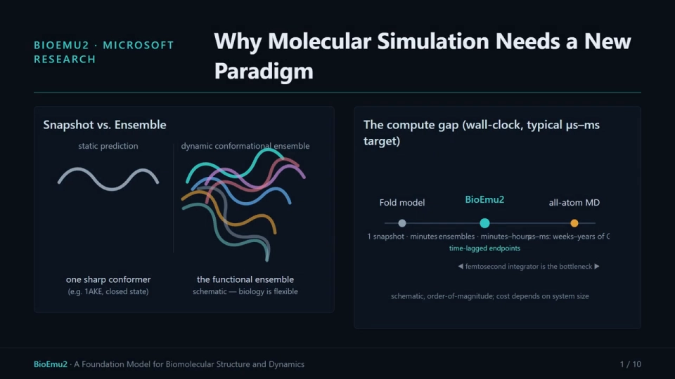
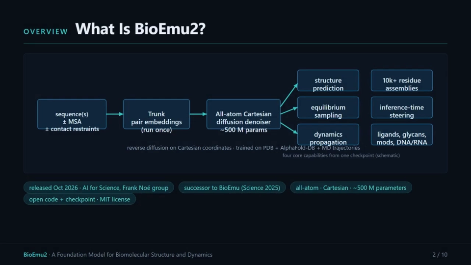
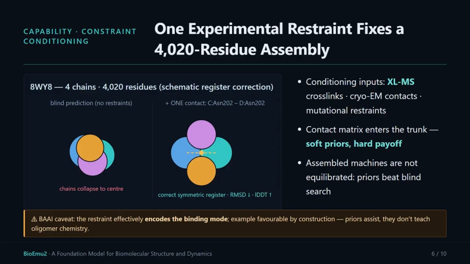
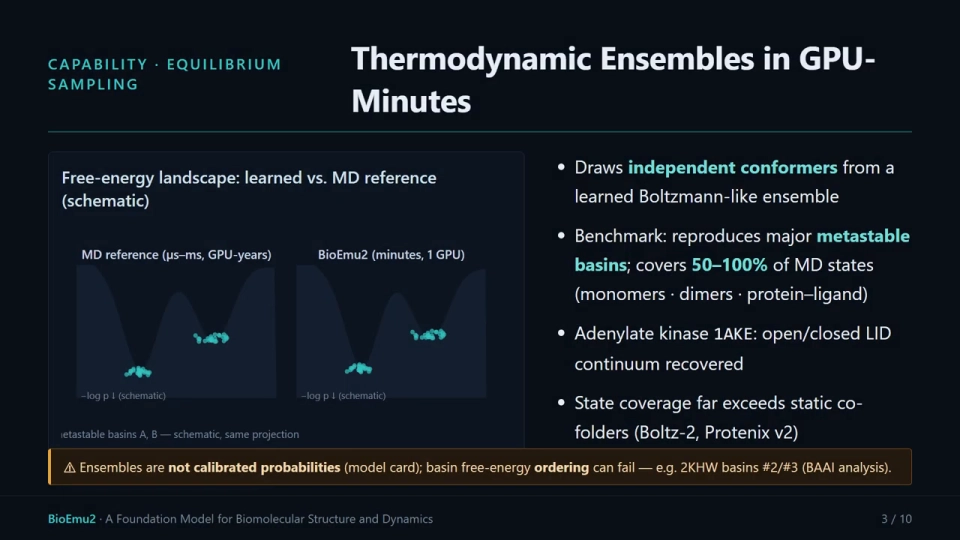
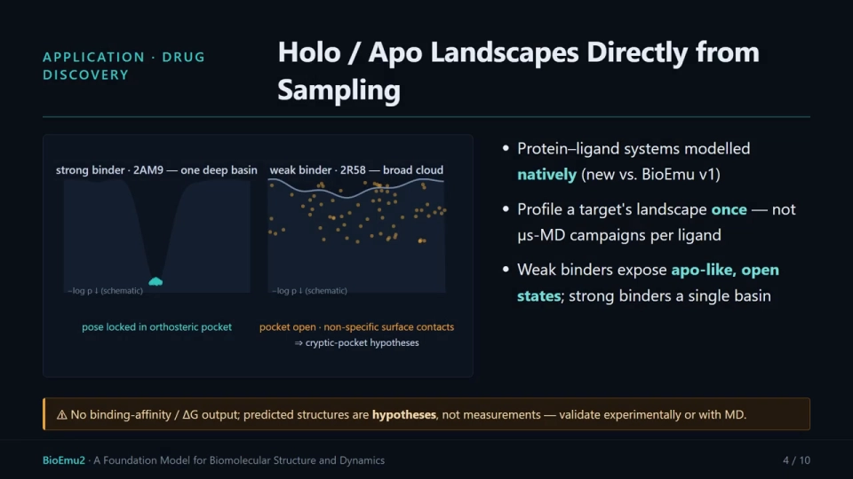
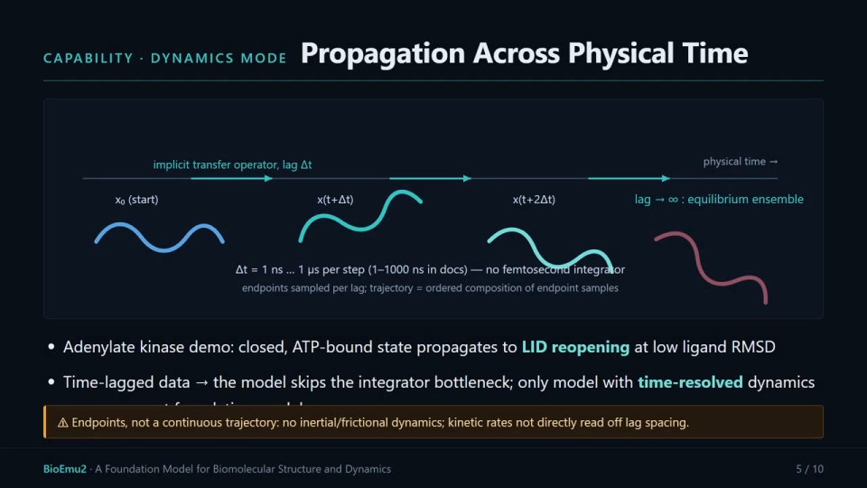
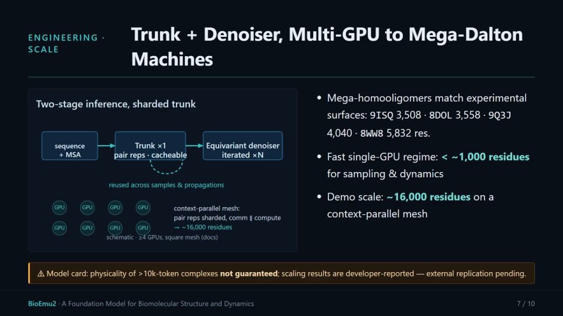
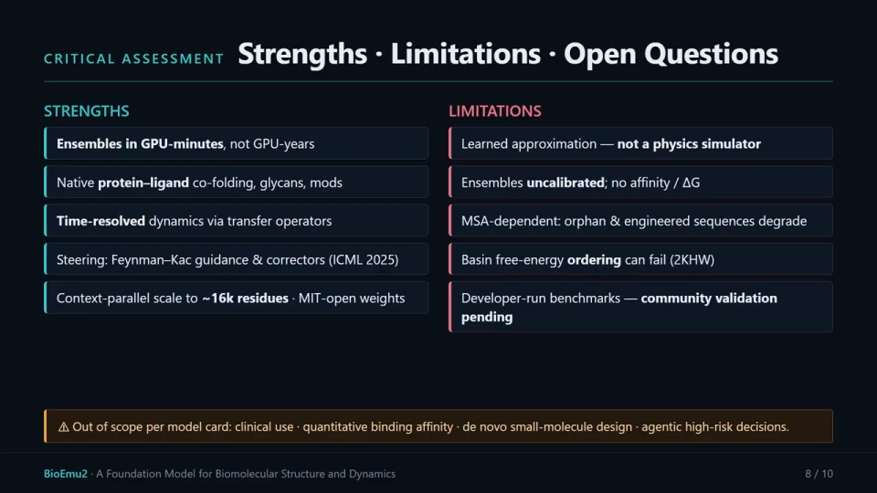
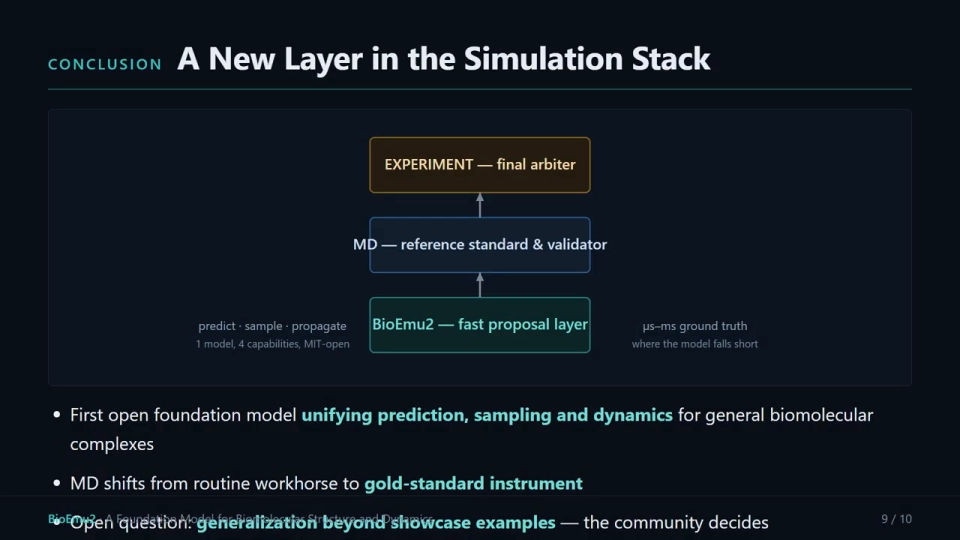

# BioEmu2：把噪声加在笛卡尔坐标上的构象系综模型

> 视频来源：[BioEmu2 foundation model explainer](https://www.youtube.com/watch?v=VDhEn0dhRTA)（YouTube · Yeng-Tseng Wang）｜时长约 6 分钟
> 导读：这支视频用 10 张幻灯片把 BioEmu2 的定位、噪声空间、条件输入、三种用法和边界条件过了一遍。本文按「噪声加在什么量上」这条线重排：先说明为什么选全原子笛卡尔坐标，再说明序列、MSA、接触约束与滞后时间各自作为什么条件进入模型，最后把检查点与模型卡上的限制单独列出来。

## 本讲要解决的核心问题（SCQA）

**背景**：结构预测在静态意义上基本被解决了。AlphaFold 及其后继模型对一条序列给出一个锐利的构象，也就是一张快照。

**冲突**：但生物学是系综。酶会「呼吸」，结构域会开合，配体在已经存在的多个状态之间做选择。用全原子分子动力学（molecular dynamics，MD）抓住这种柔性极其昂贵：一个药理学相关的体系要覆盖微秒到毫秒，通常要花几周到几年的 GPU 时间。于是我们卡在一个缺口里——序列到结构的模型给精度不给动力学，分子动力学给动力学但代价高到无法规模化。

**疑问**：能不能学一个模型，直接学会系综本身，顺带学会动力学？如果可以，噪声应该加在哪个量上——加在坐标上，还是加在旋转、扭转角上？

**回答（中心思想）**：BioEmu2 选择把噪声加在**全原子笛卡尔坐标**上：一个约 5 亿参数的扩散式全原子得分模型，直接在笛卡尔坐标上运行，由等变（equivariant）的坐标去噪器把带噪坐标逐步映射回结构。序列与 MSA 走一个只算一次的 trunk 网络，接触约束、方法标志（结构预测 / 平衡采样）和滞后时间 $\Delta t$ 作为条件注入。检查点与代码以 MIT 协议开放，滞后时间每步可用范围是 1 纳秒到 1 微秒。

## 一、缺口在哪里：一个构象不够用

视频开篇把问题摆得很直白（[【跳转到 00:00】](https://www.youtube.com/watch?v=VDhEn0dhRTA&t=0)）：静态结构预测交付的是「每条序列一个锐利构象」，而生物学需要的是系综——酶在呼吸、结构域在开合、配体在已有状态之间挑选。用全原子 MD 去抓这份柔性，代价高得离谱。

幻灯片把代价量化成一条时间轴：折叠模型是「1 个快照」，BioEmu2 是「分钟级的系综、带时间滞后的端点」，全原子 MD 是「微秒到毫秒，等于数周到数年的 GPU 时间」。瓶颈被明确指认为**飞秒积分器**：键振动逼着积分步长只能取飞秒量级，于是几乎全部算力都花在「买纳秒」上。

这就是 BioEmu2 想绕开的东西：不是把积分器写得更快，而是不写积分器。

## 二、噪声加在什么量上：全原子笛卡尔坐标

### 2.1 一个模型、四个能力

BioEmu2 由 Microsoft Research 的 AI4Science 团队（Frank Noé 领导的 biomolecular emulator 线）在 2026 年 10 月发布，是发表在 Science 上的 BioEmu 的后继。它的技术定位被一句话说清（[【跳转到 00:44】](https://www.youtube.com/watch?v=VDhEn0dhRTA&t=44)）：

- **扩散式全原子得分模型**，约 5 亿参数；
- **直接在笛卡尔坐标上运行**；
- 训练数据是实验结构、AlphaFold DB 模型，以及大规模 MD 模拟语料。

一个模型给出四个能力：跨蛋白、核酸、配体的结构预测；热力学平衡采样；沿物理时间轴的动力学推进；以及兆道尔顿级复合物的组装建模。代码与检查点以 MIT 协议开放。

注意流程图里那个 **Gaussian noise** 方块的位置：噪声直接加在坐标上，去噪器输出的是「坐标读出（coordinate readout）」。这就是本小节关心的「几何噪声空间」选择——不是加在旋转矩阵上，也不是加在扭转角上，而是加在 $N_{\text{atoms}}\times 3$ 的实数坐标上。

### 2.2 两阶段推理：trunk 只算一次

架构上，推理被拆成两段（[【跳转到 04:19】](https://www.youtube.com/watch?v=VDhEn0dhRTA&t=259)）：

1. **trunk 网络**计算序列表示与 pair 表示，**只跑一次**，在之后的每一次采样和每一次时间推进中复用；
2. **等变笛卡尔去噪器**反复迭代，把带噪坐标映射成结构。

这个拆分是规模化的关键：采样要跑几百步去噪、动力学推进要连续调用很多次，如果每次都重算 trunk，重复开销会吃掉全部收益。把条件嵌在一次性的 trunk 里，后面就只剩便宜的去噪迭代。

### 2.3 条件输入：序列、MSA、接触、方法标志

视频把条件分成几类，对应到本小节学习目标里的「序列、MSA、结构与检查点条件」：

| 条件 | 进入位置 | 作用 |
| --- | --- | --- |
| 蛋白序列 / 核酸序列 / 小分子原子 | trunk 输入 | 定义体系是什么 |
| 蛋白 MSA | trunk 输入 | 提供进化信息；孤儿序列与工程化序列上质量会下降 |
| 已知接触（交联质谱、冷冻电镜接触、突变约束） | trunk 的接触矩阵 | 软先验，把生成拉向指定排布 |
| 方法标志（结构预测 / 平衡采样） | 条件 | 同一个检查点切换任务模式 |
| 滞后时间 $\Delta t$、上一时间步 | 可选时间输入 | 动力学推进模式 |
| 检查点本身 | 权重 | 决定能力范围与适用体系规模 |

接触约束的效果被一个具体案例说明（[【跳转到 03:39】](https://www.youtube.com/watch?v=VDhEn0dhRTA&t=219)）：8WY8 是 4 条链、约 4020 个残基的组装体。不加约束时，预测把四条链塌缩成一个对称的团块；只加入**一个**链间接触约束（一对天冬酰胺 Asn202–Asn202），组装体就跳进正确的对称配准，RMSD 明显下降、LDDT 明显上升。

视频同时转述了原分析自己的告诫，这一点很重要：那条约束实际上等于告诉了模型结合模式，这个例子是「构造上就有利」的。稀疏数据帮助巨大，但不是魔法。

## 三、三种用法：同一个检查点，不同的时间语义

### 3.1 平衡采样：分钟级拿到玻尔兹曼系综的近似

平衡采样模式从「学到的玻尔兹曼系综近似」中抽取**相互独立**的构象。主张很具体：MD 要花数年 GPU 时间才能访问到的构象分布，在单张卡上几分钟就能生成。

在单体、二聚体、蛋白–配体复合物的精选基准上，自由能景观复现了参考 MD 跑出的主要亚稳态盆地，覆盖了大约 50% 到接近全部的参考状态——这种覆盖是静态共折叠模型（如 Boltz-2、Protenix v2）根本不尝试的。对腺苷酸激酶，静态预测只给几个互不相连的点，BioEmu2 把催化循环的开态与闭态恢复成一片连续景观。

两条诚实的告诫也写在幻灯片上（[【跳转到 01:44】](https://www.youtube.com/watch?v=VDhEn0dhRTA&t=104)）：**布居数不是校准过的概率**；**次级盆地的自由能排序可能出错**——开发者自己对肽复合物 2KHW 的分析就展示了这一点。

### 3.2 配体场景：强结合与弱结合给出两种景观

对药物发现最直接的部分是（[【跳转到 02:07】](https://www.youtube.com/watch?v=VDhEn0dhRTA&t=127)）：因为配体被原生建模，你可以**一次性**刻画一个靶点的构象景观，而不是为每个配体跑一轮微秒级 MD。

- **强结合**（2AM9）：平衡采样塌缩成一个很深的自由能盆地，配体姿态被锁在正构口袋中心；
- **弱结合**（2R58）：同一个模型返回一片很宽的构象云，配体在口袋内部与周边游走，形成大量非特异表面接触，**apo 状态下的口袋开放构象**随之显形。

口袋开放行为正是隐蔽口袋（cryptic pocket）发现所依赖的。限制同样重要：模型不预测亲和力，系综不是自由能计量器，每个生成结构都是待验证的假设。

### 3.3 动力学推进：滞后时间是检查点的时间尺度

这是视频认为最有辨识度的能力（[【跳转到 02:50】](https://www.youtube.com/watch?v=VDhEn0dhRTA&t=170)）。MD 的根本障碍是时间步，BioEmu2 干脆绕开积分器：它学一个**隐式转移算子**——一个生成式映射，以起始结构为条件，采样「一个滞后时间之后」的结构。

**可用滞后范围：每步 1 纳秒到 1 微秒**（文档里写的是 1–1000 ns）；滞后足够长时，端点收敛到平衡系综，于是动力学与热力学落在同一个框架里。对腺苷酸激酶，从闭态、ATP 结合的起点推进，能复现 LID 结构域重新打开，同时配体保持低 RMSD。

但必须分清它是什么、不是什么：**这些是采样出来的端点，给的是按时间排序的统计量，不是连续的力场轨迹**。没有惯性项、没有摩擦项，动力学速率不能直接从滞后间隔读出。

## 四、规模、检查点与模型卡边界

### 4.1 上下文并行把 trunk 摊到多卡

trunk 的 pair 表示被切分到一组 GPU 组成的网格上（[【跳转到 03:34】](https://www.youtube.com/watch?v=VDhEn0dhRTA&t=214)），通信与计算重叠，团队演示了约 16000 个残基的体系。兆道尔顿级同源寡聚体（3,500 到 6,000 残基，如 9ISQ、8DOL、9Q3J、8WY8）与实验表面吻合得相当好。

但**模型卡自己写明了上限**：超过约 10000 个 token 的复合物，物理合理性不保证。1000 个残基以下，单卡跑得很快。

### 4.2 检查点与适用对象

视频给出的检查点信息是三条（[【跳转到 01:09】](https://www.youtube.com/watch?v=VDhEn0dhRTA&t=69)）：

1. **代码与检查点以 MIT 协议开放**，权重完全开放；
2. 检查点发布在 Hugging Face，配套 GitHub 仓库 `microsoft/bioemu2` 与模型卡；
3. 一个检查点覆盖四种能力（预测、采样、动力学、组装），**不是**每个任务一个检查点。

至于「不同检查点的时间范围」，视频只给了滞后时间的可用区间（1 ns–1 μs 每步），并没有给出「某个检查点专用于某个时间尺度」的清单。这一点属于**官方资料在本视频范围内没有说明的内部细节**，不应自行补全。

### 4.3 一份审计：强项与限制

视频最后做了一次逐条审计（[【跳转到 05:05】](https://www.youtube.com/watch?v=VDhEn0dhRTA&t=305) 起，[【跳转到 05:10】](https://www.youtube.com/watch?v=VDhEn0dhRTA&t=310)）：

| 强项 | 限制（多为开发者自述） |
| --- | --- |
| 系综生成以分钟计，而非 GPU 年 | 是对物理的学习近似，不是模拟器 |
| 原生处理蛋白–配体、糖基与修饰 | 系综未校准，不给亲和力 / $\Delta G$ |
| 真正的动力学通道（转移算子） | 依赖 MSA，孤儿序列与工程化序列质量下降 |
| 推理期可用可微势做引导（有 Feynman–Kac 理论支撑） | 盆地自由能排序可能失败（2KHW） |
| 上下文并行扩展到约 16k 残基，MIT 开放权重 | 基准目前由开发者运行，社区验证待做 |

决定性检验是社区在冷靶点、差 MSA 家族和盲组装挑战上的评测。结论句是（[【跳转到 05:52】](https://www.youtube.com/watch?v=VDhEn0dhRTA&t=352)）：把每个输出当成假设，而不是测量值。

## 五、回到「几何噪声空间」这条主线

把 BioEmu2 放回本小节的主题，它的选择很清楚：**噪声加在全原子笛卡尔坐标上**。

- 好处是表示直接、与任何原子类型都能统一（蛋白、核酸、配体、离子、修饰残基都在同一套坐标里），等变去噪器只需要处理「坐标怎么动」；
- 代价是坐标空间维数极高（$3N_{\text{atoms}}$），而且**纯粹的坐标加噪不自动保证键长、键角、手性**——这些约束要靠等变结构与训练数据来兜。相比之下，把噪声加在旋转（SO(3)）或扭转角（周期角）上，天然把「合法几何」写进了表示里。

这个对照正是下一支视频（FrameDiff 精读）要处理的内容：当几何合法性成为硬需求时，人们会把噪声从坐标搬到帧与角度上。

## 小结

- BioEmu2 是一个**扩散式全原子得分模型**（约 5 亿参数），噪声加在**笛卡尔坐标**上，由等变坐标去噪器逐步去噪。
- 推理分两段：trunk（序列 + MSA + 接触）只算一次并可缓存，去噪器反复迭代；条件包括方法标志、接触约束与滞后时间。
- 三种用法共享一个检查点：结构预测、平衡采样、动力学推进；平衡采样的布居数未校准，次级盆地排序可能出错。
- 动力学推进学的是**隐式转移算子**，滞后每步 1 ns–1 μs，输出是时间排序的端点而非连续轨迹。
- 检查点以 MIT 开放、发布在 Hugging Face；模型卡声明超过约 10k token 的复合物物理合理性不保证；不同检查点的时间范围在视频范围内未说明。
- 坐标噪声空间的普遍代价是几何合法性不由表示保证，这一点要靠等变网络与数据兜底。

## 关键术语速查

| 术语 | 一句话解释 |
| --- | --- |
| 笛卡尔坐标噪声 | 直接对每个原子的 $(x,y,z)$ 加高斯噪声，再去噪回结构 |
| 等变去噪器 | 输入整体旋转/平移时，输出跟着同样变换的去噪网络 |
| trunk | 只算一次的序列/pair 表示网络，结果可缓存复用 |
| MSA | 多序列比对，提供进化信息；缺失时模型质量下降 |
| 平衡采样 | 从学到的玻尔兹曼系综近似中抽独立构象，而非预测单一结构 |
| 隐式转移算子 | 给定起点与滞后 $\Delta t$，直接采样 $\Delta t$ 之后的结构分布 |
| 滞后时间 $\Delta t$ | 动力学推进一步跨越的物理时间，本模型为 1 ns–1 μs |
| 校准 | 生成样本的频率能否当作真实概率；BioEmu2 的布居数未校准 |
| 隐蔽口袋 | 只在某些构象下才出现的结合口袋，靠系综采样才看得到 |