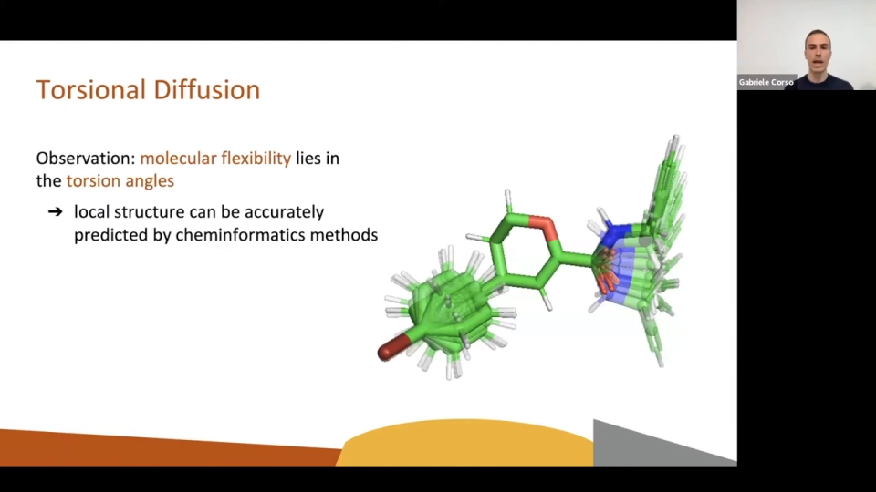
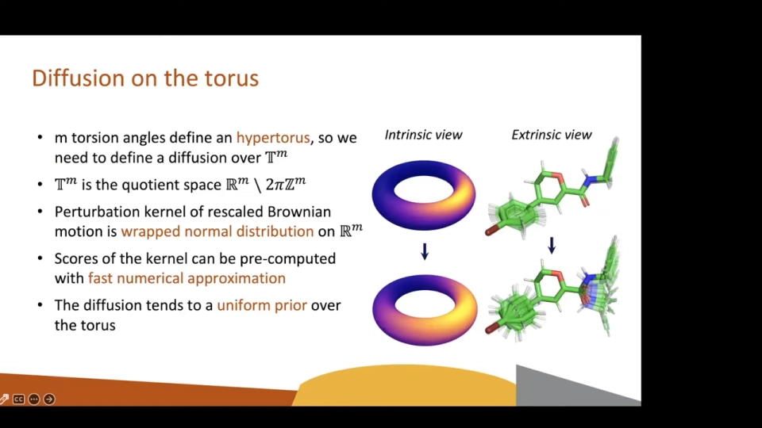
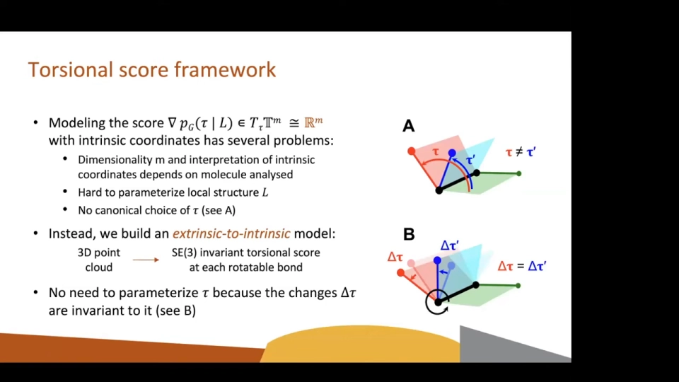
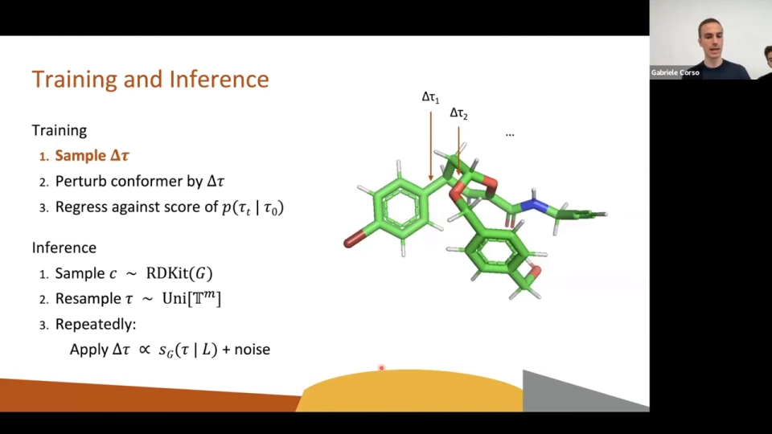
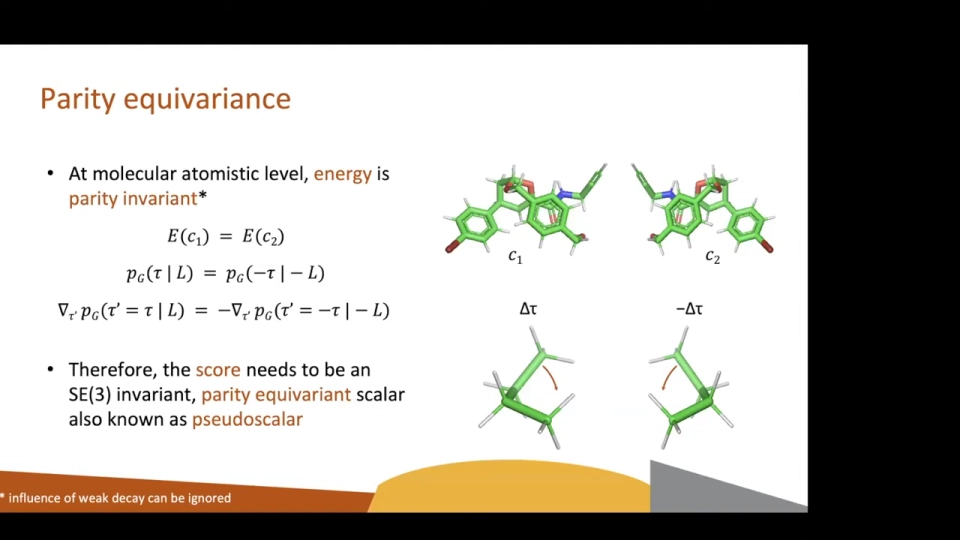
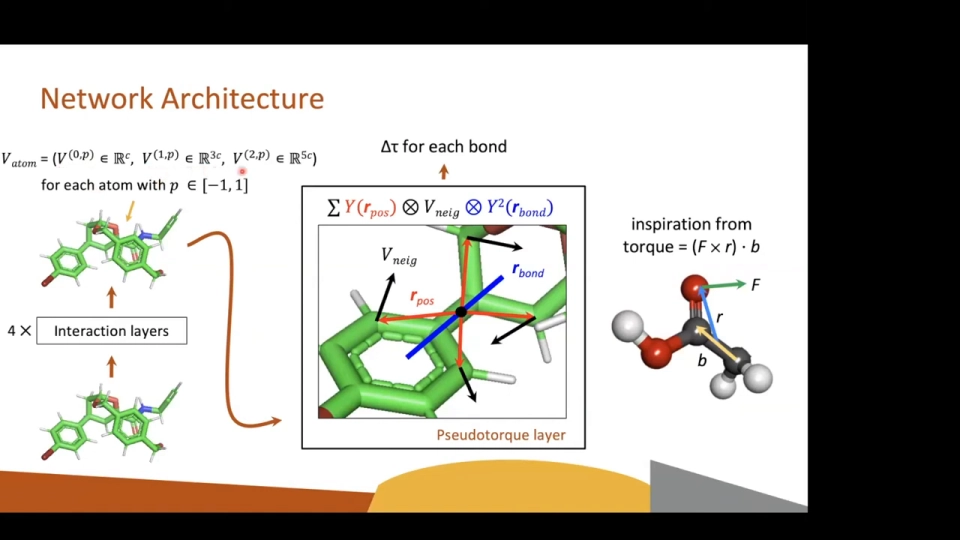
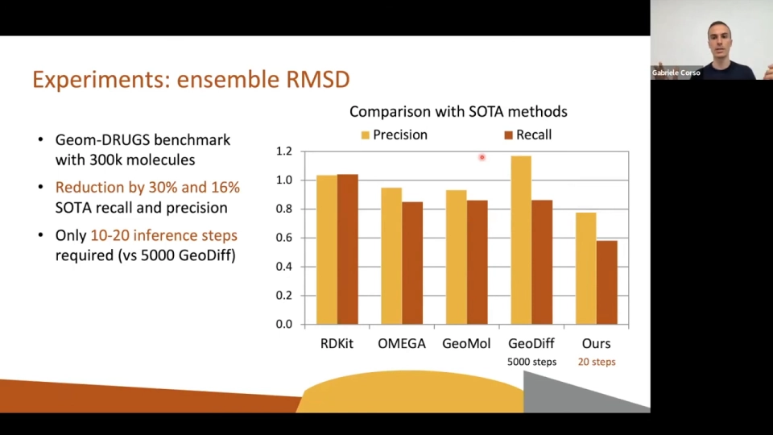
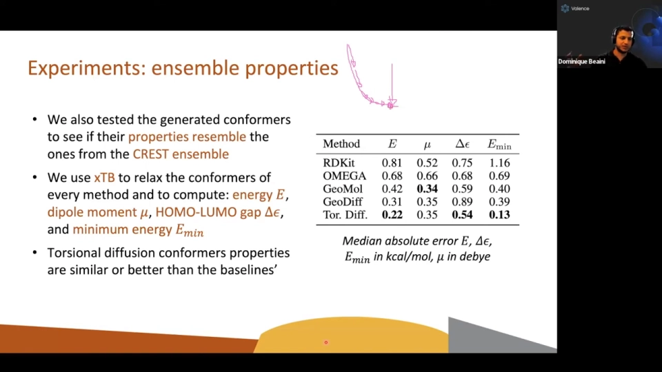
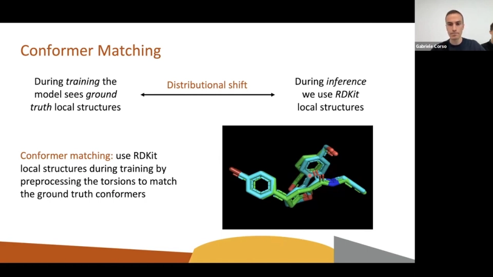
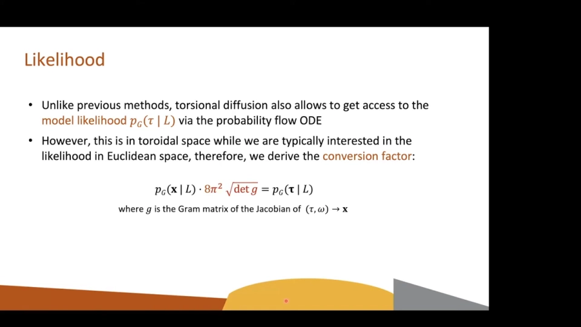

# 扭转角扩散：在环面上做合法的去噪更新

> 视频来源：[Torsional Diffusion for Molecular Conformer Generation | Gabriele Corso & Bowen Jing](https://www.youtube.com/watch?v=29veWh5Ls5s)（YouTube · Valence Labs）｜时长约 97 分钟
> 导读：这是论文两位一作 Gabriele Corso 与 Bowen Jing 亲自讲的 reading group，前 20 分钟讲「为什么把扩散限制到扭转角」，中段是环面扩散的完整推导（加噪核、分数、网络输入输出、更新怎么施加回 3D），后段是实验与一场很长的问答。本文只抓一条线：**在一个 $0$ 与 $2\pi$ 是同一个点的空间里，去噪更新怎样才能合法**。字幕为 YouTube 自动字幕，术语已按原文订正（如「judith」→ GeoDiff、「articulate / arctic kit」→ RDKit、「geomole」→ GeoMol、「rob normal」→ wrapped normal）。

## 本讲要解决的核心问题（SCQA）

**背景**：分子构象生成（conformer generation）是给定一张分子图、要求出它在三维空间里能取哪些构象。这件事很贵：DFT 对一个类药分子要跑几天 CPU，而很多分子性质取决于三维结构。近年有两条替代路线——化学信息学方法（RDKit、Omega）快但不够准，机器学习方法（GeoMol、GeoDiff）准一些但还不够。

**冲突**：最直接的机器学习做法是欧几里得扩散：把构象看成三维点云，给每个原子坐标加高斯噪声，再学着去噪。GeoDiff 就是这么做的，效果能打平化学信息学的最优方法，但**每个构象要 5000 步推理**，慢了若干个数量级。而分子的柔性其实集中在扭转角上——键长和键角这些「局部结构」用化学信息学方法就能预测得很准。于是自然的想法是：只对扭转角做扩散，把维度从 132 降到约 8。

**疑问**：可是扭转角不住在欧几里得空间里。角度取值 $0$ 到 $2\pi$，而 $2\pi$ 就是 $0$；$m$ 个扭转角构成的空间是一个环面 $\mathbb{T}^m$。在这个空间上，加噪核长什么样？去噪方向（分数）住在哪个空间？网络该吃进什么、吐出什么？算出来的更新又怎么施加回三维结构？

**回答（中心思想）**：**加噪在环面上做、去噪更新也必须回到环面的切空间上做**。具体是三步：环面上的热核就是欧几里得热核的周期缠绕，也就是 wrapped normal 分布，它的分数可以预先算好存盘；环面在任意一点的切空间就是普通的 $\mathbb{R}^m$，所以分数模型的**输出空间天然合法**；而输入用「外在到内在」的分数模型——吃三维点云、对每根可旋转键吐一个标量，模型**只预测扭转角的增量 $\Delta\tau$、从不预测 $\tau$ 的绝对值**，于是「$\tau$ 没有规范定义」这个问题被彻底绕开。最后，$\Delta\tau$ 是通过在三维里绕那根键旋转半个分子来施加的。

## 一、为什么把扩散限制在扭转角上

### 1.1 分子的柔性住在扭转角里

讲者给出的观察很直接（[【跳转到 05:14】](https://www.youtube.com/watch?v=29veWh5Ls5s&t=314)）：**分子的柔性住在扭转角里**，而局部结构——键长、键角、环内的构象——可以用化学信息学方法预测得非常准。

原因不难理解：等价的键有固定的长度，每种原子组合倾向于特定的键角，这些都是很「硬」的约束；而扭转角非常软，可以自由旋转，正是它决定了分子的整体形状。

### 1.2 维度从 132 降到约 8

代价的差别是数量级的（[【跳转到 06:54】](https://www.youtube.com/watch?v=29veWh5Ls5s&t=414)）。一个类药分子平均 44 个原子，欧几里得扩散要在 $3\times 44 = 132$ 维的空间里工作；而可旋转键平均只有 7.9 根，于是空间降到不到 8 维。

但讲者紧接着强调了一句关键的话：**这 7.8 维的空间「显然不是欧几里得空间」**。这就是整篇工作的技术核心所在。

### 1.3 可旋转键的定义

为了避免歧义，讲者把可旋转键定义得很死（[【跳转到 16:34】](https://www.youtube.com/watch?v=29veWh5Ls5s&t=994)）：把那根键切断之后，会得到两个连通分量，且每个分量至少含两个原子。这个定义**排除了环内的键**，理由有两条：化学上，数据集里的环大多很小，芳香环上的扭转角本来就很确定；工程上，环内的扭转角无法独立扰动。于是构象被写成

$$
\text{conformer} = (l,\ \tau),
$$

其中 $l$ 是局部结构、$\tau$ 是扭转角元组。模型只学条件分布 $p(\tau\mid l)$，而 $l$ 由 RDKit 的 ETKDG 例程给出（[【跳转到 17:49】](https://www.youtube.com/watch?v=29veWh5Ls5s&t=1069)）。

## 二、环面：加噪核与先验

### 2.1 $\mathbb{T}^m$ 是商空间，所以热核是「缠绕」

$m$ 个扭转角构成的空间是环面 $\mathbb{T}^m$，它可以写成商空间

$$
\mathbb{T}^m=\mathbb{R}^m \big/ 2\pi\mathbb{Z}^m ,
$$

也就是说，把 $\mathbb{R}^m$ 里相差 $2\pi$ 整数倍的平移都粘成同一个点（[【跳转到 18:39】](https://www.youtube.com/watch?v=29veWh5Ls5s&t=1119)）。

这个商空间结构带来一个极大的便利：**环面上的扰动核就是欧几里得热核的周期缠绕**，也就是 wrapped normal 分布。而它的分数只是一个无穷级数，可以**预先算好存到磁盘上**。所以「在环面上加噪」这件事，计算上一点都不贵。

### 2.2 紧流形上的先验是均匀分布，不是高斯

第二个要点容易被忽略（[【跳转到 20:44】](https://www.youtube.com/watch?v=29veWh5Ls5s&t=1244)）：因为环面是紧流形，扩散**收敛到的先验不再是高斯分布，而是均匀分布**。所以推理时从先验采样，就是给每个扭转角从 $[0,2\pi)$ 上均匀抽一个数。

这一点和欧几里得扩散有本质差别：在 $\mathbb{R}^d$ 里噪声越加越大，分布会「摊平」到无限远；在紧流形上它摊平到的是有限体积上的均匀分布。讲者把它当成一个好消息——先验采样变得极其简单。

### 2.3 两个视角：内在的环面与外在的构象

报告用一张图并排展示了两个视角（[【跳转到 19:54】](https://www.youtube.com/watch?v=29veWh5Ls5s&t=1194)）：

- **内在视角**：只看扭转角构成的空间，也就是环面。你看到的是环面上一个热核在演化。
- **外在视角**：环面上的每个点都映射到一个真实构象。所以环面上的扩散，很自然地对应到三维空间里「绕每根可旋转键做越来越大的扰动」的扩散。

这两个视角后面会反复用到：**推导在内在视角里做（环面上），网络和更新在外在视角里做（三维点云上）**。

## 三、输出空间与输入空间：分数住在切空间

### 3.1 输出空间天然合法

讲者先看输出空间（[【跳转到 21:59】](https://www.youtube.com/watch?v=29veWh5Ls5s&t=1319)）：**分数必须住在环面在任意一点的切空间里**。而环面的切空间就是普通的 $\mathbb{R}^m$——这一部分「相当简单」，因为没有任何约束需要处理。

这是环面相对于球面、$\mathrm{SO}(3)$ 的一个巨大便利：球面的切空间是随点变化的平面，$\mathrm{SO}(3)$ 的切空间是反对称矩阵，而环面的切空间处处都是同一个 $\mathbb{R}^m$。

### 3.2 输入空间有三个坑

麻烦在输入。既然做的是内在坐标，最直接的想法是把构象的环面坐标喂给分数模型。讲者列了三个问题（[【跳转到 22:24】](https://www.youtube.com/watch?v=29veWh5Ls5s&t=1344)）：

1. **维度随分子变**：环面的维数取决于可旋转键的根数，不同分子不一样。
2. **局部结构 $l$ 难以参数化**：$l$ 里的自由度是受约束的（键长、键角不是自由变量），很难给出一个非任意的参数化。
3. **$\tau$ 没有规范定义**：扭转角严格说是二面角，需要选四个点。要给某个键的扭转角一个数值，你必须为键两端的原子各挑一个邻居原子。而挑法不唯一，遇到对称性还会退化（四个点共线时二面角根本不存在）。

第 3 点讲者花了很长时间讨论。有人提议「对邻居原子取平均」，讲者回答说这确实是一种规范化办法，但如果三个邻居等距等角，四个点会共线、二面角消失。Octavian 的论文与 GeoMol 用神经网络给邻居算权重来选规范点，但讲者认为这类做法「给公式注入了一些丑陋的东西」（[【跳转到 25:44】](https://www.youtube.com/watch?v=29veWh5Ls5s&t=1544)）。

### 3.3 外在到内在：吃三维点云，吐每根键一个标量

他们的解法是换掉问题（[【跳转到 26:59】](https://www.youtube.com/watch?v=29veWh5Ls5s&t=1619)）：**不要求分数模型的输入是内在坐标，只要求它输出的分数在正确的空间里**。于是有了所谓「外在到内在」（extrinsic-to-intrinsic）分数模型：

- 输入：构象的欧几里得表示，也就是每个原子在三维空间里的位置；
- 输出：对每根可旋转键一个 $\mathrm{SE}(3)$ 不变的标量，这 $m$ 个标量直接当作环面切空间里分数的 $m$ 个分量。

这样一来，三个坑全部绕开。更妙的是第 3 个坑的处理方式（[【跳转到 28:14】](https://www.youtube.com/watch?v=29veWh5Ls5s&t=1694)）：**在基于分数的框架里，你始终只跟环面上的「位移」$\Delta\tau$ 打交道，从不需要 $\tau$ 的绝对值**。而在局部结构固定的前提下，无论你选哪种 $\tau$ 定义，增量都是同一个。

### 3.4 更新甚至不需要任何参数化

问答里有人追问：「既然只预测增量，那施加增量时选哪根键、哪种定义就无所谓了？」讲者的回答更进一步（[【跳转到 29:54】](https://www.youtube.com/watch?v=29veWh5Ls5s&t=1794)）：**他们根本不做任何参数化**。施加 $\Delta\tau$ 的方式是直接在三维里绕那根键旋转半个分子，全程不出现「这个键的扭转角等于多少」这样的数值。

这里有一个必须记住的前提：**这一切成立的条件是局部结构固定**。如果 $l$ 也在动，增量与定义无关这条性质就不成立了。

## 四、更新怎么施加回三维：训练与推理

讲者把整个流程压成一张图（[【跳转到 43:54】](https://www.youtube.com/watch?v=29veWh5Ls5s&t=2634)）：

**训练**（[【跳转到 44:19】](https://www.youtube.com/watch?v=29veWh5Ls5s&t=2659)）：

1. 从训练集里挑一个构象；
2. 对每根可旋转键，按当前噪声尺度从 **wrapped normal** 里采一个扰动 $\Delta\tau$；
3. 用三维旋转把这个扰动施加到构象上，得到加噪构象；
4. 把加噪构象喂给分数模型，回归分数，更新参数。

注意第 2 步用的是 wrapped normal，不是普通正态——这正是「加噪在流形上」的具体体现。噪声尺度越大，wrapped normal 越接近均匀分布，这正是推理时要用的先验。

**推理**（[【跳转到 45:34】](https://www.youtube.com/watch?v=29veWh5Ls5s&t=2734)）：

1. 用 RDKit 生成一个构象，拿到局部结构 $l$；
2. 把它的扭转角**完全随机化**（在 $[0,2\pi)$ 上均匀采样），得到「局部结构正确、扭转角全乱」的起点；
3. 重复 20 次：算分数、按尺度缩放、加噪声、施加 $\Delta\tau$。

第 2 步值得多说一句。问答里有人问能不能直接从 RDKit 的扭转角出发，讲者说不行（[【跳转到 56:06】](https://www.youtube.com/watch?v=29veWh5Ls5s&t=3366)）：那样实际上没有在从训练分布里采样，更容易卡在局部极小里，召回率会更差。**起点必须真的在环面上均匀分布**，这才对应「从先验出发」。

结果是 20 步对 5000 步（[【跳转到 59:34】](https://www.youtube.com/watch?v=29veWh5Ls5s&t=3574)）：单个构象在 CPU 上从五分钟降到几秒。讲者认为这在很多应用里是关键性的加速。

## 五、等变性与宇称：为什么输出必须是伪标量

这一节是「更新必须合法」的另一层含义——不只是「住在对的切空间里」，还要**在对的对称性下变换**。

分子的能量在宇称（parity，也就是镜像反射）下是不变的（[【跳转到 34:03】](https://www.youtube.com/watch?v=29veWh5Ls5s&t=2043)）：同一个分子图的两个镜像，能量几乎完全一样。幻灯片上给这个「几乎」加了星号——弱相互作用会带来极微小的差异，讲者在最后专门讲了这段物理。

既然分布是宇称不变的，分数就必须是**宇称等变**的（[【跳转到 35:18】](https://www.youtube.com/watch?v=29veWh5Ls5s&t=2118)）。所以对每根键只预测一个普通标量是不够的，必须预测一个 $\mathrm{SE}(3)$ 不变、且宇称等变的量，也就是物理学里说的**伪标量（pseudoscalar）**。

为什么？因为扭转角是用叉积定义的，镜像会翻转叉积的符号，于是「该往哪个方向转」也跟着翻。如果网络输出的是普通标量，它无法表达这种翻转。

实现上，他们把最后一层做成所谓的 **pseudotorque layer**（[【跳转到 37:48】](https://www.youtube.com/watch?v=29veWh5Ls5s&t=2268)）：用三路张量积把邻居原子的嵌入、键轴方向的二阶球谐表示（$l=2$）结合起来，输出一个伪标量。

用 $l=2$ 而不是 $l=1$ 的理由很讲究：$l=1$ 是带方向的表示，用它等于给键轴选了一个朝向，而朝向是任意的；$l=2$ 是偶数阶表示，不带方向，正好只需要「轴」而不需要「箭头」。消融实验显示，全程用 $l=2$ 比用 $l=1$ 好相当多（[【跳转到 42:48】](https://www.youtube.com/watch?v=29veWh5Ls5s&t=2568)）。

## 六、实验：精度、速度与能量

### 6.1 集成 RMSD

评测用 GEOM-Drugs（约 30 万个类药分子），指标是集成 RMSD 的精确率与召回率（[【跳转到 57:04】](https://www.youtube.com/watch?v=29veWh5Ls5s&t=3424)）。

结果是：召回率误差降低约 30%、精确率误差降低约 16%，**成为第一个超过 Omega 这类最优化学信息学方法的机器学习方法**，而推理步数只有 20 步。

### 6.2 集成性质

只比几何距离还不够，还要看生成出来的构象集合能不能复现分子性质（[【跳转到 60:24】](https://www.youtube.com/watch?v=29veWh5Ls5s&t=3624)）。做法是用 xTB 松弛每个方法生成的构象，再算能量 $E$、偶极矩 $\mu$、HOMO-LUMO 能隙 $\Delta\varepsilon$ 和最低能量 $E_{\min}$。

讲者特别强调 $E_{\min}$ 这一列（[【跳转到 63:19】](https://www.youtube.com/watch?v=29veWh5Ls5s&t=3799)）：构象在室温下的出现概率正比于 $\exp(-E)$，也就是 Boltzmann 分布。**你可以生成 CREST 给出的 90% 的构象，但如果没有生成低能的那个，就基本没有价值**。0.13 kcal/mol 的误差意味着更接近全局极小。

### 6.3 一个必须处理的分布偏移

这里有一个容易被忽略但很关键的工程问题（[【跳转到 47:58】](https://www.youtube.com/watch?v=29veWh5Ls5s&t=2878)）：训练时模型看到的是**真实局部结构**，推理时拿到的却是 **RDKit 的局部结构**。两者很像，但差别足以让模型失效。

他们的解法叫**构象匹配（conformer matching）**：用 RDKit 生成局部结构，再用差分进化调整扭转角，让它尽可能在三维上贴合真实构象，把这个结果当作新的训练目标。

讲者提到一个让他们「完全震惊」的现象（[【跳转到 54:21】](https://www.youtube.com/watch?v=29veWh5Ls5s&t=3261)）：如果直接用真实局部结构训练，模型能把整个构象恢复到 RMSD 小于 0.2 Å——也就是说，**局部结构里那些极微小的差异，包含了足以重建整个构象的信息**。而把这样的模型直接用到 RDKit 局部结构上，就完全失败。这也解释了为什么「局部结构固定」这个前提如此重要：它把模型能走多远的上限钉死了。

## 七、从分数到似然：环面密度怎么换算成欧几里得密度

因为用的是基于分数的框架，可以用概率流 ODE 拿到**精确似然**，把它看成一个从先验到数据分布的连续归一化流（[【跳转到 75:32】](https://www.youtube.com/watch?v=29veWh5Ls5s&t=4532)）。

但这里有一个几何上的麻烦：模型给的是**环面上的**似然 $p_G(\tau\mid L)$，而 Boltzmann 分布是定义在**欧几里得空间**上的密度。两者之间需要一个换算因子：

$$
p_G(\mathbf{x}\mid L)\cdot 8\pi^2\sqrt{\det g}=p_G(\tau\mid L),
$$

其中 $g$ 是映射 $(\tau,\omega)\to\mathbf{x}$ 的雅可比的 Gram 矩阵（[【跳转到 75:57】](https://www.youtube.com/watch?v=29veWh5Ls5s&t=4557)）。

讲者解释了这个因子的来源：它本质上是变量替换的雅可比，但多了一个复杂之处——**还有三个对应整体取向的自由度要积掉**，$8\pi^2$ 就是从那里来的。除此之外，它和普通流模型里的雅可比项没有本质区别。

有了似然就可以做 Boltzmann generator：两阶段训练，第一阶段把模型当重要性采样器、用真实能量函数给样本重新加权（这一步不做梯度下降），第二阶段用这些样本做正常的分数匹配训练（[【跳转到 78:52】](https://www.youtube.com/watch?v=29veWh5Ls5s&t=4732)）。

## 八、讨论里的几个判断

这场问答很长，有几处判断值得单独记下来：

- **为什么用扩散而不是直接预测**（[【跳转到 68:30】](https://www.youtube.com/watch?v=29veWh5Ls5s&t=4110)）。直接预测扭转角是 GeoMol 的路线。讲者的理由是：扭转角空间维数虽低，但高度非独立，复杂分子上直接预测很容易产生立体冲突；而扩散模型学的是一个分布、可以采样，10 到 20 步是甜点（既保留精修的价值，又不需要 5000 步）。
- **扩散更像物理运动**（[【跳转到 73:02】](https://www.youtube.com/watch?v=29veWh5Ls5s&t=4382)）。另一位讲者补了一个类比：扩散的每一步相当于解一步微分方程，离目标越远推得越大、越近推得越小——这更像分子在能量面上真实运动的方式，而不是一次性猜出答案。
- **立体冲突能被检测**（[【跳转到 47:08】](https://www.youtube.com/watch?v=29veWh5Ls5s&t=2828)）。限制到扭转角并不能阻止立体冲突，但因为模型输入是三维坐标，它能直接「看到」两个原子靠得太近，所以表现比 GeoMol 好。
- **Boltzmann 生成和构象生成是两个任务**（[【跳转到 80:32】](https://www.youtube.com/watch?v=29veWh5Ls5s&t=4832)）。构象生成要的是多峰分布的各局部极小（无条件），Boltzmann 生成要的是从条件 Boltzmann 分布里独立采样；而且后者为了算力可行用的是 MMFF 力场，和训练集里优化构象用的能量函数不同，所以两者不能直接比较。
- **扩散模型与能量函数没有天然联系**（[【跳转到 90:46】](https://www.youtube.com/watch?v=29veWh5Ls5s&t=5446)）。提问者指出：严格说能量函数在扩散模型的表述里没有任何角色，给数据分布加噪也不等于给 Boltzmann 分布升温。讲者同意这个表述上的区分，并说明他们用能量只是为了教模型往哪走、让它泛化得更好。

## 小结

- **加噪在流形上**：环面上的扰动核是欧几里得热核的周期缠绕，也就是 wrapped normal；它的分数是一个可以预先算好存盘的无穷级数。
- **紧流形的先验是均匀分布**：环面是紧的，扩散收敛到均匀分布而不是高斯，所以先验采样就是每个角从 $[0,2\pi)$ 均匀抽一个数。
- **去噪更新回到切空间**：环面在任意点的切空间就是 $\mathbb{R}^m$，所以分数模型的输出空间天然合法；这是环面比球面、$\mathrm{SO}(3)$ 好做的地方。
- **输入可以「外在化」**：不必把内在坐标喂进网络。吃三维点云、对每根可旋转键吐一个标量，就绕开了「维度随分子变」「$l$ 难参数化」「$\tau$ 无规范定义」三个坑。
- **只用增量、不用绝对值**：框架里始终只出现 $\Delta\tau$；局部结构固定时增量与 $\tau$ 的定义无关，施加时直接绕键旋转半个分子，连参数化都不需要。
- **输出必须是伪标量**：能量宇称不变 $\Rightarrow$ 分数宇称等变 $\Rightarrow$ 每根键的输出必须是 $\mathrm{SE}(3)$ 不变且宇称等变的伪标量，$l=2$ 的键轴表示正是为此。
- **代价换来了速度**：20 步推理对 5000 步，CPU 上从五分钟降到几秒。
- **似然要换算**：环面上的密度乘以 $8\pi^2\sqrt{\det g}$ 才是欧几里得空间的密度，其中 $8\pi^2$ 来自积掉的三个取向自由度。

## 关键术语速查

| 术语 | 一句话解释 |
| --- | --- |
| 构象（conformer） | 同一张分子图在三维空间里的一种具体摆法 |
| 扭转角（torsion / dihedral angle） | 绕一根键转动的角度，取值 $0$ 到 $2\pi$，$2\pi$ 与 $0$ 等价 |
| 局部结构（local structure） | 键长、键角、环内构象等「硬」自由度，化学信息学方法能预测得很准 |
| 可旋转键（rotatable bond） | 切断后得到两个各含至少两个原子的连通分量的键；不含环内的键 |
| 环面（torus，$\mathbb{T}^m$） | $m$ 个角度构成的空间，等于 $\mathbb{R}^m$ 模掉 $2\pi$ 的整数倍平移 |
| wrapped normal | 把欧几里得高斯核按 $2\pi$ 周期叠加起来得到的环面分布，即环面上的热核 |
| 切空间（tangent space） | 环面在任意点的切空间就是 $\mathbb{R}^m$，所以分数没有额外约束 |
| 分数（score） | 对数密度的梯度，指向「密度增大」的方向；在环面上它是切空间里的位移 |
| 外在到内在分数模型 | 输入三维点云、输出环面切空间里分数的模型，绕开了内在坐标的种种麻烦 |
| 伪标量（pseudoscalar） | 在旋转下不变、在镜像下变号的量；宇称不变的分布要求分数是伪标量 |
| pseudotorque layer | 用三路张量积把邻居嵌入与键轴二阶球谐结合、输出每根键伪标量的网络层 |
| 构象匹配（conformer matching） | 预处理步骤：用差分进化调 RDKit 构象的扭转角，使其贴合真实构象，消除训练/推理的分布偏移 |
| 集成 RMSD（ensemble RMSD） | 生成构象集合与真实构象集合之间的距离指标，分精确率与召回率两侧 |
| 概率流 ODE | 由分数函数定义的确定性 ODE，可当作连续归一化流来计算精确似然 |
| Boltzmann generator | 用能量函数（而非样本）训练的生成模型，目标是采样 Boltzmann 分布 |