# 黎曼扩散模型：把去噪更新约束在切空间里

> 视频来源：[Riemannian Diffusion Models 黎曼扩散模型 | Chin-Wei Huang and Milad Aghajohari](https://www.bilibili.com/video/BV1gM4y1q7S7/)（Bilibili · 统一perspective）｜时长约 55 分钟
> 导读：这是两位作者（Chin-Wei Huang 与 Milad Aghajohari）亲自讲的论文报告，前半段是「在流形上写 SDE 会踩到什么坑」的逐步推导，后半段是球面、环面、$\mathrm{SO}(3)$ 三组实验与问答。本文只抓一条线：**去噪更新怎样才能始终是合法的**——切空间、投影、图卡与雅可比、散度怎么算。字幕为 B 站自动中文识别，术语已按原文订正（如「罗马尼亚语扩散模组」→ Riemannian diffusion models，「歧管」→ 流形，「肘部」→ ELBO）。

## 本讲要解决的核心问题（SCQA）

**背景**：扩散模型在图像这类欧几里得数据上已经非常成功。做法是把数据看成 $\mathbb{R}^d$ 里的点，加高斯噪声、再学着一步步去噪；连续时间极限下就是一个随机微分方程（stochastic differential equation，SDE）。

**冲突**：很多有意思的数据根本不住在 $\mathbb{R}^d$ 里。蛋白质的扭转角住在环面上（角度取 $0$ 到 $2\pi$，而 $2\pi$ 就是 $0$）；刚体的姿态住在旋转群 $\mathrm{SO}(3)$ 上（矩阵必须正交、行列式为 $1$）；地球上的事件住在球面上。把这些数据硬塞进欧几里得空间，最直接的问题是：**你在切空间之外的方向上「推动」了数据点，点就不再属于原来的集合**。

**疑问**：在流形上，加噪和去噪的每一步更新，怎样才能保证结果仍然落在流形上？神经网络应该预测切空间里的一个量，还是流形上的一个点？算损失时需要的散度又该怎么算？

**回答（中心思想）**：整篇报告只有一条硬约束——**更新量必须是切向量**。围绕这条约束有两条实现路线：外在（extrinsic）路线是「随便预测一个向量，然后投影回切空间」；内在（intrinsic）路线是「在图卡空间里算，再用图卡逆映射的雅可比把它拉回流形」。这条约束还会一路传导到散度项：黎曼散度必须写成「用投影矩阵从左右两边夹住雅可比再取迹」，否则算出来的是环境空间里的散度，不是流形上的。把散度算对，才能得到可训练的黎曼连续时间 ELBO。

## 一、先补齐「连续性」：为什么非要从离散加噪走到连续时间

报告开篇先做了一段扩散模型的入门回顾（[【跳转到 00:37】](https://www.bilibili.com/video/BV1gM4y1q7S7/?t=37)）：从一个噪声分布出发采样，再逐步重建出结构；或者反过来，从数据出发不断加噪直到认不出猫，然后学习倒转这个过程。两种视角对应同一个隐变量模型。

关键的一步是把离散时间推到连续时间（[【跳转到 03:39】](https://www.bilibili.com/video/BV1gM4y1q7S7/?t=219)）。如果每次把步长减半、同时把时间步数加倍，那么转移核

$$
p(x_{t+\Delta t}\mid x_t)=\mathcal{N}\!\left(x_{t+\Delta t};\, x_t+\mu(x_t,t)\Delta t,\ \sigma(x_t,t)^2\Delta t\right)
$$

在 $\Delta t\to 0$ 时就收敛成一个定义在 $[0,T]$ 上任意时刻的过程，也就是

$$
\mathrm{d}X=\mu\,\mathrm{d}t+\sigma\,\mathrm{d}B_t .
$$

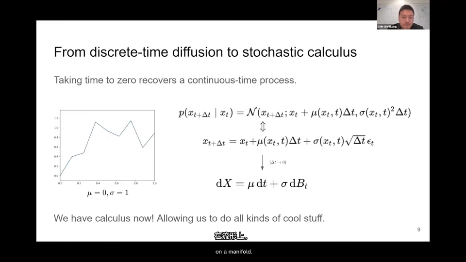

为什么非要做这一步？讲者的理由很直接（[【跳转到 06:33】](https://www.bilibili.com/video/BV1gM4y1q7S7/?t=393)）：**连续时间模型才有微积分**。有了微积分才有链式法则，而链式法则正是后面在「环境空间」和「图卡空间」之间来回搬运速度向量的唯一工具。离散时间扩散没有这个工具，你在流形上几乎无从下手。

顺带一提，报告把「值得用流形建模的数据」列了一张表（[【跳转到 01:17】](https://www.bilibili.com/video/BV1gM4y1q7S7/?t=77)）：分子科学里的扭转角与键角、计算机视觉里的隐式场、无限维的函数空间、以及带边界约束的数据。它们的共同点是**都有连续性的概念**——这正是能定义「扰动」和「切向量」的前提。

## 二、第一个坑：速度场可以指向流形外面

有了连续时间 SDE，就可以在流形上写

$$
\mathrm{d}X=V_0\,\mathrm{d}t+V\,\mathrm{d}B_t ,
$$

其中 $V_0$ 和 $V$ 是流形上的光滑向量场。讲者在球面上画了一个点，并在这个点上画出 $v$ 和 $v_0$（[【跳转到 08:13】](https://www.bilibili.com/video/BV1gM4y1q7S7/?t=493)）。

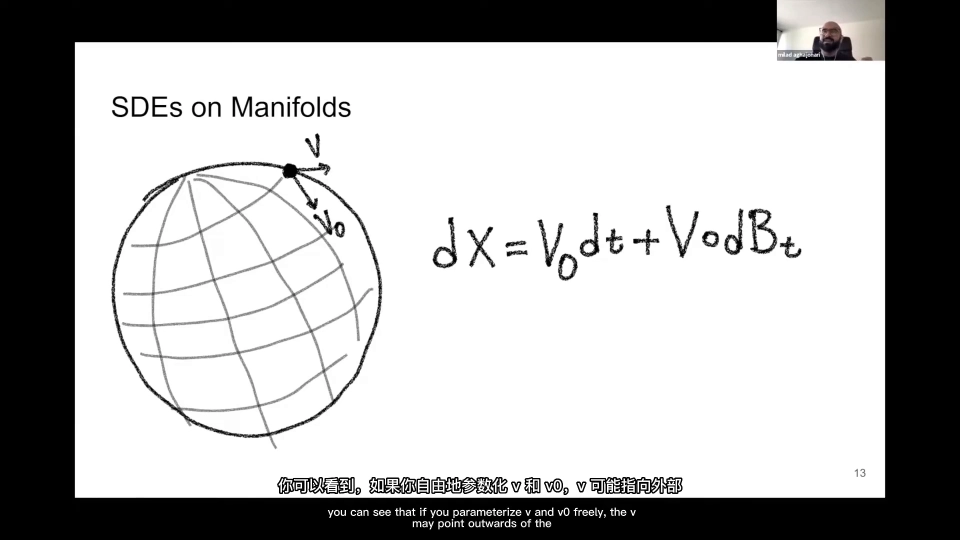

问题就在这里：**如果你自由地参数化 $v$ 和 $v_0$，它们可以指向流形外部**。一旦这样，模拟这个 SDE 时你的点就会从流形上掉下来，之后的一切都无效了——因为 $V_0$ 和 $V$ 本来就只定义在流形上的点处，点跑出去之后速度场就没有定义了。

这不是一个可以忽略的数值误差，而是定义层面的失效。所以必须显式地约束住它。报告给了两个修复办法，对应两种看待流形的视角。

## 三、两条让更新留在流形上的路径

### 3.1 外在视角：把向量投影回切空间

第一个办法最直观（[【跳转到 09:03】](https://www.bilibili.com/video/BV1gM4y1q7S7/?t=543)）：让网络自由地输出一个向量，然后把它投影回切平面。

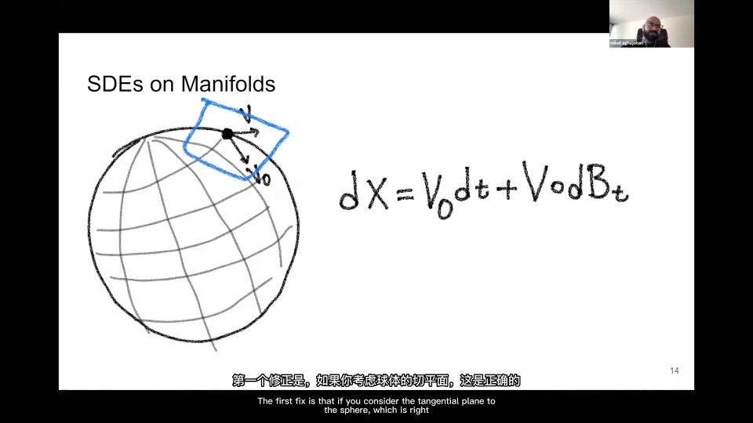

写成公式就是

$$
V_0=\mathrm{Project}(V_0'),
$$

其中 $V_0'$ 是网络输出的、可以指向任何方向的原始向量，$\mathrm{Project}$ 是到切空间的投影算子。讲者把它称为「切向投影算子」，并强调这是**约束 SDE、让它始终留在流形上的一种方法**（[【跳转到 09:28】](https://www.bilibili.com/video/BV1gM4y1q7S7/?t=568)）。

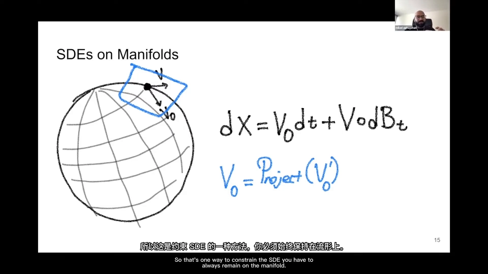

这条路线的优点是实现简单：网络结构完全不用改，只在输出之后加一步投影。代价是投影矩阵需要显式知道（球面上是 $I-xx^\top$ 这种形式），而且投影会丢掉法向分量——如果网络大部分输出都在法向上，信息就浪费了。

### 3.2 内在视角：在图卡空间里算，再用雅可比拉回来

第二个办法是采取内在的观点（[【跳转到 09:53】](https://www.bilibili.com/video/BV1gM4y1q7S7/?t=593)）。流形的定义本身就告诉我们：它的每一小片都可以用图卡（chart）函数 $\varphi$ 映射到一个平直的空间里。反过来，图卡的逆函数 $\varphi^{-1}$ 把平直空间里的点送回流形。

于是在图卡空间（讲者叫它 patch 空间）里，坐标是 $\tilde{x}_1,\tilde{x}_2$；你在那里描述一个速度向量 $\tilde{v}$，它可以走任何方向。它诱导到流形上的速度向量是

$$
v=\frac{\mathrm{d}\varphi^{-1}}{\mathrm{d}\tilde{x}}\,\tilde{v},
$$

也就是**图卡逆函数的雅可比**乘以 $\tilde{v}$。

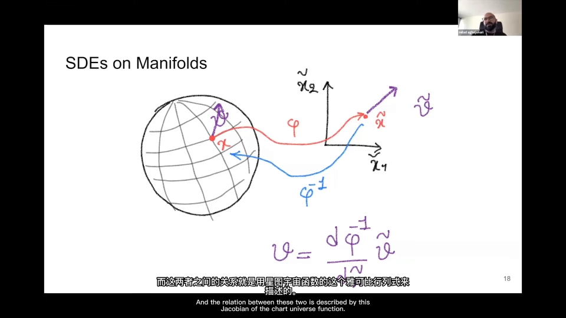

为什么这样得到的 $v$ 一定是切向量？讲者给的理由很干脆（[【跳转到 11:08】](https://www.bilibili.com/video/BV1gM4y1q7S7/?t=668)）：雅可比的**列**天然与流形相切，而雅可比乘以 $\tilde{v}$ 只是这些列的线性组合，所以结果必然是切向量。也就是说，内在视角不是「先违规再修正」，而是**从一开始就只在合法方向上参数化**。

两条路线之间可以自由切换，靠的就是链式法则（[【跳转到 12:48】](https://www.bilibili.com/video/BV1gM4y1q7S7/?t=768)）。这里有一个容易被忽略的技术细节：在流形上，报告用的是 Stratonovich 积分（式中的 $\circ$）而不是文献里更常见的 Itô 积分，因为 **Stratonovich 积分下链式法则成立**，公式更干净。这也是为什么第 3.1 节和第 3.2 节的推导能对得上。

## 四、从「合法的 SDE」到「可训练的生成模型」

约束问题解决之后，就可以写生成式 SDE 了（[【跳转到 11:58】](https://www.bilibili.com/video/BV1gM4y1q7S7/?t=718)）：

$$
\mathrm{d}X=V_0\,\mathrm{d}t+V\circ \mathrm{d}B_t,\qquad X_0\sim p_0,
$$

其中先验 $p_0$ 本身也定义在流形上（球面上可以是接近均匀的分布）。目标是设计 $V_0$ 和 $V$，使得时间 $T$ 时诱导出的分布 $p_T$ 尽量接近数据分布。

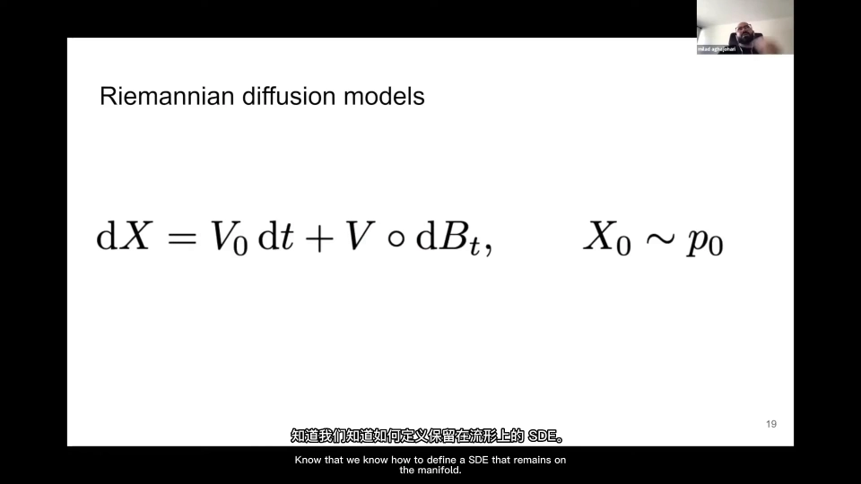

要训练就得有似然。第一步是拿到概率密度 $p_t(x)$ 随时间的变化，这由 Fokker–Planck 方程给出（[【跳转到 16:08】](https://www.bilibili.com/video/BV1gM4y1q7S7/?t=968)）：它是一个关于 $\partial_t p(x,t)$ 的偏微分方程，一阶项对应漂移、二阶项对应扩散。再用 Feynman–Kac 定理去解这个 PDE，就得到 $p_t(x)$ 的显式表达——它写成一个关于**反向时间过程** $Y$ 的期望，$Y_0=x$ 从我们关心的数据点出发。

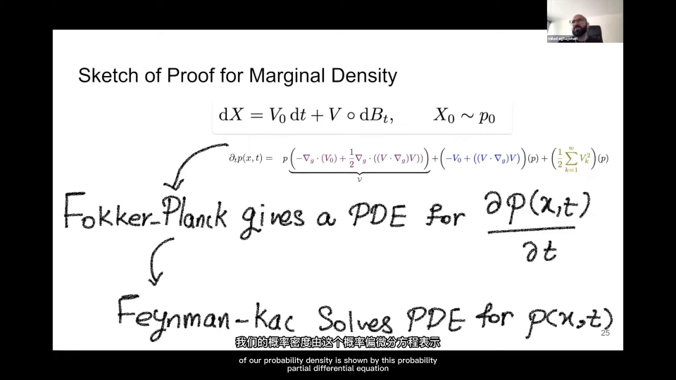

有了边际密度，就直接最大化 $\log p_T(x)$。但这里有两个麻烦（[【跳转到 20:18】](https://www.bilibili.com/video/BV1gM4y1q7S7/?t=1218)）：

1. 对数套在期望外面，期望里面还有积分，无法直接算；
2. 这个期望是对**生成过程**求的，而生成过程采到的轨迹绝大多数只给 $x$ 分配极小的概率，估计方差极大。

解决办法和 VAE 一样：引入一个由 $\phi$ 参数化的推断过程 $q$，把采样集中到「最有可能生成 $x$」的区域，再用重要性采样校正测度变化，最后用 Jensen 不等式把对数推进去。得到的下界就是**黎曼连续时间 ELBO**：

$$
\log p(x,T)\ \ge\ \mathbb{E}\left[\log p_0(Y_T)-\int_0^T\frac{1}{2}\lVert a(Y_s,s)\rVert_g^2+\nabla_g\cdot\left(V_0-\frac{1}{2}(V\cdot\nabla_g)V\right)\mathrm{d}s\ \middle|\ Y_0=x\right].
$$

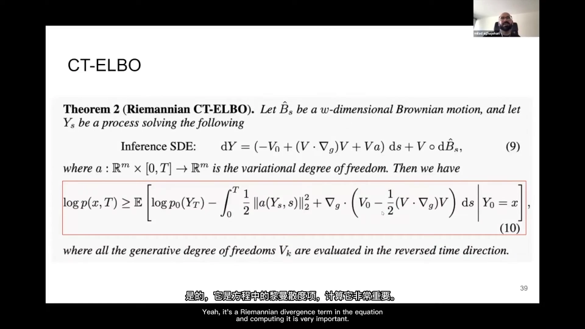

注意这个下界里有三块内容（[【跳转到 26:42】](https://www.bilibili.com/video/BV1gM4y1q7S7/?t=1602)）：评估样本先验的项、正则化项，以及**主损失**——向量场的散度。讲者说得很清楚：散度这一项在方程和计算中非常重要，而它恰恰是流形上最容易算错的一项。

## 五、散度这一项：为什么它必须在切空间里算

### 5.1 散度的直观含义

讲者先给了散度的直觉（[【跳转到 27:07】](https://www.bilibili.com/video/BV1gM4y1q7S7/?t=1627)）：**散度是非正式意义上的「负的质量积累」**，描述一个点周围无穷小邻域里质量如何变化。

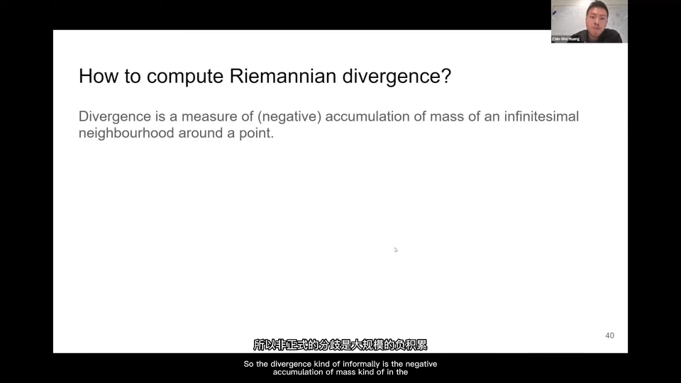

在一维情形下它就是速度的导数；在三维里要把三个方向的贡献加起来。如果左边速度小、右边速度大，质量往外流，散度为正。

### 5.2 流形上的散度为什么不一样

到了流形上，事情变了（[【跳转到 28:22】](https://www.bilibili.com/video/BV1gM4y1q7S7/?t=1702)）：**我们的向量场处处与流形相切**。如果为了算导数而任意扰动这个向量场，扰动就可能产生一个不再切向的方向，而这个法向分量是我们根本不关心的——因为点始终在流形上。

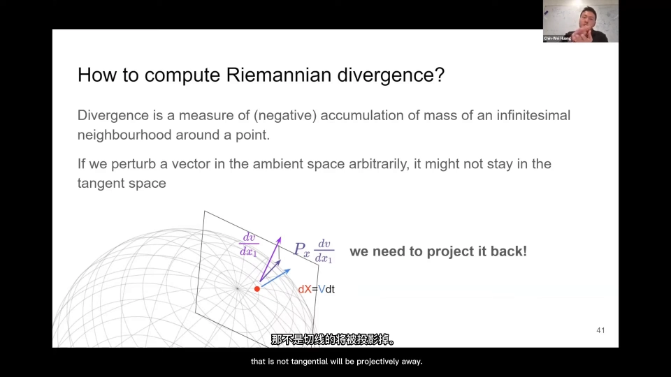

修复的办法还是投影：乘上一个投影矩阵，把所有非切向的贡献消掉。讲者的原话是「把它投影回去」，确保扰动是切向的、产生的变化也是切向的。

### 5.3 一个可以用自动微分算的公式

把上面的直觉写成定理（[【跳转到 29:37】](https://www.bilibili.com/video/BV1gM4y1q7S7/?t=1777)），黎曼散度可以写成

$$
\nabla_g\cdot V=\mathrm{tr}\!\left(P_x\frac{\mathrm{d}v}{\mathrm{d}x}P_x\right),
$$

也就是**用投影矩阵 $P_x$ 从左右两边夹住速度场的雅可比，然后取迹**。这个形式的好处是它完全在环境空间里算，不需要真的去构造流形的局部坐标。

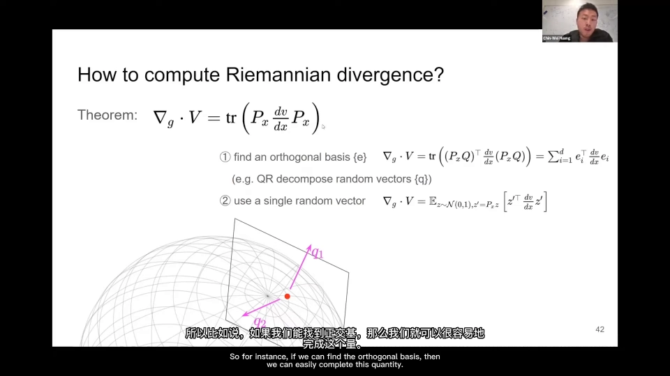

报告给了两条把它变成可计算量的路线：

1. **正交基路线**：找一组切空间的正交基 $\{e_i\}$，则散度等于 $\sum_i e_i^\top \frac{\mathrm{d}v}{\mathrm{d}x}e_i$。怎么得到正交基？先随机抽一个高斯向量并投影到切空间，再对若干个这样的切向量做 QR 分解正交化（[【跳转到 30:27】](https://www.bilibili.com/video/BV1gM4y1q7S7/?t=1827)）。每个 $e_i^\top \frac{\mathrm{d}v}{\mathrm{d}x} e_i$ 都是一个向量-雅可比乘积，可以高效地用反向模式自动微分算出来。球面例子里环境空间三维、流形实维数二维，所以只需要做两次。
2. **单随机向量路线**：如果维数 $d$ 很高、不想做 $d$ 次，就抽一个随机向量、投影到切空间、做一次反向模式微分来估计（[【跳转到 31:17】](https://www.bilibili.com/video/BV1gM4y1q7S7/?t=1877)）。这就是 Hutchinson 式的迹估计，只不过随机向量必须先投影到切空间。

单随机向量路线的估计式是

$$
\nabla_g\cdot V=\mathbb{E}_{z\sim\mathcal{N}(0,I),\ z'=P_xz}\left[z'^{\top}\frac{\mathrm{d}v}{\mathrm{d}x}z'\right].
$$

有了便宜的散度估计，就能便宜地估计对数似然的下界，进而训练模型。
## 六、三组实验：球面、环面、$\mathrm{SO}(3)$

### 6.1 球面：地球上发生的事件

第一组实验把「地球上的自然事件」当成球面上的密度估计问题（[【跳转到 32:30】](https://www.bilibili.com/video/BV1gM4y1q7S7/?t=1950)）：地震、火灾、洪水、火山喷发。训练集是事件发生的地点，测试集是模型没见过的点。蓝色表示模型学到的密度，红点是测试点。

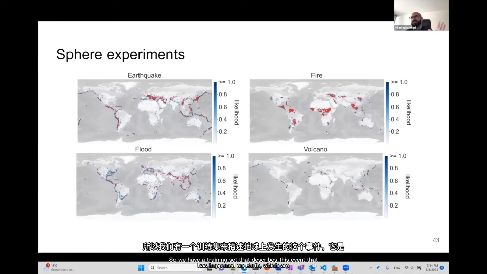

可以看到模型成功学到了数据的分布。这组实验还顺带演示了一个训练技巧——**对时间做重要性采样**（[【跳转到 33:42】](https://www.bilibili.com/video/BV1gM4y1q7S7/?t=2022)）。训练目标里有一个从 $0$ 到 $T$ 的积分，文献里的做法是把它当成对时间 $s$ 的期望、从均匀分布里采样。但讲者观察到：**越接近时间 $0$ 的点，损失越高**。这很自然——接近 $0$ 意味着噪声很小，模型要预测的是很精细的结构。

于是他们不再从均匀分布采样时间，而是学一个关于时间的提议分布，并对密度的变化做校正。学到的密度明显偏向 $0$ 附近。

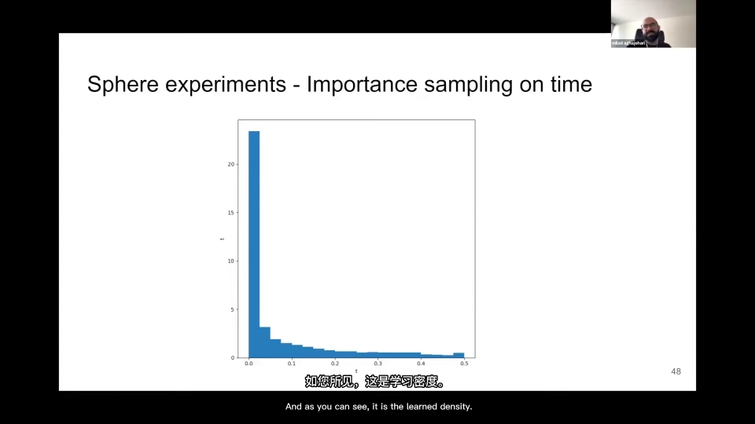

效果是损失下降得更快（[【跳转到 36:12】](https://www.bilibili.com/video/BV1gM4y1q7S7/?t=2172)）：用均匀时间采样的曲线在某个地方饱和、下降很慢；用学到的时间采样，损失下降明显更快。

### 6.2 环面：氨基酸的扭转角

第二组实验是模拟氨基酸的边缘扭转角，用 $\phi$ 和 $\psi$ 表示（[【跳转到 36:53】](https://www.bilibili.com/video/BV1gM4y1q7S7/?t=2213)）。注意这里只建模**两个角的边缘分布**，不对整条蛋白质链建模——讲者后来在问答里明确说这是一个玩具实验，用来证明可以这样参数化模型。

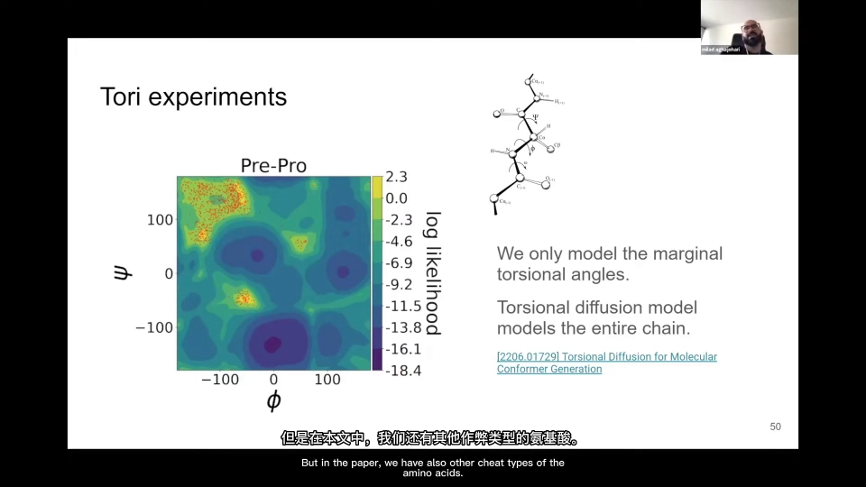

这组实验的重点不是精度，而是**流形建模带来的连续性**（[【跳转到 37:43】](https://www.bilibili.com/video/BV1gM4y1q7S7/?t=2263)）。角度从 $180°$ 切到 $-180°$ 时，流形上的点其实是同一个点，密度天然连续。如果你改在 patch 空间上建模密度，就没有这种连续性——你会被迫让 $180°$ 和 $-180°$ 各自学一份密度，而它们本该是同一个值。

这条性质直接决定了「预测什么」的选择：**网络预测的必须是切空间里的量（角的增量），而不是流形上的点（角的绝对值）**，否则周期边界的连续性就要靠额外的工程手段去补。

### 6.3 $\mathrm{SO}(3)$：旋转矩阵的密度

第三组实验在 $\mathrm{SO}(3)$ 上做（[【跳转到 43:51】](https://www.bilibili.com/video/BV1gM4y1q7S7/?t=2631)）：给定一个合成的多峰密度，看模型能不能学出来。

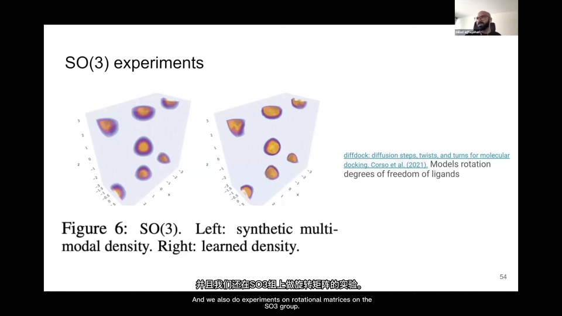

讲者特别提到这类建模在自然科学里的用处：旋转无处不在。幻灯片上引了 DiffDock 作为例子——它对配体的旋转自由度做扩散，而旋转正是住在 $\mathrm{SO}(3)$ 上的。

## 七、边界：这套方法覆盖不到什么

报告最后一段问答把边界讲得比较清楚，值得单独列出来，因为它们决定了「什么时候不该用这套框架」：

- **和分数匹配是同一件事的两种写法**（[【跳转到 45:31】](https://www.bilibili.com/video/BV1gM4y1q7S7/?t=2731)）。讲者承认，他们推导出的那个「类似分数函数的函数」，也可以从分数匹配的角度得到。所以黎曼扩散模型并不排斥得分匹配路线，只是换了个出发点。
- **离散数据不适用**（[【跳转到 45:56】](https://www.bilibili.com/video/BV1gM4y1q7S7/?t=2756)）。对离散状态空间，你不能再写布朗运动 SDE，因为状态空间不是连续的；要用马尔可夫链理论里的其他工具。这也解释了为什么掩码扩散、均匀噪声扩散是另外一套机制。
- **约束边界有别的做法**（[【跳转到 46:46】](https://www.bilibili.com/video/BV1gM4y1q7S7/?t=2806)）。除了「投影回切空间」，还可以用反射（reflection）让轨迹不越出边界，或者用**扩散桥（diffusion bridge）**把过程约束到预先指定的区域。讲者预告了 Aaron Lou 的后续报告专门讲这件事。
- **无限维函数空间需要换噪声**（[【跳转到 47:11】](https://www.bilibili.com/video/BV1gM4y1q7S7/?t=2831)）。如果你直接对函数加白噪声，会立刻丢掉所有高频特征。所以这类工作改用**随机高斯场**来扰动函数，让扰动在空间上是相关的、更连续的。
- **实际应用还不多**（[【跳转到 49:16】](https://www.bilibili.com/video/BV1gM4y1q7S7/?t=2956)）。被问到有没有真实任务上的成功案例时，讲者说据他所知还不多，大多数扩散模型应用仍在欧几里得空间；最自然的落点是计算生物学（扭转角、旋转群），另外电子结构理论里用正交矩阵参数化波函数也是一个方向。

## 小结

- **一条硬约束**：流形上的 SDE 里，漂移和扩散系数必须是切向量场。否则点会掉出流形，速度场随之失去定义，整个生成过程失效。
- **两条实现路线**：外在路线是「自由预测 + 投影回切空间」（$V_0=\mathrm{Project}(V_0')$）；内在路线是「在图卡空间里参数化 + 用图卡逆映射的雅可比拉回流形」，后者从构造上就只产生切向量。
- **切换靠 Stratonovich**：在流形上报告用 Stratonovich 积分而不是 Itô，因为只有前者满足链式法则，而链式法则正是环境空间与图卡空间之间搬运向量的工具。
- **散度要夹投影**：黎曼散度写成 $\mathrm{tr}(P_x\frac{\mathrm{d}v}{\mathrm{d}x}P_x)$，用投影矩阵从两侧夹住雅可比；不夹的话算出来的是环境空间的散度，多算了法向贡献。
- **两条数值路线**：正交切基 + QR（精确，代价随维数线性增长）与单随机切向量估计（Hutchinson 式，代价与维数无关）。
- **预测切空间增量而非流形上的点**：这样周期边界（$180°$ 与 $-180°$）的连续性自动成立，不需要额外工程手段。
- **边界**：离散状态空间要换马尔可夫链工具；无限维函数空间要换随机高斯场；硬约束还可以用反射或扩散桥。

## 关键术语速查

| 术语 | 一句话解释 |
| --- | --- |
| 流形（manifold） | 局部看起来像平直空间、整体可以弯曲的集合；球面、环面、$\mathrm{SO}(3)$ 都是 |
| 切空间（tangent space） | 流形上某一点处所有「允许的运动方向」构成的平直空间；速度向量必须落在这里 |
| 投影算子（projection） | 把环境空间里的任意向量压回切空间的线性算子，法向分量被丢掉 |
| 图卡（chart） | 把流形的一小片铺平成平直空间的映射；它的逆映射把平直空间送回流形 |
| 雅可比（Jacobian） | 映射的局部线性化矩阵；图卡逆映射的雅可比把平直空间的速度搬成切向量 |
| Stratonovich 积分 | 一种随机积分约定，满足普通链式法则，因此在流形上比 Itô 更好用 |
| Fokker–Planck 方程 | 描述概率密度随时间演化的偏微分方程，一阶项对应漂移、二阶项对应扩散 |
| Feynman–Kac 定理 | 把某类偏微分方程的解写成对随机过程求期望的公式 |
| 散度（divergence） | 向量场在某点处的「净流出」；非正式地说是负的质量积累 |
| 黎曼散度 | 在流形上定义的散度，等于 $\mathrm{tr}(P_x\frac{\mathrm{d}v}{\mathrm{d}x}P_x)$ |
| 黎曼 CT-ELBO | 连续时间、流形上的证据下界；主损失项是向量场的散度 |
| 重要度采样（importance sampling） | 从一个好采的分布采样、再用密度比加权，来估计另一个分布下的期望 |
| 扩散桥（diffusion bridge） | 把扩散过程约束到预先指定区域的构造，用于硬约束 |
