# 可逆架构的演进：从一维变量替换到 RealNVP、Glow 与自回归流

> 视频来源：[Lecture 10.3: ARM & Flows](https://www.youtube.com/watch?v=Rhx6W3dGvK8)（YouTube · VU 深度生成模型课程）｜时长约 33 分钟
> 简要导读：这是一节课堂讲授，讲法从「一个随机变量乘 0.75 再加 1」这种最小例子起步，一路推到 RealNVP 的耦合层、用耦合层实现自回归分解，以及 Glow 与流式 VAE。本文保留这条推导链的顺序，并在每处补上「为什么这一步必须这样走」的说明；字幕为自动生成，术语已按 RealNVP、Glow 原论文订正。

## 本讲要解决的核心问题（SCQA）

**背景**：深度生成模型里，GAN 能采样但给不出密度，VAE 给出的是似然的下界。只有拿到**精确似然**，才能判断「某个样本有多可能出现」，也才能用最大似然直接训练。

**冲突**：精确似然要求我们知道数据密度 $p_X(x)$，而真实数据（比如图像）的密度根本无法直接写出解析式。

**疑问**：能不能用一个简单分布（标准高斯）加上一个可逆变换，把复杂密度「换算」出来？如果行，为什么不能随便拿一个神经网络当这个变换？

**回答（中心思想）**：用变量替换公式可以把密度精确搬到简单空间，但代价是每层都要算雅可比行列式、并且必须可逆。普通网络两条都做不到，于是研究者反过来**把约束设计进架构**：RealNVP 的仿射耦合层让雅可比自动成为三角阵（行列式 = 对角元之积），逆映射写成闭式代数；同一套耦合层堆叠起来还能实现自回归分解，一次前向就算出所有条件概率。此后 Glow 用可逆 $1\times1$ 卷积替代手工置换，流式 VAE 用它加强编码器与先验——「可逆 + 行列式易算」这条主线一直没变。

## 一、从一维开始：变量替换公式是可以手算的

### 1.1 一个乘加变换，密度怎么变

设随机变量 $v$ 服从标准正态 $p(v)=\mathcal{N}(v\mid 0,1)$，做变换

$$
u = 0.75\,v + 1
$$

问：$u$ 的概率密度函数是什么？

答案是 $p(u)=\mathcal{N}(u\mid 1,\,0.75^2)$——还是一个高斯，均值变成 1，方差变成 $0.75^2$。从图上看，蓝色是原始标准高斯，橙色是新分布：整体右移一格，同时被「压窄」了。

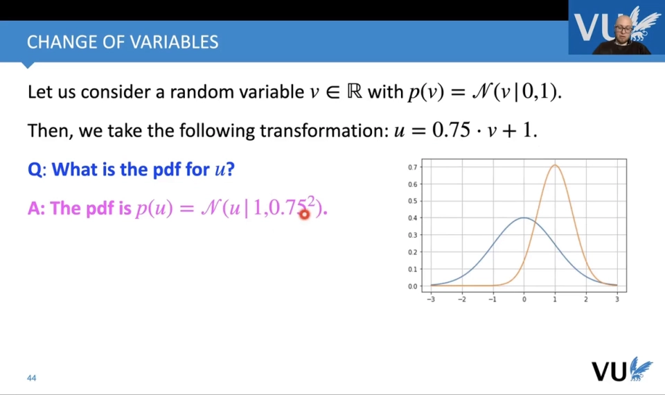

凭直觉也能猜出这个结果（加常数平移均值、乘常数缩放方差），但那是「反向工程」。

[【跳转到 00:25】](https://www.youtube.com/watch?v=Rhx6W3dGvK8&t=25)要把它变成可推广的方法，需要一条有原理的公式。

### 1.2 原理：变量替换公式

一般地，若 $f$ 可逆，则

$$
p(u) = p\big(f^{-1}(u)\big)\left|\frac{\partial f^{-1}(u)}{\partial u}\right|
$$

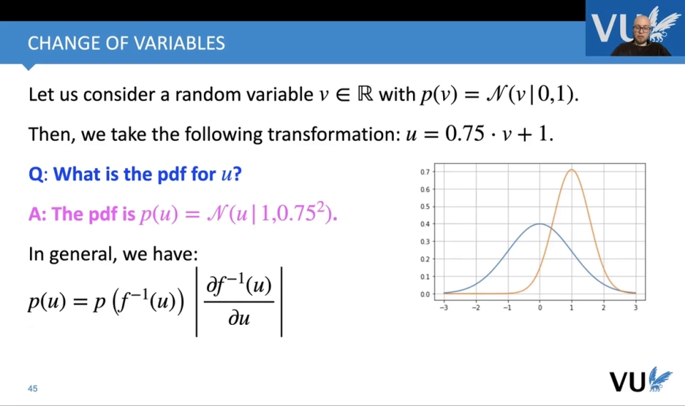

代进本例：$f^{-1}(u)=(u-1)/0.75$，其导数为 $1/0.75=4/3$。把它塞进标准高斯的表达式，整理后正好得到 $\mathcal{N}(u\mid 1,0.75^2)$。注意这个导数因子**不是可有可无的修正项**：没有它，变换后的函数积分就不再等于 1，根本不是密度。

[【跳转到 01:40】](https://www.youtube.com/watch?v=Rhx6W3dGvK8&t=100)

### 1.3 推广到高维：雅可比矩阵登场

图像是一个像素向量，不是单个标量。高维情形下，导数变成一个矩阵——**雅可比矩阵**：第 $i$ 行第 $j$ 列是「第 $i$ 个输出对第 $j$ 个输入的偏导」$\partial f_i/\partial x_j$。一维时的「导数绝对值」，在高维就升级为「雅可比行列式的绝对值」。

于是流模型的密度表达式为

[【跳转到 04:35】](https://www.youtube.com/watch?v=Rhx6W3dGvK8&t=275)

$$
p(x) = \pi(z_0)\prod_{i=1}^{K}\left|\det \frac{\partial f_i(z_{i-1})}{\partial z_{i-1}}\right|^{-1}
$$

其中 $\pi(z_0)$ 是简单基分布（标准高斯），$K$ 是变换层数。连乘来自「复合函数的行列式等于各层行列式之积」。

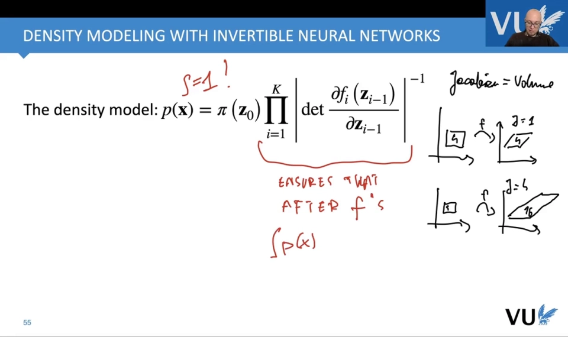

## 二、雅可比行列式的物理含义：它是「体积」

### 2.1 为什么必须有这个因子

视频在这里补了一个容易被忽略的直觉：**雅可比行列式就是体积变化率**。

- 把一个面积为 4 的正方形「推一下」，形状变了但面积不变，行列式为 1——没有体积变化；
- 把同样的正方形放大成面积 16 的四边形，行列式为 4——体积被放大了 4 倍。

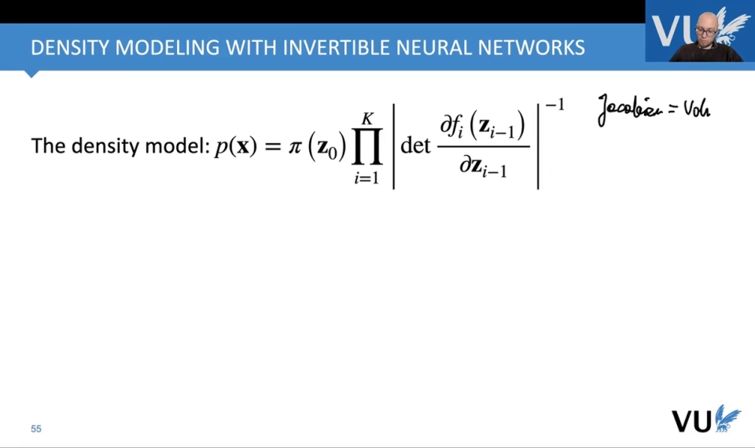

这也解释了公式里为什么必须乘这个因子：概率密度对全空间积分必须等于 1。

[【跳转到 10:25】](https://www.youtube.com/watch?v=Rhx6W3dGvK8&t=625)变换把某块区域拉伸了，那里的密度就必须相应变稀，否则总概率会凭空变多。

### 2.2 二维实例：两个月亮

课程用 two moons 数据集演示整条流程：

- **推断方向**：把复杂的数据分布经一串可逆变换 $\{f_k\}$ 搬到潜空间，变成一团高斯噪声；
- **生成方向**：从高斯采点，经逆变换 $\{f_k^{-1}\}$ 折回，得到两个月亮形状的样本。

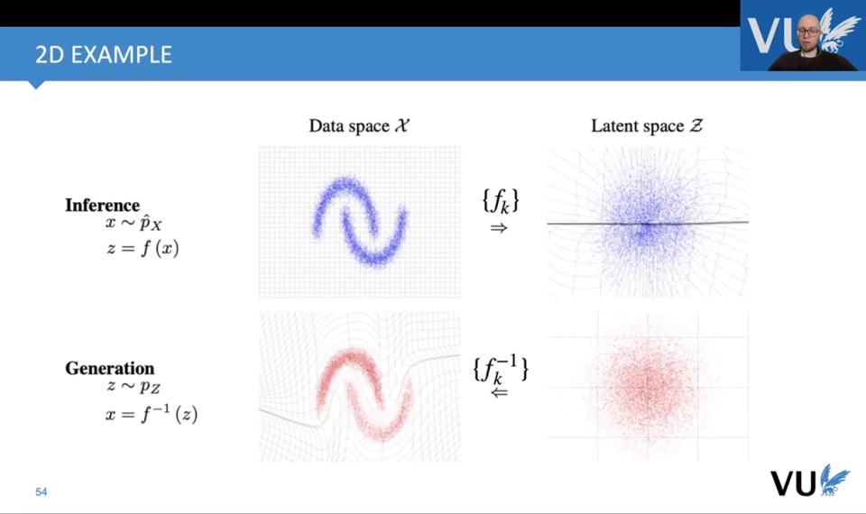

这一步说明流模型的「采样」有多直接：不需要迭代去噪、不需要解方程，只要从高斯抽点再做一次前向（这里是反向）计算。

[【跳转到 09:10】](https://www.youtube.com/watch?v=Rhx6W3dGvK8&t=550)

## 三、真正的难点：网络必须同时「可逆」和「行列式好算」

### 3.1 两件事都不能将就

讲者把流模型的核心矛盾讲得很直白：为了表达力，$f$ 要用神经网络；但一旦用了神经网络，就必须同时满足

1. **可逆**：逆映射要能算出来，否则没法采样；
2. **行列式易算**：每层都要算 $\det J$，对任意网络这可能是「贵到不可承受」的。

所以不能「随便拿一个网络砍一刀」，必须**专门设计一种架构**。讲者说，流模型这条研究线基本就是在回答一个问题：**我能选多灵活的网络，同时还能轻松算出它的雅可比？**

[【跳转到 12:30】](https://www.youtube.com/watch?v=Rhx6W3dGvK8&t=750)

### 3.2 RealNVP 的答案：仿射耦合层

RealNVP（real-valued non-volume preserving flow）的第一个大突破，做法极其干净：

[【跳转到 13:53】](https://www.youtube.com/watch?v=Rhx6W3dGvK8&t=833)把输入向量切成两段 $x_{1:d}$ 和 $x_{d+1:D}$，

$$
y_{1:d} = x_{1:d}, \qquad y_{d+1:D} = x_{d+1:D}\odot \exp\big(s(x_{1:d})\big) + t(x_{1:d})
$$

其中 $s(\cdot)$、$t(\cdot)$ 是**任意**神经网络，但它们只看前一段 $x_{1:d}$。

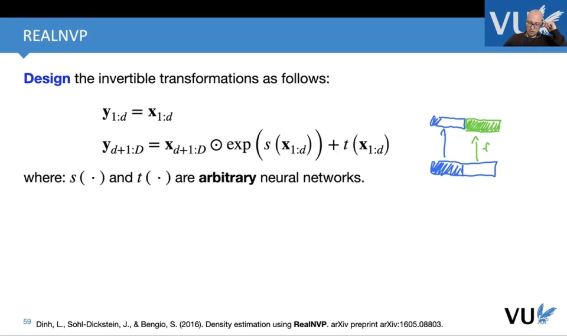

### 3.3 逆映射：写出来就是闭式

因为前一半没动，逆变换不需要解方程：

$$
x_{1:d} = y_{1:d}, \qquad x_{d+1:D} = \Big(y_{d+1:D} - t(x_{1:d})\Big)\odot \exp\big(-s(x_{1:d})\big)
$$

减掉平移、乘上缩放倒数即可。

[【跳转到 15:08】](https://www.youtube.com/watch?v=Rhx6W3dGvK8&t=908)关键点是 $s,t$ 只依赖 $x_{1:d}=y_{1:d}$，所以逆变换用到的所有量在输出端都是已知的——**可逆不是训练出来的，是结构保证的**。

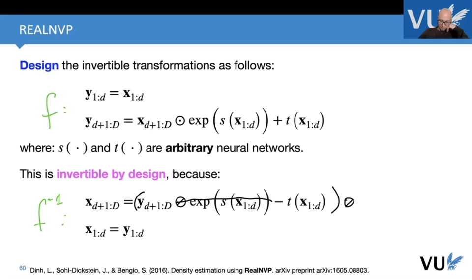

### 3.4 雅可比：自动变成三角阵

对上式求偏导，雅可比矩阵是分块三角阵：

$$
J = \begin{bmatrix} \mathbb{I}_d & 0_{d\times(D-d)} \\[4pt] \dfrac{\partial y_{d+1:D}}{\partial x_{1:d}} & \operatorname{diag}\big(\exp(s(x_{1:d}))\big) \end{bmatrix}
$$

左下那块确实很复杂（它是任意网络的导数），但三角阵的行列式只看对角块，于是

$$
\det J = \prod_{j=1}^{D-d}\exp\big(s(x_{1:d})\big)_j = \exp\left(\sum_{j=1}^{D-d} s(x_{1:d})_j\right)
$$

取对数就是 $\sum_j s(x_{1:d})_j$——一次求和，$O(n)$ 代价。

[【跳转到 16:48】](https://www.youtube.com/watch?v=Rhx6W3dGvK8&t=1008)讲者在这里的评价是「简单到可以立刻算」。

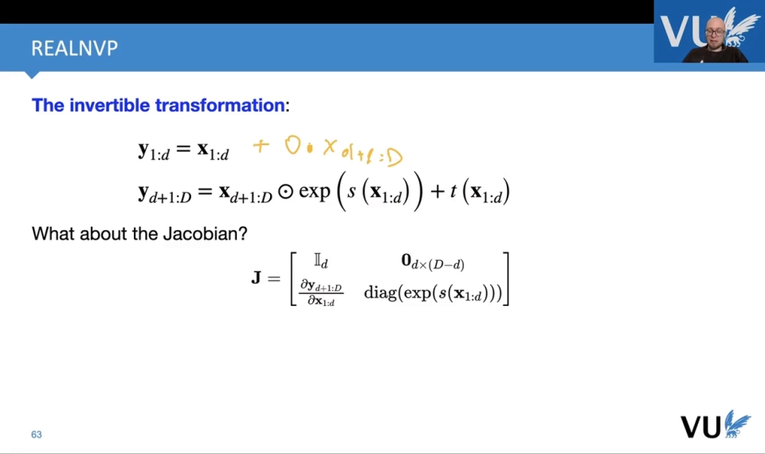

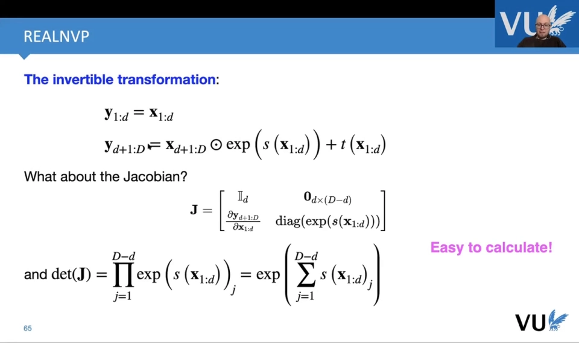

[【跳转到 18:53】](https://www.youtube.com/watch?v=Rhx6W3dGvK8&t=1133)

## 四、耦合层还能做自回归分解

### 4.1 一次前向算出所有条件概率

自回归模型把联合分布拆成条件概率的乘积：

$$
p(z_1)\,p(z_2)\,p(z_3\mid z_1,z_2)\,p(z_4\mid z_1,z_2,z_3)
$$

传统自回归（如 PixelCNN）逐维生成，采样要跑 $D$ 次前向。讲者指出，用耦合层可以把这件事**并行化**：把输入切成两段、逐层堆叠，每一层的输出都「已经看过」它下面所有维度。

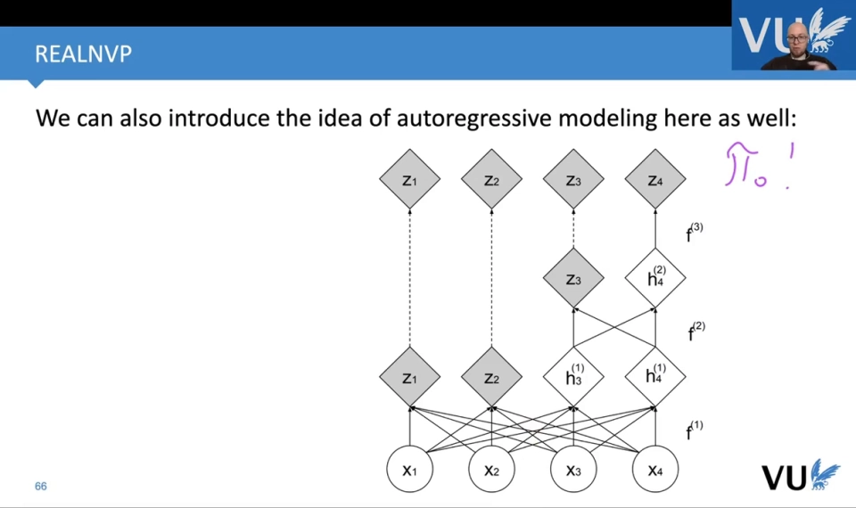

具体地，第 1 层只让 $x_3,x_4$ 看到 $x_1,x_2$；第 2 层再让 $x_4$ 看到 $x_3$ 的中间表示 $h_3^{(1)}$；如此堆叠，最终每个 $z_i$ 都只依赖它之前的维度。于是「自回归」这个约束（第 $i$ 维不能看第 $i+1$ 维）通过**掩码**实现，而所有条件量在一次前向里同时算出。

[【跳转到 20:53】](https://www.youtube.com/watch?v=Rhx6W3dGvK8&t=1253)

### 4.2 三种补强手段

单靠切分维度，表达力仍受限，讲者补充了三种常用技巧：

[【跳转到 22:57】](https://www.youtube.com/watch?v=Rhx6W3dGvK8&t=1377)

1. **置换（permutation）**：把维度顺序打乱。置换本身可逆、行列式为 $\pm1$，不增加行列式计算负担，但能让不同维度在层间充分「混合」；
2. **棋盘掩码（checkerboard pattern）**：不按前后切，而按位置交替选（像棋盘的黑白格），让被变换的维度在空间上分散，有助于学到更高阶的依赖；
3. **挤压（squeezing）**：图像是「通道 × 高 × 宽」的张量，通道数 3 不好对半分。于是把空间维度折叠进通道（例如 $3\times H\times W \to 6\times H/2\times W/2$），再对半分——这既是重排也是混合。

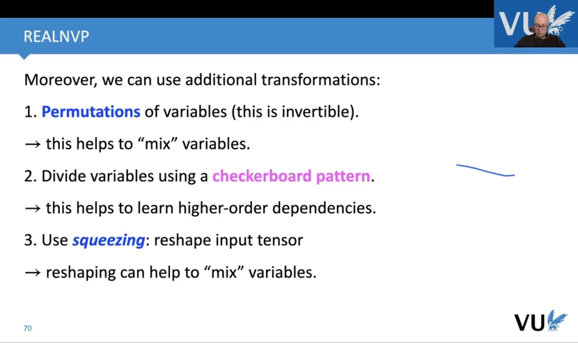

[【跳转到 22:57】](https://www.youtube.com/watch?v=Rhx6W3dGvK8&t=1377)

## 五、效果与后续：Glow、潜空间插值与流式 VAE

### 5.1 RealNVP 的样本

讲者展示了 2016 年 RealNVP 的生成结果：

[【跳转到 24:37】](https://www.youtube.com/watch?v=Rhx6W3dGvK8&t=1477)卧室数据集上几乎分不出真假；人脸样本细看一两秒能发现瑕疵；更复杂的自然图像则明显有崩坏处。他的评价是：以 2016 年的水平，这已经相当震撼。

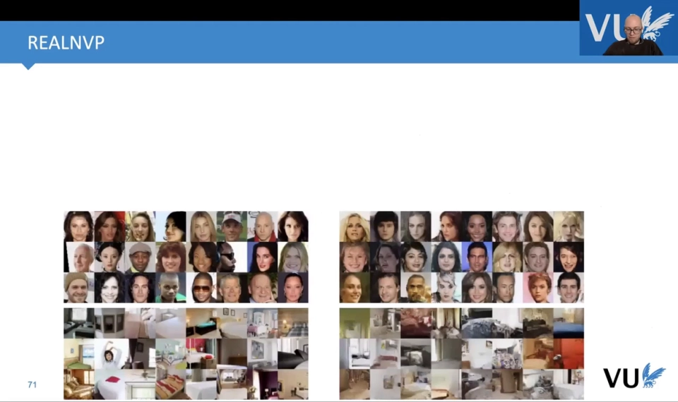

### 5.2 Glow：用可逆 1×1 卷积替代手工置换

2018 年的 Glow 把 RealNVP 的「手工翻转掩码/置换」换成**可学习的可逆 $1\times1$ 卷积**。

[【跳转到 26:08】](https://www.youtube.com/watch?v=Rhx6W3dGvK8&t=1568)整个模型约 1000 层卷积，结构上是「actnorm → 可逆 1×1 卷积 → 仿射耦合层」组成一个 flow step，再配合 squeeze 做多尺度分解。

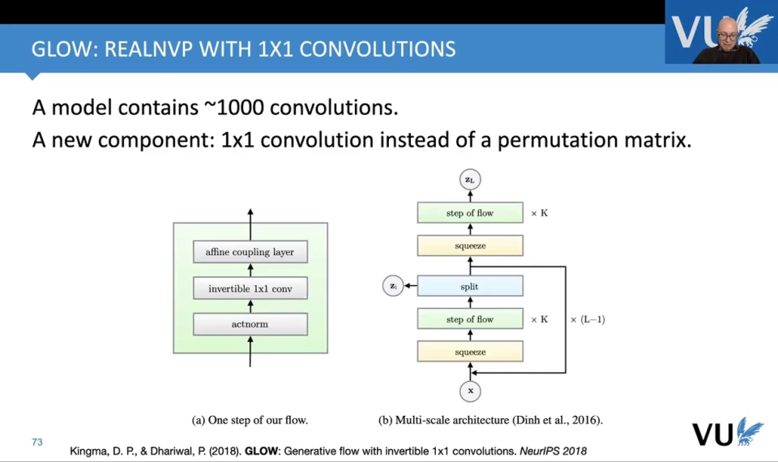

讲者的判断很克制：Glow 本质上是「更大号的 RealNVP + 一些小改进」，核心仍是耦合层。但它的样本质量是当时的突破——整屏人脸全是生成的，连皱纹细节都有。

### 5.3 潜空间插值：可逆带来的额外能力

因为映射可逆，可以先把两张图分别编码到 $z$ 空间

[【跳转到 27:42】](https://www.youtube.com/watch?v=Rhx6W3dGvK8&t=1662)，再对两个 $z$ 做线性插值 $\alpha z_1 + (1-\alpha) z_2$，然后解码回图像。CelebAHQ 上的结果是平滑的人脸渐变：不仅身份在变，连侧脸角度都在连续转动。这是「有精确逆映射」的直接红利——潜空间里的直线，在数据空间里对应一条有意义的路径。

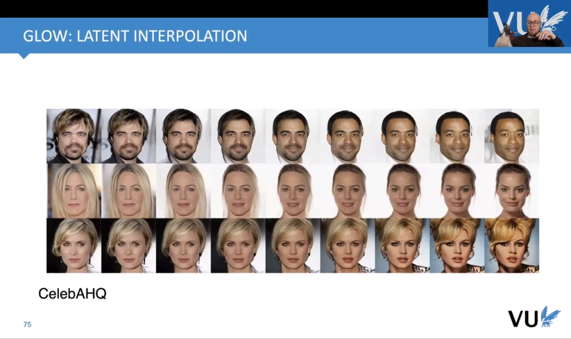

### 5.4 与其他模型组合：流式编码器与流式先验

最后一组幻灯片讲的是流模型如何嵌进别的框架。VAE 的近似后验 $q(z\mid x)$ 可以写成「高斯编码器 + 若干可逆变换」，也就是用流来加强变分推断；反过来也可以把可逆流放在先验 $p(z)$ 上，让先验不再是简单高斯。

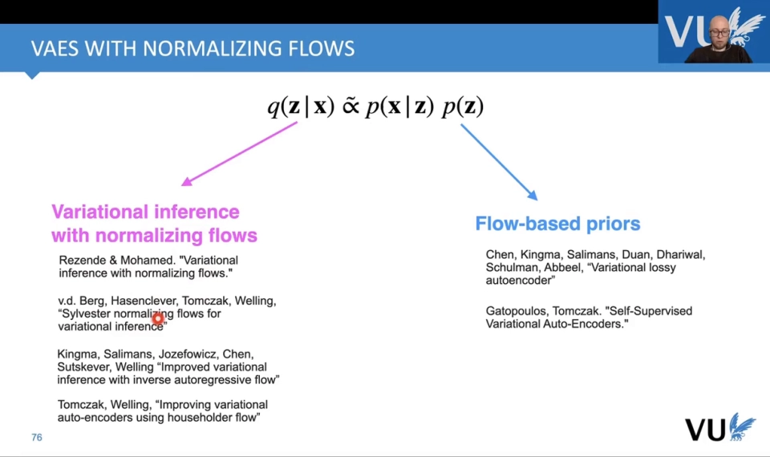

讲者列出的工作包括 Rezende 与 Mohamed 2015 年的 normalizing flows 变分推断、Sylvester flows、Householder flows，以及 OpenAI 的 inverse autoregressive flows。他自己的经验是：把 RealNVP 用作先验、作为更大项目的一个小部件，也能明显提升指标和生成质量。

[【跳转到 29:10】](https://www.youtube.com/watch?v=Rhx6W3dGvK8&t=1750)

## 六、这节 lecture 的落点

讲者在结尾强调，这一系列三讲反复在讲同一件事：**为什么我们真的需要建模似然**。有了似然，才有「这个样本有多可能出现」的量化概念，才谈得上不确定性；而作为独立方法，能算出精确似然又能源源不断生成新样本，本身就是很强的能力。流模型正是少数同时做到这两点的路线——代价是架构必须被约束成可逆、且行列式可算。

## 小结

- 变量替换公式从一维就能手算验证：$p(u)=p(f^{-1}(u))\left|\partial f^{-1}/\partial u\right|$，那个导数因子是保证归一化的必需品，不是修正项。
- 高维时导数升级为雅可比矩阵，行列式就是**局部体积变化率**；连乘形式对应多层复合变换。
- 流模型的两条硬约束：$f$ 必须可逆（否则不能采样），$\det J$ 必须易算（否则训练不动）。普通神经网络两条都不满足。
- RealNVP 的仿射耦合层切分输入、只变换一半、参数只看另一半：雅可比自动成为三角阵，行列式退化为缩放项之和，逆映射写成闭式代数。
- 同一套耦合层堆叠后可实现自回归分解，一次前向得到全部条件量；置换、棋盘掩码、squeezing 用来补足表达力。
- Glow 把手工置换换成可逆 $1\times1$ 卷积，模型更大但思路一致；可逆性还带来潜空间插值这种额外能力。
- 流可以嵌进 VAE：既做更强的变分后验，也做更灵活的先验。

## 关键术语速查

| 术语 | 一句话解释 |
| --- | --- |
| 变量替换公式 | 换元后密度要乘以逆映射导数的绝对值，高维时是雅可比行列式 |
| 雅可比矩阵 | 由所有一阶偏导 $\partial f_i/\partial x_j$ 组成的矩阵，描述映射的局部线性化 |
| 雅可比行列式即体积 | 行列式的绝对值等于映射在该点把单位体积放大或缩小的倍数 |
| 基分布 base distribution | 流模型里那个简单、可采样的分布，通常取标准高斯 |
| 仿射耦合层 | 切分输入、对一半做缩放平移、参数只依赖另一半的可逆结构 |
| 三角雅可比 | 耦合层带来的结构，使行列式只需对角元相乘，代价从 $O(n^3)$ 降到 $O(n)$ |
| 掩码翻转 | 堆叠耦合层时交替冻结不同维度，让信息在两半之间流动 |
| 棋盘掩码 | 按空间位置交替选择被变换的维度，替代前后切分 |
| squeezing | 把空间维度折叠进通道，使张量能被对半切分并混合信息 |
| 自回归流 | 用掩码让第 $i$ 维只依赖前 $i-1$ 维，一次前向算出全部条件概率 |
| actnorm | Glow 引入的激活归一化层，用可学习的缩放与偏置做数据相关初始化 |
| 可逆 1×1 卷积 | Glow 用来替代固定置换的可学习通道混合，行列式等于卷积核矩阵的行列式 |