# 正规化流与 RealNVP：变量替换公式、雅可比行列式与仿射耦合层

> 视频来源：[Cracking the Generative Code: Mastering Normalizing Flows and RealNVP](https://www.youtube.com/watch?v=P_V_SEFqODE)（YouTube · AI Anytime）｜时长约 19 分钟
> 简要导读：这支视频用「侦探破案」的叙事把正规化流讲成一个完整的推理链：先立变量替换公式，再指出雅可比行列式与可逆性两个死结，最后用 RealNVP 的仿射耦合层一次解开。本文按同一顺序重排，补上公式推导与「为什么必须这样设计」的解释，适合作为流模型的第一篇入门读物。字幕为自动生成，术语已按 RealNVP 原论文订正。

## 本讲要解决的核心问题（SCQA）

**背景**：我们手头有一批观测样本，它们来自某个未知分布 $p_X(x)$。统计量（均值、方差、形状）能描述这批数据，但不能凭空造出新的样本。

**冲突**：想生成新样本，就得知道 $p_X(x)$ 本身；可真实数据的分布又复杂到无法直接写出解析式。GAN 这类隐式模型绕开了密度，却也拿不到「某个点的概率是多少」。

**疑问**：能不能不直接建模复杂的 $p_X$，而是把它**变换**成一个我们完全认识的简单分布，从而既拿到精确密度、又能反向采样？

**回答（中心思想）**：正规化流（normalizing flow）用一个**可逆**映射 $f$ 把数据空间搬到简单的高斯空间，密度靠变量替换公式精确换算；代价是每层都要算雅可比行列式并保证可逆。RealNVP 的仿射耦合层通过「只变换一半维度、参数只看另一半」把雅可比矩阵压成三角阵，让行列式从 $O(n^3)$ 降到 $O(n)$，同时让逆映射变成几行代数运算——这就是「可逆 + 行列式易算」能同时成立的原因。

## 一、思路：不去建模复杂，而是把它变换掉

### 1.1 一个可逆函数，同时充当「解密器」和「生成器」

视频把任务定义为「破解生成代码」：屏幕左侧是一团看似混乱的螺旋状数据点，右侧是我们希望造出的新样本。破案的办法不是硬啃 $p_X(x)$，而是设计一个可逆函数 $f$：

- **前向** $z = f(x)$：把复杂数据搬到简单空间，$z$ 服从标准高斯 $p_Z(z)=\mathcal{N}(0,I)$。这一步叫「归一化证据」。
- **反向** $x = g(z) = f^{-1}(z)$：从高斯里随便抽一个点，映射回数据空间，就得到一个全新的样本。

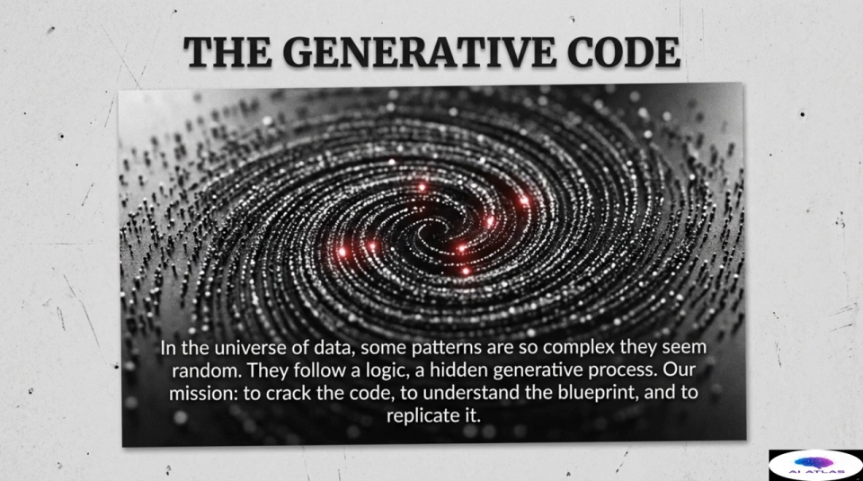

于是同一张网络有两个身份：$f$ 是揭示结构的密码本，$g$ 是生成引擎。

[【跳转到 02:21】](https://www.youtube.com/watch?v=P_V_SEFqODE&t=141)这里的关键约束是 **$f$ 必须可逆**——否则只能算密度、不能采样，或者只能采样、算不出密度。

### 1.2 变量替换公式：密度要按「体积变化」重新标定

把一个概率分布从一个空间搬到另一个空间，密度不能原样搬过去，因为映射会局部拉伸或压缩空间。变量替换公式给出精确换算：

$$
p_X(x) = p_Z\big(f(x)\big)\,\left|\det \frac{\partial f}{\partial x}\right| = p_Z\big(f(x)\big)\,\big|\det J_f(x)\big|
$$

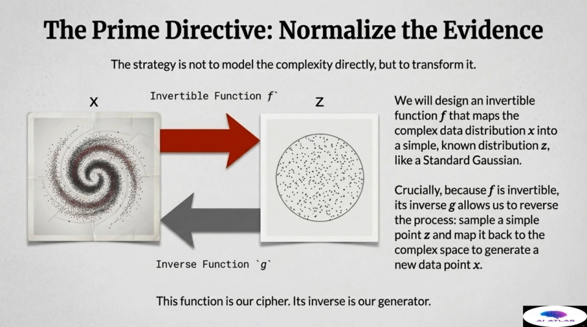

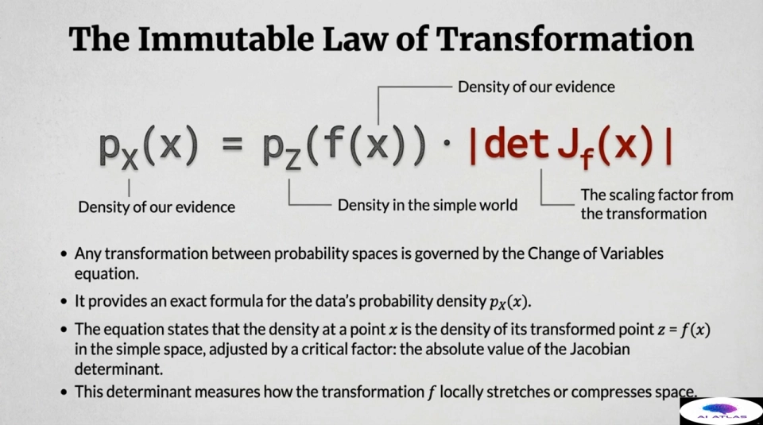

三个因子各司其职：

1. $p_Z(f(x))$：把这个点搬到简单世界后，那里的密度是多少；
2. $\det J_f(x)$：映射在 $x$ 附近把单位体积放大或缩小了多少倍；
3. 取绝对值：密度必须为正，方向（正负号）不重要。

直观理解缩放因子：**空间被拉伸，密度就变稀；空间被压缩，密度就变密**。

[【跳转到 04:47】](https://www.youtube.com/watch?v=P_V_SEFqODE&t=287)这也解释了为什么必须有这个因子——没有它，变换后的「密度」积分不再等于 1，就不是概率分布了。

[【跳转到 03:34】](https://www.youtube.com/watch?v=P_V_SEFqODE&t=214)

## 二、两个死结：为什么不能直接拿一个神经网络当 f

视频把困难称为「无法破解的密码」，它其实是两条硬约束。

### 2.1 死结一：行列式的计算代价是 $O(n^3)$

雅可比矩阵 $J_f$ 是 $n\times n$ 的偏导矩阵，$n$ 是数据维度（对图像就是像素数）。一般矩阵求行列式要做矩阵分解，复杂度随维度的立方增长：

- $n=1024$（一张很小的图）时，$1024^3 \approx 10^9$ 量级；
- 而每次训练迭代都要对每个样本算一次，还要能对它求导。

结论：**用普通深层网络做 $f$，训练一步都跑不动**。

[【跳转到 05:37】](https://www.youtube.com/watch?v=P_V_SEFqODE&t=337)

### 2.2 死结二：普通神经网络天生不可逆

生成要靠 $g=f^{-1}$。但标准网络里有降维、有不可逆的激活（如 ReLU 把负数全压成 0）、有池化，信息一旦丢掉就找不回来。一个逆不出来的 $f$，作为生成模型毫无用处。

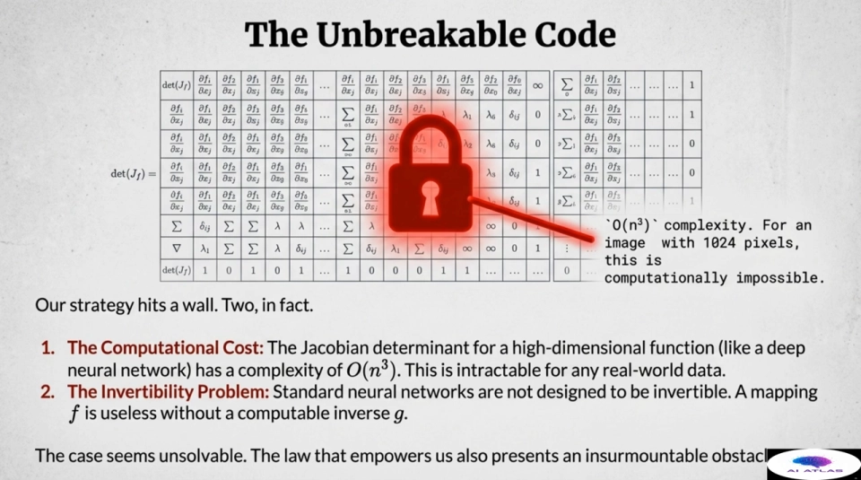

这两条约束合起来说明：**不是数学不够用，而是架构选错了**。变量替换公式本身没有错，错在让「任意网络」去满足它。

## 三、解法：把约束写进架构，而不是事后计算

### 3.1 思路转向：牺牲一点自由度，换取可算性

RealNVP（Real-valued Non-Volume Preserving flow，实值非体积保持流）的核心主张是：与其用一个任意复杂的 $f$ 然后硬算行列式，不如**设计一种天生就可逆、天生行列式好算的网络结构**。代价是表达自由度受限制，收益是数学上确定、计算上可行。

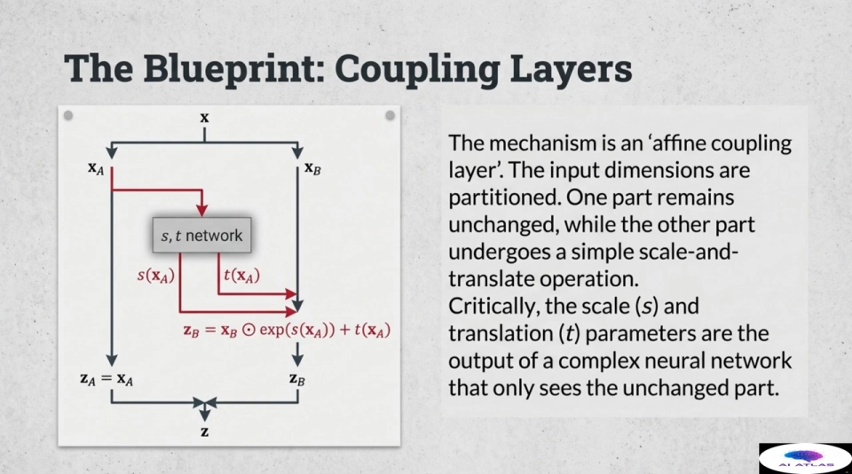

### 3.2 仿射耦合层：只动一半，参数只看另一半

仿射耦合层（affine coupling layer）把输入向量按维度切成两半 $x_A, x_B$：

$$
z_A = x_A, \qquad z_B = x_B \odot \exp\big(s(x_A)\big) + t(x_A)
$$

其中 $s(\cdot)$ 和 $t(\cdot)$ 是**任意**神经网络（缩放网络和平移网络），但它们**只以 $x_A$ 为输入**。这个依赖关系是整个设计的灵魂：

[【跳转到 07:35】](https://www.youtube.com/watch?v=P_V_SEFqODE&t=455)

- 前半段原样复制，不做任何变换；
- 后半段做「逐元素的缩放 + 平移」，缩放用 $\exp(s)$ 保证恒正，方向不会翻转；
- 关键：算 $z_B$ 时用到的 $s,t$ 只依赖 $x_A$，而 $x_A$ 在输出里原封不动地保留着。

### 3.3 逆映射：三行代数就能倒推

因为 $z_A = x_A$，逆变换不需要求解任何方程：

$$
x_A = z_A, \qquad x_B = \big(z_B - t(z_A)\big) \odot \exp\big(-s(z_A)\big)
$$

先减掉平移、再乘上缩放的倒数即可。**参数 $s,t$ 全部由 $z_A$（也就是 $x_A$）算出，不需要知道 $x_B$**——这正是「可逆 by design」的含义：不是训练出来的近似逆，而是结构上保证的精确逆。

### 3.4 雅可比矩阵：被结构压成三角阵

对上面这个映射求偏导，雅可比矩阵呈分块形式：

$$
J = \begin{bmatrix} I_d & 0 \\[4pt] \dfrac{\partial z_B}{\partial x_A} & \operatorname{diag}\big(\exp(s(x_A))\big) \end{bmatrix}
$$

四个块的来历很清楚：

[【跳转到 08:46】](https://www.youtube.com/watch?v=P_V_SEFqODE&t=526)

- 左上 $\partial z_A/\partial x_A = I$：$z_A$ 就是 $x_A$；
- 右上 $\partial z_A/\partial x_B = 0$：$z_A$ 根本不依赖 $x_B$；
- 右下是对角阵：$z_B$ 的每个分量只被自己那一维的缩放控制；
- 左下是那块「复杂又难看」的偏导——它确实复杂，但**我们不需要它**。

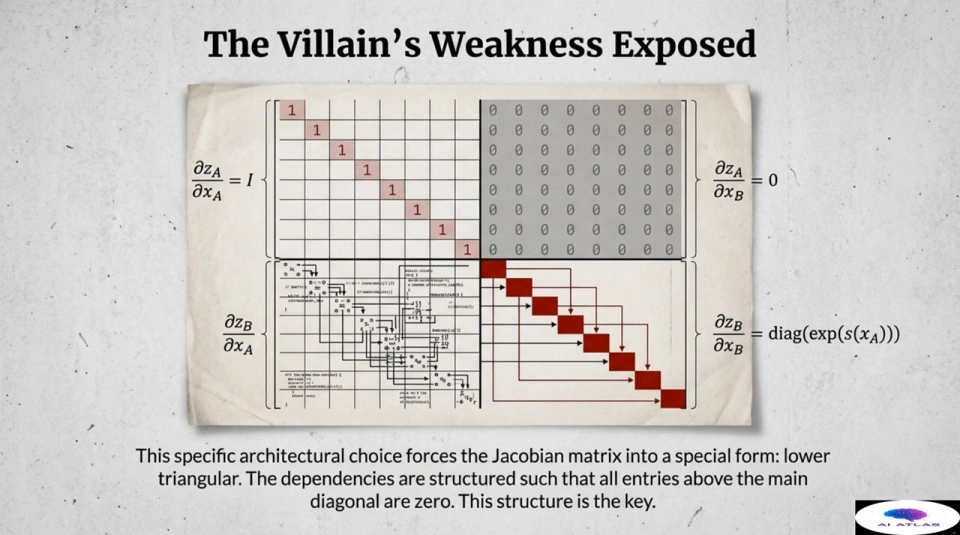

三角矩阵的行列式等于对角元之积，于是

$$
\det J = \prod_{j} \exp\big(s(x_A)\big)_j = \exp\left(\sum_j s(x_A)_j\right)
$$

一个 $O(n^3)$ 的行列式，变成了 $O(n)$ 的求和。取对数后更简单：$\log|\det J| = \sum_j s(x_A)_j$。

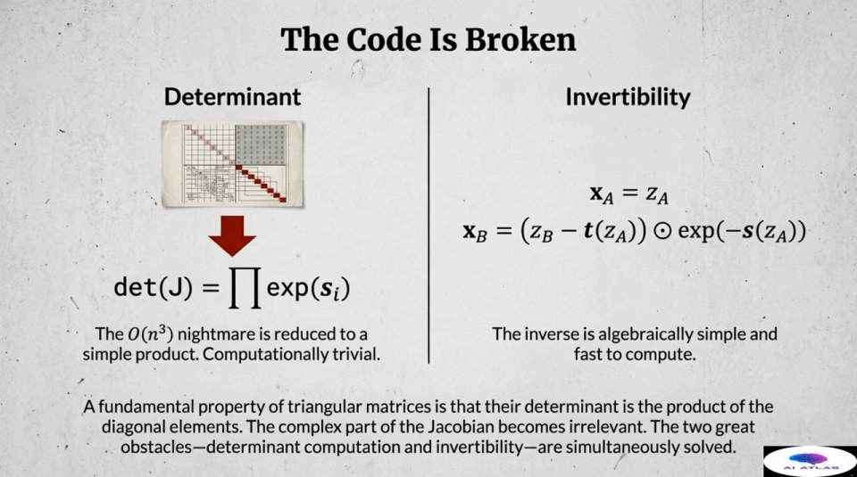

[【跳转到 10:06】](https://www.youtube.com/watch?v=P_V_SEFqODE&t=606)

### 3.5 单层只动一半，所以要堆叠并翻转掩码

一层耦合层只更新一半维度，表达力不够。做法是串联多层，并且**每层翻转一次掩码**：第 1 层变换红色那一半、冻结灰色那一半；第 2 层反过来，把上一轮刚更新过的那一半冻结、把上一轮没动过的那一半拿去变换——而且这次变换的参数来自刚刚更新过的那部分。

这样信息在层与层之间来回交换，堆出一个深而强的可逆函数。

[【跳转到 11:26】](https://www.youtube.com/watch?v=P_V_SEFqODE&t=686)更妙的是，复合函数的行列式相乘、取对数后变成相加：

$$
\log p_X(x) = \log p_Z(z) + \sum_{i=1}^{K} \log\big|\det J_{f_i}\big|
$$

整个深层网络的总对数行列式，就是各层对数行列式之和，训练时逐层累加即可，代价依然是线性的。

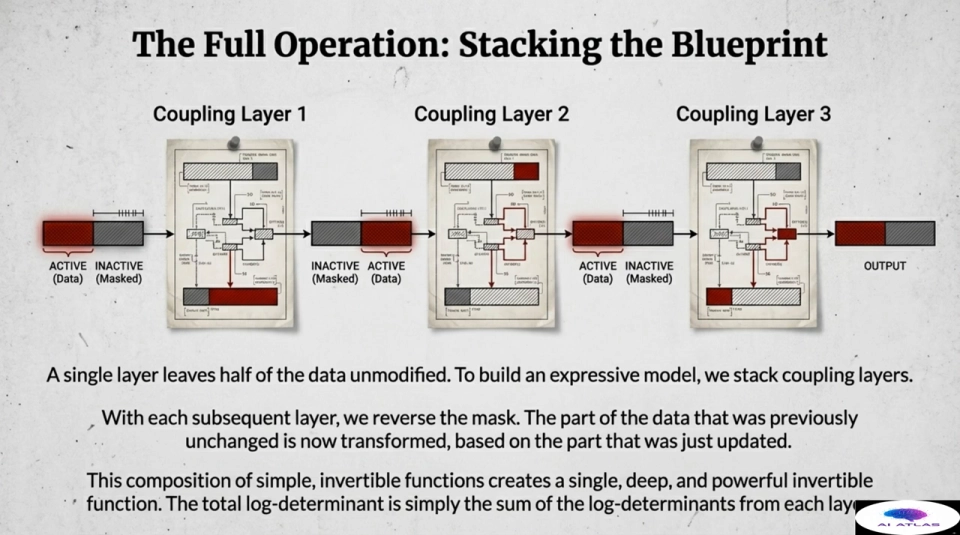

## 四、训练与采样：一个损失函数，两个方向

### 4.1 损失函数：潜变量要像高斯，变换不能偷偷改体积

训练目标只有一个：最大化观测数据的对数似然，等价于最小化负对数似然：

$$
\mathcal{L} = -\log p_X(x) = -\Big(\log p_Z(z) + \sum_i \log\big|\det J_i\big|\Big)
$$

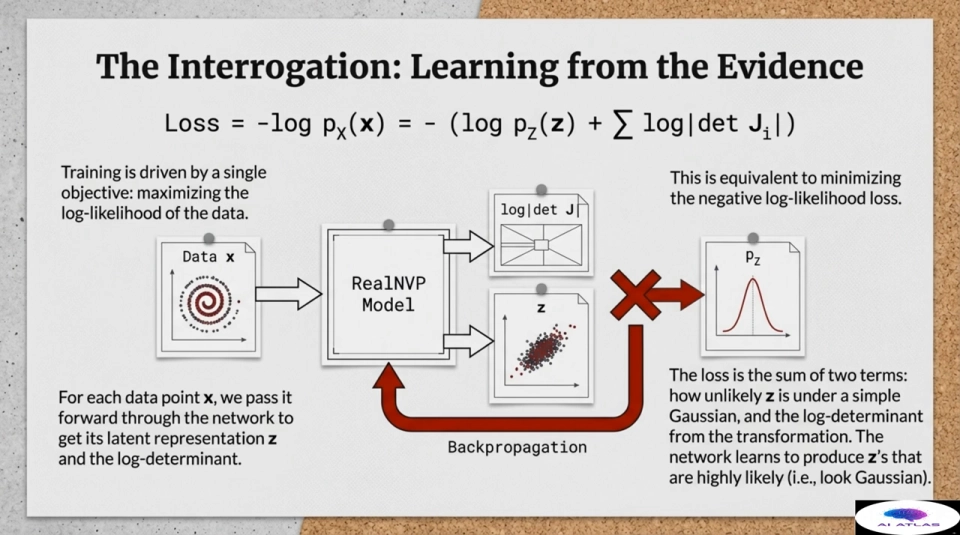

这个损失在逼网络做两件互相制衡的事：

1. **让 $z$ 像高斯**：把每个样本前向推过网络，得到的 $z$ 要落在高概率区域；
2. **为变换付「体积税」**：如果网络靠剧烈拉伸/压缩空间来把点塞进高概率区，$\log|\det J|$ 这一项会惩罚它。

两项合起来，网络必须学到一个既能把数据摊平成高斯、又不靠作弊缩放的可逆映射。

[【跳转到 12:46】](https://www.youtube.com/watch?v=P_V_SEFqODE&t=766)梯度通过反向传播回传，更新的是 $s,t$ 这两个子网络的权重。

### 4.2 训练后的效果：螺旋被摊平

训练收敛后，原本高度结构化的螺旋数据被 $f$ 展开成一团无结构的各向同性噪声

[【跳转到 14:12】](https://www.youtube.com/watch?v=P_V_SEFqODE&t=852)——没有残留的螺旋、没有条纹，只剩纯噪声。这说明网络不是「描述」了数据，而是学到了生成数据的机制。

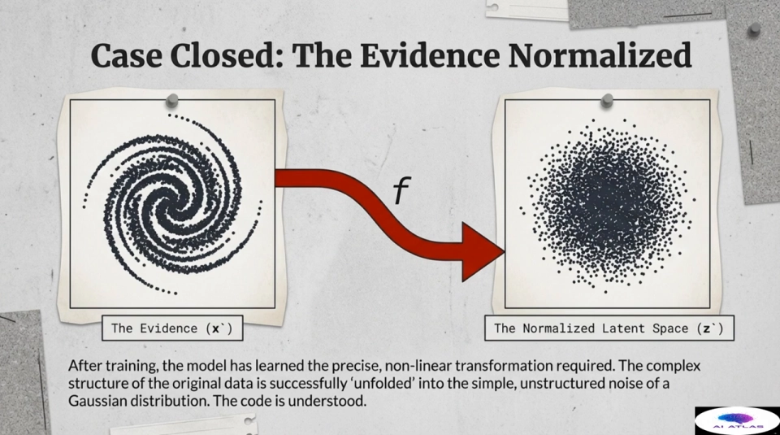

### 4.3 采样：从噪声「折」回结构

生成时切换到逆函数 $g$：先从 $p_Z$ 抽随机点，再逐层反向穿过耦合层。模型像一台折纸机，把平坦的噪声折回原来的螺旋结构，得到从未在训练集里出现过的新样本。因为 $g$ 是 $f$ 的精确逆，这些样本在分布意义上与原始数据同源。

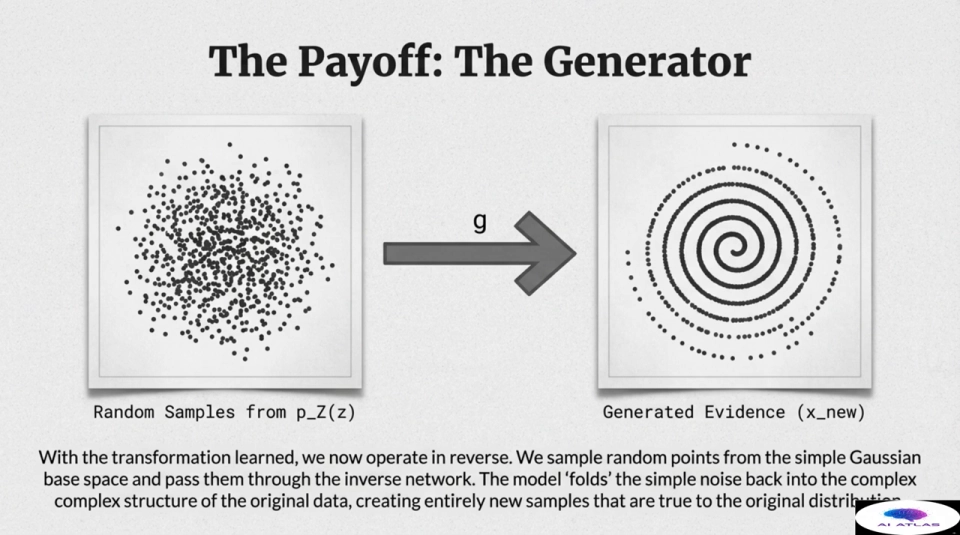

[【跳转到 15:15】](https://www.youtube.com/watch?v=P_V_SEFqODE&t=915)

## 五、这条路线后来怎么走

视频最后给出两个后续方向，它们都在保留「可逆 + 行列式可算」的前提下继续加强表达力：

- **Glow（2018）**：把 RealNVP 里「手工翻转掩码」换成**可逆的 $1\times1$ 卷积**。

[【跳转到 16:25】](https://www.youtube.com/watch?v=P_V_SEFqODE&t=985)掩码翻转是人为规定哪一半被变换，$1\times1$ 卷积则让模型自己学一个可逆的通道混合矩阵，实现特征之间的全局混洗，表达力更强。
- **FFJORD**：把「离散堆叠的若干层」看成**连续时间的流**，用一个由神经网络定义的常微分方程（ODE）描述变换。对数行列式不再逐层求和，而改成一个积分——被积函数是雅可比矩阵的迹（trace），可以用 Hutchinson 估计等技巧近似，从而绕开完整的 $O(n^3)$ 行列式。

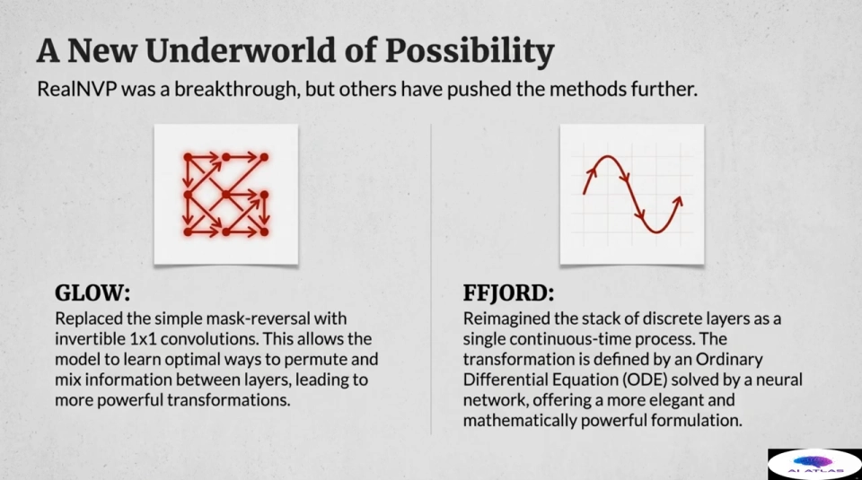

## 小结

[【跳转到 17:40】](https://www.youtube.com/watch?v=P_V_SEFqODE&t=1060)

## 小结

- 正规化流的核心不是「更复杂的网络」，而是**换一个建模对象**：不建模 $p_X$，建模把 $p_X$ 搬到高斯的可逆映射 $f$。
- 变量替换公式 $p_X(x)=p_Z(f(x))\left|\det J_f(x)\right|$ 是全部推导的起点；行列式因子负责修正映射造成的局部体积变化，保证密度仍然归一。
- 直接拿普通网络当 $f$ 会撞上两堵墙：行列式 $O(n^3)$、网络不可逆。这两条不是实现细节，而是路线能否成立的前提。
- 仿射耦合层用「切一半 + 参数只看另一半」把雅可比压成三角阵：行列式退化为对角元之积（$O(n)$），逆映射退化为减平移、乘倒数（精确且快）。
- 单层只更新一半维度，靠堆叠与掩码翻转补足表达力；总对数行列式是各层之和，训练代价保持线性。
- 训练目标是负对数似然，两项分别约束「潜变量像高斯」和「变换别乱改体积」；生成时用逆函数从高斯采样。
- 代价是架构自由度受限：可逆、易算行列式与强表达力三者只能取其二，Glow 与 FFJORD 都是在同一约束下换更聪明的混合方式。

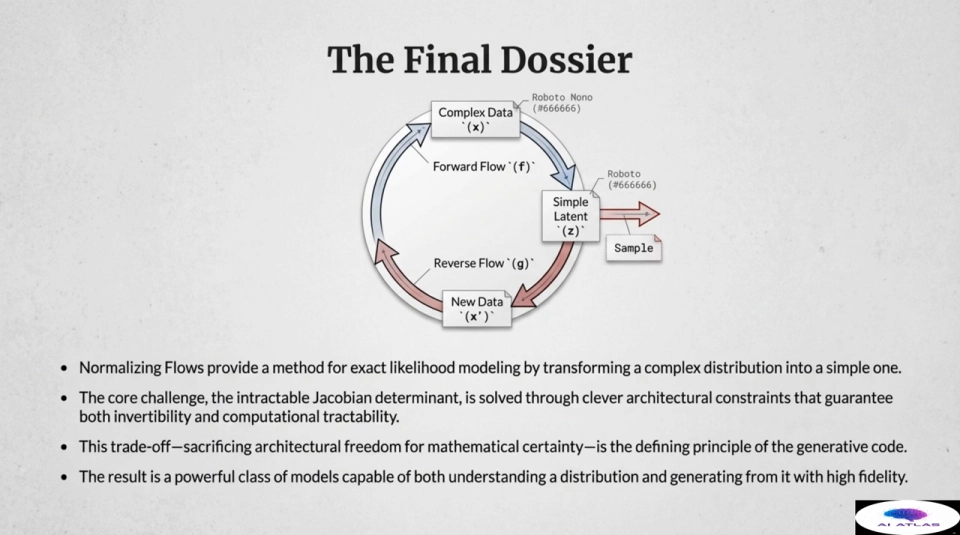

## 关键术语速查

| 术语 | 一句话解释 |
| --- | --- |
| 正规化流 normalizing flow | 用一串可逆变换把复杂分布搬到简单分布，从而同时得到精确密度与采样能力 |
| 变量替换公式 | 密度在换元后要乘以雅可比行列式的绝对值，修正局部的体积伸缩 |
| 雅可比矩阵 $J_f$ | 由 $\partial f_i/\partial x_j$ 组成的偏导矩阵，描述映射的局部线性近似 |
| 雅可比行列式 | 映射在某点附近把单位体积放大或缩小的倍数，决定密度如何被重新标定 |
| 仿射耦合层 affine coupling | 切分输入、只对一半做缩放平移、参数只依赖另一半的可逆结构 |
| 掩码翻转 mask reversal | 堆叠耦合层时交替冻结不同维度，让信息在两半之间来回流动 |
| 对数行列式 log-determinant | 训练时实际累加的量，$\log\vert\det J\vert$，耦合层下等于缩放项之和 |
| 负对数似然损失 | $-\log p_X(x)$，由潜变量对数似然与对数行列式之和构成 |
| RealNVP | 首个用仿射耦合层大规模做图像密度估计的流模型，全称 real-valued non-volume preserving |
| Glow | 用可逆 $1\times1$ 卷积替代固定掩码翻转的流模型，支持特征全局混合 |
| FFJORD | 把离散耦合层换成连续时间 ODE 的流模型，用雅可比迹的积分替代行列式 |