# Flow Matching 论文精读：概率密度路径、条件速度场与可算的回归目标

> 视频来源：[Flow Matching for Generative Modeling (Paper Explained)](https://www.youtube.com/watch?v=7NNxK3CqaDk)（YouTube · Yannic Kilcher）｜时长约 56 分钟
> 简要导读：这是一支按论文段落顺序走的精读视频，讲法是「先把四个核心对象定义清楚，再解释每个定理为什么必须存在」，中间插入了作者自己画的示意图，最后补了一段「损失到底怎么从直线路径里掉出来」的返场讲解。本文只覆盖训练侧（概率路径、条件速度场、回归目标）；采样与求解器留给同系列 4.2.3。

## 本讲要解决的核心问题（SCQA）

**背景**：扩散模型做图像生成，是把数据一步步加噪成标准高斯，再学着把每一步反过来。这套流程效果很好，Stable Diffusion 3 却开始转向流匹配（flow matching）。

**冲突**：扩散模型**预先固定了一条加噪过程**，训练和采样都被这条过程锁死——你必须按它规定的方式加噪、按它规定的顺序去噪。流匹配想退后一步：不预设加噪，只要求学到一个「随时间变化的速度场」，让样本沿着它从噪声流到数据。但这样一来，理想目标里那个「真正的边缘速度场」既写不出、也积不出。

**疑问**：既然边缘速度场算不出来，为什么只对**单个样本**回归条件速度场就够了？这两者之间是什么关系？路径又该怎么选，才能让目标速度有解析式？

**回答（中心思想）**：论文的路线是「从整条分布退到单个样本，再聚合回去」。条件路径按数据分布混合，就得到边缘路径；条件速度场按**后验权重** $p_t(x\mid x_1)q(x_1)/p_t(x)$ 加权积分，就得到边缘速度场——这个加权积分就是条件期望。于是理论上可以只回归条件速度场（定理一、定理二保证梯度一致）；再把路径取成高斯族，条件速度场就有闭式解（定理三）。选线性插值路径时，目标速度甚至简化成一个与时间无关的常数向量 $x_1-x_0$。

## 一、先把「要学什么」说清楚：四个核心对象

视频花了前十分钟铺垫动机，然后直接进入论文第 2 节的预备知识。论文用四个对象描述整件事：

1. **概率密度路径 $p_t$**：一个随时间变化的密度函数，输入是时刻 $t\in[0,1]$ 和空间中的点 $x\in\mathbb R^d$，输出是该点在该时刻的密度。$p_0$ 是我们能采样的简单分布（标准高斯），$p_1$ 要尽量接近数据分布 $q$。
2. **随时间变化的向量场 $v_t$**：输入时刻和位置，输出一个 $\mathbb R^d$ 的向量——可以理解为「每个点的瞬时速度」。
3. **flow $\phi_t$**：一个随时间变化的微分同胚映射，由向量场通过 ODE 定义：

$$
\frac{\mathrm d}{\mathrm dt}\phi_t(x)=v_t\big(\phi_t(x)\big),\qquad \phi_0(x)=x
$$

4. **pushforward（前推）**：把密度「推过」flow 的算子，$p_t=[\phi_t]_*p_0$。它其实就是变量替换公式的算子写法，包含一个雅可比行列式。

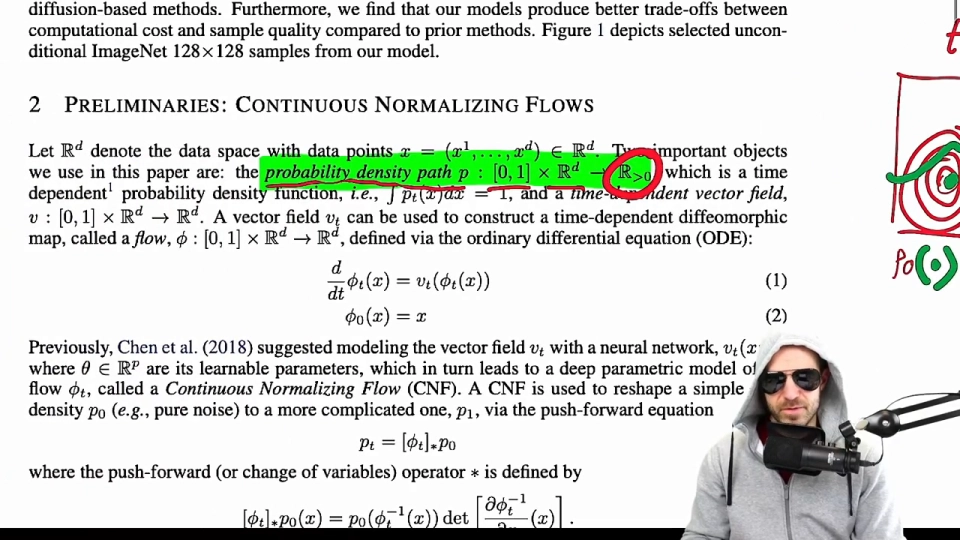

讲者对这四个对象的解释很直白：**flow 就是每个点沿时间走的轨迹，向量场决定这条轨迹在每个瞬间朝哪拐**。因为向量场本身可以随时间变化，所以你不能「沿着一个固定方向一直走」，必须一边走一边看当前时刻的箭头。

[【跳转到 13:32】](https://www.youtube.com/watch?v=7NNxK3CqaDk&t=812)

### 1.1 什么叫「向量场生成了这条路径」

论文的说法是：如果 $v_t$ 的 flow 满足 $p_t=[\phi_t]_*p_0$，就说 $v_t$ **生成**了概率路径 $p_t$。换句话说，把初始密度整体推过 flow，得到的就是 $p_t$。判断这件事有一个实用工具——**连续性方程**，它也是论文所有证明的关键部件。

[【跳转到 19:18】](https://www.youtube.com/watch?v=7NNxK3CqaDk&t=1158)

讲者在这里给了一个具体到能算的例子：在二维平面上，$p_0$ 是以原点为中心的高斯，$p_1$ 是围绕某个数据点、标准差小得多的高斯。同一个位置 $x$ 在 $t=0$ 时的密度可能是 0.1，到 $t=1$ 时就掉到 0.003 左右——**概率密度路径就是「同一点在不同时刻的密度」这条曲线**。

[【跳转到 12:04】](https://www.youtube.com/watch?v=7NNxK3CqaDk&t=724)

## 二、理想目标长什么样，以及它为什么不可用

论文第 3 节开头给出 Flow Matching 目标：让网络 $v_t(x;\theta)$ 去回归那个能生成目标路径的向量场 $u_t$：

$$
\mathcal L_{\mathrm{FM}}(\theta)=\mathbb E_{t,\,p_t(x)}\Big\|v_t(x)-u_t(x)\Big\|^2
$$

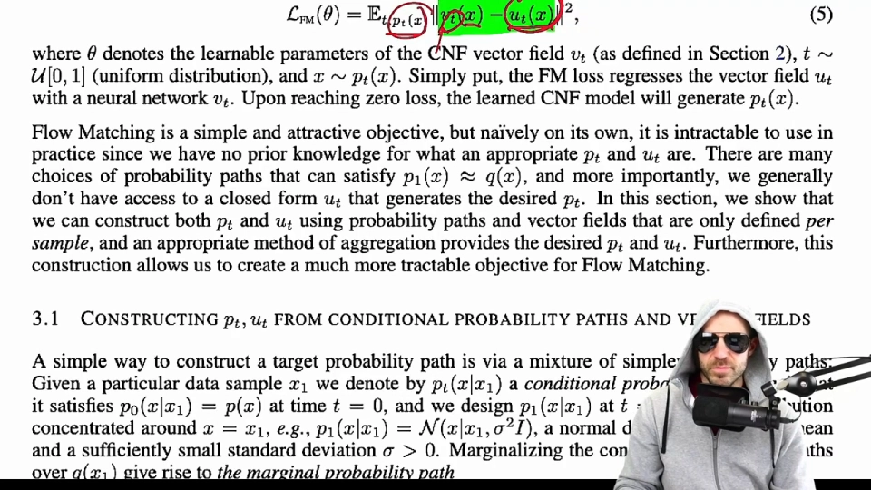

问题在于论文自己紧接着承认：**这个目标单独拿出来是不可用的**。原因有两条，讲者特意拆开讲：

- 我们并不知道该选哪条 $p_t$——满足 $p_1\approx q$ 的路径有无穷多条；
- 更致命的是，**没有 $u_t$ 的闭式表达式**，也就没法算出损失。

这和扩散模型的困境是同一类：真实的目标量写不出来。论文的解法是「从一般退到具体」——不再直接构造整条分布的路径，而是**先用单个样本构造路径，再想办法聚合**。

[【跳转到 20:22】](https://www.youtube.com/watch?v=7NNxK3CqaDk&t=1222)

## 三、从单个样本出发：条件路径与边缘路径

### 3.1 条件路径的两条边界条件

给定一个数据点 $x_1$，定义**条件概率路径** $p_t(x\mid x_1)$，它必须满足：

- $t=0$ 时与终点无关，回到同一个源分布：$p_0(x\mid x_1)=p(x)$（标准高斯）；
- $t=1$ 时集中在 $x_1$ 附近：$p_1(x\mid x_1)=\mathcal N(x\mid x_1,\sigma^2I)$，$\sigma$ 足够小。

这正好对应「从纯噪声出发、落到这个数据点」的一条小路径。注意此时**还没说**具体怎么从 $x_0$ 走到 $x_1$——那有无穷多种走法，先不选。

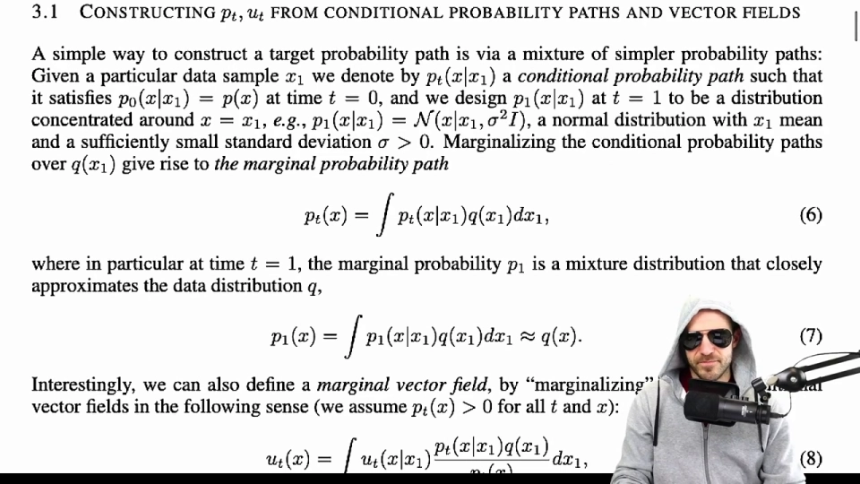

### 3.2 聚合：对数据分布做边缘化

把每个数据点的小路径按数据分布 $q(x_1)$ 加权混合，就得到**边缘概率路径**：

$$
p_t(x)=\int p_t(x\mid x_1)\,q(x_1)\,\mathrm dx_1
$$

在 $t=1$ 处，这个混合分布是「以每个数据点为中心的小高斯」的高斯混合，因此**很接近真实数据分布** $q$。讲者在这里点了一句关键：真实密度 $q$ 我们写不出来，但用样本上的高斯混合去近似它，对训练来说已经够用了。

[【跳转到 23:47】](https://www.youtube.com/watch?v=7NNxK3CqaDk&t=1427)

## 四、把速度场也「聚合」：条件期望就是边缘速度场

### 4.1 论文式 (8)：一个看起来很奇怪但必须这样的加权

假设我们已经能算出每个样本对之间的条件速度场 $u_t(x\mid x_1)$（下一节会给出闭式），那么边缘速度场定义为

$$
u_t(x)=\int u_t(x\mid x_1)\,\frac{p_t(x\mid x_1)\,q(x_1)}{p_t(x)}\,\mathrm dx_1
$$

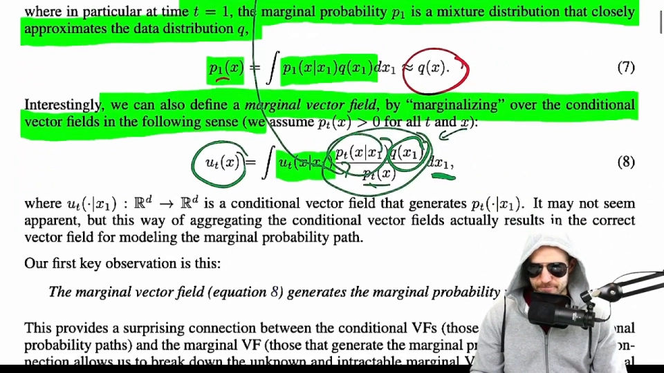

论文紧接着说了一句「看起来不明显，但这样聚合条件速度场，确实能得到建模边缘路径的正确向量场」。这就是**定理一**，也是整篇论文最核心的一步：它把「移动单个样本」和「移动整个分布」连了起来。

讲者的评价很实在：这一步「看起来不算什么」，但它是可行性的来源——因为**我们只能对样本做操作，不可能对整个分布做大积分**。

### 4.2 这个权重就是后验，所以是条件期望

把权重单独看：

$$
\frac{p_t(x\mid x_1)\,q(x_1)}{p_t(x)}=p(x_1\mid x)
$$

由贝叶斯公式，它正是「给定当前点 $x$、终点 $x_1$ 的后验概率」。所以式 (8) 可以读成一句话：

$$
u_t(x)=\mathbb E_{x_1\sim p(\cdot\mid x)}\big[u_t(x\mid x_1)\big]
$$

**边缘速度场是条件速度场的条件期望。** 这一点解释了两个现象：

- **为什么可以直接回归条件速度**：平方损失的最优解就是条件期望，网络在训练中会自然把「同一位置上来自不同终点 $x_1$ 的多个条件速度」按后验权重平均掉，收敛到的正是 $u_t(x)$；
- **为什么 $u_t(x)$ 不能直接写出来**：它要对所有可能终点求积分，而条件速度场是逐样本的解析式。

[【跳转到 26:58】](https://www.youtube.com/watch?v=7NNxK3CqaDk&t=1618)

## 五、Conditional Flow Matching：把不可算的目标换成可采样的目标

论文承认，由于式 (6) 和式 (8) 里的积分不可算，$u_t$ 也就不可算，因此**无法朴素地得到原目标的 unbiased 估计**。于是提出一个更简单的目标——Conditional Flow Matching：

$$
\mathcal L_{\mathrm{CFM}}(\theta)=\mathbb E_{t,\,q(x_1),\,p_t(x\mid x_1)}\Big\|v_t(x)-u_t(x\mid x_1)\Big\|^2
$$

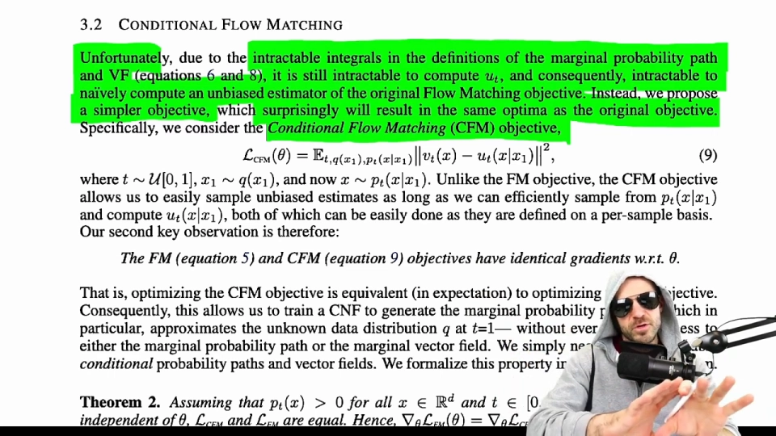

这个目标的期望里只有**逐样本**的采样：采一个 $t$、采一个真实数据点 $x_1$、再在这条小路径上采一个 $x$。所有量都能算，因为 $p_t(x\mid x_1)$ 和 $u_t(x\mid x_1)$ 都是逐样本定义的。

论文的第二个关键结论（定理二）是：**$\mathcal L_{\mathrm{FM}}$ 与 $\mathcal L_{\mathrm{CFM}}$ 对 $\theta$ 的梯度完全相同**，两个损失最多差一个与 $\theta$ 无关的常数。讲者的复述很到位：与其先聚合出整个向量场再让网络去拟合它，不如直接让网络预测「单个数据点对应的条件向量场」——只要训练到最优，得到的参数是一样的。

[【跳转到 29:47】](https://www.youtube.com/watch?v=7NNxK3CqaDk&t=1787)

## 六、把路径选成高斯族：$u_t$ 终于有闭式解

到这里，论文的写法是「先假设能算，再回头补怎么算」。第六节开始做具体选择：让条件路径是一条**高斯路径**，

$$
p_t(x\mid x_1)=\mathcal N\big(x\mid\mu_t(x_1),\,\sigma_t(x_1)^2I\big)
$$

其中 $\mu_t$ 是随时间变化的均值，$\sigma_t$ 是标量标准差，边界条件为 $\mu_0=0,\sigma_0=1$、$\mu_1=x_1,\sigma_1=\sigma_{\min}$。对应的 flow 是一个**仿射变换**：

$$
\psi_t(x)=\sigma_t(x_1)\,x+\mu_t(x_1)
$$

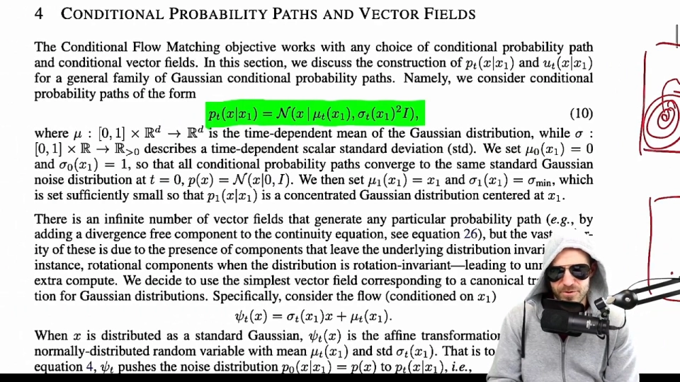

论文在这里补了一个容易被忽略的细节：**能生成同一条概率路径的向量场有无穷多个**（可以在连续性方程里加任意无散度分量，比如旋转分量），但那些多余分量不改变分布、只会增加计算，所以取最简单的那个。

### 6.1 定理三：闭式速度场

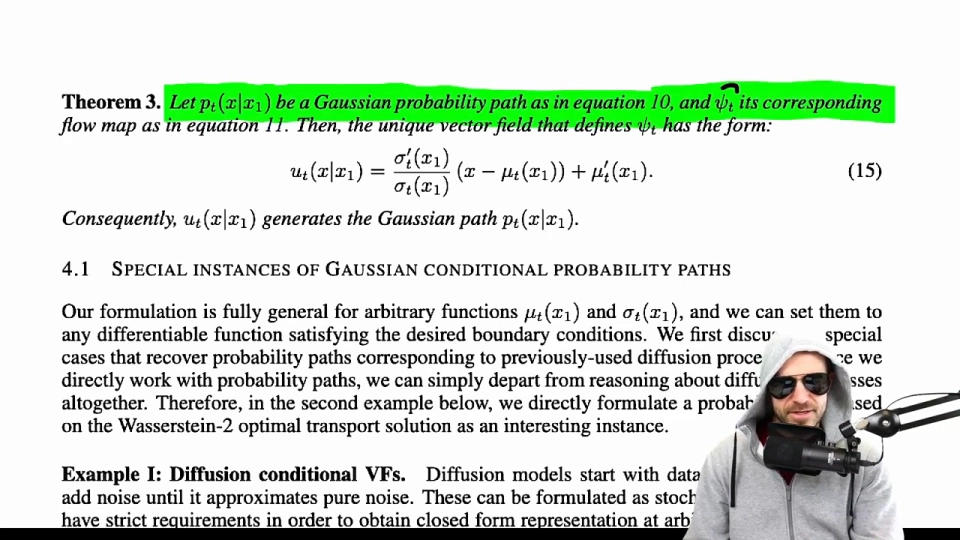

$$
u_t(x\mid x_1)=\frac{\sigma_t'(x_1)}{\sigma_t(x_1)}\big(x-\mu_t(x_1)\big)+\mu_t'(x_1)
$$

它的含义很好读：**速度 = 「把当前点拉回均值」的那一项 + 「均值自己移动」的那一项**。也就是说，只要知道均值函数和标准差函数以及它们的导数，目标速度就是解析的——训练时不需要任何积分。

[【跳转到 36:38】](https://www.youtube.com/watch?v=7NNxK3CqaDk&t=2198)

## 七、两个特例：扩散路径 vs 最优传输直线

论文接着考察高斯路径的两个特例。

### 7.1 特例一：扩散路径（能还原扩散目标，但端点有问题）

取扩散过程对应的 $\mu_t,\sigma_t$，可以证明得到的条件向量场与扩散论文里的目标等价——**扩散被流匹配包含了**。但讲者特意指出一个值得注意的细节：这组函数在 $t=1$ 处**没有定义**，因为扩散里「真正到达噪声分布」需要 $t\to\infty$，而流匹配把时间压缩到 $[0,1]$，$t=1$ 对应扩散的 $t=\infty$。这是流匹配与扩散的一个本质区别：流匹配可以在**有限时间**内到达目标分布。

[【跳转到 40:20】](https://www.youtube.com/watch?v=7NNxK3CqaDk&t=2420)

### 7.2 特例二：最优传输路径（直线）

更简单的选择是让均值和标准差**线性变化**：

$$
\mu_t(x)=t\,x_1,\qquad \sigma_t(x)=1-(1-\sigma_{\min})t
$$

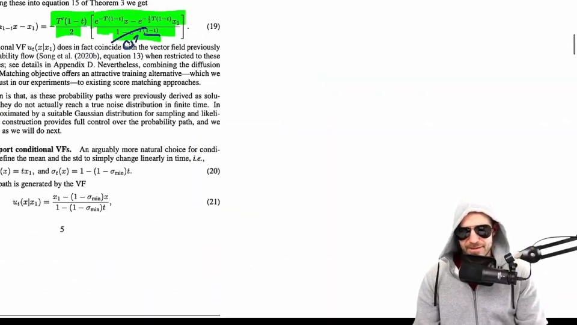

取 $\sigma_{\min}=0$，条件 flow 就是噪声与数据点的线性插值：

$$
\psi_t(x)=(1-t)\,x+t\,x_1
$$

代入式 (14) 的 CFM 损失，得到一个极简的回归目标：

$$
\mathcal L_{\mathrm{CFM}}(\theta)=\mathbb E_{t,\,q(x_1),\,p_0(x_0)}\Big\|v_t\big(\psi_t(x_0)\big)-\big(x_1-x_0\big)\Big\|^2
$$

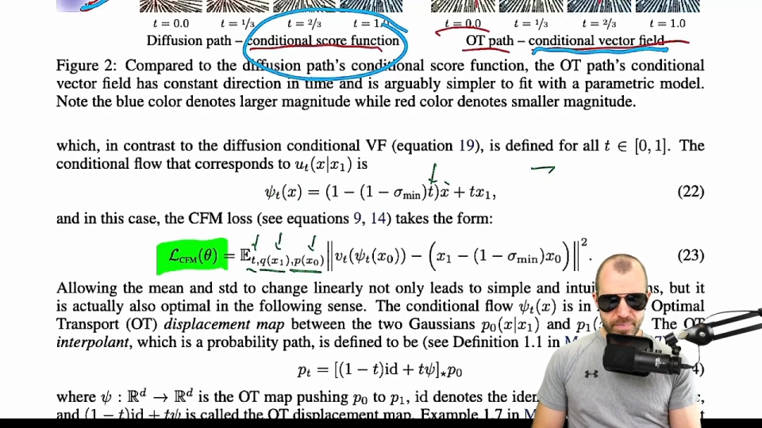

**目标速度变成了 $x_1-x_0$：一个常数向量，方向从噪声指向数据点，与 $t$ 无关。** 这就是「直线路径」在训练目标上的直接体现。

### 7.3 一般高斯路径下，损失长什么样

回到一般情形，论文把式 (13) 代进 CFM 损失，得到实际可用的形式：

$$
\mathcal L_{\mathrm{CFM}}(\theta)=\mathbb E_{t,\,q(x_1),\,p_0(x_0)}\left\|v_t\big(\psi_t(x_0)\big)-\frac{\mathrm d}{\mathrm dt}\psi_t(x_0)\right\|^2
$$

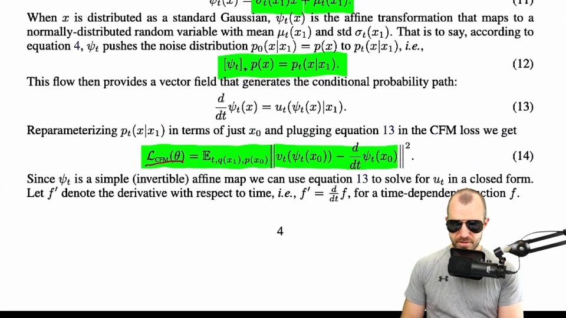

一句话概括：**训练目标就是「在路径上的点 $\psi_t(x_0)$ 处，回归这条路径自己的瞬时速度 $\frac{\mathrm d}{\mathrm dt}\psi_t(x_0)$」**。因为 $\psi_t$ 是仿射的，这个导数有闭式，整个损失不需要任何积分，也不需要知道边缘分布。

[【跳转到 36:31】](https://www.youtube.com/watch?v=7NNxK3CqaDk&t=2191)

## 八、为什么直线路径「更好」：方向恒定，聚合出加权方向

### 8.1 条件速度场的方向对比

论文附录里画了两个条件向量场的对比图：扩散路径的条件 score 函数随时间**不断改变方向**（先向外推、再拐回来），而最优传输路径的条件向量场**方向恒定**、始终指向目标点。讲者的解释是：扩散的加噪过程是「先朝各个方向推开，再收拢」，所以反向过程必然要走曲线；直线路径没有这个包袱。

讲者还提醒一个容易忽略的差别：**扩散回归的不是向量场，而是对数概率的导数（score）**，所以两张图里的箭头方向本来就不是一回事。

[【跳转到 42:18】](https://www.youtube.com/watch?v=7NNxK3CqaDk&t=2538)

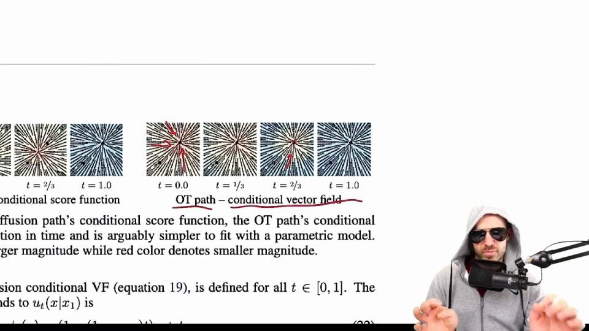

### 8.2 聚合之后学到的是什么

讲者在返场部分补了一段很直观的解释：训练时对每个 $x_0$ 和每个 $x_1$ 都要求网络输出「指向 $x_1$」的方向，聚合到整个数据集上，网络在每个位置学到的就是**按后验加权的方向分布的平均**——如果附近有三个数据点，它会主要指向最近的那个、稍微偏向另外两个。这正是第四节那个条件期望在几何上的样子。

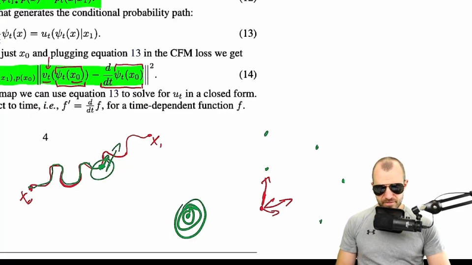

### 8.3 与采样效率的关系（只点一句）

讲者提到，用最优传输目标训练出来的模型，在采样时需要的函数评估次数（NFE）更少，Stable Diffusion 3 正是沿着这条路线继续研究「训练时怎么采时间步、选哪条路径」。至于怎么积分、步数怎么取、误差怎么积累，属于 4.2.3 的内容，本文不展开。

[【跳转到 45:46】](https://www.youtube.com/watch?v=7NNxK3CqaDk&t=2746)

## 小结

- **扩散锁死过程，流匹配只学速度场**：扩散必须预先定义加噪过程；流匹配只要求学到一个随时间变化的向量场，让样本沿它从噪声流到数据。
- **理想目标不可算**：$\mathcal L_{\mathrm{FM}}$ 需要边缘速度场 $u_t$，而 $u_t$ 既无闭式也积不出。
- **退到单样本再聚合**：条件路径按 $q(x_1)$ 混合成边缘路径；条件速度场按后验权重 $p_t(x\mid x_1)q(x_1)/p_t(x)$ 加权积分成边缘速度场——这就是**条件期望**，也是「可以直接回归条件速度」的根本原因。
- **CFM 与 FM 梯度相同**：换成逐样本可采样的 CFM 目标，训练到最优得到同样的参数。
- **高斯路径给出闭式速度**：$u_t(x\mid x_1)=\frac{\sigma_t'}{\sigma_t}(x-\mu_t)+\mu_t'$，训练不需要任何积分。
- **路径可以自选**：扩散路径能还原扩散目标但端点无定义；线性插值路径给出 $x_t=(1-t)x_0+tx_1$，目标速度简化为常数 $x_1-x_0$，方向恒定。

## 关键术语速查

| 术语 | 一句话解释 |
| --- | --- |
| 概率密度路径 $p_t$ | 随时间变化的密度函数，$p_0$ 是噪声、$p_1$ 近似数据分布 |
| 向量场 $v_t$ | 每个时刻每点的瞬时速度，决定样本怎么走 |
| flow $\phi_t$ | 由向量场通过 ODE 定义的映射，把初始点推到 $t$ 时刻的位置 |
| pushforward $[\phi_t]_*$ | 把密度沿 flow 推过去的算子，含雅可比行列式 |
| 连续性方程 | 判断「$v_t$ 是否生成 $p_t$」的方程，论文证明的核心工具 |
| 条件概率路径 $p_t(x\mid x_1)$ | 固定终点 $x_1$ 后，从噪声到该点的一条小路径 |
| 边缘概率路径 $p_t(x)$ | 条件路径按数据分布 $q(x_1)$ 加权混合的总路径 |
| 条件速度场 $u_t(x\mid x_1)$ | 生成条件路径的速度场，高斯路径下有闭式解 |
| 边缘速度场 $u_t(x)$ | 生成边缘路径的速度场，等于条件速度场的条件期望 |
| CFM 目标 | 只对单个样本回归条件速度的损失，与 FM 目标梯度相同 |
| 最优传输路径 | 均值方差线性变化的高斯路径，$x_t=(1-t)x_0+tx_1$，目标速度为 $x_1-x_0$ |