# 流匹配训练目标全推导：概率路径、条件速度场与三大定理

> 视频来源：[【AI知识分享】你一定能听懂的扩散模型 Flow Matching 流匹配基本原理深度解析](https://www.bilibili.com/video/BV1Wv3xeNEds/)（Bilibili · Double童发发）｜时长约 70 分钟
> 简要导读：这是一支逐行读 Lipman 等人 *Flow Matching for Generative Modeling* 的推导型视频，讲法是「先补数学工具，再按论文的三个定理顺序推」。本文保留这条推导链，并在每处补上「这一步在算什么」的说明；字幕为 AI 生成，术语已按论文订正（如「刘匹配」→ 流匹配、「普赛/普ST」→ $\psi_t$、「西格玛」→ $\sigma$）。采样与求解器只在必要处点到，细节留给同系列的 4.2.3。

## 本讲要解决的核心问题（SCQA）

**背景**：扩散模型（DDPM、score-based model）已经能生成高质量图像，Stable Diffusion 3 也开始用流匹配（flow matching）这套技术。它们的共同思路是：先把数据分布「加噪」成一个简单分布，再学着把噪声一步步还原成数据。

**冲突**：扩散模型必须**预先指定**一条加噪过程，训练和采样都被这条过程锁死。流匹配想更一般一些——不预设加噪，而是直接学一个**随时间变化的速度场** $v_t(x)$，让样本沿着它从噪声「流」到数据。可是理想的学习目标里有个 $u_t(x)$（真正的边缘速度场），我们既不知道它的形式，也积不出它。

**疑问**：既然 $u_t(x)$ 算不出来，为什么改成回归**逐样本的条件速度场** $u_t(x\mid x_1)$ 就能训练？这两者到底是什么关系？训练时那条「概率路径」又该怎么选？

**回答（中心思想）**：论文用三个定理把这件事拆开：**定理一**说明把条件速度场按后验权重 $p_t(x\mid x_1)q(x_1)/p_t(x)$ 加权平均，得到的正是能生成边缘概率路径的边缘速度场——这个加权平均就是条件期望；**定理二**说明「回归边缘速度场」与「回归条件速度场」两个损失只差一个与参数 $\theta$ 无关的常数，因此梯度处处相同；**定理三**说明只要把概率路径取成一族高斯路径，$u_t(x\mid x_1)$ 就有闭式解。于是训练就退化成一句话：**采样一对 $(x_0,x_1)$、采样一个 $t$、取路径上的点 $x_t$，让网络去回归这条路径在该点的瞬时速度**。

## 一、先把三个前置工具备好

### 1.1 散度：向量场在一点「发散」的强度

视频花前 20 分钟补数学，因为后面的证明全靠这三个工具。

**通量**是单位时间内通过某个曲面的物理量（比如能量），写法是对曲面做积分 $\iint_\Sigma \vec A\cdot \vec n\,\mathrm{d}S$。**散度**则是在通量基础上取极限：把包含点 $M$ 的三维体 $\Omega$ 缩到一点，用通量除以体积：

$$
\operatorname{div}\vec A(M)=\lim_{\Omega\to M}\frac{1}{V}\iint_{\partial\Omega}\vec A\cdot\vec n\,\mathrm{d}S
$$

对应到数学上，散度就是**对函数的每一个变量求偏导再累加**：

$$
\operatorname{div}\mathbf F=\nabla\cdot\mathbf F=\frac{\partial F_x}{\partial x}+\frac{\partial F_y}{\partial y}+\frac{\partial F_z}{\partial z}=\sum_{i=1}^{d}\frac{\partial F_i}{\partial x_i}
$$

对初学者来说，只需记住一句：**散度衡量「这一点是源还是汇」**。一个速度场若在某点散度为正，说明那里的「流」正在向外扩散，密度会随时间下降——这正是下一节连续性方程的物理来源。

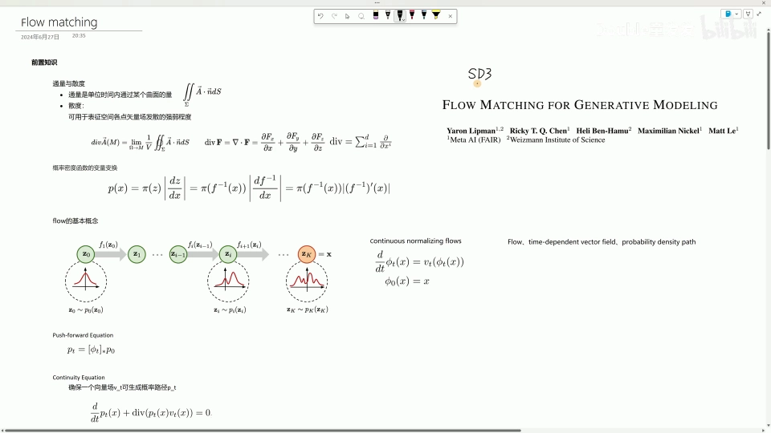

[【跳转到 00:30】](https://www.bilibili.com/video/BV1Wv3xeNEds/?t=30)

### 1.2 概率密度的变量替换：换变量要按「体积变化」重新标定

设随机变量 $Z$ 服从分布 $\pi(z)$，有一个可逆变换 $F$ 使 $X=F(Z)$。那么 $X$ 的密度是

$$
p(x)=\pi(z)\left|\frac{\mathrm{d}z}{\mathrm{d}x}\right|=\pi\!\left(F^{-1}(x)\right)\left|\frac{\mathrm{d}F^{-1}}{\mathrm{d}x}\right|
$$

视频用 DDPM 举例说明为什么需要这个公式：DDPM 里 $x_t=\sqrt{\bar\alpha_t}\,x_0+\sqrt{1-\bar\alpha_t}\,\varepsilon$，因为 $\varepsilon$ 是标准正态，可以直接用「重参数化」的性质读出 $x_t\sim\mathcal N\!\left(\sqrt{\bar\alpha_t}x_0,(1-\bar\alpha_t)I\right)$，不需要变量替换公式。但**一般情形下没有这种便利**，必须靠上面的公式把密度搬过去。这个对比很重要：它说明「知道分布」和「知道怎么算分布」是两回事，而流匹配要处理的正是一般情形。

[【跳转到 02:10】](https://www.bilibili.com/video/BV1Wv3xeNEds/?t=130)

### 1.3 连续性方程：向量场决定分布怎么流

第三个工具是 **continuity equation（连续性方程）**。它说的是：如果给定了向量场 $v_t$，而你真的能沿着这些箭头把 $p_0$ 走到 $p_1$，并且中途每个时刻都恰好访问到预先设定的 $p_t$，那么 $p_t$ 与 $v_t$ 一定满足

$$
\frac{\mathrm{d}}{\mathrm{d}t}p_t(x)+\operatorname{div}\!\big(p_t(x)v_t(x)\big)=0
$$

直观理解：某点密度下降的速度，等于「流」从这点净流出的量。视频没有推导它，只强调它是后面所有证明的出发点——**「速度场能生成路径」这件事，等价于它和路径一起满足连续性方程**。

[【跳转到 18:00】](https://www.bilibili.com/video/BV1Wv3xeNEds/?t=1080)

## 二、把 flow 写成 ODE：$\phi_t$、$v_t$、$p_t$ 三件套

### 2.1 从一串可逆变换到一个常微分方程

**flow（流）** 的定义很朴素：把一个分布通过**一系列可逆变换**变成另一个分布的过程。从 $z_0$ 出发，依次作用 $f_1,f_2,\dots,f_K$ 得到 $z_K$，这就是一个离散的流。把这一串变换聚合成一个整体，记作 $\phi_t$（论文里也写作 $\psi_t$），就能一步从 $x_0$ 跳到 $x_t$——这和 DDPM 里 $x_t=\sqrt{\bar\alpha_t}x_0+\sqrt{1-\bar\alpha_t}\varepsilon$ 的「一步到位」是同一个意思。

把时间从 $0,\dots,T$ 归一化到 $[0,1]$ 并视作连续变量，离散的变换串就变成**连续标准化流（continuous normalizing flow, CNF）**，用一个 ODE 描述：

$$
\frac{\mathrm{d}}{\mathrm{d}t}\phi_t(x)=v_t\big(\phi_t(x)\big),\qquad \phi_0(x)=x
$$

[【跳转到 05:55】](https://www.bilibili.com/video/BV1Wv3xeNEds/?t=355)

### 2.2 三个对象各管什么：路径、速度、变换

视频用「从北京到上海再到广州」的比方把三者分开：

- **概率路径 $p_t$**：预先画好的路线图，规定每个时刻的分布应该长什么样；
- **flow $\phi_t$（$\psi_t$）**：把某个具体样本从起点运到路径上对应位置的那个变换；
- **向量场 $v_t$**：每个时刻、每个位置上的**瞬时速度**，有大小也有方向，告诉样本「现在该往哪走、走多快」。

三者关系是：**给定 $p_t$ 和 $\phi_t$，$v_t$ 就被 ODE 唯一确定**。反过来，只要学到 $v_t$，就能用数值积分（比如欧拉法 $x_{t+\Delta t}=x_t+\Delta t\,v_t$）把样本推着走。

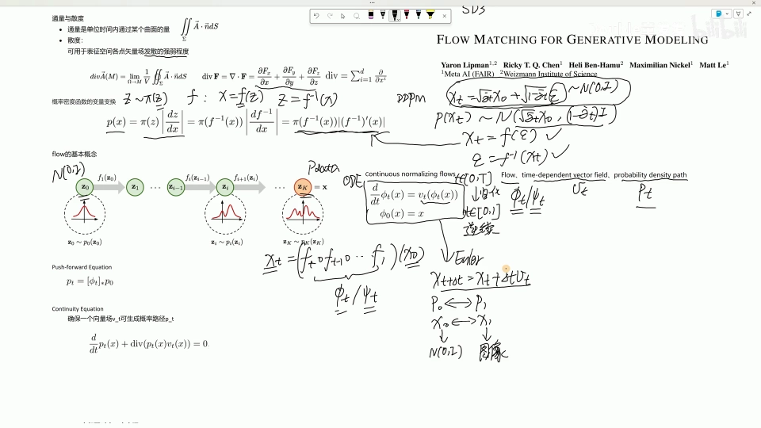

[【跳转到 13:25】](https://www.bilibili.com/video/BV1Wv3xeNEds/?t=805)

> 求解器怎么选、步数怎么定、路径误差怎么积累，属于采样问题，见同系列 4.2.3；本文只关心「$v_t$ 是怎么训练出来的」。

### 2.3 一个容易搞混的约定：$x_0$ 是噪声，$x_1$ 是图像

流匹配的记号与 DDPM **方向相反**：这里 $t=0$ 是纯噪声（$p_0$ 一般取标准正态），$t=1$ 是数据（$p_1\approx q$），所以 $x_0$ 是噪声、$x_1$ 是图像。论文里 $x_1$ 才是「原图」，与 DDPM 的 $x_0$ 角色相同。看论文时把这条记牢，后面所有公式都依赖它。

[【跳转到 11:20】](https://www.bilibili.com/video/BV1Wv3xeNEds/?t=680)

## 三、Flow Matching 的「理想损失」根本算不出来

### 3.1 照抄 score matching 的写法

score matching 的损失是「网络预测的 score 减去真实 score」的平方期望。流匹配**照搬**这个结构，只是把 score 换成速度场：

$$
\mathcal L_{\mathrm{FM}}(\theta)=\mathbb E_{t,\,p_t(x)}\Big\|v_t(x)-u_t(x)\Big\|^2
$$

其中 $v_t$ 是神经网络预测的速度场，$u_t$ 是「真正的」边缘速度场（ground truth）。含义是：如果每个时刻、每个位置的速度都预测对了，样本就能沿着它从噪声分布走到数据分布。

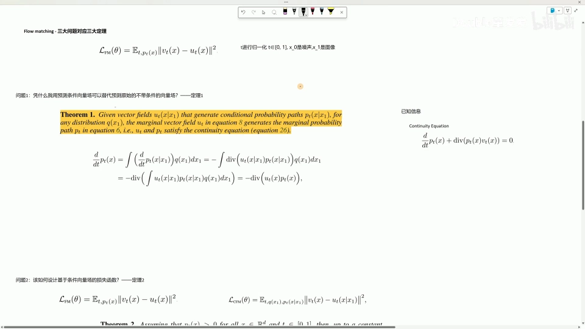

[【跳转到 19:29】](https://www.bilibili.com/video/BV1Wv3xeNEds/?t=1169)

### 3.2 为什么算不出来：$u_t(x)$ 没有闭式

问题在于**这个损失根本算不了**：$u_t(x)$ 的形式我们完全不知道，也不知道该用哪条 $p_t$。这和 score matching 里「真实 score 不知道」、DDPM 里「反向分布不知道」是同一类困境。

### 3.3 加条件：从 $u_t(x)$ 到 $u_t(x\mid x_1)$

score matching 和 DDPM 的解法都是**加条件**：score matching 里给定原图 $x$ 再加噪，加噪后的分布就已知了；DDPM 里给定 $x_0$，逆向分布也能算。流匹配照葫芦画瓢，加的条件就是**终点图像** $x_1$：

$$
\mathcal L_{\mathrm{CFM}}(\theta)=\mathbb E_{t,\,q(x_1),\,p_t(x\mid x_1)}\Big\|v_t(x)-u_t(x\mid x_1)\Big\|^2
$$

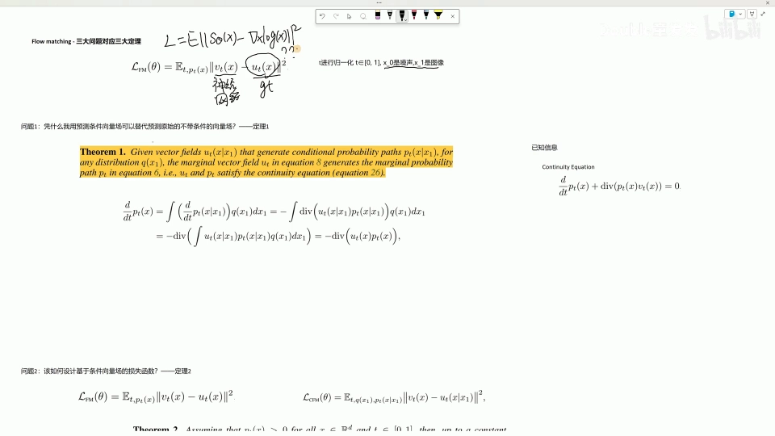

条件速度场 $u_t(x\mid x_1)$ 的好处是：它是**逐样本**定义的，给定一对 $(x_0,x_1)$ 就能写出解析式（定理三）。但这样一来就欠了一个解释——**我凭什么用一个带条件的东西，去替代原本不带条件的目标？** 这正是定理一要回答的问题。

[【跳转到 22:49】](https://www.bilibili.com/video/BV1Wv3xeNEds/?t=1369)

## 四、定理一：条件速度场按后验权重平均，就是边缘速度场

### 4.1 边缘概率路径是条件路径的加权混合

先写下两个「已知信息」。第一，边缘概率路径等于条件路径对数据分布的积分：

$$
p_t(x)=\int p_t(x\mid x_1)\,q(x_1)\,\mathrm{d}x_1
$$

它的意思是：整个分布 $p_t$ 是「每个数据点各自那条小路径」的**加权求和**，权重就是该数据点出现的概率 $q(x_1)$。第二，已知条件速度场 $u_t(x\mid x_1)$ 能生成条件路径 $p_t(x\mid x_1)$，于是它满足条件版的连续性方程。

### 4.2 边缘速度场必须写成加权平均

定理一的结论是：**如果 $u_t(x\mid x_1)$ 生成条件路径 $p_t(x\mid x_1)$，那么由下式定义的边缘速度场 $u_t(x)$ 生成边缘路径 $p_t(x)$**：

$$
u_t(x)=\int u_t(x\mid x_1)\,\frac{p_t(x\mid x_1)\,q(x_1)}{p_t(x)}\,\mathrm{d}x_1
$$

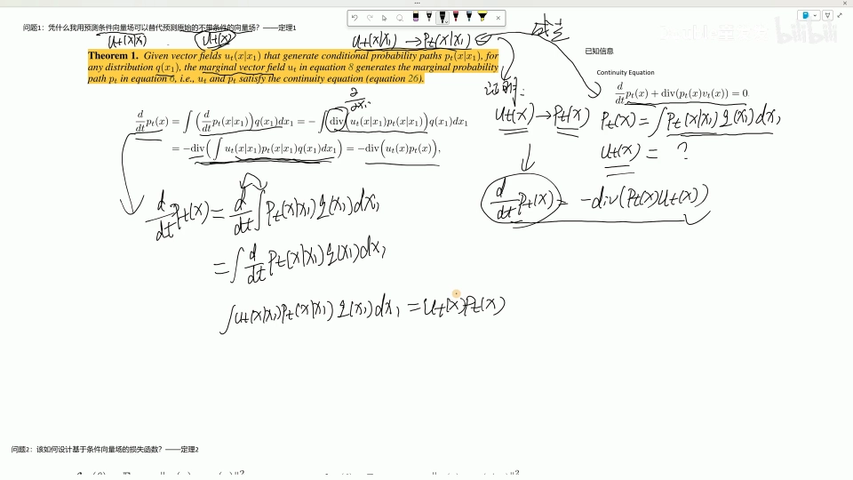

讲者对这个公式有一段很实在的评论：论文是**直接给出**这个形式的，初看非常难理解，直到看懂定理一的证明才明白——它是「为了这碟醋包的饺子」：**必须**把 $u_t$ 设成这个加权平均，最后一步才能对上，否则定理一不成立。

### 4.3 用连续性方程把证明走一遍

证明只有四步，全部围绕「把 $p_t(x)$ 对 $t$ 的导数算出来」：

1. 由 $p_t(x)=\int p_t(x\mid x_1)q(x_1)\mathrm dx_1$，对 $t$ 求导；
2. 用莱布尼茨法则把求导挪进积分号（这一步不影响结果）；
3. 代入条件版的连续性方程，把 $\frac{\mathrm d}{\mathrm dt}p_t(x\mid x_1)$ 换成 $-\operatorname{div}\big(u_t(x\mid x_1)p_t(x\mid x_1)\big)$；
4. 再用一次「散度与积分可交换」，把散度提到积分号外，得到

$$
\frac{\mathrm d}{\mathrm dt}p_t(x)=-\operatorname{div}\!\left(\int u_t(x\mid x_1)\,p_t(x\mid x_1)\,q(x_1)\,\mathrm dx_1\right)
$$

把它和边缘连续性方程 $\frac{\mathrm d}{\mathrm dt}p_t(x)=-\operatorname{div}\big(u_t(x)p_t(x)\big)$ 对照，两边散度括号里的东西必须相等。因为 $p_t(x)$ 与 $x_1$ 无关（对 $x_1$ 积分时是常数），把它除过去就得到 4.2 的公式。

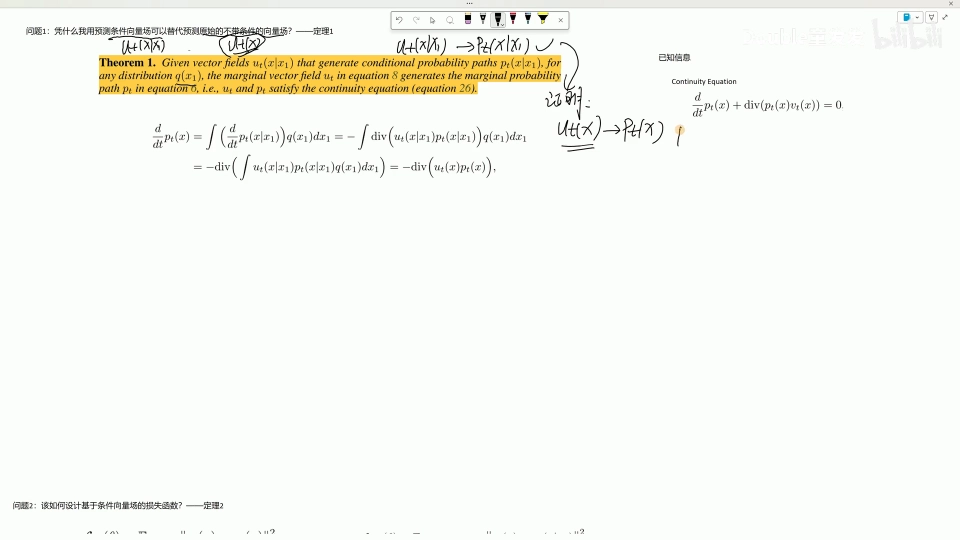

### 4.4 这个加权平均就是条件期望

把 4.2 的式子改写一下就看清楚了。令权重

$$
w(x_1\mid x)=\frac{p_t(x\mid x_1)\,q(x_1)}{p_t(x)}
$$

由贝叶斯公式，它正是**给定当前点 $x$ 时终点 $x_1$ 的后验分布** $p(x_1\mid x)$。于是

$$
u_t(x)=\mathbb E_{x_1\sim p(\cdot\mid x)}\big[u_t(x\mid x_1)\big]
$$

**边缘速度场是条件速度场的条件期望。** 这句话解释了两件事：

- 为什么可以直接回归条件速度：对平方损失而言，最优预测就是条件期望，网络在训练中会**自动**把同一位置上来自不同 $x_1$ 的条件速度平均掉，收敛到的正是 $u_t(x)$；
- 为什么 $u_t(x)$ 本身没法直接写出来：它需要对所有可能终点求期望，是一个积分，而积分算不了；条件速度场却是逐样本的解析式。

[【跳转到 34:31】](https://www.bilibili.com/video/BV1Wv3xeNEds/?t=2071)

## 五、定理二：两个损失函数的梯度处处相等

定理一说明「预测条件速度场」在**函数层面**够用；定理二则从**优化层面**再确认一次：两个损失训练出来的网络是同一个。

### 5.1 差别只有两处

$\mathcal L_{\mathrm{FM}}$ 与 $\mathcal L_{\mathrm{CFM}}$ 的区别只有两点：目标从 $u_t(x)$ 换成 $u_t(x\mid x_1)$；期望的分布从 $p_t(x)$ 换成 $q(x_1)p_t(x\mid x_1)$（多采了一个 $x_1$）。

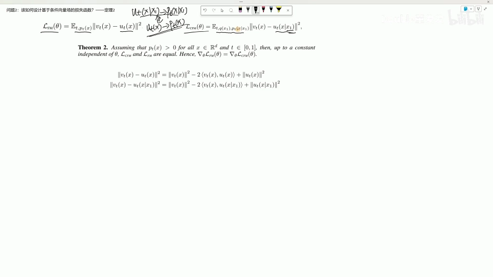

### 5.2 拆平方、换测度

把 $\|v_t-u_t\|^2$ 展开成 $\|v_t\|^2-2\langle v_t,u_t\rangle+\|u_t\|^2$，逐项比较：

- **第三项** $\|u_t\|^2$ 不含 $\theta$，对梯度没有贡献，可以不管；
- **第一项** $\mathbb E_{p_t}\|v_t\|^2$ 与 $\mathbb E_{q(x_1)p_t(x\mid x_1)}\|v_t\|^2$ 相等，因为对 $x_1$ 积分正好还原出 $p_t(x)$；
- **第二项** 需要把 $u_t(x)$ 用定理一的加权平均式代入，$p_t(x)$ 在分子分母上约掉，剩下的正好是 $\mathbb E_{q(x_1)p_t(x\mid x_1)}\langle v_t,u_t(x\mid x_1)\rangle$。

三项都对上了，于是两个损失只差一个与 $\theta$ 无关的常数，**梯度处处相同**：用哪个损失去更新网络，走出来的参数轨迹都一样。

### 5.3 这条定理的实际价值

它把「不可计算的理想目标」换成了「可采样的实用目标」：训练时不再需要边缘路径和边缘速度场，只要**采样一对 $(x_0,x_1)$、采样一个 $t$**，就能构造出无偏的梯度估计。

[【跳转到 40:13】](https://www.bilibili.com/video/BV1Wv3xeNEds/?t=2413)

## 六、定理三：高斯路径让 $u_t$ 有闭式解

到这里还有最后一个洞：**$u_t(x\mid x_1)$ 的具体形式是什么？** 要写代码就得有它。既然凭空写不出，就**假设**——最自然的假设是让条件路径取一族高斯分布。

### 6.1 高斯条件路径的两条边界条件

$$
p_t(x\mid x_1)=\mathcal N\big(x\mid \mu_t(x_1),\,\sigma_t(x_1)^2 I\big),\qquad \psi_t(x)=\sigma_t(x_1)\,x+\mu_t(x_1)
$$

边界条件有两条，正好对应「从噪声出发、到达数据」：

- $t=0$：希望是标准正态，于是 $\mu_0(x_1)=0$、$\sigma_0(x_1)=1$；
- $t=1$：希望集中在 $x_1$ 附近，于是 $\mu_1(x_1)=x_1$、$\sigma_1(x_1)=\sigma_{\min}$ 取足够小（不必为 0）。

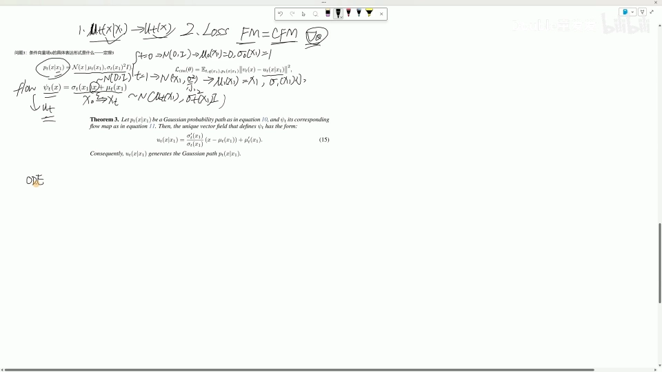

### 6.2 由 ODE 与反函数解出 $u_t$

把 $\psi_t$ 代进 CNF 的 ODE，$\frac{\mathrm d}{\mathrm dt}\psi_t(x)=u_t\big(\psi_t(x)\mid x_1\big)$。这里有个**极易踩的坑**：等式右边的 $x$ 不是左边那个服从标准正态的初始 $x$，而是**已经走到 $t$ 时刻的位置** $\psi_t(x)$——「此 $x$ 非彼 $x$」。讲者特意强调，很多人以为「直接求个导就完了」，正是错在这一点上。

正确做法是利用 $\psi_t$ 可逆：令 $y=\psi_t(x)$，则 $x=\psi_t^{-1}(y)=\frac{1}{\sigma_t(x_1)}\big(y-\mu_t(x_1)\big)$。把它代回求导式，整理即得

$$
u_t(x\mid x_1)=\frac{\sigma_t'(x_1)}{\sigma_t(x_1)}\big(x-\mu_t(x_1)\big)+\mu_t'(x_1)
$$

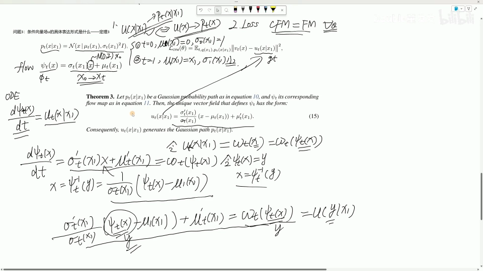

### 6.3 训练算法落到伪代码

把三个定理串起来，训练循环只有五行：

```text
repeat:
  x1 ~ q(x1)                     # 采一张真实图像
  x0 ~ N(0, I)                   # 采一个噪声
  t  ~ U[0, 1]                   # 采一个时刻
  x_t = sigma_t(x1) * x0 + mu_t(x1)        # 走到路径上的点
  u   = sigma'_t(x1)/sigma_t(x1) * (x_t - mu_t(x1)) + mu'_t(x1)   # 目标速度
  loss = || v_theta(x_t, t) - u ||^2
  update theta by gradient of loss
```

注意目标速度里**没有** $x_1$ 之外的未知量：$\mu_t,\sigma_t$ 是我们自己选的函数，导数也是解析的。这就是定理三的全部价值——把「不知道的 $u_t$」变成「能算的 $u_t(x\mid x_1)$」。

[【跳转到 57:09】](https://www.bilibili.com/video/BV1Wv3xeNEds/?t=3429)

## 七、三种概率路径：方差爆炸、方差保持与最优传输直线

定理三里的 $\mu_t$ 和 $\sigma_t$ 是**可以随便选**的，只要满足两条边界条件。选不同的函数，就得到不同的概率路径；而 DDPM 和 score matching 恰好是其中两个特例。

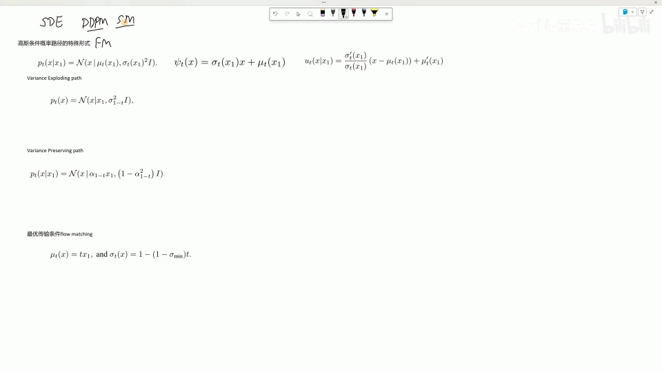

### 7.1 方差爆炸路径 = score matching

取 $\mu_t(x_1)=x_1$、$\sigma_t(x_1)=\sigma_{1-t}$，且 $t=0$ 时 $\sigma_1\gg 1$。因为方差没有上界、可以一直涨到远大于 1，所以叫**方差爆炸（variance exploding, VE）**路径——这正是 score-based model 的加噪方式。

### 7.2 方差保持路径 = DDPM

取 $\mu_t(x_1)=\sqrt{\alpha_{1-t}}\,x_1$、$\sigma_t(x_1)=\sqrt{1-\alpha_{1-t}^2}$，就是 DDPM 的 $x_t=\sqrt{\bar\alpha_t}x_0+\sqrt{1-\bar\alpha_t}\varepsilon$（注意这里 $t$ 是反的，所以写成 $1-t$）。方差最大为 1，所以叫**方差保持（variance preserving, VP）**。

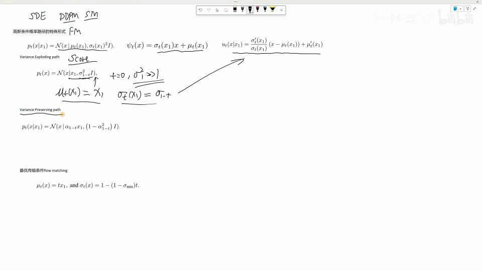

### 7.3 最优传输直线：$x_t=(1-t)x_0+t\,x_1$

最简洁的选择是让均值和标准差都**随时间线性变化**：

$$
\mu_t(x_1)=t\,x_1,\qquad \sigma_t(x_1)=1-(1-\sigma_{\min})t
$$

取 $\sigma_{\min}=0$ 时，路径上的点就是噪声与图像的**线性插值**：

$$
x_t=(1-t)\,x_0+t\,x_1
$$

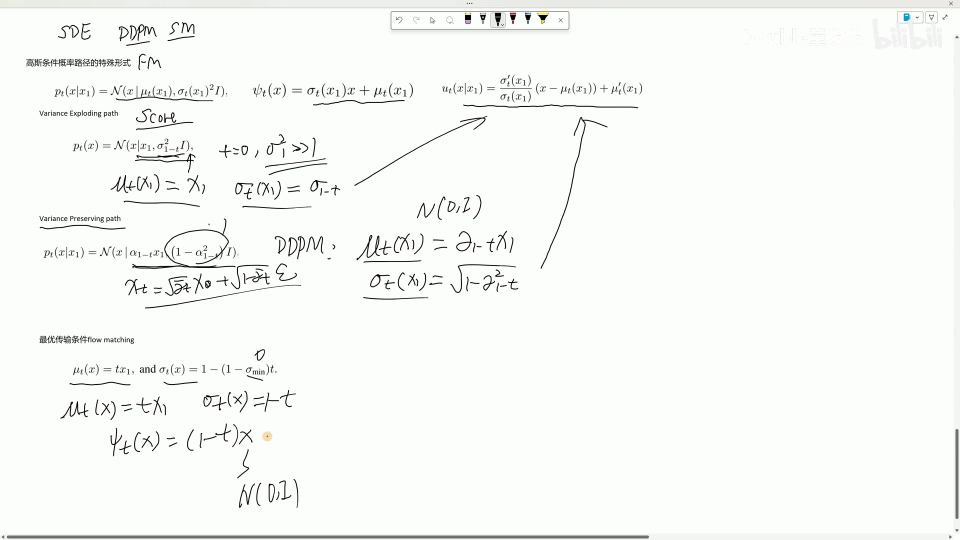

### 7.4 直线为什么好（以及为什么这里不展开）

直线路径意味着**每个样本沿一条直线从噪声走到数据**，方向不绕弯，因此可以用很少的积分步数走完——这是流匹配能加速采样的直接原因。讲者在结尾只说了一句「可以直接一步到位，加速采样」，具体怎么积分、步数怎么影响误差，属于 4.2.3 的内容。

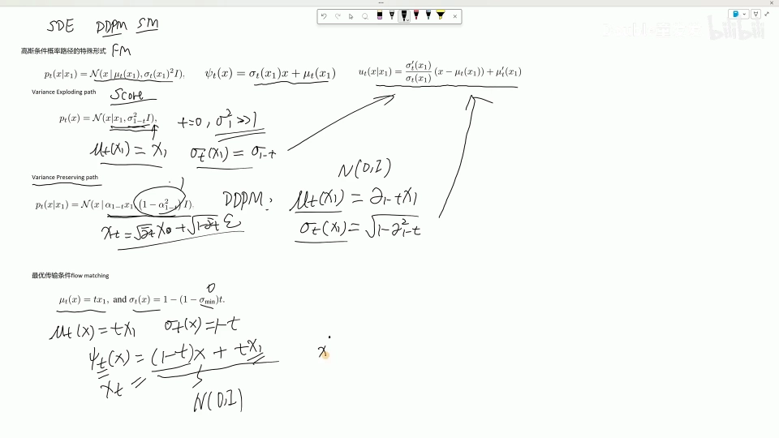

[【跳转到 67:00】](https://www.bilibili.com/video/BV1Wv3xeNEds/?t=4020)

## 小结

- **理想目标算不出来**：$\mathcal L_{\mathrm{FM}}$ 要回归边缘速度场 $u_t(x)$，而 $u_t$ 既没有闭式、也积不出来。
- **定理一（函数层）**：把条件速度场按后验权重 $p_t(x\mid x_1)q(x_1)/p_t(x)$ 加权积分，得到的正是生成边缘路径的边缘速度场；用连续性方程四步即可证明。这个加权平均就是**条件期望**。
- **定理二（优化层）**：$\mathcal L_{\mathrm{FM}}$ 与 $\mathcal L_{\mathrm{CFM}}$ 只差一个与 $\theta$ 无关的常数，梯度处处相等，所以用可采样的条件目标训练，等价于优化理想目标。
- **定理三（可计算性）**：取高斯条件路径 $p_t(x\mid x_1)=\mathcal N(\mu_t,\sigma_t^2I)$，条件速度场有闭式解 $u_t(x\mid x_1)=\frac{\sigma_t'}{\sigma_t}(x-\mu_t)+\mu_t'$。
- **训练样本的构造**：采 $x_1\sim q$、$x_0\sim\mathcal N(0,I)$、$t\sim U[0,1]$，走到 $x_t=\sigma_t x_0+\mu_t$，回归该点的瞬时速度。
- **路径可以自选**：VE 路径对应 score matching，VP 路径对应 DDPM，线性插值给出最优传输直线路径 $x_t=(1-t)x_0+tx_1$。

## 关键术语速查

| 术语 | 一句话解释 |
| --- | --- |
| 概率路径 $p_t$ | 每个时刻 $t$ 上的分布，规定样本从噪声到数据沿途该长什么样 |
| 向量场 / 速度场 $v_t$ | 每个时刻、每个位置的瞬时速度，决定样本往哪走、走多快 |
| flow $\phi_t$（$\psi_t$） | 把初始点沿速度场推到 $t$ 时刻位置的变换，满足 ODE $\frac{\mathrm d}{\mathrm dt}\phi_t=v_t(\phi_t)$ |
| 连续性方程 | $\frac{\mathrm d}{\mathrm dt}p_t+\operatorname{div}(p_tv_t)=0$，是「速度场生成该路径」的判据 |
| 条件概率路径 $p_t(x\mid x_1)$ | 固定终点 $x_1$ 后，从噪声到该点的那条小路径 |
| 边缘概率路径 $p_t(x)$ | 所有条件路径按数据分布 $q(x_1)$ 加权混合后的总路径 |
| 条件速度场 $u_t(x\mid x_1)$ | 生成条件路径的速度场，给定 $(x_0,x_1)$ 有解析式 |
| 边缘速度场 $u_t(x)$ | 生成边缘路径的速度场，等于条件速度场的条件期望 |
| 方差爆炸 / 方差保持 | 两种经典高斯路径，分别对应 score matching 与 DDPM |
| 最优传输路径 | 取 $\mu_t=tx_1$、$\sigma_t=1-t$ 的直线路径，$x_t=(1-t)x_0+tx_1$ |