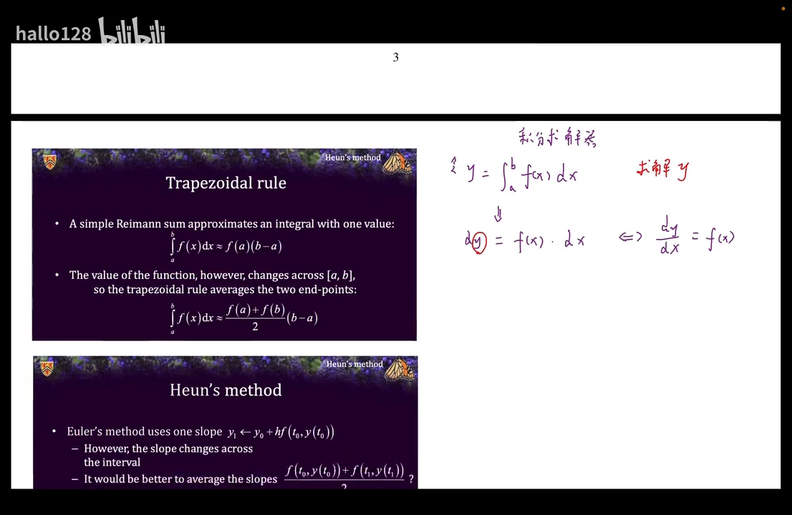
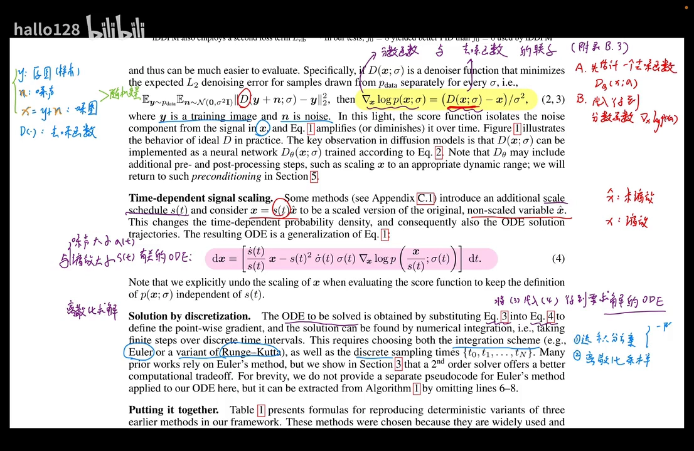
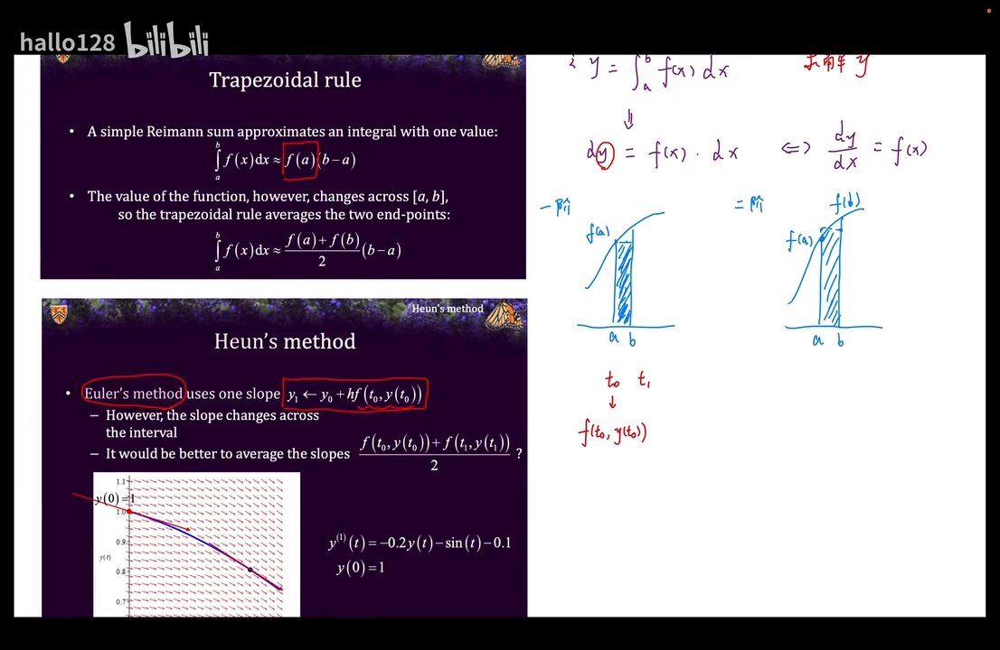
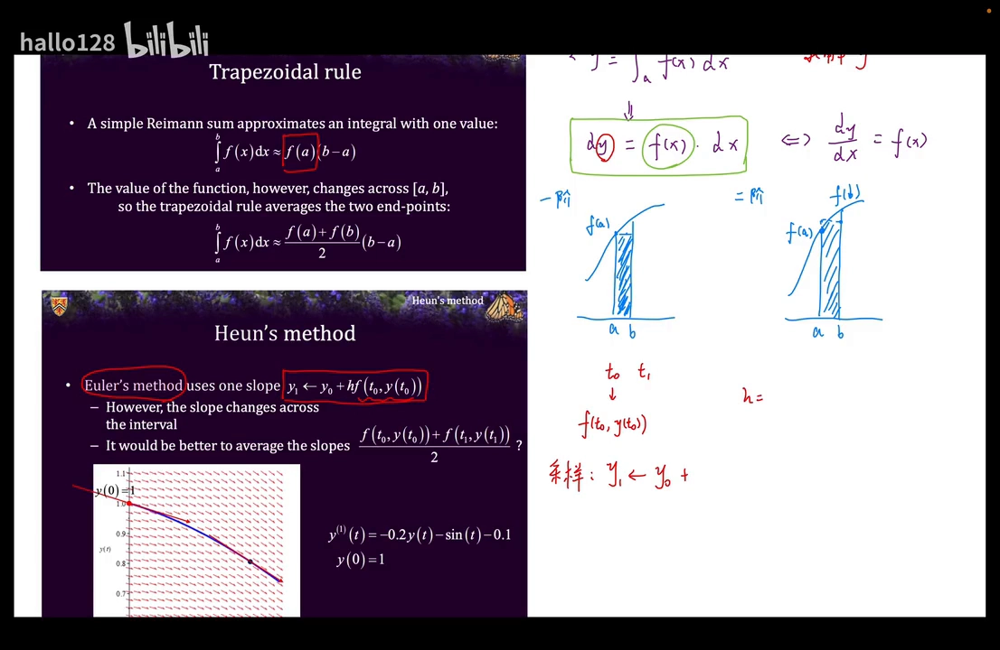
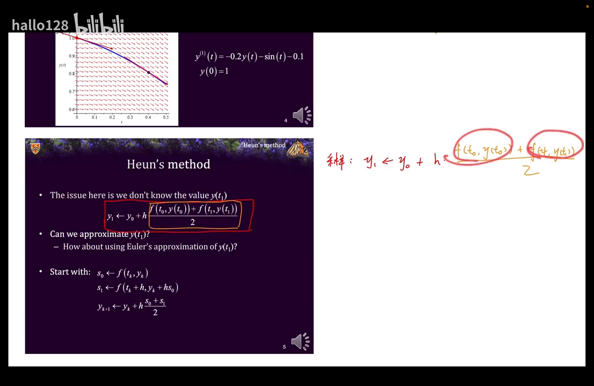
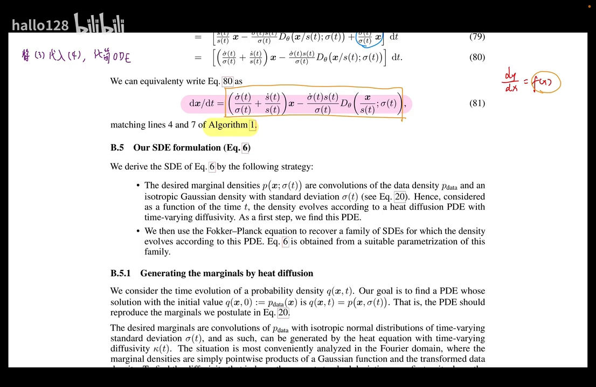
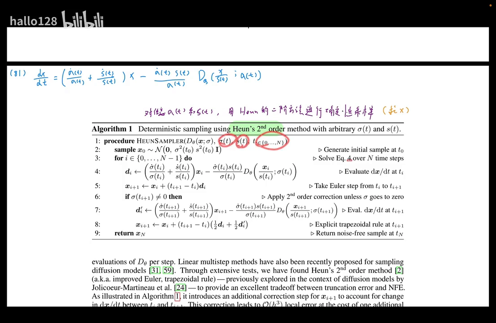
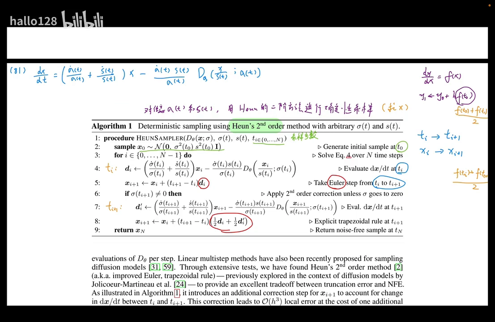
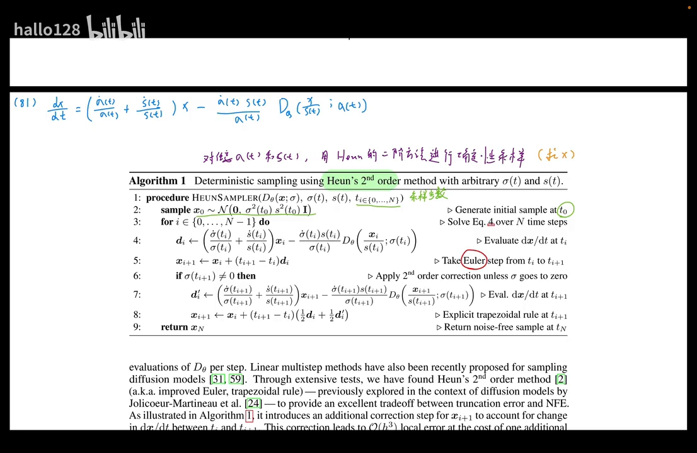

# 从欧拉到Heun：确定性采样器的积分阶数、步长与网络调用次数

> 视频来源：[【公式推导】离散化求解ODE：算法1，介绍积分求解器【附录B.4】](https://www.bilibili.com/video/BV1xEW8e1E1j/)（Bilibili · hallo128）｜时长约 33 分钟
> 导读：这是一次论文精读，读的是 EDM（Karras 等）附录 B.4 与算法 1。视频前半段用最朴素的"求面积"讲清一阶欧拉与二阶 Heun 的区别，后半段把 ODE 化简成可直接写进代码的形式，再逐行过算法 1。本文只取**积分器与步长**这条线：它讲的是"已知速度场之后怎么走"，与速度场怎么学（4.2.2）无关；DDIM、DPM-Solver 这类扩散专用采样器见 3.2.4。

## 本讲要解决的核心问题（SCQA）

**背景**：一旦把生成写成常微分方程 $\frac{dx}{dt}=v_\theta(x,t)$，采样就变成"解方程"。方程右端是网络给出的速度，理论上解析解拿不到，只能**离散化**：取一串时间点 $t_0<t_1<\dots<t_N$，一步一步往前推。

**冲突**：离散化必然引入误差。用最省事的欧拉法（每步只查一次速度），步长一大就走偏；想减小误差就得加步数，而每一步都要调用一次网络（NFE），成本直接翻倍。**精度和成本在这里是对立的。** [【跳转到 02:05】](https://www.bilibili.com/video/BV1xEW8e1E1j/?t=125)

**疑问**：有没有一种方法，在同样步数下把误差压得更低？多花的代价是什么？

**回答（中心思想）**：有。**一阶欧拉法只用区间左端一个点的高度去近似整块面积；二阶 Heun 法取两端高度的平均（梯形法则），局部误差从 $O(h^2)$ 降到 $O(h^3)$，代价是每步多一次函数评估。** 论文的算法 1 就是"先走一个欧拉步拿到预测点，再用两端的斜率平均做一次校正"，并且规定 $\sigma(t_{i+1})\to 0$ 时跳过校正——因为那一步的分母会出问题。

## 一、把采样写成积分：求的是"面积"

视频先把符号统一。我们想求的量写成积分：

$$
y=\int_a^b f(x)\,dx
$$

对它微分，就得到

$$
dy=f(x)\,dx\quad\Longleftrightarrow\quad \frac{dy}{dx}=f(x)
$$

于是"解 ODE"和"求积分"是同一件事：**采样就是沿着时间轴把速度累加起来**。[【跳转到 05:29】](https://www.bilibili.com/video/BV1xEW8e1E1j/?t=329)

那么问题就变成：怎么用有限个点上的函数值，去近似一整块面积？

论文在这一段把两件事并列：**选积分方案**（Euler 或 Runge-Kutta 的变体）与**选离散时间点** $\{t_0,t_1,\dots,t_N\}$。前者决定单步误差，后者决定步长与总步数。[【跳转到 03:20】](https://www.bilibili.com/video/BV1xEW8e1E1j/?t=200)

## 二、一阶欧拉：用一个点的高度近似整块面积

如果区间 $[a,b]$ 足够短，就可以拿左端点的高度乘上区间长度：

$$
\int_a^b f(x)\,dx\approx f(a)\,(b-a)
$$

这就是**一阶**近似——只取一个点。几何上，是用一块矩形代替曲线下的面积。[【跳转到 07:31】](https://www.bilibili.com/video/BV1xEW8e1E1j/?t=451)

换回采样语言：把 $b-a$ 记作步长 $h=t_1-t_0$，就得到欧拉法

$$
y_1=y_0+h\,f(t_0)
$$

注意这个近似的成立条件：**$a$ 到 $b$ 的距离必须足够小**。距离一大，矩形和曲线下的真实面积就相差很多——这正是"步长不能太大"的几何解释。[【跳转到 09:17】](https://www.bilibili.com/video/BV1xEW8e1E1j/?t=557)

## 三、二阶 Heun：两端取平均，再补一次校正

### 3.1 梯形法则：用两个点代替一个点

二阶的想法很自然：既然函数在区间内会变，那就把**两端的高度取平均**：

$$
\int_a^b f(x)\,dx\approx \frac{f(a)+f(b)}{2}\,(b-a)
$$

区间长度还是 $b-a$，只是高度从"一个点"变成"两端的平均"。这就是梯形法则（trapezoidal rule）。[【跳转到 08:52】](https://www.bilibili.com/video/BV1xEW8e1E1j/?t=532)

### 3.2 麻烦在于：右端点的值还不知道

梯形公式要用 $f(t_1,y(t_1))$，可 $y(t_1)$ 正是我们要求的东西。Heun 方法的处理是**先用欧拉法猜一个**，再拿这个猜测去算右端斜率：

$$
s_0=f(t_k,y_k),\qquad s_1=f(t_k+h,\ y_k+h\,s_0),\qquad y_{k+1}=y_k+h\cdot\frac{s_0+s_1}{2}
$$

这就是"预测—校正"：第一步（$s_0$）是预测，第二步（$s_1$）是校正。视频把它概括成一句话：**一阶就是一步一步代；二阶就是多求一个值，然后取平均**。[【跳转到 15:59】](https://www.bilibili.com/video/BV1xEW8e1E1j/?t=959)

## 四、把公式落成算法：算法 1 逐行看

### 4.1 先化简 ODE 的形式

视频花了大量篇幅做代数：把分数函数用去噪函数替换（$\nabla_x\log p(x;\sigma)=(D(x;\sigma)-x)/\sigma^2$），再代入带信号缩放的 ODE，约掉 $\sigma$ 与 $s(t)$，最后得到可以直接写进代码的形式：[【跳转到 26:28】](https://www.bilibili.com/video/BV1xEW8e1E1j/?t=1588)

$$
\frac{dx}{dt}=\left(\frac{\dot\sigma(t)}{\sigma(t)}+\frac{\dot s(t)}{s(t)}\right)x-\frac{\dot\sigma(t)\,s(t)}{\sigma(t)}\,D_\theta\!\left(\frac{x}{s(t)};\sigma(t)\right)
$$

这一步的意义在于：**积分器是通用的，但右端函数必须先化简成"网络能算的形式"**。化简完成后，把它当成 $f(x)$ 塞进欧拉或 Heun 即可。

### 4.2 算法 1 的结构

算法 1 的骨架只有四件事：[【跳转到 17:13】](https://www.bilibili.com/video/BV1xEW8e1E1j/?t=1033)

1. **给定采样步数 $N$**，以及 $\sigma(t)$、$s(t)$ 这两条你指定的变化曲线；
2. **初始点从正态分布采样**：$x_0\sim\mathcal{N}(0,\sigma^2(t_0)s^2(t_0)I)$；
3. **循环 $N$ 步**：先算当前点的 $d_i$，走一个欧拉步得到 $x_{i+1}$；
4. **若 $\sigma(t_{i+1})\neq 0$**，在新点再算一次 $d'_i$，用两者平均重写 $x_{i+1}$。

写成公式就是：

$$
x_{i+1}=x_i+(t_{i+1}-t_i)\,d_i
$$

$$
x_{i+1}=x_i+(t_{i+1}-t_i)\left(\tfrac12 d_i+\tfrac12 d'_i\right)
$$

视频里特别点出两个细节：

- **$\sigma(t_{i+1})\neq 0$ 才做校正。** 当 $\sigma$ 走到 0，$d'_i$ 里的 $\dot\sigma/\sigma$ 会发散，所以最后一步退化成纯欧拉步。
- **校正用的是同一个区间。** 不是"再走一步"，而是把这一步的两个端点斜率平均后**重写** $x_{i+1}$——所以它不增加步数，只增加每步的网络调用次数。

## 五、阶数、步长与 NFE 的三角权衡

把三条信息放在一起看：

| 方案 | 每步网络调用 | 局部误差 | 直观解释 |
| --- | --- | --- | --- |
| 欧拉（一阶） | 1 次 | $O(h^2)$ | 用左端一个点的高度当整块面积 |
| Heun（二阶） | 2 次 | $O(h^3)$ | 两端高度取平均，误差随步长下降更快 |

论文正文的说法是：Heun 的二阶方法在**截断误差与 NFE 之间提供了很好的折中**；它多引入一次校正，把局部误差降到 $O(h^3)$，代价是每步多一次函数评估。视频也交代了这条线索的来处：早期工作多用欧拉法，而这里选择二阶，是因为它在计算上更划算。[【跳转到 02:00】](https://www.bilibili.com/video/BV1xEW8e1E1j/?t=120)

由此可以得到几条实用判断：

- **步长必须足够小**。无论一阶还是二阶，"用有限个点近似面积"都要求区间够短；步长太大，任何阶数都救不回来。
- **二阶不是免费的**。同样 $N$ 步，Heun 的网络调用次数是欧拉的两倍；比较两种方法时，"步数"和"NFE"是两个不同的口径，不能混着说。
- **阶数换来的是误差随步长下降的速度**。局部误差 $O(h^2)$ 与 $O(h^3)$ 的差别，在 $h$ 变小时会迅速放大成数量级差异。

## 六、这条线的边界

**第一，这里解的是"确定性"采样。** 给定同一个初始噪声，整个积分过程是确定的；随机性全部来自初始点的采样。这与随机微分方程（SDE）采样是两条路，后者每步还要额外注入噪声。

**第二，积分器与"速度场怎么来"无关。** 视频里的右端函数来自分数模型（用去噪网络表示），但欧拉/Heun 的推导只用到"$dy=f(x)dx$"这一件事。换成流匹配学到的速度场 $v_\theta(x,t)$，积分器的写法完全一样——**这正是本小节把"求解器"单独拎出来讲的原因**：它是采样侧共用的零件，与训练目标（4.2.2）解耦。

**第三，采样不需要雅可比，也不等于可逆密度模型。** 前向积分只查询速度场，不计算任何行列式；代价是这条路径也给不出精确的对数似然。

## 小结

- 采样 = 解 $\frac{dx}{dt}=v_\theta(x,t)$；解析解拿不到，只能离散化成一串时间点逐步推进。
- 一阶欧拉：$\int_a^b f\approx f(a)(b-a)$，只用一个点的高度；成立条件是区间足够短。
- 二阶 Heun：$\int_a^b f\approx\frac{f(a)+f(b)}{2}(b-a)$，两端取平均；右端点的值先用欧拉步预测，再校正。
- 局部误差：欧拉 $O(h^2)$，Heun $O(h^3)$；代价是每步网络调用从 1 次变 2 次。
- 算法 1 的骨架：给定 $N$ 与 $\sigma(t),s(t)$ → 从正态采初始点 → 每步先欧拉、再校正 → $\sigma(t_{i+1})=0$ 时跳过校正。
- 步长、阶数、NFE 三者互相牵制；比较方法时要说清用的是"步数"还是"网络调用次数"。
- 积分器与速度场来源无关：分数模型、流匹配都能套同一套欧拉/Heun 写法。

## 关键术语速查

| 术语 | 一句话解释 |
| --- | --- |
| 离散化 | 把连续的 ODE 拆成有限个时间点，逐步近似求解 |
| 欧拉法 | 一阶积分器，用左端点斜率乘步长前进 |
| Heun 法 | 二阶积分器，用区间两端斜率的平均；需要先预测右端点 |
| 梯形法则 | $\int f\approx\frac{f(a)+f(b)}{2}(b-a)$，Heun 的几何来源 |
| 局部误差 | 单步引入的误差，欧拉 $O(h^2)$、Heun $O(h^3)$ |
| NFE | 网络函数调用次数，采样成本的直接度量 |
| 预测—校正 | 先用一阶方法猜下一步，再用二阶公式修正 |
| 确定性采样 | 给定初始噪声后轨迹唯一，随机性只来自初始点 |