# 训练走直线，采样为什么还会拐弯：速度场积分与少步采样

> 视频来源：[训练沿直线，生成为什么还会拐弯？｜Flow Matching 与 Rectified Flow【04/14】](https://www.bilibili.com/video/BV1HXnE6GEK6/)（Bilibili · newbiligirls）｜时长约 7 分钟
> 导读：《多模态与生成模型》系列第 4 章。本文只取这支视频的**采样侧**：速度场怎么积分、欧拉一步错在哪、路径为什么会弯、少步生成靠什么成立。训练目标（条件速度的回归）属于本系列 4.2.2，扩散采样器（DDIM、DPM-Solver）属于 3.2.4，本文不重复。

## 本讲要解决的核心问题（SCQA）

**背景**：流匹配（flow matching）训练时，每一对样本 $(x_0,x_1)$ 之间的路径都是一条直线，监督信号就是这条直线的方向 $x_1-x_0$，干净、好算。[【跳转到 01:00】](https://www.bilibili.com/video/BV1HXnE6GEK6/?t=60)

**冲突**：可是真正生成时，轨迹经常是弯的，而且步数一少，图像就糊。既然训练时"处处是直线"，为什么生成时还会拐弯？[【跳转到 00:00】](https://www.bilibili.com/video/BV1HXnE6GEK6/?t=0)

**疑问**：生成时到底在解什么方程？弯的路径和步数之间是什么关系？少步生成（甚至一步）凭什么可行、又凭什么不可行？

**回答（中心思想）**：**采样是在解一个常微分方程 $\frac{dx}{dt}=v_\theta(x,t)$，用数值积分器一步一步走。**训练时给的是"条件速度"，生成时用的是把所有条件速度按后验权重平均出来的"边缘速度"——平均这一步就会让场弯曲；路径越弯，一步跨得越大，局部切线就越偏离真实路径，误差按步长的高阶项放大。所以"少步"不是免费的：要么把路径拉直（reflow、更好的配对），要么让网络直接学区间平均速度（MeanFlow），要么就得接受更多步数。

## 一、采样是在解一个常微分方程

### 1.1 速度场：每个位置一支箭头

生成不是搬动一个点，而是把整群样本的分布从容易抽样的噪声变成数据分布。视频用时间 $t$ 标记中间阶段：$t=0$ 是起点（噪声），$t=1$ 是终点（数据）。每个位置都有一支速度箭头，告诉经过这里的样本该往哪走；点群按这个速度场演化，密度便随时间改变。[【跳转到 00:25】](https://www.bilibili.com/video/BV1HXnE6GEK6/?t=25)

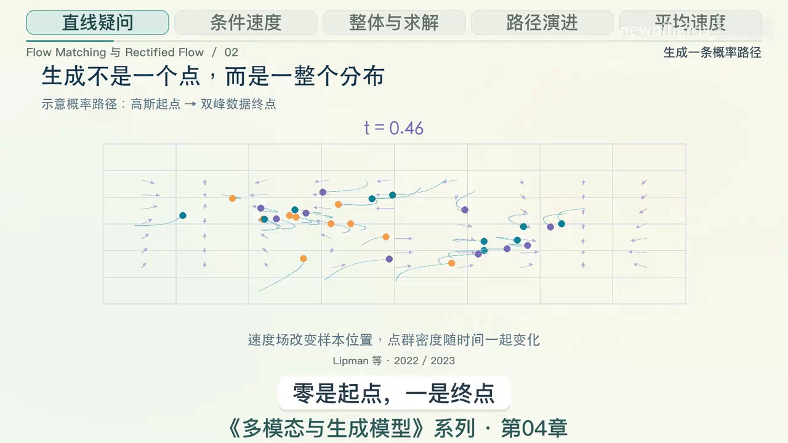

要强调的是：**速度描述的是每单位时间的变化，不是直接给出最终图像**。连续归一化流（CNF，continuous normalizing flow）很早就可以用微分方程描述生成，但按自然方式训练，通常要在每次更新参数时反复求解轨迹、每一步都调用一次网络，成本不小。[【跳转到 00:50】](https://www.bilibili.com/video/BV1HXnE6GEK6/?t=50)

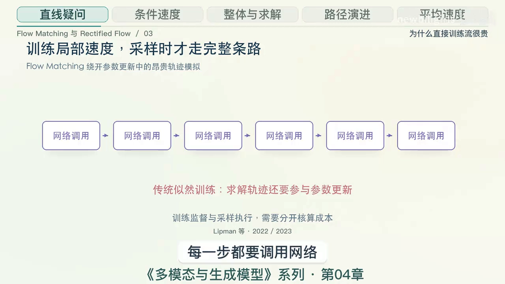

这张图是理解"流匹配为什么便宜"的关键：**训练只回归局部速度，采样才走完整条路**。训练监督和采样执行要分开核算成本。

### 1.2 采样只需要前向积分，不需要雅可比

这里要划清一条界线，避免把流匹配和可逆密度模型混为一谈：

- **训练**：抽配对、抽时间、算出中间点 $x_t$ 与条件速度，把 $(x_t,t)$ 送进网络，比较预测速度与目标速度。中间点可以直接算出，**这次更新不需要先把整条轨迹数值走完**。[【跳转到 01:40】](https://www.bilibili.com/video/BV1HXnE6GEK6/?t=100)
- **采样**：从先验噪声出发，**只做前向积分**，一路查询速度场，不需要计算任何雅可比行列式。
- **代价**：正因为绕开了似然，流匹配也**没有免费的精确对数似然**。要算似然就得沿轨迹额外累积散度项，那正是视频里说的"反复求解轨迹"的 CNF 训练成本。

换句话说：可逆密度模型（4.2.1）用雅可比换似然；流匹配用回归换训练效率，把成本挪到了采样时的积分上。

### 1.3 欧拉一步：最简单的积分器

采样要解的方程是：

$$
\frac{dx}{dt}=v_\theta(x,t)
$$

最简单的数值解法是欧拉法：用当前位置加步长乘当前速度，估计下一位置。

$$
x_{t+h}\approx x_t+h\,v_\theta(x_t,t)
$$

视频给了一个具体数字：当前位置 $-0.5$、步长 $h=0.1$、预测速度 $3$，下一位置就是 $-0.5+0.1\times 3=-0.2$。[【跳转到 03:45】](https://www.bilibili.com/video/BV1HXnE6GEK6/?t=225)

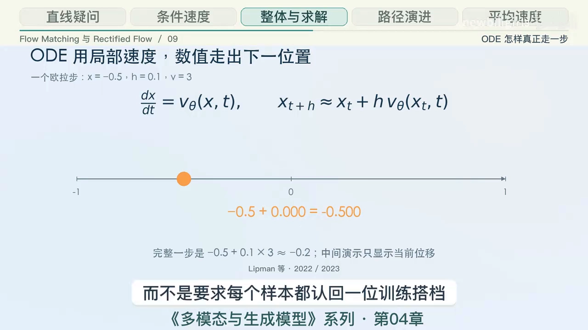

两个容易忽略的细节：

1. **每一步都要在新位置重新预测速度**，不能一直把旧速度用到底——速度场是位置的函数。
2. **步长越大，局部近似误差越明显**。欧拉法拿的是"当前点的切线"，一步跨太远，切线就不再代表这段路的真实走向。

## 二、训练直线不等于生成直线

### 2.1 条件速度：给定配对时，目标速度处处相同

最简单的构造是线性插值：

$$
x_t=(1-t)x_0+t\,x_1,\qquad u_t=x_1-x_0
$$

$t=0$ 时只有起点，$t=1$ 时到达终点；把路径对时间求导，速度就是"终点减起点"，**给定这对样本，目标速度处处相同**。视频特别提醒：这里规定的是"噪声到数据"的方向，有些论文用相反记号，阅读时先核对方向。[【跳转到 01:40】](https://www.bilibili.com/video/BV1HXnE6GEK6/?t=100)

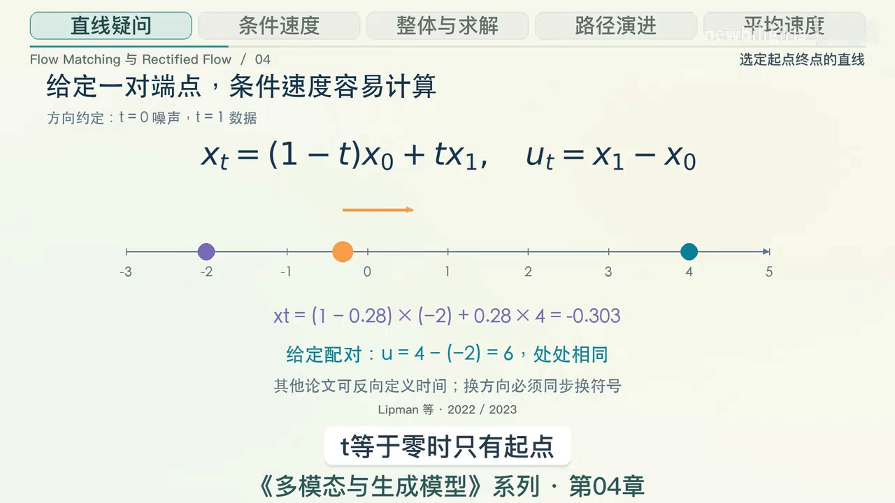

损失就是两支箭头之差的平方：

$$
L=\mathbb{E}_{t,x_0,x_1}\left\|v_\theta(x_t,t)-(x_1-x_0)\right\|^2
$$

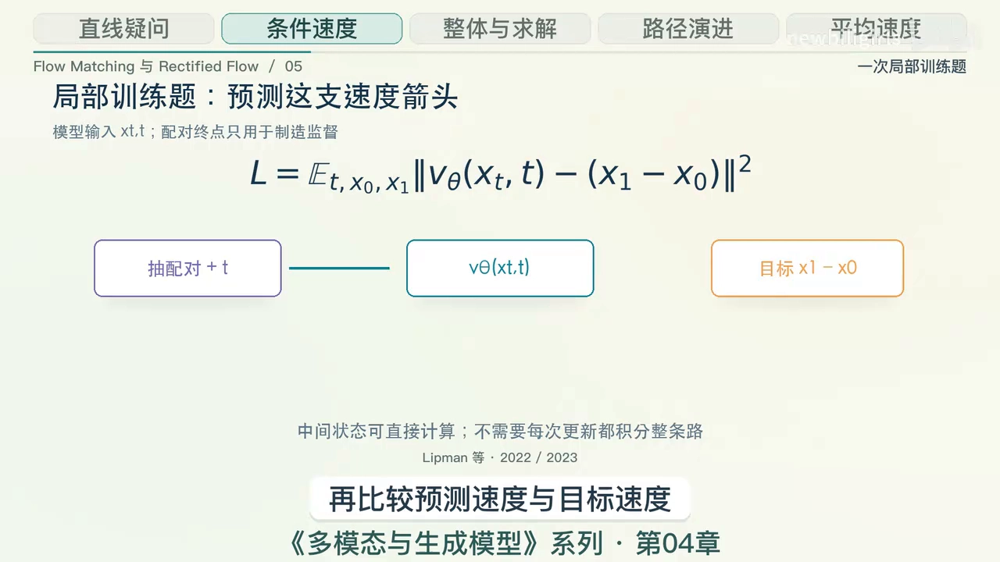

### 2.2 位置、速度、误差是三种不同的量

视频用一个手算例子把这几个量分开：起点 $x_0=-2$、终点 $x_1=4$、$t=0.25$，中间位置是

$$
x_t=0.75\times(-2)+0.25\times 4=-0.5
$$

目标速度是 $4-(-2)=6$。这里位置在随时间变，给定配对的目标速度不变，而预测误差由网络输出决定——**三者不要混在一起看**。[【跳转到 02:05】](https://www.bilibili.com/video/BV1HXnE6GEK6/?t=125)

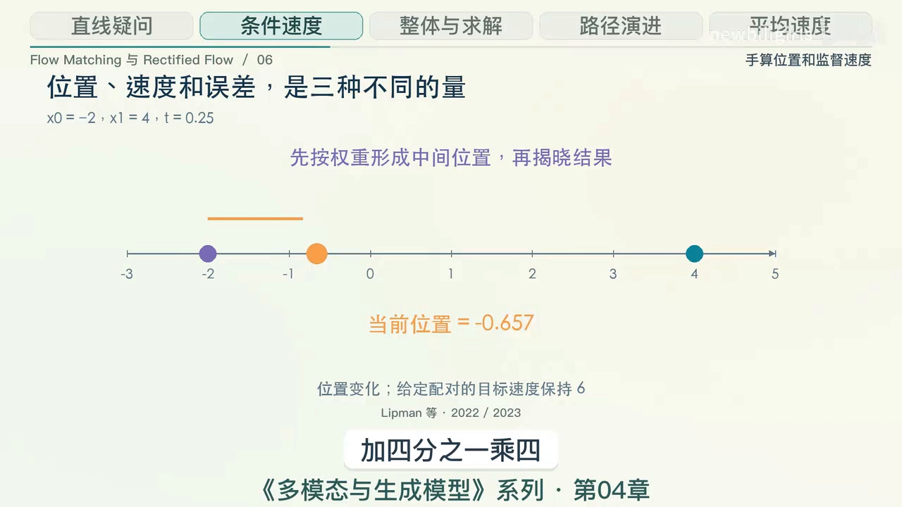

### 2.3 拐弯的真正来源：条件速度到边缘速度

关键来了：**同一个位置和时间，可能由不同的配对经过**。假设当前位置有两条路径经过，条件概率分别是 $1/4$ 和 $3/4$，速度分别是 $6$ 和 $2$，那么整体目标速度是加权平均：

$$
v^*(x,t)=\mathbb{E}\left[x_1-x_0\mid x_t=x\right]=0.25\times 6+0.75\times 2=3
$$

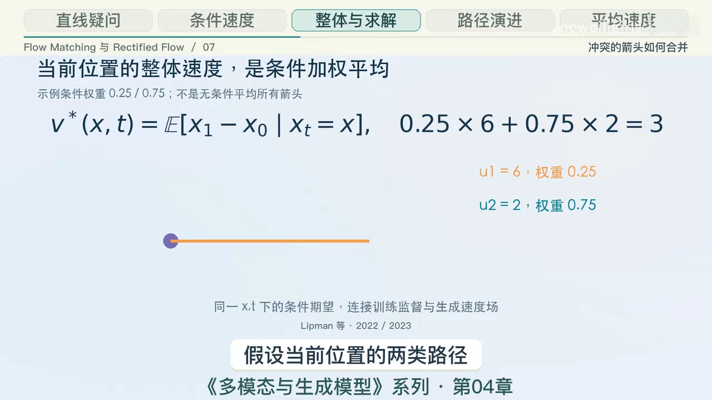

注意权重来自**给定当前位置与时间后的条件分布**，不是"随便把所有训练箭头平均"。这就是条件速度到边缘速度的桥梁，**也是直线训练仍可能产生弯曲轨迹的原因**：模型没有拿到这次终点的隐藏身份，它只能根据可见的当前位置与时间学习统计规律。[【跳转到 02:55】](https://www.bilibili.com/video/BV1HXnE6GEK6/?t=175)

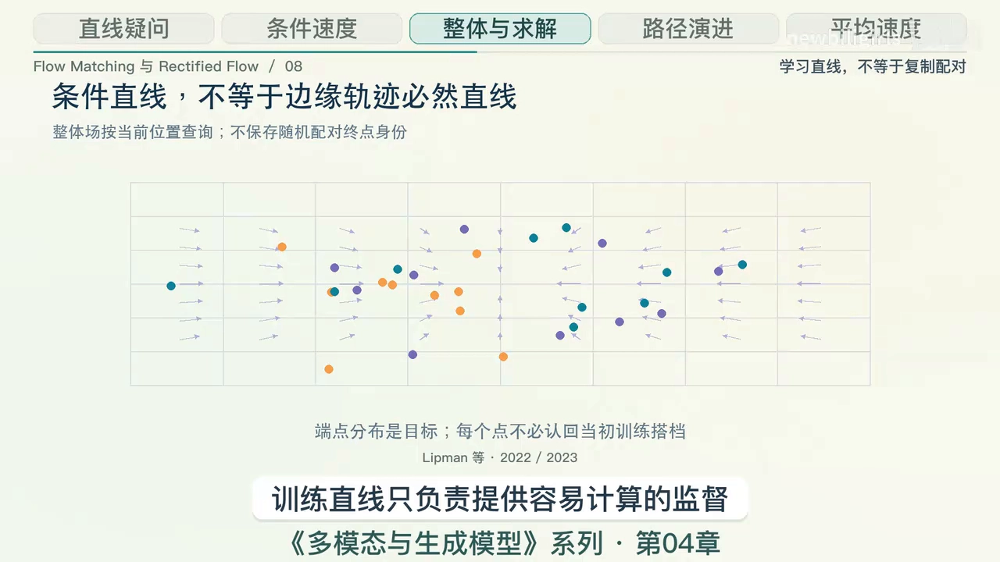

由此得到一条重要的判据：**训练直线只负责提供容易计算的监督，不要求生成轨迹把每个噪声送回当初随机配上的那张图**。采样时新的点不断查询当前位置的整体速度，它的方向可以连续改变；只要速度场与概率路径相容，整群样本仍可按目标分布运输。我们要检查的是**最终分布**，而不是要求每个样本都认回某一位训练搭档。[【跳转到 03:20】](https://www.bilibili.com/video/BV1HXnE6GEK6/?t=200)

## 三、步长与曲率：少步为什么可行

把上面两件事合起来，就能回答"少步为什么可行、又为什么有上限"：

- **如果路径真的是直线**，且网络预测的速度完全准确，那么 $h=1$ 一步就能到终点——因为整段路上速度一模一样。
- **如果路径是弯的**，欧拉法每步只沿当前切线走。步长一大，一步就偏离原路径；下一步再在新位置取切线，于是越走越偏，和终点渐行渐远。视频的说法是：跳得越大，误差急剧增大，这正对应泰勒展开里步长的高阶余项。[【跳转到 03:45】](https://www.bilibili.com/video/BV1HXnE6GEK6/?t=225)

所以"少步"的本质不是把步数硬砍掉，而是**让路径尽可能直**：路径越直，同样的步数下每步的切线越接近真实走向，误差越小。这就是整流流（Rectified Flow）把"拉直路径"当作核心设计的理由。

## 四、把路径拉直：reflow 与配对规则

### 4.1 reflow：用上一轮的流生成新配对

reflow（重流）的做法是：先用已经学到的速度场，从一批起点**积分出终点**，再用这些新配对的两端训练下一轮直线插值回归。[【跳转到 04:35】](https://www.bilibili.com/video/BV1HXnE6GEK6/?t=275)

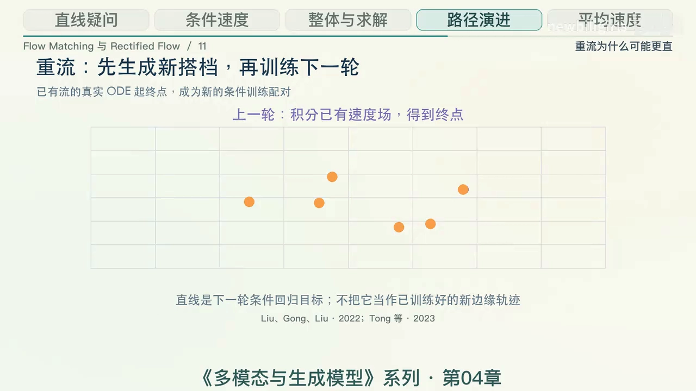

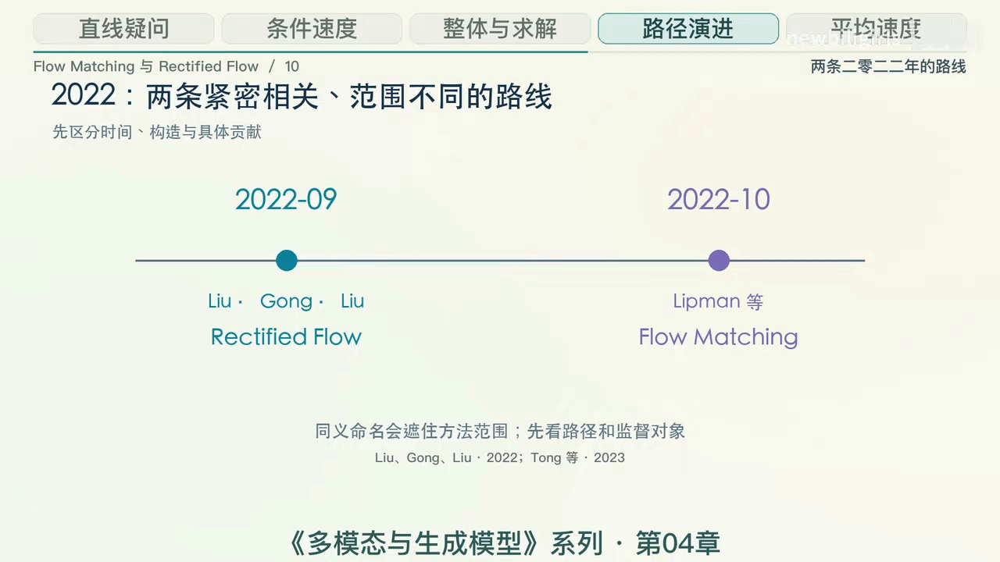

原来随机配对可能交叉得很厉害；新的运输配对带着上一轮流的结构，路径有机会变得更直。**更直通常有利于少步近似**，但视频明确划了边界：一轮 reflow 之后，不代表每个点都能用一步精确到达，也不保证任意指标都会改善。[【跳转到 05:00】](https://www.bilibili.com/video/BV1HXnE6GEK6/?t=300)

### 4.2 配对规则会改变监督路径的几何

另一个选择是**怎样配起点和终点**：独立随机配对简单，但可能产生很多交叉；小批量最优传输（OT）尝试让这一批配对的总距离更小，它改变了监督路径的几何，也增加了配对计算。[【跳转到 05:00】](https://www.bilibili.com/video/BV1HXnE6GEK6/?t=300)

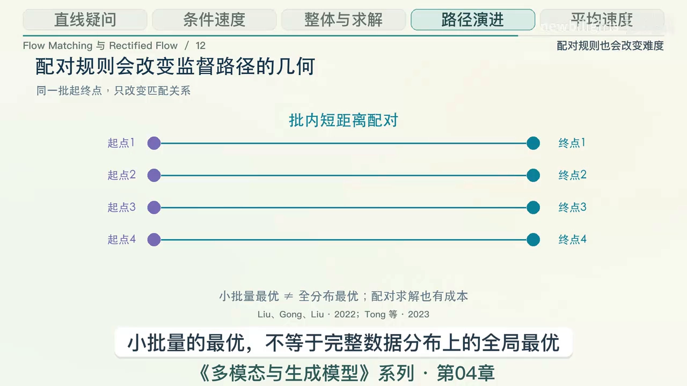

同样要划边界：**小批量的最优不等于完整数据分布上的全局最优**，直线距离更短也不能替代对最终质量、覆盖和实际网络调用成本的评估。

## 五、一步生成的另一条路：直接学区间平均速度

前面所有讨论都建立在一个前提上：网络学的是**瞬时速度**（某一时刻、某一位置的切线）。如果每一步走得很大，只学瞬时速度还够不够？视频提到 2025 年的 MeanFlow 引入**区间平均速度**，把它与 flow matching 的瞬时速度区分开：一个时间点的切线，不等于一整段路径的位移除以时间。[【跳转到 05:25】](https://www.bilibili.com/video/BV1HXnE6GEK6/?t=325)

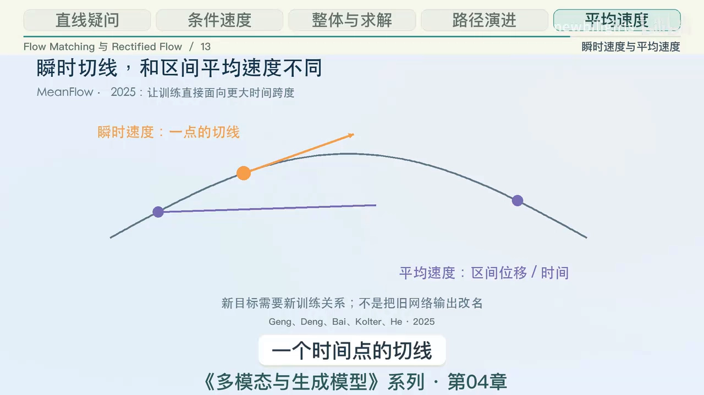

但这不是"把原网络输出换个名字"就能完成的：平均速度目标需要新的训练关系，单步生成这条路线仍有开放问题——高维图像、长视频和机器人动作需要的路径几何并不一样；噪声时间怎么抽、训练误差集中在哪里、求解器怎样分配调用，都可能改变结果。

## 六、两条容易踩的边界

**第一，确定性的 ODE 不意味着只有一个结果。** 采样过程是确定的，但初始噪声仍然随机，所以同一个模型仍能生成不同样本。比较方法时，要保留数据规模、网络大小、调用次数（NFE）和任务条件，才看得出改进来自哪里。[【跳转到 06:15】](https://www.bilibili.com/video/BV1HXnE6GEK6/?t=375)

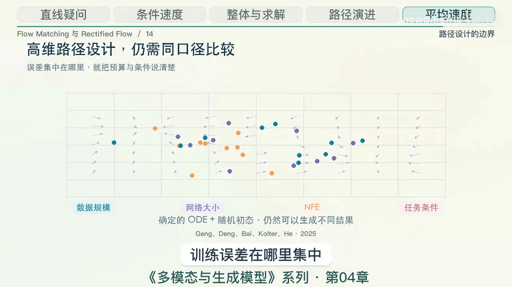

**第二，训练直线并不等于生成处处直线，路径更直也不等于一步无误差。** 这两句话是本文的收束：前者说的是条件速度与边缘速度的区别，后者说的是数值积分误差与路径曲率的关系。

## 小结

- 采样就是解 $\frac{dx}{dt}=v_\theta(x,t)$：从先验噪声出发，用数值积分器一步一步查询速度场，**不需要雅可比行列式**。
- 欧拉法用"当前位置 + 步长 × 当前速度"走一步；每步都要在新位置重新预测，**步长越大局部误差越明显**。
- 训练时看到的是"条件速度"（给定配对，处处相同）；生成时用的是按条件分布加权的"边缘速度"——**平均这一步就是轨迹拐弯的来源**。
- 训练直线只提供监督，不要求生成轨迹把每个噪声送回它当初的搭档；要检查的是**最终分布**。
- 少步可行的前提是**路径够直**：路径越直，同样的步数下切线越接近真实走向。
- 拉直路径的两条路：reflow（用上一轮的流生成新配对）与更好的配对规则（如小批量 OT）；两者都不保证一步精确到达。
- 想真正服务大步长，就得让网络学**区间平均速度**（MeanFlow），而这需要新的训练关系。
- 确定性的 ODE 加上随机初值，仍然生成不同样本；比较方法要统一数据规模、网络大小、NFE 与任务条件。

## 关键术语速查

| 术语 | 一句话解释 |
| --- | --- |
| 速度场 $v_\theta(x,t)$ | 每个位置、每个时刻给出一支箭头，告诉样本往哪走、走多快 |
| 条件速度 | 给定一对 $(x_0,x_1)$ 时的目标速度，直线构造下就是 $x_1-x_0$ |
| 边缘速度 | 同一位置与时间上，所有可能配对的条件速度按后验权重平均的结果 |
| 欧拉法 | 一阶积分器：$x_{t+h}\approx x_t+h\,v_\theta(x_t,t)$ |
| NFE | 网络函数调用次数（number of function evaluations），采样成本的主要度量 |
| reflow | 用现有流积分出新配对，再按直线重新回归，使路径更直 |
| 区间平均速度 | 一段时间的位移除以时间，与某一点的瞬时切线不同；MeanFlow 的目标 |
| 少步采样 | 用很少的积分步数生成，前提是路径足够直、单步误差足够小 |