# 同一条搬运，两种监督：扩散回归噪声，流匹配回归速度

> 视频来源：[Flow-Matching vs Diffusion Models explained side by side](https://www.youtube.com/watch?v=firXjwZ_6KI)（YouTube · AI Coffee Break with Letitia）｜时长约 16 分钟
> 导读：这支视频把两条路线**并排放**讲：同一套记号（数据 $x_1$、噪声 $x_0$、时间 $t$）下，先走完扩散的训练与采样，再走完流匹配的训练与采样，最后把两栏贴在一起。本文只做对照与判读，不重推公式：扩散的训练目标参数化见本系列 3.1.3，扩散采样器见 3.2.4，流匹配训练见 4.2.2，流模型采样见 4.2.3。

## 本讲要解决的核心问题（SCQA）

**背景**：过去几年，Stable Diffusion、Imagen 这类扩散模型（diffusion model）是图像生成的最强基线；它的训练循环简单到可以背下来——抽一张真图、抽一个时间步、加噪、让网络把加进去的噪声预测回来。[【跳转到 00:05】](https://www.youtube.com/watch?v=firXjwZ_6KI&t=5)

**冲突**：但这两年的新模型——FLUX、Stable Diffusion 3——用的却是流匹配（flow matching）。一个已经稳定收敛、被调了好几年的目标，为什么会被换掉？[【跳转到 00:20】](https://www.youtube.com/watch?v=firXjwZ_6KI&t=20)

**疑问**：流匹配到底在哪一步和扩散分道扬镳？是训练目标变了，是前向加噪的方式变了，还是采样方式变了？三者中哪一个才是"少步生成"的真正来源？

**回答（中心思想）**：**两条路线共用同一个骨架——把噪声分布搬到数据分布；差别集中在三处：训练时回归什么（噪声还是速度）、前向路径长什么样（方差保持的缩放加噪还是线性插值）、采样时解什么方程（随机微分方程 SDE 还是常微分方程 ODE）。**三者里，只有"路径"和"方程"决定了采样预算；而"回归什么"在特定路径下可以互相改写，所以视频最后说两者"几乎是同一枚硬币的两面"。[【跳转到 13:57】](https://www.youtube.com/watch?v=firXjwZ_6KI&t=837)

## 一、先看清两条路线共用的骨架

在进入差别之前，先把共用的部分钉死，后面的对照才有坐标。

两条路线都用同一套符号：

| 符号 | 含义 |
| --- | --- |
| $x_1$ | 干净数据（一张真图） |
| $x_0$ | 起点噪声，标准高斯 $x_0 \sim \mathcal{N}(0,I)$ |
| $t \in [0,1]$ | 连续化的时间步，$t=0$ 是纯噪声，$t=1$ 是干净图像 |
| $x_t$ | 中间态：既不是噪声也不是图，是"半成品" |
| 网络 | 一个吃 $(x_t, t)$、吐某个回归目标的神经网络 |

扩散里这个网络通常是 UNet，也可以是 transformer；时间步 $t$ 一般通过位置编码（positional embedding）注入。[【跳转到 04:10】](https://www.youtube.com/watch?v=firXjwZ_6KI&t=250)

**共用骨架的一句话版本**：训练时把"中间态怎么来"写成一条可解析的公式，于是监督信号可以闭式算出；采样时反过来沿这条公式往回走。**两条路线的全部分歧，都发生在这条公式的具体形状上。**

## 二、训练目标：一边回归"加进去的噪声"，一边回归"两点之间的速度"

### 2.1 扩散：前向加噪本身就是一次插值

扩散的训练样本是这样造出来的：取真图 $x_1$，抽一个 $t \sim U(0,1)$，然后按噪声日程（noise schedule）往每个像素上加高斯噪声，得到 $x_t$。[【跳转到 02:00】](https://www.youtube.com/watch?v=firXjwZ_6KI&t=120)

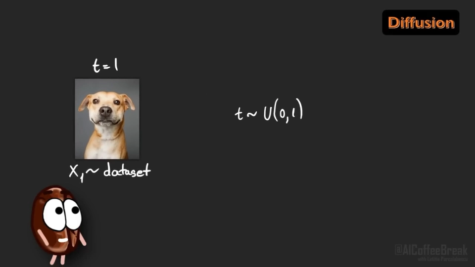

最朴素的写法是"真图乘一个系数 $a_t$，再加噪声乘一个系数 $b_t$"。为了让 $x_t$ 的数值范围和 $x_1$ 一致，还要约束两部分的方差加起来等于 1——这就是**方差保持（variance preserving）**的来历。[【跳转到 02:25】](https://www.youtube.com/watch?v=firXjwZ_6KI&t=145)

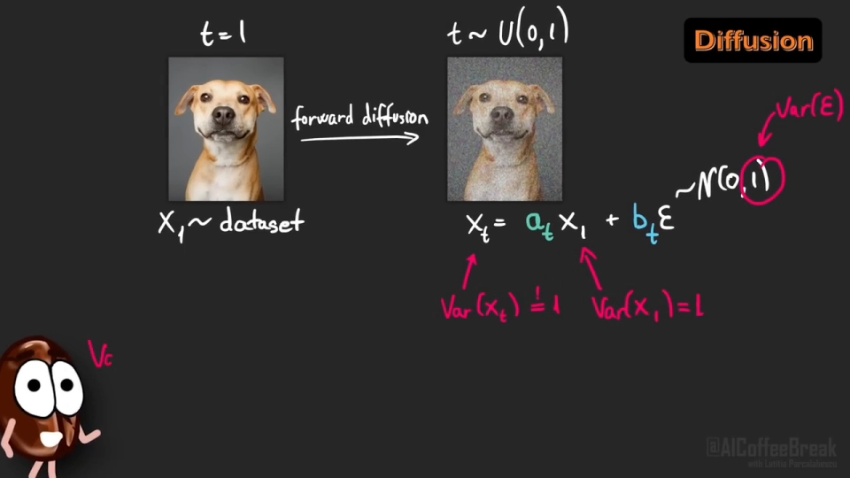

令 $\alpha_t = a_t^2$，就得到扩散里最常见的那条前向公式：

$$
x_t = \sqrt{\alpha_t}\, x_1 + \sqrt{1-\alpha_t}\,\epsilon, \qquad \epsilon \sim \mathcal{N}(0, I)
$$

注意这里的结构：**它也是一次插值**——只是两个系数被方差约束绑在一起，不能自由选。$t$ 越小，$\sqrt{\alpha_t}$ 越小、噪声项越重，$t=0$ 时图像退化成纯高斯噪声。[【跳转到 03:20】](https://www.youtube.com/watch?v=firXjwZ_6KI&t=200)

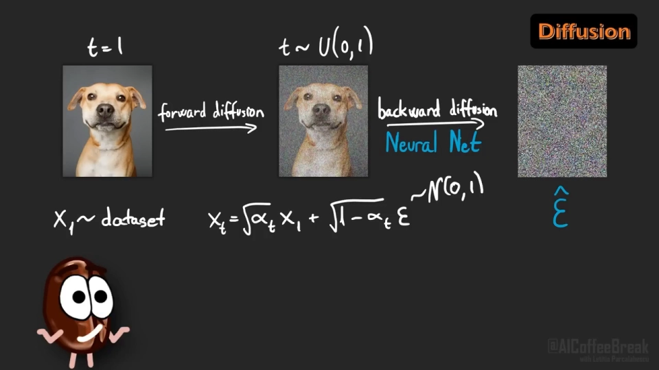

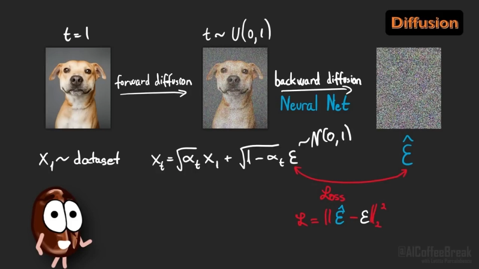

于是扩散的训练目标就是一句大白话：**"我把多少噪声加进去了，你把它猜回来。"**

$$
\mathcal{L}_{\text{diff}} = \big\lVert \hat\epsilon_\theta(x_t, t) - \epsilon \big\rVert_2^2
$$

### 2.2 同一个前向过程，也可以写成 SDE

视频在这里埋了一个伏笔：这套"逐步加噪"的过程，数学上等价于一条随机微分方程（SDE，stochastic differential equation）：

$$
dx_t = v(x_t, t)\,dt + g(t)\,dW_t
$$

其中 $dW_t$ 就是高斯噪声的微分。作者特意提一句"先记住这个形式，等会儿看流匹配时会用上"，然后让观众暂时忘掉它。[【跳转到 03:45】](https://www.youtube.com/watch?v=firXjwZ_6KI&t=225)

这个伏笔很关键：**扩散的"路径"是由一个带随机项的方程定义的**，而流匹配的第一步改动，就是把这一项删掉。

### 2.3 流匹配：抽两个端点，插一条直线，回归这条直线的方向

流匹配的训练样本更直接：抽真图 $x_1$，抽噪声 $x_0 \sim \mathcal{N}(0,I)$，抽 $t$，然后**直接线性插值**：

$$
x_t = (1-t)\,x_0 + t\,x_1
$$

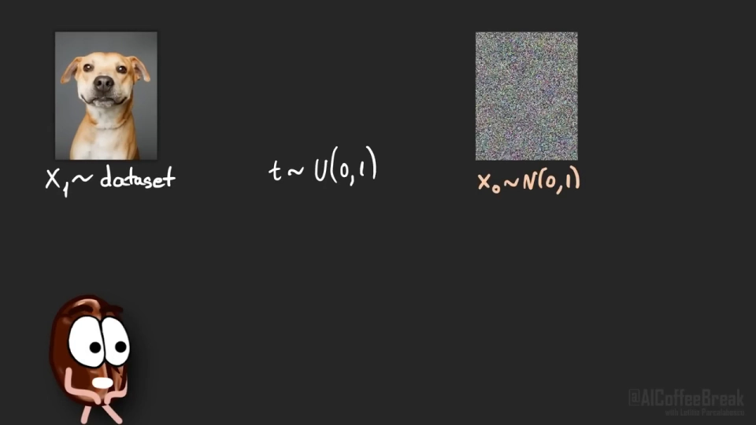

对 $t$ 求导，中间态的变化率是一个**常数**：

$$
\frac{dx_t}{dt} = x_1 - x_0 \;\equiv\; v
$$

这就是"速度场（velocity field）"这个名字的来源：在直线插值下，从噪声点指向数据点的那个向量，就是整条路径上处处相同的速度。[【跳转到 10:37】](https://www.youtube.com/watch?v=firXjwZ_6KI&t=637)

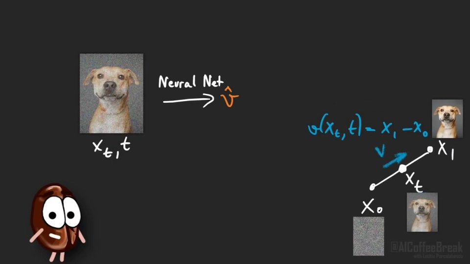

训练目标随之变成速度的均方误差：

$$
\mathcal{L}_{\text{fm}} = \big\lVert \hat v_\theta(x_t, t) - (x_1 - x_0) \big\rVert_2^2
$$

### 2.4 对照：两个目标其实是同一个回归问题的两种参数化

把两栏并排，差别一目了然：

| 维度 | 扩散 | 流匹配 |
| --- | --- | --- |
| 前向公式 | $x_t=\sqrt{\alpha_t}x_1+\sqrt{1-\alpha_t}\epsilon$ | $x_t=(1-t)x_0+t\,x_1$ |
| 系数能否自由选 | 不能，被方差约束绑死 | 能，$a_t$、$b_t$ 可任意设计 |
| 网络回归什么 | 加进去的噪声 $\epsilon$ | 速度 $v=x_1-x_0$ |
| 损失 | $\lVert\hat\epsilon-\epsilon\rVert^2$ | $\lVert\hat v-v\rVert^2$ |
| 监督信号的性质 | 逐像素的"噪声量" | 逐像素的"位移方向" |

**关键判读**：这两行不是两个不相干的任务。给定同一条前向公式，噪声、干净数据、速度三者之间是可以互相换算的——知道 $x_t$、$x_1$、$\alpha_t$ 就能解出 $\epsilon$，反过来也一样。所以"回归噪声"和"回归速度"在数学上可以互相改写，只是**同样的信息被换了个坐标系表达**，网络学起来的难易和数值条件不同。本系列 3.1.3 已经把 $\epsilon$／数据／速度三种参数化的权重差异讲透，这里只记结论：**目标函数的选择会影响训练稳定性，但不改变"这条路径长什么样"。**

## 三、概率路径：加噪路径 vs 直线路径，形状决定步数

### 3.1 扩散的路径：被方差约束压弯的一条曲线

扩散的前向过程从 $t=1$ 的干净图走到 $t=0$ 的纯高斯噪声，中间每一站都满足"总方差为 1"。这意味着：**随着噪声加重，图像分量必须同步缩小**——$\sqrt{\alpha_t}$ 一路降到 0。在 $(x_0, x_1)$ 平面上看，这条轨迹不是直线，而是一条被方差约束压出来的曲线。

### 3.2 流匹配的路径：一条可以画在纸上的直线

流匹配的路径就是字面意义上的直线：$x_t$ 在 $x_0$ 与 $x_1$ 之间匀速移动，速度处处等于 $x_1-x_0$。视频把这张图反复画了好几遍——一个噪声方块、一张狗的照片、中间连一条带箭头的直线。[【跳转到 11:12】](https://www.youtube.com/watch?v=firXjwZ_6KI&t=672)

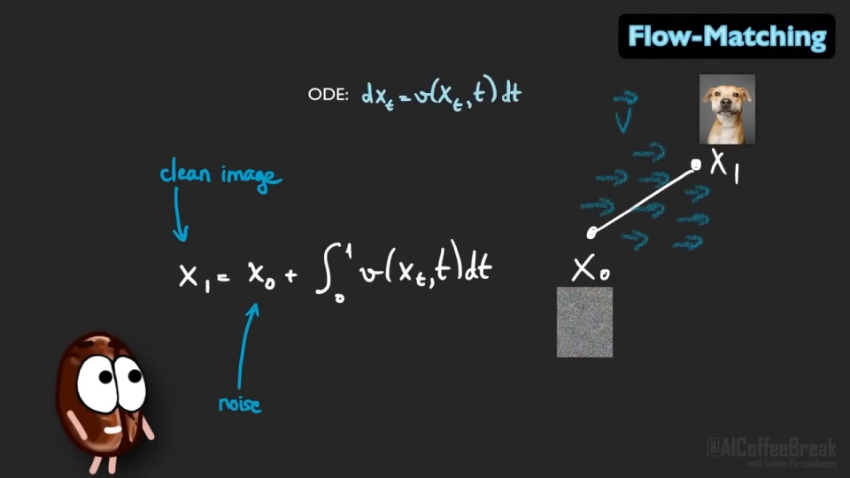

### 3.3 路径直不直，直接换算成采样步数

这是本小节最该记住的一句判读：**路径的形状不是审美问题，它决定了数值积分要多细。**

- 路径**弯**：每一步的局部切线方向和真实走向偏离大，步子一大就飞出去，只能靠多走小步逼近。
- 路径**直**：局部切线方向基本就是全局方向，一步跨很远也不至于偏离，于是可以用很少的步数。

所以"流匹配更快"这件事，根子在**路径**上，而不是在"速度比噪声更好学"上。

## 四、采样：解 SDE 还是解 ODE

### 4.1 扩散：反转一条随机方程，只能小步挪

扩散的采样是把前向公式**反解**：把 $x_1$ 挪到等号左边，用网络预测的 $\hat\epsilon$ 把噪声减掉。[【跳转到 05:50】](https://www.youtube.com/watch?v=firXjwZ_6KI&t=350)

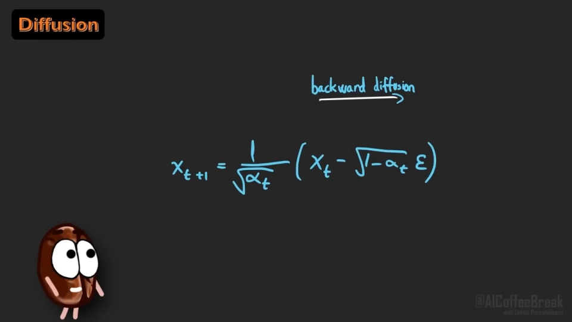

这里有个初学者最容易问的问题：**为什么不一次性把预测的噪声全减掉？** 视频给了两条理由：[【跳转到 07:09】](https://www.youtube.com/watch?v=firXjwZ_6KI&t=429)

1. **网络只学过"某个噪声水平"下的去噪方向**。它学的是"在这张被 $t$ 级噪声污染过的图上，往哪个方向挪一点更接近数据分布"，而不是"从噪声直接跳到数据"。一步跳完，落点会远离数据流形，得到一张糊掉的图。
2. **网络从没直接见过跨噪声水平的转移**。它只学到该噪声水平下数据分布的梯度（得分），所以必须把这些小步沿整条日程积分起来。

结论就是：扩散采样要几百甚至上千步小步去噪。[【跳转到 07:59】](https://www.youtube.com/watch?v=firXjwZ_6KI&t=479)

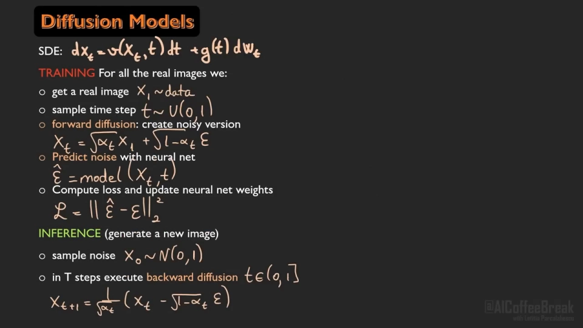

### 4.2 流匹配：删掉随机项，解一条 ODE

流匹配的起点就是上面那句伏笔的兑现：**把 SDE 里的 $g(t)\,dW_t$ 删掉**，剩下一条常微分方程（ODE，ordinary differential equation）：[【跳转到 09:07】](https://www.youtube.com/watch?v=firXjwZ_6KI&t=547)

$$
dx_t = v(x_t, t)\,dt
$$

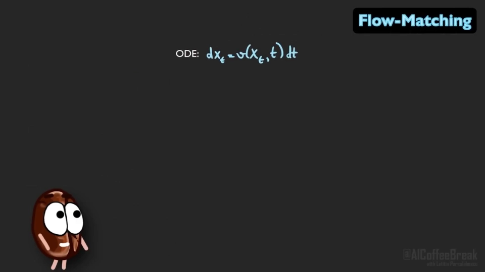

它的解就是高中物理：速度是位置对时间的变化率，知道每个时刻的速度，积分回去就得到终点。

$$
x_1 = x_0 + \int_0^1 v(x_t, t)\,dt
$$

采样时用数值求解器（solver）走这条路，比如自适应步长的 Runge–Kutta：向量场平滑的地方步子放大，变化剧烈的地方步子收小。[【跳转到 11:54】](https://www.youtube.com/watch?v=firXjwZ_6KI&t=714)

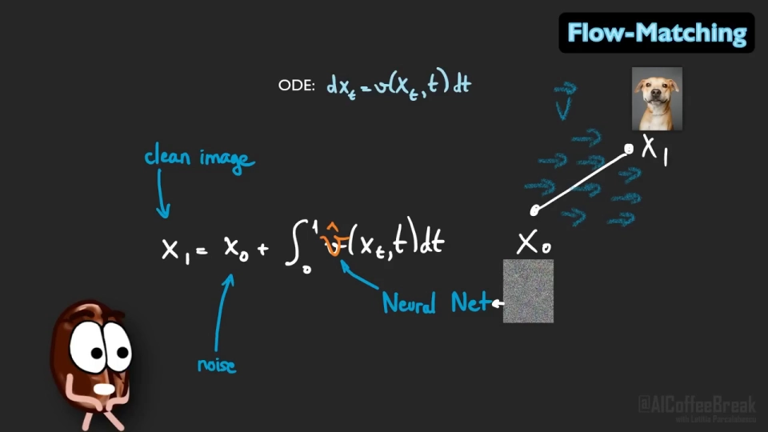

### 4.3 既然理论上是直线，为什么还要好几步

这是全片最诚实的一段。理论上如果速度场学得完美，直线路径上的速度是常数，一步就能到。但实际中：[【跳转到 12:37】](https://www.youtube.com/watch?v=firXjwZ_6KI&t=757)

- 网络只学到这条全局路径的**近似**；
- 速度可能沿路径变化，尤其当训练还没收敛好时；
- 求解器（欧拉或 Runge–Kutta）需要在多个时刻查询网络，才能安全地跟住这条曲线。

所以流匹配也不是真的"一步生成"，而是把步数从数百压到**5～15 次前向**。这个数量级差别，才是它生成快的原因。[【跳转到 13:07】](https://www.youtube.com/watch?v=firXjwZ_6KI&t=787)

| 采样维度 | 扩散 | 流匹配 |
| --- | --- | --- |
| 求解对象 | 反向 SDE（带随机项） | 概率流 ODE（无随机项） |
| 轨迹性质 | 随机游走，每条样本路径不同 | 确定性，同一初值同一终点 |
| 典型网络调用 | 数百到数千次 | 5～15 次 |
| 步数瓶颈 | 噪声水平之间不能跳 | 路径弯曲度 + 求解器阶数 |

## 五、工程取舍：稳定性和少步各占一头

视频没有把流匹配说成全面胜利，反而明确指出两边各有一头：[【跳转到 13:32】](https://www.youtube.com/watch?v=firXjwZ_6KI&t=812)

- **扩散的强项是稳**：噪声预测损失简单、数值行为良好，被工业界打磨了好几年，属于"闭着眼睛也能收敛"的目标。
- **流匹配的弱项是不稳**：它不依赖每一步的随机噪声，一旦估计出的速度场在某处不准，训练就可能抖。视频把这一点归因于"确定性"本身——没有随机性帮忙平滑误差。
- **但工程上已经补上了**：rectified flow 一类方法解决了其中很多问题。

最后视频给出定性判断：**流匹配保留了扩散最好的部分（那个强大的训练目标），把随机游走换成了一条有引导的捷径。** 两者在数学上"几乎是同一枚硬币的两面"。[【跳转到 15:15】](https://www.youtube.com/watch?v=firXjwZ_6KI&t=915)

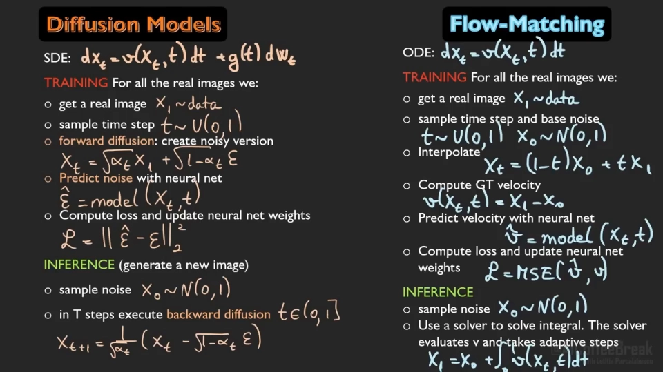

## 小结

- **共用骨架**：两条路线都在把噪声分布搬到数据分布，都用 $(x_t, t)$ 喂网络、都靠一条可解析的前向公式造监督信号。
- **训练目标不同，但可互换**：扩散回归"加进去的噪声"，流匹配回归"两点之间的速度"；在同一条前向公式下，噪声、数据、速度三者可以互相换算，所以这是同一回归问题的两种参数化（细节见 3.1.3）。
- **概率路径决定步数**：扩散的前向路径被方差保持约束压成曲线；流匹配用线性插值得到直线。路径越直，数值积分越敢跨大步。
- **采样方程决定随机性**：扩散解带随机项的反向 SDE，只能小步挪（数百到数千步）；流匹配删掉随机项解 ODE，5～15 次前向就够。
- **取舍**：扩散胜在训练稳定、生态成熟；流匹配胜在采样步数与生成速度，代价是速度场必须处处准。
- **一句话记住**：与其问"哪个模型更好"，不如问"我要的是训练稳定还是采样便宜"——这是两条路线真正的分水岭。

## 关键术语速查

| 术语 | 一句话解释 |
| --- | --- |
| 前向过程（forward process） | 从干净数据造出带噪中间态的可解析公式，训练样本由它生成 |
| 噪声日程（noise schedule） | 控制每个 $t$ 加多少噪声的预设曲线，$\alpha_t$ 就是它的数值化 |
| 方差保持（variance preserving） | 约束 $x_t$ 的总方差与数据一致，使 $\sqrt{\alpha_t}$ 与 $\sqrt{1-\alpha_t}$ 平方和为 1 |
| 噪声预测（$\epsilon$-prediction） | 扩散的监督目标：让网络猜出前向过程加进去的那份噪声 |
| 速度场（velocity field） | 每个位置、每个时刻的"往哪走、走多快"，流匹配的回归对象 |
| 线性插值路径（linear interpolation） | $x_t=(1-t)x_0+t x_1$，端点之间匀速直线，速度恒为 $x_1-x_0$ |
| SDE / ODE | 带随机项的微分方程 / 不带随机项的微分方程；前者轨迹随机，后者确定 |
| 求解器（solver） | 数值积分微分方程的方法，欧拉是一阶、Runge–Kutta 更高阶，阶数越高同样精度所需步数越少 |
| 数据流形（data manifold） | 真实样本在像素空间里占据的低维区域；一步跳太远会落到流形之外，得到模糊结果 |