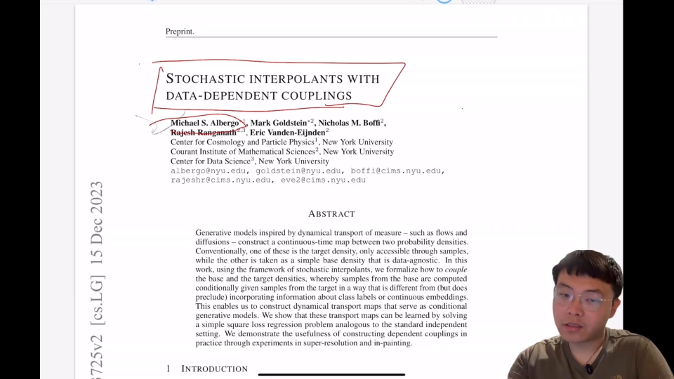
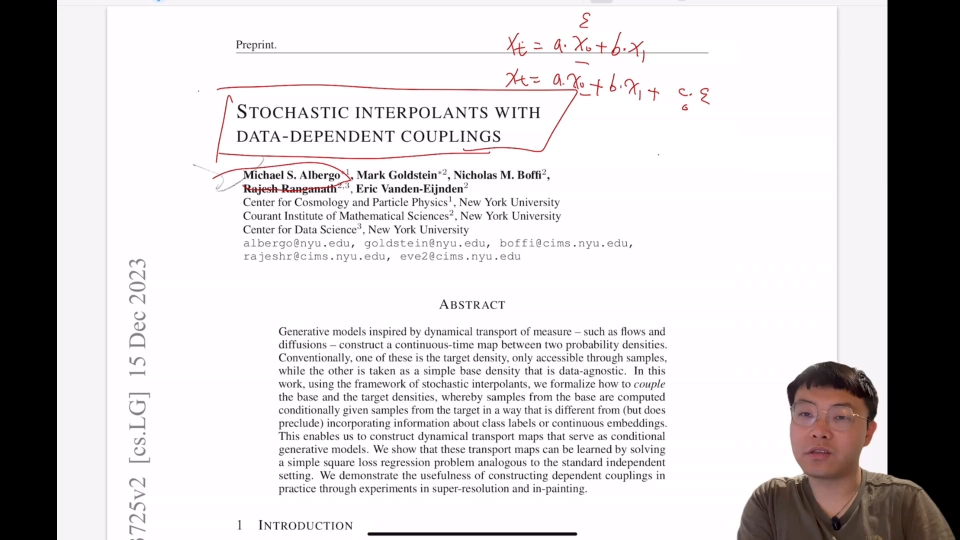
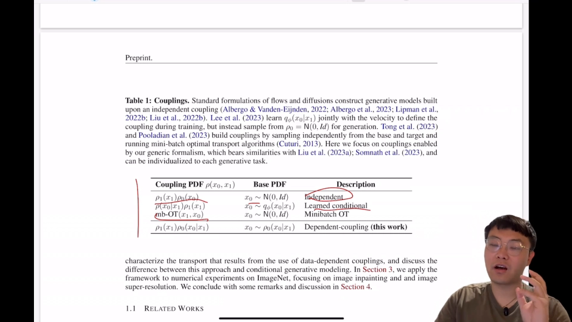
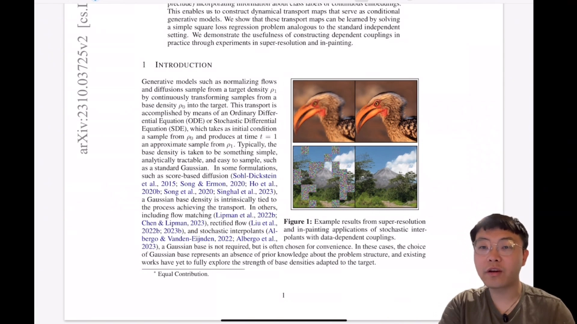
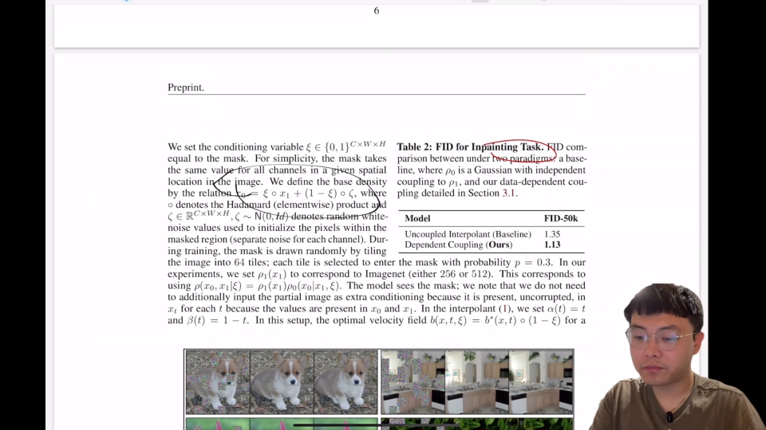
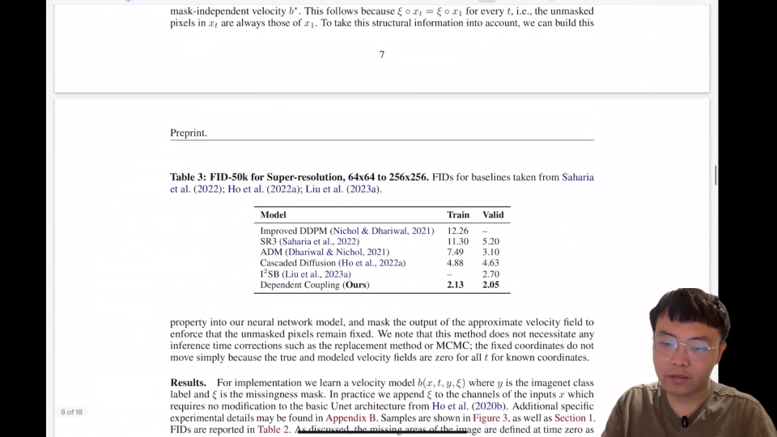
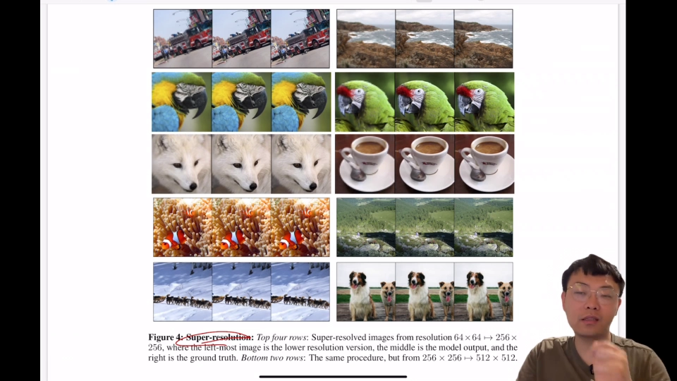

# 流匹配比扩散多出的三个旋钮：基分布、噪声日程与随机性

> 视频来源：[Flow Matching 和 Diffusion 相比，有什么优势](https://www.bilibili.com/video/BV1Wi7TzXEvF/)（Bilibili · Vincent 教你学 AI）｜时长约 18 分钟
> 导读：这支视频不讲某一条路线的完整推导，而是从一篇具体论文（《Stochastic Interpolants with Data-Dependent Couplings》）切入，把 flow matching 与 diffusion 的差别归纳成**三个可调的旋钮**。本文只做对照与判读：扩散的训练目标参数化见 3.1.3、扩散采样器见 3.2.4、流匹配训练见 4.2.2、流模型采样见 4.2.3。

## 本讲要解决的核心问题（SCQA）

**背景**：扩散模型（diffusion model）的默认叙事是"从数据出发不停加噪，加得足够多以后必然落到一个标准高斯分布"。这套叙事支撑了 DDPM、LDM 一整套工程经验。[【跳转到 02:35】](https://www.bilibili.com/video/BV1Wi7TzXEvF/?t=155)

**冲突**：但 flow matching 里，起点分布 $X_0$ 并不必须是高斯噪声。一旦承认这一点，"加噪"就不再是唯一的心智模型——而且很多工程上被当成常识的超参数，其实只是这套叙事带来的副产品。[【跳转到 01:45】](https://www.bilibili.com/video/BV1Wi7TzXEvF/?t=105)

**疑问**：如果起点可以不是高斯，那"加噪"该怎么理解？扩散里那些必须反复调的东西（噪声日程、随机性）在流匹配里变成了什么？这些差别只是写法不同，还是真的打开了新的设计空间？

**回答（中心思想）**：**flow matching 相对 diffusion 的差别可以归成三个旋钮：①基分布 $X_0$ 的取法（可以是与 $X_1$ 相关的 data-dependent coupling，而不只是独立高斯）；②插值系数 $a_t$、$b_t$ 的选择（比"方差保持／方差爆炸"自由得多）；③训练与采样的解耦（训练学的是概率流 ODE 的速度场，采样时随机性可以另调）。** 三者里，第一个是本质差别，后两个是它带来的自由度。[【跳转到 15:44】](https://www.bilibili.com/video/BV1Wi7TzXEvF/?t=944)

## 一、先看两条路线共用的那个式子

视频一上来先把 flow matching 和 diffusion 写成同一个形状。给定基分布（base distribution）和靶分布（target distribution），中间态由一个插值公式给出：

$$
X_t = a_t X_0 + b_t X_1
$$

其中 $X_0$ 来自基分布（通常取高斯噪声），$X_1$ 来自数据，$a_t$、$b_t$ 是两个随时间变化的系数。**这是 flow 和 diffusion 都在用的典型写法。**[【跳转到 00:55】](https://www.bilibili.com/video/BV1Wi7TzXEvF/?t=55)

作者介绍的那篇论文用的是 stochastic interpolants（随机插值），它在这个式子上**多加了一项**：

$$
X_t = a_t X_0 + b_t X_1 + c_t\,\epsilon, \qquad \epsilon \sim \mathcal{N}(0, I)
$$

这一项的作用很直白：**$c_t$ 是一个平滑的系数，$c_t=0$ 时就退化成 flow matching；$c_t$ 越大，做 transport 时的随机性就越大。** 换句话说，随机插值把"确定性流"和"随机扩散"放进了同一个公式，用一个系数在两者之间连续滑动。[【跳转到 01:20】](https://www.bilibili.com/video/BV1Wi7TzXEvF/?t=80)

有个自然的疑问：如果 $X_0$ 本来就是高斯噪声，那 $a_t X_0$ 和 $c_t \epsilon$ 不就直接合并成一项了吗？视频承认"理论上确实如此"，但紧接着指出：**这正是 flow 和 diffusion 一个重要的分岔点——在 flow 里，$X_0$ 不一定非得是高斯噪声。**[【跳转到 01:45】](https://www.bilibili.com/video/BV1Wi7TzXEvF/?t=105)

## 二、旋钮一：基分布不必是高斯

### 2.1 为什么"必须加噪到高斯"只是 diffusion 的习惯

视频给了一个很实用的判读建议：**不要用"不停加噪"去理解 diffusion，直接用 interpolant 的方式去理解。**

理由有两层：[【跳转到 03:00】](https://www.bilibili.com/video/BV1Wi7TzXEvF/?t=180)

1. **数学上等价**：高斯加噪本身具有可解析性（tractability），你可以推导出它的中间态就是一个 interpolant 的形式。
2. **代码上本来就是这么写的**：大家写训练代码时都是"sample 一个噪声、sample 一个 data，乘一个 $t$，算出 $a$ 和 $b$，求出 $X_t$"——这本来就是插值，只是被"加噪"这个词盖住了。[【跳转到 03:25】](https://www.bilibili.com/video/BV1Wi7TzXEvF/?t=205)

一旦接受"中间态 = 两个端点的插值"，那么**端点怎么配对**就成了一个可以自由设计的对象，而不是必须"数据配独立高斯"。

### 2.2 四种配对方式：从独立到 data-dependent

论文的 Table 1 把常见做法排成了一张表，这张表是本小节最有价值的对照物：

| 配对方式 | 基分布 $X_0$ 怎么来 | 一句话判读 |
| --- | --- | --- |
| independent | $X_0 \sim \mathcal{N}(0,I)$，与 $X_1$ 独立 | 这就是 diffusion 的默认设定 |
| learned conditional | $X_0 \sim q_\phi(X_0 \mid X_1)$ | 用学出来的条件分布当基分布 |
| minibatch OT | $X_0 \sim \mathcal{N}(0,I)$，但在 batch 内做最优传输配对 | 在一个 batch 内部让配对"更近"，但 $X_0$ 仍是高斯 |
| data-dependent coupling（本文） | $X_0 \sim p_0(X_0 \mid X_1)$ | 基分布直接由 $X_1$ 算出来，与数据强相关 |

视频对 minibatch OT 的评价很到位：它在 batch 内部让起点和终点离得比较近，但**它始终还是在考虑"高斯噪声与数据"的配对**——基分布本身没变。[【跳转到 09:55】](https://www.bilibili.com/video/BV1Wi7TzXEvF/?t=595)

而 data-dependent coupling 把这一步彻底放开：$X_0$ 直接依赖 $X_1$。视频给了两种具体做法：[【跳转到 08:23】](https://www.bilibili.com/video/BV1Wi7TzXEvF/?t=503)

- **降采样**：把高分辨率图降成低分辨率图，低分辨率图当 $X_0$，高分辨率图当 $X_1$；
- **随机掩码**：对完整图像做 random mask，把 mask 后的（被破坏的）图当 $X_0$，完整图当 $X_1$。

然后训练 flow matching 或 stochastic interpolants，让网络在 $X_0$ 和 $X_1$ 之间做**直接 transport**。

**这一步的判读价值在于**：一旦 $X_0$ 可以是"同一张图的低质版本"，flow matching 就从"生成模型"变成了"任意两个相关分布之间的搬运器"。视频说得很直接：这个思路一下就把 flow matching 用到不同的下游任务，"思路就完全打开了"。[【跳转到 08:48】](https://www.bilibili.com/video/BV1Wi7TzXEvF/?t=528)

## 三、旋钮二：噪声日程不必照抄 DDPM

### 3.1 扩散的日程是"搜"出来的，不是推出来的

第二个差别是 $a_t$、$b_t$ 的选择更灵活。在 diffusion 里，你能选的大概是 variance preserving 或 variance exploding 这几档；flow matching 则给了更自由的设计空间。[【跳转到 03:50】](https://www.bilibili.com/video/BV1Wi7TzXEvF/?t=230)

为什么这件事重要？视频举了一个非常具体的工程痛点：**换分辨率就要重调噪声日程。** 图片的 resolution 一变，原本的 schedule 通常就不合适，这个现象至少有两三篇比较经典的论文在讨论。[【跳转到 04:15】](https://www.bilibili.com/video/BV1Wi7TzXEvF/?t=255)

换数据集、换任务同理——noise schedule 要重新调。[【跳转到 04:40】](https://www.bilibili.com/video/BV1Wi7TzXEvF/?t=280)

### 3.2 一个反例：Diffusion Autoencoder 用了 constant schedule

视频举了 Diffusion Autoencoder 这个工作：翻开它的附录，会发现它训练 DDIM 时用的**不是**经典的 linear（基于 DDPM）日程，而是一个 constant noise schedule。在当时的语境里，这个选择相当"奇葩"。[【跳转到 05:05】](https://www.bilibili.com/video/BV1Wi7TzXEvF/?t=305)

原因不在日程本身，而在**训练所在的表示空间变了**：DDPM 在 pixel space 训练，LDM 在标准的、训练好的 VAE latent space 训练，而这个工作是在一个 VAE 的 feature 上训练的。空间一换，整个模态就变了，之前在 DDPM 上搜出来的那套 schedule 自然不一定 work。[【跳转到 05:30】](https://www.bilibili.com/video/BV1Wi7TzXEvF/?t=330)

视频顺势吐槽了那批超参数的来历：DDPM 那套 beta 从 0.0002 到 0.05 的参数，到底是怎么算出来的？它对每个任务、每个分辨率都固定适用吗？[【跳转到 06:20】](https://www.bilibili.com/video/BV1Wi7TzXEvF/?t=380)

**结论**：flow matching 的价值不在于"给了一个更好的日程"，而在于**把日程从"必须遵守的物理约束"降级成"可设计的超参数"**，设计空间更 broad、更 general。[【跳转到 06:45】](https://www.bilibili.com/video/BV1Wi7TzXEvF/?t=405)

## 四、旋钮三：训练学 ODE，采样时随机性另调

第三个差别最容易被忽略，但对工程最有用。

flow matching 本质上学习的是一个**概率流 ODE（probability flow ODE）**——用 Yaron Lipman 那篇讲 probability flow 的文章的说法，它训练的是 ODE 的向量场（vector field prediction）。[【跳转到 07:10】](https://www.bilibili.com/video/BV1Wi7TzXEvF/?t=430)

好处是：**训练时学的是确定性的速度场，采样时的随机性可以另外调。** 视频让观众去看 SiT 那篇论文，里面有一自然段专门描述这个特性：你可以在采样时通过控制 diffusion 那一项的超参数，来决定往任务里注入多大的随机性。[【跳转到 07:35】](https://www.bilibili.com/video/BV1Wi7TzXEvF/?t=455)

这个"解耦"对某些计算机视觉任务很关键，视频点名的是 **editing（图像编辑）**：编辑任务往往希望结果不要乱跑，随机性要可控；而纯生成任务可能希望随机性大一点以增加多样性。在 diffusion 里，随机性和训练目标绑在一起；在 flow matching 里，它变成了一个采样期的旋钮。

把三个旋钮放在一起对照：

| 旋钮 | diffusion 的默认设定 | flow matching 的开放度 | 影响什么 |
| --- | --- | --- | --- |
| 基分布 $X_0$ | 独立高斯，与数据无关 | 可以是 $p_0(X_0\mid X_1)$，任意与数据相关的配对 | 任务形态：生成 vs 超分／补全／翻译 |
| 插值系数 $a_t,b_t$ | variance preserving / exploding 几档 | 可自由设计，日程不再绑定物理直觉 | 训练稳定性、不同分辨率／模态的迁移成本 |
| 随机性 | 与训练目标绑定 | 训练学 ODE，采样时用 $c_t$ 另调 | 编辑类任务的可控性、生成多样性 |

## 五、把旋钮一拧到底：coupling flow 能干什么

视频后半段基本是在演示"基分布可设计"这一条能延伸出多少任务。[【跳转到 12:00】](https://www.bilibili.com/video/BV1Wi7TzXEvF/?t=720)

- **图像到深度**：把 $X_1$ 设为 image，$X_0$ 换成 depth estimation 的结果，任务就变成"用 flow 在 image 和 depth 之间做 transport"。
- **超分**：视频提到 PixelFlow 和他们组之前的 FM-Boost，本质上都是利用 coupling flow matching 做 super resolution，只是 FM-Boost 在 latent 里做，而 PixelFlow 主要在 pixel space 做，并且各个 upsampling stage 共享网络权重、靠额外 condition 告诉网络当前处在哪个 stage；这一点和 PyramidFlow 也有相通之处。[【跳转到 11:35】](https://www.bilibili.com/video/BV1Wi7TzXEvF/?t=695)
- **文本到图像**：把 $X_0$ 设成 caption、$X_1$ 设成 image。视频对这个方向持保留态度：depth 和 image 之间轮廓相似，低分辨率到高分辨率也可以自动 map，但 image 和 text 之间直接 mapping 其实不太好 map。[【跳转到 12:50】](https://www.bilibili.com/video/BV1Wi7TzXEvF/?t=770)

针对这个"不好 map"的问题，作者的解法是**先加一个简单的 adapter 或 projector 做模态转换，转换完再在上面做基于 flow 的 transport**，这样就好很多。[【跳转到 13:15】](https://www.bilibili.com/video/BV1Wi7TzXEvF/?t=795)

视频还提醒了一句方法论：这篇论文的一作本身是学物理的，写得很数学化，但**high level 抓到他要表达的点就够了**，没必要抠细节——核心就是"怎么更好地设计 coupling、怎么根据 $X_1$ 得到 $X_0$"。[【跳转到 14:05】](https://www.bilibili.com/video/BV1Wi7TzXEvF/?t=845)

## 六、实验：换掉基分布，FID 有没有真的变好

视频快速扫了两个任务的结果。

**图像补全（inpainting）**：和 baseline 相比，使用 dependent coupling 后在 FID 上有改善。

**超分辨率（64×64 → 256×256）**：作者在训练集和验证集上分别算了 FID，与一批经典方法对比，其中包括 Cascaded Diffusion 这类基于 diffusion 做超分的经典方案。

**判读要点**：这些数字说明的不是"flow matching 全面优于 diffusion"，而是**在同一个 flow／interpolant 框架里，把基分布从"独立高斯"换成"与数据相关"，在超分和补全这类任务上能拿到更好的指标**。也就是说，旋钮一拧动，收益是可测量的，不是只有理论上的优雅。

## 小结

- **共同骨架**：两条路线都可以写成 $X_t = a_tX_0 + b_tX_1$ 的插值；stochastic interpolants 再加一项 $c_t\epsilon$，用一个系数在确定性流与随机扩散之间滑动。
- **旋钮一（本质差别）**：diffusion 默认 $X_0$ 是独立高斯，所以只能用"不停加噪"来理解；flow matching 允许 $X_0$ 依赖 $X_1$，于是超分、补全、image-to-depth 都变成"两个相关分布之间的搬运"。
- **旋钮二（工程差别）**：diffusion 的 noise schedule（variance preserving／exploding）换分辨率、换数据集就要重调，DDPM 那套 beta 只是搜出来的经验值；flow matching 把 $a_t$、$b_t$ 放开成可设计的超参数。
- **旋钮三（采样差别）**：flow matching 训练的是概率流 ODE 的向量场，采样时的随机性可以另调，这对 editing 这类需要可控性的任务很关键。
- **一句话记住**：与其说 flow matching 是"更好的扩散"，不如说它把扩散里那些被写死的东西——基分布、日程、随机性——提成了三个旋钮。真正该问的是：我的任务需要拧哪一个？

## 关键术语速查

| 术语 | 一句话解释 |
| --- | --- |
| 基分布（base distribution） | 生成过程的起点分布，扩散里默认是标准高斯，flow matching 里可以任意指定 |
| 插值／interpolant | 用 $a_tX_0+b_tX_1$ 把两个端点连成一条随时间演化的路径，中间态由它闭式给出 |
| stochastic interpolants | 在插值公式上再加 $c_t\epsilon$ 随机项的框架，$c_t=0$ 退化为 flow matching |
| coupling（配对） | 决定"哪个 $X_0$ 配哪个 $X_1$"的联合分布；independent 是最简单的一种 |
| data-dependent coupling | 让 $X_0$ 由 $X_1$ 直接算出来的配对方式（如降采样、掩码） |
| minibatch OT | 在一个 batch 内部做最优传输配对，让起点终点更近，但基分布仍是高斯 |
| 噪声日程（noise schedule） | 控制各时刻加噪强度的曲线；换分辨率／数据集往往需要重新搜索 |
| 概率流 ODE（probability flow ODE） | 与扩散过程共享边缘分布的确定性方程，flow matching 学的就是它的速度场 |
| vector field prediction | 训练目标是回归速度场，而不是回归噪声 |