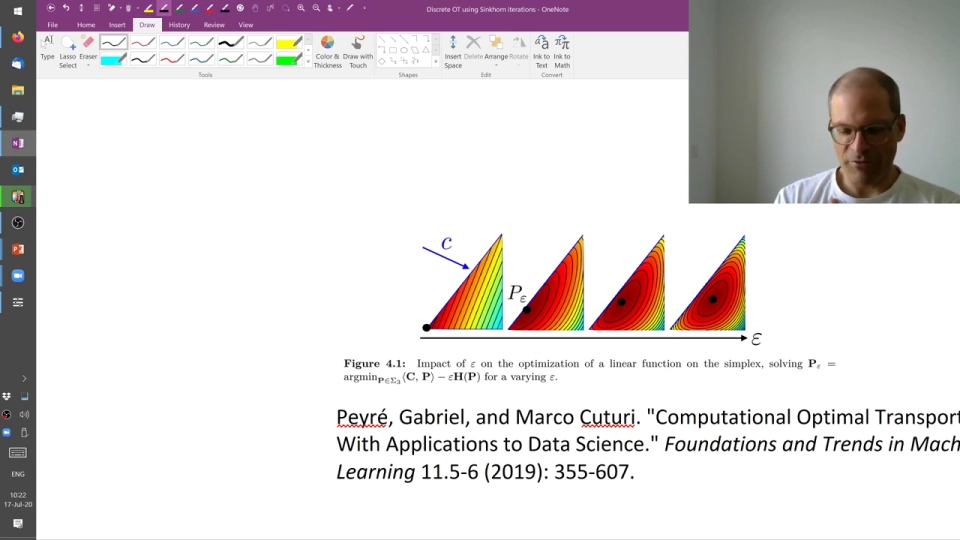
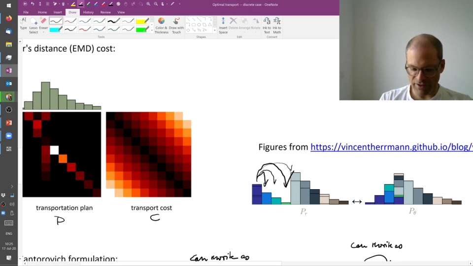
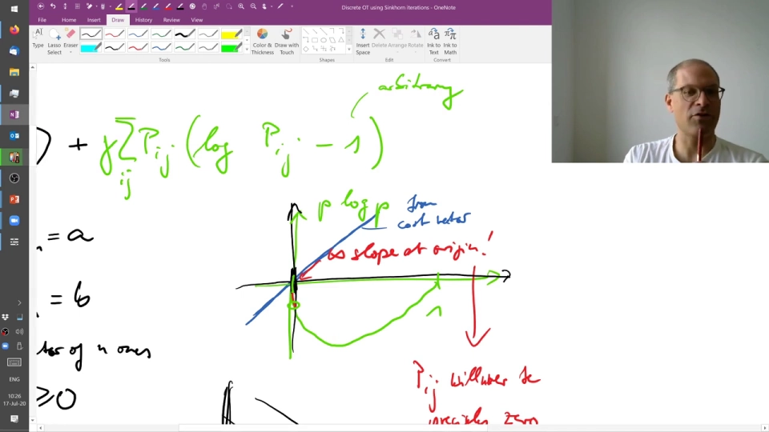
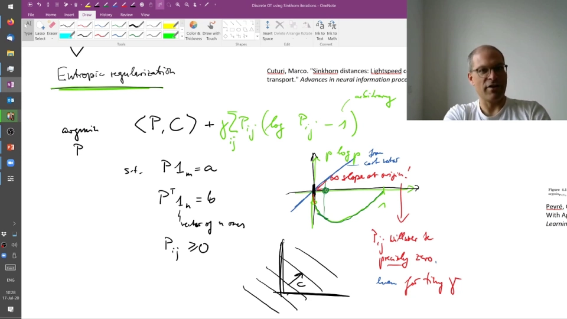
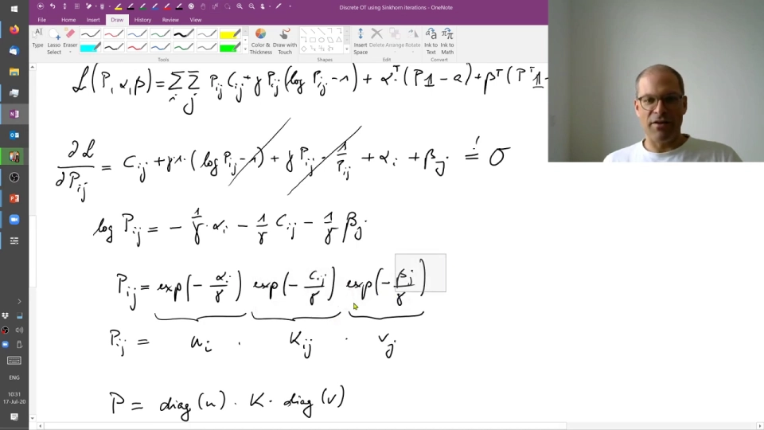
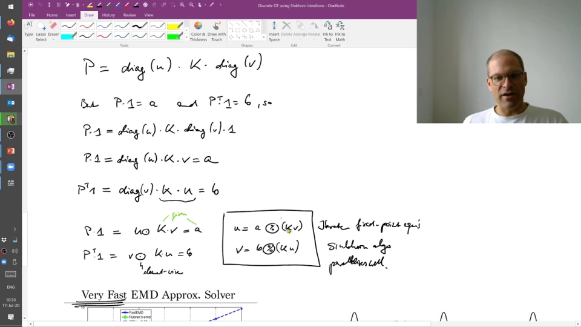
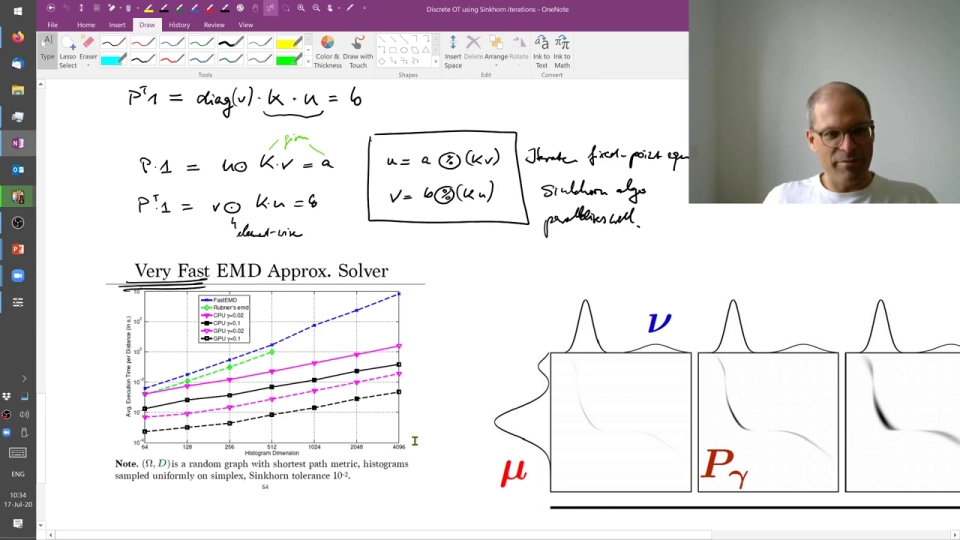
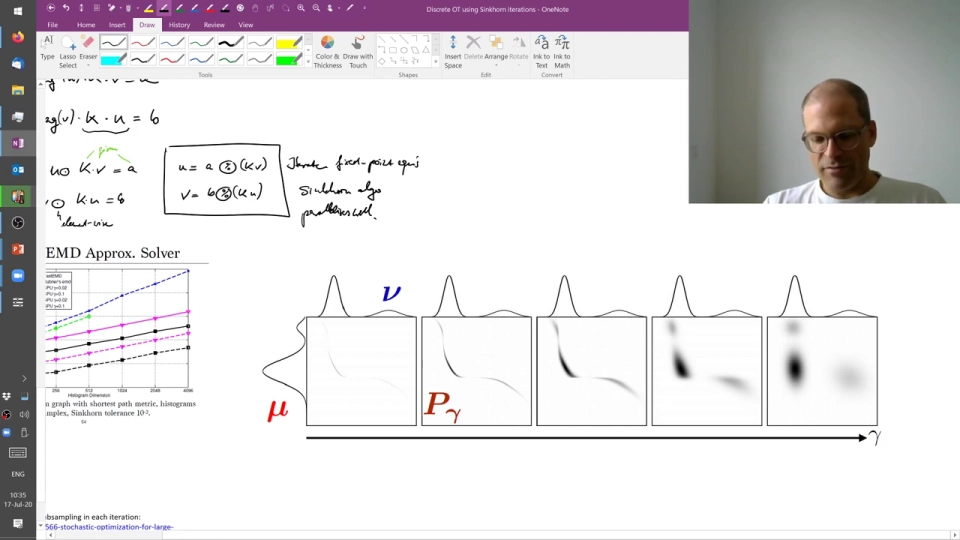

# 熵正则与 Sinkhorn 迭代：让运输计划变软且可微

> 视频来源：[Lecture 11.3: Discrete Optimal Transport (cont.) | Sinkhorn Iterations | CVF20](https://www.youtube.com/watch?v=BfOjrQAhG4M)（YouTube · UniHeidelberg，计算机视觉课程）｜时长约 20 分钟
> 导读：这是紧接上一篇的课堂讲授。上一篇把运输计划写成线性规划，能求精确解；这一篇给它加一个熵正则项，把「角点上的稀疏解」换成「内部的光滑解」，从而得到一个又快又可微的迭代算法——Sinkhorn 迭代。本文按「为什么放弃精确解 → 正则项改了什么 → 闭式解怎么来 → 迭代怎么转 → 参数 $\gamma$ 怎么选」的顺序展开。视频里把正则权重记作 $\gamma$，Peyré–Cuturi 综述里记作 $\varepsilon$，两者是同一个量。

## 本讲要解决的核心问题（SCQA）

**背景**：上一篇已经证明，离散最优传输可以写成线性规划，也可以写成最小代价流，用标准求解器就能拿到精确最优运输计划。

**冲突**：精确解有三个不好用的地方。第一，规模一大就慢。第二，解落在可行多面体的角点上，因此稀疏、对代价扰动不稳定、还可能多解。第三，也是最要命的一点：**它不可微**。而实际用的时候，代价常常是神经网络估出来的，代价本身就不完全可靠，我们却拿不到「最优计划对网络参数」的梯度（[【跳转到 00:00】](https://www.youtube.com/watch?v=BfOjrQAhG4M&t=0)）。

**疑问**：如果本来就不确定该问哪个问题，那么一个**近似**但快得多、还可微的解，是不是比精确解更有用？

**回答（中心思想）**：加一个熵正则项 $\gamma\sum_{ij}P_{ij}(\log P_{ij}-1)$，线性规划就变成一个严格凸的光滑问题。它的最优解有闭式结构 $P=\mathrm{diag}(u)\,K\,\mathrm{diag}(v)$，其中 $K=\exp(-C/\gamma)$ 是「取指数的代价矩阵」。未知的 $u$、$v$ 通过交替满足行和、列和约束来求，这就是 **Sinkhorn 迭代**：全部是矩阵—向量乘法，快、GPU 友好、可微。代价是解变**稠密**了，而且正则权重 $\gamma$ 决定了配对有多「软」。

## 一、先承认一件事：我们未必想要精确解

讲者开场就把动机摆在台面上：线性规划给出的是**我们所要问题的精确最优解**，但有时候我们并不确定该问哪个问题（[【跳转到 00:25】](https://www.youtube.com/watch?v=BfOjrQAhG4M&t=25)）。如果运输代价是用神经网络估计出来的，代价本身就不完全可靠；这种情况下，一个近似解只要**快得多、还可微、性质又好**，就完全够用。

Sinkhorn 迭代并不是新东西——它至少从 1960 年代就为人所知，在机器学习里被反复拾起；讲者特别引用了把它重新带回最优传输语境的那篇工作（[【跳转到 00:55】](https://www.youtube.com/watch?v=BfOjrQAhG4M&t=55)）。

## 二、熵正则改了什么：解从角点搬到内部

### 2.1 一张图看懂正则化的作用

这张图取自 Peyré 的书，画的是同一个线性目标在不同正则强度下的最优点（[【跳转到 01:20】](https://www.youtube.com/watch?v=BfOjrQAhG4M&t=80)）。每张三角形是一个可行域（单纯形），彩色等高线是目标函数，黑点是当前最优点，横轴是正则权重 $\varepsilon$：

- **最左边**：没有正则项，最优点在角点上——这正是上一篇的线性规划解；
- **往右**：随 $\varepsilon$ 增大，等高线变圆，最优点离开角点，向内部移动；
- **最右边**：正则项占主导，最优点几乎落在中心。

### 2.2 为什么这带来「平滑」

讲者用多面体的语言重述这件事（[【跳转到 02:00】](https://www.youtube.com/watch?v=BfOjrQAhG4M&t=120)）：线性规划的解总在角点上，至多在某个面上；而一旦加上负熵项，混合目标函数的最优点**不再落在角点上**。

好处立刻显现：代价向量变化时，解**平滑地变化**，不会突然从一个角点跳到另一个角点。这一点很值得要，如果我们想端到端地训练这类系统（[【跳转到 03:57】](https://www.youtube.com/watch?v=BfOjrQAhG4M&t=237)）。换句话说，正则化把「离散的选择」换成了「连续的插值」，梯度才有意义。

### 2.3 代价是：解不再稀疏

缺点也随之而来。如果把多面体的角点理解为「源元素和汇元素之间到底有没有流量」，那么解落在多面体内部，就意味着**非常稠密的解**（[【跳转到 04:28】](https://www.youtube.com/watch?v=BfOjrQAhG4M&t=268)）。

看这张没有正则化的例子：代价矩阵呈带状，最优运输计划几乎是一条对角线，矩阵里大多数元素是零。讲者指着其中一个深蓝色元素说：它的一部分去了这里，一部分去了第二个箱子，一部分去了第四个箱子，**其余地方一点都没去，确实一点都没有**（[【跳转到 05:41】](https://www.youtube.com/watch?v=BfOjrQAhG4M&t=341)）。

而一旦加上熵正则，「我们就会把它推一点到这里，推一点到那里，再推一点到那边」——于是每个源箱子都会给每个目标箱子贡献一点。讲者特意点明：**这可能是个问题，取决于你想要什么**（[【跳转到 06:06】](https://www.youtube.com/watch?v=BfOjrQAhG4M&t=366)）。如果你要的是一张「谁配谁」的稀疏配对表，稠密解就不合用；如果你要的是一个平滑、可微、能反向传播的传输量，稠密正是你要的。

## 三、一维例子：解为什么会离开边界

为什么加一项 $P\log P$ 就能把解从边界拉走？讲者给了一个一维的直观解释（[【跳转到 06:23】](https://www.youtube.com/watch?v=BfOjrQAhG4M&t=383)）。

设可行域是「零右边的所有东西」，代价是标量、越往右越贵。没有正则项时，线性规划的解就取在零处——因为不能再往左走，而往右更贵。

现在加上 $P\log P$，就是图上那条绿色曲线。它在原点处**斜率为负无穷**：只要从零往正方向挪无穷小的一步，正则项带来的收益（无穷大的负斜率）就会远大于代价的增加，于是最优解离开边界（[【跳转到 07:13】](https://www.youtube.com/watch?v=BfOjrQAhG4M&t=433)）。

如果代价的斜率是 $+1$，最优解就落在「代价斜率 $+1$ 与正则项斜率 $-1$ 相抵」的位置。讲者强调：这是一维例子，但**高维完全一样**（[【跳转到 08:03】](https://www.youtube.com/watch?v=BfOjrQAhG4M&t=483)）。

## 四、把目标函数写出来

把上一篇的线性规划加上熵项，就得到这一讲的主角（[【跳转到 08:28】](https://www.youtube.com/watch?v=BfOjrQAhG4M&t=508)）：

$$
\arg\min_{P}\ \langle P,C\rangle + \gamma\sum_{i,j}P_{ij}\left(\log P_{ij}-1\right)
\quad\text{s.t.}\quad P\mathbf{1}_m=a,\ \ P^{\top}\mathbf{1}_n=b,\ \ P_{ij}\ge 0
$$

三个细节值得说明：

1. **$\gamma$ 是使用者选的**，决定正则项占多大比重（Peyré–Cuturi 综述里写作 $\varepsilon$，两者是同一个量）。
2. **那个「减一」纯粹是为了让数学更漂亮**，你马上会看到它怎么抵消（[【跳转到 08:53】](https://www.youtube.com/watch?v=BfOjrQAhG4M&t=533)）。
3. 这一项就是**负熵**：因为 $H(P)=-\sum_{ij}P_{ij}\log P_{ij}$，所以 $\gamma\sum P(\log P-1)=-\gamma H(P)-\gamma$。也就是说，目标等于「运费减去 $\gamma$ 倍的熵」。熵大意味着计划「摊得开」，所以这个正则项在鼓励**不要把鸡蛋放在一个篮子里**。

## 五、拉格朗日 → 闭式解

### 5.1 写出拉格朗日函数

把两个等式约束乘上乘子向量 $\alpha$、$\beta$ 加进目标（[【跳转到 09:18】](https://www.youtube.com/watch?v=BfOjrQAhG4M&t=558)）：

$$
\mathcal{L}(P,\alpha,\beta)=\sum_{i,j}P_{ij}C_{ij}+\gamma\sum_{i,j}P_{ij}\left(\log P_{ij}-1\right)+\alpha^{\top}\left(P\mathbf{1}_m-a\right)+\beta^{\top}\left(P^{\top}\mathbf{1}_n-b\right)
$$

### 5.2 对 $P_{ij}$ 求导

对每个元素求偏导并令其为零（[【跳转到 10:29】](https://www.youtube.com/watch?v=BfOjrQAhG4M&t=629)）：

$$
\frac{\partial \mathcal{L}}{\partial P_{ij}}=C_{ij}+\gamma\log P_{ij}+\alpha_i+\beta_j=0
$$

注意那个「减一」在这里起了作用：$\gamma$ 项求导得到 $\gamma(\log P_{ij}+1)$，与 $-1$ 带来的 $-\gamma$ 正好抵消，只剩下 $\gamma\log P_{ij}$。这就是「为了让数学更漂亮」的意思。

### 5.3 取指数：三个因子的乘积

把上式整理成 $\log P_{ij}=-\frac{\alpha_i}{\gamma}-\frac{C_{ij}}{\gamma}-\frac{\beta_j}{\gamma}$，再取指数（[【跳转到 11:23】](https://www.youtube.com/watch?v=BfOjrQAhG4M&t=683)）：

$$
P_{ij}=\underbrace{\exp\!\left(-\frac{\alpha_i}{\gamma}\right)}_{u_i}\cdot\underbrace{\exp\!\left(-\frac{C_{ij}}{\gamma}\right)}_{K_{ij}}\cdot\underbrace{\exp\!\left(-\frac{\beta_j}{\gamma}\right)}_{v_j}
$$

图下半部分就是结论：$P_{ij}=u_iK_{ij}v_j$，写成矩阵形式是

$$
P=\mathrm{diag}(u)\,K\,\mathrm{diag}(v),\qquad K_{ij}=\exp\!\left(-\frac{C_{ij}}{\gamma}\right)
$$

讲者把这个 $K$ 叫作**核矩阵**（kernel matrix）——它就是「取指数的代价矩阵」，分母里的 $\gamma$ 有点像温度（[【跳转到 11:48】](https://www.youtube.com/watch?v=BfOjrQAhG4M&t=708)）。

**麻烦在于**：$u$、$v$ 依赖我们并不知道的乘子 $\alpha$、$\beta$。于是出现了「闵希豪森」式的做法：不知道的东西先猜一个，代进去得到更新，再从更新里改进估计，然后迭代（[【跳转到 12:13】](https://www.youtube.com/watch?v=BfOjrQAhG4M&t=733)）。

## 六、Sinkhorn 迭代：交替满足两端的约束

### 6.1 把约束代进去

把 $P=\mathrm{diag}(u)K\,\mathrm{diag}(v)$ 代入两个边缘约束（[【跳转到 12:38】](https://www.youtube.com/watch?v=BfOjrQAhG4M&t=758)）：

- 行约束：$P\mathbf{1}_m=\mathrm{diag}(u)\,K\,v=a$
- 列约束：$P^{\top}\mathbf{1}_n=\mathrm{diag}(v)\,K^{\top}u=b$

写成逐元素形式就是两个不动点方程：

$$
u=a\oslash(Kv),\qquad v=b\oslash(K^{\top}u)
$$

其中 $\oslash$ 表示逐元素相除（视频里用 $\odot$ 表示逐元素相乘，这里按同样的记号习惯写）。

### 6.2 为什么这个迭代一定能转

看这两个式子：$u$ 的更新式依赖 $v$，$v$ 的更新式依赖 $u$。于是你可以**交替更新**：固定 $v$ 更新 $u$（这一步让行和精确等于 $a$），再固定 $u$ 更新 $v$（这一步让列和精确等于 $b$），如此往复。讲者说，迭代下去会找到**一个不动点**，整体上给出一个非常快的算法（[【跳转到 13:53】](https://www.youtube.com/watch?v=BfOjrQAhG4M&t=833)）。

注意每次更新只做一件事：矩阵—向量乘法加逐元素除法。**没有任何优化器、没有搜索、没有求解器**——这就是它快的原因。

## 七、快多少：对数级时间与 GPU 友好

讲者引用那篇论文的基准图（[【跳转到 14:18】](https://www.youtube.com/watch?v=BfOjrQAhG4M&t=858)）：横轴是直方图的箱子数（最大到 4000），纵轴是执行时间（对数刻度）。**执行时间是对数级的**，比之前的算法快了大约三个数量级，而之前的算法已经不差了（[【跳转到 14:43】](https://www.youtube.com/watch?v=BfOjrQAhG4M&t=883)）。

更实际的一点：因为全是矩阵—向量运算，它**对 GPU 非常友好**；在 GPU 上做大约比 CPU 快一个数量级。

## 八、$\gamma$ 的两个极端：从精确解到「笨答案」

这是全篇最值得记住的一张图（[【跳转到 15:08】](https://www.youtube.com/watch?v=BfOjrQAhG4M&t=908)）：

图的结构：上方曲线是目标分布 $\nu$，左侧曲线是源分布 $\mu$，中间每个方块就是一张运输计划 $P_\gamma$，横轴是逐渐增大的 $\gamma$。

- **$\gamma\to 0$**：正则项几乎消失，解逼近**精确解**。在一维绝对连续分布的情形下，精确的运输计划在一条曲线之外真的就是零——图上最左边那张，质量集中在一条细曲线上（[【跳转到 15:33】](https://www.youtube.com/watch?v=BfOjrQAhG4M&t=933)）。
- **$\gamma\to\infty$**：正则项压倒一切，解变成**两个分布的外积** $P=\mu\nu^{\top}$。讲者管它叫「笨答案」：拿一把铲子，把某个位置的那点质量，老老实实按目标分布想要的样子铺开，完全不管其他位置（[【跳转到 17:13】](https://www.youtube.com/watch?v=BfOjrQAhG4M&t=1033)）。

但请注意：这个「笨答案」**永远是一个合法的运输计划**——行和等于 $\mu$、列和等于 $\nu$，两条约束都满足。它对应的是「源和目标完全独立」的耦合，也是熵最大的那个耦合。

### 8.1 软硬与代价的取舍

由此得到一条实用的选择规则：

| 你想要的 | 该怎么选 $\gamma$ | 会得到什么 |
| --- | --- | --- |
| 接近精确的稀疏配对 | 小 | 计划集中在少数几条路线上，但**迭代次数多、更贵** |
| 平滑、可微、稳定的传输量 | 中等 | 计划摊开，对代价的依赖平滑 |
| 只要一个合法计划（基线） | 很大 | 退化成外积 $\mu\nu^{\top}$，几乎不算 |

讲者明确说了迭代次数的依赖关系：想非常接近精确解就得选很小的 $\gamma$，而**用小 $\gamma$ 比用大 $\gamma$ 更贵**（[【跳转到 17:38】](https://www.youtube.com/watch?v=BfOjrQAhG4M&t=1058)）。这就是「精度」与「速度」之间的直接交换。

## 九、还能更快、还能求导

### 9.1 子采样

这个算法已经很快，但还能更快：在这些矩阵—向量运算里，不必用完整的矩阵和向量，可以**对两者都做子采样**，具体做法在讲者引用的另一篇论文里（[【跳转到 18:03】](https://www.youtube.com/watch?v=BfOjrQAhG4M&t=1083)）。

### 9.2 为什么它可微

这是这一讲最关键的工程结论（[【跳转到 18:28】](https://www.youtube.com/watch?v=BfOjrQAhG4M&t=1108)）：**通向解的整个过程就是一长串矩阵—向量乘积和逐元素运算**。这类线性运算你总可以写成一个网络，因此总可以反向传播。

对比一下上一篇的困境：线性规划的解 $P^{*}(C(\theta))$ 对参数 $\theta$ 的导数是拿不到的；而 Sinkhorn 的迭代本身就是可微的计算图，梯度可以一路传回代价矩阵，再传回生成代价的网络。这就是「近似」换来的最大好处。

## 十、判读：什么时候该用软的，什么时候不该

讲者的总结非常克制（[【跳转到 18:53】](https://www.youtube.com/watch?v=BfOjrQAhG4M&t=1133)）：Sinkhorn 迭代**快、可微、是近似的**。

- 「近似」有时是**好事**：如果你想要解对代价的平滑依赖，或者代价本身是学出来的、本来就不精确，那精确解反而是假精确。
- 「近似」有时是**坏事**：如果你在意稀疏解——想要一张「谁配谁」的干净配对表——那么 Sinkhorn 给你的就是稠密解，每个源项都跟每个目标项有一点往来（[【跳转到 19:18】](https://www.youtube.com/watch?v=BfOjrQAhG4M&t=1158)）。

由此可以延伸出一个判读上的提醒（这一条是从上面的定义推出来的，不是视频里的原话）：**$\gamma$ 是一个会改变结论的旋钮**。同一对分布、同一个代价矩阵，$\gamma$ 小时你看到「几乎确定的配对」，$\gamma$ 大时你看到「几乎独立的摊平」。如果拿这张计划去解释「谁变成了谁」，那么「配对有多确定」很大程度上是**你选的 $\gamma$ 造出来的**，而不是数据里本来就有的。所以报告这类结果时，$\gamma$（或 $\varepsilon$）必须和结论一起给出；把某个 $\gamma$ 下的稠密或稀疏图案当成客观的对应关系，是把正则化参数误读成了机制。

## 小结

- **动机**：线性规划的精确解慢、稀疏、不稳定、不可微；而代价常常是估出来的，近似解反而更合用。
- **改了什么**：加熵项 $\gamma\sum P(\log P-1)=-\gamma H(P)-\gamma$，目标变严格凸，解从多面体角点移到内部，随代价平滑变化。
- **闭式结构**：$P=\mathrm{diag}(u)K\,\mathrm{diag}(v)$，$K=\exp(-C/\gamma)$，由拉格朗日求导 + 取指数得到。
- **Sinkhorn 迭代**：$u=a\oslash(Kv)$、$v=b\oslash(K^{\top}u)$ 交替更新，全是矩阵—向量运算，快、GPU 友好、可微。
- **$\gamma$ 的作用**：$\gamma\to0$ 逼近精确稀疏解（但更贵），$\gamma\to\infty$ 退化成外积 $\mu\nu^{\top}$（合法但「笨」）。
- **代价**：解变稠密；若需要稀疏配对表，它不是合适工具。
- **判读**：$\gamma$ 会改变「配对有多确定」，报告结论时必须一并给出。

## 关键术语速查

| 术语 | 一句话解释 |
| --- | --- |
| 熵正则 | 在运费目标上加 $-\gamma H(P)$，鼓励运输计划「摊开」，使问题严格凸、解光滑 |
| 正则权重 $\gamma$（或 $\varepsilon$） | 控制熵项强度的使用者参数；小则接近精确解，大则接近外积 |
| 核矩阵 $K$ | $K_{ij}=\exp(-C_{ij}/\gamma)$，即取指数的代价矩阵，分母 $\gamma$ 起温度作用 |
| 缩放因子 $u,v$ | $P=\mathrm{diag}(u)K\,\mathrm{diag}(v)$ 中的两个非负向量，用来满足行和与列和约束 |
| Sinkhorn 迭代 | 交替执行 $u\leftarrow a\oslash(Kv)$、$v\leftarrow b\oslash(K^{\top}u)$，收敛到不动点 |
| 稠密解 | 熵正则后的运输计划每个元素都非零，与线性规划的稀疏角点解相对 |
| 外积解 | $\gamma\to\infty$ 时的极限 $P=\mu\nu^{\top}$，永远合法，对应源与目标独立 |
| 可微性 | Sinkhorn 的每一步都是线性/逐元素运算，因此能对整个迭代反向传播 |