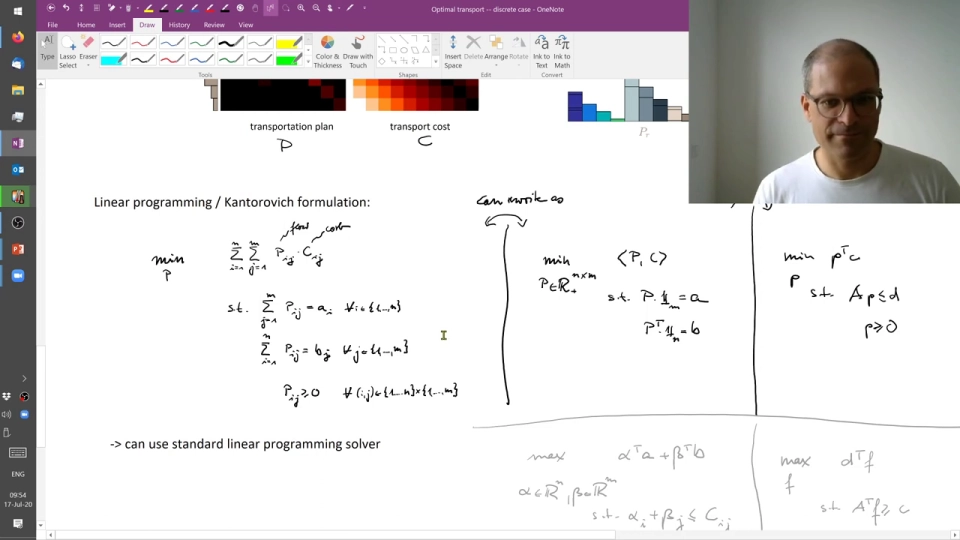
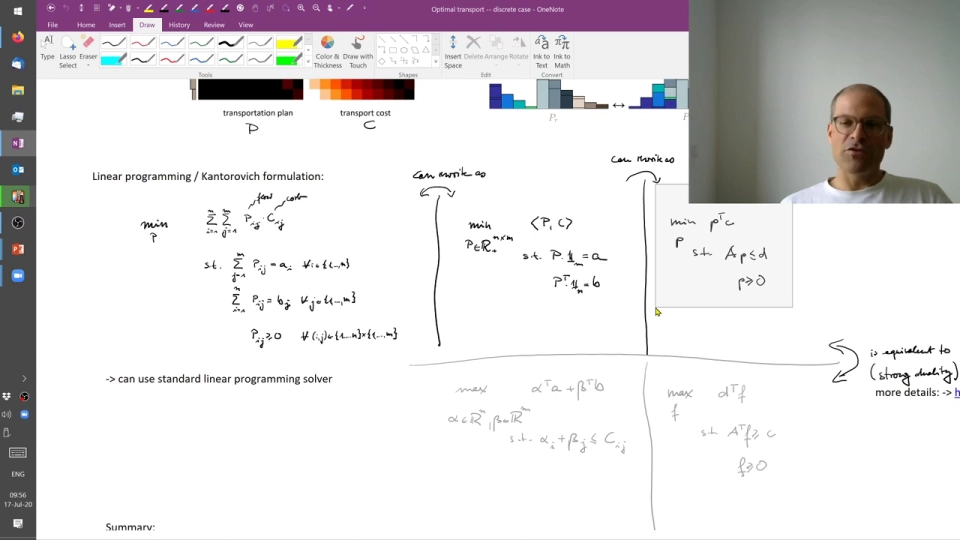
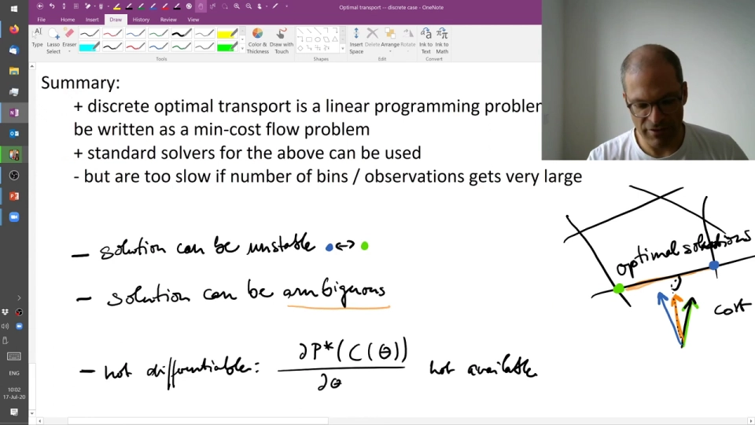
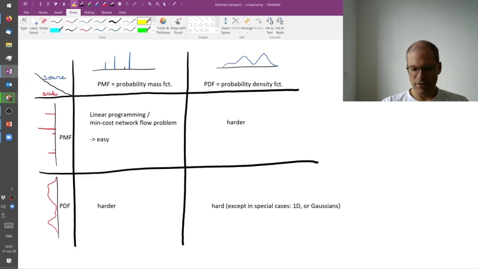

# 离散最优传输：耦合矩阵、代价与线性规划

> 视频来源：[Lecture 11.2: Discrete Optimal Transport | CVF20](https://www.youtube.com/watch?v=VY0syny-o1M)（YouTube · UniHeidelberg，计算机视觉课程）｜时长约 27 分钟
> 导读：这是一节课堂讲授，把「把一堆东西搬到另一堆地方」写成矩阵问题：给定两个带权样本和一个代价矩阵，求一张满足行、列求和约束的运输计划表。全程只用一维直方图举例，但结论适用于任意维度。本文聚焦**运输计划怎么定义、怎么算、解长什么样**；熵正则与 Sinkhorn 迭代留给同一小节的另一篇。

## 本讲要解决的核心问题（SCQA）

**背景**：我们手上有两组带权样本——比如两张直方图、两批细胞、两组特征点——想知道「把第一组变成第二组，最少要花多少代价」，并且想知道**具体怎么搬**。

**冲突**：只报一个总距离是不够的。同一个总距离可以由很多种搬法实现，而很多下游任务（生成、匹配、轨迹推断）真正需要的是那张「谁搬到谁」的表。更麻烦的是，这张表要满足硬性条件：源那边每一份都得搬走，目标那边每一份都得被填满，不能凭空多出来也不能少。

**疑问**：怎样把「搬法」写成一个可以求解的数学对象？它有什么结构，解出来长什么样，什么时候不该信它？

**回答（中心思想）**：把搬法写成一个矩阵 $P$（运输计划 / 耦合矩阵），它的行和必须等于源分布 $a$、列和必须等于目标分布 $b$，总代价是 $P$ 与代价矩阵 $C$ 的内积。于是问题变成**带线性约束的线性规划**，可以用网络流或线性规划求解器求精确解。代价是：精确解稀疏、可能多解、对代价扰动不稳定、而且对代价矩阵不可微——这四点正是后面要引入熵正则的动机。

## 一、把「搬运」写成一张表：$a$、$b$、$C$ 与未知的 $P$

### 1.1 先限定在最容易的情形：两边都离散

最优传输要处理的对象是一对分布：源分布要被「变形」成汇（目标）分布。源分布可以是离散的——一维特征空间里若干带权重的狄拉克脉冲；也可以是连续的，用概率密度函数描述（[【跳转到 00:08】](https://www.youtube.com/watch?v=VY0syny-o1M&t=8)）。

这里要区分两个词。**概率质量函数**（PMF）在某个具体取值上有一份有限的概率；**概率密度函数**（PDF）整体积分等于一，但单个取值上的概率小到可以忽略（[【跳转到 00:33】](https://www.youtube.com/watch?v=VY0syny-o1M&t=33)）。汇分布同样可以离散或连续，四种组合之间有对称性。其中**源和目标都离散是最容易的情形**，连续情形在计算上一般难得多，只有少数简单情形（比如一维、比如高斯）能给出闭式解（[【跳转到 01:23】](https://www.youtube.com/watch?v=VY0syny-o1M&t=83)）。

### 1.2 三个已知量，一个未知量

设源分布是 $a=(a_1,\dots,a_m)$，目标分布是 $b=(b_1,\dots,b_n)$，两者都是概率向量（各分量非负、各自求和为 1）。再设 $C_{ij}$ 表示「把一份物料从源的第 $i$ 项运到目标的第 $j$ 项」的代价。

于是问题的结构非常干净：

- **已知**：源分布 $a$、目标分布 $b$、运输代价矩阵 $C$；
- **要求**：运输计划 $P$；
- **总代价**：由运输计划算出（[【跳转到 03:36】](https://www.youtube.com/watch?v=VY0syny-o1M&t=216)）。

图里左侧竖着的柱状是目标分布 $b$，上方横着的柱状是源分布 $a$，右边彩色方块是代价矩阵 $C$（白色高代价、黑色零代价），中间打着问号的黑块就是待求的运输计划 $P$（[【跳转到 02:48】](https://www.youtube.com/watch?v=VY0syny-o1M&t=168)）。

### 1.3 代价矩阵可以有任意结构，也可以不是方阵

讲者特意用了一个**随手生成的**代价矩阵，就为了强调：运输代价矩阵可以有任意的结构，不必来自任何几何距离。这个例子里源有 10 项、汇也有 10 项，但一般情况下不必如此——**源项可以比汇项多，这时代价矩阵不再是方阵，而是矩形**（[【跳转到 03:13】](https://www.youtube.com/watch?v=VY0syny-o1M&t=193)）。

这一点很关键：只要 $C$ 是给定的，问题就成立；$C$ 是不是「距离」、来自哪个度量空间，是另一个问题。

### 1.4 总代价 = 逐元素相乘再求和

给定 $P$ 之后，总代价的算法是：把 $P$ 与 $C$ **逐元素相乘**，得到一个新矩阵，再把所有元素加起来（[【跳转到 04:01】](https://www.youtube.com/watch?v=VY0syny-o1M&t=241)）。写成式子就是内积：

$$
\langle P, C \rangle = \sum_{i=1}^{m}\sum_{j=1}^{n} P_{ij}\, C_{ij}
$$

含义很直白：$P_{ij}$ 是「从 $i$ 搬到 $j$ 的物料量」，$C_{ij}$ 是「搬一份的单价」，乘起来是这一条路线花的钱，全部加起来就是总运费。

## 二、边缘约束：行和等于 $a$，列和等于 $b$

### 2.1 两个必须满足的条件

光有代价还不能定义问题，必须加上「不许凭空增减物料」的约束（[【跳转到 16:47】](https://www.youtube.com/watch?v=VY0syny-o1M&t=1007)）：

- **源这边全部运走**：$P$ 的第 $i$ 行加起来必须等于 $a_i$；
- **目标那边全部填满**：$P$ 的第 $j$ 列加起来必须等于 $b_j$。

图上那些从 $a$ 的柱子和 $b$ 的柱子指向中间黑块的箭头，画的就是这件事：$a$ 规定了每一行要运出多少，$b$ 规定了每一列要收到多少（[【跳转到 04:01】](https://www.youtube.com/watch?v=VY0syny-o1M&t=241)）。

用向量写法更紧凑。记 $\mathbf{1}_m$ 是 $m$ 维全 1 列向量：

$$
P\,\mathbf{1}_m = a, \qquad P^{\top}\mathbf{1}_n = b, \qquad P_{ij}\ge 0
$$

这就是**耦合（coupling）**的确切含义：$P$ 是一个联合分布，它的两个边缘分布分别被钉死成 $a$ 和 $b$。满足这两条约束的 $P$ 都叫**可行运输计划**，其中总代价最小的那个叫**最优运输计划**。

### 2.2 约束的几何：可行域是一个多面体

把 $P$ 拉直成一个长向量，上面这些约束都是线性的等式和不等式，所以可行域是一个**多面体**——被若干半平面围住的有界体（[【跳转到 24:00】](https://www.youtube.com/watch?v=VY0syny-o1M&t=1440)）。线性规划的解总落在多面体的某个**角点**上，至多落在某个面上。这一点在下一篇讲熵正则时会反复用到：加了熵正则之后，解会从角点跑到多面体内部去。

## 三、三种等价视角：网络流、线性规划、对偶

### 3.1 视角一：最小代价流

因为课上之前讲过网络流，讲者先用流网络把问题画出来（[【跳转到 04:20】](https://www.youtube.com/watch?v=VY0syny-o1M&t=260)）：

- 造一个源点 $s$、一个汇点 $t$；
- 为每个直方图柱子造一个节点，从 $s$ 连到源侧节点，从目标侧节点连到 $t$；
- 这些边上的**流量下限和上限都等于柱子的高度**——也就是说，必须恰好流过这么多；
- 源侧节点到目标侧节点之间全连接，这些边的**单价就是 $C_{ij}$**，流量就是运输计划 $P_{ij}$。

图上标着「lower limit = upper limit = capacity」的那几笔，就是「必须恰好运这么多」的意思：容量本来是流量上限，但流问题里也能设下限，把上下限设成相等，就变成了硬性需求量（[【跳转到 06:28】](https://www.youtube.com/watch?v=VY0syny-o1M&t=388)）。

讲者还坦白了一处容易画错的地方：中间那些边不能全都设成零代价，**必须有一端承担 $C_{ij}$**，要么在源侧、要么在汇侧，否则总代价就不对了（[【跳转到 10:38】](https://www.youtube.com/watch?v=VY0syny-o1M&t=638)）。

结论：如果代价等于「运输量 × 单价」而单价由矩阵 $C$ 编码，整个问题就能写成一个**最小代价流问题**（[【跳转到 13:22】](https://www.youtube.com/watch?v=VY0syny-o1M&t=802)）。

### 3.2 视角二：线性规划（Kantorovich 形式）

最小代价流本身是线性规划的子类，所以直接写成线性规划也不奇怪，而且对很多人来说更直观（[【跳转到 16:31】](https://www.youtube.com/watch?v=VY0syny-o1M&t=991)）：

$$
\begin{aligned}
\min_{P}\quad & \sum_{i=1}^{m}\sum_{j=1}^{n} P_{ij}\,C_{ij} \\
\text{s.t.}\quad & \sum_{j=1}^{n} P_{ij} = a_i, \quad \forall i\in\{1,\dots,m\}\\
& \sum_{i=1}^{m} P_{ij} = b_j, \quad \forall j\in\{1,\dots,n\}\\
& P_{ij}\ge 0, \quad \forall (i,j)
\end{aligned}
$$

图中间那一栏把同一件事写成了内积形式 $\min_{P\in\mathbb{R}^{n\times m}}\langle P,C\rangle$，约束是 $P\mathbf{1}_m=a$、$P^{\top}\mathbf{1}_n=b$；右边一栏则整理成线性规划的标准形 $\min\, p^{\top}c$，约束 $Ap\le d$、$p\ge 0$（[【跳转到 17:37】](https://www.youtube.com/watch?v=VY0syny-o1M&t=1057)）。

工程上的取舍：**最小代价流求解器一般比通用线性规划求解器更高效**，因为最小代价流只是线性规划的一个子类；但如果手头只有线性规划求解器，或者问题规模不大，直接用也没关系（[【跳转到 18:52】](https://www.youtube.com/watch?v=VY0syny-o1M&t=1132)）。

### 3.3 视角三：对偶问题与「价格」的解释

线性规划有一个性质叫**强对偶**：每个线性规划都有一个伴随的线性规划，原始问题（primal）的最优值与对偶问题（dual）的最优值相等（[【跳转到 19:28】](https://www.youtube.com/watch?v=VY0syny-o1M&t=1168)）。注意这里说的「解」不是那个最优的 $P$，而是**最小值本身** $\langle P,C\rangle$。

对偶形式是：

$$
\max_{\alpha\in\mathbb{R}^m,\ \beta\in\mathbb{R}^n}\ \alpha^{\top}a + \beta^{\top}b
\quad\text{s.t.}\quad \alpha_i + \beta_j \le C_{ij}\ \ \forall i,j
$$

图上右下角那一栏就是这个对偶式：$C$ 从目标函数跑到约束里，$a$ 和 $b$ 从约束右端跑到目标函数里，约束矩阵也转置了（[【跳转到 20:15】](https://www.youtube.com/watch?v=VY0syny-o1M&t=1215)）。讲者提醒：**没有很简单、很一般的几何解释**，因为原始问题和对偶问题一般活在不同维度的空间里——若约束矩阵是 $n\times m$，原始问题优化 $m$ 维向量，对偶问题优化 $n$ 维向量（[【跳转到 21:05】](https://www.youtube.com/watch?v=VY0syny-o1M&t=1265)）。

不过经济学里有一个直觉解释：把 $\alpha_i$、$\beta_j$ 想成源端和目标端的**价格**，约束 $\alpha_i+\beta_j\le C_{ij}$ 说的是「从 $i$ 买、在 $j$ 卖，赚不到比运费更多」，而目标函数就是在这样的价格下最大化总价值（[【跳转到 21:30】](https://www.youtube.com/watch?v=VY0syny-o1M&t=1290)）。这个解释后面还会再出现。

## 四、精确解长什么样：稀疏、多解、不稳定、不可微

### 4.1 一个具体的代价：只跟距离有关

讲者给了一个特别情形：如果代价只取决于源项和目标项相距多远，问题会简单很多。当然，「相距多远」只有在源分布和目标分布位于**同一个度量空间**里才有意义；如果规定代价就是欧氏距离，代价矩阵就有非常简单的结构（[【跳转到 13:55】](https://www.youtube.com/watch?v=VY0syny-o1M&t=835)）。

这就是经典的「搬土距离」（earth mover's distance）情形：代价矩阵 $C_{ij}=|i-j|$ 呈带状，最优运输计划几乎是一条对角线——**每条物料基本只往最近的空位搬**，矩阵里绝大多数元素是零（[【跳转到 14:26】](https://www.youtube.com/watch?v=VY0syny-o1M&t=866)）。

### 4.2 稀疏性来自「解在多面体角点上」

这不是巧合。线性规划的解落在可行多面体的角点上，而角点的特征是：在 $m+n-1$ 个位置之外，$P_{ij}$ 全为零。所以**精确解天然稀疏**，读起来就是一张「配对表」：某个源项只跟少数几个目标项有往来。

### 4.3 三个麻烦：多解、不稳定、不可微

讲者用多面体的图把三个麻烦一次讲清（[【跳转到 24:25】](https://www.youtube.com/watch?v=VY0syny-o1M&t=1465)）：

1. **多解**：如果代价向量正好与多面体的某个面正交，那么那个面上所有解都有相同的最优值——最优运输计划不唯一。
2. **不稳定**：代价向量稍微变一点，最优运输计划就可能变，有时变得很多。
3. **不可微**：最优计划 $P^{*}$ 依赖代价矩阵，而代价矩阵可以依赖参数（比如由一个带参数 $\theta$ 的神经网络给出）。在这个线性规划形式里，**无法直接对网络参数求最优解的导数**。

这三条正是下一篇的入口：如果代价本身是学出来的、不那么可靠，那么一个**更快、可微、允许近似**的解可能比精确解更有用（[【跳转到 25:56】](https://www.youtube.com/watch?v=VY0syny-o1M&t=1556)）。

## 五、什么时候适用：四种组合与一个判读边界

### 5.1 四种组合的难度表

| 源 / 汇 | 离散（PMF） | 连续（PDF） |
| --- | --- | --- |
| 离散（PMF） | 线性规划 / 最小代价流，容易 | 较难 |
| 连续（PDF） | 较难 | 很难（一维或高斯等特例除外） |

这张表是这一讲最实用的结论之一（[【跳转到 01:23】](https://www.youtube.com/watch?v=VY0syny-o1M&t=83)）：只要两边都能写成有限的带权样本，「求运输计划」就是一个标准线性规划；一旦有一边是连续密度，问题就跳到另一个难度级别。

### 5.2 耦合矩阵说明什么、不说明什么

这一点值得单独强调，因为它决定了这套工具能不能被当成「证据」用。

**它说明的**：在给定 $a$、$b$、$C$ 之后，哪张配对表能让总运费最小。$P_{ij}$ 大，意味着在**这个代价定义下**把 $i$ 和 $j$ 配在一起是划算的。

**它不说明的**：$P$ 里没有任何关于「时间先后」「祖先与后代」「因果」的信息。回看定义——$P$ 只由三个量决定：两端的边缘分布 $a$、$b$ 和代价矩阵 $C$。换一个代价，最优计划就换一张；$C$ 里若没有编码时间或机制，$P$ 里也不会有。

这个区别在单细胞场景里尤其要紧。若把两个时间点的细胞群当作 $a$ 和 $b$，用表达相似度或空间距离定义 $C$，求出的 $P$ 是一张**统计耦合**：它回答「按这个代价，哪一组的细胞最像、最该配到一起」。而**真实的细胞谱系**——哪个细胞真的是哪个细胞的后代——只能由谱系示踪（条形码、突变累积）这类直接观测来确认。把 $P$ 当成谱系图，等于把「在这个代价下最划算的配对」偷换成「发生过的分化事件」；代价选得不同，故事就会不同，而数据本身并不会指出哪个故事为真。所以更稳妥的用法是：把 $P$ 当作**在明确假设下的最优配对假设**，并把这些假设（代价怎么定、两端分布怎么估）连同结论一起报告。

## 小结

- **问题结构**：给定源分布 $a$、目标分布 $b$、代价矩阵 $C$，求运输计划 $P$；总代价是内积 $\langle P,C\rangle$。
- **耦合的定义**：$P\mathbf{1}_m=a$、$P^{\top}\mathbf{1}_n=b$、$P\ge 0$——行和列和分别被两端分布钉死，这就是「软配对」。
- **三种等价写法**：最小代价流（最直观）、线性规划（最标准）、对偶（最有「价格」味道，$\alpha_i+\beta_j\le C_{ij}$）。
- **代价矩阵不一定是距离**：它可以有任意结构，也可以是矩形；只有想把它当距离用时，才需要两端在同一度量空间。
- **精确解的性质**：落在可行多面体的角点上，因此稀疏；可能多解；对代价扰动不稳定；对代价矩阵不可微。
- **判读边界**：$P$ 只由 $a$、$b$、$C$ 决定，是统计耦合，不是谱系或因果证据。

## 关键术语速查

| 术语 | 一句话解释 |
| --- | --- |
| 运输计划 / 耦合矩阵 $P$ | 一个 $m\times n$ 的非负矩阵，$P_{ij}$ 表示从源第 $i$ 项搬到目标第 $j$ 项的物料量 |
| 边缘约束 | $P$ 的行和等于 $a$、列和等于 $b$，即两个边缘分布被固定 |
| 代价矩阵 $C$ | $C_{ij}$ 是把一份物料从 $i$ 运到 $j$ 的单价；可以有任意结构，不必是距离 |
| 总代价 $\langle P,C\rangle$ | 逐元素相乘再求和，等于这张计划的总运费 |
| 最小代价流 | 把运输问题画成带上下限的流网络；是线性规划的一个子类 |
| 强对偶 | 原始线性规划与对偶线性规划的最优值相等；对偶里 $a,b$ 进目标，$C$ 进约束 |
| 可行多面体 | 所有满足约束的 $P$ 组成的集合；线性规划的解总在角点上，因此稀疏 |
| 统计耦合 vs 谱系 | 耦合只说明「按这个代价最划算的配对」，不说明真实的祖先—后代关系 |