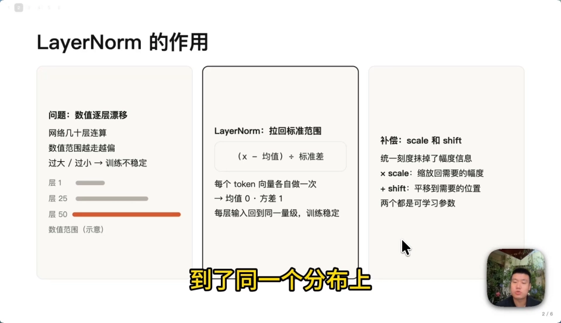
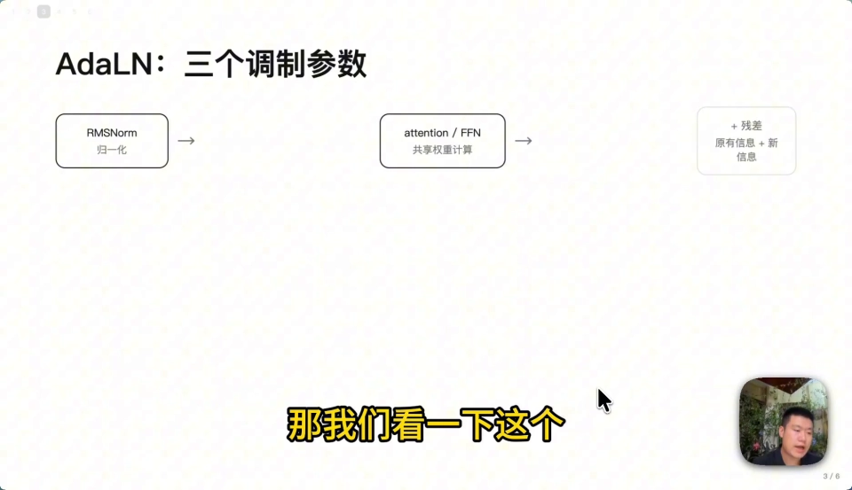
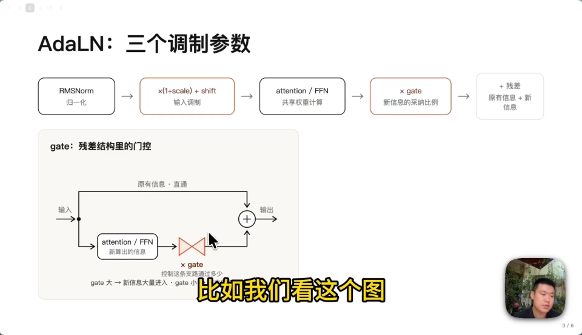
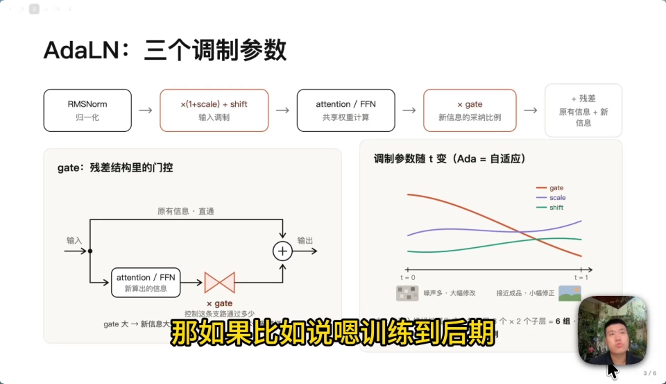
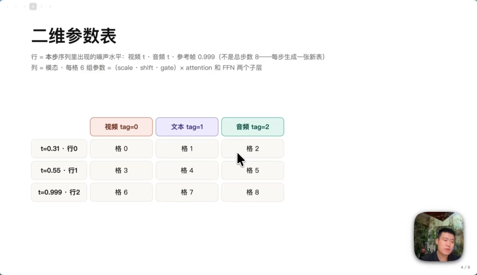
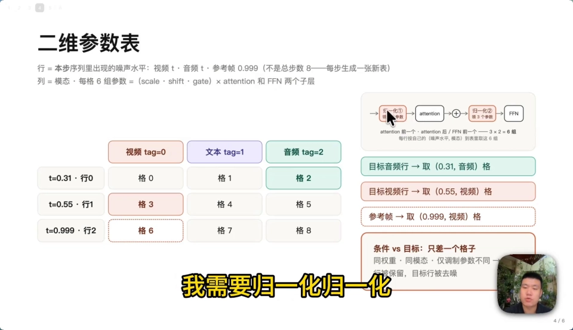

# AdaLN 条件调制：把条件变成缩放、平移与门控参数

> 视频来源：[跟着 H3 学视频生成③ AdaLN](https://www.bilibili.com/video/BV1WN8d6GEmi/)（Bilibili · UP 主「clip」）｜时长约 8.3 分钟
> 导读：前面两种条件注入方式（通道拼接、交叉注意力）都是把条件当成「额外的输入」塞进网络；这一支视频讲第三种思路——**不送数据，送参数**：用条件回归出归一化层的缩放、平移和门控系数，直接改造特征图。本文按「LayerNorm 是什么 → adaLN 多了什么 → 为什么要随条件变 → 工程上怎么省显存」四步走。字幕为 AI 生成，术语已订正（「艾达令」→ adaLN、「规划和」→ 归一化）。

## 本讲要解决的核心问题（SCQA）

**背景**：扩散模型的去噪网络里，条件（时间步 $t$、类别、文本）必须让每一层都知道。最直觉的做法是把它拼进输入，或者用交叉注意力送进去。

**冲突**：但有一类模型（视频生成里的 DiT 系骨干）根本不把 $t$ 拼进输入。attention 和 FFN 这两块本身不含 $t$ 的信息，那模型怎么知道自己现在去噪到第几步？更麻烦的是，一条序列里可能同时有视频、音频和条件文本三种模态，它们的噪声水平还不一样。

**疑问**：条件不进入数据通路，还能从哪里进入网络？进入之后又怎样做到「不同模态、不同噪声水平用不同的调制」？

**回答（中心思想）**：走**归一化层**这条路。LayerNorm 本来就要对每个 token 做「减均值、除标准差」，adaLN（adaptive layer norm）把归一化后的 **scale（缩放）、shift（平移）** 以及残差分支的 **gate（门控）** 三个参数，改成由条件回归出来的量。于是条件不再是数据，而是「改造特征的系数」——这就是调制式注入（AdaGN / FiLM 属于同一族）。[【跳转到 00:00】](https://www.bilibili.com/video/BV1WN8d6GEmi/?t=0)

## 一、先补 LayerNorm：它解决的是数值逐层漂移

网络可能有十几层乃至几百层，数据一层层传下去，**每一层的数据范围会慢慢偏移**：有的方向越算越大，有的方向越算越小。范围一大一小，梯度就非常不稳定，训练就崩了。[【跳转到 00:25】](https://www.bilibili.com/video/BV1WN8d6GEmi/?t=25)

LayerNorm 的做法非常直接：对每个 token 的向量，先减掉自己的均值，再除以自己的标准差，把分布拉回均值 0、方差 1 的标准范围。这样每一层拿到的输入都在同一个量级上，训练更稳定。

但只做归一化有个巨大的副作用：**所有向量都被压到同一个分布上，原来幅度里携带的信息被抹平了**。所以标准做法是归一化之后再补两个可学习参数：

- **scale**：把分布缩放回网络需要的大小；
- **shift**：把整体平移到网络需要的位置。

这就是普通 LayerNorm：$\text{LN}(x)\cdot\gamma+\beta$，其中 $\gamma,\beta$ 是**固定的、与输入内容无关**的可学习参数。[【跳转到 00:50】](https://www.bilibili.com/video/BV1WN8d6GEmi/?t=50) [【跳转到 01:15】](https://www.bilibili.com/video/BV1WN8d6GEmi/?t=75)

## 二、adaLN 多了什么：参数随条件变，还多一个 gate

adaLN 和普通 LayerNorm 的区别有两条：[【跳转到 01:40】](https://www.bilibili.com/video/BV1WN8d6GEmi/?t=100)

1. **scale 和 shift 不再是固定常数，而是跟着当前的去噪时刻 $t$ 变化**（推广到条件生成，就是跟着条件向量变化）；
2. **多出第三个参数 gate**，也就是「新信息的采纳比例」。

### 2.1 gate 是残差结构里的门控

transformer 的每个子层是残差结构：输出 = 原有信息 + 当前这一层新算出来的信息。gate 就是**新信息加进去之前乘的那个系数**，它控制「这一层新算出来的东西我要采纳多少」。[【跳转到 02:05】](https://www.bilibili.com/video/BV1WN8d6GEmi/?t=125)

- gate 大 → 大量新信息进入，这一层改动很大；
- gate 小 → 保持原样，这一层几乎不动。

用公式写出来，一个子层的形状大致是：

$$
h' = h + \text{gate}\cdot\big(\text{FFN}(\text{Norm}(h)\cdot(1+\text{scale})+\text{shift})\big)
$$

其中 scale、shift、gate 都由条件（时间步 $t$ 的嵌入）回归得到，而不是训练后固定下来。

### 2.2 为什么这些参数必须随 $t$ 变

视频给了一个很好懂的例子，就拿 gate 来说：[【跳转到 02:30】](https://www.bilibili.com/video/BV1WN8d6GEmi/?t=150)

- **$t$ 很小**（去噪早期）：画面里基本都是噪声，模型要做的是生成整个画面的大结构——东西摆在哪、有什么物品。这时改动需要大刀阔斧，所以 gate 要开得很大。
- **$t$ 很大**（去噪后期）：大画面已经有了，只需要精修细节，比如让边缘、纹理更真实。这时大改反而会破坏现有画面，所以 gate 要收小，每层只允许小幅修正。

更根本的原因是：**$t$ 并不拼进模型输入**。attention 和 FFN 本身没有 $t$，唯一能感知「现在去噪到哪一步」的只有 layer norm 这一层。它们如果不随 $t$ 变化，模型根本不知道自己处于哪个阶段。而且不同阶段子层拿到的输入分布本身就不一样，所以不同 $t$ 的 scale 和 shift 也应该不同。[【跳转到 02:55】](https://www.bilibili.com/video/BV1WN8d6GEmi/?t=175) [【跳转到 03:20】](https://www.bilibili.com/video/BV1WN8d6GEmi/?t=200)

这正是调制式注入与「拼接」最本质的区别：拼接是在输入上加信息，调制是**在每一层的归一化处改写特征的尺度与偏移**，而且改写的幅度可以随条件连续变化。

## 三、一个真实系统里的做法：按「噪声水平 × 模态」查表

视频用 H3 这个视频生成模型举例。它的特殊之处在于：上一期讲过 H3 的信息流，它把**所有模态拼成一条大长条**送进 attention block，所以一条序列里有三种模态——视频、音频、条件文本。[【跳转到 03:45】](https://www.bilibili.com/video/BV1WN8d6GEmi/?t=225)

问题随之而来：不同行的噪声水平不一样，不同模态的数值分布也不一样，所以它们的 scale、shift、gate **天生就完全不同**。H3 的解法是把调制参数组织成一张**二维表**：行是噪声水平，列是模态。[【跳转到 04:08】](https://www.bilibili.com/video/BV1WN8d6GEmi/?t=248)

每个格子里是**六组**调制参数。为什么是六组？因为一个 transformer block 里有两个 adaLN：一个在进 attention 之前做归一化，那里有三个参数（scale、shift、gate）；过了 attention、在 FFN 之前又有另一套，所以每格是 $2\times3=6$ 组。[【跳转到 04:33】](https://www.bilibili.com/video/BV1WN8d6GEmi/?t=273)

取用方式就像抽屉：要取目标音频行，就取「对应时间点 × 音频模态」那一格；要取目标视频行，就取对应的那一格。[【跳转到 04:58】](https://www.bilibili.com/video/BV1WN8d6GEmi/?t=298)

这里有个很漂亮的设计：**参考帧和目标视频行是同一个模态、过同一套权重，两者在网络里的唯一区别就是调制参数不同**。就靠这一点，模型才能把参考帧当成「不要动的输入」，而把目标行当成「要去输出的噪声」。[【跳转到 05:23】](https://www.bilibili.com/video/BV1WN8d6GEmi/?t=323)

换句话说，**「这个 token 是条件还是生成目标」这件事，本身也是靠调制参数编码的**——这比在输入上拼一个 0/1 标记更彻底，因为它作用在每一层。

## 四、代价与红利：13B 参数可以预计算

### 4.1 代价：调制参数占的参数量很大

生成调制参数的是一个线性层：输入是 $t$ 的 embedding（2688 维），输出是 96768 维。这个数字怎么来的？[【跳转到 05:45】](https://www.bilibili.com/video/BV1WN8d6GEmi/?t=345)

$$
96768 = 6\ \text{组} \times 5376\ \text{维} \times 3\ \text{种模态}
$$

其中 5376 是 H3 定好的宽度。这个线性层有 50 层，合起来约 **13B** 参数，占整个 33B 模型的相当一大部分。[【跳转到 06:10】](https://www.bilibili.com/video/BV1WN8d6GEmi/?t=370)

### 4.2 红利：输入只有 $t$，所以能提前算完

关键观察是：**adaLN 的输入只跟 $t$ 有关，是一个单变量函数，和输入的画面内容完全没关系**。而推理时采样计划是固定的（H3 固定八步），每一步的 $t$ 事先就知道。所以可以在开始跑之前，把这八步、每一层的调制参数全部算完，13B 权重在推理时完全不用进显存；算出来的结果只有几百 MB，作为调制向量缓存常驻显存，每一步直接取表即可。[【跳转到 06:35】](https://www.bilibili.com/video/BV1WN8d6GEmi/?t=395) [【跳转到 07:00】](https://www.bilibili.com/video/BV1WN8d6GEmi/?t=420)

这就解释了开头那个问题：**H3 号称 33B，但推理时真正参与计算、占显存的远远小于 33B**。

注意这个红利**只在推理时存在**。训练时 $t$ 是随机采样的，每一层的 adaLN 参数都要参与训练和反向传播，没法提前算好。

## 五、把三种注入方式放在一起对比

| 注入方式 | 条件以什么形式进入 | 作用位置 | 典型代价 |
| --- | --- | --- | --- |
| 通道拼接 | 与特征图同宽高的额外通道 | 网络输入 | 条件必须能铺成空间网格，文本难直接用 |
| 交叉注意力 | K/V 序列 | 中间层（注意力子层） | 额外的注意力计算与参数 |
| 调制（AdaGN / FiLM / adaLN） | 一组缩放、平移、门控系数 | 每个归一化层 | 参数生成层可能很大（如 13B），但推理可预计算 |

三者的共同点是：**条件都要先编码成向量**，区别只在「这个向量最后以什么身份碰到特征图」——是加在输入上、作为被查询的键值，还是变成改写特征的系数。

## 小结

- LayerNorm 解决数值逐层漂移，用 scale/shift 补回表达能力；这两个参数在普通 LN 里是固定的。
- adaLN 把 scale、shift 改成**随条件变化**，并新增 **gate** 控制残差分支新信息的采纳比例。
- 参数必须随 $t$ 变，因为 attention/FFN 本身不含 $t$，归一化层是唯一能感知去噪阶段的入口；早期 gate 要大（改大结构），后期 gate 要小（精修细节）。
- 多模态系统里，调制参数按「噪声水平 × 模态」组织成二维表，每格 6 组（2 个 adaLN × 3 个参数）。
- 「条件 vs 生成目标」的区分也可以只靠调制参数实现：同模态、同权重，只换一个格子。
- 因为调制参数只是 $t$ 的函数，推理时可以预计算并缓存，13B 权重不必进显存；训练时没有这个红利。

## 关键术语速查

| 术语 | 一句话解释 |
| --- | --- |
| LayerNorm | 对每个 token 向量减均值、除标准差，把分布拉回标准范围 |
| scale / shift | 归一化后的缩放与平移参数，普通 LN 里固定，adaLN 里由条件回归 |
| gate | 残差分支上新信息相乘的系数，控制这一层的改动幅度 |
| adaLN | adaptive layer norm：scale/shift/gate 由条件（时间步、模态）生成 |
| AdaGN / FiLM | 同一族调制式注入：用条件生成归一化层的缩放与平移 |
| 调制向量缓存 | 推理前按固定采样步预先算好的调制参数，几百 MB 替代 13B 权重 |